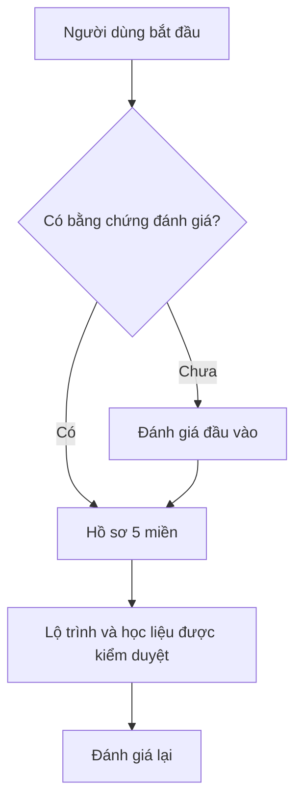

# AGENTS.md — Quy tắc làm việc cho AI Coding Agent của NEXA AI

## 1. Nguyên tắc vận hành của coding agent

1. **Hiểu yêu cầu trước khi thay đổi.** Đọc những file, route, schema, test và luồng hiện có liên quan; kiểm tra implementation thực tế thay vì đoán theo tên component.
2. **Phân biệt REVIEW và TRIỂN KHAI:**
   - Khi được yêu cầu **review/đánh giá**, chỉ phân tích hiện trạng; viết **file Markdown `.md` bằng tiếng Việt**, nêu bằng chứng, đường dẫn mã nguồn, vấn đề và đề xuất thiết kế. Khuyến khích sơ đồ **Mermaid** cho luồng hiện tại và luồng đề xuất. **Không tự biến review thành kế hoạch theo Phase/PR** nếu không được yêu cầu.
   - Khi được yêu cầu **viết/chỉnh sửa code**, thực hiện đúng phạm vi, sửa tối thiểu nhưng hoàn chỉnh, kiểm thử và nêu rõ kết quả.
   - Chỉ lập `tasks/plan.md`, chia Phase, tạo PR, commit, push hoặc sửa GitHub khi có yêu cầu/ủy quyền rõ ràng cho hành động đó. Review không mặc nhiên cho phép triển khai.
3. **Tái sử dụng trước khi tạo mới.** Tìm service, API, schema, component và test hiện có; không nhân bản business logic hoặc thêm dependency chỉ vì thói quen.
4. **Không giả lập thành công.** API lỗi thì báo lỗi; thiếu dữ liệu thì trình bày thiếu dữ liệu. Không tạo số liệu, bài thi, quyền lợi hay giao dịch “mẫu” trên luồng production.
5. **Không tuyên bố đã kiểm chứng nếu chưa chạy.** Phân biệt: đã đọc source, đã chạy test, đã kiểm tra staging và đã xác nhận production. CI xanh không đồng nghĩa an toàn tuyệt đối.
6. **Bảo toàn dữ liệu.** Không chỉnh sửa migration lịch sử đã áp dụng; không xóa dữ liệu hoặc chạy migration production, thay khóa bí mật, thay cấu hình thanh toán thực, deploy/merge khi chưa được cho phép.

---

## 2. Bản chất sản phẩm: ba không gian, một danh tính

**NEXA AI là nền tảng đánh giá và phát triển năng lực số.** Điểm khác biệt là **đánh giá có bằng chứng → phát hiện khoảng trống → gợi ý học tập/đào tạo → thực hành → đánh giá lại**, không phải trang bán khóa học hoặc dashboard thống kê chung chung.

| Phạm vi | Mục đích | Đặc điểm quyền |
| --- | --- | --- |
| **Personal** — `/personal/*` | Người dùng làm bài, theo dõi 5 miền, học tập, chứng chỉ, tạo đề/nhóm/phòng thi trong hạn mức | Tài nguyên thuộc cá nhân và các quyền được cấp cho tài nguyên cụ thể |
| **Organization Business** — `/org/[slug]/*` | Trường học/doanh nghiệp vận hành lớp, thành viên, đợt đánh giá, chấm bài, báo cáo tập thể | Tài nguyên thuộc **một tổ chức cụ thể**; quyền theo membership, vai trò, phân công và hợp đồng |
| **Platform Admin** — `/admin/*` | Chủ sở hữu NEXA điều hành nền tảng, khách hàng Business, gói, tài chính, AI, nội dung, bảo mật | Đặc quyền cấp nền tảng; **không phải** quyền mua được bằng Personal Pro/Business |

- **Một tài khoản đăng nhập** có thể vừa là người học, người tạo đề và thành viên nhiều tổ chức. Chuyển workspace là đổi **ngữ cảnh**, không đổi tài khoản hay loại tài khoản.
- **Không lấy `profiles.role = 'LEARNER' | 'EVALUATOR'` làm mô hình nghiệp vụ đích.** Các enum cũ có thể còn trong database để tương thích; tính năng được quyết định bởi **quyền trên tài nguyên + entitlement + workspace**.
- `ORG_OWNER`, `ORG_ADMIN`, `ASSESSOR`, `REPORT_VIEWER`, `MEMBER` là vai trò **của từng tổ chức**. Không bao giờ đồng nhất `ORG_ADMIN` với Platform Admin.
- Thông tin Personal, Organization A và Organization B phải cách ly. Chỉ chuyển dữ liệu hoặc chia sẻ khi có quy tắc và quyền cụ thể; việc một người tham gia tổ chức không làm tổ chức sở hữu toàn bộ dữ liệu Personal của họ.
- Sidebar có thể khác nhau theo vai trò, nhưng **ẩn nút/ẩn menu không phải kiểm tra phân quyền**.

### 2.1. Chỉ đánh giá **5 miền năng lực số**

- Chỉ có **5 điểm miền** được chấm, tổng hợp, hiển thị Radar, so sánh và dùng xác định lộ trình. Không thiết kế UX đánh giá 21 kỹ năng thành phần.
- Cấu trúc kỹ năng thành phần nếu vẫn có trong DB chỉ là **phân loại/ánh xạ câu hỏi và tương thích dữ liệu nội bộ**, không biến thành điểm hoặc KPI sản phẩm cho người dùng.
- `score: null` = **chưa có bằng chứng hợp lệ**; `score: 0` = **đã có đánh giá hợp lệ với kết quả 0**. Không thay `null` bằng `0`, không vẽ Radar 0% giả.
- **Không gán điểm tổng bài cho cả 5 miền**. Chỉ tính điểm miền từ câu hỏi/bằng chứng được ánh xạ và chấm hợp lệ, kèm số lượng/độ bao phủ khi cần.
- Một lần làm bài, điểm hồ sơ năng lực theo thời gian, XP, xếp hạng và chứng chỉ là **các đại lượng riêng biệt**. Chứng chỉ phải có bản ghi/quy tắc cấp phát hợp lệ; không tự mở khóa vì đủ XP hoặc mua gói.
- Ngưỡng mục tiêu như `70%` là **chính sách NEXA cấu hình**, không tự gán là chuẩn chính thức của DigComp nếu chưa có nguồn xác nhận.
- Bài đánh giá đầu vào phải là bản ghi đã phát hành, có câu hỏi và quyền làm bài thật; **không trả về ID giả** khi DB trống.

### 2.2. Lộ trình và khóa học

- Lộ trình dựa trên **miền còn thiếu bằng chứng hoặc có điểm thấp**, mục tiêu, nội dung học và thời điểm đánh giá lại.
- Có thể kết hợp **học liệu NEXA** với **khóa học bên ngoài đã được tuyển chọn/kiểm duyệt**. NEXA **không phải sàn bán khóa học, không bán hộ và không ưu tiên đề xuất trả phí**.
- AI chỉ được đề xuất **khóa học thực sự tồn tại trong catalog đã duyệt** và URL chính thức. Không bịa tên/link; catalog lỗi hoặc rỗng thì hiển thị trạng thái phù hợp, không tự bật dữ liệu fallback chưa được duyệt.
- Không tuyên bố điểm tăng là do khóa học gây ra nếu chưa có bằng chứng nhân quả. Tiến độ học ngoài NEXA phải phân biệt tự khai báo và dữ liệu xác minh được.

---

## 3. Quy chuẩn giao diện — LIGHT TRẮNG / DARK ĐEN, tránh “AI slop/AI Stop”

> **Định hướng thương hiệu:** giao diện SaaS giáo dục/học thuật hiện đại, tinh gọn, tin cậy. **Light Mode lấy trắng làm nền**, **Dark Mode lấy đen thật làm nền**. Chữ chính phải trung tính, **không dùng màu xanh làm màu chữ mặc định**. Cả ba Dashboard dùng **cùng hệ thống màu**; khác nhau ở thông tin, quyền và workflow, không tạo ba theme riêng. Tuyệt đối tránh giao diện rập khuôn kiểu “AI slop”, watermark “AI Stop”, neon, gradient rực, thẻ kính mờ quá đà hay trang trí vô nghĩa.

### 3.1. Bảng màu chính thức — Light Mode (mặc định)

| Vai trò | HEX | Sử dụng / Tailwind gợi ý |
| --- | --- | --- |
| **Nền trang** | **`#FFFFFF`** | `bg-white`, `bg-background` |
| Nền phụ | `#F8FAFC` | `bg-slate-50` cho bảng, thanh phụ, vùng phân nhóm |
| **Tiêu đề, số liệu quan trọng** | **`#171717`** | `text-neutral-900` |
| **Nội dung chính, nhãn menu** | **`#262626`** | `text-neutral-800` |
| Chữ phụ, metadata | `#64748B` | `text-slate-500`, bảo đảm độ tương phản |
| Viền, đường phân cách | `#E2E8F0` | `border-slate-200` |
| **Xanh thương hiệu mới — Cobalt** | **`#2563EB`** | `bg-blue-600`, `text-blue-600` **chỉ cho link, CTA, trạng thái chọn** |
| Xanh hover / pressed | `#1D4ED8` | `hover:bg-blue-700`, `hover:text-blue-700` |
| Xanh nền chọn nhẹ | `#EFF6FF` | `bg-blue-50` |
| Chữ trên nút xanh | `#FFFFFF` | `text-white` |

**Quy tắc màu chữ:** Không dùng đen tuyệt đối `#000000` cho toàn bộ text vì tương phản quá gắt trên trắng. Chữ chính vẫn là **đen than trung tính** `#171717` hoặc `#262626`, **không phải xanh**. Xanh chỉ là màu nhấn điều hướng/tương tác, không phủ lên heading, số liệu thống kê hay nội dung bảng.

### 3.2. Bảng màu chính thức — Dark Mode (nền đen)

| Vai trò | HEX | Sử dụng / Tailwind gợi ý |
| --- | --- | --- |
| **Nền trang** | **`#000000`** | `dark:bg-black` / token `--background` |
| Nền panel / sidebar | `#0A0A0B` | Dành cho vùng có phân cấp; sidebar có thể đen tuyệt đối |
| Nền card / dropdown | `#111114` | Card nổi trên nền đen nhờ viền, không cần glow |
| Nền hover / chọn nhẹ | `#18181B` | `dark:bg-zinc-900` |
| **Tiêu đề và chữ chính** | **`#F5F5F5`** | `dark:text-neutral-100` |
| Nội dung thường | `#E4E4E7` | `dark:text-zinc-200` |
| Chữ phụ / mô tả | `#A3A3A3` | `dark:text-neutral-400` |
| Viền / phân cách | `#27272A` | `dark:border-zinc-800` |
| **Xanh nhấn sáng (link/icon/focus)** | **`#60A5FA`** | `dark:text-blue-400`, `dark:border-blue-400` khi thích hợp |
| Nút hành động chính | `#2563EB` | `dark:bg-blue-600 dark:text-white`; hover `#1D4ED8` |
| Nền nhấn nhẹ | `#102044` | Dùng rất ít cho selected/notice có ý nghĩa |

**Dark Mode là nền đen thật, không phải nền xanh navy hoặc tím đen.** Vùng phụ chỉ nâng sáng vừa đủ để phân tách lớp, tránh các card xám quá sáng hoặc 10 lớp màu tối khác nhau. Không dùng trắng tinh `#FFFFFF` cho đoạn văn dài trên nền đen; ưu tiên `#F5F5F5` / `#E4E4E7` để dịu mắt. Xanh `#60A5FA` dành cho liên kết và điểm nhấn trên nền tối, **không dùng làm màu toàn bộ chữ chính**.

### 3.3. Quy tắc chuyển Light / Dark

- **Mặc định khi chưa có lựa chọn người dùng: Light Mode (nền trắng)**. Dark Mode chỉ kích hoạt khi người dùng chọn hoặc theo chính sách theme của sản phẩm đã có; không tự đổi toàn bộ UI chỉ vì người dùng có hệ điều hành tối nếu chưa có cơ chế đã xác nhận.
- **Dark Mode phải hỗ trợ đầy đủ** cả Personal, Organization và Platform Admin: sidebar, topbar, card, bảng, modal, tooltip, form, trạng thái loading/empty/error, biểu đồ và trạng thái focus.
- Dùng **token theme** ở `src/app/globals.css` và các biến đã tồn tại (`--background`, `--foreground`, `--card`, `--border`, `--primary`, v.v.). Nếu đang dùng `.dark`/`html.dark`, tiếp tục theo cơ chế đó; ưu tiên sửa token/chỗ tái sử dụng thay vì thêm `dark:` rải rác không kiểm soát.
- Bố cục, khoảng cách, phân cấp nội dung và hành vi phải thống nhất khi đổi theme. **Đổi màu không được thay đổi quyền truy cập, tính toán hay workflow.**
- Kiểm tra tương phản theo **WCAG AA**: chữ thường tối thiểu 4.5:1; thành phần UI/biểu tượng thiết yếu tối thiểu 3:1; có thể phân biệt trạng thái mà không chỉ dựa vào màu sắc. Xanh `#2563EB` trên trắng và xanh `#60A5FA` trên đen phù hợp cho link; nút xanh `#2563EB` dùng chữ trắng.
- Nút tắt/bật theme nếu có phải dễ tìm, đọc được bằng bàn phím và không gây nhấp nháy theme khi tải trang. Không tự cài thư viện theme mới khi cơ chế hiện có đã đáp ứng.

### 3.4. Quy tắc chống thiết kế rập khuôn “AI slop”

- **Cấm mặc định:** gradient màu mè(khi cho phép thì vẫn được), neon/glow, bóng đổ lớn, card kính mờ, hero trang trí chiếm diện tích, icon/emoji vô nghĩa, watermark hoặc nhãn “AI Stop”. Không lạm dụng chuyển động, bộ màu cầu vồng hay trang trí mô phỏng chatbot.
- Nền **không có hoa văn**, trừ khi có lý do sản phẩm rõ. Card nền trắng ở Light / gần đen ở Dark, viền mảnh, bo góc khoảng `6px` (`rounded-md`), shadow rất nhẹ hoặc không shadow.
- **Dùng màu có ngữ nghĩa:** đỏ cho lỗi/nguy hiểm, vàng hổ phách cho cảnh báo, xanh lá cho thành công; các màu trạng thái này là ngoại lệ có kiểm soát, không biến thành màu branding hoặc biến mỗi miền năng lực thành một màu cầu vồng.
- `lucide-react` là thư viện icon chuẩn (`strokeWidth={1.75}` khi phù hợp); **không dùng emoji làm icon sản phẩm trong JSX**. Font sans hiện có cho văn bản; `font-mono tabular-nums` khi hiển thị ID, PIN, mã tham gia, thời gian, tiền/số liệu cần căn chữ số.
- Mỗi trang cần **một hành động chính rõ ràng** và trạng thái loading/empty/error/permission denied/success tương ứng. Không tạo dashboard có nhiều thẻ đẹp nhưng thiếu việc để làm.
- Hỗ trợ responsive, focus rõ, điều hướng bàn phím, nhãn input, kích thước vùng bấm và độ tương phản đủ tốt. Không dùng màu nhạt để che nội dung quan trọng.
- **Không dựng số liệu giả** (`0`, `100%`, “đã kích hoạt”, “đã duyệt”, v.v.) khi query lỗi; phân biệt rõ không có dữ liệu, chưa được đánh giá và lỗi tải dữ liệu.

### 3.5. Trọng tâm thiết kế của mỗi Dashboard

- **Personal:** ưu tiên việc tiếp theo, đánh giá → 5 miền → lộ trình → thực hành → đánh giá lại; giảm lạm dụng leaderboard/XP.
- **Organization:** ưu tiên thành viên, lớp, **Đợt đánh giá**, công việc chấm, tiến độ và báo cáo tập thể có bằng chứng.
- **Platform Admin:** ưu tiên hàng đợi Business, giao dịch đối soát, trạng thái AI/dịch vụ, chất lượng nội dung và kiểm toán; không chỉ là trang đếm tổng.
- Chỉ hiển thị CTA và dữ liệu theo **đúng quyền**; không tự đưa người dùng sang workspace khác khi đang thao tác tài nguyên tổ chức.

---

## 4. Quy trình nghiệp vụ không được phá vỡ

### 4.1. Personal

```text
Đăng nhập → Đánh giá đầu vào có thật → Hồ sơ 5 miền → Xác định miền ưu tiên
→ Lộ trình/học liệu/khóa kiểm duyệt → Thực hành → Đánh giá lại → Theo dõi tiến bộ
```

- Người dùng có thể tự tạo đề, nhóm và phòng thi theo quyền/hạn mức; thao tác quản lý đề cá nhân **không gọi API chỉ dành cho `/api/admin/**`**.
- Bàn chấm bài mở theo **bài nộp/đề/lớp được phép**, không phải ai cũng xem được mọi bài; không tự phát hành kết quả nháp.
- Gói Personal dùng checkout và quyền lợi **cá nhân**, không mang quyền Business hoặc Platform Admin.

### 4.2. Organization **chỉ theo mô hình Business được duyệt**

```text
Khách hàng liên hệ NEXA → Tư vấn/báo giá/hợp đồng → Platform Admin phê duyệt
→ Cấp organization + entitlement có hiệu lực → Mời chủ tổ chức → Kích hoạt sử dụng
→ Mời thành viên/lớp → Đợt đánh giá → Chấm & duyệt → Báo cáo 5 miền
```

- **Không cho người đăng ký thông thường tự tạo một Organization Business ACTIVE** hoặc trả tiền ở checkout Personal để tự kích hoạt Business.
- Thiếu/hết hạn entitlement, chưa duyệt, bị tạm ngưng: **fail-closed**, không trả 50 ghế/1.000 credits/hợp đồng một năm giả.
- Thành viên có thể tham gia qua **link/mã**, lời mời email hoặc **CSV/Excel hàng loạt**. Link có hạn, có thu hồi, chống đoán/thử mã, kiểm tra số ghế; không tự cấp `ORG_ADMIN/ORG_OWNER`.
- Link mời thực tế phải dẫn đúng route có triển khai; bộ đếm mã tham gia chỉ tính **một lần** theo định nghĩa thống nhất và chống race condition.
- **Assessment Campaign** là trung tâm: đề đã duyệt, danh sách lớp, lịch thi, người chấm, bài nộp, duyệt điểm, báo cáo theo đợt. Trạng thái chuẩn phải nhất quán giữa DB, API, UI.
- Dữ liệu từng lớp/đợt chỉ hiển thị cho người có quyền trên **chính lớp/đợt đó**, không phải mọi thành viên cùng tổ chức.
- Quota AI, số ghế, đề, hợp đồng là **quyền lợi của tổ chức**; không tự tăng gói Personal của thành viên.

### 4.3. Platform Admin

- Quản lý **Business Inquiry → báo giá → phê duyệt → entitlement → kích hoạt/gia hạn/tạm ngưng**; các bước nhạy cảm phải atomic hoặc có state machine/khôi phục rõ ràng.
- Quản lý gói và quyền lợi đúng hiệu lực, xử lý thanh toán, chứng từ và audit; có khả năng phân biệt dữ liệu thực tế với ước tính.
- Quản lý kiểm duyệt đề/học liệu, version khung năng lực và đề đã phát hành; không sửa ngược lịch sử kết quả khảo thí.
- **Chỉ Platform Admin** được biết và cấu hình tên model, nhà cung cấp, API key, routing, giá thành, latency kỹ thuật. **Personal/Organization không được hiển thị hoặc nhận metadata model/provider/secret từ API công khai**, kể cả JSON phản hồi có thể đọc qua DevTools.
- Không tạo màn hình cấu hình có nút “Lưu” khi backend không lưu bền vững hoặc không thực thi cấu hình đó. Secrets không ghi vào repo/file JSON theo cách có thể lộ hoặc mất sau restart/deploy.

---

## 5. Bảo mật, phân quyền và toàn vẹn dữ liệu — không được thỏa hiệp

1. **Xác thực và phân quyền phía server** cho mọi route, API, RPC, chức năng chấm/duyệt, dữ liệu nhạy cảm. Kiểm tra đồng thời: tài khoản, trạng thái tổ chức, membership, vai trò, quyền sở hữu hoặc phân công trên tài nguyên, entitlement và quota.
2. **`createAdminClient()`/service-role bỏ qua RLS:** chỉ sử dụng khi cần thiết **sau khi đã kiểm tra quyền**, không dùng trực tiếp dữ liệu `orgId`, `slug`, `userId` do client gửi để đọc tenant khác.
3. **RLS Supabase** dùng chính sách quyền tối thiểu; kiểm tra cả `USING`/`WITH CHECK`, quyền `GRANT`, `SECURITY DEFINER`, `search_path`, `auth.uid()` và JWT role. Không dựa vào `current_user` bên trong hàm definer như căn cứ xác định người dùng cuối.
4. **Không tin input của client.** Kiểm tra bằng Zod ở API; định danh UUID, status, điểm, số tiền, quyền, `assessmentId`, `classId`, `submissionId` phải đối chiếu nguồn dữ liệu thật và đúng workspace.
5. **Thao tác nhiều bước phải nguyên tử hoặc có xử lý bù trừ đầy đủ:** phê duyệt Business, tạo Campaign/giao bài, chấm/phê duyệt, nộp bài, cấp quyền, thanh toán/credits. Xóa một bản ghi sau lỗi **không tự động là transaction**.
6. **Trạng thái bài thi là state machine:** chặn nộp lại bài đã chốt, sửa điểm không đúng quyền, thao tác lặp/cạnh tranh. Đáp án và dữ liệu đề khóa phải được bảo vệ, không lộ sang client trước khi cho phép.
7. **AI chỉ chấm gợi ý theo yêu cầu.** Chấm câu hỏi khách quan bằng logic xác định; tự luận/minh chứng phải theo rubric hợp lệ. `AI_DRAFT` không trở thành điểm chính thức trước khi người có quyền phê duyệt. Điểm từng tiêu chí và tổng điểm không vượt giới hạn rubric; AI confidence chỉ là tín hiệu hỗ trợ, không phải xác suất đã hiệu chuẩn.
8. **XP, năng lực, chứng chỉ và AI credits có ledger/trạng thái riêng.** Mọi cộng/trừ/cấp quyền bảo đảm idempotency và audit. Không báo thành công nếu lưu hoặc trừ credits thất bại.
9. **Thanh toán Personal bằng payOS:** xác minh webhook/chữ ký, số tiền, đơn, provider reference, idempotency trước khi cấp entitlement. Cổng lỗi thì **fail-closed**, tuyệt đối không tạo fallback QR tài khoản ngân hàng hardcoded.
10. **Thông tin cá nhân:** giảm dữ liệu gửi AI; phân quyền đọc email/điểm/bài nộp; không log token, khóa, mật khẩu, chứng từ nhạy cảm. Log hành vi quản trị quan trọng phải truy vết được người thực hiện và thời điểm.
11. **Không sửa/sử dụng dữ liệu giả để che lỗi.** `null` khác `0`; `undefined` khác “đã thành công”; request lỗi không được biến thành mảng rỗng hợp lệ.

---

## 6. AI Gateway: cách dùng và quyền kiểm soát

- AI **on-demand**: chỉ gọi khi người dùng bấm tác vụ rõ ràng và đã có entitlement/credits hợp lệ. **Không tự động gọi AI khi nộp bài**, mở dashboard hoặc tải Radar.
- Tác vụ chấm AI và phân tích năng lực có kiểm tra quyền **trên chính bài nộp/tổ chức**; không cho truy cập bài của người khác chỉ vì tài khoản có role tương thích cũ.
- SDK/model chỉ được gọi từ adapter/gateway trung tâm tại `src/features/ai-gateway/`; nơi khác gọi qua interface/service đã chuẩn hóa.
- **Chỉ quảng bá provider/model thực sự có adapter hoạt động**. Không đưa provider chưa hỗ trợ vào dropdown rồi âm thầm gọi model khác.
- Kết quả AI cần được xác thực schema, kiểm tra điểm/rubric/evidence ở backend, xử lý prompt injection từ nội dung người dùng và lưu nguồn dữ liệu hợp lệ.
- Không tự suy luận nội dung khóa học/URL không có trong catalog đã duyệt. Thiếu dữ liệu phải nói rõ.
- Quota/credits theo chủ thể sử dụng (**Personal** hoặc **Organization**) và phải trừ bằng cơ chế nguyên tử. Log usage, chi phí ước tính và thực tế rõ ràng; không gọi 100 sự kiện gần nhất là “tổng toàn hệ thống”.
- Admin được thấy tên model/provider, routing và chi phí; Personal/Org chỉ thấy **tên chức năng, trạng thái phục vụ, giới hạn và kết quả được phép**.

---

## 7. Quy ước kỹ thuật theo repository hiện tại

- Stack chính: **Next.js 15 (App Router), React 19, TypeScript, Tailwind CSS 4, Supabase/Postgres RLS, Zod, Vitest, lucide-react, payOS**. AI hiện có `GeminiAdapter`; đừng giả định các provider khác đã hoàn thiện.
- Giữ cách chia `src/app/`, `src/components/`, `src/features/`, `src/lib/`, `src/database/migrations/` hiện có. Business logic nên nằm tại service/feature thích hợp; route handler mỏng, có auth, validation, error handling.
- **Không bắt buộc React Query, Zustand, Formik, React Hook Form hoặc font chưa cài.** Chỉ thêm thư viện khi thật sự cần và đã có lý do rõ ràng. Ưu tiên dùng khả năng có sẵn của React/Next.js và codebase.
- Ưu tiên TypeScript strict, kiểu dữ liệu rõ ràng; tránh `any` mới, sử dụng `unknown` + kiểm tra cấu trúc ở ranh giới dữ liệu. Không dùng `@ts-ignore` để che lỗi.
- Component có trách nhiệm rõ ràng; tách component/hook/service khi trang quá dài hoặc trộn UI với truy vấn, không áp đặt giới hạn dòng cứng gây chia file vô nghĩa.
- Trạng thái data-fetch và form phải thật: loading, empty, error, success, disabled, retry; kiểm `response.ok` và lỗi DB trước khi thông báo thành công. Không dùng `alert/confirm` trình duyệt cho luồng nghiệp vụ phức tạp khi đã có dialog/toast nhất quán.
- Không tạo SEO/animation/chart mới chỉ để trang trông đầy; mọi KPI cần định nghĩa nguồn, bộ lọc, phạm vi thời gian, trạng thái dữ liệu.
- Schema thay đổi theo migration **mới, forward-only**; không tự sửa migration đã chạy. Với RLS, luôn kiểm thử cả quyền đọc và ghi qua người dùng thực, không chỉ service-role.
- Trước khi kết luận hoàn thành, kiểm tra `package.json` và chạy những lệnh phù hợp như `npm run typecheck`, `npm run test`, `npm run build` và lệnh lint đang khả dụng. Nếu script hiện tại lỗi do cấu hình/công cụ, báo rõ thay vì tuyên bố đã pass.

---

## 8. Định dạng trả lời bắt buộc khi được yêu cầu REVIEW

**Xuất file `.md` bằng tiếng Việt** (không chỉ trả lời chat). Nội dung ưu tiên đánh giá thực tế, không biến thành kế hoạch triển khai khi chưa được yêu cầu:

1. **Thông tin phiên bản:** branch, commit SHA, phạm vi đọc, có/không có thử nghiệm thực tế.
2. **Nhận định sản phẩm và giao diện:** UX hiện tại, điều gì ổn, điều gì bất hợp lý, mỗi trang có vai trò gì.
3. **Sơ đồ luồng hiện tại bằng Mermaid** cho Personal/Organization/Admin hoặc luồng đang được yêu cầu; phân biệt **đã xác nhận từ source** với luồng suy luận.
4. **Phát hiện có bằng chứng:** lỗi/điểm nghẽn, mức độ nghiêm trọng P0/P1/P2 khi cần, file:line/link, nguyên nhân, ảnh hưởng với người dùng; không bịa dòng code.
5. **Sơ đồ luồng nên có bằng Mermaid**, giải thích vì sao tốt hơn, ai có quyền, trạng thái nào thay đổi và dữ liệu đi đâu.
6. **Đề xuất cải thiện cụ thể**, gồm hành vi UX, ranh giới API/RLS, trạng thái dữ liệu; không viết PR/Phase mặc định.
7. **Kịch bản kiểm chứng** cả happy path, lỗi, không đủ quyền, thiếu dữ liệu, đa tổ chức, thao tác trùng.
8. **Giới hạn kiểm tra và kết luận**: có gì chưa được chạy/chưa kiểm chứng, không tự xác nhận đã triển khai.

Ví dụ sơ đồ sử dụng cú pháp Mermaid chuẩn:



---

## 9. Kiểm tra cuối cùng trước khi giao kết quả

- [ ] **Light:** nền `#FFFFFF`, chữ chính `#171717` / `#262626`. **Dark:** nền `#000000`, chữ chính `#F5F5F5`. Xanh Cobalt `#2563EB`, link Dark `#60A5FA` **chỉ làm điểm nhấn**; không AI slop, không “AI Stop”/watermark.
- [ ] Đúng ngữ cảnh **Personal / Organization / Platform Admin**, chuyển workspace không làm lẫn dữ liệu/quyền.
- [ ] Radar và báo cáo **đúng 5 miền**, không 21 chỉ tiêu; `null` khác 0; không tạo điểm miền suy diễn.
- [ ] Business chỉ **liên hệ → Admin duyệt → entitlement → kích hoạt**; không có quota hoặc tổ chức ACTIVE giả.
- [ ] Các API/service-role đã kiểm **quyền trên tài nguyên và tenant**.
- [ ] Đợt đánh giá, nộp bài, chấm bài, payOS và credits có chống thao tác trùng/sai trạng thái.
- [ ] AI on-demand; model/provider chỉ hiện ở **Platform Admin**; khóa bí mật không lộ.
- [ ] Không dùng số liệu/khóa học/bài baseline giả hoặc che lỗi bằng số 0/trạng thái thành công.
- [ ] Có kết quả kiểm thử thực tế và nêu trung thực phần chưa kiểm chứng.
- [ ] Nếu yêu cầu là **review**: đã xuất **Markdown tiếng Việt + sơ đồ luồng khi hữu ích**, không tự code/commit/PR.

**Quy tắc ưu tiên cuối:** đúng nghiệp vụ và dữ liệu → an toàn đa tổ chức → quy trình liền mạch → trải nghiệm dễ hiểu → giao diện Light trắng / Dark đen tinh gọn. Không đánh đổi bốn yếu tố đầu để làm một dashboard “trông giống sản phẩm AI”.
