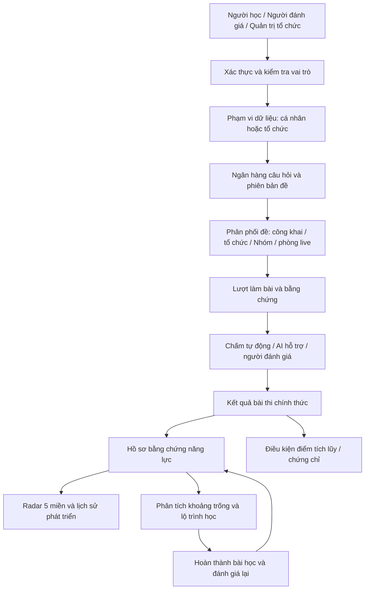
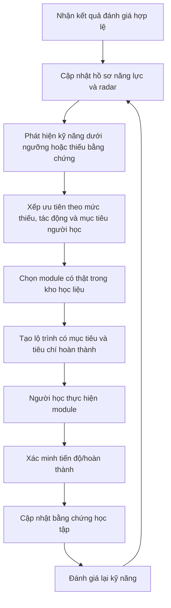
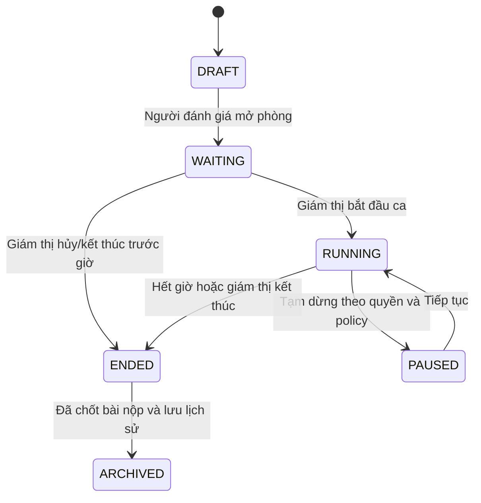
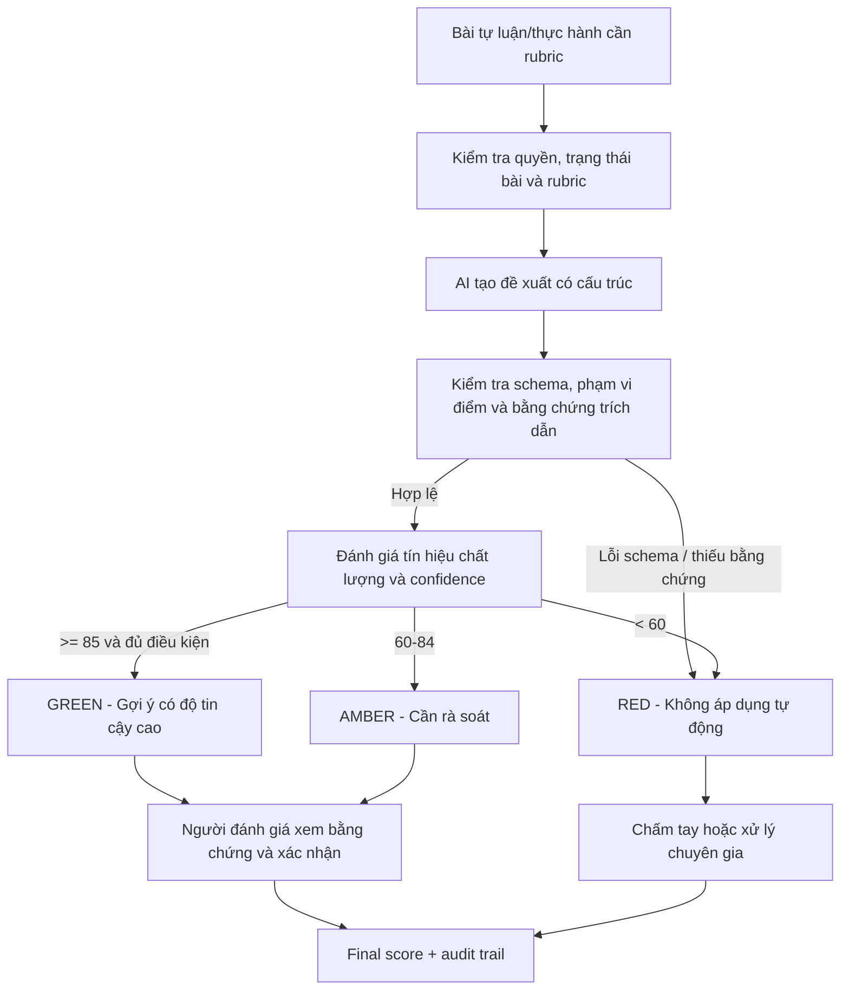

# REVIEW TỔNG THỂ DỰ ÁN NEXA AI

**Tài liệu:** Review sản phẩm, nghiệp vụ, kiến trúc, dữ liệu, AI, khảo thí và vận hành  
**Phiên bản review:** 1.0  
**Ngày review:** 24/10/2026  
**Repository:** <https://github.com/minhhuyzzz/nexa_AI>  
**Nhánh tham chiếu:** `main`  
**Mục tiêu:** Làm tài liệu nền để thống nhất quyết định sản phẩm, giao việc cho AI Coding Agent và nghiệm thu theo nghiệp vụ thực tế.

> **Quy ước đọc tài liệu**  
>
> - **Hiện trạng đã quan sát:** Có căn cứ từ cấu trúc repo, mã nguồn hoặc migration đã đọc. Không đồng nghĩa đã chạy kiểm thử trên Supabase đang triển khai.  
> - **Rủi ro:** Hành vi có thể sai, thiếu hoặc không an toàn theo mã hiện có; cần kiểm chứng trên môi trường thật trước khi khẳng định mức độ ảnh hưởng.  
> - **Đề xuất:** Thiết kế mục tiêu nên triển khai. Đây không phải mô tả tính năng hiện đã có.

---

## 1. Kết luận điều hành

NEXA đang có nền tảng tương đối rõ: Next.js App Router, TypeScript, Supabase, các phân hệ Người học/Người đánh giá/Admin, bộ biên tập đề dùng chung, cổng AI, phân tích năng lực, chứng chỉ và phòng thi bằng PIN. Vấn đề lớn nhất không nằm ở số lượng trang mà ở **ranh giới quyền hạn, tính toàn vẹn của dữ liệu và các luồng xuyên suốt giữa các vai trò**.

Một số tính năng có giao diện nhưng chưa có cơ chế nghiệp vụ tương ứng hoặc chưa hoàn chỉnh. Ví dụ: gói dịch vụ cập nhật trong state giao diện; nâng cấp gói được mô phỏng bằng `setTimeout`; duyệt đề cộng đồng lưu trong `localStorage`; khóa phòng live hiện mới đổi state phía trình duyệt; dữ liệu token AI có cột trong schema nhưng chưa thấy được ghi đầy đủ ở luồng chấm AI.

### 1.1. Các việc phải ưu tiên

| Mức | Việc | Lý do |
| --- | --- | --- |
| **P0** | Siết API/RLS, quyền sở hữu đề và quyền tổ chức | Tránh người dùng truy cập hoặc chỉnh sửa dữ liệu ngoài phạm vi |
| **P0** | Bảo vệ đáp án đúng và đề VIP ở máy chủ | Không thể bảo vệ nội dung chỉ bằng cách ẩn nút ở giao diện |
| **P0** | Khóa quyền ghi trực tiếp vào điểm, gói dịch vụ và tiến độ học | Tránh tự tăng điểm, tự cấp credits hoặc tự ghi nhận hoàn thành |
| **P1** | Tách ngân hàng câu hỏi khỏi câu hỏi thuộc từng đề | Cho phép tái sử dụng, quản lý phiên bản và kiểm định chất lượng |
| **P1** | Xây dựng luồng tổ chức, lời mời và phân quyền thành viên | Đưa mô hình B2B từ bảng dữ liệu sang sản phẩm vận hành được |
| **P1** | Chuẩn hóa điểm bài thi, điểm tích lũy và điều kiện chứng chỉ | Tránh sai lệch điểm, buff điểm và cấp chứng chỉ không đúng điều kiện |
| **P1** | Hoàn thiện phòng live và nhật ký giám sát | Hiện chưa thể coi tất cả lựa chọn giám sát là cơ chế đã cưỡng chế ở máy chủ |
| **P1** | Ghi nhận sử dụng AI và chi phí thực tế | Không thể quản trị quota hoặc lợi nhuận nếu số liệu token không đầy đủ |
| **P2** | Xây dựng Admin Analytics và cải tiến UI | Nên làm khi định nghĩa dữ liệu, quyền và KPI đã thống nhất |

### 1.2. Nguyên tắc sản phẩm cốt lõi

1. **Giao diện không phải bằng chứng về nghiệp vụ.** Mọi nút quan trọng phải nối với API, kiểm tra quyền ở máy chủ, lưu dữ liệu bền vững và có trạng thái lỗi rõ ràng.
2. **Dùng chung công cụ không đồng nghĩa dùng chung quyền.** Admin và Người đánh giá có thể dùng chung `AssessmentStudio`, nhưng không được dùng chung quyền phát hành, quyền quản lý kho chuẩn hoặc quyền cộng điểm.
3. **Điểm bài thi, điểm năng lực và điểm tích lũy là ba dữ liệu khác nhau.** Không được dùng chung một cột `points` để biểu diễn cả ba.
4. **Radar năng lực là hồ sơ phát triển theo thời gian.** Mỗi lần đánh giá là một bằng chứng mới, không phải một hồ sơ năng lực hoàn toàn độc lập.
5. **AI là công cụ hỗ trợ có kiểm soát.** AI có thể phân tích, gợi ý và chấm sơ bộ; kết quả có ảnh hưởng đến chứng chỉ phải tuân theo quy trình đánh giá được phê duyệt.
6. **Cờ Tin cậy của AI khác với cờ rủi ro gian lận.** Không dùng một nhãn `GREEN/AMBER/RED` cho cả độ tin cậy chấm điểm và hành vi đáng ngờ của thí sinh.
7. **Không tuyên bố cấm chụp màn hình tuyệt đối trên web thông thường.** Trình duyệt không thể ngăn chắc chắn việc chụp bằng hệ điều hành hoặc thiết bị khác.

---

## 2. Phạm vi và cách đọc hiện trạng

Review này dựa trên mã nguồn và các migration đã có trong repository `main`, tập trung vào:

- Ba dashboard: Người học (`learner`), Người đánh giá (`evaluator`) và Admin (`admin`).
- Xác thực, phân quyền, mô hình tổ chức và phạm vi dữ liệu.
- Ngân hàng câu hỏi, biên soạn đề, duyệt và phát hành đề.
- AI Gateway, chấm Rubric, phân tích năng lực, radar năm miền và lộ trình học.
- Cơ chế điểm tích lũy, credits và điều kiện cấp chứng chỉ.
- Bài thi truy cập thông thường và phòng thi trực tiếp PIN/QR.
- Giám sát, cờ Tin cậy, Analytics, thanh toán và chi phí AI.

**Giới hạn:** Tôi chưa thực thi kiểm thử end-to-end trên cơ sở dữ liệu Supabase production và chưa đối chiếu các thay đổi thủ công bên ngoài repo. Một số trường có thể đã được thêm trực tiếp trên môi trường thật nhưng chưa được phản ánh trong migration; đây cũng chính là một rủi ro phải xử lý. Những phát hiện về bảo mật cần được xác nhận bằng kiểm thử thực tế trước khi kết luận có khai thác được hay không.

---

## 3. Hiện trạng repo đã quan sát

### 3.1. Những phần đã có nền tảng

- Ba route dashboard riêng biệt trong `src/app/(dashboard)/learner`, `evaluator`, `admin`.
- Bộ giao diện dùng chung `src/features/assessments/components/AssessmentStudio.tsx` cho Admin và Người đánh giá.
- Các bảng nền tảng trong migrations: `profiles`, `organizations`, `user_organizations`, `assessments`, `assessment_items`, `item_options`, `assessment_submissions`, `submission_answers`, `rubrics`, `ai_evaluations`, `competency_analyses`, `learning_modules`, `user_learning_progress`, `credentials`, `exam_rooms`, `room_participants`, nhóm và cộng tác nhóm.
- Adapter AI Gemini, interface của nhà cung cấp AI, kiểm tra cấu trúc đầu ra bằng Zod và `PIIScrubberService`.
- API nộp bài, chấm Rubric bằng AI, phân tích năng lực, xuất dữ liệu, cấp PDF chứng chỉ, tham gia phòng live và xem trạng thái phòng.
- Bộ kiểm thử đơn vị cho một số chức năng như AI config, PII scrubber, import đề, scoring/radar và certificate generator.

### 3.2. Các điểm không nên coi là đã hoàn thiện

| Thành phần | Quan sát trong repo | Hệ quả |
| --- | --- | --- |
| Gói dịch vụ Admin | `admin/plans/page.tsx` giữ `defaultPlans` và cập nhật bằng `setPlans` | Thay đổi có thể chỉ tồn tại trong state phía giao diện |
| Nâng cấp Người đánh giá | `evaluator/billing/page.tsx` mô phỏng xác nhận bằng `setTimeout` | Chưa phải quy trình thanh toán thật |
| Duyệt đề cộng đồng | `admin/contributions/page.tsx` và `learner/contribute/page.tsx` dùng `localStorage` | Trạng thái duyệt chưa phải dữ liệu tập trung trên máy chủ |
| Tổ chức | Có bảng và trang quản lý tổ chức; API tạo bản ghi `organizations` | Chưa thấy luồng hoàn chỉnh tạo lời mời, gắn người quản trị đầu tiên và quản lý thành viên xuyên suốt |
| Ngân hàng câu hỏi | Trang `evaluator/item-bank` thao tác trực tiếp với `assessment_items` | Mô hình câu hỏi chưa tách khỏi đề; các thao tác insert có thể không đáp ứng schema bắt buộc |
| AI usage | `ai_evaluations` có `prompt_tokens` và `completion_tokens`, nhưng luồng chấm không truyền các trường này khi ghi kết quả | Không đủ cơ sở để tính lượng token/chi phí thực từ bảng này |
| Phòng live | Trang điều phối và phòng chờ poll API theo chu kỳ | Có cập nhật gần thời gian thực, nhưng không phải toàn bộ luồng đã dùng sự kiện real-time |
| Khóa phòng | `isLocked` trong `live/control/page.tsx` chỉ đổi state phía client | API tham gia phòng chưa dựa vào trạng thái khóa đó |
| Chế độ nhóm | Schema có `room_mode` và `organization_id` | API tham gia cần cưỡng chế quyền nhóm/tổ chức ở máy chủ; chỉ lưu lựa chọn mode là chưa đủ |
| Analytics Admin | Chưa thấy route Admin Analytics riêng trong cây route | Cần xây dựng module riêng thay vì chỉ mở rộng KPI trang tổng quan |

### 3.3. Rủi ro kỹ thuật và bảo mật cần rà soát

1. **RLS đề thi rộng hơn phạm vi chủ sở hữu.** Migration `02_assessment_mcq_schema.sql` cho phép `EVALUATOR` và `ADMIN` quản lý bản ghi `assessments` theo vai trò, chưa thể hiện đầy đủ ràng buộc đề thuộc người tạo hoặc tổ chức.
2. **Rủi ro lộ đáp án.** Chính sách đọc bảng `item_options` trong migration cho phép đọc phương án của đề đã công khai, trong khi bảng có `is_correct`. API bài thi chi tiết có bỏ trường này, nhưng việc truy cập trực tiếp bảng vẫn cần kiểm thử và khóa lại.
3. **RLS hồ sơ người dùng rộng.** Chính sách `profiles` cho phép người dùng đã xác thực xem nhiều hồ sơ. Cần rà soát trường email, dữ liệu nhạy cảm và nguyên tắc tối thiểu quyền.
4. **Các API quản trị đề dựa nhiều vào RLS.** Endpoint thuộc `/api/admin/assessments` cần xác minh vai trò Admin rõ ràng; endpoint phục vụ Người đánh giá phải có logic riêng giới hạn quyền sở hữu/phạm vi, không lấy API Admin làm đường ghi chung.
5. **Schema drift.** Một số trường được mã nguồn truy cập như `is_vip`, `access_tier`, `rubric_guide` hoặc thuộc tính đa năng lực chưa thấy được định nghĩa trong bộ migration hiện tại đã xem. Nếu tồn tại ngoài repo, phải đưa chúng trở lại migration có version.
6. **Điểm và tiến độ ghi theo nhiều bước.** Một số luồng đọc số điểm hiện tại rồi ghi tổng mới; cách này dễ gặp race condition khi có request đồng thời. Các khoản thưởng cần được ghi nguyên tử và idempotent.
7. **API chấm AI chưa thể hiện kiểm tra phạm vi bài nộp ngay trong route.** `grade-submission/route.ts` xác thực tài khoản và quota, sau đó truy vấn `submission_answers` theo `submissionId`/`itemId`; trong phần xử lý đã đọc chưa thấy bước xác nhận submission thuộc người học đang gọi hoặc thuộc nhóm/ca thi mà Evaluator được phân công. Do RLS cho Evaluator/Admin có thể đọc rộng, không nên dựa vào RLS hiện tại để thay thế kiểm tra quyền nghiệp vụ tại endpoint. Đây là điểm P0 cần kiểm thử và sửa.
8. **Điều kiện cấp chứng chỉ dùng phép AND có thể tạo đường đi không nhất quán.** `credentials/generate/route.ts` từ chối khi `!submission.is_passed && percentage < passingScore`. Như vậy request không bị từ chối nếu một trong hai giá trị cho thấy đã đạt, kể cả khi giá trị còn lại mâu thuẫn. Cần dùng một điều kiện cuối cùng đã được chốt ở service finalization, đồng thời kiểm tra trạng thái bài nộp và quyền của người yêu cầu.
9. **Tín hiệu demo/mô phỏng trong một số màn hình.** Cần rà soát các fallback tạo điểm AI giả, số liệu tĩnh và thông báo “thành công” không dựa trên dữ liệu đã xác nhận. Không được dùng số demo trên môi trường production.

---

## 4. Mô hình vai trò và không gian làm việc

### 4.1. Giữ ba dashboard

Không cần tạo dashboard thứ tư chỉ dành cho tổ chức. NEXA nên giữ ba loại dashboard chính:

- **Người học:** Tự đánh giá, làm đề được cấp quyền, xem kết quả, radar dài hạn, học theo lộ trình và quản lý chứng chỉ.
- **Người đánh giá:** Soạn đề trong phạm vi quyền, quản lý nhóm/lớp, mở ca thi, chấm bài, dùng AI hỗ trợ và xem báo cáo.
- **Admin nền tảng:** Quản trị người dùng, nội dung chuẩn, tổ chức, chính sách AI, gói dịch vụ, tài chính, an toàn và vận hành toàn hệ thống.

### 4.2. Tổ chức là một phạm vi làm việc, không phải vai trò hệ thống thứ tư

Một tài khoản Người đánh giá có thể hoạt động độc lập hoặc là thành viên của một hay nhiều tổ chức. Trong dashboard Người đánh giá cần có **bộ chuyển không gian làm việc**:

- `Không gian cá nhân` — các đề, nhóm và ca thi do người đánh giá quản lý độc lập.
- `Tổ chức A` — chỉ tài nguyên thuộc tổ chức A theo quyền được cấp.
- `Tổ chức B` — chỉ tài nguyên thuộc tổ chức B theo quyền được cấp.

Mọi API lấy đề, nhóm, bài nộp, báo cáo, phòng thi và quota phải nhận diện được `created_by`, `organization_id` hoặc membership tương ứng. Không được chỉ lọc bằng giao diện.

### 4.3. Vai trò được đề xuất trong tổ chức

| Vai trò | Quyền điển hình |
| --- | --- |
| `ORG_OWNER` | Chủ hợp đồng, quản trị cấu hình và thành viên; chỉ một số thao tác nhạy cảm có thể bị giới hạn theo hợp đồng |
| `ORG_ADMIN` | Quản lý người dùng, nhóm, phân công, hạn mức trong phạm vi tổ chức |
| `ORG_EVALUATOR` | Soạn/giao đề và chấm bài theo nhóm được phân công |
| `ORG_VIEWER` | Chỉ xem báo cáo được cấp quyền |
| `LEARNER` | Làm bài, xem hồ sơ cá nhân; không có quyền điều hành tổ chức |

Có thể ánh xạ các vai trò này vào bảng membership hiện có, nhưng phải chốt chính sách trước khi sửa enum/schema. Không tự động biến người đánh giá thành `ORG_ADMIN` chỉ vì được mời vào tổ chức.

### 4.4. Luồng gia nhập tổ chức

1. Đơn vị đăng ký yêu cầu sử dụng NEXA hoặc Admin tạo hồ sơ tổ chức theo hợp đồng.
2. Admin xác nhận thông tin, gói, ngày hiệu lực, số lượng tài khoản và quota AI.
3. Tổ chức chỉ định quản trị viên đầu tiên.
4. Quản trị viên tổ chức mời người dùng qua email hoặc liên kết mời có thời hạn, một lần sử dụng.
5. Người được mời đăng nhập hoặc đăng ký tài khoản cá nhân, chấp nhận lời mời, sau đó được thêm vào `user_organizations`.
6. Người dùng mở dashboard Người đánh giá và chọn không gian tổ chức. Người học được tổ chức giao bài có thể tiếp tục dùng dashboard Người học.
7. Khi thành viên bị thu hồi quyền, mọi API phải từ chối truy cập tài nguyên tổ chức ngay lập tức; dữ liệu lịch sử vẫn giữ để kiểm toán.

SSO/SAML/OIDC có thể triển khai sau khi quy trình membership, RBAC và tenant isolation ổn định. Không cần bắt buộc SSO để có phiên bản B2B đầu tiên.

---

## 5. Kiến trúc nghiệp vụ tổng thể

### 5.1. Luồng nền tảng

### 5.2. Luồng phải có một nguồn sự thật

- Điểm bài thi chính thức phải đến từ bộ chấm điểm máy chủ hoặc kết quả chấm đã được người có quyền xác nhận.
- Kết quả AI là bản đề xuất có nguồn, phiên bản model và trạng thái phê duyệt; không tự thay thế kết quả chính thức khi chưa qua chính sách.
- Radar tổng hợp từ các bằng chứng đánh giá hợp lệ; không lấy văn bản do AI tự viết làm điểm đầu vào.
- Điểm tích lũy đến từ ledger bất biến và sự kiện đủ điều kiện; không cho phép người dùng, Người đánh giá hoặc UI ghi trực tiếp số dư.
- Chứng chỉ được cấp qua một dịch vụ xác minh điều kiện thống nhất; không để nhiều endpoint tự tính điều kiện theo công thức khác nhau.
- Giao dịch thương mại chỉ cấp quyền khi webhook/đối soát phía máy chủ xác nhận thành công.

---

## 6. Admin Control Plane: quản trị toàn hệ thống

### 6.1. Thanh điều hướng đề xuất (có thể thiết kế menu con trong một số mục lớn)

| Nhóm | Trang/module nên có |
| --- | --- |
| Điều hành | Tổng quan, Analytics toàn nền tảng, Trạng thái dịch vụ, Hàng đợi sự cố |
| Danh tính & tổ chức | Người dùng, Người đánh giá, Tổ chức, Thành viên/lời mời, Hạn mức và hợp đồng |
| Nội dung chuẩn | Khung năng lực, Ngân hàng câu hỏi chuẩn, Đề thi hệ thống, Học liệu, Duyệt đề cộng đồng |
| Khảo thí | Phòng live đang diễn ra, Lịch sử ca thi, Bài nộp/kết quả, Chứng chỉ và thu hồi |
| Kinh doanh | Gói dịch vụ, Đơn hàng, Giao dịch, Đăng ký/gia hạn, Hoàn tiền, Đối soát |
| AI Gateway | Nhà cung cấp/model, Bật/tắt luồng, quota, token, chi phí, lỗi và độ trễ |
| Quản trị | Audit log, Chính sách truy cập, Đồng thuận/quyền riêng tư, Cấu hình hệ thống |

Đây là cấu trúc mục tiêu; không phải tất cả module đều cần tạo đồng loạt. Chỉ đưa một module lên navigation khi nó có nghiệp vụ thực và dữ liệu thật.

### 6.2. Dashboard Admin

Trang tổng quan nên trả lời bốn câu hỏi:

1. **Nền tảng có đang hoạt động bình thường không?** Lỗi đăng nhập, lỗi AI, API lỗi, phòng live đang chạy, bài thi đang có sự cố.
2. **Có việc gì cần xử lý ngay?** Đề chờ duyệt, hồ sơ người đánh giá chờ xác minh, giao dịch chờ đối soát, tổ chức sắp hết hạn, quota AI gần cạn.
3. **Sản phẩm đang được sử dụng ra sao?** Người dùng hoạt động, người học hoàn thành đánh giá, tỷ lệ quay lại, tỷ lệ nộp bài, xu hướng theo thời gian.
4. **Chi phí và doanh thu có hợp lý không?** Doanh thu đã xác nhận, hoàn tiền, phí nhà cung cấp AI, chi phí hạ tầng có dữ liệu, chi phí trên một lượt đánh giá hợp lệ.

Không hiển thị KPI tĩnh như tổng license, phần trăm tiêu thụ hay tỷ lệ ký kết nếu không có query/mô hình dữ liệu chứng minh. Mỗi KPI cần có định nghĩa, khoảng thời gian, thời điểm cập nhật và link drill-down.

### 6.3. Analytics nên tách khỏi trang Tổng quan

**Có, cần module Analytics riêng cho Admin.** Nên chia ít nhất bốn nhóm:

- **Product Analytics:** người dùng mới/đang hoạt động, funnel đăng ký → làm bài → quay lại, tỷ lệ hoàn tất và bỏ dở.
- **Assessment Analytics:** số đề theo trạng thái/phạm vi, tỷ lệ đạt, thời gian làm bài, câu hỏi quá dễ/quá khó, tỷ lệ bị gắn cờ, độ nhất quán chấm.
- **Business Analytics:** doanh thu đã thu, doanh thu thuần sau hoàn tiền, đăng ký mới, gia hạn, hủy gói, chuyển đổi miễn phí → trả phí, doanh thu theo phân khúc.
- **AI/Cost Analytics:** số lượt gọi theo tính năng/model/tenant, input/output token, độ trễ, lỗi, chi phí theo bảng giá có version, chi phí trung bình trên một bài chấm/phân tích.

Không gọi một chỉ số là “lợi nhuận” nếu chưa cộng đủ chi phí trực tiếp và chưa có nguồn kế toán tương ứng. Ban đầu có thể báo cáo **chi phí AI ước tính**; phải gắn nhãn `estimated` nếu token hoặc đơn giá chưa được xác nhận từ nhà cung cấp.

---

## 7. Ngân hàng câu hỏi và Assessment Studio

### 7.1. Tách ngân hàng câu hỏi khỏi đề thi

Mô hình hiện tại dùng `assessment_items` vừa làm câu hỏi vừa gắn trực tiếp vào một đề qua `assessment_id`. Điều này gây khó tái sử dụng, duyệt nội dung, tạo phiên bản và chia sẻ câu hỏi có kiểm soát.

**Đề xuất thực thể:**

- `question_bank_items`: câu hỏi logic trong ngân hàng, có chủ sở hữu/phạm vi, trạng thái và metadata.
- `question_bank_item_versions`: phiên bản nội dung bất biến sau khi phát hành; lưu prompt, phương án, đáp án, giải thích, rubric và nguồn.
- `assessment_versions`: phiên bản bất biến của đề, lưu cấu hình và snapshot những câu hỏi đã chọn.
- `assessment_version_items`: liên kết hoặc snapshot câu hỏi, thứ tự, điểm, trọng số và điều kiện áp dụng trong phiên bản đề.
- `content_review_records`: lịch sử người duyệt, quyết định, lý do và các phiên bản được duyệt.

Có thể đặt tên khác khi triển khai, nhưng phải giữ được bốn nguyên tắc: câu hỏi tái sử dụng được; đề đã có người làm không đổi nội dung hồi tố; thay đổi nội dung tạo version mới; đáp án đúng không bị lộ trước thời điểm cho phép.

### 7.2. Quyền quản trị kho

| Hoạt động | Admin | Người đánh giá cá nhân | Người đánh giá trong tổ chức |
| --- | --- | --- | --- |
| Tạo câu hỏi ở kho riêng | Có | Có | Có trong kho tổ chức nếu được phép |
| Sửa nội dung chưa phát hành | Có | Chỉ câu thuộc quyền | Chỉ câu thuộc tổ chức/phạm vi được cấp |
| Duyệt câu hỏi chuẩn toàn hệ thống | Có | Không | Không |
| Chọn câu vào đề riêng | Có | Có câu được phép dùng | Có câu được phép dùng |
| Phát hành đề hệ thống | Có, theo quy trình | Không mặc định | Không mặc định |
| Xóa cứng nội dung đã có bài làm | Không nên xóa cứng; lưu trữ/ẩn và giữ lịch sử | Không | Không |

### 7.3. Studio nên chia ba vùng nhưng có workflow riêng theo vai trò

- **Cột trái — Cấu trúc đề:** danh sách câu, loại câu, thứ tự, trạng thái đã cấu hình, điểm và thao tác thêm/nhân bản.
- **Cột giữa — Biên tập câu hỏi:** nội dung, phương án, đáp án, giải thích, media/minh chứng và cấu hình tình huống.
- **Cột phải — Thuộc tính/kiểm định:** miền và kỹ năng DigComp, cấp độ, trọng số, rubric, thời lượng, chuẩn đạt, chính sách giám sát và phạm vi truy cập.
- **Thanh hành động cố định:** Lưu nháp, Xem trước, Kiểm tra đề, Gửi duyệt/Phát hành hoặc Lưu & Mở phòng theo quyền.

Các thao tác phải loại bỏ hoặc hợp nhất:

- Không dùng modal nhỏ để thay thế trải nghiệm biên tập toàn trang.
- Không yêu cầu người dùng chuyển qua lại nhiều tab nếu cùng một luồng biên soạn.
- Không lặp các KPI 0 câu/0 điểm/thời lượng ở nhiều nơi.
- Không đưa nút “Công khai cho Người học” cho Người đánh giá cá nhân.
- Không tự động công khai đề chỉ vì chọn “Lưu & Mở phòng Live”.
- Không dùng `as any`, `STANDARD` hoặc payload thiếu trường để né validation. Giá trị UI phải khớp enum và schema thực tế.

### 7.4. Các bước kiểm định đề trước khi phát hành

1. Tất cả câu có nội dung và loại hợp lệ.
2. Câu trắc nghiệm có số phương án phù hợp và số đáp án đúng hợp lệ.
3. Câu tình huống/thực hành có hướng dẫn chấm hoặc rubric phù hợp.
4. Tổng điểm tối đa lớn hơn 0; tổng điểm câu khớp cấu hình đề.
5. Miền/kỹ năng DigComp được gán; nếu thiếu phải hiển thị cảnh báo chứ không âm thầm gán miền mặc định.
6. Có thời lượng, chuẩn đạt, quy tắc nộp bài, chính sách hiển thị đáp án và chính sách giám sát.
7. Có nguồn, giấy phép hoặc xác nhận quyền sử dụng nội dung khi cần.
8. Xem trước với tư cách Người học.
9. Phát hành tạo version bất biến và ghi audit log.

---

## 8. AI Gateway: các chế độ AI và cách tích hợp

### 8.1. Nguyên tắc tổng quát

NEXA không nên gọi AI ngầm trong mọi hành động. Cần tách xử lý tất định bằng code/backend với những tác vụ cần mô hình sinh. Người dùng phải biết lúc nào đang dùng AI, dự kiến tiêu hao bao nhiêu quota/credits, dữ liệu nào được gửi đi và kết quả có ảnh hưởng đến điểm chính thức hay không.

Mã nguồn hiện có `AIProviderAdapter`, `GeminiAdapter`, schemas Zod cho output và `PIIScrubberService`. Đây là khởi điểm tốt. Tuy nhiên, sự hiện diện của biến môi trường OpenAI/Anthropic hoặc nhãn “đa mô hình” chưa chứng minh các adapter tương ứng đã được triển khai. Mỗi nhà cung cấp và từng model phải được kiểm tra riêng.

### 8.2. Nhóm chế độ AI

| Chế độ | Người dùng chính | Kích hoạt | Đầu ra | Có được tự thay điểm chính thức? |
| --- | --- | --- | --- | --- |
| Chấm Rubric hỗ trợ | Người đánh giá | Bấm “AI gợi ý chấm” trong bàn chấm | Điểm từng tiêu chí, bằng chứng trích dẫn, nhận xét, cờ Tin cậy | **Không**, chỉ thành điểm chính thức sau bước phê duyệt theo chính sách |
| Phân tích năng lực | Người học | Bấm “Phân tích hồ sơ năng lực” | Điểm theo bằng chứng, điểm mạnh/yếu, xu hướng và lời giải thích | Không; AI không được tự tạo điểm đo lường |
| Phân tích khoảng trống | Người học và Người đánh giá | Sau khi có kết quả hợp lệ | Kỹ năng cần cải thiện, mức độ ưu tiên, lý do | Không |
| Lộ trình học cá nhân hóa | Người học | Sau phân tích hoặc tự mở mục Lộ trình | Các module thật trong kho, mục tiêu, thời lượng và tiêu chí hoàn thành | Không |
| Phân tích minh chứng số | Người học/Người đánh giá | Tải tệp hoặc gửi liên kết và đồng ý phân tích | Tóm tắt, phát hiện liên quan rubric, cảnh báo thiếu bằng chứng | Không; phải xử lý quyền truy cập tệp và PII |
| Sinh bản nháp câu hỏi | Người đánh giá/Admin | Người dùng nhập mục tiêu và miền năng lực | Câu hỏi nháp, phương án, đáp án đề xuất và giải thích | Không; phải được người có quyền xem và duyệt |
| Kiểm định đề | Admin/Người đánh giá | Bấm kiểm tra trước phát hành | Độ phủ miền, lỗi đáp án, độ mơ hồ, thiếu rubric, trùng câu | Không; chỉ tạo cảnh báo/đề xuất |
| Trợ lý phân tích nhóm | Người đánh giá | Mở nhóm hoặc báo cáo | Mẫu sai phổ biến, nhóm kỹ năng yếu, gợi ý hoạt động | Không; chỉ dùng trong phạm vi dữ liệu được phép |
| Hỗ trợ Admin AI | Admin | Mở AI Gateway/Analytics | Sử dụng, token, lỗi, chi phí và gợi ý cấu hình | Không tự thay đổi cấu hình hệ thống |

### 8.3. Trải nghiệm AI bên Người học

AI nên xuất hiện tại các điểm có ích thay vì rải nút AI khắp nơi.

**Trang kết quả bài thi:**

- Hiển thị điểm khách quan, chuẩn đạt và từng phần điểm trước.
- Nút riêng “Phân tích sâu bằng AI” kèm quota/credits dự kiến.
- Tóm tắt điểm mạnh/yếu, mức độ chắc chắn của dữ liệu và các kỹ năng cần kiểm tra thêm.
- Nếu bài chứa tự luận/thực hành chưa được Người đánh giá xác nhận, gắn nhãn “phân tích tham khảo”, không dùng như điểm chứng nhận chính thức.

**Trang Hồ sơ năng lực:**

- Một radar 5 miền xuyên suốt, có điểm hiện tại, đường cơ sở và xu hướng.
- AI giải thích thay đổi dựa trên những bằng chứng cụ thể; không tự tạo số điểm.
- Danh sách kỹ năng còn thiếu, nguồn bằng chứng, thời gian đo gần nhất và mức tin cậy dữ liệu.

**Trang Lộ trình học:**

- Nêu tại sao một kỹ năng được ưu tiên, mục tiêu cần đạt, nội dung học và tiêu chí đánh giá lại.
- Mỗi gợi ý phải liên kết đến `learning_modules` hoặc tài nguyên có thật. Không cho AI tự bịa `moduleId`, đường dẫn hay tài liệu không tồn tại.
- Người học đánh dấu hoàn thành theo tiến trình thật: nội dung, bài kiểm tra/hoạt động bắt buộc nếu có, không chỉ bằng một request do client tự gửi.
- Sau khi hoàn tất, hệ thống bổ sung bằng chứng học tập và cung cấp bài đánh giá lại phù hợp.

**Trang làm bài:**

- Không gọi AI để tự động chấm mọi câu trắc nghiệm vốn đã chấm được bằng code.
- AI không được cấp đáp án trước khi nộp.
- AI phân tích câu trả lời tự luận ở chế độ luyện tập phải tách khỏi điểm chính thức, trừ khi một quy trình khảo thí được cấu hình cho phép và có kiểm soát.

### 8.4. Trải nghiệm AI bên Người đánh giá

**Trong Studio:** AI là trợ lý biên soạn. Nó có thể tạo câu hỏi nháp theo mục tiêu, đề xuất phương án nhiễu, giải thích đáp án, gắn kỹ năng và đề xuất rubric. Người đánh giá phải xác nhận từng phần trước khi đưa vào đề.

**Trong Bàn chấm Rubric:**

1. Người đánh giá mở bài nộp và xem nội dung/bằng chứng trước.
2. Bấm “AI gợi ý chấm”; hệ thống kiểm tra quyền, tính hợp lệ của bài nộp, quota và rubric.
3. AI trả về điểm từng tiêu chí, dẫn chứng gốc, nhận xét, model/version và cờ Tin cậy.
4. Người đánh giá so sánh bằng chứng với rubric; có thể chấp nhận, sửa hoặc bác bỏ từng tiêu chí.
5. Khi xác nhận, hệ thống lưu kết quả chính thức, người xác nhận, lý do sửa nếu có và lịch sử phiên bản.

**Trong dashboard nhóm:** AI tóm tắt xu hướng chung từ dữ liệu của nhóm được phân quyền, không tự suy diễn thuộc tính nhạy cảm của học viên và không truy cập nhóm của đơn vị khác.

### 8.5. Chính sách gọi AI và credits

- Trước khi gọi: xác minh tài khoản, quyền truy cập đối tượng, quota, chính sách consent và giới hạn tần suất.
- Ghi nhận mỗi lần gọi bằng `ai_usage_events`: ai gọi, tenant, feature, model, provider, prompt version, input/output token, latency, kết quả, lỗi, chi phí và mã tương quan.
- Không trừ credit trước khi biết request có được chấp nhận hay không; cần định nghĩa rõ cách xử lý timeout, retry và lần gọi thất bại.
- Dùng idempotency key để request retry không bị trừ credit nhiều lần.
- Đối với chấm bài: nếu lưu kết quả chấm thành công mà ghi usage thất bại, phải có cơ chế đối soát; không được âm thầm mất chi phí.
- PII scrubber là lớp giảm thiểu dữ liệu, không phải bảo đảm tuyệt đối. Cần chính sách giữ dữ liệu, quyền truy cập, nhà cung cấp và thời hạn xóa.

---

## 9. Radar năng lực số 5 miền: phải theo dõi xuyên suốt

### 9.1. Quyết định sản phẩm

**Nên có một Hồ sơ năng lực dài hạn cho mỗi người học và mỗi phiên bản khung năng lực.** Không nên tạo ra nhiều radar rời rạc khiến người học không biết radar nào là kết quả hiện tại.

Tuy vậy, vẫn cần giữ từng kết quả đánh giá lịch sử. Cấu trúc đúng là:

- **Radar hiện tại:** hồ sơ tổng hợp từ tất cả bằng chứng hợp lệ đến thời điểm hiện tại.
- **Ảnh chụp lịch sử:** radar tại thời điểm một lần đánh giá hoặc một mốc đánh giá lại.
- **So sánh tiến bộ:** overlay đường cơ sở, điểm hiện tại và lịch sử theo ngày.
- **Chi tiết bằng chứng:** mở từng miền/kỹ năng để xem nó được đo từ bài nào, loại bằng chứng gì, vào thời điểm nào và ai đã xác nhận.

Mỗi lần thi mới sẽ tạo thêm bằng chứng hoặc snapshot; không tạo một hồ sơ không liên quan đến dữ liệu cũ.

### 9.2. Năm miền hiển thị

Tên miền phải được lấy từ phiên bản framework đang áp dụng trong database, không ghi cứng trong chart. Theo cấu trúc nội dung hiện có, năm miền được nhóm theo các chủ đề:

1. Thông tin và dữ liệu số.
2. Giao tiếp và cộng tác số.
3. Sáng tạo nội dung số và AI.
4. An toàn, sức khỏe và trách nhiệm số.
5. Giải quyết vấn đề số.

Nội dung chính thức cần ánh xạ với framework DigComp/version được Admin kích hoạt trong hệ thống; không trộn dữ liệu giữa các version khác nhau nếu chưa có quy tắc chuyển đổi.

### 9.3. Cấu trúc năng lực và bằng chứng

- **Miền năng lực:** tổng hợp các kỹ năng liên quan; không phải trực tiếp một câu hỏi.
- **Kỹ năng (competency):** đơn vị đo chi tiết, gắn mã kỹ năng trong framework.
- **Bằng chứng (evidence):** câu trả lời, điểm theo tiêu chí, kết quả bài thực hành, sản phẩm số hoặc đánh giá do người có quyền xác nhận.
- **Snapshot hồ sơ:** tổng hợp dữ liệu ở một thời điểm, giữ phiên bản công thức và nguồn bằng chứng.

Các nguồn bằng chứng có thể gồm trắc nghiệm, tình huống, nhiệm vụ thực hành, sản phẩm số và đánh giá của Người đánh giá. Mỗi loại cần trọng số/độ tin cậy được định nghĩa trong chính sách chứ không để AI tự đặt.

### 9.4. Quy tắc tính điểm đề xuất

1. Chuẩn hóa điểm từng câu về tỷ lệ `0–100%` dựa trên điểm đạt được và điểm tối đa của câu.
2. Gom các câu hợp lệ theo `competency_id`, có xét trọng số câu và loại bằng chứng.
3. Tính điểm từng kỹ năng từ các bằng chứng hợp lệ. Một bài thi lặp lại không được phép chiếm toàn bộ hồ sơ chỉ vì người học thi đi thi lại rất nhiều lần.
4. Tính điểm miền bằng trung bình có trọng số các kỹ năng thuộc miền theo framework đang áp dụng.
5. Tính mức tổng quan năng lực bằng công thức riêng được version hóa; không lấy trung bình đơn giản các phần trăm nếu trọng số kỹ năng khác nhau.
6. Tạo snapshot mới, giữ snapshot cũ và giải thích thay đổi giữa hai thời điểm.
7. Nếu chưa đủ dữ liệu cho một kỹ năng/miền, hiển thị “Chưa đủ dữ liệu” hoặc khoảng tin cậy; **không tự gán 0%**.

Công thức khởi điểm có thể dùng trung bình có trọng số:

`Điểm kỹ năng = Σ(điểm bằng chứng × trọng số bằng chứng) / Σ(trọng số bằng chứng)`

`Điểm miền = Σ(điểm kỹ năng × trọng số kỹ năng) / Σ(trọng số kỹ năng)`

Trong đó, trọng số bằng chứng phải dựa trên chính sách đã cấu hình: độ tin cậy loại đánh giá, độ phù hợp của bài với kỹ năng, trạng thái chấm (tự động/human-reviewed), thời điểm và quy tắc retake. Không cho mô hình AI thay đổi trọng số tùy ý.

### 9.5. Quy tắc chống làm đẹp radar giả

- Chỉ dùng điểm từ bài đã nộp hợp lệ; phần tự luận chờ duyệt phải đánh dấu tạm thời.
- Không lấy `confidenceScore` của AI làm điểm năng lực.
- Không cộng điểm tích lũy vào điểm radar; hai chỉ số có ý nghĩa khác nhau.
- Một bài thi không được làm thay đổi vô lý cả năm miền nếu chỉ đo một vài kỹ năng.
- Bài luyện tập được đưa vào phần phát triển/tiến bộ nhưng phải phân biệt với bằng chứng chứng nhận chính thức.
- Dữ liệu từ hai framework version chỉ so sánh trực tiếp khi có mapping được Admin duyệt.
- UI phải thể hiện thời điểm đo gần nhất, số lượng bằng chứng và trạng thái dữ liệu.

### 9.6. UI Radar nên gồm

- Radar 5 trục với thang `0–100` thống nhất.
- Đường cơ sở (lần đánh giá ban đầu) và đường hiện tại.
- Bộ lọc thời gian: toàn bộ lịch sử, 90 ngày, 1 năm hoặc khoảng chọn.
- Chú giải nguồn bằng chứng và thời điểm cập nhật.
- Bảng kỹ năng bên dưới, có điểm hiện tại, thay đổi, bằng chứng mới nhất và nút mở lịch sử.
- Tải/xem báo cáo PDF chỉ khi người dùng yêu cầu; dữ liệu xuất phải tuân theo chính sách riêng tư.

### 9.7. Data model gợi ý

- `competency_evidence`: một dòng cho một bằng chứng/kỹ năng/lần đo; lưu nguồn, điểm chuẩn hóa, trạng thái duyệt, framework version, `submission_id`, `item_id`, người xác nhận và thời điểm.
- `learner_competency_snapshots`: snapshot hồ sơ của người học theo framework version và thời điểm.
- `learner_competency_snapshot_scores`: điểm năm miền và các kỹ năng trong snapshot.
- `competency_score_policies`: công thức, trọng số và version chính sách.

Có thể điều chỉnh cách tách bảng, nhưng phải bảo đảm tái tạo được điểm lịch sử từ dữ liệu nguồn và công thức đã áp dụng.

---

## 10. Lộ trình học tập cá nhân hóa

### 10.1. Luồng nghiệp vụ chuẩn

### 10.2. AI chịu trách nhiệm gì?

AI có thể:

- Diễn giải vì sao một kỹ năng đang thấp dựa trên câu trả lời và bằng chứng liên quan.
- Đề xuất thứ tự học phù hợp mục tiêu, thời gian và năng lực hiện tại.
- Tóm tắt kết quả trước/sau học bằng ngôn ngữ dễ hiểu.
- Đề xuất một bài đánh giá lại tương ứng với kỹ năng cần cải thiện.

AI không được:

- Tự bịa ra bài học, liên kết, moduleId hoặc tài liệu không tồn tại.
- Tự ghi `is_completed = true` khi người học chưa thực hiện điều kiện hoàn thành.
- Tự tăng điểm radar chỉ vì người học đã đọc một gợi ý.
- Cấp chứng chỉ chỉ vì đã hoàn thành một lộ trình.

### 10.3. Ưu tiên khoảng trống

Có thể dùng ngưỡng ban đầu, ví dụ kỹ năng dưới 60% được đưa vào nhóm cần cải thiện; nhưng ngưỡng phải là cấu hình theo framework/chính sách, không ghi cứng trong component. Ngoài điểm thấp, cần xem:

- Kỹ năng có quan trọng với mục tiêu cá nhân không?
- Bằng chứng đã đủ mới và đủ tin cậy chưa?
- Kỹ năng có phải điều kiện tiên quyết của kỹ năng khác không?
- Người học đã hoàn thành module tương ứng chưa?
- Có module thật và còn được phát hành không?

Mỗi mục tiêu học nên gồm: lý do, kết quả cần đạt, module, ước lượng thời lượng, hành động cụ thể, điều kiện hoàn thành và hình thức đánh giá lại.

### 10.4. Rủi ro cần sửa ở API hoàn thành học tập

API `learning/complete` nhận `moduleId` và cập nhật tiến độ/điểm. Cần kiểm tra chặt hơn việc người dùng có thật sự hoàn tất nội dung/hoạt động bắt buộc hay chỉ gọi thẳng API. Bảng `user_learning_progress` cũng không nên cho phép client ghi trực tiếp trường `is_completed` và `points_awarded` mà không qua điều kiện máy chủ.

Đề xuất: hoàn thành module phải là một sự kiện được máy chủ xác nhận; có thể yêu cầu hoàn tất nội dung tối thiểu, đạt quiz, nộp sản phẩm hoặc hoàn tất một bước thực hành. Điểm thưởng chỉ phát một lần theo `module_id + user_id + reward_policy_version`, bằng transaction/idempotency key.

---

## 11. Cơ chế điểm: phải phân biệt ba lớp dữ liệu

Đây là một trong các quyết định quan trọng nhất của NEXA.

### 11.1. Ba loại điểm

| Loại | Ý nghĩa | Ví dụ | Nơi dùng |
| --- | --- | --- | --- |
| **Điểm câu hỏi/bài thi** | Kết quả học thuật của một lần làm bài | Đạt 36/50, tức 72% | Chấm bài, chuẩn đạt, báo cáo nhóm, điều kiện thi/chứng chỉ |
| **Điểm năng lực** | Mức ước lượng năng lực theo một kỹ năng/miền dựa trên các bằng chứng | Miền 2 hiện đạt 68/100 | Radar dài hạn và lộ trình học |
| **Điểm tích lũy (gamification points)** | Điểm thưởng do hệ thống cấp khi có sự kiện đủ điều kiện | Hoàn thành module lần đầu +30 | Tiến trình, thành tựu, điều kiện mở khóa nếu có |

Không được cộng điểm năng lực vào số dư điểm tích lũy; không cộng điểm tích lũy vào điểm bài thi; không dùng điểm bài thi của một đề làm đại diện toàn bộ radar.

### 11.2. Những gì code hiện tại đang làm

Theo `src/app/api/assessments/[id]/submit/route.ts`:

- Cộng điểm câu hỏi theo số điểm của từng câu.
- Tính điểm quy đổi thang 10 (`scoreOn10`).
- Có lấy `passing_score` của đề nhưng đang có logic chuẩn đạt hard-code `scoreOn10 >= 7.0`; cần sửa để sử dụng `passing_score` đã cấu hình.
- Khi người học đạt lần đầu cho một đề, endpoint cấp **10 điểm tích lũy** bằng giá trị hard-code cho mọi đề đi qua endpoint, chưa giới hạn ở đề chuẩn được Admin cho phép thưởng và chưa dùng nhất quán trường `point_reward` của đề. Điều này tạo rủi ro người dùng lợi dụng đề tự tạo/đề thuộc phạm vi không phù hợp để farm điểm.
- Cập nhật số dư `profiles.points` bằng cách đọc số hiện tại rồi ghi số mới; cách này không nguyên tử khi có request đồng thời.
- Migration `01_core_schema.sql` cho phép người dùng cập nhật bản ghi `profiles` của chính mình, còn trigger được thấy chủ yếu ngăn đổi `role`. Nếu quyền UPDATE ở database vẫn cho phép cập nhật mọi cột, người dùng có thể thử sửa trực tiếp các trường như `points`, `credits`, `plan_tier` hoặc `avg_competency_score`. Cần khóa bằng quyền cột/RPC/RLS và kiểm thử direct API, không chỉ ẩn trường trên giao diện.

Theo `src/app/api/learning/complete/route.ts`:

- Điểm thưởng module lấy từ `learning_modules.point_reward`, mặc định 30.
- Có kiểm tra tiến độ đã hoàn thành để tránh thưởng lặp thông thường, nhưng vẫn cần khóa các request đồng thời và không tin trạng thái do client tự gửi.

Theo `src/app/api/credentials/generate/route.ts`:

- Điều kiện hiện thấy dựa trên bài nộp và chuẩn đạt của đề; chưa thấy kiểm tra ngưỡng `profiles.points >= 450`.
- Điều kiện từ chối hiện là `!is_passed && percentage < passingScore`. Do dùng `&&`, kết quả không nhất quán vẫn có thể qua nếu cờ `is_passed` hoặc phần trăm điểm nói rằng đã đạt. Cần sửa để một service duy nhất xác định trạng thái chính thức và chứng chỉ chỉ được cấp khi `finalized = true` cùng các điều kiện đều đạt.

Như vậy tài liệu và code hiện chưa thống nhất nếu quy tắc sản phẩm là cần 450 điểm tích lũy để nhận chứng chỉ. Phải chốt rõ một quy tắc duy nhất rồi áp dụng ở server và UI.

### 11.3. Công thức điểm bài thi

- `max_score = tổng điểm tối đa của câu hỏi trong phiên bản đề`.
- `earned_score = tổng điểm được chấm cho bài nộp`.
- `percentage = earned_score / max_score × 100`.
- `score_on_10 = percentage / 10` chỉ là cách hiển thị quy đổi nếu sản phẩm cần thang 10.
- `is_passed = percentage >= assessment.passing_score`.

Không hard-code chuẩn đạt 70% nếu mỗi đề cho phép Admin cấu hình mức khác. Không dùng số câu làm mẫu số nếu câu hỏi có trọng số khác nhau.

### 11.4. Ai được đặt điểm tích lũy?

**Người đánh giá không được đặt hoặc sửa điểm tích lũy toàn cục cho người học.** Điểm tích lũy là chính sách nền tảng, không phải công cụ chấm điểm nhóm.

Đề xuất quyền như sau:

- **Admin:** cấu hình chính sách thưởng toàn hệ thống và loại sự kiện đủ điều kiện; không chỉnh trực tiếp số dư như sửa một trường hồ sơ.
- **Người đánh giá:** cấu hình điểm của từng câu/đề để tính kết quả học thuật trong phạm vi được phép; không được đặt `point_reward` tạo điểm tích lũy cho đề riêng.
- **Người học:** chỉ nhận điểm từ các sự kiện hợp lệ, không thể gửi payload để chọn số điểm.
- **Quản trị tổ chức:** có thể theo dõi kết quả và một hệ thống điểm nội bộ riêng nếu cần; điểm nội bộ không được tự động cộng vào điểm tích lũy toàn cục.

Đối với đề do Người đánh giá tự tạo, mặc định **không phát sinh điểm tích lũy toàn nền tảng**. Đề đó vẫn có điểm bài thi, chuẩn đạt, báo cáo nhóm và phản hồi như bình thường. Chỉ các bài/hoạt động thuộc chính sách đã được Admin phê duyệt mới được thưởng điểm tích lũy.

### 11.5. Chính sách thưởng khởi điểm đề xuất

| Sự kiện | Điểm tích lũy đề xuất | Điều kiện |
| --- | ---: | --- |
| Đạt một bài đánh giá chuẩn của hệ thống | +10 | Chỉ thưởng một lần cho cùng một track/version/chính sách khi đạt điều kiện |
| Hoàn thành module học tập chính thức | +30 | Máy chủ xác nhận điều kiện hoàn thành; một module chỉ thưởng một lần theo policy version |
| Hoàn thành đánh giá lại | Có thể +0 hoặc thưởng theo policy | Không thưởng chỉ vì làm đi làm lại; phải có điều kiện tiến bộ/hoàn thành được định nghĩa |
| Làm đề do Người đánh giá tạo | 0 mặc định | Điểm bài thi vẫn được lưu bình thường; không tăng điểm tích lũy toàn cục |
| Được Người đánh giá chấm tay/AI hỗ trợ | 0 trực tiếp | Kết quả chấm ảnh hưởng điểm bài, không tự tạo khoản thưởng tích lũy |
| Đóng góp câu hỏi cộng đồng | Chỉ thưởng sau duyệt và policy cụ thể | Không thưởng khi mới gửi; xử lý chống spam/trùng lặp |
| Điều chỉnh vì lỗi hệ thống | Không sửa số dư trực tiếp | Ghi khoản bù/đảo có lý do, người thực hiện và audit log |

Các con số +10/+30 là đề xuất tiếp nối mô hình đang có, không phải kết luận rằng chúng là giá trị tối ưu vĩnh viễn. Có thể điều chỉnh bằng policy version, nhưng không để mỗi Người đánh giá tự đặt thưởng.

### 11.6. Quy tắc 450 điểm và chứng chỉ

**Khuyến nghị:** 450 điểm tích lũy chỉ nên là điều kiện mở khóa hoặc đủ điều kiện đăng ký kỳ đánh giá chứng nhận, không phải tự động cấp chứng chỉ.

Để cấp chứng chỉ số có ý nghĩa, người học cần:

1. Đủ điều kiện mở khóa nếu sản phẩm chọn áp dụng ngưỡng 450 điểm.
2. Làm đúng bài đánh giá/chương trình chứng nhận được chỉ định.
3. Đạt chuẩn điểm của bài thi đó.
4. Hoàn tất mọi bước chấm thủ công cần thiết và không ở trạng thái chờ xử lý gian lận.
5. Được dịch vụ cấp chứng chỉ xác minh các điều kiện trên trong một transaction an toàn.

Nếu muốn chứng chỉ được cấp chỉ nhờ 450 điểm, đó phải là một loại **huy hiệu thành tích** khác, không nên gọi tương đương chứng chỉ năng lực đã qua sát hạch.

### 11.7. Chống buff điểm và sửa số dư

Cần thay mô hình “đọc `profiles.points` rồi cộng” bằng `point_ledger` bất biến:

`point_ledger(id, user_id, event_type, source_type, source_id, delta, policy_version, idempotency_key, created_at, actor_id, metadata)`.

Nguyên tắc:

- Mỗi khoản thưởng gắn sự kiện nguồn, ví dụ submission hợp lệ hoặc module hoàn thành.
- Có unique constraint/idempotency key ngăn phát thưởng nhiều lần.
- Điểm số dư được tính từ ledger hoặc cập nhật bằng transaction ở máy chủ.
- Không cho client tự UPDATE `profiles.points`, `profiles.credits`, `plan_tier`, `avg_competency_score` hoặc trường quyền lợi tương tự. Cần kiểm thử trực tiếp bằng anon/authenticated key và session của người học, không chỉ kiểm thử qua giao diện Next.js.
- Người đánh giá không có API tăng điểm tích lũy.
- Admin không sửa số dư trực tiếp từ UI thông thường. Nếu có sự cố cần điều chỉnh, chỉ tạo khoản điều chỉnh có lý do, người thực hiện, thời điểm và phê duyệt/audit tương ứng.
- Kiểm tra mọi đường có thể ghi `user_learning_progress`, `assessment_submissions` và `profiles` qua Supabase trực tiếp; RLS phải cấm thay đổi trường được server quản lý.

### 11.8. Điểm bài thi tạo bởi Admin so với Người đánh giá

Điểm học thuật được tính theo cùng một engine cho cả hai. Khác biệt nằm ở quyền và chính sách thưởng:

- **Đề chuẩn hệ thống do Admin quản trị:** có thể chọn policy thưởng, phạm vi công khai/miễn phí/trả phí và điều kiện chứng nhận.
- **Đề cá nhân do Người đánh giá tạo:** người đánh giá cấu hình điểm câu hỏi, trọng số và chuẩn đạt; không được tự cấu hình điểm tích lũy toàn cục hay tự cấp chứng chỉ chuẩn hệ thống.
- **Đề trong tổ chức:** có thể dùng điểm và báo cáo nội bộ theo hợp đồng, nhưng không tự cộng vào điểm tích lũy toàn cục trừ khi Admin đã thiết lập policy đủ điều kiện.

---

## 12. Chứng chỉ và quyền cấp chứng chỉ

- Chứng chỉ phải gắn với một bài nộp/track chứng nhận được định nghĩa; lưu framework version, phiên bản đề, điểm, chuẩn đạt và quy tắc cấp tại thời điểm thi.
- Không cấp chứng chỉ chỉ dựa trên `profiles.points`.
- Người đánh giá có thể chấm bài thuộc phạm vi của mình nhưng không được tùy ý cấp chứng chỉ hệ thống.
- Nếu tổ chức được phép cấp chứng chỉ nội bộ, phải phân biệt rõ loại chứng chỉ, issuer, phạm vi xác minh và thương hiệu.
- Không cấp chứng chỉ trong khi bài còn chờ chấm, đang có cờ rủi ro nghiêm trọng hoặc chưa qua bước xem xét bắt buộc.
- Thu hồi chứng chỉ phải có lý do, actor, thời gian, audit log và trang xác minh QR thể hiện trạng thái thu hồi.
- Endpoint cấp chứng chỉ phải kiểm tra người gọi có quyền yêu cầu cấp cho submission tương ứng; không chỉ kiểm tra UUID tồn tại.

---

## 13. Bài thi thông thường và phòng thi Live: chính sách giám sát

### 13.1. Không phải mọi bài thi cần cùng mức giám sát

NEXA nên định nghĩa các **profile giám sát** rõ ràng, thay vì nhiều tùy chọn rời rạc khó hiểu.

| Chế độ | Mục đích | Cơ chế |
| --- | --- | --- |
| `PRACTICE` | Ôn luyện tự do | Không hạn chế tab/copy; lưu tiến độ và nộp bài an toàn |
| `STANDARD` | Bài kiểm tra trực tuyến thông thường | Đồng hồ phía server, auto-save, ghi nhận tab hidden/focus loss và sự kiện mất kết nối; cảnh báo theo chính sách |
| `SUPERVISED_LIVE` | Thi trực tiếp có giám thị | PIN/link có quyền hạn, trạng thái phòng từ server, khóa nhận người, sự kiện giám sát, danh sách thí sinh, timer và điều khiển giám thị |
| `HIGH_STAKES` | Sát hạch chứng nhận giá trị cao | Có thể cộng thêm xác minh danh tính/giám sát trực tiếp theo chính sách riêng và consent; cần đánh giá pháp lý, bảo mật và khả năng tiếp cận |

Profile nào được chọn phải hiển thị trước khi bắt đầu bài thi: dữ liệu nào sẽ được ghi, hành vi nào được giám sát, hệ quả của cảnh báo và cách khiếu nại.

### 13.2. Cơ chế có thể thực hiện trên web

- **Đồng hồ phía máy chủ:** thời gian bắt đầu/kết thúc và hạn nộp phải do server xác nhận; đồng hồ client chỉ để hiển thị.
- **Auto-save:** lưu câu trả lời định kỳ và khi chuyển câu; hiển thị trạng thái đã lưu/chưa lưu.
- **Visibility/tab:** ghi event khi tài liệu chuyển `hidden` hoặc người dùng mất focus trong phạm vi browser cung cấp.
- **Fullscreen:** yêu cầu người dùng vào toàn màn hình ở profile phù hợp; ghi nhận sự kiện thoát và yêu cầu vào lại nếu policy quy định.
- **Clipboard:** có thể phát hiện một số sự kiện `copy`, `cut`, `paste`; có thể vô hiệu hóa thao tác trong vùng nội dung bằng UI như biện pháp răn đe, nhưng không đảm bảo ngăn được mọi cách sao chép.
- **Chuột phải/chọn văn bản:** có thể hạn chế ở một số thành phần UI; không phải biện pháp bảo mật đáng tin cậy.
- **Trộn câu/phương án:** dùng seed và phiên bản đề để hạn chế chia sẻ đáp án; lưu đúng thứ tự đã cấp cho từng lượt thi.
- **Giới hạn phiên:** phát hiện cùng tài khoản đăng nhập nhiều phiên thi đồng thời nếu chính sách yêu cầu; quy định rõ cách phục hồi sau mất mạng.
- **Mất kết nối:** ghi trạng thái, thời điểm cuối hoạt động và thời gian reconnect; không tự động coi mất mạng là gian lận.
- **Nộp bài bất biến:** sau khi server xác nhận nộp, không cho client thay đổi đáp án đã khóa.

### 13.3. Các giới hạn không được mô tả sai

- Web thông thường **không thể ngăn tuyệt đối chụp màn hình** bằng hệ điều hành, công cụ bên ngoài hoặc một điện thoại khác.
- Chặn `Ctrl+C`, chuột phải hay chọn văn bản chỉ cản trở một số thao tác; người dùng có thể vượt qua bằng phương thức khác.
- JavaScript không thể quan sát mọi hành vi bên ngoài trình duyệt.
- Webcam, micro, quay màn hình hoặc kiểm tra danh tính là xử lý dữ liệu nhạy cảm hơn; chỉ triển khai khi có mục đích rõ, thông báo/consent phù hợp, giới hạn truy cập và chính sách giữ/xóa dữ liệu.

Vì vậy UI nên diễn đạt chính xác “ghi nhận sự kiện chuyển tab”, “hạn chế sao chép trong giao diện” hoặc “yêu cầu fullscreen”, không tuyên bố “cấm chụp màn hình 100%”. Nếu cần mức bảo vệ cao hơn, phải cân nhắc secure exam browser/kiosk hoặc giám thị trực tiếp cùng đánh giá khả năng triển khai trên thiết bị thực tế.

### 13.4. Phòng thi Live — luồng chuẩn

`LOCKED` nên là trạng thái nhận người tham gia độc lập với vòng đời `WAITING/RUNNING`; ví dụ phòng vẫn đang chờ nhưng đã khóa cửa không cho thêm thí sinh.

Các hành động phải chạy ở server:

- Tạo phòng, sinh PIN duy nhất, thời gian hết hạn PIN.
- Mở/khóa nhận người, xác thực PIN/link, kiểm tra `OPEN` hay `GROUP_ONLY`.
- Xác minh membership nếu phòng thuộc nhóm/tổ chức.
- Bắt đầu, tạm dừng (nếu hỗ trợ), tiếp tục, kết thúc và chốt bài nộp.
- Thu hồi quyền tham gia và ghi lý do.
- Chặn chuyển sang bài thi nếu phòng đã đóng hoặc người tham gia không còn quyền.

Không nên xóa cứng phòng đã có bài làm; nên kết thúc/lưu trữ và giữ lịch sử kiểm toán.

### 13.5. Phòng chờ Người học

Hiển thị:

- Tên ca thi, tên đề, đơn vị/giám thị và thời lượng.
- Trạng thái rõ: đang chờ, phòng đã khóa, đang diễn ra, mất kết nối, đã kết thúc.
- Xác nhận người học đã vào phòng; mã PIN/QR chỉ hiển thị khi phù hợp.
- Quy tắc giám sát trước khi bắt đầu và thông tin hỗ trợ.
- Kiểm tra thiết bị/trạng thái kết nối; cảnh báo câu trả lời đã lưu nếu đang ở giai đoạn làm bài.
- Khi server phát trạng thái bắt đầu, chuyển vào đúng `assessmentId` thuộc phòng đã xác minh; không dùng fallback id như `asm-01` để tiếp tục thi.

Không cần hiển thị sơ đồ avatar bay quanh màn hình nếu nó làm giảm khả năng đọc trạng thái. Danh sách người khác chỉ hiển thị nếu có mục đích nghiệp vụ rõ ràng và phù hợp riêng tư.

### 13.6. Bảng điều khiển Người đánh giá/Giám thị

**Dải trạng thái:** trạng thái phòng, thời gian còn lại, số người đã vào, số đang làm, số đã nộp, số mất kết nối và số sự kiện cần xem xét.

**Danh sách thí sinh:** tên/mã, trạng thái, tiến độ, thời gian nộp, trạng thái kết nối, số sự kiện giám sát, trạng thái chấm.

**Timeline sự kiện:** thời điểm, loại event, số lần/thời lượng, người liên quan, mức độ, cách xử lý và người xử lý. Không chỉ hiển thị một huy hiệu màu mà không có ngữ cảnh.

**Thao tác:** mở hồ sơ, cảnh báo, khóa nhận người, loại khỏi phòng theo quyền, tạm dừng/kết thúc khi policy cho phép, cấp thêm thời gian có lý do, xử lý sự cố kết nối và xuất biên bản.

Mọi thao tác thay đổi kết quả, thêm thời gian, loại thí sinh hoặc kết luận vi phạm phải có audit trail. Giám thị chỉ xem dữ liệu của ca thi thuộc phạm vi được phân công.

### 13.7. Bảng giám sát cấp Admin

Admin cần xem được tình trạng vận hành toàn hệ thống ở mức tổng quan: phòng đang chạy, lỗi bất thường, dịch vụ đang có sự cố, hàng đợi cần hỗ trợ và lịch sử thao tác. Admin không mặc nhiên cần xem nội dung riêng của mọi bài làm nếu không có lý do nghiệp vụ; quyền truy cập chi tiết phải được kiểm toán.

---

## 14. Cờ Tin cậy AI và cờ rủi ro khảo thí

### 14.1. Không được nhập nhằng hai loại cờ

Hiện tại `ai_evaluations` có `confidence_score` và `confidence_flag` (`GREEN`, `AMBER`, `RED`). Trong `GeminiAdapter`, ngưỡng được mô tả là:

- `GREEN`: từ 85 trở lên.
- `AMBER`: từ 60 đến 84.
- `RED`: dưới 60.

Một số tài liệu khác trong repo có cách ghi ngưỡng khác, do đó cần thống nhất một policy version. Quan trọng hơn, số `confidenceScore` hiện được sinh bởi chính mô hình AI. Đây **không tự động là xác suất thống kê đã hiệu chuẩn** rằng kết quả chấm đúng.

Cần duy trì hai nhãn tách biệt:

1. **AI grading confidence flag** — mức độ đáng tin của đề xuất chấm AI.
2. **Assessment integrity/risk flag** — tín hiệu có thể cần xem xét về hành vi thi, danh tính, phiên kết nối hoặc bất thường.

Thí sinh có thể có bài làm rất rõ nhưng chuyển tab do thông báo hệ điều hành; khi đó AI grading confidence vẫn có thể cao, còn cờ giám sát chỉ ghi nhận sự kiện. Ngược lại, bài viết mơ hồ có thể cần chấm lại dù không có dấu hiệu gian lận.

### 14.2. Luồng cờ Tin cậy của AI

### 14.3. Điều kiện tính cờ

Không nên dựa duy nhất vào số confidence do prompt yêu cầu AI tự khai báo. Cần kết hợp:

- Đầu ra đúng schema và mọi điểm nằm trong giới hạn rubric.
- Tổng điểm bằng tổng điểm tiêu chí, trọng số hợp lệ.
- Dẫn chứng `evidenceQuote` có thể đối chiếu với câu trả lời/tệp nguồn.
- Không có rubric thiếu, file đọc lỗi, câu trả lời rỗng hoặc nội dung không liên quan.
- Mức nhất quán giữa điểm, nhận xét và bằng chứng.
- Thống kê hiệu chuẩn từ tập bài đã được chuyên gia chấm làm chuẩn.

Ngưỡng 85/60 chỉ là điểm khởi đầu. Sau khi có dữ liệu đánh giá độ chính xác, cần hiệu chuẩn để biết `GREEN` có thực sự tương ứng với tỷ lệ sai thấp hay không.

### 14.4. Hành vi theo từng cờ

| Cờ | Hành vi mặc định | Điều kiện kết thúc |
| --- | --- | --- |
| **GREEN** | Cho phép Người đánh giá ưu tiên xem nhanh; hiển thị điểm và trích dẫn bằng chứng | Chỉ thành điểm chính thức khi được xác nhận theo policy; bài chứng nhận giá trị cao cần human approval |
| **AMBER** | Đưa vào hàng đợi cần rà soát, làm nổi phần mơ hồ/thiếu bằng chứng | Người đánh giá chấp nhận/sửa/bác; lưu lý do nếu sửa đáng kể |
| **RED** | Không tự áp dụng điểm AI làm kết quả cuối; yêu cầu chấm tay hoặc chuyên gia | Được người đủ quyền chấm lại và kết luận |
| **ERROR/NO_RESULT** | Ghi lỗi model/schema/timeout, không gán thành RED do gian lận | Retry có idempotency hoặc chuyển chấm tay |

Cờ phải đi cùng lý do, bằng chứng, model/version và thời điểm. Không chỉ dùng màu; cần nhãn văn bản và khả năng truy cập.

### 14.5. Cờ rủi ro gian lận

Một event riêng lẻ không nên tự động dẫn đến kết luận gian lận. Đề xuất cấp độ:

- `INFO`: sự kiện kỹ thuật như reconnect hoặc vào lại fullscreen.
- `REVIEW`: lặp lại mất focus/chuyển tab, nhiều lần paste/copy trong chế độ cấm theo policy, phiên trùng hoặc hành vi bất thường.
- `ESCALATE`: tổ hợp nhiều tín hiệu, vi phạm quy định rõ hoặc nghi ngờ ảnh hưởng kết quả; cần giám thị xem xét.
- `RESOLVED`: đã xử lý, kèm người xử lý và lý do.

Cần xây dựng policy theo loại bài, không dùng một ngưỡng chung cho tất cả. Không gán `RED` cho AI confidence chỉ vì có event chuyển tab.

---

## 15. Thanh toán, gói dịch vụ và chi phí AI

### 15.1. Thanh toán thực

Để thương mại hóa, NEXA cần có các thực thể tương đương:

- `service_plans` và `plan_versions`: giá, kỳ hạn, quota, quyền lợi và thời điểm hiệu lực.
- `subscriptions`/`entitlements`: gói của tài khoản hoặc tổ chức, trạng thái và hạn sử dụng.
- `orders`: ý định mua, số tiền, currency, đối tượng mua.
- `payment_transactions`: trạng thái giao dịch, provider reference, số tiền xác nhận, thời điểm và kết quả đối soát.
- `refunds`: khoản hoàn, lý do, trạng thái và liên kết giao dịch gốc.
- `payment_webhook_events`: nội dung callback đã xác thực, idempotency và trạng thái xử lý.

Quy tắc: client không được tự thông báo “đã thanh toán”; quyền lợi chỉ cấp sau khi server xác thực trạng thái giao dịch. Webhook phải kiểm chữ ký, chống replay và xử lý nhiều lần cùng một event một cách an toàn. QR chuyển khoản chỉ là cách tạo lệnh thanh toán; nó không phải bằng chứng đã nhận tiền.

### 15.2. Chi phí AI

Schema `ai_evaluations` có chỗ chứa `prompt_tokens` và `completion_tokens`, nhưng phải xây dựng log usage dùng chung cho tất cả tính năng AI. Mỗi sự kiện cần ít nhất:

- `request_id`, `user_id`, `organization_id` nếu có.
- `feature`: rubric grading, competency analysis, content authoring...
- Provider/model và version bảng giá áp dụng.
- Input/output/cached token nếu provider cung cấp.
- Thời gian, trạng thái, lỗi và retry count.
- Chi phí thực hoặc chi phí ước tính, cùng loại số liệu.
- Credits tiêu thụ và idempotency key.

Cần phân biệt **AI credits nội bộ** với **chi phí tiền thật của nhà cung cấp**. Một credit có thể đại diện cho một lượt hoặc một mức tiêu thụ quy đổi, nhưng giá quy đổi phải do hệ thống quản trị và theo dõi; không mặc định mọi model/lượt gọi đều có chi phí như nhau.

### 15.3. Những báo cáo tối thiểu

- Chi phí theo ngày/tháng, provider, model và chức năng.
- Chi phí trung bình trên một bài rubric, một phân tích năng lực và một người dùng hoạt động.
- Tỷ lệ thất bại, retry, timeout và độ trễ.
- Credits đã cấp, đã dùng, còn lại và các lần điều chỉnh.
- Quota theo tổ chức, cảnh báo vượt ngưỡng và chặn sử dụng khi cần.
- Doanh thu đã xác nhận, hoàn tiền và doanh thu thuần; không tính đơn hàng chưa thanh toán vào doanh thu thực thu.

---

## 16. Dữ liệu, bảo mật và audit log

### 16.1. Quyền truy cập phải kiểm tra ở hai lớp

- **API/server:** kiểm tra xác thực, vai trò, chủ sở hữu, membership tổ chức, trạng thái đối tượng, quyền lợi gói và điều kiện hành động.
- **RLS/database:** giới hạn truy cập như lớp phòng thủ bổ sung. RLS không nên thay thế hoàn toàn logic nghiệp vụ ở API; API cũng không được là lớp bảo vệ duy nhất.

Các trường được server quản lý như `points`, `credits`, `plan_tier`, `is_passed`, `score_awarded`, `is_completed`, `is_published` hoặc trạng thái phát hành/khóa phòng không được cho client update tự do qua Supabase.

### 16.2. Đáp án và bài làm

- Tách quyền đọc nội dung câu hỏi khỏi quyền đọc đáp án đúng.
- Chỉ trả các trường cần thiết cho client đang làm bài.
- Đáp án/điểm chuẩn phải được kiểm tra ở server khi nộp bài.
- Đề VIP phải được xác thực entitlement ở API trước khi trả nội dung, không dựa vào khóa ở UI.
- Phân tách bài thi luyện tập, bài thi nhóm và bài thi chứng nhận.
- Giữ lịch sử phiên bản đề và thứ tự câu hỏi thực tế đã cấp.

### 16.3. Audit log tối thiểu

Các sự kiện cần ghi: thay đổi quyền, mời/thu hồi thành viên, tạo/sửa/phát hành/ẩn đề, duyệt đề cộng đồng, chấm/sửa điểm, cấp/thu hồi chứng chỉ, điều chỉnh điểm tích lũy, thay đổi gói, thanh toán/hoàn tiền, gọi AI, thay đổi policy giám sát, khóa/kết thúc phòng và xử lý sự cố.

Mỗi log nên có actor, thời điểm, đối tượng, action, kết quả, lý do, request/correlation id và metadata đã loại PII không cần thiết. Không lưu bí mật API key hoặc dữ liệu thô nhạy cảm vào log.

---

## 17. Thiết kế dữ liệu mục tiêu cần cân nhắc

Danh sách này là định hướng, không phải yêu cầu tạo mọi bảng ngay lập tức.

| Bảng/thực thể gợi ý | Vai trò |
| --- | --- |
| `organizations`, `organization_memberships`, `organization_invitations` | Tenant, thành viên và lời mời |
| `question_bank_items`, `question_bank_item_versions` | Kho câu hỏi và lịch sử nội dung |
| `assessment_versions`, `assessment_version_items` | Bản phát hành đề bất biến |
| `assessment_reward_policies` | Chính sách thưởng điểm theo loại đề/sự kiện |
| `point_ledger` | Sổ cái điểm tích lũy có audit và idempotency |
| `competency_evidence` | Các bằng chứng đo theo kỹ năng/miền |
| `learner_competency_snapshots`, `learner_competency_snapshot_scores` | Radar dài hạn và lịch sử |
| `ai_grading_runs`, `ai_usage_events` | Bản đề xuất chấm và hạch toán sử dụng AI |
| `assessment_proctoring_policies`, `proctoring_events` | Cấu hình và sự kiện giám sát |
| `audit_logs` | Kiểm toán các thao tác nhạy cảm |
| `service_plans`, `subscriptions`, `orders`, `payment_transactions`, `refunds` | Gói dịch vụ và thương mại |

Trước khi tạo migration mới, phải đối chiếu schema triển khai đang dùng, viết migration tương thích và có cách backfill nếu dữ liệu đã tồn tại.

---

## 18. Quy tắc trạng thái nghiệp vụ

### 18.1. Đề thi

`DRAFT → VALIDATION_FAILED / READY_FOR_REVIEW → APPROVED → PUBLISHED`.

Các nhánh khác: `CHANGES_REQUESTED`, `ARCHIVED`, `SUSPENDED`. Trạng thái phát hành cần tách khỏi `visibility_scope` và `access_policy`.

### 18.2. Bài nộp

`IN_PROGRESS → SUBMITTED → AUTO_GRADED` và/hoặc `AWAITING_REVIEW → EVALUATED → FINALIZED`.

Nếu bài chỉ gồm trắc nghiệm khách quan, có thể hoàn tất chấm tự động sau khi server xác nhận. Nếu có câu thực hành cần người chấm hoặc AI hỗ trợ, không công bố kết quả cuối trước khi các phần bắt buộc đã hoàn tất.

### 18.3. AI grading run

`REQUESTED → PROCESSING → DRAFT_READY → ACCEPTED / MODIFIED / REJECTED`.

Nhánh lỗi: `FAILED`, `TIMED_OUT`, `NEEDS_HUMAN_REVIEW`. Mỗi lần retry phải phân biệt với kết quả đã hoàn tất để tránh trừ credits hoặc ghi điểm hai lần.

### 18.4. Đề cộng đồng

`SUBMITTED → UNDER_REVIEW → APPROVED / CHANGES_REQUESTED / REJECTED`.

`APPROVED` không tự động có nghĩa `PUBLISHED`, `PAID` hoặc `CERTIFICATION_ELIGIBLE`. Phạm vi phát hành và quyền thương mại là quyết định khác.

---

## 19. Lộ trình triển khai

### Phase 0 — Bảo mật, schema và tính toàn vẹn dữ liệu (P0)

- Đối chiếu schema Supabase thực tế với 10 migration đã commit.
- Thêm migration có version cho các trường hiện đang được mã nguồn sử dụng nhưng chưa thấy trong migration.
- Rà soát toàn bộ RLS: `profiles`, `assessments`, `assessment_items`, `item_options`, submissions, answers, organizations, memberships, credentials và learning progress.
- Chặn truy cập đáp án qua query trực tiếp và bảo vệ đề trả phí.
- Thêm test quyền âm: người A không được đọc/sửa dữ liệu người B; Evaluator không được sửa đề hệ thống; user không tự tăng points/credits/plan.
- Chuyển các cập nhật điểm/quota/trạng thái nhạy cảm thành transaction hoặc RPC server-side.

**Điều kiện qua Phase 0:** Không còn đường ghi trực tiếp số dư điểm hoặc quyền lợi từ client; test quyền truy cập và lộ đáp án đều đạt.

### Phase 1 — Ngân hàng câu hỏi và quyền sở hữu đề

- Thiết kế mô hình bank item/version và snapshot đề.
- Sửa import câu hỏi để tạo đủ nội dung, lựa chọn, đáp án, giải thích, rubric và competency mapping.
- Tạo API riêng cho Admin, cá nhân và tenant; áp dụng owner/organization scope.
- Studio lưu nháp, kiểm định, xem trước, gửi duyệt và phát hành theo vai trò.
- Giữ nội dung lịch sử của đề đã có bài nộp.

**Điều kiện qua Phase 1:** Câu hỏi tái sử dụng được và các thao tác với đề của một vai trò không vượt quyền.

### Phase 2 — Điểm, hồ sơ năng lực và chứng chỉ

- Chốt công thức điểm bài thi và dùng `passing_score` theo cấu hình.
- Xây `point_ledger`, reward policy, idempotency và event nguồn.
- Chốt quy tắc 450 điểm: điều kiện mở khóa, không thay thế điều kiện đỗ chứng nhận.
- Chuẩn hóa một service finalization cho auto-grading và human grading.
- Tạo competency evidence và longitudinal radar snapshot.
- Chặn cấp chứng chỉ từ bài nộp không thuộc người yêu cầu hoặc chưa đủ điều kiện.

**Điều kiện qua Phase 2:** Không thể buff điểm qua tài khoản Người đánh giá; radar có lịch sử và tái tạo được; chứng chỉ tuân theo một quy tắc thống nhất.

### Phase 3 — Lộ trình học và AI

- Tách output AI thành đề xuất có schema và nguồn dữ liệu.
- Kết nối lộ trình với module thật; xác minh hoàn thành module.
- Tạo `ai_usage_events`, tracking token/model/latency/error/cost.
- Thống nhất confidence thresholds và human-in-the-loop.
- Loại bỏ fallback giả lập kết quả AI trên môi trường production.
- Thêm kiểm thử mẫu chấm đã được chuyên gia chuẩn hóa để đánh giá chất lượng AI.

**Điều kiện qua Phase 3:** Mọi kết quả AI có nguồn, trạng thái và usage log; không tự biến đề xuất AI thành điểm chính thức ngoài policy.

### Phase 4 — Tổ chức và B2B

- Luồng tạo tổ chức, chủ sở hữu, lời mời, membership và context switcher.
- Cô lập dữ liệu theo tenant ở API và RLS.
- Phân quyền quản lý đề, nhóm, báo cáo và quota.
- Quản lý thời hạn hợp đồng và thành viên.

**Điều kiện qua Phase 4:** Hai tổ chức không thể truy cập dữ liệu của nhau; người bị thu hồi membership không còn quyền vào tài nguyên tenant.

### Phase 5 — Phòng live và giám sát

- Lưu trạng thái khóa phòng và policy giám sát trong database.
- Cưỡng chế `GROUP_ONLY`, room owner, trạng thái phòng và quyền tham gia ở server.
- Tạo event log cho tab/visibility, fullscreen, clipboard, session và reconnect.
- Tạo timeline giám thị và thao tác xử lý có audit trail.
- Kiểm thử reconnect, race conditions, PIN hết hạn, người vào muộn, đóng phòng và đồng hồ server.

**Điều kiện qua Phase 5:** Khóa phòng thực sự chặn người vào mới; phòng nhóm không cho người ngoài vào; sự kiện giám sát có thể truy vết.

### Phase 6 — Thanh toán và Analytics Admin

- Lưu plans/entitlements ở server.
- Tạo orders, payment transactions, webhook và reconciliation.
- Bổ sung refund/renewal và ghi audit.
- Tạo Analytics nền tảng, kinh doanh, khảo thí và AI cost với KPI có định nghĩa.

**Điều kiện qua Phase 6:** Client không thể tự đánh dấu đã trả tiền; KPI đều có nguồn; chi phí ước tính được phân biệt với chi phí thực.

### Phase 7 — UI refinement và nghiệm thu end-to-end

- Tối ưu dashboard Admin và dashboard Người đánh giá theo tác vụ.
- Loại KPI trang trí, trạng thái mơ hồ và CTA trùng.
- Tối ưu mobile cho Người học và màn hình lớn cho phòng điều phối.
- Chạy migration từ môi trường sạch, unit tests, integration tests, E2E và security tests.
- Kiểm tra accessibility, lỗi trạng thái tải, empty state, retry và recovery.

**Điều kiện nghiệm thu cuối:** Toàn bộ luồng từ đăng ký, tham gia tổ chức, soạn đề, phát hành, làm bài, chấm, cập nhật radar, học lại, ghi điểm, thanh toán và cấp chứng chỉ hoạt động nhất quán.

---

## 20. Bộ tiêu chí nghiệm thu cụ thể

### 20.1. Vai trò và tổ chức

- [ ] Người học không thể truy cập route/API Admin hoặc API điều hành Người đánh giá.
- [ ] Người đánh giá không thể phát hành đề chuẩn công khai hoặc sửa đề của tài khoản khác.
- [ ] Người đánh giá thuộc tổ chức A không thể xem dữ liệu tenant B.
- [ ] Lời mời hết hạn/đã sử dụng không thể tái sử dụng.
- [ ] Thu hồi membership có hiệu lực tại API, không chỉ ẩn navigation.

### 20.2. Câu hỏi và đề

- [ ] Câu hỏi trong ngân hàng không bắt buộc gắn với một đề cụ thể.
- [ ] Import CSV/Excel có preview lỗi, map đầy đủ đáp án và không tạo bản ghi dở dang.
- [ ] Không thể phát hành đề có câu thiếu đáp án/rubric theo loại câu.
- [ ] Nội dung đề đã có bài làm không bị thay đổi hồi tố.
- [ ] Câu trả lời đúng không xuất hiện trong payload người học trước khi được phép.
- [ ] Đề VIP được xác minh entitlement ở API trước khi trả câu hỏi.

### 20.3. AI và cờ Tin cậy

- [ ] Mọi request AI lưu provider/model, feature, trạng thái và usage.
- [ ] Output sai schema hoặc ngoài giới hạn điểm không được ghi thành điểm chính thức.
- [ ] `GREEN/AMBER/RED` có lý do và dẫn chứng; lỗi kỹ thuật không bị nhầm thành nghi gian lận.
- [ ] Người đánh giá có thể chấp nhận, sửa hoặc bác đề xuất AI; sửa điểm có audit.
- [ ] Bài chứng nhận không được tự động chốt chỉ dựa vào confidence do model tự khai báo.
- [ ] Learner self-analysis không thay đổi điểm chính thức hoặc điểm tích lũy.

### 20.4. Radar và lộ trình học

- [ ] Radar hiện tại dùng dữ liệu tổng hợp xuyên suốt, không chỉ lấy bài thi mới nhất.
- [ ] Có lịch sử snapshot và đường cơ sở để so sánh.
- [ ] Kỹ năng thiếu dữ liệu hiển thị “Chưa đủ dữ liệu”, không giả vờ 0%.
- [ ] Điểm radar được tạo từ evidence, không phải văn bản AI tự sinh.
- [ ] Lộ trình chỉ trỏ đến module thật, còn được phát hành.
- [ ] Hoàn thành module được server xác minh và không thể nhận thưởng nhiều lần.

### 20.5. Điểm tích lũy và chứng chỉ

- [ ] Điểm bài thi, điểm năng lực và điểm tích lũy là các dữ liệu tách biệt.
- [ ] Người đánh giá không có đường tăng điểm tích lũy.
- [ ] Client không thể update số dư điểm/credits/gói.
- [ ] Một sự kiện chỉ được thưởng một lần kể cả khi request retry hoặc chạy đồng thời.
- [ ] Chuẩn đạt lấy từ cấu hình phiên bản đề, không hard-code 70%.
- [ ] Quy tắc 450 điểm được áp dụng thống nhất ở UI và API.
- [ ] Chứng chỉ cần đạt đúng bài/track và vượt qua mọi bước xác nhận cần thiết.

### 20.6. Giám sát

- [ ] `PRACTICE`, `STANDARD`, `SUPERVISED_LIVE`, `HIGH_STAKES` có hành vi và mô tả rõ.
- [ ] Timer lấy thời gian server.
- [ ] Trạng thái khóa phòng được lưu và API join từ chối người mới.
- [ ] `GROUP_ONLY` kiểm tra membership ở server.
- [ ] Có audit event cho thao tác giám thị.
- [ ] Mất mạng không tự động dẫn đến kết luận gian lận.
- [ ] UI không quảng cáo việc cấm chụp màn hình tuyệt đối.

### 20.7. Tài chính/Analytics

- [ ] Gói dịch vụ được lưu ở server và thay đổi có version/audit.
- [ ] Giao dịch giả/lặp không cấp entitlement nhiều lần.
- [ ] Refund làm cập nhật quyền lợi theo policy.
- [ ] Token/chi phí AI được ghi và phân biệt thật/ước tính.
- [ ] KPI có định nghĩa, nguồn và khoảng thời gian.
- [ ] Không còn số demo trên production.

---

## 21. Các quyết định sản phẩm cần chốt một lần

Những mục sau không nên để AI Coding Agent tự suy đoán khi viết code:

1. **Ngưỡng 450 điểm:** điều kiện mở khóa dự thi chứng nhận hay điều kiện nhận một loại huy hiệu? Khuyến nghị là điều kiện mở khóa, vẫn phải thi đạt để nhận chứng chỉ năng lực.
2. **Điểm tích lũy:** xác nhận đề cá nhân/tổ chức mặc định không cộng điểm toàn cục; chỉ event do policy Admin cho phép mới thưởng.
3. **Điểm thưởng module:** +30 là mặc định ban đầu hay giá trị cần cấu hình? Dù chọn gì, không cho client quyết định.
4. **Chuẩn đạt:** dùng `passing_score` từng phiên bản đề hay một chuẩn cứng? Khuyến nghị dùng cấu hình phiên bản đề.
5. **Retake:** điểm radar lấy lần gần nhất, tốt nhất hay tổng hợp theo bằng chứng? Khuyến nghị: điểm chứng nhận dùng attempt chính thức theo policy; radar phát triển tổng hợp bằng chứng có trọng số và giới hạn ảnh hưởng của một bài.
6. **Cờ AI:** thống nhất ngưỡng và tác động; khuyến nghị 85/60 làm điểm bắt đầu nhưng cần hiệu chuẩn thực nghiệm.
7. **Đề cộng đồng:** duyệt nội dung, công khai và bán là ba quyết định khác nhau.
8. **Giám sát:** xác định profile nào ghi nhận tab/clipboard/fullscreen và khi nào cần consent bổ sung.
9. **AI quota:** một credit là một request, một đơn vị chuẩn hóa hay một ngân sách token? Phải định nghĩa và công bố nhất quán.
10. **Chứng chỉ tổ chức:** chứng chỉ nội bộ của tổ chức có được xác minh công khai không, issuer là ai và tiêu chuẩn nào áp dụng?

---

## 22. Kết luận cuối

NEXA không thiếu hoàn toàn các module nền tảng; dự án đã có nhiều trang, API và bảng dữ liệu. Nhưng để trở thành một nền tảng khảo thí và phát triển năng lực số vận hành nghiêm túc, cần chuyển trọng tâm từ “có màn hình/có nút” sang “đúng trạng thái, đúng quyền, đúng dữ liệu, có thể kiểm toán”.

Ba việc có tác động lớn nhất là:

1. **Bảo vệ dữ liệu và quyền:** khóa RLS/API, đáp án đúng, đề VIP, phạm vi chủ sở hữu và tổ chức; cấm client tự sửa điểm/credits/quyền lợi.
2. **Chuẩn hóa mô hình học thuật:** tách điểm bài thi/điểm radar/điểm tích lũy; xây ledger và bằng chứng năng lực; xác nhận chứng chỉ bằng một quy tắc duy nhất.
3. **Xây workflow thật:** AI đề xuất có kiểm soát, radar dài hạn, lộ trình học liên kết nội dung thật, phòng live có trạng thái server và giám sát có audit, cùng Analytics dựa trên số liệu thật.

**Thứ tự khuyến nghị:** P0 bảo mật/schema → ngân hàng câu hỏi và quyền phát hành → điểm/ledger/radar/chứng chỉ → lộ trình học và AI → tổ chức/tenant → phòng live → thanh toán/Analytics → UI refinement.

Đây là thứ tự an toàn hơn so với làm lại toàn bộ giao diện trước. Khi mô hình dữ liệu và nghiệp vụ đã đúng, việc thiết kế dashboard mới sẽ dễ hơn, ít phải sửa lại và tránh tạo thêm lớp giao diện đẹp nhưng không phản ánh được trạng thái thực của hệ thống.

---

## Phụ lục A — File repo quan trọng để tiếp tục review

- [Architecture review and refactor spec](https://github.com/minhhuyzzz/nexa_AI/blob/main/ARCHITECTURE_REVIEW_AND_REFACTOR_SPEC.md)
- [Project context](https://github.com/minhhuyzzz/nexa_AI/blob/main/docs/00-project-context.md)
- [Implementation plan](https://github.com/minhhuyzzz/nexa_AI/blob/main/IMPLEMENTATION_PLAN.md)
- [Admin dashboard](https://github.com/minhhuyzzz/nexa_AI/blob/main/src/app/(dashboard)/admin/dashboard/page.tsx)
- [Admin plans](https://github.com/minhhuyzzz/nexa_AI/blob/main/src/app/(dashboard)/admin/plans/page.tsx)
- [Admin organizations API](https://github.com/minhhuyzzz/nexa_AI/blob/main/src/app/api/admin/organizations/route.ts)
- [Assessment Studio](https://github.com/minhhuyzzz/nexa_AI/blob/main/src/features/assessments/components/AssessmentStudio.tsx)
- [Assessment submission scoring](https://github.com/minhhuyzzz/nexa_AI/blob/main/src/app/api/assessments/[id]/submit/route.ts)
- [AI rubric grading](https://github.com/minhhuyzzz/nexa_AI/blob/main/src/app/api/ai/grade-submission/route.ts)
- [AI competency analysis](https://github.com/minhhuyzzz/nexa_AI/blob/main/src/app/api/ai/analyze-competency/route.ts)
- [Learning completion](https://github.com/minhhuyzzz/nexa_AI/blob/main/src/app/api/learning/complete/route.ts)
- [Credential generation](https://github.com/minhhuyzzz/nexa_AI/blob/main/src/app/api/credentials/generate/route.ts)
- [Live room controller](https://github.com/minhhuyzzz/nexa_AI/blob/main/src/app/live/control/page.tsx)
- [Live room join API](https://github.com/minhhuyzzz/nexa_AI/blob/main/src/app/api/rooms/join/route.ts)
- [Core schema migration](https://github.com/minhhuyzzz/nexa_AI/blob/main/src/database/migrations/01_core_schema.sql)
- [Assessment schema migration](https://github.com/minhhuyzzz/nexa_AI/blob/main/src/database/migrations/02_assessment_mcq_schema.sql)
- [AI/rubric schema migration](https://github.com/minhhuyzzz/nexa_AI/blob/main/src/database/migrations/03_scenario_rubric_schema.sql)
- [Competency/pathway schema migration](https://github.com/minhhuyzzz/nexa_AI/blob/main/src/database/migrations/05_competency_pathway_schema.sql)
- [Live room schema migration](https://github.com/minhhuyzzz/nexa_AI/blob/main/src/database/migrations/07_live_rooms_and_analytics_schema.sql)

## Phụ lục B — Gợi ý giao việc cho Coding Agent

> Hãy đọc toàn bộ `NEXA_AI_REVIEW_TONG_THE.md` trước khi sửa code. Không tự làm lại giao diện hàng loạt. Bắt đầu từ Phase 0, đối chiếu schema đang deploy với migrations, lập danh sách API/RLS có nguy cơ vượt quyền và viết test tái hiện trước khi sửa. Mỗi thay đổi phải nêu file đã chỉnh, migration cần chạy, luồng nghiệp vụ được sửa và test chứng minh. Không tạo số liệu giả, không mô phỏng thanh toán trên production, không gọi AI tự động khi chưa có policy/consent/quota, không để client tự ghi điểm tích lũy/credits/trạng thái chứng nhận. Chỉ chuyển sang phase tiếp theo khi toàn bộ acceptance criteria của phase hiện tại đạt.
