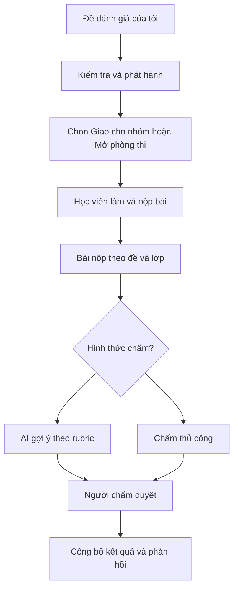

# NEXA AI — Personal Dashboard: Review UX, kiến trúc sản phẩm và kế hoạch cải thiện

> **Loại tài liệu:** Product/UX Review + Implementation Backlog  
> **Ngày review:** 30/10/2026  
> **Phạm vi:** Personal Workspace (`/personal/*`), giao diện và workflow, liên hệ với AI/competency/learning/payment  
> **Repository:** [minhhuyzzz/nexa_AI](https://github.com/minhhuyzzz/nexa_AI)  
> **Nhánh và commit được đối chiếu:** `main` — [`ab1a99ba35f594fd26fb6454077d40dfe7dd6253`](https://github.com/minhhuyzzz/nexa_AI/commit/ab1a99ba35f594fd26fb6454077d40dfe7dd6253)  
> **Nguồn nhận xét:** Các ảnh chụp màn hình localhost do chủ dự án cung cấp, cộng với đọc source tại commit trên.  
> **Trạng thái:** **Chỉ review / Đề xuất** — không thay đổi repository, không xác nhận đã test E2E hay database staging.  
> **Cập nhật yêu cầu sản phẩm:** 30/10/2026 — **Chỉ đo 5 miền năng lực**, không chấm/hiển thị 21 kỹ năng thành phần; bổ sung **đề xuất khóa học được tuyển chọn theo khoảng trống năng lực** (không xây sàn bán khóa học).

---

## 1. Tóm tắt điều hành

Personal Dashboard hiện có nhiều chức năng và nền tảng kỹ thuật đáng kể: bài đánh giá, hồ sơ năng lực, lộ trình học, nhóm/lớp, nộp bài, soạn đề, ngân hàng câu hỏi, phòng thi, chấm bài, AI và thanh toán. Tuy nhiên, **nó chưa tạo thành hành trình sử dụng mạch lạc**. Người học phải tự đoán mình nên bắt đầu ở đâu và vì sao một số trang tồn tại; nhiều khung dữ liệu trống không dẫn đến hành động thực tế.

**Định hướng cần chốt trước khi chỉnh UI:**

**Đánh giá 5 miền → Nhận diện khoảng trống → Lộ trình & khóa học phù hợp → Đánh giá lại.**

- **Personal** là workspace mặc định cho một tài khoản có thể vừa học vừa tạo/tổ chức đánh giá.
- **Học tập & phát triển** là hành trình chính; **tạo & tổ chức** là nhóm công cụ phụ theo ngữ cảnh.
- **Radar** là một biểu đồ trong **Hồ sơ năng lực**, không phải bản thân một phân hệ độc lập.
- **Bàn chấm bài** vẫn tồn tại về mặt kỹ thuật, nhưng nên mở từ bài nộp/đề/lớp và chỉ nổi bật khi người dùng có việc cần chấm.
- **Gói & Nâng cấp** rời khỏi sidebar; việc nâng cấp dùng chuỗi **trang chọn gói → trang checkout → trang kết quả**, không mở QR bằng modal.
- **Đánh giá năng lực chỉ ở cấp 5 miền**; tuyệt đối không yêu cầu người dùng theo dõi, chấm điểm hoặc hoàn thành từng kỹ năng thành phần. Các bảng `competencies` hiện có có thể tiếp tục là metadata nội bộ để tương thích schema, nhưng không tạo ra 21 thang điểm hiển thị.
- **Lộ trình** phải dẫn đến học liệu, hoạt động thực hành và **khóa học phù hợp theo miền đang thiếu**, thay vì chỉ hiển thị danh sách module chung.
- **NEXA không phải sàn bán khóa học:** khóa học là tài nguyên được tuyển chọn, hỗ trợ khắc phục khoảng trống năng lực; khác biệt nằm ở chẩn đoán bằng chứng → gợi ý có lý do → học → đo tiến bộ, không ở thương mại hóa khóa học.
- **AI là chức năng hỗ trợ theo yêu cầu**; không tự chấm khi người dùng nộp bài, không tự biến nháp AI thành điểm chính thức.
- **Điểm bài đánh giá ≠ điểm năng lực ≠ điểm hoạt động**; chứng chỉ không được mở khóa chỉ nhờ điểm đăng nhập/gamification.

### Các phát hiện lớn nhất

| ID | Mức ưu tiên | Trạng thái | Phát hiện |
|---|---|---|---|
| PERS-01 | P1 | DESIGN GAP | Sidebar dàn ngang chức năng học tập và công cụ tổ chức, khó xác định hành động chính. |
| PERS-02 | P1 | OBSERVED IN SCREENSHOT | Dashboard dẫn người mới đi làm khảo thí, nhưng catalog trong ảnh lại rỗng: onboarding bị đứt. |
| PERS-03 | P1 | CONFIRMED IN SOURCE | Trang lộ trình đọc `learning_modules` theo `order_index`, chưa gắn thành một kế hoạch theo **5 miền** và chưa có lớp tuyển chọn/đề xuất khóa học. |
| PERS-04 | P1 | CONFIRMED IN SOURCE + PRODUCT DECISION | Source còn trình bày 21 kỹ năng và nhiều cách tính; yêu cầu sản phẩm mới chỉ đo **5 miền**, một hợp đồng điểm/coverage thống nhất, `null` khác `0`. |
| PERS-05 | P1 | CONFIRMED IN SOURCE | Level và điều kiện mở khóa Master Certificate trong `profile-stats` dựa trên `profiles.points` (450 điểm): dễ trộn thành tích hoạt động với chứng nhận năng lực. |
| PERS-06 | P1 | CONFIRMED IN SOURCE | AI tạo `confidenceScore`/`confidenceFlag` do mô hình tự ước lượng; chưa nên diễn giải như xác suất đúng đã được kiểm định. |
| PERS-07 | P1 | DESIGN GAP | `/personal/grading` là một điểm đến độc lập thay vì bước xử lý bài làm của một đề/assignment/lớp cụ thể. |
| PERS-08 | P2 | CONFIRMED IN SOURCE | Billing đang dùng QR modal (`showQrModal`), không phù hợp checkout nhiều bước được yêu cầu. |
| PERS-09 | P2 | CONFIRMED IN SOURCE | Leaderboard có fallback dữ liệu người dùng mẫu khi API lỗi hoặc rỗng. |
| PERS-10 | P2 | OBSERVED IN SCREENSHOT | “Nhiệm vụ & Hạn nộp” đang có việc quá hạn nhưng tab mặc định “Sắp tới” lại hiển thị thông báo không có việc. |
| PERS-13 | P1 | PRODUCT DECISION | Tích hợp **kho khóa học tuyển chọn** để đề xuất sau khi nhận diện khoảng trống 5 miền; không xây marketplace, không ưu tiên khóa trả phí. |

**Giới hạn xác minh:** `CONFIRMED IN SOURCE` nghĩa là đã đối chiếu hành vi trong code ở commit nêu trên, không đồng nghĩa đã chạy test khai thác, DB production hay test trình duyệt. `OBSERVED IN SCREENSHOT` là trạng thái trong ảnh gửi, không được suy rộng thành lỗi trên mọi tài khoản.

---

## 2. Nguyên tắc sản phẩm và UI cần giữ

### 2.1. Mô hình workspace

1. **Personal Workspace:** mọi tài khoản có thể học và dùng các công cụ tạo/tổ chức trong giới hạn quyền/gói.
2. **Organization Workspace:** dữ liệu, thành viên, lớp, báo cáo và quota gắn `organization_id` cụ thể; không lẫn Personal.
3. **Platform Admin:** khu vực quản trị nền tảng, không phải quyền thu được do trả phí.

Không biến người học và người tạo đề thành hai tài khoản bắt buộc. Workspace xác định **phạm vi dữ liệu**, còn role/capability xác định **hành động được phép**.

### 2.2. Quy chuẩn UI theo `AGENTS.md`

- Nền trắng; vùng phụ slate nhạt; viền mảnh; chữ slate đậm; xanh học thuật làm màu nhấn.
- Font Inter cho nội dung, JetBrains Mono cho số/mã/PIN, icon `lucide-react` nét mảnh.
- Tránh gradient, dashboard neon, emoji trang trí trong TSX, lạm dụng thẻ/khoảng trắng.
- Tên menu và CTA là **ngôn ngữ hành động của người dùng**, tránh lạm dụng thuật ngữ học thuật ở mức điều hướng.
- Mọi trang có loading / empty / error / success / unauthorized / entitlement states; trợ năng bàn phím, focus rõ, contrast WCAG AA.

**Nguồn:** [`AGENTS.md`](https://github.com/minhhuyzzz/nexa_AI/blob/ab1a99ba35f594fd26fb6454077d40dfe7dd6253/AGENTS.md) và [Product Spec Personal/Organization](https://github.com/minhhuyzzz/nexa_AI/blob/ab1a99ba35f594fd26fb6454077d40dfe7dd6253/NEXA_AI_PRODUCT_SPEC_PERSONAL_ORGANIZATION_WORKSPACES.md).

---

## 3. Sidebar / Information Architecture (IA)

### 3.1. Vấn đề hiện tại

[`src/components/dashboard/personal/PersonalSidebar.tsx`](https://github.com/minhhuyzzz/nexa_AI/blob/ab1a99ba35f594fd26fb6454077d40dfe7dd6253/src/components/dashboard/personal/PersonalSidebar.tsx) đang đặt nhiều đường dẫn cấp cao, trong đó “Radar 5 Miền”, “Bảng xếp hạng”, “Bàn chấm bài”, “Gói & Nâng cấp” xuất hiện như các phân hệ ngang hàng.

Hậu quả: người chỉ muốn làm bài và hiểu năng lực vẫn phải tiếp xúc với ngân hàng câu hỏi, bàn chấm bài và nghiệp vụ tổ chức thi. Ngược lại, người tạo đề không có chuỗi điều hướng tự nhiên từ đề đến bài nộp và chấm điểm.

### 3.2. Sidebar mục tiêu

```text
NEXA
[Không gian làm việc: Cá nhân ▼]

HỌC TẬP & PHÁT TRIỂN
  Tổng quan
  Bài đánh giá
  Hồ sơ năng lực
  Lộ trình của tôi
  Chứng chỉ

NHÓM & CÔNG VIỆC
  Nhóm của tôi
  Bài được giao

CÔNG CỤ TẠO & TỔ CHỨC
  Đề đánh giá của tôi
  Ngân hàng câu hỏi
  Phòng thi trực tiếp

---
  Cài đặt
  Góp ý
```

**Các thay đổi cần thực hiện:**

| Hiện tại | Đích đến | Hành động |
|---|---|---|
| `Radar 5 Miền` | `Hồ sơ năng lực` | Đổi nhãn, giữ route `/personal/competency`, tổ chức lại nội dung. |
| `Lộ trình học tập` | `Lộ trình của tôi` | Đổi nhãn và thiết kế lại nội dung theo 5 miền năng lực. |
| `Bài khảo thí` | `Bài đánh giá` | Dễ hiểu với người mới, thuật ngữ “khảo thí” vẫn có trong mô tả chuyên môn. |
| `Nhiệm vụ & Hạn nộp` | `Bài được giao` | Đổi nhãn, bổ sung tab `Cần xử lý` mặc định. |
| `Bàn chấm bài` | Không trong sidebar cấp 1 | Mở từ `Đề đánh giá`/`Nhóm`/hàng đợi có bài chờ chấm; giữ route. |
| `Bảng xếp hạng` | Mục phụ của thành tích/cộng đồng | Giảm độ nổi bật, không làm lệch mục tiêu đánh giá năng lực. |
| `Gói & Nâng cấp` | Menu tài khoản / CTA trong giới hạn quota | Giữ trang gói nhưng không hiện mục sidebar. |
| `Góp đề thi cộng đồng` | Liên kết phụ trong công cụ tạo/ngân hàng | Bỏ làm CTA tối màu chiếm vị trí cao nhất của mọi người dùng. |

**Không xóa route cũ ngay:** bảo toàn deep links, lịch sử, bookmark; có thể redirect khi thiết kế mới ổn định.

### 3.3. Quy tắc hiển thị theo ngữ cảnh

- Không yêu cầu tài khoản có role `EVALUATOR` mới được xem công cụ tạo đề nếu đặc tả gói cho phép Personal creator.
- Khi người dùng có bài chờ chấm, hiển thị shortcut `Bài chờ chấm (n)` trong Dashboard và trong trang đề/lớp tương ứng.
- Khi hết quota AI hoặc soạn đề, dẫn đến trang chọn gói phù hợp, không chặn bằng modal quảng cáo.
- Khi đang ở workspace Organization, chuyển ngữ cảnh và dữ liệu phải rõ; không tự động giả định quyền đối với tài nguyên Personal.

---

## 4. Review từng màn hình Personal

| Trang hiện tại | Vấn đề | Hành vi/thiết kế kỳ vọng |
|---|---|---|
| **Tổng quan** (`/personal/dashboard`) | Quá nhiều KPI, Radar và gamification; không có “Bước tiếp theo” duy nhất. | Dashboard theo trạng thái: người mới / đã có baseline / có bài đến hạn / có công việc chấm. |
| **Bài khảo thí** (`/personal/assessments`) | Trong ảnh catalog rỗng ngay khi được kêu gọi làm bài đầu vào; bộ lọc lớn dù 0 kết quả. | Đánh giá đầu vào thật, điều kiện phát hành rõ; phân biệt rỗng do filter và rỗng do catalog. |
| **Lộ trình học tập** (`/personal/learning-path`) | Lặp Radar, kiểm tra kết nối AI lấn sân trải nghiệm học; danh sách module chưa phản ánh kế hoạch cá nhân. | Lộ trình dựa trên khoảng trống của 5 miền, kèm học liệu NEXA, khóa học tuyển chọn, tiến độ và đánh giá lại. |
| **Radar 5 Miền** (`/personal/competency`) | Tên tính năng thiên về loại biểu đồ; số `0%` gây nhầm với chưa đo; có nơi 0 miền yếu dù không có dữ liệu. | `Hồ sơ năng lực`, chỉ báo cáo 5 miền (không điểm kỹ năng thành phần), nguồn đánh giá, lịch sử; Radar chỉ khi đủ dữ liệu. |
| **Bảng xếp hạng** (`/personal/leaderboard`) | Podium chiếm phần lớn màn hình, gamification quá nổi bật; có fallback fake trong source. | Mục phụ, chỉ dữ liệu thật; giải thích điểm hoạt động không phải điểm năng lực. |
| **Nhóm học tập** (`/personal/groups`) | Tham gia bằng mã là luồng tốt nhưng chưa truyền đạt trọn đời sống lớp học. | Nhóm → thành viên/tài liệu/bài giao → bài nộp → phản hồi. |
| **Nhiệm vụ & Hạn nộp** (`/personal/submissions`) | Có 1 việc quá hạn trong ảnh nhưng mặc định vào tab `Sắp tới (0)` gây nhận định sai. | Tab `Cần xử lý`, ưu tiên quá hạn/gần hạn, trạng thái server bền vững, nộp lại theo policy. |
| **Chứng chỉ của tôi** (`/personal/credentials`) | Dễ lẫn chứng chỉ năng lực với hệ thống điểm hoạt động. | Chứng chỉ chỉ theo eligibility/assessment/công nhận hợp lệ, lịch sử và xác minh. |
| **Đề thi của tôi** (`/personal/authoring`) | Có trình quản lý nhưng không dẫn người dùng xuyên suốt tạo → phát hành → sử dụng → kết quả. | Trang chi tiết đề với CTA hành động theo trạng thái và danh sách hoạt động sử dụng đề. |
| **Phòng thi trực tiếp** (`/personal/live-room`) | Tách như một sản phẩm khác. | Là hình thức tổ chức một assessment có sẵn: chọn đề → tạo phiên → PIN → giám sát → kết thúc. |
| **Bàn chấm bài** (`/personal/grading`) | Đến màn chấm không có ngữ cảnh đề/lớp/assignment. | Workbench theo submission cụ thể, liên kết từ danh sách bài nộp và quản lý đề. |
| **Ngân hàng câu hỏi** (`/personal/item-bank`) | Công cụ đúng nhưng liên hệ với Assessment Studio chưa được truyền đạt. | Kho câu hỏi/rubric có version, thêm vào đề qua Studio, nguồn gốc rõ. |

### 4.1. Ba lỗi UX dễ thấy nhất trong ảnh

1. **Onboarding dead end:** Tổng quan mời “Bắt đầu khảo thí” nhưng trang catalog báo chưa có đề công khai. Cần điều kiện hiển thị CTA đúng với backend, có bài đầu vào thực tế hoặc hướng dẫn chờ nội dung thay thế.
2. **Empty state gây hiểu nhầm:** trang nhiệm vụ báo không có bài cần nộp trong tab hiện tại dù người dùng có việc quá hạn. Cần `Cần xử lý` làm tab mặc định, trừ khi người dùng có lựa chọn đã lưu.
3. **Khung trắng khổng lồ không có hành động:** Assessment Studio và trang rỗng nên dùng hướng dẫn 1–2 bước có CTA khả thi, không dựng canvas lớn chỉ để hiện icon dấu hỏi.

### 4.2. Ngôn ngữ giao diện

Nên thay tiêu đề khi thích hợp:

- “Bài Khảo Thí Năng Lực Số” → “Bài đánh giá năng lực số”.
- “Khung Năng Lực Số Cá Nhân / Radar 5 Miền” → “Hồ sơ năng lực của tôi”.
- “Thẩm Định Bài Làm & Minh Chứng” → “Chấm và phản hồi bài nộp”.
- “Lộ Trình Bồi Dưỡng & Khung Năng Lực AI” → “Lộ trình phát triển năng lực”.
- “Kiểm định & Mở Phòng Live” → 2 hành động riêng: “Kiểm tra & phát hành đề” và “Tạo phòng thi”.

Không bỏ thuật ngữ chuyên ngành ở các màn cần chuyên môn; chỉ đưa thuật ngữ vào đúng ngữ cảnh.

---

## 5. Trang Tổng quan: chuyển từ KPI tĩnh sang bảng điều khiển theo trạng thái

### 5.1. Câu hỏi trang này phải trả lời

> **Tôi đang ở đâu? Tôi nên làm gì tiếp? Tôi có việc nào cần xử lý ngay không?**

### 5.2. Thiết kế khuyến nghị

```text
[Chào mừng trở lại]                           [Gói hiện tại / avatar]

[BƯỚC TIẾP THEO CỦA BẠN]
  Chưa có baseline?           → Làm bài đánh giá đầu vào
  Có miền cần cải thiện?      → Mở lộ trình và khóa học phù hợp
  Có bài được giao gần hạn?   → Mở bài cần nộp
  Có bài đang chờ chấm?       → Xử lý bài nộp (người tạo đề)

[Tiến độ của tôi]
  Bài đã hoàn thành | Miền đã được đánh giá (x/5) | Bài được giao cần xử lý

[HỒ SƠ NĂNG LỰC — TÓM TẮT]
  Không có dữ liệu: giải thích + CTA, không vẽ 0% giả
  Có dữ liệu: biểu đồ nhỏ + miền cần chú ý + link chi tiết

[LỘ TRÌNH ĐANG THEO]
  1–2 học phần / khóa học phù hợp theo miền + tiến độ + nút tiếp tục

[NHÓM / CÔNG VIỆC]
  Chỉ hiển thị nhóm/đề/việc người dùng thực sự có
```

### 5.3. Bốn trạng thái bắt buộc

- **Người mới:** không đánh đồng `null` với `0`; hướng dẫn làm bài đầu vào khi catalog đã sẵn sàng.
- **Đã có baseline:** hiển thị tiến bộ, khoảng trống có dữ liệu, học phần hoặc khóa học phù hợp được gợi ý.
- **Có việc gần hạn/quá hạn:** ưu tiên công việc cần xử lý lên đầu.
- **Có công việc tổ chức/chấm:** thêm hàng đợi theo tài nguyên sở hữu/được phân công, không biến thành dashboard dành riêng giảng viên.

Chỉ hiển thị số liệu theo nguồn có thật. Phân biệt `loading`, `error`, `empty`, `insufficient_data`.

**Nguồn:** [`personal/dashboard/page.tsx`](https://github.com/minhhuyzzz/nexa_AI/blob/ab1a99ba35f594fd26fb6454077d40dfe7dd6253/src/app/%28dashboard%29/personal/dashboard/page.tsx).

---

## 6. Hồ sơ năng lực: chỉ đánh giá 5 miền, không chấm kỹ năng thành phần

> **Quyết định sản phẩm đã chốt:** NEXA đánh giá và công bố kết quả **đúng 5 miền năng lực số**. Không có trang, bộ lọc, KPI, bài thi bắt buộc hay lộ trình chấm điểm cho 21 kỹ năng thành phần. Tên miền/phiên bản khung lấy động từ database, không hardcode danh sách từ một phiên bản tài liệu vào UI.

### 6.1. Vấn đề hiện tại

Trong ảnh, nhiều màn hiển thị 5 trục Radar ở `0%` khi chưa có bài đánh giá, nhưng nơi khác ghi “0 miền cần cải thiện”. Cần phân biệt:

- **Chưa đánh giá:** `score = null`, không đủ bằng chứng, không thể kết luận yếu.
- **Đã đánh giá và được 0/100:** điểm thật nếu đánh giá hợp lệ đã được chấm.
- **Đã đánh giá một phần:** chỉ những miền có bằng chứng hợp lệ mới được chấm; không suy đoán miền còn lại.

### 6.2. Hợp đồng dữ liệu khuyến nghị (5 miền, không có skill score)

```ts
// Kiểu mục tiêu minh họa; không khẳng định đang có trong source.
type DomainAssessment = {
  domainId: string;
  domainCode: string;
  domainName: string;
  score: number | null;              // 0..100; null = chưa đủ dữ liệu
  assessmentCount: number;           // số lượt đánh giá hợp lệ liên quan
  evidenceCount: number;             // số bằng chứng hợp lệ của miền
  status: 'INSUFFICIENT_DATA' | 'NEEDS_IMPROVEMENT' | 'MEETS_TARGET';
  lastEvaluatedAt: string | null;
  frameworkVersion: string;
};

type PersonalCompetencyProfile = {
  domains: DomainAssessment[];       // đúng 5 miền cấu hình trong framework
  assessedDomainCount: number;       // 0..5, không phải 0..21 kỹ năng
  overallScore: number | null;       // null nếu chưa đáp ứng quy tắc tổng hợp
  sourceSnapshotId: string | null;
  updatedAt: string | null;
};
```

**Quy tắc điểm:** câu hỏi/đề đánh giá được ánh xạ vào **miền**; hệ thống chấm khách quan hoặc nhận kết quả đã duyệt rồi chuẩn hóa điểm theo miền về thang 0–100. Có thể giữ quan hệ `competency_id` nội bộ để tương thích dữ liệu lịch sử, nhưng **không hiển thị hoặc lấy điểm kỹ năng nhỏ làm đơn vị kết quả sản phẩm**. Đảm bảo điểm có nguồn, lần đánh giá, trạng thái duyệt và phiên bản framework.

- Điểm 5 miền độc lập với XP/điểm hoạt động và với điểm từng bài thi.
- `0 miền yếu` chỉ có ý nghĩa khi miền đã được đo; không đồng nghĩa “chưa có dữ liệu”.
- **Một ngưỡng sản phẩm rõ ràng:** ví dụ `target = 70/100` cho một chương trình được định nghĩa; không lẫn `<60` và `<70` giữa các trang. Không đặt ngưỡng cố định nếu chương trình/loại bài đánh giá quy định khác.
- Khi có dữ liệu của 1–4 miền, dùng thanh điểm và trạng thái từng miền; không nối các điểm còn thiếu thành đa giác Radar giả.
- Radar đầy đủ chỉ khi có dữ liệu đủ 5 miền. Nếu chưa đủ, dùng “Đã đánh giá x/5 miền” và CTA đánh giá miền còn thiếu.

### 6.3. Mẫu giao diện Hồ sơ năng lực

```text
HỒ SƠ NĂNG LỰC CỦA TÔI
  [Điểm tổng nếu đủ dữ liệu]   [Miền đã đánh giá: x/5]  [Cập nhật lần cuối]

  [Radar 5 miền khi đủ dữ liệu]   [Giải thích nguồn điểm / chuẩn mục tiêu]

  MIỀN 01 — THÔNG TIN & DỮ LIỆU        45/100 (minh họa)
       Trạng thái: Cần cải thiện
       [Xem bằng chứng] [Xem lộ trình & khóa học gợi ý]
  MIỀN 02 — GIAO TIẾP & HỢP TÁC        Chưa có dữ liệu
       [Làm bài đánh giá miền này]
  ... tổng cộng 5 miền, KHÔNG chia trang thành kỹ năng nhỏ

  [So sánh với lần trước theo từng miền]   [Lịch sử đánh giá]
```

- Home chỉ hiển thị **tóm tắt** hồ sơ và CTA tiếp theo, không nhân bản 3 Radar độc lập.
- `/personal/competency` là nguồn trình bày kết quả chính cho 5 miền; `/personal/competency/analysis` là phần diễn giải AI theo yêu cầu, không tính lại điểm bằng mô hình riêng.
- Khi chọn một miền yếu, người dùng được dẫn sang **Lộ trình + Khóa học gợi ý đúng miền**, không bắt phải hiểu 21 mã kỹ năng thành phần.

### 6.4. Thay đổi nguồn dữ liệu cần thực hiện khi coding

- [`CompetencyAggregationService`](https://github.com/minhhuyzzz/nexa_AI/blob/ab1a99ba35f594fd26fb6454077d40dfe7dd6253/src/features/competency/services/competency-aggregation.service.ts) đã có `number | null` cho điểm thiếu dữ liệu, nhưng còn tính/đếm theo skill; chỉnh thành hợp đồng **5 domain-level scores**.
- `/api/personal/competency-radar` và `/api/personal/competency-profile` cần nhất quán công thức, dữ liệu, ngưỡng và `frameworkVersion`.
- `personal/competency/page.tsx` có KPI `0/21 kỹ năng`; đổi thành **x/5 miền đã đánh giá**. Xóa các thông điệp hoặc bảng công khai chấm điểm kỹ năng thành phần.
- `src/features/ai-gateway/types/competency.types.ts` và adapter/phân tích AI có `skillScores`/`skillGaps`; điều chỉnh output sản phẩm thành `domainGaps` và 5 `domainScores`. Không để AI tự tạo điểm miền chưa có bằng chứng.
- Nếu dữ liệu cũ lưu ở cấp kỹ năng, cần **quy tắc tổng hợp/migration tương thích**, không xóa bảng liên quan ngay và không phá kết quả lịch sử.

---

## 7. Lộ trình và đề xuất khóa học — điểm khác biệt của NEXA

### 7.1. Định vị sản phẩm: NEXA không phải kênh bán khóa học

**NEXA là nền tảng đánh giá và phát triển năng lực số dựa trên bằng chứng**, không phải sàn thương mại hay công cụ xếp hạng nhà cung cấp khóa học theo tiền quảng cáo. Giá trị riêng là:

**Đánh giá 5 miền → Xác định miền cần cải thiện → Đề xuất lộ trình và khóa học phù hợp → Học/thực hành → Đánh giá lại cùng miền → So sánh tiến bộ.**

- **Khóa học là phương tiện cải thiện, không phải sản phẩm chính để bán.** NEXA không cần giỏ hàng, chiết khấu, phân phối khóa học, hoa hồng hay hệ thống seller trong giai đoạn này.
- Có thể giới thiệu học liệu NEXA, khóa học miễn phí từ các đơn vị giáo dục uy tín hoặc khóa bên ngoài phù hợp; nếu có khóa trả phí phải ghi rõ bên cung cấp và chi phí, **không ưu tiên vì trả phí/hoa hồng**.
- Người dùng được quyền chọn học phần NEXA hoặc học bên ngoài; NEXA vẫn tập trung vào **đo tiến bộ** khi họ quay về làm đánh giá lại.
- Không sao chép hoặc nhúng nội dung khóa học bên thứ ba khi chưa có quyền; phiên bản đầu dùng liên kết đến nguồn chính thức.

### 7.2. Chẩn đoán source hiện tại

[`personal/learning-path/page.tsx`](https://github.com/minhhuyzzz/nexa_AI/blob/ab1a99ba35f594fd26fb6454077d40dfe7dd6253/src/app/%28dashboard%29/personal/learning-path/page.tsx) lấy `learning_modules` đã phát hành theo `order_index`, đọc `user_learning_progress`, mở khóa tuần tự. API AI có thể sinh `learningPathway`, `recommendedCourses`, nhưng chưa thấy một **catalog khóa học đã được tuyển chọn và kiểm tra** gắn với domain score ở UI.

Repo có seed học liệu NEXA như [`05_learning_modules_seed.sql`](https://github.com/minhhuyzzz/nexa_AI/blob/ab1a99ba35f594fd26fb6454077d40dfe7dd6253/src/database/seeds/05_learning_modules_seed.sql). Seed trong repo không chứng minh học liệu đã được deploy/chạy. Cần kiểm tra cả chất lượng, liên kết và tình trạng phát hành.

### 7.3. Hành trình 4 bước, chỉ dựa trên 5 miền

1. **Đánh giá đầu vào:** mỗi bài/nhóm câu hỏi đóng góp bằng chứng cho một hoặc nhiều trong 5 miền. Người chưa có dữ liệu vẫn có thể học tự do, nhưng không được gắn nhãn “lộ trình cá nhân hóa” vô căn cứ.
2. **Xác định miền ưu tiên:** backend tính khoảng cách `targetScore - domainScore` với những miền **đã được đánh giá hợp lệ**. Sắp thứ tự theo mức thiếu hụt, tính mới/đủ bằng chứng và mục tiêu người dùng. Không dùng điểm 21 kỹ năng thành phần để xếp hạng.
3. **Đề xuất và thực hành:** mỗi miền cần cải thiện có 2 đường lựa chọn: **(A) Học liệu/bài luyện tập trong NEXA; (B) Khóa học tuyển chọn từ danh mục đã xác minh**. Người học có thể lưu kế hoạch, đánh dấu đang học/hoàn thành, gửi phản hồi.
4. **Đánh giá lại và đo tiến bộ:** mở bài đánh giá tương đương ở miền liên quan, so sánh điểm trước/sau cùng phiên bản/phương pháp có thể đối chiếu. Không khẳng định khóa học *gây ra* sự tiến bộ chỉ từ một kết quả trước–sau.

### 7.4. Wireframe trang Lộ trình của tôi

```text
LỘ TRÌNH PHÁT TRIỂN NĂNG LỰC
  Bạn đã đánh giá 3/5 miền | Miền cần cải thiện: 2 | Lộ trình đang theo: 1

  [MIỀN ƯU TIÊN 01 — THÔNG TIN & DỮ LIỆU]
    Điểm hiện tại: 45/100 | Mục tiêu: 70/100 (số minh họa)
    Lý do: kết quả đánh giá đầu vào cho thấy miền này dưới mục tiêu.

    [Học trên NEXA]                             [Khóa học được NEXA gợi ý]
    - Thẩm định nguồn tin (20 phút)              - Nhận biết tin sai lệch (đơn vị X)
    - Bài luyện tình huống thực tế               - Hình thức: Online | Thời lượng: ...
    [Bắt đầu học]                                [Xem khóa học tại nguồn chính thức]

    [Lưu vào lộ trình]    [Đánh dấu đã học]    [Đánh giá lại miền 01]

  [MIỀN ƯU TIÊN 02 — ...]
    ...

  [CÁC MIỀN CHƯA CÓ DỮ LIỆU]
    [Làm bài đánh giá]  (không tự kết luận yếu)

  [LỊCH SỬ TIẾN BỘ]  So sánh trước / sau theo từng miền
```

### 7.5. Chính sách tuyển chọn và gợi ý khóa học

**Mỗi khóa học trong catalog là một mục tham khảo có kiểm duyệt**, tối thiểu có: `id`, `title`, `provider`, `officialUrl`, `domainIds[]` (thuộc 5 miền), `level`, `language`, `format`, `duration`, `priceType` (`FREE`/`PAID`/`UNKNOWN`), `lastVerifiedAt`, `reviewStatus`, `shortDescription`, `learningOutcomes`.

**Quy tắc đề xuất:**

1. Chỉ xét những **miền đã được đo và thấp hơn mục tiêu**; chưa đo thì gợi ý đánh giá, không gán khoảng trống giả.
2. Chỉ đề xuất khóa học **đang được duyệt**, liên kết hoạt động, nội dung phù hợp miền, mức đầu vào hợp lý và đơn vị cung cấp có thể kiểm chứng.
3. Ưu tiên tính phù hợp với miền cần cải thiện, chất lượng nội dung, thời lượng, ngôn ngữ, chi phí/khả năng tiếp cận; **không ưu tiên nhà cung cấp trả tiền**.
4. Giải thích lý do: “Được gợi ý vì miền 01 đang dưới mục tiêu và khóa này tập trung vào kiểm chứng nguồn thông tin”. Không viết “đảm bảo nâng điểm” hoặc “được NEXA chứng nhận chất lượng” nếu chưa đánh giá độc lập.
5. Không bao giờ dùng URL/tên khóa học do AI tự bịa. Backend cung cấp **catalog đã xác minh**; AI chỉ có thể xếp thứ tự/giải thích lựa chọn từ các `courseId` và `moduleId` hợp lệ, sau đó server kiểm lại.
6. Khi không có khóa phù hợp, hiển thị “Chưa có khóa học được tuyển chọn cho miền này” và gợi ý học liệu NEXA hoặc tự khám phá, không tạo card giả.
7. Nêu rõ liên kết ngoài, điều kiện học, trả phí (nếu có) và đơn vị tổ chức; người dùng quyết định có tham gia hay không.

**Điểm khác biệt khó bị nhầm với website bán khóa học:** NEXA đo **độ phù hợp với kết quả đánh giá** và lưu **tiến trình cải thiện năng lực**, không tổ chức gian hàng, xếp hạng theo tiền hay bán khóa học của đối tác.

### 7.6. AI trong hệ thống gợi ý

**Giai đoạn đầu có thể dùng rule-based để gợi ý**, không bắt buộc gọi AI cho mọi người: `domainScore < target` → lọc `course_catalog` theo miền/độ khó/ngôn ngữ → sắp theo chất lượng và mức phù hợp. AI chỉ là tùy chọn **on-demand** để giải thích hoặc điều chỉnh kế hoạch từ danh sách đã tuyển chọn.

- Kết quả AI nên là `recommendedModuleIds[]`, `recommendedCourseIds[]`, `domainReasons[]`; không trực tiếp sinh nội dung khóa học mới.
- AI không được tự đổi 5 điểm miền, tính chứng chỉ, khẳng định người học yếu ở miền chưa đo hoặc gọi thanh toán.
- Lộ trình đã lưu và danh sách khóa học cần tồn tại qua F5/đăng nhập thiết bị khác, có phiên bản nguồn dữ liệu và thời điểm gợi ý.

### 7.7. Data model và lộ trình triển khai

**Đề xuất schema, cần đối chiếu DB thật trước khi tạo migration:**

| Thực thể | Trường cốt lõi | Ý nghĩa |
|---|---|---|
| `learning_plans` | `user_id`, `source_snapshot_id`, `framework_version`, `status`, `created_at` | Một kế hoạch của một người học |
| `learning_plan_items` | `plan_id`, `domain_id`, `item_type`, `module_id?`, `course_id?`, `reason`, `priority`, `status` | Hoạt động cải thiện một trong 5 miền |
| `course_catalog` | `id`, `title`, `provider`, `official_url`, `domain_ids`, `level`, `language`, `price_type`, `review_status`, `last_verified_at` | Danh mục khóa học được tuyển chọn, không phải marketplace |
| `user_course_progress` | `user_id`, `course_id`, `status`, `started_at`, `completed_at`, `completion_source` | Tiến độ tự khai báo hoặc tích hợp có xác minh, không tự cấp chứng chỉ |
| `competency_snapshots` | `user_id`, `domain_scores`, `framework_version`, `evaluated_at`, `evidence_refs` | Lưu lịch sử đánh giá 5 miền trước/sau |

Không cần tạo đúng 5 bảng mới nếu project đã có cấu trúc tương đương. Không xóa dữ liệu kỹ năng cũ trước khi kiểm tra tương thích. Khóa bên ngoài chưa có API xác minh hoàn thành thì trạng thái “Đã học” chỉ là **người dùng tự ghi nhận**, không phải bằng chứng chứng nhận năng lực.

**Phát hành từng giai đoạn:**

- **V1:** chuẩn hóa 5 điểm miền + tạo catalog khóa học tuyển chọn thủ công (kho nhỏ, có kiểm tra URL) + gợi ý theo quy tắc + CTA về nguồn chính thức + đánh giá lại.
- **V2:** lưu mục tiêu học, gợi ý AI có lý do, phản hồi chất lượng gợi ý, lịch sử kế hoạch và nhắc đánh giá lại.
- **V3 (chỉ nếu có nhu cầu):** kết nối API đối tác/LMS có cho phép, đồng bộ tiến độ hợp lệ; không xây marketplace hay thanh toán khóa học bên thứ ba.

### 7.8. Không khóa bài học vô lý

Cho người dùng học tự do; chỉ yêu cầu tiền đề khi nội dung thật sự cần, không mặc định toàn bộ module/khóa học thành chuỗi `1 → 2 → 3` dựa trên `order_index`.

---

## 8. AI trong Personal — 5 vị trí, 2 loại quyết định

### 8.1. AI được đặt vào đúng điểm chạm

| Ngữ cảnh | AI hỗ trợ | Đầu ra | Ai quyết định kết quả cuối? |
|---|---|---|---|
| Kết quả bài đánh giá | Giải thích điểm mạnh/yếu dựa trên kết quả đã chấm | Nhận xét, đề xuất cải thiện | Điểm khách quan vẫn do code/rubric quyết định. |
| Hồ sơ năng lực | Giải thích khoảng trống đã xác định ở **5 miền** | Ưu tiên miền cần cải thiện | Điểm miền do phép tính bằng chứng đã duyệt quyết định. |
| Lộ trình & khóa học | Gợi ý học phần NEXA và khóa học tuyển chọn theo miền | `moduleId`/`courseId` hợp lệ + lý do | Người dùng chọn; backend kiểm tồn tại, trạng thái duyệt và quyền truy cập. |
| Bài thực hành | Chấm nháp theo rubric có dẫn chứng | `ai_evaluations` DRAFT, flags | Người đánh giá phê duyệt nếu policy yêu cầu. |
| Soạn đề | Gợi ý câu hỏi/rubric và lỗi nội dung | Draft chưa phát hành | Chủ đề/biên tập viên duyệt. |

**Tuyệt đối không tự gọi AI trong bước nộp bài khách quan**: tuân nguyên tắc on-demand trong `AGENTS.md`.

### 8.2. Cờ AI Xanh — Vàng — Đỏ

Trong [`gemini.adapter.ts`](https://github.com/minhhuyzzz/nexa_AI/blob/ab1a99ba35f594fd26fb6454077d40dfe7dd6253/src/features/ai-gateway/adapters/gemini.adapter.ts), model hiện sinh `confidenceScore` và `confidenceFlag` theo ngưỡng nêu trong prompt (xanh ≥85, vàng 60–84, đỏ <60).

**Quan trọng:** đây là tự ước lượng của model, không phải xác suất độ chính xác đã được hiệu chuẩn. Cần thêm kiểm định deterministic phía server.

| Cờ | Cách diễn giải UI | Hành động |
|---|---|---|
| **Xanh** | Bằng chứng khá rõ, rubric nhất quán, kiểm tra định dạng hợp lệ | Ưu tiên duyệt nhanh; không tự động cấp chứng chỉ nếu policy yêu cầu người duyệt. |
| **Vàng** | Thiếu chắc chắn/mơ hồ/không đủ bằng chứng một phần | Người chấm đối chiếu rubric, điều chỉnh, duyệt. |
| **Đỏ** | Không có bằng chứng, dẫn chứng sai, model fail hoặc confidence quá thấp | Chấm thủ công; không tự sử dụng điểm AI. |

**Server-side validation tối thiểu:**

- `criterionId` của từng mục thuộc rubric của bài.
- `0 ≤ criterion.score ≤ criterion.maxPoints`; tổng điểm và thang điểm khớp phép tính deterministic.
- Trích dẫn `evidenceQuote` thực sự tồn tại trong phần nội dung text có thể đối chiếu (đối với file, yêu cầu nguồn trích có khả năng truy vết).
- Phân biệt đủ dữ liệu, thiếu dữ liệu và lỗi model.
- `confidenceFlag` cuối cùng là quyết định từ server checks + model signal, không tin tuyệt đối flag do model sinh.
- Trả `DRAFT / NEEDS_REVIEW / APPROVED` theo workflow; `DRAFT` không tự trở thành điểm chính thức.

### 8.3. AI credits & quota

- Hiển thị chi phí dự kiến trước khi bấm “Phân tích AI” hay “Chấm bằng AI”, nếu tính bằng credits.
- Sau khi người dùng chủ động gọi, hiển thị trạng thái đang chạy; khi thất bại không giả định thành công hoặc tự cho rằng credits đã bị trừ đúng.
- Cần idempotency để retry/double-click không tạo bản nháp và charge nhiều lần.
- Không ưu tiên role `LEARNER/EVALUATOR` toàn cục để suy ra quyền được miễn phí: quyền AI nên dựa trên `entitlement + quota + workspace + resource authorization`.
- Bảo đảm PII scrub cho prompt và minh chứng theo policy; không tự gửi dữ liệu người khác chỉ vì tài khoản có label EVALUATOR.

**Nguồn:** `/api/ai/analyze-competency`, `/api/ai/grade-submission`, `src/features/ai-gateway/*`.

---

## 9. “Bàn chấm bài” — giữ engine, đổi entry point

### 9.1. Lý do không nên là module top-level

“Chấm bài” chỉ có ý nghĩa khi đã có **submission** và quyền chấm. Mục sidebar độc lập, đặc biệt khi không có bài nào, khiến người dùng không hiểu phải làm gì.

### 9.2. Luồng mục tiêu



### 9.3. Thiết kế điều hướng

- Trong **Đề của tôi**, từng đề có `Chỉnh sửa`, `Giao cho nhóm`, `Tạo phòng thi`, `Xem bài nộp`.
- Trong **Nhóm/Lớp**, mỗi assignment có số người nộp, chờ chấm, hoàn thành; CTA `Xem bài nộp`.
- Trong **Tổng quan**, chỉ người có công việc được phân công mới thấy `Bài chờ chấm (n)`.
- Workbench tiếp tục dùng route `/personal/grading` nếu phù hợp, truyền `assignmentId`/`submissionId` theo URL hoặc state được server xác thực.
- Không cho phép sửa điểm một bài không thuộc quyền người gọi chỉ vì họ có quyền chấm một bài khác của cùng học viên.

### 9.4. Ranh giới thực thể bắt buộc

| Thực thể | Vai trò |
|---|---|
| `Assessment` | Bộ đề/câu hỏi và rubric đã phát hành có version. |
| `Class` | Nhóm thành viên lâu dài, quản lý tài liệu và bài giao. |
| `ClassAssignment` | Lời giao một assessment cho lớp, deadline và policy. |
| `LiveRoom` | Phiên thi tạm thời bằng PIN/QR, khác lớp học. |
| `Submission/Attempt` | Lần làm cụ thể của học viên. |
| `Grading/AI Evaluation` | Bản nháp chấm, đánh giá, phê duyệt theo lần nộp. |

---

## 10. Gói nâng cấp / Checkout: chuyển từ modal sang các trang riêng

### 10.1. Yêu cầu đã chốt

**Không để “Gói & Nâng cấp” trong sidebar. Không mở QR thanh toán bằng modal.**

Khi người dùng nhấn nâng cấp ở menu tài khoản hoặc nơi chạm quota, điều hướng theo thứ tự:

```text
Menu tài khoản / Nút Nâng cấp / Hết AI credits
           ↓
/personal/billing
  Trang chọn gói: giá, chu kỳ, hạn mức, quyền lợi
           ↓
/personal/checkout/[orderId]
  Đơn hàng: số tiền, phương thức trả, QR/link payOS, trạng thái
           ↓
/personal/billing/result?orderId=...
  Đang xác minh / Thành công / Thất bại / Hủy / Hết hạn
           ↓
Entitlement & credits được backend cập nhật đúng một lần
```

### 10.2. UI và dữ liệu cần có

- Trang gói hiển thị **gói hiện tại**, so sánh tính năng, giá theo chu kỳ và CTA chọn gói.
- Không tin số tiền/gói từ client; API tra giá authoritative từ DB.
- Checkout có `orderId` bền vững; reload/F5 không tạo đơn mới hoặc mất mã thanh toán.
- Xác thực thông báo từ provider, đối chiếu số tiền, loại tiền, trạng thái, mã đơn và chống event trùng.
- Người dùng quay lại `returnUrl` không được tự kích hoạt gói.
- Lịch sử giao dịch và quyền lợi nằm ở menu tài khoản / trang Billing, không cần sidebar.

### 10.3. Code hiện tại cần thay

[`personal/billing/page.tsx`](https://github.com/minhhuyzzz/nexa_AI/blob/ab1a99ba35f594fd26fb6454077d40dfe7dd6253/src/app/%28dashboard%29/personal/billing/page.tsx) đang có `showQrModal`, `activeIntent`, API status và mock-payment cho môi trường kiểm thử; còn gọi `/api/profile` trong fetch kế hoạch/hồ sơ. Khi thực hiện redesign cần kiểm tra route thực tế và response contract (`/api/personal/profile` có tồn tại) trước khi thay, không chỉ đổi modal thành một trang.

---

## 11. Gamification, leaderboard và chứng chỉ

### 11.1. Ba thang đo phải tách

| Thang đo | Nguồn & ý nghĩa | Có dùng cấp chứng chỉ năng lực? |
|---|---|---|
| **Điểm hoạt động / XP** | Đăng nhập, hoàn thành học phần, tham gia hoạt động | Không được làm căn cứ duy nhất. |
| **Điểm bài đánh giá** | Tính theo rubric/đáp án cho một lần thi cụ thể | Có thể là một phần bằng chứng. |
| **Hồ sơ năng lực 5 miền** | Tổng hợp bằng chứng theo **5 miền** và phiên bản khung, không chấm 21 kỹ năng nhỏ | Là nguồn đánh giá năng lực sau khi đáp ứng tiêu chí dữ liệu và phê duyệt. |

Trong [`/api/personal/profile-stats`](https://github.com/minhhuyzzz/nexa_AI/blob/ab1a99ba35f594fd26fb6454077d40dfe7dd6253/src/app/api/personal/profile-stats/route.ts), Level và trạng thái `isCertificateUnlocked` hiện tính từ `points >= 450`. Cần tách **level hoạt động** khỏi **credential eligibility**; nếu muốn giữ hệ thống level 1–4, đặt tên rõ là level hoạt động và không dùng nhãn chứng chỉ năng lực.

### 11.2. Leaderboard

Trang hiện tại có `fallbackLeaderboard` chứa người mẫu và gọi fallback khi API lỗi/rỗng. Trên sản phẩm thật phải:

- Không hiển thị người giả khi API thất bại.
- `Empty`: chưa có người tham gia hoặc chưa đủ điều kiện hiển thị bảng xếp hạng.
- `Error`: không thể tải dữ liệu + nút thử lại.
- Cho người dùng biết đang xếp theo **XP**, không phải năng lực DigComp.
- Cân nhắc quyền riêng tư, opt-out tên/ảnh đại diện và bảng xếp hạng riêng theo lớp/tổ chức.
- Thu gọn podium và đưa xuống cấp độ secondary feature.

**Nguồn:** [`personal/leaderboard/page.tsx`](https://github.com/minhhuyzzz/nexa_AI/blob/ab1a99ba35f594fd26fb6454077d40dfe7dd6253/src/app/%28dashboard%29/personal/leaderboard/page.tsx).

---

## 12. Workflow toàn Personal cần kiểm thử end-to-end

### 12.1. Người mới

```text
Đăng ký → Personal Home → chọn bài đánh giá đầu vào đang được phát hành
→ Làm bài → Nộp → Chấm phần khách quan bằng code
→ Nhận kết quả 5 miền có bằng chứng → Hồ sơ năng lực cập nhật
→ [Tùy chọn] AI giải thích → Lộ trình + khóa học tuyển chọn theo miền yếu
→ Học trên NEXA/nguồn bên ngoài → Đánh giá lại cùng miền → So sánh tiến bộ
```

**Edge:** không có đề đầu vào, mất mạng giữa chừng, reload, không đủ quyền/gói, đề bị thu hồi, nộp hai lần, câu hỏi thực hành chờ review.

### 12.2. Người tham gia nhóm

```text
Nhập mã nhóm → ClassMember → Mở nhóm → Xem Assignment theo deadline
→ Làm bài / nộp minh chứng → Submission có nguồn Assignment
→ Người chấm được phân công đánh giá → Học viên nhận phản hồi
```

**Edge:** mã nhóm không hợp lệ, bài được giao lặp ở 2 lớp, hạn nộp đã qua, nộp lại theo policy, minh chứng private, F5 vẫn hiện trạng thái.

### 12.3. Người tạo đề / tổ chức

```text
Ngân hàng câu hỏi (tùy chọn) → Studio → Draft → Kiểm tra → Publish
→ Giao bài cho nhóm hoặc tạo Live Room
→ Theo dõi lượt tham gia/nộp bài → Mở bài chờ chấm
→ Chấm tay hoặc AI draft → Review → Publish kết quả
```

**Edge:** sửa đề khi đã có bài nộp, resource owner sai, phòng hết hạn, PIN sai, xâm phạm quyền của lớp khác, nội dung không có rubric.

### 12.4. Người nâng cấp

```text
Nhấn Nâng cấp → Chọn gói → Tạo order từ backend → Checkout trên trang riêng
→ Provider xác nhận → Backend verify + fulfill exactly once
→ Entitlement/credits cập nhật → Kết quả và hóa đơn/lịch sử
```

**Edge:** callback giả, webhook lặp, chưa trả tiền nhưng user trở về result page, sai số tiền, đơn hết hạn, lỗi provider, người khác truy cập orderId.

---

## 13. Backlog theo thứ tự triển khai (cho coding agent)

> Mỗi ticket cần một commit/PR độc lập tương đối nhỏ, có migration forward-only nếu cần. Đừng làm tất cả UI, schema và AI trong một PR lớn.

| Ticket | Ưu tiên | Công việc | File/cụm file chính | Tiêu chí nghiệm thu |
|---|---|---|---|---|
| **PERS-01** | P1 | Sidebar/IA, bỏ Grading và Billing khỏi cấp 1, sửa nhãn | `PersonalSidebar.tsx` | Menu đúng; route cũ vẫn truy cập qua điểm vào hợp lệ. |
| **PERS-02** | P1 | Home theo 4 trạng thái, 1 CTA hành động chính | `personal/dashboard/page.tsx`, profile stats | Không có CTA dẫn tới catalog vô dụng; công việc quan trọng nhất được ưu tiên. |
| **PERS-03** | P1 | Bài đánh giá đầu vào thực, catalog phân biệt empty/error | `personal/assessments/page.tsx`, `/api/assessments` | Người mới làm được bài đầu vào thật sau khi nội dung được phát hành. |
| **PERS-04** | P1 | Thống nhất **5 miền duy nhất**; bỏ KPI 21 kỹ năng, chuẩn hóa điểm/evidence/baseline | `competency-aggregation.service.ts`, competency APIs, AI schema | Đúng 5 điểm miền; `null` khác `0`; không chấm kỹ năng nhỏ; kết quả nhất quán. |
| **PERS-05** | P1 | Learning plan theo **miền ưu tiên**, học liệu NEXA + re-assessment | `personal/learning-path/page.tsx`, learning services/DB | Chỉ đề xuất theo 5 miền có bằng chứng; tiến độ bền vững qua F5. |
| **PERS-06** | P1 | AI flag & grading draft được backend kiểm định, human-review | `gemini.adapter.ts`, AI grading APIs/services | Không dùng điểm/flag model trực tiếp để duyệt chính thức; lỗi có hướng xử lý. |
| **PERS-07** | P1 | Tách credential eligibility khỏi XP | `profile-stats`, credential services | Login/XP không tự cấp chứng chỉ năng lực. |
| **PERS-08** | P1 | Ngữ cảnh Class → Assignment → Submission → Grading | `authoring`, `groups`, `submissions`, `grading` | Đúng bài, đúng lớp, đúng người chấm, đúng feedback. |
| **PERS-09** | P2 | Trang gói → checkout → kết quả thay QR modal | `personal/billing`, checkout/result routes, billing API | Không modal; F5 giữ order; backend fulfill idempotent. |
| **PERS-10** | P2 | Loại leaderboard fallback mẫu, thu gọn gamification | `personal/leaderboard/page.tsx` | Không hiển thị fake khi lỗi hoặc empty; XP có nhãn rõ. |
| **PERS-11** | P2 | Studio guided empty state, tách Publish và Launch | `AssessmentStudio.tsx`, `personal/authoring` | Tạo câu đầu tiên được hướng dẫn; không mở room từ đề draft chưa hợp lệ. |
| **PERS-12** | P2 | Design system và các trạng thái trang | Personal components & routes | Consistent loading/empty/error, responsive, keyboard, WCAG AA. |
| **PERS-13** | P1 | Catalog khóa học tuyển chọn theo **5 miền**, recommender không thiên vị thương mại | `course_catalog`/learning services, AI gateway, learning-path UI | Chỉ hiện khóa đã duyệt và có URL thực; có lý do gợi ý, link nguồn chính thức, không marketplace. |

### Dependency và thứ tự hợp lý

**Phase A (nền sản phẩm):** PERS-01 → PERS-02 → PERS-03.  
**Phase B (core learning):** PERS-04 → PERS-13 (catalog tuyển chọn) → PERS-05 (lộ trình) → PERS-06 (AI giải thích).  
**Phase C (creator & credential):** PERS-08 + PERS-07 + PERS-11.  
**Phase D (commerce & polish):** PERS-09 + PERS-10 + PERS-12.

**Ràng buộc xuyên suốt:** trước khi vận hành với dữ liệu học viên/thanh toán thật, các vấn đề quyền submission, điểm, RLS, evidence và AI credits trong bản security review riêng phải được xử lý/kiểm chứng ở staging. UI đẹp không thay thế permission checks.

---

## 14. Acceptance tests / Manual E2E matrix

| Test ID | Thử nghiệm | Kết quả phải đạt |
|---|---|---|
| UX-01 | Người mới đăng nhập, không có assessment đã phát hành | Không CTA giả; hiển thị hướng dẫn phù hợp, không đổ lỗi cho người dùng. |
| UX-02 | Người mới đăng nhập, có assessment đầu vào | CTA mở đúng bài đủ điều kiện, làm được từ đầu đến kết quả. |
| UX-03 | Đang làm bài thì refresh | Giữ dữ liệu theo autosave policy; không tự tạo attempt/points trùng. |
| UX-04 | Có một assignment quá hạn, không có assignment sắp tới | Home và mặc định Bài được giao cho thấy việc quá hạn cần xử lý. |
| UX-05 | Chưa có evidence | Hồ sơ năng lực hiển thị `—`/chưa đủ dữ liệu, không vẽ 0% là điểm thực. |
| UX-06 | Có evidence chỉ ở miền 1 | Chỉ miền 1 có score, các miền khác chưa đủ dữ liệu; không hiển thị 21 kỹ năng thành phần. |
| UX-07 | Home/Competency/Learning Path cùng một profile | Điểm và phạm vi năng lực nhất quán; cùng version/framework. |
| UX-08 | AI đề xuất `moduleId` hoặc `courseId` không tồn tại/chưa duyệt | Backend từ chối/bỏ mục; không hiển thị tài nguyên hoặc link học ảo. |
| UX-09 | Hoàn thành module hoặc lưu khóa học rồi F5 / đăng nhập máy khác | Tiến độ duy trì; tiến độ khóa ngoài tự khai báo được gắn nhãn; không cộng XP trùng. |
| UX-10 | Người học chưa có bài được chấm | Không tự sinh AI confidence hoặc đánh dấu 5 miền yếu. |
| UX-11 | AI trả `GREEN` nhưng quote/rubric không hợp lệ | Server flag lại hoặc chặn, không auto-approve. |
| UX-12 | Có AI draft chờ duyệt | Điểm chính thức không thay đổi trước khi đúng người phê duyệt. |
| UX-13 | Creator không có submission | Không cần xuất hiện “Bàn chấm bài” trống ở sidebar. |
| UX-14 | Creator có bài chờ chấm trong lớp A | Mở workbench từ Assignment; chỉ thấy submission đúng phạm vi. |
| UX-15 | Creator A thử chấm submission thuộc lớp/tổ chức khác | 403/không có dữ liệu, không ghi điểm. |
| UX-16 | Bảng xếp hạng API trả empty hoặc 500 | Không render danh sách người giả; empty/error riêng. |
| UX-17 | Tài khoản tích lũy XP nhưng chưa đủ bằng chứng năng lực | Không tự được cấp chứng chỉ năng lực. |
| UX-18 | Người dùng bấm Nâng cấp | Đến `/personal/billing`, chọn gói, đến checkout trang riêng; không QR modal. |
| UX-19 | Checkout refresh / back rồi quay lại | Trạng thái đơn hàng được phục hồi; không tạo thêm order ngoài ý muốn. |
| UX-20 | Provider gửi webhook hợp lệ 2 lần | Entitlement/credits chỉ cấp đúng một lần. |
| UX-21 | Người dùng vào success URL trước khi thanh toán | Không được nâng gói; trạng thái là đang chờ xác minh. |
| UX-22 | Keyboard/mobile: sidebar, filter, checkout, Studio | Focus, thứ tự tab, responsive và thông báo lỗi sử dụng được. |
| UX-23 | Có dữ liệu đủ 5 miền | Mỗi miền có một score 0–100, radar vẽ đúng; không có KPI 21 kỹ năng. |
| UX-24 | Có dữ liệu 2/5 miền | Chỉ hai miền có score; không nối radar như đã đo đủ 5; không gắn cờ yếu cho miền chưa đo. |
| UX-25 | Miền 1 dưới ngưỡng, catalog có khóa phù hợp đã duyệt | Gợi ý đúng miền, có provider, URL chính thức, chi phí/ngôn ngữ, lý do phù hợp. |
| UX-26 | AI đề xuất URL tự tạo hoặc khóa chưa duyệt | Không hiển thị; AI chỉ chọn ID từ catalog hợp lệ. |
| UX-27 | Không có khóa được tuyển chọn cho miền yếu | Empty state trung thực, vẫn có học liệu NEXA/đánh giá lại, không card giả. |
| UX-28 | Người học click khóa ngoài rồi tự đánh dấu đã học | Hành vi mở trang nguồn chính thức; trạng thái tự khai báo, không tự tạo chứng chỉ NEXA. |
| UX-29 | Đánh giá lại miền 1 sau học | Lưu lịch sử trước/sau với cùng thang đo phù hợp; không khẳng định quan hệ nhân quả thiếu bằng chứng. |

**Mức kiểm thử cần thực hiện:** static source review (đã làm trong cuộc trao đổi); unit và integration (cần coding agent làm); browser E2E + Supabase staging (chưa chạy trong review này).

---

## 15. File references để lập kế hoạch sửa

- [`AGENTS.md`](https://github.com/minhhuyzzz/nexa_AI/blob/ab1a99ba35f594fd26fb6454077d40dfe7dd6253/AGENTS.md)
- [`PersonalSidebar.tsx`](https://github.com/minhhuyzzz/nexa_AI/blob/ab1a99ba35f594fd26fb6454077d40dfe7dd6253/src/components/dashboard/personal/PersonalSidebar.tsx)
- [`personal/dashboard/page.tsx`](https://github.com/minhhuyzzz/nexa_AI/blob/ab1a99ba35f594fd26fb6454077d40dfe7dd6253/src/app/%28dashboard%29/personal/dashboard/page.tsx)
- [`personal/assessments/page.tsx`](https://github.com/minhhuyzzz/nexa_AI/blob/ab1a99ba35f594fd26fb6454077d40dfe7dd6253/src/app/%28dashboard%29/personal/assessments/page.tsx)
- [`personal/competency/page.tsx`](https://github.com/minhhuyzzz/nexa_AI/blob/ab1a99ba35f594fd26fb6454077d40dfe7dd6253/src/app/%28dashboard%29/personal/competency/page.tsx)
- [`personal/competency/analysis/page.tsx`](https://github.com/minhhuyzzz/nexa_AI/blob/ab1a99ba35f594fd26fb6454077d40dfe7dd6253/src/app/%28dashboard%29/personal/competency/analysis/page.tsx)
- [`personal/learning-path/page.tsx`](https://github.com/minhhuyzzz/nexa_AI/blob/ab1a99ba35f594fd26fb6454077d40dfe7dd6253/src/app/%28dashboard%29/personal/learning-path/page.tsx)
- [`CompetencyAggregationService`](https://github.com/minhhuyzzz/nexa_AI/blob/ab1a99ba35f594fd26fb6454077d40dfe7dd6253/src/features/competency/services/competency-aggregation.service.ts)
- [`personal/authoring/page.tsx`](https://github.com/minhhuyzzz/nexa_AI/blob/ab1a99ba35f594fd26fb6454077d40dfe7dd6253/src/app/%28dashboard%29/personal/authoring/page.tsx)
- [`personal/groups/page.tsx`](https://github.com/minhhuyzzz/nexa_AI/blob/ab1a99ba35f594fd26fb6454077d40dfe7dd6253/src/app/%28dashboard%29/personal/groups/page.tsx)
- [`personal/submissions/page.tsx`](https://github.com/minhhuyzzz/nexa_AI/blob/ab1a99ba35f594fd26fb6454077d40dfe7dd6253/src/app/%28dashboard%29/personal/submissions/page.tsx)
- [`personal/leaderboard/page.tsx`](https://github.com/minhhuyzzz/nexa_AI/blob/ab1a99ba35f594fd26fb6454077d40dfe7dd6253/src/app/%28dashboard%29/personal/leaderboard/page.tsx)
- [`personal/billing/page.tsx`](https://github.com/minhhuyzzz/nexa_AI/blob/ab1a99ba35f594fd26fb6454077d40dfe7dd6253/src/app/%28dashboard%29/personal/billing/page.tsx)
- [`profile-stats/route.ts`](https://github.com/minhhuyzzz/nexa_AI/blob/ab1a99ba35f594fd26fb6454077d40dfe7dd6253/src/app/api/personal/profile-stats/route.ts)
- [`api/personal/competency-radar/route.ts`](https://github.com/minhhuyzzz/nexa_AI/blob/ab1a99ba35f594fd26fb6454077d40dfe7dd6253/src/app/api/personal/competency-radar/route.ts)
- [`api/personal/competency-profile/route.ts`](https://github.com/minhhuyzzz/nexa_AI/blob/ab1a99ba35f594fd26fb6454077d40dfe7dd6253/src/app/api/personal/competency-profile/route.ts)
- [`api/ai/analyze-competency/route.ts`](https://github.com/minhhuyzzz/nexa_AI/blob/ab1a99ba35f594fd26fb6454077d40dfe7dd6253/src/app/api/ai/analyze-competency/route.ts)
- [`api/ai/grade-submission/route.ts`](https://github.com/minhhuyzzz/nexa_AI/blob/ab1a99ba35f594fd26fb6454077d40dfe7dd6253/src/app/api/ai/grade-submission/route.ts)
- [`gemini.adapter.ts`](https://github.com/minhhuyzzz/nexa_AI/blob/ab1a99ba35f594fd26fb6454077d40dfe7dd6253/src/features/ai-gateway/adapters/gemini.adapter.ts)
- [`05_learning_modules_seed.sql`](https://github.com/minhhuyzzz/nexa_AI/blob/ab1a99ba35f594fd26fb6454077d40dfe7dd6253/src/database/seeds/05_learning_modules_seed.sql)

---

## 16. Kết luận

NEXA không thiếu chức năng; NEXA cần **giảm số lựa chọn, hợp nhất nguồn dữ liệu, và nối các trang thành một hành trình thực sự**. Kế hoạch đầu tiên có giá trị nhất là chốt Sidebar và Home, đảm bảo bài đánh giá đầu vào khả dụng, sau đó đo **đúng 5 miền** và kết nối **miền cần cải thiện → lộ trình → khóa học tuyển chọn → đánh giá lại**. Đây là điểm riêng của nền tảng đánh giá/phát triển năng lực, **không phải mục tiêu bán khóa học**. AI, chấm bài và checkout phải đặt đúng thời điểm người dùng cần chúng.

**Không thực hiện trong review này:** chỉnh code, tạo file trong GitHub, commit/PR/merge, apply migration hoặc kết luận E2E đã pass. Các đề xuất schema, route, data contract cần được coding agent so với HEAD và database staging tại thời điểm triển khai.
