# NEXA AI — Nền Tảng Đánh Giá & Phát Triển Năng Lực Số Chuẩn Quốc Tế
### Evidence-Based Digital Competency Assessment & Growth Platform

[](https://nextjs.org/)
[](https://react.dev/)
[](https://www.typescriptlang.org/)
[](https://tailwindcss.com/)
[](https://supabase.com/)
[](https://payos.vn/)
[]()

NEXA AI là nền tảng công nghệ giáo dục chuyên sâu về khảo thí chuẩn hóa, chẩn đoán khoảng trống kỹ năng và phát triển năng lực số toàn diện cho người học trong kỷ nguyên số và trí tuệ nhân tạo.

Khác với các cổng thông tin khóa học thông thường hay dashboard thống kê chung chung, NEXA AI vận hành theo chu trình khép kín: **Đánh giá có bằng chứng khoa học $\rightarrow$ Phát hiện chính xác khoảng trống kỹ năng $\rightarrow$ Đề xuất lộ trình bồi dưỡng trọng tâm $\rightarrow$ Thực hành thi đấu thời gian thực $\rightarrow$ Cấp chứng nhận số có mộc đỏ và mã QR tra cứu toàn cầu**.

## 1. TRIẾT LÝ HỆ THỐNG: BA KHÔNG GIAN, MỘT DANH TÍNH DUY NHẤT

Hệ thống loại bỏ hoàn toàn sự phiền toái của việc phải tạo nhiều tài khoản riêng lẻ. Mỗi người dùng sở hữu duy nhất một tài khoản đăng nhập nhưng có thể chuyển đổi linh hoạt giữa ba không gian làm việc độc lập:

| Không gian | Đường dẫn | Đối tượng & Mục đích | Phân quyền & Đặc tính |
| :--- | :--- | :--- | :--- |
| **Không gian Cá nhân** | `/personal/*` | Người học tự do rèn luyện, theo dõi 5 miền năng lực số, tạo nhóm, thi trực tiếp và nhận chứng chỉ | Phân cấp theo gói cước: Miễn phí (Tiêu chuẩn) và Trả phí (Personal Pro) |
| **Không gian Tổ chức** | `/org/[slug]/*` | Trường học, viện đào tạo và doanh nghiệp vận hành lớp học, tổ chức kỳ thi tập thể, chấm bài và báo cáo | Quản trị theo 4 vai trò chuẩn: `ORG_OWNER`, `ORG_ADMIN`, `ASSESSOR`, `MEMBER` |
| **Không gian Quản trị Nền tảng** | `/admin/*` | Ban điều hành NEXA AI điều hành toàn sàn, ngân hàng đề chuẩn, duyệt khách hàng, AI và bảo mật | Phân tách nghiêm ngặt thành 2 cấp độ: `SUPER_ADMIN` (Toàn quyền) và `ADMIN` (Vận hành) |

## 2. MA TRẬN VAI TRÒ CHUẨN HÓA (RBAC OPERATIONAL MATRIX)

Hệ thống bảo đảm nguyên tắc cách ly dữ liệu nghiêm ngặt giữa dữ liệu cá nhân của người học và dữ liệu các trường học/doanh nghiệp:

### 2.1. Không gian Tổ chức (Organization)
- **`ORG_OWNER` (Chủ sở hữu Tổ chức):** Quyền hạn cao nhất của đơn vị. Quản trị thông tin pháp lý, ký kết và gia hạn hợp đồng gói cước, phân bổ hạn mức điểm AI (AI Credits), quản lý toàn bộ thành viên, tạo lớp học, phát hành đợt thi, chấm bài và xuất báo cáo tổng thể.
- **`ORG_ADMIN` (Quản trị viên Tổ chức):** Điều hành tác nghiệp thường nhật. Mời và duyệt thành viên, phân bổ vai trò, quản lý lớp học, thiết lập đợt khảo thí diện rộng, phân công người chấm thi, công bố kết quả và xem báo cáo phân tích toàn trường.
- **`ASSESSOR` (Khảo thí viên):** Chuyên môn chấm thi. Truy cập Bàn chấm thi tập thể để chấm bài tự luận và bài thực hành nộp tệp (nhận hỗ trợ gợi ý tiêu chí Rubric từ AI), chấm bài cho các lớp học và đợt thi được phân công phụ trách.
- **`MEMBER` (Thành viên làm bài):** Người tham gia làm bài. Không vào màn hình điều hành của trường; được hệ thống điều hướng trực tiếp vào lớp học để nhận bài tập, làm bài thi khảo thí của trường và theo dõi kết quả bài nộp của chính mình.

### 2.2. Không gian Quản trị Nền tảng (Platform Admin)
- **`SUPER_ADMIN` (Quản trị viên Cấp cao):** Nắm giữ toàn bộ 9/9 đặc quyền tối cao. Độc quyền quản lý 4 phân hệ cốt lõi: Phân bổ vai trò quản trị viên, Cài đặt toàn sàn và kích hoạt chế độ bảo trì, Cấu hình cổng kết nối mô hình trí tuệ nhân tạo (AI Gateway), và Giám sát nhật ký an ninh bất biến chống gian lận.
- **`ADMIN` (Quản trị viên Vận hành):** Điều hành tác nghiệp sàn. Phê duyệt hợp đồng trường học và đối tác, quản trị ngân hàng đề thi chuẩn, thẩm định câu hỏi cộng đồng đóng góp, quản lý mẫu phôi chứng chỉ và mộc đỏ điện tử, đối soát dòng tiền VietQR, quản trị người dùng toàn sàn. Bị chặn tuyệt đối khỏi phân quyền admin, cấu hình AI, bảo trì và nhật ký kiểm toán.

### 2.3. Không gian Cá nhân (Personal)
- **Tài khoản Tiêu chuẩn (Miễn phí):** Khảo sát chẩn đoán đầu vào, theo dõi biểu đồ Radar 5 miền năng lực số, tạo nhóm học tập, tham gia và tạo phòng thi trực tiếp mã PIN (tối đa 10 người), đóng góp câu hỏi tình huống cho cộng đồng.
- **Tài khoản Nâng cao (Personal Pro):** Không giới hạn lượt thi chuẩn hóa, mở khóa lộ trình bồi dưỡng chuyên sâu từ AI, được cấp chứng chỉ số chính thức có mộc đỏ và mã QR bảo mật, tổ chức phòng thi trực tiếp quy mô lớn (đến 500 người).

## 3. CÁC TÍNH NĂNG NỔI BẬT

### Khảo sát chẩn đoán đầu vào & Hồ sơ năng lực số
- Khảo sát đầu vào xác lập điểm xuất phát tin cậy không áp lực điểm số.
- Biểu đồ Radar 3 lớp trực quan: Vạch xuất phát ban đầu, Chuẩn năng lực mục tiêu 70%, và Điểm năng lực tích lũy thực tế.
- Cơ chế tích lũy bền vững: Điểm năng lực tăng lũy tiến từng nấc nhỏ 1-2% từ các bài thi đạt chuẩn $\ge 70\%$, chống cày điểm ảo.
- Đánh giá toàn diện trên các miền năng lực số: Thông tin & Dữ liệu, Giao tiếp & Hợp tác, Sáng tạo Nội dung số, An toàn & Bảo mật, Giải quyết Vấn đề.

### Phòng thi trực tiếp thời gian thực (Live Exam Room)
- Tổ chức thi đồng bộ qua mã PIN 6 số với độ trễ dưới 50ms qua WebSocket / Realtime.
- Giám sát trạng thái thí sinh thời gian thực (đang làm bài, cảnh báo rời màn hình/chuyển tab).
- Tự động thu bài và niêm phong dữ liệu bài nộp ngay khi hết giờ.

### Bàn chấm thi khảo thí tập thể & AI gợi ý tiêu chí Rubric
- Hỗ trợ câu hỏi tự luận, bài tập tình huống và nộp tệp đa phương tiện.
- Trợ lý AI phân tích nội dung bài làm và đưa ra đề xuất điểm số kèm nhận xét chi tiết theo tiêu chí Rubric chuẩn hóa.
- Giảng viên/Khảo thí viên giữ toàn quyền quyết định điểm số cuối cùng.

### Chứng chỉ số danh dự & Cổng tra cứu công khai 24/7
- Chứng chỉ số chính thức có mộc đỏ điện tử và chữ ký số của Chủ tịch Hội đồng Khảo thí.
- Bảo mật bằng công nghệ mã băm kép SHA-256 chống làm giả bằng Photoshop.
- Cổng tra cứu công khai độc lập 24/7: Nhà tuyển dụng quét mã QR để đối soát tính hợp lệ của văn bằng tức thì mà không cần tài khoản đăng nhập.

### Thanh toán tự động VietQR PayOS quét mã 24/7
- Tích hợp cổng thanh toán VietQR NAPAS 24/7 qua PayOS.
- Kích hoạt gói dịch vụ tự động chỉ sau 3-5 giây với độ chính xác tuyệt đối, hỗ trợ đối soát dòng tiền minh bạch.

## 4. KIẾN TRÚC CÔNG NGHỆ (TECH STACK)

```mermaid
flowchart LR
    subgraph Client ["Frontend & Giao diện"]
        Next["Next.js 15 (App Router)"]
        React["React 19"]
        Tailwind["Tailwind CSS v4"]
        Lucide["Lucide React Icons"]
    end

    subgraph Core ["Xử lý Nghiệp vụ & API"]
        AppRoutes["Route Handlers & Server Actions"]
        RBAC["Bộ phân giải RBAC & Admin Guard"]
        AI_Engine["AI Gateway (Gemini 2.5 Flash / OpenAI)"]
    end

    subgraph DataService ["Dữ liệu & Thanh toán"]
        Supabase["Supabase PostgreSQL (RLS & Realtime)"]
        Storage["Supabase Storage (Assets & Phôi bằng)"]
        PayOS["Cổng thanh toán VietQR PayOS"]
        Redis["Upstash Redis (Cache & Rate Limiting)"]
    end

    Client --> Core
    Core --> DataService
```



- **Frontend Framework:** Next.js 15.2 (App Router), React 19.0, TypeScript 5.7.
- **Styling & Design System:** Tailwind CSS v4, Lucide React (`strokeWidth={1.75}`). Tuân thủ quy chuẩn Light Mode (Nền trắng tinh khiết `#FFFFFF`, chữ than chì `#171717`) và Dark Mode (Nền đen thật `#000000`, chữ sáng dịu `#F5F5F5`), điểm nhấn xanh Cobalt `#2563EB` / `#60A5FA`.
- **Backend & Database:** Supabase PostgreSQL với Row Level Security (RLS) bảo vệ từng hàng dữ liệu, Supabase Auth SSR, Realtime Channels, Supabase Storage.
- **AI Gateway & Integration:** Google GenAI SDK (`@google/genai` Gemini 2.0 / 2.5 Flash), OpenAI API, Upstash Redis.
- **Payment & Reconciliation:** Thư viện `@payos/node` kết nối cổng thanh toán VietQR NAPAS 24/7, tự động đối soát giao dịch định kỳ.
- **Chứng chỉ số & Xuất dữ liệu:** `pdf-lib`, `qrcode`, `exceljs`.
- **Kiểm thử & Chất lượng:** Vitest, ESLint, TypeScript Strict Checking.

## 5. HƯỚNG DẪN KHỞI CHẠY (LOCAL DEVELOPMENT)

### 5.1. Yêu cầu tiên quyết
- **Node.js:** Phiên bản 20.x trở lên.
- **npm** hoặc **pnpm**.
- **Supabase Project:** Cơ sở dữ liệu PostgreSQL đã được áp dụng các file migrations trong thư mục `supabase/migrations/`.

### 5.2. Các bước cài đặt

1. **Clone mã nguồn từ GitHub:**
```bash
git clone https://github.com/your-org/nexa.git
cd nexa
```

2. **Cài đặt các gói phụ thuộc:**
```bash
npm install
```

3. **Cấu hình biến môi trường:**
Tạo file `.env.local` từ mẫu `.env.example`:
```bash
cp .env.example .env.local
```
Cập nhật các giá trị cấu hình tương ứng trong `.env.local`:
```env
NEXT_PUBLIC_SUPABASE_URL=https://your-project.supabase.co
NEXT_PUBLIC_SUPABASE_ANON_KEY=your-anon-key
SUPABASE_SERVICE_ROLE_KEY=your-service-role-key

NEXT_PUBLIC_APP_URL=http://localhost:3000

# Trí tuệ nhân tạo (AI Engine)
GEMINI_API_KEY=your-gemini-api-key
OPENAI_API_KEY=your-openai-api-key

# Cổng thanh toán VietQR PayOS
PAYOS_CLIENT_ID=your-payos-client-id
PAYOS_API_KEY=your-payos-api-key
PAYOS_CHECKSUM_KEY=your-payos-checksum-key
RECONCILIATION_CRON_SECRET=your-random-cron-secret-32-chars

# Dịch vụ thư điện tử (Resend)
RESEND_API_KEY=re_your-resend-api-key
RESEND_FROM_EMAIL=NEXA Platform <onboarding@resend.dev>

# Tài khoản Quản trị viên Tối cao
SUPER_ADMIN=admin@nexa.edu.vn
```

4. **Khởi chạy môi trường phát triển:**
```bash
npm run dev
```
Mở trình duyệt và truy cập `http://localhost:3000`.

### 5.3. Các lệnh thực thi chính
- `npm run dev`: Khởi chạy máy chủ phát triển cục bộ (Next.js Local Dev Server).
- `npm run build`: Kiểm tra kiểu dữ liệu và biên dịch mã nguồn production (Static Site Generation & Optimization).
- `npm run start`: Khởi chạy ứng dụng production sau khi đã build thành công.
- `npm run lint`: Kiểm tra chất lượng mã nguồn bằng ESLint.
- `npm run typecheck`: Xác thực kiểu TypeScript toàn bộ dự án (`tsc --noEmit`).
- `npm test`: Thực thi toàn bộ bộ kiểm thử tự động với Vitest.

## 6. HỆ THỐNG TÀI LIỆU QUY CHUẨN (DOCUMENTATION SUITE)

Hệ thống tài liệu hoàn chỉnh của dự án được tổ chức chi tiết trong thư mục `docs/`, biên soạn bằng ngôn ngữ nghiệp vụ trong sáng, không chứa code, phục vụ đa dạng các bên liên quan:

- [docs/INDEX.md](docs/INDEX.md): Cẩm nang điều hướng trung tâm kết nối toàn bộ hệ thống tài liệu.
- [docs/01_DESIGN_SYSTEM_AND_PALETTE.md](docs/01_DESIGN_SYSTEM_AND_PALETTE.md): Quy chuẩn thiết kế giao diện, bảng màu Light/Dark, typography và thẩm mỹ chống AI slop.
- [docs/02_BUSINESS_FLOWS_AND_PROCESSES.md](docs/02_BUSINESS_FLOWS_AND_PROCESSES.md): Đặc tả 5 luồng nghiệp vụ cốt lõi kèm sơ đồ Mermaid chi tiết.
- [docs/03_COMPETENCY_FRAMEWORK_AND_ASSESSMENT_SPEC.md](docs/03_COMPETENCY_FRAMEWORK_AND_ASSESSMENT_SPEC.md): Đặc tả 5 miền năng lực số, cách đọc biểu đồ Radar và cơ chế tích lũy bền vững.
- [docs/04_PRICING_PLANS_AND_ENTITLEMENTS.md](docs/04_PRICING_PLANS_AND_ENTITLEMENTS.md): Bảng giá cá nhân, giải pháp trường học, hạn mức AI và thanh toán VietQR.
- [docs/05_SYSTEM_ARCHITECTURE_AND_SECURITY.md](docs/05_SYSTEM_ARCHITECTURE_AND_SECURITY.md): Kiến trúc an ninh dữ liệu, phòng thủ chống gian lận thi cử và xác thực chứng chỉ số.
- [docs/06_WORKSPACE_RBAC_AND_ROLES_SPEC.md](docs/06_WORKSPACE_RBAC_AND_ROLES_SPEC.md): Quy chuẩn phân quyền vai trò và điều hướng 3 không gian làm việc.

## 7. BẢO MẬT & ĐÓNG GÓP

NEXA AI áp dụng các quy chuẩn bảo mật nghiêm ngặt:
- Mọi truy vấn cơ sở dữ liệu đều được kiểm soát bởi Row Level Security (RLS).
- Mọi thao tác quản trị cấp cao đều được ghi nhận vào Nhật ký kiểm toán an ninh bất biến (Audit Logs).
- Khi phát hiện lỗ hổng bảo mật, vui lòng gửi thông tin tới `security@nexa.edu.vn`.

Bản quyền thuộc về NEXA AI Education Platform © 2026. Mọi quyền được bảo lưu.
