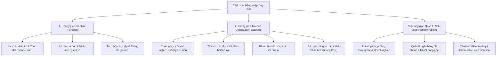
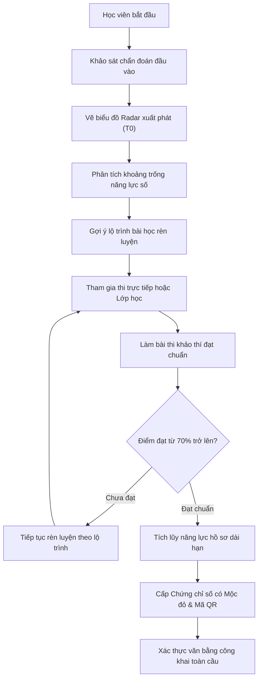
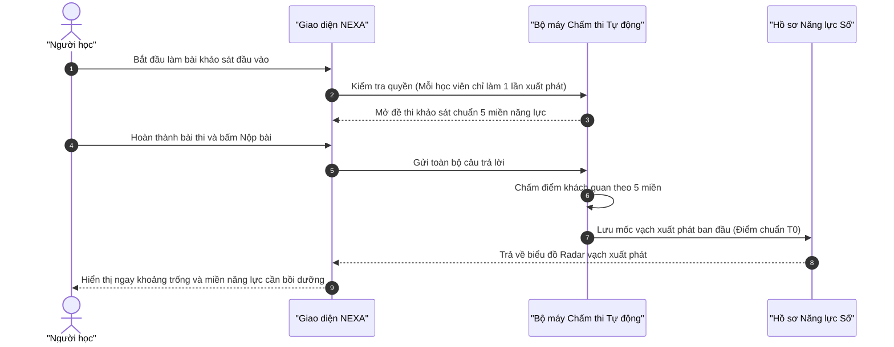
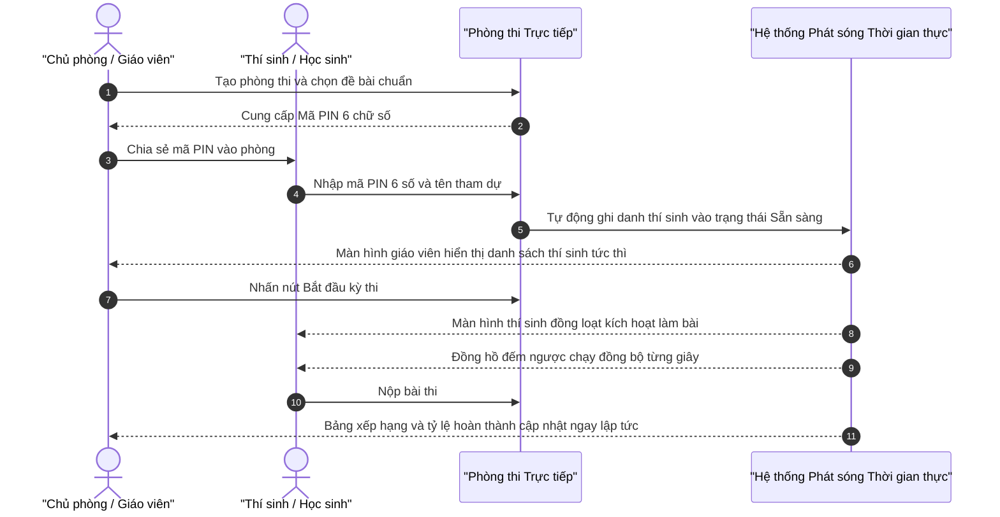
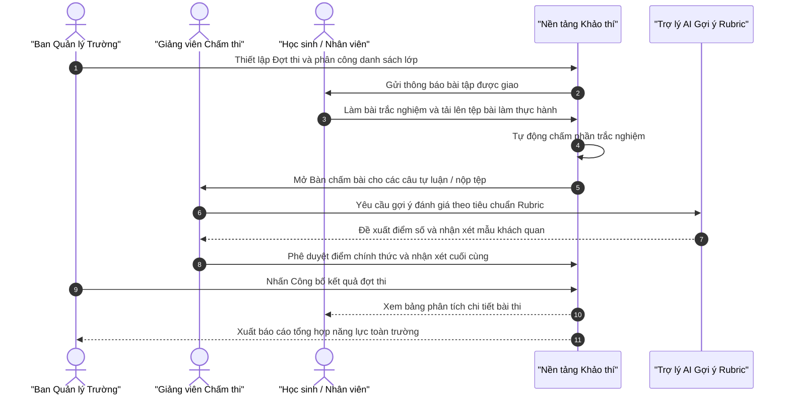
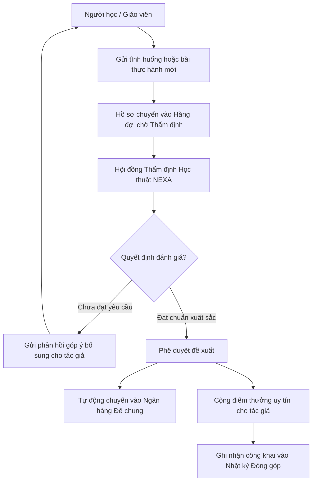
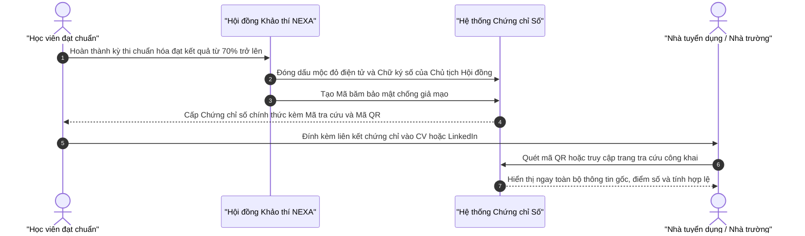

# QUY TRÌNH NGHIỆP VỤ VÀ LUỒNG VẬN HÀNH TOÀN DIỆN NEXA AI
# END-TO-END BUSINESS WORKFLOWS & OPERATIONAL MANUAL

Mã định danh: `DOC-NEXA-BUSINESS-FLOWS-2026`  
Phiên bản: `v3.0.0-PUBLIC`  
Dành cho: Khách hàng, Ban Giám hiệu, Doanh nghiệp đối tác, Chuyên viên phân tích nghiệp vụ  
Tiêu chuẩn tuân thủ: Bộ quy tắc `AGENTS.md`, Chuẩn vận hành khảo thí số quốc tế

## 1. MÔ HÌNH VẬN HÀNH: BA KHÔNG GIAN, MỘT DANH TÍNH DUY NHẤT

Nền tảng NEXA AI được thiết kế xoay quanh triết lý thống nhất tài khoản: Một người dùng chỉ cần một tài khoản đăng nhập duy nhất nhưng có thể linh hoạt chuyển đổi giữa ba không gian làm việc khác nhau:

### 1.1. Không gian Cá nhân (Personal Workspace)
- Dành cho học viên tự do, sinh viên, giáo viên tự rèn luyện.
- Người học tự chẩn đoán năng lực số ban đầu, xem biểu đồ Radar cá nhân, tự tạo đề luyện tập, tạo phòng thi giao lưu và nhận chứng chỉ số khi đạt chuẩn.

### 1.2. Không gian Tổ chức / Doanh nghiệp (Organization Business Workspace)
- Dành cho các Trường Đại học, Trường Cao đẳng, Trường Phổ thông hoặc Doanh nghiệp đào tạo nhân sự.
- Cho phép quản lý danh sách lớp học, phân công giảng viên chấm bài, tổ chức các kỳ thi đánh giá năng lực số diện rộng, và xuất báo cáo phân tích năng lực tập thể cho ban giám hiệu/lãnh đạo.

### 1.3. Không gian Quản trị Nền tảng (Platform Admin Console)
- Dành cho Ban điều hành và Hội đồng Khảo thí NEXA AI.
- Quản trị danh mục khách hàng tổ chức, thẩm định nội dung câu hỏi đóng góp, cấu hình chính sách điểm thưởng, quản lý phôi chứng chỉ danh dự và giám sát an toàn toàn hệ thống.

## 2. BẢN ĐỒ TỔNG THỂ TOÀN BỘ VÒNG ĐỜI NGHIỆP VỤ

Mọi hoạt động trên NEXA AI đều tuân theo vòng tròn khép kín: **Khảo thí có bằng chứng $\rightarrow$ Phát hiện khoảng trống $\rightarrow$ Gợi ý nội dung học $\rightarrow$ Thực hành thi đấu $\rightarrow$ Cấp chứng nhận số**.

## 3. CHI TIẾT CÁC LUỒNG NGHIỆP VỤ CỐT LÕI

### 3.1. Luồng 1: Khảo thí Đầu vào & Chẩn đoán Năng lực Số Khởi đầu
Mục đích: Xác định chính xác mặt bằng năng lực số ban đầu của học viên ngay khi tham gia hệ thống mà không áp đặt định kiến.

Quy tắc nghiệp vụ:
- Bài khảo sát đầu vào chỉ được thực hiện một lần duy nhất để thiết lập vạch xuất phát.
- Hệ thống không cộng điểm thưởng tràn lan từ bài khảo sát đầu vào để tránh hiện tượng gian lận cày điểm ảo. Điểm số thiết lập này là căn cứ so sánh sự tiến bộ vượt bậc của học viên về sau.

### 3.2. Luồng 2: Tổ chức Phòng thi Trực tiếp Thời gian thực (Live Exam Room)
Mục đích: Cho phép giảng viên hoặc học viên tự tổ chức các buổi thi đấu, kiểm tra trực tiếp trong lớp học hoặc giao lưu cộng đồng với trải nghiệm đồng bộ tức thì.

Quy tắc nghiệp vụ:
- Thí sinh chỉ cần nhập mã PIN 6 chữ số duy nhất là có thể tham gia ngay lập tức, không qua các bước đăng ký phức tạp.
- Hệ thống hỗ trợ chế độ giám sát thi thông minh: Cảnh báo khi thí sinh chuyển sang tab khác hoặc thoát khỏi toàn màn hình để đảm bảo tính nghiêm túc.

### 3.3. Luồng 3: Khảo thí Tổ chức & Lớp học Doanh nghiệp
Mục đích: Hỗ trợ trường học và doanh nghiệp vận hành các kỳ thi đánh giá diện rộng có cả câu hỏi trắc nghiệm tự động và bài thực hành nộp tệp cần giảng viên chấm điểm.

Quy tắc nghiệp vụ:
- Tách biệt rõ ràng giữa hai giai đoạn: Giai đoạn chấm thi nội bộ và Giai đoạn công bố kết quả. Thí sinh chỉ xem được điểm và đáp án khi nhà trường cho phép công bố.
- Giảng viên là người quyết định điểm số cao nhất; AI chỉ đóng vai trò trợ lý gợi ý tiêu chí chấm, loại bỏ hoàn toàn việc để máy tự ý đánh trượt thí sinh một cách thiếu nhân văn.

### 3.4. Luồng 4: Đóng góp Đề thi Cộng đồng & Xét duyệt Học thuật
Mục đích: Huy động trí tuệ tập thể từ giảng viên và chuyên gia số trên toàn quốc nhằm liên tục làm giàu ngân hàng đề thi tình huống thực tế.

Quy tắc nghiệp vụ:
- Mức điểm thưởng khi đề xuất được duyệt được thiết lập linh hoạt theo cấu hình hệ thống (mặc định 20 điểm hoặc điều chỉnh theo độ khó và chất lượng thực tế của tình huống).
- Tác giả được vinh danh trong hồ sơ đóng góp cộng đồng của nền tảng.

### 3.5. Luồng 5: Cấp phát và Xác thực Chứng chỉ Số Toàn cầu
Mục đích: Cấp chứng nhận năng lực số có giá trị pháp lý, chống giả mạo tuyệt đối và cho phép nhà tuyển dụng tra cứu tức thì 24/7.

Quy tắc nghiệp vụ:
- Chứng chỉ được xác thực bảo mật qua hai lớp mã băm, đảm bảo nếu bất kỳ ai sửa đổi dù chỉ một ký tự trên chứng chỉ, hệ thống sẽ lập tức báo vi phạm tính toàn vẹn.
- Bất kỳ ai cũng có thể kiểm tra tính thật/giả của chứng chỉ tại cổng tra cứu công khai mà không cần tạo tài khoản hay đăng nhập.

## 4. MA TRẬN PHÂN QUYỀN VÀ TRÁCH NHIỆM CHỨC NĂNG

| Chức năng chính | Học viên tự do | Giảng viên chấm thi | Ban Quản lý Trường | Quản trị viên Nền tảng |
| :--- | :---: | :---: | :---: | :---: |
| Làm bài khảo sát đầu vào & Xem Radar cá nhân | Có quyền | Có quyền | Có quyền | Có quyền |
| Tự tạo đề thi luyện tập cá nhân | Có quyền | Có quyền | Có quyền | Có quyền |
| Tạo và điều hành phòng thi trực tiếp Live | Có quyền | Có quyền | Có quyền | Có quyền |
| Quản lý lớp học và giao bài tập theo lớp | Không | Có quyền | Toàn quyền | Toàn quyền |
| Sử dụng Bàn chấm thi và xem gợi ý AI | Không | Toàn quyền | Toàn quyền | Toàn quyền |
| Xuất báo cáo năng lực số tập thể toàn trường | Không | Không | Toàn quyền | Toàn quyền |
| Đóng góp câu hỏi và tình huống mới | Có quyền | Có quyền | Có quyền | Toàn quyền |
| Thẩm định và duyệt đề thi cộng đồng | Không | Không | Không | Toàn quyền |
| Cấu hình mẫu phôi chứng chỉ & mộc đỏ | Không | Không | Không | Toàn quyền |
| Cấu hình mức điểm thưởng và bảo trì hệ thống | Không | Không | Không | Toàn quyền |
