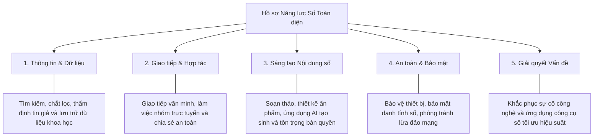
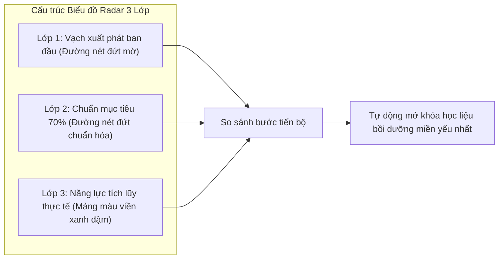
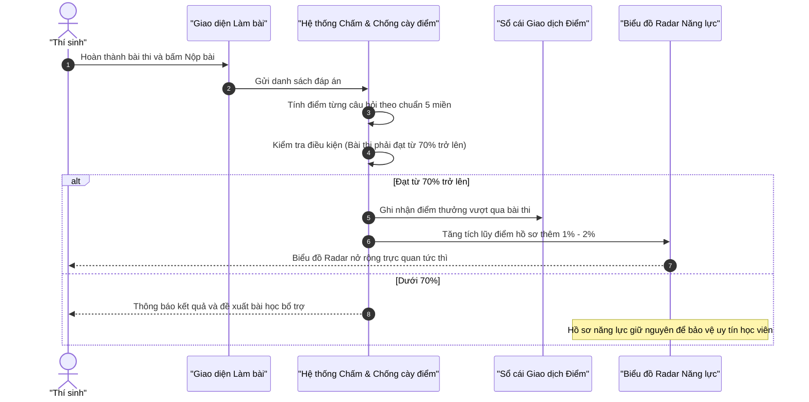

# ĐẶC TẢ KHUNG NĂNG LỰC SỐ VÀ PHƯƠNG PHÁP ĐÁNH GIÁ NEXA AI
# DIGITAL COMPETENCY FRAMEWORK & ASSESSMENT METHODOLOGY

Mã định danh: `DOC-NEXA-COMPETENCY-SPEC-2026`  
Phiên bản: `v3.0.0-PUBLIC`  
Dành cho: Học viên, Giảng viên, Chuyên gia Khảo thí, Ban Giám hiệu, Doanh nghiệp  
Tiêu chuẩn tuân thủ: Bộ quy tắc `AGENTS.md`, Chuẩn mực Khảo thí Năng lực Số Quốc tế

## 1. GIỚI THIỆU 5 MIỀN NĂNG LỰC SỐ CHUẨN MỰC

NEXA AI đánh giá năng lực số của con người một cách toàn diện thông qua **5 Miền Năng lực Cốt lõi**, phản ánh đầy đủ khả năng sống, học tập và làm việc an toàn, hiệu quả trong kỷ nguyên trí tuệ nhân tạo:

### 1.1. Chi tiết 5 miền năng lực
- **Miền 1: Thông tin và Dữ liệu:** Đánh giá khả năng tìm kiếm tài liệu thông minh trên Internet, phân biệt thông tin chính xác với tin giả/tin lừa đảo, sắp xếp và quản lý tệp dữ liệu cá nhân an toàn.
- **Miền 2: Giao tiếp và Hợp tác số:** Đánh giá kỹ năng ứng xử văn hóa trong môi trường mạng xã hội và email, kỹ năng cộng tác làm việc nhóm từ xa trên các ứng dụng văn phòng trực tuyến, và ý thức công dân số.
- **Miền 3: Sáng tạo Nội dung số:** Đánh giá khả năng soạn thảo văn bản quy chuẩn, xử lý bảng tính số liệu, thiết kế hình ảnh, video cơ bản, khả năng ra lệnh hiệu quả cho các trợ lý AI (Prompt Engineering) và tôn trọng quyền tác giả.
- **Miền 4: An toàn và Bảo mật số:** Đánh giá nhận thức về bảo vệ mật khẩu, bảo mật hai lớp, nhận diện chiêu trò lừa đảo trực tuyến (Phishing), bảo vệ dữ liệu riêng tư và giữ gìn sức khỏe tinh thần khi làm việc trước màn hình.
- **Miền 5: Giải quyết Vấn đề bằng Công nghệ:** Đánh giá khả năng tự xử lý các sự cố phần mềm/mạng thông dụng, linh hoạt lựa chọn công cụ số phù hợp để tự động hóa các công việc lặp đi lặp lại.

## 2. QUY CHUẨN CHẤM ĐIỂM VÀ TÍNH TRUNG THỰC CỦA DỮ LIỆU

### 2.1. Phân định triệt để giữa "Chưa có bằng chứng" và "0 điểm"
Một điểm khác biệt lớn của NEXA AI so với các hệ thống thông thường là tính nhân văn và độ chính xác của dữ liệu khảo thí:
- **Trạng thái Chưa có bằng chứng:** Khi học viên mới đăng ký tài khoản hoặc bài thi chưa có câu hỏi thuộc một miền nào đó, hệ thống ghi nhận là Chưa có dữ liệu đánh giá. Trên giao diện, điểm số không hiển thị con số 0 mà hiển thị vòng tròn trống nhằm khích lệ học viên làm bài bổ sung.
- **Trạng thái Đã đánh giá 0 điểm:** Chỉ khi học viên đã thực hiện bài thi có câu hỏi thuộc miền đó nhưng trả lời sai toàn bộ, hệ thống mới ghi nhận điểm số 0 kèm giải thích chi tiết đáp án để học viên rút kinh nghiệm.

### 2.2. Thang đo kết quả bài thi
- **Thang điểm 10:** Thân thiện, trực quan và gần gũi với thói quen học tập của học sinh, sinh viên tại Việt Nam.
- **Thang điểm Phần trăm (0% - 100%):** Dùng để phân tích độ bao phủ năng lực số và xếp loại đạt chuẩn quốc tế. Ngưỡng đạt chuẩn chuẩn hóa là **70%**.

## 3. CÁCH ĐỌC BIỂU ĐỒ RADAR NĂNG LỰC SỐ 3 LỚP

Biểu đồ mạng nhện (Radar Chart) trên bảng điều khiển cá nhân là bức tranh trực quan nhất về sự tiến bộ của người học. Biểu đồ gồm 3 lớp đường nét rõ ràng:

### 3.1. Ý nghĩa từng lớp hiển thị
- **Lớp 1 — Vạch xuất phát ban đầu:** Ghi lại kết quả bài khảo sát chẩn đoán đầu vào. Lớp này được cố định như một mốc tham chiếu lịch sử, giúp học viên luôn nhìn thấy mình đã xuất phát từ đâu.
- **Lớp 2 — Chuẩn mục tiêu 70%:** Vòng ranh giới chuẩn hóa toàn sàn. Khi mảng năng lực của học viên vượt ra ngoài vòng tròn 70% ở tất cả các miền, học viên đủ điều kiện nhận Chứng chỉ Năng lực số Chính thức.
- **Lớp 3 — Năng lực tích lũy thực tế:** Mảng mạng nhện viền xanh Cobalt đậm nét, mở rộng dần theo thời gian khi học viên rèn luyện và làm các bài thi chuẩn hóa.
- **Chỉ dẫn miền yếu nhất:** Điểm miền nào đang nằm lùi sâu nhất về tâm biểu đồ sẽ được gắn nhãn chú ý, đồng thời hệ thống tự động đề xuất lộ trình bài học ngắn gọn để học viên bù đắp ngay khoảng trống đó.

## 4. CƠ CHẾ TÍCH LŨY NĂNG LỰC BỀN VỮNG VÀ CHỐNG GIAN LẬN

### 4.1. Nguyên lý tăng trưởng lũy tiến (Không nhảy vọt ảo)
Năng lực số thật sự đòi hỏi sự rèn luyện bền bỉ. Vì vậy, hệ thống thiết kế cơ chế tích lũy điểm số chặt chẽ:
- Bài khảo sát đầu vào chỉ dùng làm mốc so sánh xuất phát, không làm biến động điểm số dài hạn.
- Sau mốc ban đầu, mỗi khi học viên hoàn thành một bài thi chuẩn hóa hoặc bài kiểm tra trong lộ trình đạt kết quả từ **70% trở lên**, điểm hồ sơ năng lực số chỉ tăng lũy tiến từng nấc nhỏ **1% đến 2%** (hoặc tối đa 3% đối với bài thi xuất sắc trên 90%).
- Cơ chế này loại bỏ hoàn toàn khả năng người dùng làm 1-2 bài dễ để đạt điểm tối đa 100% ảo, đảm bảo giá trị uy tín tuyệt đối cho hồ sơ năng lực của học viên khi nộp hồ sơ xin việc.

### 4.2. Phân định rõ ràng 4 đại lượng hệ thống
Để người dùng không bị nhầm lẫn, NEXA AI tách biệt hoàn toàn 4 chỉ số:
1. **Điểm một lần thi (0 - 100%):** Thể hiện kết quả làm bài của một kỳ thi cụ thể.
2. **Điểm Hồ sơ Năng lực số (0 - 100%):** Đại lượng bền vững dài hạn phản ánh trình độ thực tế tích lũy qua thời gian.
3. **Điểm thưởng chuyên cần (Điểm PTS):** Điểm số tích lũy từ điểm danh hằng ngày, chuỗi học tập đều đặn hoặc đóng góp câu hỏi hay; dùng để đổi các quyền lợi trên nền tảng.
4. **Bảng xếp hạng thi đua:** Vị trí thi đua của học viên trong tuần/tháng nhằm tạo động lực học tập vui vẻ.

## 5. QUY TRÌNH TỪ LÀM BÀI ĐẾN CẬP NHẬT BIỂU ĐỒ NĂNG LỰC

