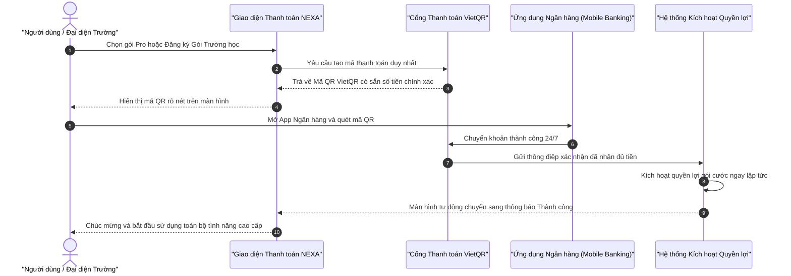

# BẢNG GIÁ DỊCH VỤ, CÁC GÓI CƯỚC VÀ PHÂN PHỐI QUYỀN LỢI NEXA AI
# PRICING PLANS, SERVICE PACKAGES & FEATURE ENTITLEMENTS

Mã định danh: `DOC-NEXA-PRICING-PLANS-2026`  
Phiên bản: `v3.0.0-PUBLIC`  
Dành cho: Khách hàng Cá nhân, Ban Giám hiệu Nhà trường, Giám đốc Đào tạo Doanh nghiệp  
Tiêu chuẩn tuân thủ: Bộ quy tắc `AGENTS.md`, Chuẩn hóa Giao dịch Điện tử Minh bạch

## 1. MÔ HÌNH DỊCH VỤ TÁCH BIỆT RÕ RÀNG

NEXA AI áp dụng mô hình định giá minh bạch và phân định rõ ràng giữa hai đối tượng phục vụ:
- **Người học Cá nhân (Personal):** Thanh toán tự động, linh hoạt từng tháng hoặc theo năm, được trải nghiệm dùng thử 30 ngày miễn phí.
- **Tổ chức, Nhà trường và Doanh nghiệp (Organization Business):** Ký kết hợp đồng đào tạo theo quy mô số lượng học sinh/nhân sự, xuất hóa đơn tài chính đầy đủ và có đội ngũ hỗ trợ kỹ thuật chuyên trách.

Học viên tham gia làm bài thi trong các kỳ thi do trường học hoặc công ty tổ chức sẽ hoàn toàn không phải trả thêm bất kỳ chi phí nào; mọi quyền lợi khảo thí và chi phí kiểm chuẩn đều do đơn vị chủ quản đài thọ.

## 2. BẢNG SO SÁNH QUYỀN LỢI CÁC GÓI DỊCH VỤ CÁ NHÂN

| Tính năng và Quyền lợi | Gói Cá nhân Miễn phí (Basic) | Gói Cá nhân Nâng cao (Personal Pro) |
| :--- | :---: | :---: |
| **Giá dịch vụ** | **0 VNĐ** | **49.000 VNĐ / tháng** *(hoặc 39.000 VNĐ/tháng khi thanh toán theo năm)* |
| **Chương trình Dùng thử** | Dùng vĩnh viễn | **30 ngày trải nghiệm miễn phí 0 VNĐ** |
| Làm bài khảo sát chẩn đoán đầu vào | Không giới hạn | Không giới hạn |
| Biểu đồ Radar năng lực số 5 miền | Có (Tổng quan) | Có (Chi tiết từng kỹ năng thành phần) |
| Đề thi luyện tập kiến thức chuẩn | 5 lượt thi / tuần | **Không giới hạn lượt thi** |
| Lộ trình học tập bồi dưỡng điểm yếu | Gợi ý cơ bản | **Lộ trình cá nhân hóa chuyên sâu từ AI** |
| Nhận Chứng chỉ Năng lực số chính thức | Xem bản mẫu | **Cấp bản chính thức có Chữ ký số, Mộc đỏ & Mã QR** |
| Tạo phòng thi đấu trực tiếp (Live Room) | Tối đa 10 người/phòng | **Tối đa 500 người/phòng** |
| Tải báo cáo phân tích năng lực PDF | Không hỗ trợ | **Xuất tệp PDF đầy đủ đính kèm hồ sơ xin việc** |
| Huy hiệu tài khoản chuyên nghiệp | Tiêu chuẩn | **Huy hiệu Thành viên Pro xác thực** |

Chính sách linh hoạt: Người dùng có thể hủy gia hạn bất kỳ lúc nào chỉ bằng một cú nhấp chuột trong mục Cài đặt Tài khoản mà không bị trừ phí; quyền lợi gói Pro vẫn được bảo lưu trọn vẹn cho đến hết ngày cuối cùng của chu kỳ đã đăng ký.

## 3. BẢNG GIÁ DỊCH VỤ DÀNH CHO TRƯỜNG HỌC VÀ DOANH NGHIỆP

Đối với các đơn vị đào tạo, trường đại học, trường phổ thông và doanh nghiệp, NEXA AI cung cấp 3 quy mô gói giải pháp toàn diện:

| Tiêu chí giải pháp | Gói Khởi đầu (Starter) | Gói Mở rộng (Growth) | Gói Doanh nghiệp Lớn (Enterprise) |
| :--- | :--- | :--- | :--- |
| **Quy mô học viên phục vụ** | Đến **250 học sinh / nhân viên** | Đến **2.000 học sinh / sinh viên** | **Trên 50.000 người học diện rộng** |
| **Đối tượng phù hợp** | Khoa, Bộ môn, Trung tâm Tin học | Trường Đại học, Trường Cao đẳng | Đại học Quốc gia, Tập đoàn Đa quốc gia |
| **Quản lý danh sách lớp học** | Tối đa 10 lớp học | Không giới hạn số lớp | Phân cấp Đa cơ sở, Đa chi nhánh |
| **Tổ chức đợt khảo thí diện rộng** | Tối đa 20 đợt thi / năm | Không giới hạn đợt thi | Không giới hạn đợt thi |
| **Bàn chấm bài thi tự luận** | Chấm bài thủ công | **Trợ lý AI gợi ý tiêu chí chấm Rubric** | AI chấm gợi ý chuyên sâu theo barem riêng |
| **Báo cáo phân tích tập thể** | Tổng hợp điểm trung bình | **Báo cáo khoảng trống năng lực toàn trường** | Phân tích chuyên sâu BI và xuất dữ liệu tự động |
| **Tùy biến phôi chứng chỉ** | Sử dụng mẫu chuẩn NEXA | Nhúng logo trường học | **Thiết kế phôi văn bằng riêng theo nhận diện trường** |
| **Hỗ trợ kỹ thuật & Cam kết** | Hỗ trợ qua email giờ hành chính | Hỗ trợ ưu tiên qua kênh riêng | **Kỹ sư túc trực 24/7, cam kết sẵn sàng 99.9%** |

Đơn vị giáo dục và doanh nghiệp có thể đăng ký lịch tư vấn giải pháp trực tuyến. Đội ngũ chuyên gia NEXA AI sẽ hỗ trợ thiết lập tài khoản dùng thử và xây dựng khung đề bài phù hợp với mục tiêu đào tạo của từng đơn vị.

## 4. MÔ HÌNH ĐIỂM AI (AI CREDITS) MINH BẠCH

Để đảm bảo hiệu năng phục vụ tối đa cho các kỳ thi lớn, hệ thống áp dụng cơ chế Điểm AI (AI Credits) đơn giản và minh bạch:
- **Nguyên lý tương tự nạp cước:** Mỗi tài khoản tổ chức được cấp sẵn một hạn mức điểm AI. Khi giảng viên sử dụng chức năng AI để gợi ý nhận xét bài tự luận phức tạp, hệ thống chỉ khấu trừ một lượng điểm tương ứng với bài thi đó.
- **Bảo toàn quyền lợi tuyệt đối:** Nếu quá trình phân tích bài thi gặp sự cố gián đoạn mạng, số điểm AI tạm giữ sẽ được tự động hoàn trả nguyên vẹn về tài khoản của nhà trường ngay tức khắc.
- **Không chi phí ẩn đối với học viên:** Mọi chi phí phân tích bằng AI cho các kỳ thi chung đều do trường học đài thọ; học viên không bao giờ bị trừ điểm hoặc yêu cầu thanh toán phụ phí.

## 5. PHƯƠNG THỨC THANH TOÁN VÀ QUY TRÌNH NÂNG CẤP DỊCH VỤ

### 5.1. Quét mã QR thanh toán tức thì (VietQR NAPAS 24/7)
Học viên và các đơn vị có thể thanh toán nâng cấp dịch vụ thuận tiện qua cổng thanh toán PayOS bảo mật:
- Tự động tạo mã QR động đúng số tiền và nội dung thanh toán.
- Tương thích với ứng dụng của hơn 18 ngân hàng lớn tại Việt Nam (Vietcombank, Techcombank, MB Bank, BIDV, VietinBank...) và các ví điện tử phổ biến.
- Giao dịch được xác thực an toàn tuyệt đối qua chữ ký số điện tử; tài khoản được kích hoạt nâng cấp thành công chỉ sau **3 đến 5 giây**.

### 5.2. Sơ đồ quy trình thanh toán và nâng cấp gói

