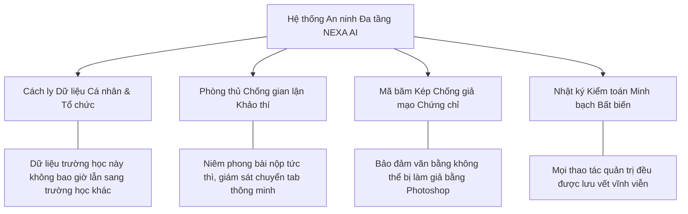
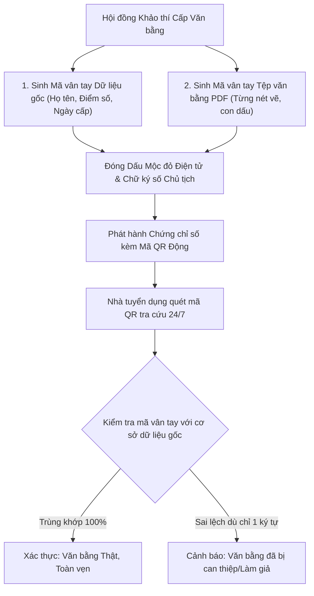
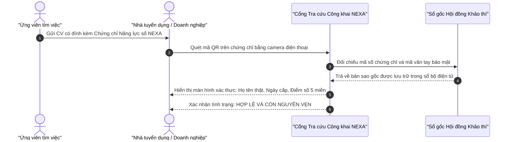

# KIẾN TRÚC AN AN NINH, BẢO MẬT VÀ XÁC THỰC CHỨNG CHỈ SỐ NEXA AI
# SECURITY ARCHITECTURE, DATA PRIVACY & CREDENTIAL VERIFICATION

Mã định danh: `DOC-NEXA-SECURITY-SPEC-2026`  
Phiên bản: `v3.0.0-PUBLIC`  
Dành cho: Nhà tuyển dụng, Ban Giám hiệu, Phụ huynh, Học viên, Chuyên gia An toàn thông tin  
Tiêu chuẩn tuân thủ: Bộ quy tắc `AGENTS.md`, Chuẩn mã hóa văn bằng số quốc tế

## 1. CAM KẾT BẢO MẬT DỮ LIỆU VÀ QUYỀN RIÊNG TƯ HỌC TẬP

NEXA AI áp dụng các tiêu chuẩn an ninh thông tin nghiêm ngặt nhất nhằm bảo vệ danh tính của học sinh, sinh viên và tài sản học liệu của các trường học, doanh nghiệp:

### 1.1. Cách ly dữ liệu độc lập
- **Quyền riêng tư cá nhân:** Việc một học viên tham gia vào lớp học của một trường học không đồng nghĩa với việc trường học đó sở hữu toàn bộ lịch sử học tập cá nhân của học viên. Dữ liệu rèn luyện cá nhân luôn thuộc quyền sở hữu của chính người học.
- **Ranh giới an toàn giữa các trường:** Toàn bộ danh sách sinh viên, đề thi nội bộ và kết quả bài làm của Trường A được lưu trữ trong khoang dữ liệu độc lập, hoàn toàn cách ly với Trường B và các tổ chức khác trên sàn.

## 2. CƠ CHẾ PHÒNG THỦ CHỐNG GIAN LẬN THI CỬ (EXAM INTEGRITY)

Để kết quả khảo thí phản ánh chính xác năng lực thực tế, hệ thống trang bị bộ giải pháp phòng chống tiêu cực toàn diện:

### 2.1. Niêm phong kỹ thuật số ngay khi nộp bài
Ngay thời điểm thí sinh nhấn nút Nộp bài hoặc khi đồng hồ đếm ngược kết thúc:
- Bài làm được hệ thống niêm phong kỹ thuật số ngay lập tức.
- Thí sinh bị khóa quyền chỉnh sửa câu trả lời để ngăn chặn việc sửa lại đáp án sau khi hết giờ.
- Kết quả bài làm được ghi nhận vĩnh viễn, loại bỏ hoàn toàn khả năng can thiệp điểm số từ bên ngoài.

### 2.2. Giám sát phòng thi thông minh (Smart Proctoring)
Trong suốt quá trình làm bài thi, hệ thống tự động ghi nhận các hành vi thiếu tập trung:
- Cảnh báo tức thì khi thí sinh chuyển sang cửa sổ trình duyệt khác hoặc mở tài liệu bên ngoài.
- Tự động ghi lại thời điểm và số lần thí sinh thoát khỏi chế độ toàn màn hình để báo cáo cho giám thị và giảng viên chấm bài.

### 2.3. Nguyên tắc công tâm trong chấm thi
Hệ thống thiết lập hàng rào ngăn chặn xung đột lợi ích: Nếu một giảng viên tham gia làm bài thi trong cùng một kỳ thi tập thể, giảng viên đó sẽ bị tước bỏ quyền tự chấm điểm cho bài thi của chính mình, đảm bảo tính khách quan tuyệt đối.

## 3. TÍNH PHÁP LÝ VÀ CƠ CHẾ BẢO MẬT CỦA CHỨNG CHỈ SỐ

Mỗi chứng chỉ số do Hội đồng Khảo thí NEXA AI phát hành đều là một văn bằng số hóa vĩnh viễn, được bảo vệ bằng công nghệ mã băm mật mã học hai lớp (Dual Cryptographic Fingerprint):

### 3.1. Mã băm bảo mật hai lớp hoạt động như thế nào?
- **Lớp 1 — Bảo vệ thông tin gốc:** Toàn bộ dữ liệu về họ tên học viên, danh sách 5 miền năng lực số và ngày cấp được mã hóa thành một chuỗi ký tự mã băm duy nhất.
- **Lớp 2 — Bảo vệ tệp văn bằng PDF:** Từng đường nét chữ ký, con dấu đỏ và bố cục hoa văn của tệp chứng chỉ PDF được tính toán một mã băm hình ảnh độc nhất.
- **Khả năng chống giả mạo:** Nếu bất kỳ ai sử dụng phần mềm chỉnh sửa ảnh để đổi tên người nhận hoặc nâng khống điểm số, mã băm của tệp chỉnh sửa sẽ lập tức sai lệch so với bản ghi gốc của Hội đồng Khảo thí. Hệ thống xác thực sẽ lập tức báo động và hiển thị cảnh báo văn bằng giả mạo.

### 3.2. Con dấu mộc đỏ điện tử và Chữ ký số
- Chứng chỉ mang con dấu mộc đỏ chính thức của Hội đồng Khảo thí Năng lực số, đóng đè lên chữ ký số của Chủ tịch Hội đồng theo đúng thể thức văn bản số.
- Học viên có thể dễ dàng tải về tệp PDF chất lượng in ấn quốc tế, chia sẻ đường link chứng thực trực tiếp lên hồ sơ LinkedIn hoặc đính kèm vào hồ sơ xin việc (CV).

### 3.3. Cổng tra cứu công khai độc lập 24/7
- Bất kỳ tổ chức, doanh nghiệp hoặc nhà tuyển dụng nào cũng có thể kiểm tra tính hợp lệ của chứng chỉ chỉ trong 2 giây bằng cách quét mã QR trên chứng chỉ hoặc nhập mã tra cứu tại Cổng xác thực công khai.
- Cổng tra cứu mở cửa 24/7 cho toàn cầu, hoàn toàn không yêu cầu người kiểm tra phải tạo tài khoản hay đăng nhập.

## 4. QUY TRÌNH XÁC THỰC VĂN BẰNG CỦA NHÀ TUYỂN DỤNG

## 5. NHẬT KÝ KIỂM TOÁN MINH BẠCH VÀ VẬN HÀNH BỀN VỮNG

- **Sổ nhật ký kiểm toán không thể tẩy xóa:** Mọi thao tác quản trị nhạy cảm (như phê duyệt đề xuất câu hỏi, điều chỉnh hạn mức dịch vụ, xuất bản đợt thi lớn) đều được tự động lưu lại vào hệ thống nhật ký kiểm toán kèm thời gian chính xác đến từng phần nghìn giây.
- **Bảo toàn dữ liệu khi bảo trì:** Khi hệ thống tiến hành nâng cấp hoặc bảo trì định kỳ, hệ thống sẽ đưa ra thông báo rõ ràng trước cho người dùng và tạm dừng các kỳ thi đang diễn ra, đảm bảo bài làm của học sinh không bao giờ bị mất mát dữ liệu.
