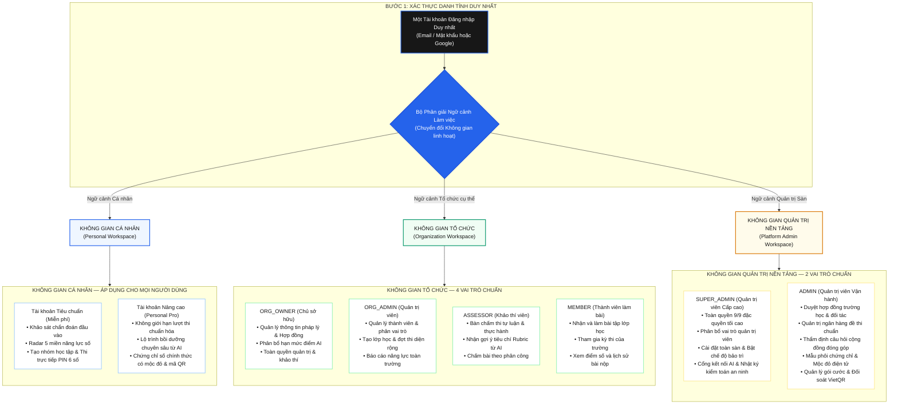

# QUY CHUẨN PHÂN QUYỀN VAI TRÒ VÀ ĐIỀU HƯỚNG KHÔNG GIAN LÀM VIỆC NEXA AI
# WORKSPACE ROLES & RBAC OPERATIONAL SPECIFICATION

Mã định danh: `DOC-NEXA-RBAC-ROLES-2026`  
Phiên bản: `v3.0.0-PUBLIC`  
Dành cho: Lãnh đạo, Đối tác Doanh nghiệp, Đơn vị Đào tạo, Chuyên viên Phân tích Nghiệp vụ  
Tiêu chuẩn tuân thủ: Bộ quy tắc `AGENTS.md`, Chuẩn an ninh phân quyền RBAC quốc tế

## 1. NGUYÊN TẮC CỐT LÕI: MỘT TÀI KHOẢN — ĐA NGỮ CẢNH LÀM VIỆC

Nền tảng NEXA AI xóa bỏ hoàn toàn sự bất tiện của việc phải tạo nhiều tài khoản riêng biệt. Mỗi người dùng sở hữu duy nhất một tài khoản đăng nhập nhưng có thể làm việc trên ba không gian độc lập:

- **Không gian Cá nhân:** Tự rèn luyện, theo dõi biểu đồ Radar 5 miền năng lực số và nhận chứng chỉ.
- **Không gian Tổ chức:** Quản lý lớp học, phân công chấm thi, phát hành đợt khảo thí diện rộng và xem báo cáo tập thể.
- **Không gian Quản trị Nền tảng:** Điều hành toàn sàn, phê duyệt khách hàng doanh nghiệp, quản lý ngân hàng đề và giám sát an toàn.

Việc chuyển đổi giữa các không gian là thao tác chuyển đổi ngữ cảnh làm việc, hoàn toàn không làm thay đổi loại tài khoản.

## 2. SƠ ĐỒ ĐIỀU HƯỚNG VÀ PHÂN QUYỀN TOÀN HỆ THỐNG

Sơ đồ trực quan hóa luồng xác thực từ khi đăng nhập đến việc phân giải ngữ cảnh và thẩm quyền thực thi của từng vai trò:

## 3. DANH MỤC CÁC VAI TRÒ CHUẨN HÓA VÀ QUYỀN HẠN THỰC THI

### 3.1. Phân quyền trong Không gian Cá nhân (Personal)
Mọi tài khoản sau khi đăng nhập đều có quyền truy cập không gian này. Quyền hạn được quyết định dựa trên gói dịch vụ:
- **Tài khoản Tiêu chuẩn (Miễn phí):** Khảo sát chẩn đoán đầu vào, theo dõi biểu đồ Radar 5 miền năng lực số, tạo nhóm học tập, tham gia và tạo phòng thi trực tiếp mã PIN (tối đa 10 người), đóng góp câu hỏi tình huống cho cộng đồng.
- **Tài khoản Nâng cao (Personal Pro):** Không giới hạn lượt làm bài thi chuẩn hóa, mở khóa lộ trình bồi dưỡng chuyên sâu từ AI, được cấp chứng chỉ số chính thức có mộc đỏ và mã QR bảo mật, tổ chức phòng thi trực tiếp quy mô lớn (đến 500 người).

### 3.2. Phân quyền trong Không gian Tổ chức (Organization)
Áp dụng khi người dùng làm việc trong một trường học hoặc doanh nghiệp cụ thể. Hệ thống chuẩn hóa về **4 vai trò chính thức**:

| Vai trò Tổ chức | Tên gọi chuẩn | Quyền hạn và Trách nhiệm thực tế |
| :--- | :--- | :--- |
| **`ORG_OWNER`** | **Chủ sở hữu Tổ chức** | **Quyền hạn cao nhất của đơn vị:** Quản lý thông tin pháp lý đơn vị, ký kết và gia hạn hợp đồng gói cước, kiểm soát và phân bổ hạn mức điểm AI, quản lý toàn bộ thành viên, tạo lớp học, tạo đợt thi diện rộng, chấm bài và xuất báo cáo tổng thể. |
| **`ORG_ADMIN`** | **Quản trị viên Tổ chức** | **Điều hành vận hành thường nhật:** Mời và duyệt thành viên, phân bổ vai trò, tạo lớp học, thiết lập đợt khảo thí diện rộng, phân công người chấm thi, công bố kết quả và xem báo cáo phân tích toàn trường. |
| **`ASSESSOR`** | **Khảo thí viên** | **Chuyên môn chấm thi:** Truy cập Bàn chấm thi để chấm bài tự luận và bài thực hành nộp tệp (nhận hỗ trợ gợi ý tiêu chí Rubric từ AI), chấm bài cho các lớp học và đợt thi được phân công phụ trách. |
| **`MEMBER`** | **Thành viên làm bài** | **Người tham gia làm bài:** Không vào màn hình điều hành của trường; được hệ thống điều hướng trực tiếp vào lớp học để nhận bài tập, làm bài thi khảo thí của trường và xem điểm số bài nộp của chính mình. |

### 3.3. Phân quyền trong Không gian Quản trị Nền tảng (Platform Admin)
Dành riêng cho ban điều hành sàn NEXA AI, được phân tách nghiêm ngặt thành **2 cấp độ vai trò**:

| Vai trò Quản trị Sàn | Tên gọi chuẩn | Quyền hạn và Trách nhiệm thực tế |
| :--- | :--- | :--- |
| **`SUPER_ADMIN`** | **Quản trị viên Cấp cao** | **Toàn quyền tối cao:** Nắm giữ toàn bộ 9/9 đặc quyền của hệ thống. Độc quyền quản lý 4 khu vực nhạy cảm nhất: Phân bổ vai trò quản trị viên, Cài đặt hệ thống toàn sàn và kích hoạt chế độ bảo trì, Cấu hình cổng kết nối mô hình trí tuệ nhân tạo (AI Gateway), và Giám sát nhật ký an ninh bất biến chống gian lận. |
| **`ADMIN`** | **Quản trị viên Vận hành** | **Điều hành tác nghiệp:** Phê duyệt hợp đồng trường học và doanh nghiệp, quản trị ngân hàng đề thi chuẩn, thẩm định câu hỏi đóng góp từ cộng đồng, quản lý mẫu phôi chứng chỉ và mộc đỏ điện tử, đối soát dòng tiền giao dịch VietQR, quản trị người dùng toàn sàn. Bị chặn tuyệt đối khỏi phân quyền admin, cấu hình AI, chế độ bảo trì và nhật ký an ninh. |

## 4. NGUYÊN TẮC AN TOÀN VÀ CÁCH LY DỮ LIỆU

- **Không leo thang đặc quyền:** Vai trò Quản trị viên của một trường học (`ORG_ADMIN`) hoàn toàn không có quyền can thiệp vào ban quản trị nền tảng (`Platform Admin`) hoặc dữ liệu của trường học khác.
- **Bảo mật dữ liệu học viên:** Dữ liệu học tập cá nhân của người học luôn thuộc quyền sở hữu riêng của người học, đơn vị đào tạo chỉ có quyền theo dõi kết quả của các bài thi được giao trong phạm vi lớp học của đơn vị.
