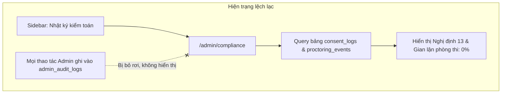
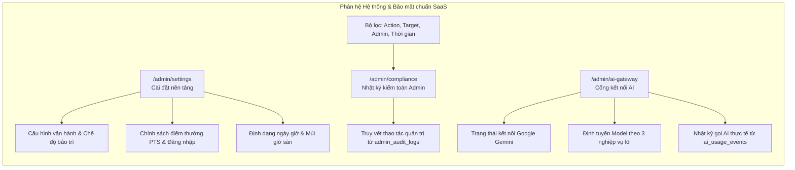

# Đặc tả Tái thiết kế: Cài đặt nền tảng, Nhật ký kiểm toán & AI Gateway

Tài liệu này rà soát hiện trạng mã nguồn, chỉ ra các lỗi kiến trúc / dữ liệu giả / lệch bản chất nghiệp vụ, và đưa ra thiết kế chuẩn SaaS cho 3 trang thuộc phân hệ **Hệ thống và bảo mật** của Platform Admin:
1. **Cài đặt nền tảng (`/admin/settings`)**
2. **Nhật ký kiểm toán (`/admin/compliance`)**
3. **Cổng kết nối AI (`/admin/ai-gateway`)**

---

## 1. Rà soát hiện trạng và bằng chứng mã nguồn

### 1.1. Trang Cài đặt nền tảng (`/admin/settings`)
* **Mã nguồn liên quan:** `src/app/(dashboard)/admin/settings/page.tsx`, `src/app/api/admin/settings/route.ts`, `src/app/api/personal/profile-stats/route.ts`, `src/app/api/contributions/route.ts`.
* **Hiện trạng & Sai lệch:**
  1. *Đưa vào các thông số hạ tầng cố định:* Giới hạn tải lên (`maxUploadSize`), thời hạn phiên (`sessionTimeout`), chính sách mật khẩu là quy định kỹ thuật hạ tầng của hệ thống/Vercel/cookie, không thuộc phạm vi cài đặt động của Super Admin.
  2. *Đưa vào các quy tắc khảo thí nhầm lẫn:* Ngưỡng chuẩn 70% thuộc về logic đối chuẩn năng lực số của NEXA; công tắc "Kiểm duyệt đề" bị nhầm lẫn giữa quy trình duyệt bài cộng đồng (lấy nguồn cảm hứng để ban nội dung tự biên soạn lại đề Canonical) với việc "duyệt cái là public lên".
  3. *Bỏ quên các tham số nghiệp vụ đang bị hardcode:*
     - Điểm danh hằng ngày: Đang gán cứng `delta: 1` tại `src/app/api/personal/profile-stats/route.ts:91`.
     - Điểm chuỗi chuyên cần (Streak bonus): Đang gán cứng mốc chuỗi 3 ngày tại `src/app/(dashboard)/personal/dashboard/page.tsx`.
     - Điểm thưởng đóng góp câu hỏi/đề thi cộng đồng: Cần cho phép admin định nghĩa mức điểm thưởng đề xuất theo từng loại câu hỏi (MCQ, Tình huống, Tệp thực hành).
     - Định dạng & Múi giờ: Đang bị giới hạn cứng một vài lựa chọn, thiếu định dạng hiển thị ngày giờ chuẩn hóa toàn sàn.

---

### 1.2. Trang Nhật ký kiểm toán (`/admin/compliance`)
* **Mã nguồn liên quan:** `src/app/(dashboard)/admin/compliance/page.tsx`, `src/app/api/admin/compliance/route.ts`, `src/app/api/admin/audit-logs/route.ts`, `src/lib/audit/admin-audit.service.ts`, `src/database/migrations/46_schema_standardization_and_cleanup.sql:159`.
* **Hiện trạng & Sai lệch nghiêm trọng:**
  1. *Lệch bản chất trang:* Menu sidebar ghi rõ **"Nhật ký kiểm toán"** (`/admin/compliance`), nhưng khi truy cập lại hiển thị tiêu đề **"Tuân thủ, bảo mật và kiểm toán"** đi kèm Nghị định 13/2023/NĐ-CP, hồ sơ đồng thuận dữ liệu, sự kiện phòng thi giám sát.
  2. *Dữ liệu giả / rỗng tuếch:* Hiển thị 4 thẻ KPI với giá trị 0 ("Hồ sơ đã đồng thuận: 0", "Tỷ lệ tuân thủ dữ liệu: 0%", "Cảnh báo mức độ cao: 0").
  3. *Không hiển thị bảng `admin_audit_logs` thực tế:* Hệ thống đã có sẵn bảng `admin_audit_logs` và API `/api/admin/audit-logs` ghi nhận đầy đủ mọi thao tác nhạy cảm của Admin (sửa settings, khóa/mở tài khoản, cấp VIP, duyệt hợp đồng B2B, đổi cấu hình AI, duyệt đóng góp đề), nhưng trang UI lại không dùng đến!

---

### 1.3. Trang Cổng kết nối AI (`/admin/ai-gateway`)
* **Mã nguồn liên quan:** `src/app/(dashboard)/admin/ai-gateway/page.tsx`, `src/app/api/admin/ai-gateway/route.ts`, `src/features/ai-gateway/services/ai-config.service.ts`, `src/database/migrations/15_ai_usage_and_hitl_schema.sql`.
* **Hiện trạng & Sai lệch:**
  1. *Giao diện "dữ liệu dữ" (Over-engineered & Cluttered):* Trang dài 900 dòng code, nhồi nhét 6 thẻ KPI (lượt gọi, tỷ lệ lỗi, token, avg latency, p95 latency, chi phí VND/USD), 2 biểu đồ phân bổ, thanh tiến trình ngân sách USD giả lập.
  2. *Lỗ hổng bảo mật thao tác:* Có nút mở modal để gõ API Key trên giao diện web (trong khi API Key kết nối với Google Gemini phải được bảo vệ tại biến môi trường hạ tầng máy chủ).
  3. *Thiếu tính thực dụng:* Thứ Super Admin thực sự cần ở một Cổng kết nối AI trong nền tảng khảo thí năng lực số là:
     - **Trạng thái cổng kết nối:** Kết nối thành công tới Gemini hay không? Model mặc định là gì?
     - **Định tuyến mô hình theo 3 nghiệp vụ lõi:** Chấm điểm tự luận/Rubric, Phân tích năng lực 5 miền, Trợ lý biên soạn câu hỏi.
     - **Nhật ký yêu cầu thực tế:** Bảng sự kiện gọi AI từ `ai_usage_events` (Thời gian, nghiệp vụ, prompt token, output token, độ trễ ms, trạng thái).

---

## 2. Thiết kế đề xuất chuẩn SaaS (Kiến trúc & Luồng nghiệp vụ)

---

## 3. Đặc tả chi tiết 3 trang màn hình

### 3.1. Cài đặt nền tảng (`/admin/settings`)
* **Mục tiêu:** Quản trị các quy tắc kinh doanh và tham số hệ thống mà Admin thực sự được điều chỉnh.
* **Bố cục giao diện:**
  - **Khối 1: Vận hành chung & Bảo trì:**
    - Tên nền tảng (`platformName`).
    - Email liên hệ vận hành / hỗ trợ người dùng (`supportEmail`).
    - Chế độ bảo trì toàn sàn (`maintenanceMode` toggle): Khi bật, chặn toàn bộ người dùng thông thường, chỉ tài khoản Super Admin trong `SUPERADMIN_EMAILS` mới truy cập được.
  - **Khối 2: Chính sách điểm thưởng & Chuyên cần (Gamification PTS):**
    - Điểm thưởng đăng nhập hằng ngày (`dailyLoginPts`): Số PTS cộng cho người dùng khi đăng nhập điểm danh mỗi ngày (thay vì cố định 1 PTS).
    - Điểm thưởng chuỗi đăng nhập liên tục (`streakMilestonePts`): Thưởng thêm khi đạt chuỗi (ví dụ: chuỗi 7 ngày liên tiếp).
    - Điểm thưởng đề xuất đóng góp câu hỏi (`contributionApprovedPts`): Điểm thưởng mặc định khi Admin phê duyệt một câu hỏi/đề thi cộng đồng gửi lên làm tư liệu.
  - **Khối 3: Thời gian & Định dạng hiển thị:**
    - Múi giờ hệ thống (`systemTimezone`): Hỗ trợ danh sách múi giờ phổ biến (Hà Nội GMT+7, Tokyo GMT+9, Singapore GMT+8, UTC...).
    - Định dạng ngày giờ hiển thị (`dateTimeFormat`): `DD/MM/YYYY HH:mm` (chuẩn Việt Nam) hoặc `YYYY-MM-DD HH:mm`.

---

### 3.2. Nhật ký kiểm toán (`/admin/compliance`)
* **Mục tiêu:** Tái định vị 100% thành **Admin Audit Trail** — hệ thống truy vết toàn bộ hành động có đặc quyền của quản trị viên trên hệ thống.
* **Nguồn dữ liệu:** Bảng `admin_audit_logs` thông qua API `/api/admin/audit-logs`.
* **Bố cục giao diện:**
  - **Thanh tổng quan hoạt động (Activity Stats):**
    - Tổng số thao tác quản trị đã ghi nhận.
    - Số thao tác trong 24 giờ qua.
    - Số quản trị viên tham gia thao tác.
  - **Bộ lọc & Tìm kiếm nhanh:**
    - Tìm kiếm theo Email Admin, ID đối tượng tác động (Target ID) hoặc nội dung chi tiết.
    - Lọc theo loại hành động (`Action`): Cập nhật Cài đặt, Cập nhật AI, Khóa/Mở tài khoản, Cấp VIP, Duyệt đóng góp, Đối soát giao dịch, Xuất bản đề...
    - Lọc theo đối tượng (`Target Type`): `USER`, `ORGANIZATION`, `ASSESSMENT`, `TRANSACTION`, `SYSTEM_SETTINGS`, `AI_GATEWAY`...
    - Lọc theo mốc thời gian: 24 giờ qua, 7 ngày qua, 30 ngày qua, Toàn thời gian.
  - **Bảng dữ liệu kiểm toán chuẩn Enterprise:**
    - Cột 1: Thời gian thao tác (Ngày giờ chi tiết).
    - Cột 2: Quản trị viên (Email Admin + Avatar nhận diện).
    - Cột 3: Hành động thực hiện (Badge màu ngữ nghĩa: Xanh lá cho duyệt/tạo mới, Vàng hổ phách cho cập nhật/cấu hình, Đỏ cho khóa tài khoản/xóa).
    - Cột 4: Đối tượng tác động (Loại đối tượng + ID liên quan).
    - Cột 5: Chi tiết thay đổi (Nút mở xem Payload JSON hoặc Diff trực quan).
    - Cột 6: Địa chỉ IP ghi nhận.

---

### 3.3. Cổng kết nối AI (`/admin/ai-gateway`)
* **Mục tiêu:** Theo dõi trạng thái hoạt động và cấu hình định tuyến mô hình AI phục vụ các tính năng thông minh của NEXA một cách tinh gọn, tin cậy.
* **Nguồn dữ liệu:** `ai_usage_events`, bảng cấu hình `ai_gateway_config` trong Supabase.
* **Bố cục giao diện:**
  - **Khối 1: Trạng thái kết nối Cổng AI (Connection Status):**
    - Nhà cung cấp: **Google Gemini**.
    - Trạng thái: Badge xanh "Đang hoạt động (Connected)".
    - Khóa kết nối: Hiển thị trạng thái an toàn ("Đã cấu hình qua biến môi trường máy chủ").
  - **Khối 2: Định tuyến mô hình theo 3 nghiệp vụ cốt lõi:**
    - *Nghiệp vụ 1: Chấm điểm tự luận theo Rubric* (`RUBRIC_GRADING`) -> Dropdown chọn model (Khuyến nghị: `gemini-2.5-flash` cho tốc độ và chi phí tối ưu, hoặc `gemini-2.5-pro` cho bài thi chuyên sâu).
    - *Nghiệp vụ 2: Phân tích năng lực 5 miền & Gợi ý lộ trình* (`COMPETENCY_ANALYSIS`) -> Dropdown chọn model.
    - *Nghiệp vụ 3: Trợ lý biên soạn & Đề xuất câu hỏi* (`AUTHORING_ASSIST`) -> Dropdown chọn model.
    - Nút "Lưu định tuyến mô hình".
  - **Khối 3: Nhật ký yêu cầu AI thực tế (Telemetry Table):**
    - Đọc dữ liệu thực từ bảng `ai_usage_events`.
    - Cột: Nghiệp vụ | Mô hình | Số token (Prompt / Output) | Độ trễ (ms) | Trạng thái (Thành công / Thất bại) | Thời gian.
    - Tìm kiếm nhanh theo nghiệp vụ hoặc model.

---

## 4. Quy chuẩn giao diện (UI/UX Standards)
* Tuân thủ quy tắc tại `AGENTS.md`:
  - **Light Mode:** Nền trang `#FFFFFF`, nền Card `#FFFFFF` với viền `border-slate-200`, tiêu đề `#171717`, nội dung `#262626`, chữ phụ `#64748B`.
  - **Dark Mode:** Nền trang `#000000`, nền Card `#111114` với viền `dark:border-zinc-800`, tiêu đề `#F5F5F5`, nội dung `#E4E4E7`, chữ phụ `#A3A3A3`.
  - **Cobalt Blue:** `#2563EB` cho nút bấm chính và trạng thái active.
  - **Tuyệt đối không dùng đường viền ngang** (`border-b`, `
`, `divide-y`).
  - Không giả lập thành công, không dùng dữ liệu mock text cứng.
