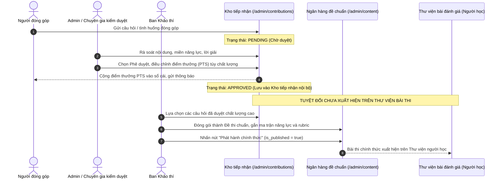

# ĐẶC TẢ QUẢN TRỊ NỀN TẢNG NEXA (PLATFORM ADMIN SPECIFICATION 2026)

Tài liệu đặc tả kiến trúc, luồng nghiệp vụ, giao diện và hợp đồng kỹ thuật cho phân hệ Quản trị Nền tảng (Platform Admin) của NEXA theo phương pháp Phát triển Định hướng Đặc tả (/spec-driven-development).

Mã tài liệu: NEXA-SPEC-ADMIN-2026-V3
Phiên bản: 3.0 (Cập nhật ngày 13/11/2026)
Trạng thái: Đặc tả chính thức sẵn sàng triển khai (Approved Specification)
Căn cứ tài liệu: docs/SRS.md (v2.0), docs/USECASE.md, docs/ai-integration-architecture.md, AGENTS.md
Mã nguồn đối chiếu: Commit 6c4ecb7 trên nhánh main kho lưu trữ NEXA


## 1. BẢN ĐỒ NĂNG LỰC HỆ THỐNG (CAPABILITY MAP)

Phân hệ Quản trị Nền tảng được phân rã thành 8 module độc lập có ranh giới rõ ràng, không có chu kỳ phụ thuộc:

| Module ID | Tên Module | Trách nhiệm chính | Phụ thuộc |
| :--- | :--- | :--- | :--- |
| `admin-core-audit` | Điều hành và Toàn vẹn dữ liệu | Dashboard 6 KPI, loại bỏ mock data, đo lường sức khỏe hệ thống thật, nhật ký kiểm toán | Không |
| `admin-rbac-security` | Phân quyền và Bảo vệ dữ liệu | Capability RBAC guard trên API, noindex private dashboards, cơ chế Kiosk tra cứu chứng nhận | `admin-core-audit` |
| `admin-system-settings` | Cấu hình tham số nền tảng | Bảo trì, chính sách khảo thí, chính sách điểm PTS động, SMTP, Webhook đối soát | `admin-rbac-security` |
| `admin-org-business` | Khách hàng và Kinh doanh B2B | Tiếp nhận tư vấn, kích hoạt B2B, gia hạn gói, tạm ngừng an toàn (không xóa cứng) | `admin-system-settings` |
| `admin-frameworks` | Quản trị Khung năng lực số | Phiên bản khung, danh mục miền năng lực và kỹ năng thành phần, neo dữ liệu | `admin-rbac-security` |
| `admin-content-staging` | Khảo thí và Kiểm duyệt đóng góp | Ngân hàng đề thi, quy trình duyệt đóng góp vào Kho tiếp nhận, thưởng điểm PTS tùy biến | `admin-frameworks`, `admin-system-settings` |
| `admin-ai-gateway` | Cổng kết nối AI và Điều phối mô hình | Multi-provider (Gemini, OpenAI, Llama/On-premise), Model Router, ngân sách trần, telemetry | `admin-core-audit`, `admin-system-settings` |
| `admin-analytics-deep` | Phân tích Khảo thí và Năng lực | Item analysis (p, D), khoảng trống năng lực số, độ tăng trưởng học tập, AI drift | `admin-content-staging`, `admin-ai-gateway` |

Thứ tự triển khai (Build Order):
`admin-core-audit` -> `admin-rbac-security` -> `admin-system-settings` -> `admin-org-business`, `admin-frameworks` -> `admin-content-staging`, `admin-ai-gateway` -> `admin-analytics-deep`.


## 2. NGUYÊN TẮC THIẾT KẾ & QUY CHUẨN BẮT BUỘC (STRICT BOUNDARIES)

### 2.1. Quy chuẩn giao diện và Thương hiệu
- Tuyệt đối không sử dụng đường viền ngang (không dùng thẻ `<hr>`, không dùng cú pháp markdown `---`, không dùng các class CSS `border-b`, `border-t`, `divide-y`).
- Cấu trúc phân tách không gian: Sử dụng khoảng trắng (whitespace: gap-4, gap-6, p-4, p-6), viền thẻ bao quanh toàn bộ (rounded-xl border border-slate-200 dark:border-zinc-800) hoặc nền phân nhóm (bg-slate-50 dark:bg-zinc-900).
- Hệ màu chuẩn Light Trắng / Dark Đen:
  - Light Mode: Nền trang `#FFFFFF`, Nền phụ `#F8FAFC`, Tiêu đề `#171717`, Chữ chính `#262626`, Chữ phụ `#64748B`, Viền `#E2E8F0`, Xanh Cobalt `#2563EB`, Hover `#1D4ED8`.
  - Dark Mode: Nền trang `#000000`, Nền panel `#0A0A0B`, Nền thẻ `#111114`, Tiêu đề `#F5F5F5`, Chữ chính `#E4E4E7`, Chữ phụ `#A3A3A3`, Viền `#27272A`, Xanh nhấn `#60A5FA`.
- Cấm hoàn toàn thiết kế kiểu AI slop: Không gradient rực rỡ, không hiệu ứng neon phát sáng, không thẻ kính mờ (glassmorphism), không dùng emoji làm icon sản phẩm trong JSX (chuẩn hóa toàn bộ bằng `lucide-react` với `strokeWidth={1.75}`).

### 2.2. Quy tắc ngôn ngữ và Điều hướng Sidebar
- Tuyệt đối không dùng ký tự `&` trong menu sidebar: Thay thế toàn bộ bằng từ nối tiếng Việt tự nhiên ("và"), gạch nối ("-") hoặc danh từ đơn rõ nghĩa.
- Tuyệt đối không phô bày thuật ngữ DigComp ra giao diện người dùng: Khung DigComp 2.2 / 3.0 chỉ là cơ sở học thuật nội bộ. Trên toàn bộ giao diện người dùng, chỉ sử dụng: "các miền năng lực số", "Khung năng lực số" hoặc "Hồ sơ năng lực số".
- Cách ly ranh giới 4 không gian - 3 Dashboard:
  - Website công khai: Không có dashboard.
  - Personal Workspace: `/personal/*`.
  - Organization Workspace: `/org/[slug]/*`.
  - Platform Admin: `/admin/*`.


## 3. CẤU TRÚC ĐIỀU HƯỚNG SIDEBAR CHUẨN (KHÔNG DÙNG KÝ TỰ &)

Menu Sidebar được tổ chức thành đúng 5 nhóm nghiệp vụ logic:

```text
NEXA — QUẢN TRỊ NỀN TẢNG

1. ĐIỀU HÀNH
   └── Tổng quan nền tảng                 /admin/dashboard

2. KHÁCH HÀNG VÀ KINH DOANH
   ├── Người dùng                       /admin/users
   ├── Tổ chức Business                 /admin/organizations
   ├── Gói dịch vụ                      /admin/plans
   └── Giao dịch đối soát               /admin/transactions

3. NĂNG LỰC VÀ KHẢO THÍ
   ├── Khung năng lực số                /admin/frameworks
   ├── Khảo thí đầu vào                 /admin/baseline
   ├── Ngân hàng đề chuẩn               /admin/content
   ├── Lộ trình học tập                 /admin/learning-paths
   └── Phân tích năng lực số            /admin/analytics

4. CỘNG ĐỒNG VÀ PHẢN HỒI
   ├── Hộp thư góp ý                    /admin/communications
   └── Kiểm duyệt đóng góp             /admin/contributions

5. HỆ THỐNG VÀ BẢO MẬT
   ├── Cổng kết nối AI                  /admin/ai-gateway
   ├── Nhật ký kiểm toán                /admin/compliance
   ├── Phân quyền quản trị              /admin/roles
   └── Cài đặt nền tảng                 /admin/settings
```

Điều kiện hiển thị menu:
- Trang `/admin/roles` và `/admin/certificates`: Chỉ hiển thị khi API backend đã hoàn thiện và tài khoản có capability tương ứng. Tuyệt đối không đưa liên kết dẫn tới trang 404 hoặc trang chỉ có giao diện giả lập.


## 4. ĐẶC TẢ CHI TIẾT CÁC PHÂN HỆ NGHIỆP VỤ

### 4.1. Module `admin-core-audit`: Tổng quan nền tảng & Kiến trúc chỉ số phân tầng
Dashboard không phải là trang nhồi nhét bảng dữ liệu, mà là Trung tâm điều hành 30 giây (Command Center).

Áp dụng Kiến trúc phân tầng chỉ số (Tiered Metrics Architecture):
- Tầng 1 (Executive Command KPI - Cố định đúng 6 thẻ Hero trên Dashboard):
  1. Doanh thu đối soát trong kỳ: Tổng tiền các giao dịch `COMPLETED`/`RECONCILED` trong kỳ đo.
  2. Tổ chức trả phí hiệu lực: Số lượng tổ chức duy nhất có gói trả phí còn hạn tại thời điểm xem.
  3. Người dùng hoạt động thật (30 ngày): Số người dùng duy nhất phát sinh sự kiện hợp lệ trong 30 ngày.
  4. Lượt đánh giá hoàn tất: Số bài thi có trạng thái `SUBMITTED` hoặc `EVALUATED` trong kỳ.
  5. Chứng nhận đã cấp: Số chứng chỉ số hợp lệ trong bảng `credentials` chưa bị thu hồi.
  6. Chi phí AI trong kỳ: Tổng chi phí ghi nhận từ bảng `ai_usage_events` trong kỳ đo (ghi rõ nhãn Ước tính).
- Chính sách Zero-Fake-Data:
  - Nếu cơ sở dữ liệu trống hoặc truy vấn trả về 0: Hiển thị chính xác số `0` hoặc `0 đ`.
  - Nghiêm cấm hiển thị các con số hardcode: `284.720` người dùng, `412` tổ chức, `18.540` đề thi, pending counts `12, 6, 37`.
  - Phễu chuyển đổi (Funnel Panel): Chỉ vẽ các bước từ dữ liệu thực tế, không nhân tỷ lệ ảo `72,4%` hay `82,3%`.
  - Hoạt động gần đây (Recent Activities): Truy vấn trực tiếp từ bảng nhật ký kiểm toán `admin_audit_logs`, không gán cứng tên công ty hư cấu.
- Trạng thái sức khỏe hệ thống:
  - Thay thế badge tĩnh "Hệ thống ổn định 99.9%" bằng cơ chế kiểm tra nhịp tim (health check) thời gian thực. Nếu chưa có telemetry, hiển thị nhãn "Dịch vụ đang hoạt động" kèm thời gian phản hồi máy chủ.

### 4.2. Module `admin-rbac-security`: Phân quyền & Kiosk tra cứu chứng chỉ số
- Kiểm soát phân quyền ở tầng máy chủ:
  Mọi endpoint quản trị phải được bảo vệ bởi hàm `requirePlatformAdmin(capability)` với 8 capability chuyên biệt:
  - `MANAGE_USERS`: Quản lý tài khoản người dùng và khóa/mở tài khoản.
  - `MANAGE_ROLES`: Phân bổ vai trò quản trị.
  - `VIEW_FINANCE`: Xem báo cáo doanh thu và lịch sử giao dịch.
  - `MANAGE_FINANCE`: Thao tác đối soát, hoàn tiền, điều chỉnh gói dịch vụ.
  - `MANAGE_CONTENT`: Quản trị ngân hàng đề, khung năng lực và duyệt đóng góp cộng đồng.
  - `OPERATE_AI`: Cấu hình mô hình AI, định tuyến Router và ngân sách AI.
  - `MANAGE_ORGANIZATIONS`: Kích hoạt, gia hạn và tạm ngừng tổ chức B2B.
  - `MANAGE_SETTINGS`: Cấu hình tham số hệ thống và bảo trì.
- Trang Tra cứu chứng nhận số Kiosk (`/verify/[credentialId]`):
  - Tuyệt đối không xuất hiện trên thanh điều hướng, menu hay sitemap.
  - Chỉ kích hoạt khi người dùng quét mã QR hoặc truy cập đường link xác thực trực tiếp.
  - Bắt buộc cấu hình `robots: { index: false, follow: false }` để bảo vệ quyền riêng tư cá nhân (PII).
  - Loại bỏ hoàn toàn đoạn mã tự dựng chứng nhận giả khi mã bắt đầu bằng `NX-`. Nếu không tìm thấy bản ghi trong bảng `credentials` hoặc chứng nhận đã bị thu hồi (`is_revoked = true`), trả về ngay giao diện cảnh báo chứng nhận không hợp lệ.

### 4.3. Module `admin-system-settings`: Cài đặt tham số nền tảng & Điểm thưởng PTS động
Loại bỏ hoàn toàn hàm giả lập `setTimeout()` và lưu cục bộ. Trang `/admin/settings` quản lý 5 nhóm tham số lưu trữ trực tiếp vào bảng `system_settings`:

1. Cấu hình vận hành chung:
   - Chế độ bảo trì hệ thống (`maintenance_mode: boolean`).
   - Email liên hệ hỗ trợ (`support_email: string`).
   - Múi giờ hệ thống (`system_timezone: string`, mặc định `Asia/Ho_Chi_Minh`).
2. Chính sách khảo thí:
   - Ngưỡng điểm đạt chuẩn mặc định (`passing_threshold_percentage: number`, mặc định 70).
   - Thời gian lưu trữ bài nộp (`data_retention_months: number`, mặc định 36 tháng).
   - Giới hạn dung lượng tệp nộp bài thực hành (`max_upload_size_mb: number`, mặc định 50MB).
3. Cơ chế điểm thưởng PTS động (Gamification & Reward Policy):
   - Tuyệt đối không gán cứng `+50 PTS`.
   - Cấu hình định mức điểm thưởng mặc định cho từng loại đóng góp:
     - Câu hỏi trắc nghiệm chuẩn: Mặc định `20 PTS`.
     - Câu hỏi tình huống thực hành: Mặc định `50 PTS`.
     - Tình huống thực hành phức tạp kèm tệp minh chứng: Mặc định `100 PTS`.
     - Báo cáo lỗi hệ thống / Lỗ hổng bảo mật: Mặc định `150 PTS`.
   - Cho phép người kiểm duyệt điều chỉnh linh hoạt số điểm thưởng trong lúc phê duyệt bài.
4. Cổng kết nối dịch vụ:
   - Cấu hình SMTP gửi email thông báo hệ thống (Resend / SendGrid / Postmark).
   - Cấu hình Webhook đối soát thanh toán tự động (VietQR, SePay, PayOS, MoMo).
5. Bảo mật và Phiên đăng nhập:
   - Thời gian hết hạn phiên làm việc Admin (`session_timeout_hours: number`, mặc định 8h).
   - Bắt buộc xác thực hai yếu tố (`enforce_admin_2fa: boolean`).

### 4.4. Module `admin-org-business`: Quản trị Khách hàng Tổ chức
- 3 tab nghiệp vụ chuẩn:
  - Tab 1: `Yêu cầu tư vấn mới` (`business_inquiries` có trạng thái NEW, CONTACTED).
  - Tab 2: `Tổ chức đang quản lý` (`organizations` có trạng thái ACTIVE, SUSPENDED).
  - Tab 3: `Yêu cầu gia hạn` (`business_renewals` có trạng thái PENDING, APPROVED).
- Kích hoạt tổ chức B2B nguyên tử (Atomic Activation):
  Khi admin bấm duyệt yêu cầu tư vấn, một giao dịch cơ sở dữ liệu duy nhất thực hiện đồng thời: Tạo tổ chức -> Tạo tài khoản Owner -> Cấp gói Entitlement (số ghế, AI credits, thời hạn) -> Cập nhật trạng thái yêu cầu -> Ghi audit log.
- Chống xóa cứng dữ liệu:
  Loại bỏ hoàn toàn lệnh `DELETE /api/admin/organizations`. Thay thế bằng thao tác chuyển trạng thái an toàn:
  - `SUSPENDED` (Tạm ngừng): Ngăn chặn thành viên đăng nhập làm bài mới nhưng bảo toàn toàn bộ dữ liệu lịch sử bài thi, chứng nhận và thanh toán.
  - `ARCHIVED` (Lưu trữ): Ẩn khỏi danh sách hoạt động thường nhật.

### 4.5. Module `admin-frameworks`: Quản trị Khung năng lực số
- Gắn kết trực tiếp API thật `/api/admin/frameworks`, loại bỏ hoàn toàn các hàm `alert()` giả lập.
- Quản lý phiên bản khung năng lực:
  - Xem danh sách phiên bản (v1.0, v2.0).
  - Nhân bản phiên bản cũ để tạo phiên bản mới (Clone & Versioning).
  - Tuyệt đối không chỉnh sửa đè lên phiên bản đã có kết quả thi trong quá khứ.
- Quản lý cây năng lực:
  - Cấp 1: Các miền năng lực số (Domain).
  - Cấp 2: Các năng lực thành phần (Competencies).
  - Cấp 3: Chỉ báo năng lực và cấp độ mục tiêu (Indicators & Levels).
- Đóng vai trò mỏ neo dữ liệu cho Ngân hàng đề thi, Lộ trình học và Báo cáo phân tích.

### 4.6. Module `admin-content-staging`: Khảo thí & Kiểm duyệt đóng góp cộng đồng
Tuân thủ nghiêm ngặt quy trình 2 tầng kiểm soát:



Quy định xử lý điểm thưởng PTS trong Kiểm duyệt đóng góp:
- Giao diện phê duyệt tại [page.tsx](file:///c:/nexa/src/app/(dashboard)/admin/contributions/page.tsx) hiển thị ô nhập điểm thưởng có giá trị gợi ý lấy từ Cài đặt hệ thống (ví dụ: 50 PTS).
- Người duyệt có toàn quyền điều chỉnh số điểm thưởng (từ 0 đến 500 PTS) dựa trên chất lượng đóng góp thực tế.
- Lệnh duyệt gọi API truyền `pointsRewarded` động, ghi nhận lịch sử vào bảng `point_ledgers` với lý do rõ ràng.

### 4.7. Module `admin-ai-gateway`: Cổng kết nối AI & Đa nhà cung cấp
Hiện thực hóa đầy đủ Kiến trúc AI 8 lớp từ tài liệu [ai-integration-architecture.md](file:///c:/nexa/docs/ai-integration-architecture.md):

1. Hỗ trợ đa dạng nhà cung cấp mô hình (Multi-Model Support):
   - **Google Gemini**: Gemini 1.5 Flash (tốc độ cao, chi phí thấp), Gemini 1.5 Pro (suy luận phức tạp).
   - **OpenAI**: GPT-4o (suy luận cao cấp), GPT-4o-mini (nhanh, tối ưu).
   - **Anthropic Claude**: Claude 3.5 Sonnet (chuyên sâu văn phong và rubric giáo dục).
   - **Mô hình mã nguồn mở On-premise**: Llama 3, DeepSeek, Qwen kết nối qua giao thức OpenAI-compatible (vLLM, Ollama hoặc TGI) dành cho các tổ chức B2B đòi hỏi bảo mật dữ liệu nội bộ tuyệt đối (Data Sovereignty).
2. Lớp Điều phối & Định tuyến (Model Router - Layer 7):
   - Định tuyến theo tác vụ:
     - Tác vụ chấm trắc nghiệm & Gợi ý học tập -> Định tuyến tới model nhẹ (Gemini 1.5 Flash / GPT-4o-mini).
     - Tác vụ chấm tự luận theo rubric & Phân tích khoảng trống năng lực -> Định tuyến tới model mạnh (GPT-4o / Gemini 1.5 Pro / Claude 3.5 Sonnet).
     - Dữ liệu thuộc tổ chức bảo mật -> Định tuyến tới Llama 3 On-premise, cấm gửi dữ liệu ra ngoài.
   - Cơ chế dự phòng thảm họa (Automatic Fallback): Khi nhà cung cấp chính trả về mã lỗi 5xx hoặc chạm ngưỡng 429 Rate Limit, Router tự động chuyển tiếp sang nhà cung cấp dự phòng mà không làm gián đoạn bài thi của học viên.
3. Giám sát & Quản trị ngân sách (Monitoring & Budget - Layer 8):
   - Ngân sách trần hàng tháng: Cảnh báo qua email khi chi phí AI trong kỳ đạt 80% hạn mức cấu hình.
   - Bảng theo dõi telemetry: Đếm token input/output, đo độ trễ P50/P95, tỷ lệ lỗi (Error Rate) và tính toán chi phí quy đổi VND trung thực.

### 4.8. Module `admin-analytics-deep`: Phân tích Khảo thí & Năng lực số chuyên sâu
Trang `/admin/analytics` không hiển thị lại các KPI cơ bản của Dashboard, mà đóng vai trò là Trung tâm nghiên cứu đo lường giáo dục:

1. Phân tích chất lượng câu hỏi (Item Analysis / Psychometrics):
   - Chỉ số độ khó câu hỏi ($p$-value): Tỷ lệ trả lời đúng ($p = \text{Số người đúng} / \text{Tổng số người làm}$). Đánh dấu các câu có $p < 0.2$ (quá khó) hoặc $p > 0.9$ (quá dễ).
   - Chỉ số độ phân biệt ($D$-value): Khả năng phân loại giữa nhóm 27% điểm cao nhất và nhóm 27% điểm thấp nhất ($D = p_{\text{cao}} - p_{\text{thấp}}$). Cảnh báo đỏ khi $D \le 0$ (câu hỏi có vấn đề về đáp án hoặc bẫy sai logic).
   - Phân tích phương án nhiễu (Distractor Analysis): Tần suất chọn từng phương án A, B, C, D để phát hiện phương án vô lý.
   - Thời gian làm bài trung vị (Median Time-on-Task): Phát hiện câu hỏi bị làm quá nhanh hoặc quá lâu bất thường.
2. Phân tích khoảng trống năng lực số diện rộng (Macro Competency Gap):
   - Phổ điểm trung bình của toàn bộ học viên theo từng miền năng lực.
   - Danh sách 5 kỹ năng thành phần có tỷ lệ học viên chưa đạt chuẩn cao nhất toàn hệ thống.
3. Đánh giá hiệu quả tiến bộ học tập (Learning Progression):
   - Đo lường mức tăng trưởng điểm số ($\Delta \text{Score} = \text{Điểm đánh giá lại} - \text{Điểm khảo thí đầu vào}$).
   - Tương quan giữa số lượng bài học hoàn thành với mức cải thiện điểm năng lực số.
4. Đánh giá độ tin cậy của AI chấm điểm (AI Grading Reliability):
   - Tỷ lệ bài thi AI chấm thành công và được học viên/giáo viên chấp thuận.
   - Độ lệch điểm trung bình giữa AI chấm tự luận và chuyên gia khảo thí phúc khảo.


## 5. HỢP ĐỒNG KỸ THUẬT & SCHEMA DỮ LIỆU CỐT LÕI

### 5.1. Schema Cài đặt hệ thống (`system_settings`)
```sql
CREATE TABLE IF NOT EXISTS system_settings (
  key VARCHAR(100) PRIMARY KEY,
  value JSONB NOT NULL,
  description TEXT,
  updated_at TIMESTAMPTZ DEFAULT NOW(),
  updated_by UUID REFERENCES profiles(id)
);

-- Dữ liệu hạt giống cho chính sách điểm thưởng PTS
INSERT INTO system_settings (key, value, description) VALUES
('gamification_reward_policy', '{
  "contribution_mcq_default_pts": 20,
  "contribution_scenario_default_pts": 50,
  "contribution_practical_file_default_pts": 100,
  "bug_report_default_pts": 150,
  "min_reward_pts": 0,
  "max_reward_pts": 500
}', 'Chính sách định mức điểm thưởng PTS cho các hoạt động đóng góp')
ON CONFLICT (key) DO NOTHING;
```

### 5.2. Hợp đồng API Kiểm duyệt đóng góp (`/api/contributions`)
```typescript
// Schema yêu cầu phê duyệt/từ chối đóng góp
export const reviewContributionSchema = z.object({
  id: z.string().uuid('ID đóng góp không hợp lệ'),
  status: z.enum(['APPROVED', 'NEEDS_REVISION', 'REJECTED']),
  adminFeedback: z.string().optional().default(''),
  pointsRewarded: z.number().int().min(0, 'Điểm thưởng không được âm').max(1000, 'Điểm thưởng vượt quá giới hạn'),
});

// Xử lý khi phê duyệt:
// 1. Cập nhật community_contributions (status = 'APPROVED', points_rewarded = pointsRewarded, is_published = false)
// 2. Chuyển vào Kho tiếp nhận nội bộ (question_bank có status = 'DRAFT_STAGING')
// 3. Nếu pointsRewarded > 0: Gọi PointLedgerService.grantPoints(...)
// 4. Tuyệt đối KHÔNG tạo bản ghi bài thi công khai trên Thư viện
```

### 5.3. Hợp đồng API Cấu hình Mô hình AI (`/api/admin/ai-gateway/config`)
```typescript
export const updateAiRouterConfigSchema = z.object({
  providers: z.array(z.object({
    id: z.enum(['GEMINI', 'OPENAI', 'CLAUDE', 'ON_PREMISE']),
    isEnabled: z.boolean(),
    apiKeyConfigured: z.boolean(),
    endpointUrl: z.string().url().optional(),
    defaultModel: z.string(),
  })),
  routingRules: z.object({
    quickGrading: z.object({ primary: z.string(), fallback: z.string() }),
    complexRubricGrading: z.object({ primary: z.string(), fallback: z.string() }),
    competencyAnalysis: z.object({ primary: z.string(), fallback: z.string() }),
    isolatedEnterpriseTenant: z.object({ primary: z.string(), allowExternalFallback: z.boolean() }),
  }),
  monthlyBudgetCapVnd: z.number().positive(),
  alertThresholdPercent: z.number().min(50).max(95).default(80),
});
```

### 5.4. Thủ tục SQL Aggregation cho Dashboard và Analytics
```sql
CREATE OR REPLACE FUNCTION get_admin_dashboard_summary()
RETURNS JSON AS $$
DECLARE
  v_revenue BIGINT;
  v_active_orgs INT;
  v_active_users INT;
  v_completed_assessments INT;
  v_issued_credentials INT;
  v_ai_cost_usd NUMERIC;
BEGIN
  -- 1. Doanh thu đối soát
  SELECT COALESCE(SUM(amount), 0) INTO v_revenue
  FROM payment_transactions
  WHERE status IN ('COMPLETED', 'RECONCILED');

  -- 2. Số tổ chức trả phí còn hạn
  SELECT COUNT(DISTINCT o.id) INTO v_active_orgs
  FROM organizations o
  JOIN organization_entitlements oe ON o.id = oe.organization_id
  WHERE o.status = 'ACTIVE' AND (oe.expires_at IS NULL OR oe.expires_at > NOW());

  -- 3. Người dùng hoạt động 30 ngày
  SELECT COUNT(DISTINCT id) INTO v_active_users
  FROM profiles
  WHERE updated_at >= NOW() - INTERVAL '30 days';

  -- 4. Lượt làm bài hoàn tất
  SELECT COUNT(*) INTO v_completed_assessments
  FROM assessment_submissions
  WHERE status IN ('SUBMITTED', 'EVALUATED');

  -- 5. Chứng nhận số đã cấp hợp lệ
  SELECT COUNT(*) INTO v_issued_credentials
  FROM credentials
  WHERE is_revoked = false;

  -- 6. Chi phí AI trong kỳ
  SELECT COALESCE(SUM(estimated_cost_usd), 0) INTO v_ai_cost_usd
  FROM ai_usage_events
  WHERE created_at >= NOW() - INTERVAL '30 days';

  RETURN json_build_object(
    'reconciled_revenue', v_revenue,
    'active_paid_orgs', v_active_orgs,
    'active_users_30d', v_active_users,
    'completed_assessments', v_completed_assessments,
    'issued_credentials', v_issued_credentials,
    'ai_cost_usd', v_ai_cost_usd
  );
END;
$$ LANGUAGE plpgsql SECURITY DEFINER;
```


## 6. TIÊU CHÍ NGHIỆM THU CHI TIẾT (ACCEPTANCE CRITERIA)

### 6.1. Tiêu chí Điều hướng và Giao diện
- [ ] Toàn bộ menu Sidebar không chứa bất kỳ ký tự `&` nào.
- [ ] Giao diện Platform Admin không chứa bất kỳ đường viền ngang nào (`---`, `<hr>`, `border-b`, `border-t`, `divide-y`).
- [ ] Giao diện tuân thủ tuyệt đối hệ màu Light Trắng (`#FFFFFF`) / Dark Đen (`#000000`) và Cobalt (`#2563EB`).
- [ ] Không xuất hiện từ khóa kỹ thuật "DigComp" ở bất kỳ văn bản nào trên giao diện người dùng.

### 6.2. Tiêu chí Tính toàn vẹn Dữ liệu (Zero Fake Data)
- [ ] Truy cập trang tra cứu với mã `NX-FAKE-1234` hoặc bất kỳ mã không tồn tại nào: Hiển thị cảnh báo không tìm thấy chứng nhận, tuyệt đối không tạo bản ghi chứng nhận giả 100%.
- [ ] Khi cơ sở dữ liệu trống: Dashboard hiển thị `0` hoặc trạng thái rỗng, không hiển thị `284.720`, `412`, `18.540` hay danh sách công ty giả.
- [ ] Phễu chuyển đổi và biểu đồ điểm năng lực phản ánh chính xác số liệu từ cơ sở dữ liệu.

### 6.3. Tiêu chí Khảo thí & Kiểm duyệt đóng góp
- [ ] Khi bấm "Phê duyệt đóng góp" tại `/admin/contributions`, bài đóng góp chỉ chuyển vào Kho tiếp nhận nội bộ, không xuất hiện trên thư viện làm bài của học viên.
- [ ] Ô nhập điểm thưởng PTS khi phê duyệt cho phép người duyệt điều chỉnh linh hoạt theo chất lượng bài thi, không bị khóa cứng `+50 PTS`.
- [ ] Điểm thưởng sau khi duyệt được ghi nhận chính xác vào bảng `point_ledgers` của tác giả.

### 6.4. Tiêu chí Cổng kết nối AI
- [ ] Cấu hình Cổng AI hỗ trợ khai báo và chuyển đổi giữa Google Gemini, OpenAI và Endpoint mô hình mở On-premise.
- [ ] Lớp Model Router tự động chuyển đổi sang mô hình dự phòng khi mô hình chính gặp lỗi HTTP 429 hoặc 5xx.
- [ ] Cảnh báo ngân sách tự động kích hoạt khi chi phí chạm ngưỡng phần trăm cấu hình.

### 6.5. Tiêu chí Bảo mật & SEO
- [ ] Trang tra cứu chứng nhận số `/verify/[credentialId]` được cấu hình `noindex, nofollow`, không xuất hiện trên menu hay sitemap.
- [ ] Toàn bộ layout của `/admin/*` có thẻ meta `robots: { index: false, follow: false }`.
- [ ] Mọi API quản trị kiểm tra đúng quyền hạn Capability cụ thể, không chấp nhận gọi `requirePlatformAdmin()` rỗng.
- [ ] Thao tác xóa tổ chức B2B chuyển sang cập nhật trạng thái `SUSPENDED` hoặc `ARCHIVED`, bảo toàn 100% dữ liệu lịch sử.
