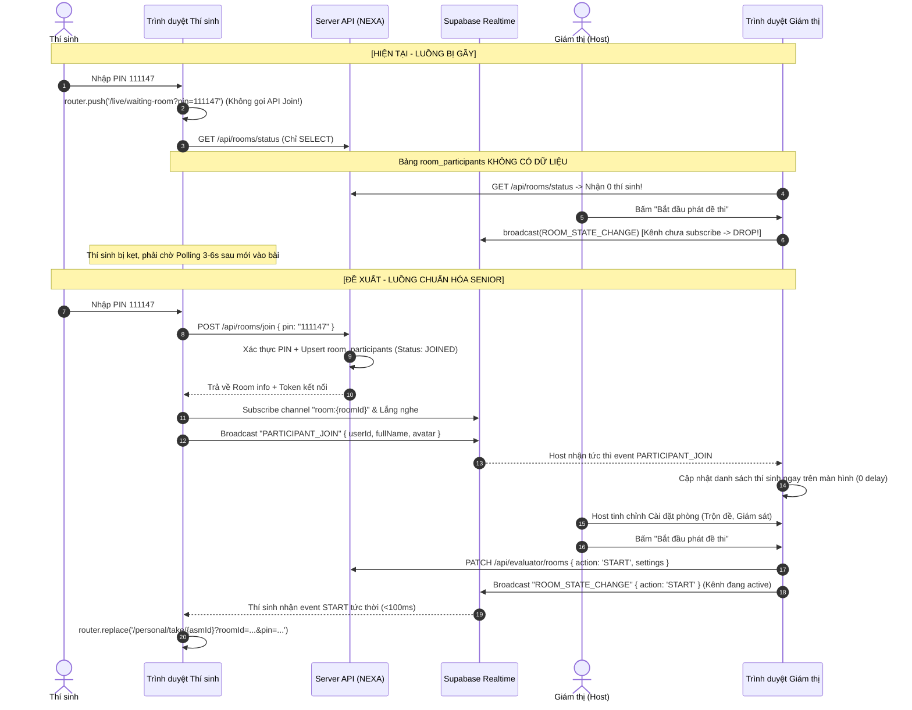

# ĐÁNH GIÁ KIẾN TRÚC & ĐẶC TẢ TÁI THIẾT LUỒNG PHÒNG THI LIVE (NEXA REALTIME EXAM ROOM)

> **Tài liệu phân tích hiện trạng, xử lý lỗi gốc và thiết kế chuẩn hóa không gian Khảo thí Trực tiếp**  
> **Áp dụng theo:** AGENTS.md, `/spec-driven-development`, `/idea-refine`, `/interview-me`  
> **Ngày lập:** 15/11/2026 | **Tác giả:** Senior System Architect (NEXA AI Team)

---

## 1. TỔNG QUAN HIỆN TRẠNG & ĐÁNH GIÁ CẤP CAO (EXECUTIVE SUMMARY)

Phòng thi Live (Live Exam Room) là một trong những tính năng tương tác thời gian thực quan trọng nhất của nền tảng NEXA, phục vụ hai kịch bản trọng yếu:
1. **Personal Workspace:** Cá nhân/giảng viên mở phòng thi luyện tập nhanh qua mã PIN 6 số cho học viên hoặc nhóm học tập.
2. **Organization Workspace:** Doanh nghiệp/nhà trường tổ chức ca thi tập trung, có giám thị trực tiếp, kiểm soát thời gian đồng bộ và giám sát vi phạm gian lận.

Tuy nhiên, qua trải nghiệm thực tế và bằng chứng kiểm thử giao diện (Screenshots đính kèm), toàn bộ luồng phòng thi Live hiện tại đang gặp **5 điểm nghẽn nghiêm trọng về kỹ thuật và kiến trúc UX**:

| Vấn đề | Hiện tượng thực tế | Nguyên nhân kỹ thuật gốc (Root Cause) |
|---|---|---|
| **Lỗi 1: Thí sinh vào phòng nhưng Giám thị không thấy** | Thí sinh nhập PIN vào sảnh chờ (`/live/waiting-room?pin=111147`), nhưng bên Host (`/live/control`) vẫn báo `0 / 40 thí sinh` và `Chưa có thí sinh kết nối`. | `QuickPinModal` và `InlinePinEntryCard` chỉ `router.push('/live/waiting-room')` mà **hoàn toàn không gọi API `POST /api/rooms/join`** để ghi nhận bản ghi vào bảng `room_participants`. Đồng thời API `/api/rooms/ready` dùng lệnh `UPDATE` thay vì `UPSERT`, khiến bản ghi không bao giờ tồn tại. |
| **Lỗi 2: Bấm phát đề nhưng thí sinh bị kẹt, chuyển trang quá lâu** | Host bấm *"Bắt đầu phát đề thi"*, nhưng thí sinh phải đợi 3-6 giây hoặc không tự chuyển sang màn hình làm bài. | Host gửi lệnh broadcast qua Supabase channel **trên một kênh chưa gọi `.subscribe()`**, dẫn đến tin nhắn broadcast bị Supabase Client âm thầm loại bỏ (drop). Thí sinh không nhận được realtime event mà bị rơi vào cơ chế polling dự phòng mỗi 3000ms (`setInterval(fetchStatus, 3000)`). |
| **Lỗi 3: Nút "Tôi đã sẵn sàng" thừa thãi & cản trở luồng** | Thí sinh đã nhập PIN vào phòng nhưng lại bị ép bấm thêm nút *"Tôi đã sẵn sàng"*, gây chia rẽ trạng thái "vào phòng nhưng chưa sẵn sàng". | Tư duy thiết kế cũ mô phỏng game đấu đối kháng (như phòng chờ game). Với khảo thí học thuật (như Canvas, Kahoot, Quizizz, Azota), việc nhập mã PIN hợp lệ và vào sảnh chờ **mặc nhiên xác nhận thí sinh đã có mặt và sẵn sàng**. |
| **Lỗi 4: Màn hình sau khi nộp bài hiển thị `0 / 0 câu`** | Thí sinh hoàn thành bài thi chuyển đến `/live/submitted`, mục *Số câu đã trả lời* hiện `0 / 0 câu`. | Do lỗi 1 (không có row trong `room_participants`), câu lệnh `UPDATE room_participants SET answers_count = ...` lúc nộp bài ở `take/[id]` tác động vào 0 hàng. Trang kết quả đọc ra dữ liệu rỗng. |
| **Lỗi 5: Giao diện "nhức mắt", lạc lõng so với nền tảng** | Host lobby có mục *"Chủ đề giao diện (Themes)"* với các thẻ màu neon/game ("Cyber Aurora", "Space Blue", "Chuyên gia IT"); sảnh chờ thí sinh có đồng hồ `00:00:00` khổng lồ gây hoang mang; thiếu các thiết lập nghiệp vụ cốt lõi. | Vi phạm quy chuẩn giao diện AGENTS.md §3 (Cấm AI slop, cấm neon/glow/gradient game, cấm watermark trang trí). Thiếu các cài đặt khảo thí thiết thực (trộn câu hỏi, trộn đáp án, quy chế giám sát, cấu hình công bố kết quả). |

---

## 2. PHÂN TÍCH NGUYÊN NHÂN GỐC RỄ & BẰNG CHỨNG MÃ NGUỒN

### 2.1. Lỗ hổng Join Flow: "Bỏ quên" bước ghi nhận thí sinh
* **Đường dẫn mã nguồn:**
  * `src/components/dashboard/QuickPinModal.tsx` (dòng 52-54)
  * `src/components/dashboard/live-room/InlinePinEntryCard.tsx` (dòng 40-42)
  * `src/app/live/waiting-room/page.tsx` (dòng 100-155)
  * `src/app/api/rooms/ready/route.ts` (dòng 36-47)
* **Bằng chứng code:**
  Khi người dùng nhập PIN:
  ```typescript
  // QuickPinModal.tsx
  router.push(`/live/waiting-room?pin=${cleanPin}`); // CHỈ ĐỔI ROUTE, KHÔNG GỌI API JOIN!
  ```
  Tại `/live/waiting-room/page.tsx`:
  Component chỉ gọi `GET /api/rooms/status?pin=...`. API status chỉ thực hiện câu lệnh `SELECT` đọc dữ liệu, **không bao giờ chèn thí sinh vào `room_participants`**.
  Hơn nữa, khi thí sinh bấm *"Tôi đã sẵn sàng"*, API `/api/rooms/ready` chạy lệnh:
  ```sql
  UPDATE public.room_participants SET is_ready = true WHERE room_id = $1 AND user_id = $2;
  ```
  Vì chưa từng có câu lệnh `INSERT`, câu lệnh `UPDATE` trả về 0 row, API trả về lỗi 404: *"Không tìm thấy thông tin tham gia phòng thi của bạn"*.
* **Hệ quả:** Host ở `/live/control` truy vấn bảng `room_participants` luôn nhận về mảng rỗng `[]` $\rightarrow$ Thí sinh đã vào màn hình chờ nhưng Host thấy 0 người!

### 2.2. Lỗ hổng Realtime Broadcast: Phát sóng trên kênh chưa đăng ký
* **Đường dẫn mã nguồn:**
  * `src/app/live/control/page.tsx` (dòng 477-484)
  * `src/app/live/waiting-room/page.tsx` (dòng 161-198)
* **Bằng chứng code:**
  ```typescript
  // handleStartExam trong LiveControlContent
  const supabase = createClient();
  await supabase.channel(`room:${roomId}`).send({
    type: 'broadcast',
    event: 'ROOM_STATE_CHANGE',
    payload: { action: 'START' },
  });
  ```
  Trong kiến trúc Supabase Realtime JS Client, một client **chỉ có thể gửi broadcast thành công sau khi channel đã được khởi tạo và nhận trạng thái `SUBSCRIBED`**. Việc gọi `channel(...).send(...)` tức thời mà không gắn vào channel instance đang lắng nghe hoặc không đợi `.subscribe()` sẽ khiến tin nhắn bị hủy âm thầm ở tầng WebSocket client.
* **Hệ quả:** Thí sinh không nhận được tín hiệu tức thời, phải đợi hàm `fetchStatus` chạy định kỳ 3 giây/lần. Nếu gặp độ trễ mạng hoặc tải DB, thí sinh phải đợi 4-6 giây mới được chuyển trang, gây cảm giác ứng dụng bị đơ hoặc lỗi.

### 2.3. Vấn đề UX: Thừa thãi nút "Tôi đã sẵn sàng" & Đồng hồ `00:00:00`
* **Bằng chứng giao diện (Ảnh 1):**
  * Sảnh chờ của thí sinh đặt một đồng hồ số điện tử cực lớn `00:00:00` ở chính giữa. Khi ca thi mở tức thì (chưa hẹn giờ cố định), con số `00:00:00` đứng yên vô nghĩa, gây tâm lý hoang mang không biết ca thi đã bắt đầu chưa hay bị lỗi.
  * Nút xanh to bản *"Tôi đã sẵn sàng"* bắt thí sinh phải bấm thêm một lần. Nếu thí sinh không bấm, Host nhìn thấy danh sách `0 đã sẵn sàng`, không dám bấm phát đề.
  * Chân trang xuất hiện dòng chữ cứng nhắc: *"Khảo thí chuẩn hóa 5 miền năng lực số"* $\rightarrow$ Vi phạm AGENTS.md §2.1 (cấm lặp từ cứng nhắc).

### 2.4. Vấn đề "Themes màu mè" và thiếu Cài đặt Khảo thí thực tế
* **Bằng chứng giao diện (Ảnh 2):**
  * Tại cột bên phải của Host Lobby, có mục *"Chủ đề giao diện (Themes)"* hiển thị 4 card với đồ họa neon: *"Minimal White"*, *"Space Blue"*, *"Cyber Aurora"*, *"Chuyên gia IT"*.
  * Đây là tàn dư của thiết kế kiểu "AI Slop / Gamification rẻ tiền", không phù hợp với phần mềm khảo thí chuẩn mực của doanh nghiệp/trường học.
  * Ngược lại, những tính năng khảo thí mà Giám thị **thực sự cần cấu hình trước khi phát đề** lại bị thiếu vắng:
    1. *Trộn thứ tự câu hỏi (Shuffle Questions)*.
    2. *Trộn thứ tự đáp án (Shuffle Options)*.
    3. *Quy chế giám sát:* Khóa toàn màn hình (Fullscreen enforcement), cảnh báo rời tab (Tab-switch alert), Watermark chống lộ đề.
    4. *Cơ chế điều hướng:* Cho phép quay lại câu trước hay bắt buộc làm tuần tự.
    5. *Chính sách sau khi nộp:* Có hiển thị điểm ngay không hay chờ Giám thị duyệt công bố.

### 2.5. Quan hệ với Không gian Làm bài Khảo thí chuẩn
* **Câu hỏi của người dùng:** *"không gian làm bài đang tận dụng của trang làm đề khảo thí chuẩn đúng hong?"*
* **Xác nhận từ mã nguồn:** **ĐÚNG.** Màn hình làm bài thi live (Ảnh 5: `/personal/take/[id]?roomId=...&pin=...`) sử dụng chung engine làm bài thống nhất `AssessmentTakeContent` với trang làm đề cá nhân và khảo thí chuẩn.
* **Đánh giá kiến trúc:** Đây là **quyết định thiết kế đúng đắn theo nguyên lý DRY (Don't Repeat Yourself)** của hệ thống lớn. Một bộ khung làm bài (Question Canvas, Audio/Video player, Question Palette, Auto-save local draft) dùng chung cho mọi bối cảnh giúp tiết kiệm chi phí bảo trì và đảm bảo tính nhất quán.
* **Điểm khác biệt duy nhất của chế độ Live:**
  1. *Đồng bộ thời gian thực:* Nhận lệnh đồng bộ từ Giám thị (Tạm dừng, gia hạn thêm phút, thu bài cưỡng chế `FORCE_SUBMIT`).
  2. *Ghi nhận sự kiện giám sát:* Bắn sự kiện chuyển tab/thoát toàn màn hình về kênh `room:${roomId}` cho Giám thị thấy.
  3. *Điều hướng nộp bài:* Nộp bài xong không bay sang trang Dashboard cá nhân mà chuyển về `/live/submitted` để chờ công bố kết quả chung của cả phòng thi.

### 2.6. Vấn đề liên kết với Lớp / Nhóm học tập
* **Câu hỏi của người dùng:** *"khi giao cho nhóm cụ thể thì sẽ xuất hiện bên nhóm hong?"*
* **Hiện trạng mã nguồn:**
  * Tại trang chi tiết nhóm cá nhân (`/personal/groups/[groupId]`) và lớp tổ chức (`/org/[slug]/classes/[classId]`), hệ thống **ĐÃ CÓ** code để render banner phòng thi đang hoạt động (`activeLiveRoom`).
  * **NHƯNG:** Khi người dùng vào trang Tạo phòng thi (`/personal/live-room/new` hoặc `/org/[slug]/live-room/new`), Wizard **hoàn toàn không có ô chọn Lớp/Nhóm**! Biến `classId` chỉ được lấy qua URL query param `?classId=...`. Nếu người dùng tạo phòng từ menu Phòng thi Live, `classId` luôn là `undefined`, dẫn đến phòng thi đó **không bao giờ xuất hiện bên trang của Lớp/Nhóm**.

---

## 3. SƠ ĐỒ THIẾT KẾ KIẾN TRÚC & LUỒNG DỮ LIỆU CHUẨN HÓA

### 3.1. So sánh Luồng Lỗi Hiện Tại vs Luồng Chuẩn Hóa Đề Xuất



---

## 4. CHI TIẾT TÁI THIẾT KẾ TỪNG MÀN HÌNH (SCREEN-BY-SCREEN REDESIGN)

### 4.1. Màn hình 1: Sảnh chờ của Giám thị (`/live/control` - Trạng thái sảnh chờ)
* **Loại bỏ:**
  * Toàn bộ khối *"Chủ đề giao diện (Themes)"* với các hình ảnh neon game rực rỡ (Ảnh 2).
  * Nút "Hẹn giờ ca thi" gây rối mắt nếu phòng mở trực tiếp.
* **Thay thế bằng:** **Bảng Cài đặt Phòng thi Chuyên nghiệp (Exam Security & Flow Settings)**
  1. **Nhóm Lớp/Khóa học liên kết:** Dropdown cho phép chọn gắn phòng thi này vào Lớp/Nhóm cụ thể (nếu chưa chọn từ trước).
  2. **Quy chế Xáo trộn:**
     * [x] Trộn ngẫu nhiên câu hỏi (`shuffle_questions`)
     * [x] Trộn ngẫu nhiên đáp án trắc nghiệm (`shuffle_options`)
  3. **Chế độ Giám sát An toàn (Smart Proctoring):**
     * [x] Bắt buộc toàn màn hình (Cảnh báo khi thoát)
     * [x] Phát hiện chuyển tab / mở cửa sổ khác
     * [ ] Chèn Watermark mờ danh tính thí sinh
  4. **Chính sách Nộp bài & Kết quả:**
     * Thời lượng thi: Cho phép chọn nhanh 15p, 30p, 45p, 60p hoặc nhập số phút tùy chỉnh.
     * Tự động thu bài khi hết giờ: Bật/Tắt.
     * Chế độ công bố: *Giữ bí mật (Giám thị duyệt sau)* hoặc *Công bố điểm tự động*.
* **Khu vực Thí sinh kết nối:**
  * Hiển thị lưới Avatar/Tên thí sinh đã kết nối với chấm xanh `ONLINE` phát sáng nhẹ.
  * Số lượng cập nhật nhảy số mượt mà: `Đã kết nối: 12 thí sinh`.
  * Nút hành động chính: Một nút duy nhất nổi bật **"Phát đề thi cho cả phòng (12 thí sinh)"** (Màu Cobalt `#2563EB`, text trắng).

---

### 4.2. Màn hình 2: Sảnh chờ Thí sinh (`/live/waiting-room`)
* **Loại bỏ:**
  * Đồng hồ số khổng lồ `00:00:00` ở giữa màn hình (Ảnh 1).
  * Nút to bản *"Tôi đã sẵn sàng"*.
  * Dòng chữ khẩu hiệu rườm rà ở footer.
* **Thay thế bằng:** **Giao diện Chờ Nhận đề Thi Tinh tế, Học thuật (Academic Lobby)**
  * **Thẻ Trung tâm:**
    * Tiêu đề bài thi & Tên Giám thị / Tổ chức.
    * Mã PIN hiển thị rõ nét góc trên kèm nút copy nhanh.
    * Thông số ca thi: Thời lượng (`45 phút`), Số lượng câu hỏi, Điểm chuẩn đạt.
    * Thanh trạng thái kết nối:
      `[● Đã kết nối phòng thi]` • `Thiết bị: Sẵn sàng` • `Mạng: Ổn định`
  * **Trạng thái Chờ:**
    * Một khối trạng thái trang nhã có hiệu ứng pulse nhẹ:  
      *"Giám thị đang hoàn tất chuẩn bị đề thi. Bài thi sẽ tự động bắt đầu khi Giám thị phát đề."*
  * **Danh sách Bạn cùng phòng thi:**
    * Danh sách thu gọn dạng avatar tròn hoặc danh sách cuộn mượt mà: *"Đang có 12 thí sinh khác cùng có mặt trong sảnh chờ"*.

---

### 4.3. Màn hình 3: Không gian Làm bài Trực tiếp (`/personal/take/[id]`)
* Tiếp tục kế thừa Universal Take Runner nhưng gia cố các logic đồng bộ:
  1. **Đồng hồ đếm ngược:** Nhận mốc `started_at` từ phòng thi và đếm ngược chính xác theo giờ máy chủ, chống gian lận chỉnh giờ máy client.
  2. **Bắt sự kiện can thiệp của Giám thị:**
     * Nhận sự kiện `PAUSE`: Tự động hiện màn hình mờ *"Ca thi đang được Giám thị tạm dừng"*.
     * Nhận sự kiện `EXTEND_TIME`: Cộng thêm 5-10 phút trực tiếp vào đồng hồ.
     * Nhận sự kiện `FORCE_SUBMIT`: Tự động đóng gói câu trả lời và nộp bài ngay lập tức.
  3. **Báo cáo vi phạm realtime:** Khi thí sinh chuyển tab hoặc thoát fullscreen, bắn event ngay về kênh `room:${roomId}` để Host Control ghi nhận lên cột *Cảnh báo vi phạm*.

---

### 4.4. Màn hình 4: Màn hình Chờ Sau Khi Nộp bài (`/live/submitted`)
* **Khắc phục lỗi:**
  * Sửa lỗi `0 / 0 câu` bằng cách cập nhật đúng `answers_count` và `total_questions` vào `room_participants`.
* **Trải nghiệm:**
  * Thông báo nộp bài thành công trang nhã.
  * Hiển thị tóm tắt: Đã trả lời `5/5 câu` • Thời gian nộp: `10:07, 15/11/2026`.
  * Trạng thái công bố kết quả:
    * Nếu Giám thị chưa công bố: Hiển thị stepper *"Đã nộp bài $\rightarrow$ Đang chờ Giám thị công bố kết quả"*.
    * Khi Giám thị bấm *"Công bố kết quả"*: Kênh realtime kích hoạt, thí sinh tự động mở bảng điểm chi tiết (Điểm số, Phân tích miền, Barem đáp án tùy theo cấu hình của Giám thị).

---

### 4.5. Màn hình 5: Trang Kết thúc & Công bố của Giám thị (`/personal/live-room/[id]/results`)
* Hiển thị bảng tổng hợp toàn diện:
  * Tổng quan: Số lượng tham gia, tỷ lệ nộp bài, điểm trung bình, điểm cao nhất.
  * Bảng xếp hạng / Bảng điểm chi tiết từng thí sinh (Họ tên, điểm, thời gian làm bài, số lần vi phạm gian lận).
  * Bộ công tắc công bố điểm:
    * `[x] Hiển thị điểm số`
    * `[x] Hiển thị xếp hạng phòng thi`
    * `[ ] Hiển thị đáp án & lời giải chi tiết`
  * Nút bấm: *"Công bố kết quả ngay"* (Phát broadcast cho toàn bộ thí sinh đang ở màn hình chờ kết quả xem điểm đồng thời).
  * Nút xuất file Excel/CSV kết quả phục vụ lưu trữ học vụ.

---

## 5. MA TRẬN PHÂN BIỆT: PERSONAL WORKSPACE VS ORGANIZATION WORKSPACE

| Tiêu chí | Personal Live Room (`/personal/live-room/*`) | Organization Live Room (`/org/[slug]/live-room/*`) |
|---|---|---|
| **Mục đích** | Giáo viên/người dùng tự tổ chức ôn tập, kiểm tra nhanh cho bạn bè hoặc nhóm cá nhân. | Tổ chức đánh giá năng lực số định kỳ, thi tuyển dụng hoặc kiểm định trường học/doanh nghiệp. |
| **Quyền hạn** | Người tạo đề (`created_by`) sở hữu toàn quyền phòng thi. | Phân quyền theo vai trò tổ chức: `ORG_ADMIN`, `ASSESSOR` được giám thị; `MEMBER` chỉ làm bài. |
| **Nguồn đề thi** | Kho đề cá nhân (`/personal/authoring`) hoặc Đề khảo thí chuẩn của hệ thống. | Kho đề riêng của Tổ chức (`/org/[slug]/assessments`) hoặc Đề chuẩn được cấp phép. |
| **Giới hạn quy mô** | Tối đa 40 thí sinh/phòng thi theo gói Personal. | Hạn mức theo gói dịch vụ Tổ chức (Business Entitlement: 100 - 1000 thí sinh). |
| **Lưu trữ dữ liệu** | Điểm số lưu trong kết quả phòng thi; **không tự ý ghi đè vào Radar năng lực lâu dài** của tài khoản nếu không đạt chuẩn kiểm định. | Dữ liệu lưu vào Báo cáo chiến dịch khảo thí và bảng xếp hạng chính thức của tổ chức. |

---

## 6. PHẢN HỒI THỰC HIỆN KẾ TIẾP (INTERVIEW-ME / DESIGN DECISIONS)

Trước khi tiến hành sửa mã nguồn, theo quy trình của `/interview-me` và `/spec-driven-development`, xin xác nhận 3 quyết định thiết kế quan trọng sau:

1. **Về việc bỏ hoàn toàn nút "Tôi đã sẵn sàng":**
   * *Đề xuất:* Khi thí sinh nhập đúng PIN, hệ thống tự động lưu trạng thái `JOINED` và hiển thị thí sinh đã sẵn sàng trong sảnh chờ. Khi Giám thị bấm phát đề, tất cả thí sinh đang online sẽ cùng vào thi. Bạn có đồng ý bỏ hẳn nút bấm này không?
2. **Về việc bỏ Themes màu mè neon ở trang Host:**
   * *Đề xuất:* Thay thế khối Themes màu mè bằng bảng **Cài đặt phòng thi thực tế** (Trộn câu hỏi, Trộn đáp án, Bật giám sát toàn màn hình, Bật cảnh báo chuyển tab). Bạn thấy hướng này đã đúng ý bạn chưa?
3. **Về việc chọn Lớp/Nhóm khi tạo phòng thi:**
   * *Đề xuất:* Bổ sung ô chọn Lớp/Nhóm trong Wizard tạo phòng thi (`CreateLiveRoomWizardView`), để khi tạo xong thì phòng thi sẽ tự động gắn mã lớp và hiển thị ngay trên trang của Lớp/Nhóm đó. Bạn đồng ý chứ?

> **Tài liệu đặc tả chi tiết đã được lưu tại:** [DANH_GIA_VA_THIET_KE_PHONG_THI_LIVE_2026.md](file:///c:/nexa/docs/DANH_GIA_VA_THIET_KE_PHONG_THI_LIVE_2026.md). Mời bạn xem qua và phản hồi 3 câu hỏi trên để chúng ta bắt tay vào tinh chỉnh!
