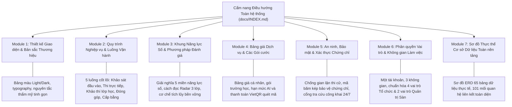

# CẨM NANG ĐIỀU HƯỚNG TÀI LIỆU TOÀN HỆ THỐNG NEXA AI
# MASTER DOCUMENTATION & PLATFORM USER GUIDE

Mã định danh: `DOC-NEXA-MASTER-INDEX-2026`  
Phiên bản: `v3.0.0-PUBLIC`  
Dành cho: Học viên, Giảng viên, Ban Giám hiệu Nhà trường, Đối tác Doanh nghiệp, Nhà tuyển dụng  
Tiêu chuẩn tuân thủ: Bộ quy tắc `AGENTS.md`, Chuẩn mực Khảo thí & Trải nghiệm Người dùng Quốc tế

## 1. GIỚI THIỆU TỔNG QUAN NỀN TẢNG NEXA AI

NEXA AI là nền tảng công nghệ giáo dục thế hệ mới, tiên phong trong việc đánh giá chuẩn hóa, phát hiện khoảng trống và bồi dưỡng phát triển năng lực số toàn diện cho người học trong kỷ nguyên trí tuệ nhân tạo.

Khác với các trang web bán khóa học thông thường hay các bảng thống kê chung chung, NEXA AI vận hành theo chu trình khép kín: **Đánh giá có bằng chứng khoa học $\rightarrow$ Phát hiện chính xác khoảng trống kỹ năng $\rightarrow$ Đề xuất lộ trình bồi dưỡng trọng tâm $\rightarrow$ Thực hành thi đấu thời gian thực $\rightarrow$ Cấp chứng nhận số có giá trị pháp lý toàn cầu**.

Hệ thống được thiết kế theo triết lý bất biến: **Ba không gian, một danh tính duy nhất**:
- **Không gian Cá nhân:** Dành cho người học tự do rèn luyện, theo dõi biểu đồ tiến bộ Radar 5 miền năng lực, tạo nhóm học tập và nhận chứng chỉ số.
- **Không gian Tổ chức:** Dành cho trường học, trường đại học và doanh nghiệp quản lý danh sách lớp học, phân công giảng viên chấm bài, tổ chức các kỳ thi đánh giá diện rộng và xuất báo cáo phân tích năng lực tập thể.
- **Không gian Quản trị Nền tảng:** Dành cho Ban điều hành và Hội đồng Khảo thí vận hành toàn sàn, phê duyệt nội dung và giám sát an toàn.

## 2. BẢN ĐỒ BỘ TÀI LIỆU QUY CHUẨN HỆ THỐNG

Bộ tài liệu được chuẩn hóa thành 7 cẩm nang chuyên sâu, được biên soạn bằng ngôn ngữ nghiệp vụ trong sáng, dễ hiểu, trực quan, hoàn toàn không chứa các đoạn mã nguồn phức tạp:

## 3. CHI TIẾT TỪNG MODULE TÀI LIỆU

### Module 01: Quy chuẩn Thiết kế Giao diện và Bản sắc Thương hiệu
- Tệp tin: [docs/01_DESIGN_SYSTEM_AND_PALETTE.md](file:///c:/nexa/docs/01_DESIGN_SYSTEM_AND_PALETTE.md)
- Nội dung tóm lược:
  - Bản sắc bảng màu: Chế độ ban ngày (Nền trắng tinh khiết, chữ than chì êm dịu, xanh Cobalt điểm nhấn) và Chế độ ban đêm (Đen thật giảm mỏi mắt, chữ trắng ngà, xanh dịu sáng).
  - Màu sắc trạng thái: Xanh ngọc (Thành công), Vàng hổ phách (Chờ duyệt), Đỏ hồng ngọc (Cảnh báo).
  - Nguyên tắc thiết kế tinh gọn: Không dùng viền ngang chia cắt thô bạo, không hiệu ứng cầu vồng chói gắt, không số liệu ảo, đảm bảo tương phản dễ đọc đạt chuẩn quốc tế WCAG.

### Module 02: Quy trình Nghiệp vụ và Luồng Vận hành Toàn diện
- Tệp tin: [docs/02_BUSINESS_FLOWS_AND_PROCESSES.md](file:///c:/nexa/docs/02_BUSINESS_FLOWS_AND_PROCESSES.md)
- Nội dung tóm lược:
  - Bản đồ luồng toàn hệ thống từ khi người học bắt đầu đến lúc nhận chứng nhận số.
  - Chi tiết 5 luồng nghiệp vụ lớn kèm sơ đồ trực quan: Luồng khảo sát chẩn đoán đầu vào, Luồng tổ chức phòng thi trực tiếp qua mã PIN 6 số, Luồng khảo thí lớp học và chấm bài tự luận, Luồng đóng góp đề thi cộng đồng, Luồng phát hành chứng chỉ số.
  - Ma trận phân quyền và trách nhiệm rõ ràng giữa Học viên, Giảng viên, Ban Quản lý Trường và Ban Quản trị Nền tảng.

### Module 03: Đặc tả Khung Năng lực Số và Phương pháp Đánh giá
- Tệp tin: [docs/03_COMPETENCY_FRAMEWORK_AND_ASSESSMENT_SPEC.md](file:///c:/nexa/docs/03_COMPETENCY_FRAMEWORK_AND_ASSESSMENT_SPEC.md)
- Nội dung tóm lược:
  - Giải thích dễ hiểu 5 miền năng lực số: Thông tin & Dữ liệu, Giao tiếp & Hợp tác, Sáng tạo Nội dung số, An toàn & Bảo mật, Giải quyết Vấn đề.
  - Ý nghĩa của dữ liệu trung thực: Phân biệt rõ giữa "Chưa có bằng chứng" và "0 điểm".
  - Hướng dẫn đọc biểu đồ Radar 3 lớp: Vạch xuất phát ban đầu, Chuẩn mục tiêu 70%, Năng lực tích lũy thực tế.
  - Cơ chế tăng trưởng điểm số bền vững: Điểm năng lực tăng lũy tiến từng nấc nhỏ 1-2% thông qua các bài thi đạt chuẩn, ngăn chặn hoàn toàn gian lận cày điểm ảo.

### Module 04: Bảng giá Dịch vụ, Các Gói cước và Phân phối Quyền lợi
- Tệp tin: [docs/04_PRICING_PLANS_AND_ENTITLEMENTS.md](file:///c:/nexa/docs/04_PRICING_PLANS_AND_ENTITLEMENTS.md)
- Nội dung tóm lược:
  - Bảng so sánh quyền lợi gói Cá nhân: Bản Miễn phí (0đ) và Bản Nâng cao Pro (49.000đ/tháng, có 30 ngày trải nghiệm miễn phí).
  - Bảng giá giải pháp Trường học & Doanh nghiệp: Gói Khởi đầu (250 người học), Gói Mở rộng (2.000 người học), Gói Doanh nghiệp lớn (trên 50.000 người học).
  - Cơ chế Điểm AI (AI Credits) minh bạch, không chi phí ẩn cho người học.
  - Hướng dẫn thanh toán quét mã QR VietQR NAPAS 24/7 kích hoạt tài khoản chỉ sau 3-5 giây.

### Module 05: Kiến trúc An ninh, Bảo mật và Xác thực Chứng chỉ số
- Tệp tin: [docs/05_SYSTEM_ARCHITECTURE_AND_SECURITY.md](file:///c:/nexa/docs/05_SYSTEM_ARCHITECTURE_AND_SECURITY.md)
- Nội dung tóm lược:
  - Cam kết bảo mật dữ liệu: Cách ly độc lập dữ liệu giữa người học và các trường học.
  - Bộ giải pháp chống gian lận thi cử: Niêm phong bài nộp kỹ thuật số, giám sát chuyển tab thông minh, phòng ngừa xung đột lợi ích khi chấm thi.
  - Tính pháp lý của chứng chỉ số: Mộc đỏ điện tử, chữ ký số Chủ tịch Hội đồng, công nghệ mã băm kép bảo vệ chống giả mạo bằng Photoshop.
  - Cổng tra cứu công khai độc lập 24/7: Nhà tuyển dụng kiểm tra chứng chỉ thật/giả tức thì qua mã QR mà không cần đăng nhập.

### Module 06: Quy chuẩn Phân quyền Vai trò và Điều hướng Không gian Làm việc
- Tệp tin: [docs/06_WORKSPACE_RBAC_AND_ROLES_SPEC.md](file:///c:/nexa/docs/06_WORKSPACE_RBAC_AND_ROLES_SPEC.md)
- Nội dung tóm lược:
  - Triết lý một tài khoản - ba không gian: Không gian Cá nhân, Không gian Tổ chức, Không gian Quản trị Nền tảng.
  - Sơ đồ phân quyền toàn hệ thống từ khâu đăng nhập, phân giải ngữ cảnh đến từng vai trò.
  - Danh mục chuẩn hóa vai trò Tổ chức: Chủ sở hữu (`ORG_OWNER`), Quản trị viên (`ORG_ADMIN`), Khảo thí viên (`ASSESSOR`), Thành viên làm bài (`MEMBER`).
  - Danh mục chuẩn hóa vai trò Quản trị Sàn: Quản trị viên Cấp cao (`SUPER_ADMIN`), Quản trị viên Vận hành (`ADMIN`).
  - Nguyên tắc an toàn: Không leo thang đặc quyền, cách ly dữ liệu cá nhân và trường học.

### Module 07: Sơ đồ Thực thể Cơ sở Dữ liệu Toàn nền tảng (ERD)
- Tệp tin: [docs/07_DATABASE_ENTITY_RELATIONSHIP_SPEC.md](file:///c:/nexa/docs/07_DATABASE_ENTITY_RELATIONSHIP_SPEC.md)
- Nội dung tóm lược:
  - Sơ đồ quan hệ thực thể (ERD) hoàn chỉnh 65 bảng dữ liệu thực tế từ 59 tệp migration.
  - 101 mối liên kết khóa chính (PK) và khóa ngoại (FK) giữa các thực thể.
  - Phân loại trực quan theo 6 phân hệ cốt lõi: Người dùng & Ví điểm, Tổ chức & Lớp học, Khung năng lực & Đề thi, Lượt làm bài & Live Room, Trí tuệ nhân tạo & Kiểm toán, Gói cước & Thanh toán.
  - Hướng dẫn và mã Mermaid chuẩn dán trực tiếp vào Mermaid Live Editor.

## 4. HƯỚNG DẪN TRA CỨU NHANH CHO CÁC BÊN LIÊN QUAN

- **Dành cho Kiến trúc sư Hệ thống & Kỹ sư Dữ liệu:** Bắt đầu từ [Module 07: Sơ đồ Thực thể Cơ sở Dữ liệu](file:///c:/nexa/docs/07_DATABASE_ENTITY_RELATIONSHIP_SPEC.md) để nắm bắt toàn diện 65 bảng dữ liệu và các mối quan hệ liên kết thực thể, sau đó đối chiếu với [Module 05: An ninh & Bảo mật](file:///c:/nexa/docs/05_SYSTEM_ARCHITECTURE_AND_SECURITY.md).
- **Dành cho Ban Giám hiệu & Giám đốc Đào tạo:** Bắt đầu từ [Module 06: Phân quyền Vai trò](file:///c:/nexa/docs/06_WORKSPACE_RBAC_AND_ROLES_SPEC.md) và [Module 02: Luồng Nghiệp vụ](file:///c:/nexa/docs/02_BUSINESS_FLOWS_AND_PROCESSES.md) để nắm bắt cách vận hành kỳ thi lớp học, sau đó xem [Module 04: Bảng giá](file:///c:/nexa/docs/04_PRICING_PLANS_AND_ENTITLEMENTS.md) để lựa chọn quy mô gói giải pháp phù hợp.
- **Dành cho Học viên & Sinh viên:** Xem [Module 03: Khung Năng lực Số](file:///c:/nexa/docs/03_COMPETENCY_FRAMEWORK_AND_ASSESSMENT_SPEC.md) để hiểu cách đọc biểu đồ Radar và cách tích lũy năng lực số bền vững; tham khảo [Module 04: Gói Cá nhân](file:///c:/nexa/docs/04_PRICING_PLANS_AND_ENTITLEMENTS.md) để đăng ký 30 ngày trải nghiệm Pro miễn phí.
- **Dành cho Nhà tuyển dụng & Chuyên viên Nhân sự:** Xem [Module 05: Xác thực Chứng chỉ](file:///c:/nexa/docs/05_SYSTEM_ARCHITECTURE_AND_SECURITY.md) để hiểu cơ chế tra cứu tính thật/giả của văn bằng ứng viên nộp qua mã QR.
- **Dành cho Chuyên gia Thiết kế & Truyền thông:** Xem [Module 01: Quy chuẩn Thiết kế](file:///c:/nexa/docs/01_DESIGN_SYSTEM_AND_PALETTE.md) để sử dụng đúng mã màu và ngôn ngữ thị giác chuẩn của thương hiệu NEXA AI.
