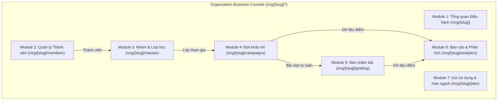
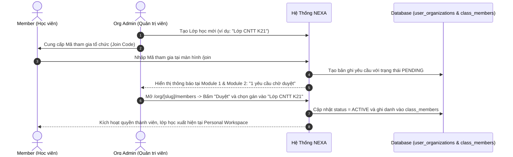
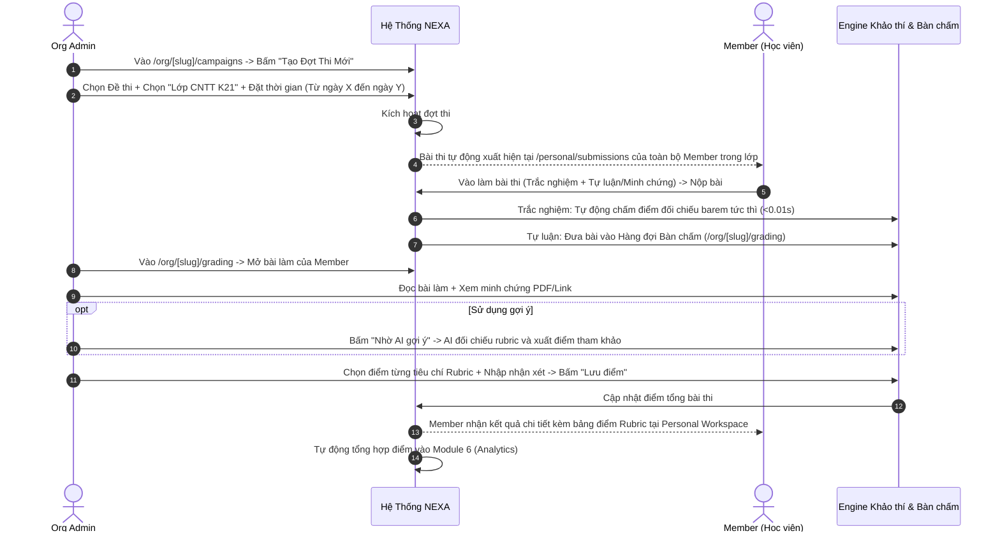
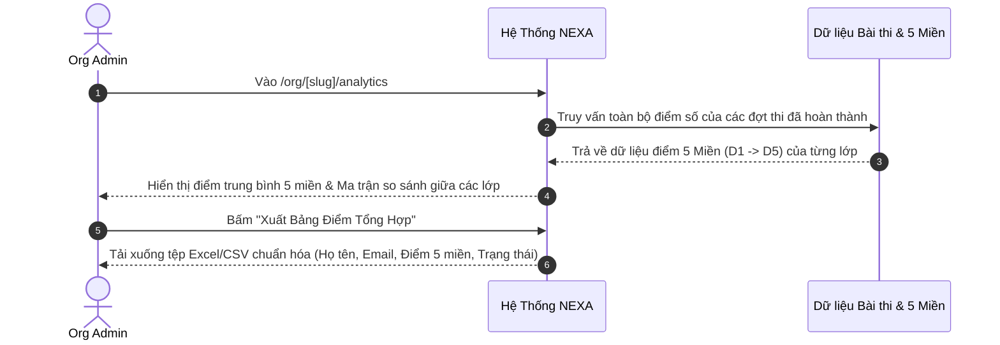

# ĐẶC TẢ THIẾT KẾ & LUỒNG NGHIỆP VỤ: ORGANIZATION BUSINESS CONSOLE
> **Phiên bản:** 2.0 (Tinh gọn & Chuẩn hóa Nghiệp vụ)  
> **Thời điểm xác lập:** 04/11/2026  
> **Căn cứ quy chuẩn:** [`AGENTS.md`](file:///c:/nexa/AGENTS.md) • [`SRS.md`](file:///c:/nexa/docs/SRS.md) • Thống nhất trực tiếp với Người dùng ngày 04/11/2026  
> **Nguyên tắc định biên:**  
> 1. Phân quyền tinh giản tuyệt đối: Chỉ có **Admin** (Quản trị tổ chức) và **Member** (Thành viên tổ chức).  
> 2. Mô tả chuẩn xác cấu trúc từng module, dữ liệu quản lý và luồng tương tác đầu-cuối (End-to-End Flows), không vẽ mô hình giao diện giả lập (No UI Wireframe/Slop).

---

## 1. MÔ HÌNH VAI TRÒ & PHÂN QUYỀN TINH GIẢN

Hệ thống loại bỏ hoàn toàn các chức danh trung gian rườm rà (như assessor, report_viewer), chỉ duy trì **2 vai trò duy nhất**:

| Vai trò | Phạm vi trách nhiệm | Quyền hạn trên hệ thống |
| :--- | :--- | :--- |
| **Org Admin** | Ban Giám hiệu, Trưởng khoa, Quản lý L&D, Giảng viên phụ trách. | Toàn quyền trong tổ chức: Quản lý thành viên, tạo lớp, khởi tạo đợt thi, trực tiếp chấm bài tự luận, xem báo cáo toàn diện và quản lý gói dịch vụ. |
| **Member** | Học viên, Sinh viên, Nhân viên trực thuộc tổ chức. | Không thao tác trên `/org/[slug]/*`. Member sử dụng [`Personal Workspace`](file:///c:/nexa/src/app/(dashboard)/personal/dashboard/page.tsx) để nhận bài được giao từ tổ chức, làm bài thi, nộp minh chứng và xem kết quả của mình. |

---

## 2. DANH MỤC 7 MODULE CHỨC NĂNG CỐT LÕI

---

### Module 1: Tổng Quan Điều Hành (`/org/[slug]`)
* **Mục đích:** Trung tâm nắm bắt nhanh tình trạng vận hành của đơn vị trong 1 màn hình duy nhất.
* **Thành phần dữ liệu:**
  1. *Chỉ số cốt lõi:* Tổng số thành viên hiện có, số lớp học đang hoạt động, số đợt thi đang diễn ra.
  2. *Hàng đợi công việc khẩn cấp (Actionable Queue):*
     * Số bài tự luận đang chờ Admin chấm (Pending grading).
     * Số yêu cầu xin gia nhập tổ chức đang chờ Admin duyệt.
     * Hạn ngạch còn lại: Số ghế (Seats used / total) và AI Credits.
  3. *Tình trạng đợt thi gần nhất:* Tiến độ tham gia (% Member đã nộp bài) của các đợt thi đang mở.

---

### Module 2: Quản Lý Thành Viên (`/org/[slug]/members`)
* **Mục đích:** Tiếp nhận, phê duyệt và quản lý danh sách nhân sự trực thuộc.
* **Chức năng chi tiết:**
  1. *Phê duyệt thành viên:* Danh sách người dùng đã nhập Mã tham gia (`Join Code`) của tổ chức đang ở trạng thái `PENDING`. Admin bấm **"Duyệt"** hoặc **"Từ chối"**.
  2. *Mời thành viên qua email:* Nhập một hoặc nhiều email để hệ thống gửi liên kết kích hoạt.
  3. *Quản trị danh sách:* Tìm kiếm theo tên/email, xem lớp học đang thuộc về, chỉ định thành viên thành `Org Admin` hoặc chuyển về `Member`, xóa thành viên khỏi tổ chức.

---

### Module 3: Nhóm & Lớp Học (`/org/[slug]/classes`)
* **Mục đích:** Phân nhóm thành viên theo đơn vị đào tạo (Khối lớp, Chuyên ngành) hoặc đơn vị phòng ban doanh nghiệp.
* **Chức năng chi tiết:**
  1. *Tạo lớp mới:* Tên lớp, mã lớp, mô tả, năm học / kỳ học.
  2. *Gán thành viên vào lớp:* Thêm thành viên từ danh sách tổ chức vào lớp học cụ thể (chọn từng người hoặc chọn tất cả).
  3. *Quản lý hoạt động lớp:* Xem danh sách bài tập đã giao cho lớp, theo dõi tiến độ nộp bài của cả lớp.

---

### Module 4: Đợt Khảo Thí Tập Trung (`/org/[slug]/campaigns`)
* **Mục đích:** Tổ chức các kỳ thi chuẩn hóa theo thời gian cho các lớp hoặc toàn tổ chức.
* **Chức năng chi tiết:**
  1. *Tạo đợt thi mới (Wizard 3 bước):*
     * *Bước 1:* Tên đợt thi + Chọn đề thi (chọn từ đề của tổ chức hoặc đề chuẩn DigComp của nền tảng).
     * *Bước 2:* Chọn phạm vi đối tượng (chọn một hoặc nhiều Lớp học tham gia).
     * *Bước 3:* Thiết lập cửa sổ làm bài (Ngày/giờ mở đề $\rightarrow$ Ngày/giờ đóng đề) và cấu hình (Thời gian làm bài, điểm sàn đạt chuẩn).
  2. *Điều hành đợt thi đang chạy:*
     * Theo dõi danh sách thí sinh: Đã nộp bài, Đang làm, Chưa làm.
     * Nút **"Nhắc nhở"**: Tự động gửi thông báo đến các Member chưa làm bài khi sắp hết hạn.
  3. *Kết thúc & Xuất dữ liệu:* Nút **"Xuất bảng điểm Excel/CSV"** gồm đầy đủ điểm tổng và điểm 5 miền.

---

### Module 5: Bàn Chấm Bài Tự Luận (`/org/[slug]/grading`)
* **Mục đích:** Admin trực tiếp thẩm định và chấm điểm các bài nộp có phần tự luận, dự án thực hành hoặc minh chứng số.
* **Chức năng chi tiết:**
  1. *Danh sách chờ chấm:* Lọc bài nộp theo Đợt thi hoặc theo Lớp học.
  2. *Khu vực xem bài làm:*
     * Hiển thị văn bản trả lời của thí sinh.
     * Xem trực tiếp tệp đính kèm (PDF, hình ảnh) hoặc mở liên kết sản phẩm (GitHub, Figma, Google Drive).
  3. *Bảng tiêu chí Rubric & Chấm điểm:*
     * Chọn mức điểm theo từng tiêu chí Rubric (hệ thống tự động cộng dồn tổng điểm).
     * Hỗ trợ nút **"Nhờ AI phân tích gợi ý"**: AI đối chiếu bài làm với rubric và đưa ra gợi ý điểm kèm lý giải để Admin tham khảo. Admin có quyền chấp nhận, sửa đổi hoặc tự chấm hoàn toàn.
     * Nhập nhận xét phản hồi cho Member $\rightarrow$ Bấm **"Lưu điểm"** để hoàn tất.

---

### Module 6: Báo Cáo & Phân Tích Năng Lực (`/org/[slug]/analytics`)
* **Mục đích:** Cung cấp số liệu tổng hợp về năng lực số toàn đơn vị.
* **Chức năng chi tiết:**
  1. *Phân tích 5 Miền Năng lực Số:* Điểm trung bình của đơn vị trên từng miền: Thông tin & Dữ liệu (D1), Giao tiếp & Hợp tác (D2), Sáng tạo Nội dung số (D3), An toàn số (D4), Giải quyết Vấn đề (D5).
  2. *So sánh giữa các Lớp/Đơn vị:* Bảng so sánh điểm số và tỷ lệ đạt chuẩn giữa các lớp học với nhau.
  3. *Tỷ lệ hoàn thành & Đạt chuẩn:* Thống kê tỷ lệ đạt chuẩn ($\ge 70\%$) trên toàn bộ nhân sự đã làm bài.
  4. *Xuất báo cáo:* Xuất file tổng hợp dữ liệu phục vụ báo cáo Ban Giám hiệu hoặc Ban Lãnh đạo.

---

### Module 7: Gói Dịch Vụ & Hạn Ngạch (`/org/[slug]/plan`)
* **Mục đích:** Giám sát mức độ sử dụng tài nguyên và gửi yêu cầu nâng cấp/gia hạn.
* **Chức năng chi tiết:**
  1. *Đồng hồ hạn ngạch:*
     * Số ghế thành viên: Đang dùng `X / Y` ghế.
     * AI Credits: Đã dùng `X / Y` tokens.
     * Thời hạn bản quyền: Số ngày còn lại.
  2. *Yêu cầu gia hạn:* Form gửi yêu cầu mua thêm ghế hoặc gia hạn thời gian gửi thẳng về đội ngũ quản trị nền tảng (Admin Platform).

---

## 3. CÁC LUỒNG NGHIỆP VỤ ĐẦU-CUỐI (END-TO-END OPERATIONAL FLOWS)

### 3.1. Luồng 1: Tiếp Nhận & Phân Lớp Thành Viên (Member Onboarding Flow)

---

### 3.2. Luồng 2: Vận Hành Đợt Khảo Thí & Chấm Bài (Assessment Campaign & Grading Flow)

---

### 3.3. Luồng 3: Theo Dõi & Xuất Báo Cáo Năng Lực (Analytics & Export Flow)

---

## 4. MA TRẬN DỮ LIỆU & QUYỀN HẠN: ADMIN VS. MEMBER

| Dữ liệu / Thao tác | Org Admin | Member |
| :--- | :---: | :---: |
| Xem Dashboard điều hành `/org/[slug]` | ✅ Toàn quyền | ❌ Bị chặn (Redirect về `/personal`) |
| Duyệt yêu cầu gia nhập của thành viên | ✅ Có quyền duyệt / từ chối | ❌ Không có quyền |
| Tạo / Chỉnh sửa Lớp học | ✅ Toàn quyền | ❌ Không có quyền |
| Khởi tạo Đợt khảo thí | ✅ Toàn quyền | ❌ Không có quyền |
| Nhận bài thi và làm bài | ❌ (Không làm bài trên org) | ✅ Làm tại `/personal/submissions` |
| Chấm điểm bài tự luận (Rubric) | ✅ Toàn quyền chấm & nhận xét | ❌ Chỉ xem điểm của mình sau khi chấm |
| Xem báo cáo năng lực toàn trường/đơn vị | ✅ Toàn quyền | ❌ Chỉ xem Radar cá nhân tại Personal |
| Quản lý Hạn ngạch & Gói cước | ✅ Toàn quyền | ❌ Không có quyền |

---

## 5. TỔNG KẾT

Tài liệu này đã:
1. Chuẩn hóa dứt điểm cơ cấu phân quyền: **Chỉ có Admin và Member**.
2. Phân rã rành mạch **7 Module chức năng** thiết yếu không thừa thãi.
3. Thiết lập chi tiết **3 Luồng nghiệp vụ khép kín** bằng sơ đồ Sequence Diagram, loại bỏ hoàn toàn các bản vẽ giao diện mô phỏng không cần thiết.

> [!NOTE]
> Toàn bộ nội dung đã được lưu tại [`docs/KE_HOACH_TINH_CHINH_UI_UX_ORGANIZATION_WORKSPACE.md`](file:///c:/nexa/docs/KE_HOACH_TINH_CHINH_UI_UX_ORGANIZATION_WORKSPACE.md). Mã nguồn hệ thống được giữ nguyên vẹn 100%.

Khi bạn duyệt xong đặc tả tinh gọn này của **Organization**, chúng ta sẽ tiến hành bước cuối cùng: **Lập đặc tả module và luồng nghiệp vụ cho Platform Admin Control Plane (`/admin/*`)**!
