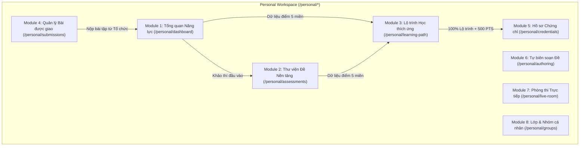
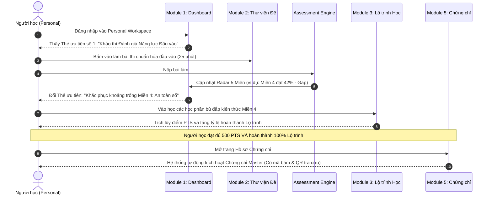
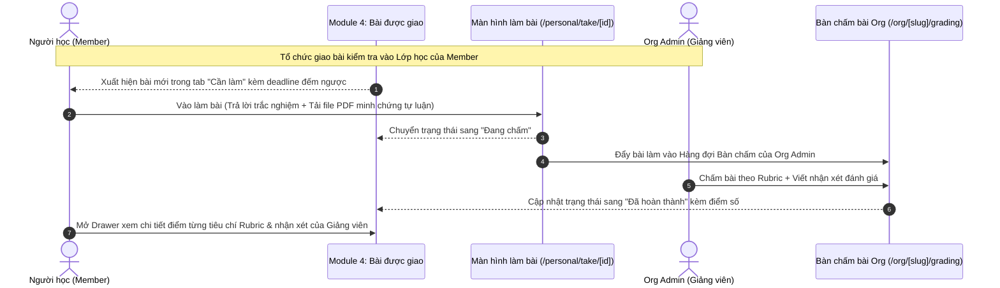
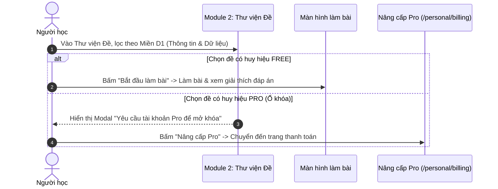

# ĐẶC TẢ THIẾT KẾ & LUỒNG NGHIỆP VỤ: PERSONAL WORKSPACE
> **Phiên bản:** 2.0 (Tinh gọn & Chuẩn hóa Nghiệp vụ)  
> **Thời điểm xác lập:** 04/11/2026  
> **Căn cứ quy chuẩn:** [`AGENTS.md`](file:///c:/nexa/AGENTS.md) • [`SRS.md`](file:///c:/nexa/docs/SRS.md) • Thống nhất trực tiếp với Người dùng ngày 04/11/2026  
> **Nguyên tắc định biên:**  
> 1. Xóa bỏ hoàn toàn các bản vẽ giao diện mô phỏng (No UI Slop/Wireframes).  
> 2. Mô tả chuẩn xác cấu trúc từng module, dữ liệu quản lý và các luồng tương tác đầu-cuối (End-to-End Flows) bằng sơ đồ Sequence Diagram.  
> 3. Tích hợp đầy đủ các quyết định nghiệp vụ đã chốt: Thẻ hành động ưu tiên Test đầu vào, Thư viện đề Free/Pro có ổ khóa, Chứng chỉ Master mở khóa khi đủ 500 điểm + 100% lộ trình.

---

## 1. NGUYÊN TẮC VẬN HÀNH & CÁC QUY TẮC NGHIỆP VỤ ĐÃ CHỐT

1. **Thẻ Hành Động Ưu Tiên Số 1 (Primary Action Card):**
   * Ưu tiên tuyệt đối trên trang Tổng quan cá nhân là **"Làm bài kiểm tra đầu vào (Baseline Assessment)"** để xác định ngay vị trí 5 miền năng lực số khi tham gia hệ thống.
   * Sau khi hoàn thành bài đầu vào, thẻ này tự động chuyển hướng người học sang bước tiếp theo (Làm bài tập lớp sắp đến hạn hoặc Học phần khắc phục miền điểm thấp nhất).
2. **Thư Viện Đề Khảo Thí (`/personal/assessments`):**
   * Là thư viện khảo thí chuẩn hóa do **Nền tảng / Admin tuyển chọn và phát hành**.
   * Người học tự do chủ động lựa chọn đề theo nhu cầu rèn luyện cá nhân.
   * Phân cấp rõ rệt: Đề **Miễn phí (`FREE`)** có thể làm ngay; Đề **Nâng cao (`PRO`)** có biểu tượng **ổ khóa**, yêu cầu tài khoản Pro để mở quyền làm bài.
3. **Điều Kiện Kép Mở Khóa Chứng Chỉ Master (`/personal/credentials`):**
   * Loại bỏ hoàn toàn việc mở khóa chứng chỉ đơn thuần bằng điểm XP.
   * Áp dụng **Điều kiện Kép Chuẩn mực**:
     $$\text{Đủ } 500\text{ PTS tích lũy} \quad \land \quad \text{Hoàn thành } 100\% \text{ Lộ trình học tập}$$
   * Giao diện theo dõi song song cả 2 thanh tiến độ, chỉ kích hoạt chứng chỉ chính thức kèm mã xác thực công khai khi thỏa mãn cả hai điều kiện.

---

## 2. DANH MỤC 8 MODULE CHỨC NĂNG CỐT LÕI

---

### Module 1: Tổng Quan Năng Lực Cá Nhân (`/personal/dashboard`)
* **Mục đích:** Trung tâm phản chiếu hồ sơ năng lực số và định hướng hành động duy nhất cho người học mỗi ngày.
* **Thành phần dữ liệu:**
  1. *Biểu đồ Radar 5 Miền DigComp:*
     * Dữ liệu trung thực: Nếu chưa thi $\rightarrow$ Trạng thái `null` (khung nét đứt, không vẽ 0% giả). Nếu đã thi $\rightarrow$ Hiển thị điểm số thực tế từ 0 đến 100 trên 5 trục (D1 đến D5).
     * Chỉ số làm nổi bật: Miền mạnh nhất (Strengths) và Khoảng trống năng lực cần bù đắp (Key Gap).
  2. *Thẻ Hành Động Ưu Tiên Số 1:*
     * Mặc định khi chưa có kết quả: Nút gọi làm bài **"Khảo thí Đánh giá Năng lực Đầu vào (25 phút)"**.
     * Khi đã có kết quả: Tự động đổi sang bài tập lớp đến hạn trong 24h hoặc bài học khắc phục miền điểm thấp nhất.
  3. *Khối Song hành (Tỷ lệ 65% / 35%):*
     * Cột chính (65%): 2-3 học phần thích ứng được gợi ý nhằm khắc phục miền có điểm thấp nhất.
     * Cột phụ (35%): Hàng đợi tối đa 3 bài tập được giao từ lớp học của tổ chức có hạn nộp gần nhất.
  4. *Thanh Thành tích Tinh gọn:* Chuỗi ngày chuyên cần (Streak), Điểm tích lũy hiện có trên thang 500 PTS (`current_points / 500`), Cấp độ hiện tại và liên kết xem Bảng xếp hạng.

---

### Module 2: Thư Viện Đề Nền Tảng (`/personal/assessments`)
* **Mục đích:** Thư viện khảo thí tập trung do Admin phát hành để học viên chủ động luyện tập và tự đo lường năng lực.
* **Thành phần dữ liệu & Chức năng:**
  1. *Bộ lọc chuẩn hóa:*
     * Lọc theo 5 Miền DigComp: D1 (Thông tin & Dữ liệu) $\rightarrow$ D5 (Giải quyết Vấn đề).
     * Lọc theo Phân hạng: Tất cả, Miễn phí (`FREE`), Nâng cao có ổ khóa (`PRO`).
     * Lọc theo Dạng bài: Trắc nghiệm (`CHOICE`), Thực hành Rubric (`OPEN_RESPONSE`).
  2. *Thẻ đề thi chuẩn:*
     * Đề Free: Hiển thị thời lượng, số câu hỏi, điểm đạt chuẩn, nút **"Bắt đầu làm bài"**, và điểm cao nhất đã từng đạt được.
     * Đề Pro: Hiển thị biểu tượng **ổ khóa**, nhãn `PRO`, nút **"Mở khóa với tài khoản Pro"** (kích hoạt modal nâng cấp gói cá nhân).

---

### Module 3: Lộ Trình Học Tập Thích Ứng (`/personal/learning-path`)
* **Mục đích:** Bồi dưỡng kiến thức có định hướng dựa trên kết quả khảo thí; là điều kiện cần để mở khóa chứng chỉ.
* **Thành phần dữ liệu & Chức năng:**
  1. *Thanh chẩn đoán 5 Miền:* Hiển thị trực quan trạng thái 5 miền (Miền $\ge 70\%$ đạt chuẩn; Miền $< 70\%$ gắn nhãn cần bồi dưỡng).
  2. *Thanh tiến độ Lộ trình:* Đo lường chính xác `Số học phần đã hoàn thành / Tổng số học phần` (phục vụ điều kiện mở khóa chứng chỉ).
  3. *Danh mục Học phần:*
     * Ưu tiên hiển thị các bài học thuộc miền có điểm số thấp nhất của người học.
     * Mỗi học phần gồm: Nội dung kiến thức cốt lõi $\rightarrow$ Bài tập tình huống minh chứng $\rightarrow$ Đánh dấu hoàn thành.

---

### Module 4: Quản Lý Bài Được Giao (`/personal/submissions`)
* **Mục đích:** Tiếp nhận toàn bộ bài tập và bài kiểm tra do Tổ chức/Lớp học giao cho Member.
* **Thành phần dữ liệu & Chức năng:**
  1. *4 Tab trạng thái chuẩn:*
     * `Cần làm`: Các bài tập đang mở, có đếm ngược thời gian hết hạn nộp bài.
     * `Đang chấm`: Bài tự luận đã nộp, đang chờ Org Admin thẩm định tại Bàn chấm Rubric.
     * `Đã hoàn thành`: Bài thi đã có kết quả điểm số chính thức.
     * `Tất cả`: Toàn bộ lịch sử bài nộp.
  2. *Drawer xem chi tiết kết quả Rubric:*
     * Bấm vào bài đã hoàn thành sẽ mở bảng trượt bên phải: Xem điểm chi tiết từng tiêu chí Rubric do Giảng viên chấm, lời nhận xét đánh giá, và tệp minh chứng đã nộp.

---

### Module 5: Hồ Sơ Chứng Chỉ (`/personal/credentials`)
* **Mục đích:** Quản lý và xác thực Chứng chỉ Năng lực Số Master cấp cho học viên.
* **Thành phần dữ liệu & Chức năng:**
  1. *Thanh theo dõi Tiến độ Kép (Dual Progress Tracker):*
     * Điều kiện 1: Điểm tích lũy (`points / 500 PTS`).
     * Điều kiện 2: Tiến độ lộ trình (`completed_steps / total_steps = 100%`).
  2. *Khung Chứng chỉ Master Chính thức:*
     * Khi chưa đủ điều kiện: Hiển thị khung mờ kèm hướng dẫn những việc còn thiếu để mở khóa.
     * Khi đã đủ điều kiện: Hiển thị Chứng chỉ số chính thức với: Tên học viên, Ngày cấp, Điểm số chi tiết 5 miền, Mã băm bảo mật duy nhất, và Mã QR tra cứu công khai tại [`/verify/[credentialId]`](file:///c:/nexa/src/app/verify/[credentialId]/page.tsx).

---

### Module 6: Tự Biên Soạn Đề Cá Nhân (`/personal/authoring`)
* **Mục đích:** Cho phép cá nhân (Giảng viên, Chuyên gia tự do) tự tạo các đề thi kiểm tra riêng.
* **Chức năng chi tiết:**
  1. *Thanh kiểm soát điểm 100:* Cố định thanh tổng điểm, nếu chưa đủ 100 điểm thì hiển thị nút **"Tự động cân bằng về 100"**.
  2. *Soạn câu hỏi:* Trắc nghiệm (`CHOICE`) hoặc Tự luận (`OPEN_RESPONSE`) có gắn tiêu chí Rubric. Tùy chọn bật/tắt bối cảnh tình huống (`Context`).
  3. *Tự động lưu (Auto-save draft):* Lưu nháp tự động liên tục, chống mất dữ liệu.

---

### Module 7: Phòng Thi Trực Tiếp Mã PIN (`/personal/live-room`)
* **Mục đích:** Tổ chức thi trực tiếp trong lớp học hoặc hội thảo với mã PIN 6 số.
* **Chức năng chi tiết:**
  1. *Tạo phòng thi:* Chọn đề thi, đặt thời gian làm bài, tạo mã PIN phòng thi.
  2. *Bảng điều khiển Host:* Giám sát danh sách thí sinh vào phòng theo thời gian thực (Supabase Realtime Presence).
  3. *Điều phối thi:* Nút bắt đầu đồng loạt, chốt thời gian, và hiển thị bảng xếp hạng điểm tức thì khi kết thúc.

---

### Module 8: Lớp & Nhóm Cá Nhân (`/personal/groups`)
* **Mục đích:** Không gian học tập nhóm tự do do người dùng tạo ra hoặc tham gia độc lập, cách ly hoàn toàn với các Lớp học của Doanh nghiệp/Nhà trường B2B.

---

## 3. CÁC LUỒNG NGHIỆP VỤ ĐẦU-CUỐI (END-TO-END FLOWS)

### 3.1. Luồng 1: Vòng Lặp Năng Lực Cốt Lõi (Đầu Vào $\rightarrow$ Lộ Trình $\rightarrow$ Chứng Chỉ Master)

---

### 3.2. Luồng 2: Nhận & Nộp Bài Tập Được Giao Từ Tổ Chức

---

### 3.3. Luồng 3: Tự Luyện Tập Qua Thư Viện Đề (Free vs Pro)

---

## 4. MA TRẬN DỮ LIỆU & QUYỀN HẠN: PERSONAL WORKSPACE

| Dữ liệu / Nghiệp vụ | Trạng thái hiển thị | Quyền thao tác |
| :--- | :--- | :--- |
| **Radar 5 Miền Cá Nhân** | Dữ liệu trung thực (`null` nếu chưa thi, điểm 0-100 nếu đã thi) | Chỉ cá nhân người học nhìn thấy, tổ chức không xem được trừ bài nộp vào lớp |
| **Thư Viện Đề Nền Tảng** | Đề Free mở tự do; Đề Pro gắn ổ khóa | Học viên tự do làm đề Free; Đề Pro yêu cầu tài khoản nâng cấp |
| **Lộ Trình Học Thích Ứng** | Cá nhân hóa theo miền điểm thấp của người học | Học viên đánh dấu hoàn thành sau khi học xong |
| **Bài Tập Được Giao** | Nhận từ Lớp học thuộc Tổ chức B2B | Học viên làm bài, nộp minh chứng, xem phản hồi điểm Rubric |
| **Chứng Chỉ Master** | Khóa mờ cho đến khi thỏa mãn điều kiện kép | Tự động kích hoạt khi `Điểm >= 500` và `Lộ trình = 100%` |

---

## 5. TỔNG KẾT

Tài liệu này đã:
1. Chuẩn hóa dứt điểm **8 Module chức năng cốt lõi** của Personal Workspace, không vẽ mô hình UI slop giả lập.
2. Thể chế hóa chính xác các quyết định nghiệp vụ: **Test đầu vào ưu tiên số 1**, **Thư viện đề Free/Pro có ổ khóa**, và **Điều kiện kép mở khóa Chứng chỉ Master (500 PTS + 100% Lộ trình)**.
3. Thiết lập chi tiết **3 Luồng nghiệp vụ Sequence Diagram** khép kín và nhất quán.

> [!NOTE]
> Toàn bộ nội dung đã được cập nhật an toàn tại [`docs/KE_HOACH_TINH_CHINH_UI_UX_PERSONAL_WORKSPACE.md`](file:///c:/nexa/docs/KE_HOACH_TINH_CHINH_UI_UX_PERSONAL_WORKSPACE.md). Mã nguồn hệ thống tiếp tục được giữ nguyên vẹn 100%.

Bây giờ cả hai bản đặc tả của **Personal Workspace** và **Organization Console** đều đã đạt chuẩn tinh gọn, chúng ta có thể bước sang không gian cuối cùng: **Platform Admin Control Plane (`/admin/*`)**!
