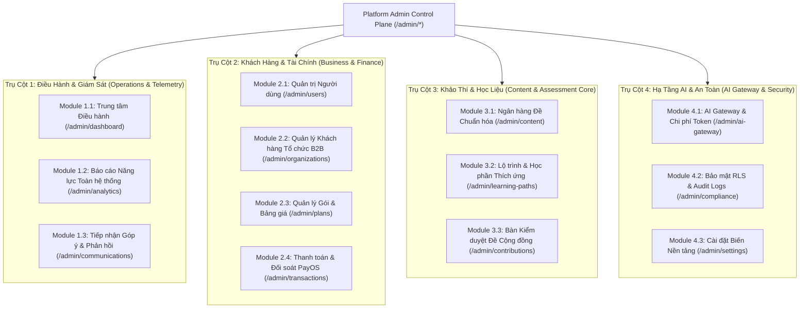
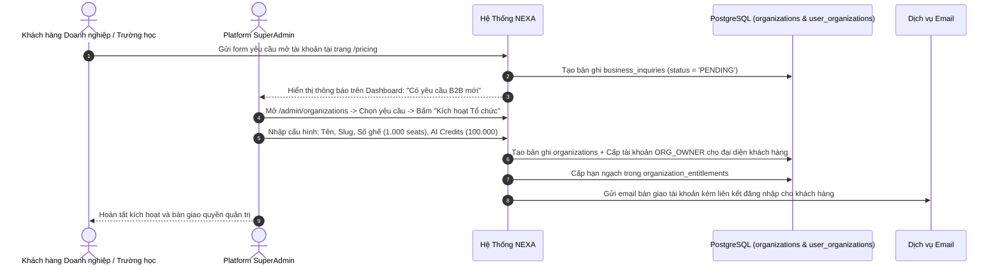
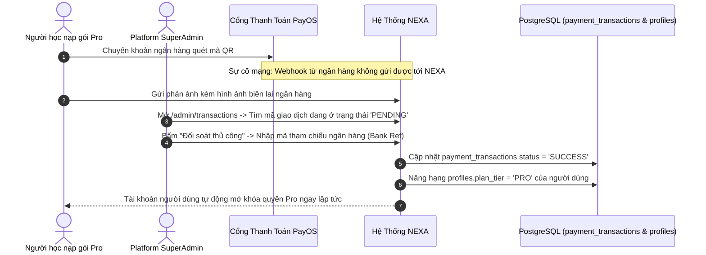
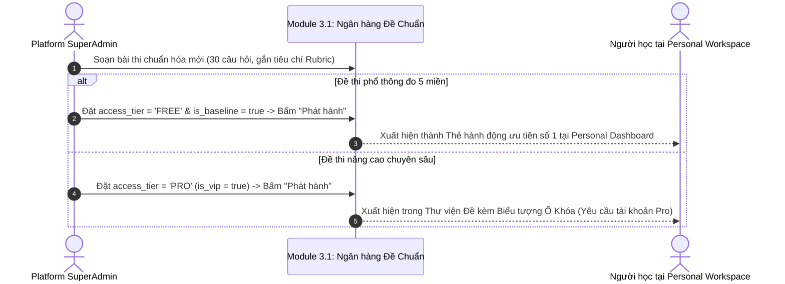

# ĐẶC TẢ THIẾT KẾ & LUỒNG NGHIỆP VỤ: PLATFORM ADMIN CONTROL PLANE
> **Phiên bản:** 2.0 (Tinh gọn & Chuẩn hóa Nghiệp vụ Toàn Nền Tảng)  
> **Thời điểm xác lập:** 04/11/2026  
> **Tác giả:** Senior Product Engineer & Staff Platform Architect  
> **Căn cứ quy chuẩn:** [`AGENTS.md`](file:///c:/nexa/AGENTS.md) • [`SRS.md`](file:///c:/nexa/docs/SRS.md) • [`USECASE.md`](file:///c:/nexa/docs/USECASE.md) • Thống nhất trực tiếp với Người dùng ngày 04/11/2026  
> **Đối tượng vận hành:** Dành riêng cho `Platform SuperAdmin` (Đội ngũ sáng lập, Kỹ sư vận hành nền tảng, Ban điều hành NEXA AI).  
> **Nguyên tắc định biên:**  
> 1. Xóa bỏ hoàn toàn các bản vẽ giao diện mô phỏng (No UI Slop/Wireframes).  
> 2. Phân rã chuẩn xác cấu trúc 4 trụ cột nghiệp vụ (11 modules), thực thể dữ liệu, quyền hạn và trách nhiệm.  
> 3. Mô tả các luồng nghiệp vụ đầu-cuối (End-to-End Operational Flows) bằng sơ đồ Sequence Diagram chuẩn mực.

---

## 1. NGUYÊN TẮC CỐT LÕI & VỊ THẾ BẢO MẬT (SECURITY & ARCHITECTURE BARRIER)

### 1.1. Cách Ly Đặc Quyền Nền Tảng Tuyệt Đối
Theo quy định bất biến tại [`AGENTS.md`](file:///c:/nexa/AGENTS.md):
* **Không gian Admin (`/admin/*`) là đặc quyền cấp nền tảng**, kiểm soát độc lập qua guard `requirePlatformAdmin` (dựa trên email superadmin hoặc cờ hệ thống trong `profiles.admin_role`).
* **Không phải quyền mua được:** Việc mua gói Personal Pro hay Organization Enterprise tuyệt đối không cấp quyền truy cập vào `/admin/*`.
* `ORG_ADMIN` (Quản trị viên trường học/doanh nghiệp) hoàn toàn khác biệt với `Platform Admin`. `ORG_ADMIN` chỉ có thẩm quyền trong phạm vi tổ chức của họ tại `/org/[slug]/*` và bị chặn truy cập `/admin/*`.

### 1.2. Chuẩn Mực Dữ Liệu Thực Chứng (Zero Fake Data)
* **Không giả lập số liệu:** Doanh thu là tiền VND thực tế đối soát từ cổng thanh toán PayOS; lượt khảo thí, token AI tiêu thụ và lỗi hệ thống phản ánh đúng 100% dữ liệu thực từ PostgreSQL và AI Gateway.
* Số liệu tiền tệ, token, mã băm, thời gian, mã giao dịch bắt buộc sử dụng định dạng số kỹ thuật `font-mono tabular-nums`.

---

## 2. BẢN ĐỒ 4 TRỤ CỘT NGHIỆP VỤ (11 MODULES HỆ THỐNG)

---

## 3. ĐẶC TẢ CHI TIẾT TỪNG MODULE CHỨC NĂNG

---

### TRỤ CỘT 1: ĐIỀU HÀNH & GIÁM SÁT NỀN TẢNG

#### Module 1.1: Trung Tâm Điều Hành Nền Tảng (`/admin/dashboard`)
* **Mục đích:** Bảng chỉ huy sinh tồn (Mission Control) giúp Platform SuperAdmin nắm bắt toàn bộ trạng thái kỹ thuật và kinh doanh trong 3 giây.
* **Thành phần dữ liệu:**
  1. *Chỉ số sinh tồn (Platform Vitals):*
     * Doanh thu thực tế tích lũy và doanh thu 30 ngày gần nhất qua PayOS (VND).
     * Tổng số tài khoản người dùng hoạt động (Daily Active Users - DAU).
     * Số tổ chức B2B đang hoạt động (`status = 'ACTIVE'`).
     * Chi phí tiêu thụ AI trong ngày (USD và VND quy đổi).
     * Tỷ lệ lỗi hệ thống (System Error Rate).
  2. *Hàng đợi Phê duyệt Hợp nhất (Universal Moderation Queue):*
     * Yêu cầu tư vấn / mở tài khoản trường học, doanh nghiệp mới (`business_inquiries`).
     * Đề thi đóng góp từ cộng đồng chờ kiểm duyệt (`community_contributions`).
     * Giao dịch thanh toán cần đối soát thủ công (`pending_transactions`).
  3. *Trạng thái Hạ tầng (Infrastructure Status):* Kết nối Database Supabase, Cổng thanh toán PayOS Webhook, Google Gemini AI Gateway.

#### Module 1.2: Báo Cáo Năng Lực Toàn Nền Tảng (`/admin/analytics`)
* **Mục đích:** Cung cấp bức tranh vĩ mô về năng lực số của toàn bộ người học trên hệ thống.
* **Thành phần dữ liệu:**
  * Điểm trung bình 5 Miền DigComp (D1 đến D5) trên quy mô toàn quốc.
  * Tỷ lệ người học đạt chuẩn theo từng cấp độ: Cơ bản (Level 1-2), Trung cấp (Level 3-4), Nâng cao (Level 5-6).
  * Biểu đồ tăng trưởng số lượng bài khảo thí được nộp theo ngày/tháng.

#### Module 1.3: Tiếp Nhận Góp Ý & Phản Hồi (`/admin/communications`)
* **Mục đích:** Thu thập ý kiến đánh giá của người dùng từ nút "Góp ý kiến" tại Personal Workspace và Organization Console.
* **Dữ liệu:** Tiêu đề, nội dung phản hồi, loại góp ý (Báo lỗi, Đề xuất tính năng, Trải nghiệm đề thi), thông tin người gửi, trạng thái xử lý (*Mới, Đang xem xét, Đã phản hồi*).

---

### TRỤ CỘT 2: KHÁCH HÀNG & KINH DOANH

#### Module 2.1: Quản Trị Người Dùng Toàn Nền Tảng (`/admin/users`)
* **Mục đích:** Kiểm soát toàn bộ tài khoản người dùng cá nhân trong hệ thống.
* **Chức năng chi tiết:**
  1. *Tìm kiếm & Lọc đa chiều:* Lọc theo phân hạng gói (`FREE`, `PRO`, `ENTERPRISE`), trạng thái tài khoản (`ACTIVE`, `SUSPENDED`), tìm kiếm theo Email / Nickname / Họ tên.
  2. *Nâng cấp / Điều chỉnh Gói cá nhân:* Cấp quyền Pro thủ công cho người dùng đặc biệt hoặc gia hạn thời hạn dùng.
  3. *Khóa tài khoản vi phạm (Suspend Account):* Tạm khóa tài khoản gian lận thi cử hoặc vi phạm chính sách, nhập lý do khóa cụ thể (hệ thống tự động điều hướng người dùng tới trang [`/account-suspended`](file:///c:/nexa/src/app/(auth)/account-suspended/page.tsx)).
  4. *Cấp đặc quyền Quản trị:* Chỉ định tài khoản thành Platform Admin (yêu cầu xác thực tài khoản SuperAdmin).

#### Module 2.2: Quản Lý Khách Hàng Tổ Chức B2B (`/admin/organizations`)
* **Mục đích:** Xử lý toàn bộ vòng đời của khách hàng Doanh nghiệp và Trường học.
* **Chức năng chi tiết:**
  1. *Hàng đợi xét duyệt yêu cầu mở tài khoản (`business_inquiries`):*
     * Tiếp nhận form đăng ký từ trang công khai `/pricing`.
     * Admin xem: Tên đơn vị, Người liên hệ, Email, Số điện thoại, Số lượng học viên dự kiến.
     * Nút **"Kích hoạt Tổ chức"**: Mở modal nhập Slug, Mã tổ chức, số lượng ghế (Seats), số lượng AI Credits $\rightarrow$ Hệ thống tự động tạo Tổ chức mới, tạo tài khoản `ORG_OWNER` và gửi email kích hoạt cho khách hàng.
  2. *Hàng đợi xét duyệt Gia hạn / Nâng cấp (`renewal_requests`):*
     * Tiếp nhận yêu cầu mua thêm ghế hoặc nạp thêm AI Credits từ Org Admin gửi lên qua `/org/[slug]/plan`.
     * Admin bấm **"Phê duyệt & Cộng hạn ngạch"** sau khi hoàn tất hợp đồng tài chính.
  3. *Danh sách Tổ chức đang hoạt động:* Xem chi tiết mức sử dụng tài nguyên (số ghế đã dùng/tối đa, AI credits còn lại), tạm dừng (`PAUSE`) hoặc đóng tài khoản tổ chức vi phạm hợp đồng.

#### Module 2.3: Quản Lý Gói Dịch Vụ & Bảng Giá (`/admin/plans`)
* **Mục đích:** Thiết lập chính sách thương mại và quyền lợi của các gói tài khoản.
* **Chức năng:** Cấu hình giá tiền VND, số lượt làm bài khảo thí chuyên sâu, hạn mức mở đề Pro, hạn mức AI Credits phân bổ cho từng gói (Personal Free, Personal Pro, Org Starter, Org Enterprise).

#### Module 2.4: Thanh Toán & Đối Soát Giao Dịch (`/admin/transactions`)
* **Mục đích:** Quản lý dòng tiền nạp tự động qua PayOS và xử lý sự cố thanh toán.
* **Chức năng chi tiết:**
  1. *Nhật ký giao dịch thời gian thực:* Mã giao dịch, Người thanh toán, Số tiền (VND), Trạng thái (`PENDING`, `SUCCESS`, `FAILED`), Mã băm đối soát PayOS.
  2. *Đối soát thủ công (Manual Reconcile):* Khi người dùng chuyển khoản thành công nhưng Webhook ngân hàng bị nghẽn $\rightarrow$ Admin mở chi tiết giao dịch, nhập Mã giao dịch ngân hàng làm bằng chứng $\rightarrow$ Bấm **"Xác nhận đối soát thành công"** $\rightarrow$ Hệ thống lập tức chuyển trạng thái sang `SUCCESS` và tự động kích hoạt gói Pro cho người dùng mà không cần can thiệp code hay cơ sở dữ liệu.

---

### TRỤ CỘT 3: KHẢO THÍ & HỌC LIỆU CỐT LÕI

#### Module 3.1: Ngân Hàng Đề Khảo Thí Chuẩn Hóa (`/admin/content`)
* **Mục đích:** Cơ quan đầu não quản lý các đề thi chuẩn của nền tảng được đưa vào Thư viện Đề của Personal và Org.
* **Chức năng chi tiết:**
  1. *Phân hạng bản quyền đề thi:*
     * Gắn nhãn **Miễn phí (`FREE`)** hoặc **Khóa Nâng cao (`PRO`)**.
     * Admin toàn quyền bật/tắt cờ `is_vip / access_tier` để đề xuất hiện có ổ khóa trên giao diện học viên.
  2. *Chỉ định mục tiêu khảo thí:* Đánh dấu đề là **"Đề Khảo thí Đầu vào Chuẩn hóa"** (dùng cho Thẻ ưu tiên số 1 của Personal Dashboard).
  3. *Trình soạn câu hỏi & Barem:*
     * Tạo câu hỏi Trắc nghiệm (`CHOICE`) và Tự luận minh chứng (`OPEN_RESPONSE`).
     * Thiết lập tiêu chí Rubric chuẩn hóa: Tên tiêu chí, Điểm tối đa, Mô tả mức đạt.
     * Ánh xạ câu hỏi vào 5 Miền năng lực số DigComp (D1 -> D5).
  4. *Xuất bản (`is_published`):* Đề chỉ xuất hiện trên toàn hệ thống sau khi Admin bấm Phát hành.

#### Module 3.2: Lộ Trình & Học Phần Thích Ứng (`/admin/learning-paths`)
* **Mục đích:** Quản trị danh mục các bài học vi mô (Micro-learning catalog) phục vụ việc khắc phục lỗ hổng năng lực cho học viên.
* **Chức năng chi tiết:**
  * Tạo học phần mới: Tiêu đề, miền năng lực mục tiêu (ví dụ: *D4: An toàn & Bảo mật*), thời lượng học, bài tập tình huống thực hành.
  * Sắp xếp thứ tự các chặng học trong Lộ trình bồi dưỡng chuẩn quốc gia.

#### Module 3.3: Bàn Kiểm Duyệt Đề Đóng Góp Cộng Đồng (`/admin/contributions`)
* **Mục đích:** Kiểm soát chất lượng các đề thi do giảng viên, chuyên gia cộng đồng chia sẻ trước khi đưa vào Thư viện chung.
* **Chức năng chi tiết:**
  * Xem trước toàn bộ câu hỏi, đáp án, barem rubric do tác giả nộp lên.
  * Tùy chọn thẩm định:
    * **"Phê duyệt & Xuất bản"**: Đề tự động chuyển vào Thư viện Đề Cộng đồng; hệ thống tự động cộng điểm uy tín cho tác giả.
    * **"Yêu cầu Chỉnh sửa"**: Nhập lý do bằng văn bản (ví dụ: *Câu hỏi số 4 thiếu đáp án chính xác*) gửi email phản hồi tác giả.

---

### TRỤ CỘT 4: HẠ TẦNG AI & AN TOÀN HỆ THỐNG

#### Module 4.1: AI Gateway & Chi Phí Token (`/admin/ai-gateway`)
* **Mục đích:** Giám sát độ ổn định, hiệu năng và chi phí của các mô hình AI (Google Gemini, OpenAI, Claude) phục vụ chấm bài và gợi ý học tập.
* **Chức năng chi tiết:**
  1. *Giám sát lưu lượng (Telemetry Meters):*
     * Tổng số request xử lý, số token đầu vào (Prompt Tokens), số token đầu ra (Completion Tokens).
     * Chi phí thực tế tích lũy tính theo USD và quy đổi sang VND.
     * Độ trễ trung bình (Average Latency) và độ trễ phân vị thứ 95 (p95 Latency).
  2. *Giám sát lỗi & Ngắt mạch khẩn cấp (Emergency Circuit Breaker):*
     * Tỷ lệ lỗi (Error Rate %). Nếu nhà cung cấp chính (ví dụ Gemini Flash) gặp sự cố nghẽn mạng, Admin có nút gạt khẩn cấp chuyển hướng toàn bộ traffic sang mô hình dự phòng (Failover Provider).

#### Module 4.2: Bảo Mật, RLS & Nhật Ký Kiểm Toán (`/admin/compliance`)
* **Mục đích:** Bảo đảm tính tuân thủ bảo mật dữ liệu và kiểm soát rủi ro truy cập.
* **Chức năng:**
  * Bảng kiểm tra tình trạng Row Level Security (RLS) của 100% các bảng dữ liệu trong PostgreSQL.
  * Nhật ký kiểm toán (Audit Logs): Lưu vết toàn bộ hành vi nhạy cảm của Admin (Ai đã khóa tài khoản X? Ai đã duyệt tổ chức Y? Ai đã sửa điểm giao dịch Z?).

#### Module 4.3: Cài Đặt Biến Nền Tảng (`/admin/settings`)
* **Chức năng:** Quản lý các tham số runtime của nền tảng: Bật/Tắt chế độ bảo trì hệ thống, cấu hình tỷ giá tính phí token AI, thông tin pháp nhân và hotline hỗ trợ kỹ thuật.

---

## 4. CÁC LUỒNG NGHIỆP VỤ ĐẦU-CUỐI TRỌNG YẾU (END-TO-END FLOWS)

### 4.1. Luồng 1: Tiếp Nhận & Kích Hoạt Khách Hàng Doanh Nghiệp B2B

---

### 4.2. Luồng 2: Đối Soát Thủ Công Giao Dịch Thanh Toán PayOS Treo

---

### 4.3. Luồng 3: Quản Lý Bản Quyền Đề Khảo Thí (Phát Hành Đề Free / Pro Lock)

---

## 5. MA TRẬN PHÂN QUYỀN VÀ TRÁCH NHIỆM

| Module / Hành động | Platform SuperAdmin | Org Admin | Người Học Cá Nhân |
| :--- | :---: | :---: | :---: |
| Truy cập `/admin/*` | ✅ Toàn quyền truy cập | ❌ Bị chặn (403 Forbidden) | ❌ Bị chặn (403 Forbidden) |
| Kích hoạt Tổ chức B2B mới | ✅ Toàn quyền | ❌ Không có quyền | ❌ Không có quyền |
| Phê duyệt Đề thi Cộng đồng | ✅ Toàn quyền | ❌ Không có quyền | ❌ Chỉ được nộp đề đóng góp |
| Giám sát AI Gateway & Đổi mô hình | ✅ Toàn quyền | ❌ Không có quyền | ❌ Không có quyền |
| Khóa tài khoản người dùng vi phạm | ✅ Toàn quyền trên toàn nền tảng | ❌ Chỉ xóa khỏi tổ chức của mình | ❌ Không có quyền |
| Đối soát giao dịch tiền tệ PayOS | ✅ Toàn quyền | ❌ Không có quyền | ❌ Chỉ xem hóa đơn cá nhân |
| Quyết định đề Free hoặc Khóa Pro | ✅ Toàn quyền phân hạng | ❌ Không có quyền | ❌ Không có quyền |

---

## 6. TỔNG KẾT BỘ BA TÀI LIỆU ĐẶC TẢ

Hệ thống NEXA AI hiện tại đã sở hữu đầy đủ bộ ba văn kiện kiến trúc chuẩn mực:
1. **Personal Workspace:** [`docs/KE_HOACH_TINH_CHINH_UI_UX_PERSONAL_WORKSPACE.md`](file:///c:/nexa/docs/KE_HOACH_TINH_CHINH_UI_UX_PERSONAL_WORKSPACE.md) — 8 Modules, Vòng lặp năng lực 5 miền, Test đầu vào ưu tiên số 1, Đề Free/Pro có ổ khóa, Chứng chỉ Master (500 PTS + 100% Lộ trình).
2. **Organization Console:** [`docs/KE_HOACH_TINH_CHINH_UI_UX_ORGANIZATION_WORKSPACE.md`](file:///c:/nexa/docs/KE_HOACH_TINH_CHINH_UI_UX_ORGANIZATION_WORKSPACE.md) — 7 Modules, Phân quyền tinh giản Admin & Member, Bàn chấm bài Rubric có trợ lý AI HITL, Đợt thi Wizard 3 bước.
3. **Platform Admin Control Plane:** [`docs/KE_HOACH_TINH_CHINH_UI_UX_PLATFORM_ADMIN.md`](file:///c:/nexa/docs/KE_HOACH_TINH_CHINH_UI_UX_PLATFORM_ADMIN.md) — 4 Trụ cột (11 Modules), Cách ly đặc quyền tuyệt đối, AI Gateway Circuit Breaker, Đối soát PayOS, Quản trị bản quyền đề thi.

> [!NOTE]
> Toàn bộ quá trình lập kế hoạch kiến trúc cho cả 3 không gian đã hoàn tất mà **không có bất kỳ dòng code nào bị chỉnh sửa tùy tiện**. Hệ thống sẵn sàng cho bước triển khai mã nguồn khi có lệnh phê duyệt từ Người dùng.
