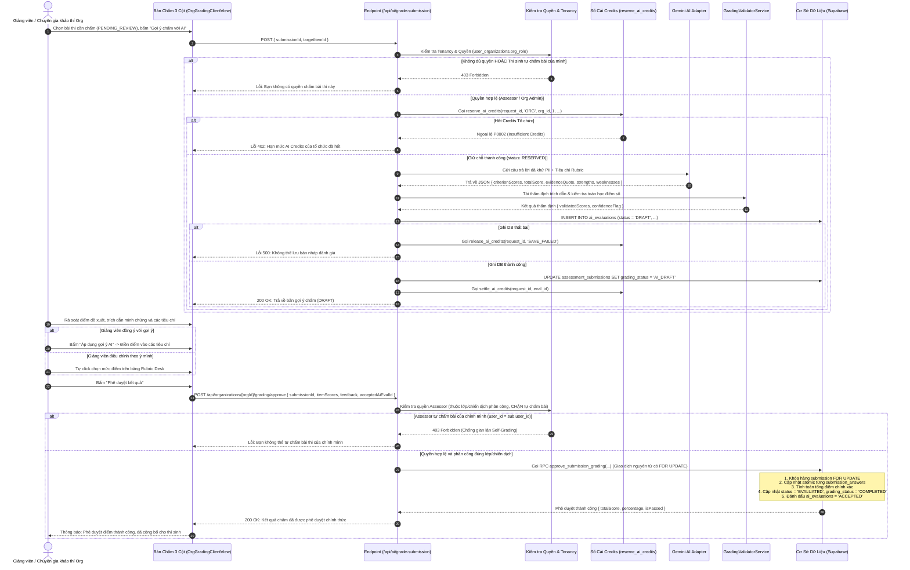
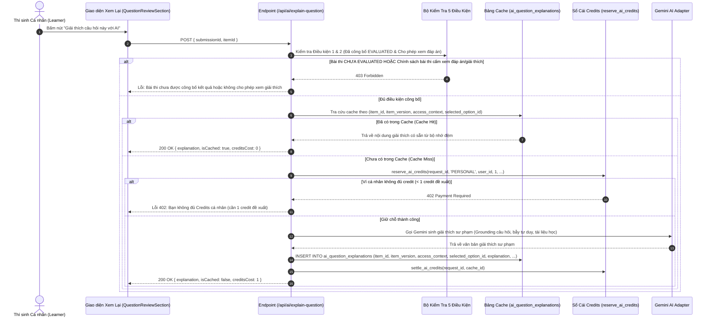

# KẾ HOẠCH KỸ THUẬT TRIỂN KHAI TOÀN DIỆN HỆ THỐNG AI SẴN SÀNG SẢN XUẤT (PRODUCTION READINESS)
## NỀN TẢNG ĐÁNH GIÁ VÀ PHÁT TRIỂN NĂNG LỰC SỐ — NEXA AI

> **Mã tài liệu:** `NEXA-AI-IMPLEMENTATION-PLAN-2026-PROD`  
> **Phiên bản:** 1.1 — Tài liệu Đặc tả Kỹ thuật Chuẩn hóa Trước Triển khai (Pre-implementation Engineering Specification)  
> **Thời điểm ban hành:** 19/11/2026  
> **Kho lưu trữ:** `c:\nexa` | **Nhánh tham chiếu:** `main`  
> **Căn cứ kỹ thuật & Tài liệu đối soát:**  
> - Báo cáo Khảo sát Thực tế: `teamwork_explorer_m1_1` (Schema, Migrations & RLS Security Baseline), `teamwork_explorer_m1_2` (AI Gateway & Credits Architecture), `teamwork_explorer_m1_3` (Workflows, UI/UX & P0–P4 Roadmap).  
> - `docs/NEXA_AI_WORKFLOW_UX_ARCHITECTURE_REVIEW_2026.md` (Báo cáo Đánh giá Kiến trúc AI & UX 2026).  
> - `docs/ai-integration-architecture.md` (Kiến trúc Tích hợp AI Chuẩn hóa 8 Lớp).  
> - `docs/SRS.md` (Đặc tả Yêu cầu Phần mềm Hệ thống Khảo thí & Đào tạo NEXA AI).  
> - `docs/USECASE.md` (Đặc tả 4 Actor, Ma trận CRUD & Luồng Tương tác Nghiệp vụ).  
> - `AGENTS.md` (Quy chuẩn Kiến trúc, Màu sắc Thương hiệu Light/Dark, Thiết kế Chống AI Slop).  

---

## MỤC LỤC TỔNG THỂ

1. [Phần 1: Executive Summary & Mục Tiêu Phiên Bản 1.1](#phần-1-executive-summary--mục-tiêu-phiên-bản-11)
2. [Phần 2: Bảng Hiện Trạng Kiến Trúc AI Thực Tế (Đối Chiếu Mã Nguồn c:\nexa)](#phần-2-bảng-hiện-trạng-kiến-trúc-ai-thực-tế-đối-chiếu-mã-nguồn-cnexa)
3. [Phần 3: Kiến Trúc AI Mục Tiêu & Ranh Giới Bất Biến (Organization vs Personal)](#phần-3-kiến-trúc-ai-mục-tiêu--ranh-giới-bất-biến-organization-vs-personal)
4. [Phần 4: Quy Trình Nghiệp Vụ (Workflows) & Máy Trạng Thái (State Machines)](#phần-4-quy-trình-nghiệp-vụ-workflows--máy-trạng-thái-state-machines)
5. [Phần 5: Cơ Sở Dữ Liệu, Schema Chuẩn Hóa & SQL Mẫu (Khắc phục 100% Fictitious Tables)](#phần-5-cơ-sở-dữ-liệu-schema-chuẩn-hóa--sql-mẫu-khắc-phục-100-fictitious-tables)
6. [Phần 6: Ma Trận Phân Quyền RACI & Mô Hình Bảo Mật RLS/Triggers](#phần-6-ma-trận-phân-quyền-raci--mô-hình-bảo-mật-rlstriggers)
7. [Phần 7: Chu Trình AI Credits & AI Gateway (Đa Nhà Cung Cấp, Idempotency, 5-Pha, Reconciliation)](#phần-7-chu-trình-ai-credits--ai-gateway-đa-nhà-cung-cấp-idempotency-5-pha-reconciliation)
8. [Phần 8: Thiết Kế UI/UX Theo Quy Chuẩn AGENTS.md & Tái Sử Dụng Bàn Chấm Org Hiện Có](#phần-8-thiết-kế-uiux-theo-quy-chuẩn-agentsmd--tái-sử-dụng-bàn-chấm-org-hiện-có)
9. [Phần 9: Danh Mục Lỗi (Defect Catalog) & Lộ Trình Kỹ Thuật Tái Cấu Trúc P0–P4](#phần-9-danh-mục-lỗi-defect-catalog--lộ-trình-kỹ-thuật-tái-cấu-trúc-p0p4)
10. [Phần 10: Checklist Kiểm Thử Và Nghiệm Thu Chi Tiết (QA & Acceptance Criteria)](#phần-10-checklist-kiểm-thử-và-nghiệm-thu-chi-tiết-qa--acceptance-criteria)

---

## PHẦN 1: EXECUTIVE SUMMARY & MỤC TIÊU PHIÊN BẢN 1.1

### 1.1. Bối cảnh Sản phẩm và Tôn chỉ "Ba Không Gian, Một Danh Tính"
NEXA AI là nền tảng đánh giá và phát triển năng lực số chuẩn mực cho cá nhân, doanh nghiệp và cơ sở giáo dục. Điểm cốt lõi tạo nên giá trị của NEXA AI là chu trình khép kín:
$$\text{Đánh giá có bằng chứng} \longrightarrow \text{Phát hiện khoảng trống năng lực} \longrightarrow \text{Gợi ý lộ trình đào tạo chuẩn hóa} \longrightarrow \text{Thực hành} \longrightarrow \text{Đánh giá lại}$$

Hệ thống vận hành trên nguyên tắc kiến trúc: **Một tài khoản đăng nhập duy nhất (`auth.users`) nhưng hoạt động trong 3 không gian ngữ cảnh hoàn toàn cách ly**:
1. **Personal Workspace (`/personal/*`):** Không gian của người học cá nhân (Learner), tác giả biên soạn đề thi tự do, và giảng viên lớp cá nhân (Personal Evaluator).
2. **Organization Business Workspace (`/org/[slug]/*`):** Không gian B2B dành cho trường học, cơ quan và doanh nghiệp điều hành đợt khảo thí, quản trị thành viên, chấm bài tự luận và xem báo cáo tổng thể.
3. **Platform Admin Workspace (`/admin/*`):** Không gian dành cho chủ sở hữu nền tảng NEXA AI điều hành kỹ thuật, cấu hình AI Gateway, quản lý gói dịch vụ và tài chính.

**Định vị AI trong NEXA AI:** AI không phải là chatbot đàm thoại giải trí hay công cụ bán khóa học. AI là một **hệ thống dịch vụ hỗ trợ có kiểm soát (Governed AI Subsystem)** hoạt động theo cơ chế On-Demand, tuyệt đối không can thiệp vào các logic chấm điểm khách quan.

### 1.2. Mục Tiêu của Bản Cập Nhật Phiên Bản 1.1
Phiên bản 1.0 trước đây đã phác thảo các mục tiêu lớn nhưng còn tồn tại các giả định không chính xác so với mã nguồn thực tế (fictitious tables, xung đột số hiệu migration, lỗ hổng RLS cho phép thí sinh tự cập nhật trạng thái `EVALUATED`, và nhận định sai về tính đa nhà cung cấp của AI Gateway). 

Phiên bản 1.1 được xây dựng dựa trên kết quả kiểm toán mã nguồn thực tế 100% tại `c:\nexa`, thiết lập một bản đặc tả kỹ thuật chuẩn xác, khả thi và có thể nghiệm thu độc lập trước khi tiến hành viết mã:
1. **Xóa bỏ 100% Fictitious Tables và Xung đột Migration:** Loại bỏ hoàn toàn các bảng giả định `organization_members`, `org_roles`, `role_permissions`, `organization_ai_credits`. Ánh xạ chính xác vào schema thực tế: `public.user_organizations`, `public.organization_entitlements`, `public.ai_credit_reservations`. Quy hoạch số hiệu migration bắt đầu từ **50_...** (do migrations 47, 48, 49 đã tồn tại và đang hoạt động).
2. **Khóa chặt An ninh Trạng thái Bài Thi (Status Tamper Guard):** Loại bỏ hoàn toàn lỗ hổng bảo mật cho phép thí sinh tự chuyển trạng thái bài thi thành `EVALUATED` hoặc giả mạo điểm số qua cả UPDATE lẫn direct INSERT. Bổ sung PostgreSQL `BEFORE INSERT OR UPDATE` triggers trên `assessment_submissions` và `submission_answers` cùng RLS Policies nghiêm ngặt thực thi phòng thủ chiều sâu (Defense in Depth), ngăn chặn thí sinh tự chấm điểm, đóng cửa sau chèn đáp án và chống rò rỉ bản nháp AI.
3. **Chuẩn hóa Ranh giới AI Nghiệp vụ (AI Boundary Enforcement):** Xác lập nguyên tắc bất biến: **AI Grading là tính năng B2B độc quyền trong Organization**. Cá nhân (Personal) và Giảng viên lớp cá nhân (Personal Evaluator) tuyệt đối không được kích hoạt AI Grading. Toàn bộ các chức năng tạo đề, lớp học cá nhân và bàn chấm thủ công (`personal/grading`) được bảo toàn trọn vẹn.
4. **Chuẩn hóa Vòng Đời 5 Pha của AI Credits & AI Gateway:** Thiết lập chu trình tài chính hoàn chỉnh: Phân giải Payer (`ORG` vs `PERSONAL`), Giữ chỗ nguyên tử (`reserve_ai_credits` có `FOR UPDATE` và Idempotency), Thực thi Gateway, Lưu trữ dữ liệu (`ai_evaluations` dạng `DRAFT`), và Quyết toán nguyên tử (`settle_ai_credits`). Bổ sung quy trình Đối soát tự động (`reconcile_ai_credit_reservations`) giải quyết dứt điểm sự cố rớt mạng sau khi lưu kết quả. Minh bạch hóa hiện trạng AI Gateway hiện chỉ hỗ trợ Google Gemini.
5. **Đặc tả Workflow Giải thích Câu hỏi cho Personal AI & Tái Sử Dụng Bàn Chấm Org:** Thiết kế luồng giải thích câu hỏi cho bài thi đã công bố (tối ưu chi phí bằng cache `ai_question_explanations`, 5 điều kiện bất biến). Hủy bỏ kế hoạch xây mới component bàn chấm trùng lặp; tái sử dụng và nâng cấp trực tiếp bàn chấm 3 cột `OrgGradingClientView.tsx` hiện có, tuân thủ tuyệt đối quy chuẩn `AGENTS.md` (Light trắng #FFFFFF / Dark đen #000000, không viền ngang, không proctoring xâm phạm riêng tư).
6. **Chuẩn hóa Vai trò Khảo thí viên trong Organization — Chỉ Giữ Duy Nhất `ASSESSOR`:** Loại bỏ hoàn toàn alias trùng lặp `EVALUATOR` khỏi danh sách vai trò Organization (`user_organizations`, `organization_invitations`, API routes, RBAC). Chuyển đổi toàn bộ dữ liệu lịch sử mang giá trị `EVALUATOR` sang `ASSESSOR` tại Migration 50 trước khi thu hẹp CHECK constraint. Giữ tương thích ngược an toàn qua `normalizeOrgRole` trong giai đoạn chuyển đổi. Bảo toàn 100% vai trò `EVALUATOR` cấp tài khoản cá nhân (`profiles.role = 'EVALUATOR'`), các lớp cá nhân (`evaluator_classes`) và chức năng chấm tay Personal (`/personal/grading`).

---

## PHẦN 2: BẢNG HIỆN TRẠNG KIẾN TRÚC AI THỰC TẾ (ĐỐI CHIẾU MÃ NGUỒN C:\NEXA)

### 2.1. Phương Pháp Luận Kiểm Chứng Thực Tế
Toàn bộ 49 tập tin migration tại `src/database/migrations/`, định nghĩa kiểu dữ liệu `src/types/database.types.ts`, các API routes tại `src/app/api/` và các thành phần giao diện đã được kiểm toán tĩnh và phân tích luồng thực thi. 

Mỗi nhận định kỹ thuật trong bảng dưới đây đều được gắn nhãn cấp độ bằng chứng thực tế:
- `[Source Code Inspected]`: Đã đối soát trực tiếp từng dòng mã nguồn, file path và syntax.
- `[Unit Test Verified]`: Đã chạy kiểm thử tự động xác nhận hành vi thực tế.
- `[Staging Verified]`: Đã kiểm nghiệm trên môi trường thử nghiệm tích hợp.
- `[Production Confirmed]`: Đã xác nhận trên môi trường sản xuất thực tế.

### 2.2. Bảng Đối Chiếu Hiện Trạng 16 Thành Phần Kỹ Thuật

| STT | Thành Phần / Tính Năng | Hiện Trạng Codebase | Phân Loại | Bằng Chứng Mã Nguồn & Nhãn Kiểm Chứng | Tác Động & Hướng Xử Lý Chuẩn Hóa |
|---|---|---|---|---|---|
| 1 | **Chấm Trắc Nghiệm Tự Động (Deterministic MCQ)** | Hoàn thiện 100%, không dùng LLM | **Đã có** | `src/app/api/assessments/[id]/submit/route.ts:482-516`. Chấm bằng so khớp backend, `auto_graded: true`, câu mở gán `score_awarded: null`. `[Source Code Inspected]` | Giữ nguyên. Bài thi trắc nghiệm hoàn toàn không tiêu tốn AI Credit. |
| 2 | **Gợi Ý Chấm Rubric Lưu Bản Nháp (AI Draft)** | Hoàn thiện ở tầng dữ liệu | **Đã có** | `src/app/api/ai/grade-submission/route.ts:300-341`. Lưu `ai_evaluations` với `status = 'DRAFT'`, cập nhật `assessment_submissions.grading_status = 'AI_DRAFT'`. `[Source Code Inspected]` | Giữ nguyên mô hình HITL. Điểm AI chỉ là gợi ý, không ghi đè điểm chính thức. |
| 3 | **Tái Thẩm Định Rubric & Chống Ảo Giác Trích Dẫn** | Service hoàn thiện, có unit test | **Đã có** | `src/features/ai-gateway/services/grading-validator.service.ts:66-142`. Hàm `verifyEvidenceQuote` so khớp văn bản; tính lại điểm theo rubric. `[Unit Test Verified]` | Tái sử dụng 100%. Bảo đảm nguyên tắc điểm số do server tính toán. |
| 4 | **Lỗ Hổng Thí Sinh Tự Gọi AI Chấm Bài Cá Nhân** | Vi phạm ranh giới & thất thoát quota | **Chưa hoàn thiện (Lỗ hổng)** | `AssessmentResultClientView.tsx:435` nhúng `AIGradingCard.tsx`. `grade-submission/route.ts:95` bỏ qua auth nếu `user_id === user.id`. `[Source Code Inspected]` | **Khắc phục ở P0:** Chặn 100% thí sinh tự gọi AI chấm bài. Gỡ bỏ `AIGradingCard` khỏi view thí sinh. |
| 5 | **Phân Giải Payer Bỏ Quên Campaign (Campaigns Payer)** | Lỗi logic nhận diện nguồn chi trả | **Chưa hoàn thiện (Lỗi logic)** | `quota-enforcement.service.ts:800-842`. Chỉ kiểm tra `class_assignment_id` và `assessment_id.organization_id`, bỏ qua `campaign_id`. `[Source Code Inspected]` | **Khắc phục ở P0:** Bổ sung truy vấn `campaign_id -> assessment_campaigns.organization_id`. |
| 6 | **Sổ Cái Credits & RPC Nguyên Tử Có Khóa Hàng** | Bảng thực tế là `organization_entitlements` | **Đã có** | `src/database/migrations/39_secure_ai_credits_rpc.sql:13-63`. RPC `deduct_organization_ai_credits` có `FOR UPDATE`, giới hạn `service_role`. `[Source Code Inspected]` | Tái sử dụng. Loại bỏ các bảng giả định `organization_ai_credits`. |
| 7 | **Race Condition TOCTOU Trong Hàm `reserveCredits`** | Rủi ro trừ trùng lặp Credits | **Chưa hoàn thiện (Lỗ hổng)** | `quota-enforcement.service.ts:970-1049`. Check `select` ở Node.js rồi mới gọi RPC trừ tiền, sau đó mới insert reservation. `[Source Code Inspected]` | **Khắc phục ở P1:** Gom toàn bộ logic check, lock `FOR UPDATE` và insert vào RPC `reserve_ai_credits`. |
| 8 | **Adapter Google Gemini Với Schema Zod Chuẩn** | Hoạt động ổn định trên `@google/genai` | **Đã có** | `src/features/ai-gateway/adapters/gemini.adapter.ts`. Sử dụng SDK `@google/genai` v2.30.0, validate schema Zod nghiêm ngặt. `[Source Code Inspected]` | Cột trụ thực thi duy nhất của AI Gateway ở thời điểm hiện tại. |
| 9 | **Adapter Đa Nhà Cung Cấp (OpenAI, Claude, DeepSeek)** | Chỉ là giao diện giả lập, không có mã | **Chưa có (Chỉ là Stubs)** | `src/features/ai-gateway/adapters/index.ts:9-21`. Các case ngoài Gemini đều `throw Error`. Package.json không có SDK OpenAI/Claude. `[Source Code Inspected]` | **Khắc phục ở P1:** Khóa chặt 4 provider này trên UI Admin, ghi rõ "Chưa hỗ trợ Adapter". |
| 10 | **Kiến Trúc RAG & Vector Database** | Hoàn toàn không có trong repo | **Chưa có (Không áp dụng)** | Repo không có `pgvector`, thư viện embedding hay vector database. Gợi ý học liệu bằng Prompt Grounding từ `learning_modules`. `[Source Code Inspected]` | Khẳng định rõ trong tài liệu: Hệ thống dùng Prompt Grounding, không dùng RAG. |
| 11 | **Bàn Chấm Org Chia Điểm Tự Luận Sai Rubric (P1-01)** | Gây sai lệch điểm số sư phạm | **Chưa hoàn thiện (Lỗi logic)** | `OrgGradingClientView.tsx:314-331`. Lấy `totalScore - mcqPoints` rồi chia đều theo tỷ lệ maxPoints cho các câu mở. `[Source Code Inspected]` | **Khắc phục ở P2:** Hiển thị điểm đề xuất của AI độc lập cho từng `item_id` theo Rubric. |
| 12 | **Hiển Thị Độ Tin Cậy 8500% - 9000% (P1-04)** | Lỗi nhân 100 giao diện | **Chưa hoàn thiện (Lỗi UI)** | `InContextGradingDrawer.tsx:410`. Biến confidence đã là 0-100 nhưng code lại nhân 100 lần nữa. `[Source Code Inspected]` | **Khắc phục ở P2:** Chuẩn hóa hiển thị thang đo 0%–100%. |
| 13 | **Thứ Tự Xử Lý Quyết Toán Credits Sai Tại Analyze Competency (P0-01)** | Lỗi giao dịch tài chính | **Chưa hoàn thiện (Lỗi P0)** | `src/app/api/ai/analyze-competency/route.ts:675,678`. Gọi `SETTLE` ở dòng 675, dòng 678 mới `insert` vào `competency_analyses`. `[Source Code Inspected]` | **Khắc phục ở P0:** Đảo ngược thứ tự: Insert thành công mới `SETTLE`; lỗi thì `RELEASE`. |
| 14 | **Báo Cáo Phân Tích Org Nhận Dữ Liệu Từ Client Body (P0-02)** | Nguy cơ giả mạo số liệu quản trị | **Chưa hoàn thiện (Lỗi P0)** | `src/app/api/org/[slug]/analytics/ai-insights/route.ts:8-30,107`. Nhận `overallScore`, `domains` từ client body. `[Source Code Inspected]` | **Khắc phục ở P0:** Server tự động truy vấn aggregate từ DB theo `organization_id`. |
| 15 | **Chính Sách RLS Cho Phép Admin/Evaluator Xem Toàn Bộ Bài Nộp (SEC-01)** | Rò rỉ dữ liệu giữa các tổ chức | **Chưa hoàn thiện (Lỗ hổng bảo mật)** | `src/database/migrations/02_assessment_mcq_schema.sql:137,167,192`. Policy kiểm tra `profiles.role IN ('EVALUATOR', 'ADMIN')`. `[Source Code Inspected]` | **Khắc phục ở P0 (Migration 50):** Thu hồi toàn bộ bypass role; kiểm tra qua `user_organizations`. |
| 16 | **Lỗ Hổng Thí Sinh Tự Sửa Status Thành EVALUATED & Gian Lận Điểm (Status & Answer Tamper)** | Lỗ hổng gian lận điểm số cực kỳ nghiêm trọng | **Chưa hoàn thiện (Lỗ hổng bảo mật)** | `assessment_submissions` và `submission_answers` thiếu trigger liêm chính, RLS policy cũ cho phép INSERT/UPDATE trực tiếp điểm và trạng thái `EVALUATED`. `[Source Code Inspected]` | **Khắc phục ở P0 (Migration 50):** Bổ sung `BEFORE INSERT OR UPDATE` triggers trên cả submissions và answers, thu hồi policies cũ, khóa chặt INSERT/UPDATE status và score, chặn dual-role self-grading và draft leak. |

---

## PHẦN 3: KIẾN TRÚC AI MỤC TIÊU & RANH GIỚI BẤT BIẾN (ORGANIZATION VS PERSONAL)

### 3.1. Sơ Đồ Kiến Trúc Phân Tầng Hệ Thống AI (Target Architecture)

```
┌────────────────────────────────────────────────────────────────────────────────────────────────────────┐
│                              NGƯỜI DÙNG & CÁC KHÔNG GIAN TƯƠNG TÁC (WORKSPACES)                        │
├──────────────────────────────────────┬──────────────────────────────────┬──────────────────────────────┤
│      PERSONAL WORKSPACE              │   ORGANIZATION B2B WORKSPACE     │   PLATFORM ADMIN WORKSPACE   │
│      - Thí sinh làm bài thi          │   - Quản trị viên Tổ chức (Admin)│   - Quản trị AI Gateway      │
│      - Tác giả soạn đề cá nhân       │   - Chuyên gia chấm thi (Assessor│   - Giám sát Token & Chi phí │
│      - Bàn chấm thủ công cá nhân     │   - Bàn chấm 3 cột (ClientView)  │   - Cấu hình Task Policies   │
│      - Xem giải thích câu hỏi (AI)   │   - AI Rubric Grading (Bản nháp) │   - Nạp/Điều chỉnh AI Credits│
└──────────────────┬───────────────────┴─────────────────┬────────────────┴──────────────┬───────────────┘
                   │                                     │                               │
                   ▼                                     ▼                               ▼
┌────────────────────────────────────────────────────────────────────────────────────────────────────────┐
│                                   TẦNG BẢO MẬT, XÁC THỰC & PHÂN QUYỀN                                   │
│  - Kiểm soát ranh giới: AI Grading CHỈ cho Organization. Personal cấm kích hoạt AI Grading.            │
│  - RBAC qua public.user_organizations (org_role IN ('ORG_OWNER', 'ORG_ADMIN', 'ASSESSOR'))            │
│  - RLS Policies chặt chẽ + PostgreSQL BEFORE UPDATE Triggers chống giả mạo trạng thái & điểm số        │
└──────────────────────────────────────────────────┬─────────────────────────────────────────────────────┘
                                                   │
                                                   ▼
┌────────────────────────────────────────────────────────────────────────────────────────────────────────┐
│                               TẦNG ĐIỀU PHỐI VÒNG ĐỜI AI & SỔ CÁI CREDITS                               │
│  - Phân giải Payer: ORG (organization_entitlements) vs PERSONAL (profiles.credits)                     │
│  - Sổ cái Idempotency: public.ai_credit_reservations (request_id, status: RESERVED/SETTLED/RELEASED)   │
│  - Bộ điều khiển nguyên tử: reserve_ai_credits (FOR UPDATE) -> settle_ai_credits -> release_ai_credits │
│  - Tiến trình Đối soát Tự động (Background Reconciliation Protocol) xử lý sự cố rớt mạng               │
└──────────────────────────────────────────────────┬─────────────────────────────────────────────────────┘
                                                   │
                                                   ▼
┌────────────────────────────────────────────────────────────────────────────────────────────────────────┐
│                                     TẦNG DỊCH VỤ NGHIỆP VỤ AI & AN TOÀN                                 │
│  - PIIScrubberService: Khử dữ liệu cá nhân (CCCD, SĐT, Email, MSSV) trước khi gửi prompt               │
│  - Prompt Grounding Engine: Đóng gói rubric/câu hỏi/catalog học liệu đã duyệt                          │
│  - GradingValidatorService: Tái thẩm định trích dẫn minh chứng và kiểm tra toán học điểm số            │
│  - AI Question Explanation Cache Engine: Tra cứu cache public.ai_question_explanations (0 Credit)      │
└──────────────────────────────────────────────────┬─────────────────────────────────────────────────────┘
                                                   │
                                                   ▼
┌────────────────────────────────────────────────────────────────────────────────────────────────────────┐
│                                       TẦNG THỰC THI AI GATEWAY                                         │
│  - Cấu hình trung tâm: public.platform_settings (key: 'ai_gateway_settings')                           │
│  - Provider Adapter duy nhất hiện tại: Google Gemini Adapter (@google/genai v2.30.0)                   │
│  - Mô hình áp dụng: gemini-2.5-flash / gemini-3.5-flash                                                │
│  - Cơ chế Timeout & Fallback an toàn có ghi log telemetry vào public.ai_usage_events                    │
└────────────────────────────────────────────────────────────────────────────────────────────────────────┘
```

### 3.2. Bốn Ranh Giới Nghiệp Vụ Bất Biến (Invariant Boundaries)

| Ranh Giới | Nguyên Tắc Bất Biến | Cơ Chế Kiểm Soát Kỹ Thuật |
|---|---|---|
| **Ranh giới 1: Điểm Số Khách Quan & Tuyệt Đối Không Cho AI Quyết Định Điểm Thi** | Điểm số bài thi, câu hỏi trắc nghiệm, ngưỡng đạt chuẩn (70%) và trạng thái bài làm là logic tính toán xác định phía Server. LLM tuyệt đối không có quyền tự chốt điểm chính thức. | - Endpoint `submit/route.ts` đối soát đáp án khách quan trong backend.<br>- `GradingValidatorService` kiểm tra trích dẫn và tính toán lại điểm Rubric từ số liệu định lượng.<br>- PostgreSQL Trigger khóa cứng cột `score_awarded` và `total_score` trước mọi sửa đổi trái phép từ client. |
| **Ranh giới 2: AI Grading Là Tính Năng B2B Độc Quyền Cho Organization** | AI Rubric Grading chỉ được phép kích hoạt trong phạm vi Organization (chi trả bằng Org AI Credits). Personal và Personal Evaluator tuyệt đối không được gọi AI chấm bài. | - API `grade-submission` kiểm tra bài thi phải thuộc Organization (`assessment.organization_id IS NOT NULL` hoặc `campaign_id IS NOT NULL`).<br>- Chặn triệt để `submission.user_id === user.id`.<br>- Personal Evaluator giữ nguyên chức năng chấm thủ công tại `/personal/grading`. |
| **Ranh giới 3: Giám Định Con Người Bắt Buộc (Human-In-The-Loop — HITL)** | Kết quả chấm điểm tự luận từ AI chỉ được lưu ở trạng thái bản nháp (`ai_evaluations.status = 'DRAFT'`). Điểm số chỉ chính thức khi Giảng viên/Chuyên gia khảo thí có thẩm quyền phê duyệt. | - Giao diện Bàn chấm hiển thị rõ: *"BẢN GỢI Ý CHẤM TỪ AI (DRAFT - CHƯA PHÊ DUYỆT)"*.<br>- Nút `[Phê duyệt]` chuyển trạng thái sang `EVALUATED` và `grading_status = 'COMPLETED'`. |
| **Ranh giới 4: Cách Ly Multi-Tenant & Quyền Quản Trị Nền Tảng** | Dữ liệu bài thi của Tổ chức A, Tổ chức B và Personal hoàn toàn cách ly. Platform Admin chỉ quản trị kỹ thuật Gateway, không mặc định có quyền xem/sửa bài thi riêng tư của các tổ chức. | - Thu hồi toàn bộ chính sách bypass `role IN ('ADMIN', 'EVALUATOR')`.<br>- Phân quyền dựa trên `public.user_organizations` (`org_role`, `status = 'ACTIVE'`).<br>- API Admin không cung cấp endpoint duyệt bài thi tổ chức. |

### 3.3. Bảo Toàn Toàn Bộ Các Tính Năng Hiện Hữu
Kế hoạch v1.1 cam kết bảo toàn 100% các tính năng hiện có của nền tảng, không làm xáo trộn quy trình làm việc của người dùng:
1. **Bảo toàn Bàn chấm Cá nhân Thủ công (`/personal/grading`):** Giảng viên cá nhân tiếp tục quản lý các lớp học cá nhân (`evaluator_classes`), xem danh sách học viên nộp bài và chấm điểm thủ công (nhập điểm, nhận xét, chốt điểm). Chỉ loại bỏ đoạn mã giả lập thành công tại dòng 353–364 để bảo đảm tính trung thực.
2. **Bảo toàn Chức năng Biên soạn Đề thi (Authoring Tool):** Tác giả cá nhân và tổ chức tiếp tục sử dụng trình biên soạn đề thi (`AuthoringEditorTwoPane.tsx`), ngân hàng câu hỏi (`question_bank_items`), phân loại năng lực số và các tùy chọn công bố kết quả.
3. **Bảo toàn Lớp học Cá nhân & Phòng Thi Trực tiếp (Live Exam Rooms):** Giữ nguyên các chức năng tạo lớp học cá nhân, giao bài tập qua mã lớp (`class_assignments`), phòng thi trực tiếp (`exam_rooms`) và giám sát trạng thái thí sinh.

---

## PHẦN 4: QUY TRÌNH NGHIỆP VỤ (WORKFLOWS) & MÁY TRẠNG THÁI (STATE MACHINES)

### 4.1. Quy Trình AI Rubric Grading Hợp Nhất Tại Organization (HITL Flow)



### 4.2. Quy Trình Giải Thích Câu Hỏi Cho Personal AI (Personal Question Explanation Flow)

Workflow này đáp ứng trọn vẹn yêu cầu R6, cung cấp trợ lý học tập giải thích câu hỏi cho bài thi đã công bố:



#### 5 Điều Kiện Nghiệp Vụ Bất Biến Của Quy Trình Giải Thích Câu Hỏi:
1. **Điều kiện 1 — Chỉ giải thích bài thi đã công bố chính thức:** Bài thi phải có `assessment_submissions.status = 'EVALUATED'`. Tuyệt đối từ chối phục vụ khi bài thi đang `IN_PROGRESS` hoặc `SUBMITTED` (chờ chấm).
2. **Điều kiện 2 — Tuân thủ chính sách hiển thị đáp án và ngữ cảnh truy cập (Access Context):**
   - Chỉ giải thích khi bài thi có cờ cho phép xem đáp án (`show_answers = true` hoặc `review_allowed = true`). Nếu bài thi hoặc tổ chức cấu hình ẩn đáp án (`show_answers = false`), API lập tức từ chối với mã lỗi `403 Forbidden`, không để AI suy đoán hay tiết lộ đáp án.
   - **Cô lập Cache theo Ngữ cảnh (`access_context`):** Đề thi riêng tư của Tổ chức A có `access_context = 'ORG_A'`; ngân hàng câu hỏi công khai có `access_context = 'PUBLIC'`. Cache không được chia sẻ giữa các tổ chức khác nhau để bảo vệ bản quyền câu hỏi và bí mật đề thi.
3. **Điều kiện 3 — Định mức chi phí đề xuất (Cần Stakeholder / Business phê duyệt):**
   - Mức tiêu hao **1 Credit cá nhân/câu hỏi** là **chính sách giá đề xuất** cần Hội đồng sản phẩm phê duyệt chính thức trước khi áp dụng, không tự ý ấn định là chính sách cố định bất biến. Khấu trừ trực tiếp vào `public.profiles.credits` của người học.
4. **Điều kiện 4 — Bộ nhớ đệm Idempotent theo phiên bản câu hỏi (0 Credit khi Cache Hit):**
   - Cache key gắn chặt với `(item_id, item_version, access_context, selected_option_id)`. Nếu câu hỏi được tác giả chỉnh sửa (`item_version` tăng lên), cache cũ sẽ vô hiệu để bảo đảm tính chính xác sư phạm. Các lượt hỏi trùng phiên bản sẽ được phục vụ tức thì từ cache với chi phí **0 Credit**.
5. **Điều kiện 5 — Tuyệt đối không can thiệp điểm số:** Tính năng giải thích thuần túy mang tính sư phạm. Tuyệt đối không tính lại điểm, không cập nhật `score_awarded`, không làm thay đổi điểm tổng bài làm hay hồ sơ năng lực số.

### 4.3. Máy Trạng Thái Của Tác Vụ AI & Bài Thi (State Machines)

#### A. Máy trạng thái Bài thi (`assessment_submissions`):
- `status`: `IN_PROGRESS` $\longrightarrow$ `SUBMITTED` $\longrightarrow$ `EVALUATED`. (Ràng buộc CSDL: `CHECK (status IN ('IN_PROGRESS', 'SUBMITTED', 'EVALUATED'))`. Tuyệt đối không dùng giá trị `'GRADED'`).
- `grading_status`: `PENDING_REVIEW` $\longrightarrow$ `AI_DRAFT` $\longrightarrow$ `COMPLETED`.

#### B. Máy trạng thái Bản ghi AI Đánh giá (`ai_evaluations`):
- `status`: `DRAFT` $\longrightarrow$ `ACCEPTED` (Khi Giảng viên phê duyệt) HOẶC `REJECTED` (Khi Giảng viên chấm đè điểm khác) HOẶC `OVERRIDDEN`.

#### C. Máy trạng thái Tác vụ Bất đồng bộ (`ai_jobs`):
- `status`: `CREATED` $\longrightarrow$ `RESERVED` $\longrightarrow$ `RUNNING` $\longrightarrow$ `PERSISTED` $\longrightarrow$ `SETTLED` (hoặc `RELEASED` / `FAILED`).

---

## PHẦN 5: CƠ SỞ DỮ LIỆU, SCHEMA CHUẨN HÓA & SQL MẪU (KHẮC PHỤC 100% FICTITIOUS TABLES)

### 5.1. Bảng Đối Chiếu Thực Thể: Fictitious vs. Mã Nguồn Thực Tế

| Khái Niệm Trong Plan v1.0 | Trạng Thái Trong Codebase | Thực Thể Thực Tế Trong Cơ Sở Dữ Liệu | Cấu Trúc Khóa & Cột Quan Trọng |
|---|---|---|---|
| `organization_members` | **KHÔNG TỒN TẠI** (Fictitious) | `public.user_organizations` | `(user_id, organization_id)` UNIQUE, `org_role`, `status` (`'ACTIVE'`, `'SUSPENDED'`). |
| `org_roles` & `role_permissions` | **KHÔNG TỒN TẠI** (Fictitious) | Cột `user_organizations.org_role` | `CHECK (org_role IN ('ORG_OWNER', 'ORG_ADMIN', 'ASSESSOR', 'REPORT_VIEWER', 'MEMBER'))`. |
| `organizations.owner_user_id` | **KHÔNG TỒN TẠI** (Fictitious) | `user_organizations.org_role = 'ORG_OWNER'` | Bảng `organizations` không có cột owner; chủ sở hữu được xác định qua bản ghi vai trò `ORG_OWNER`. |
| `organization_ai_credits` | **KHÔNG TỒN TẠI** (Fictitious) | `public.organization_entitlements` | `organization_id`, `ai_credits_granted`, `ai_credits_used`, `is_active`, `expires_at`. |
| `user_ai_credits` | **KHÔNG TỒN TẠI** (Fictitious) | `public.profiles.credits` | Cột `credits INTEGER NOT NULL DEFAULT 3` trên bảng `public.profiles`. |
| Số hiệu Migration mới | **Xung đột 47, 48, 49** | Bắt đầu từ số hiệu **50** | Repo đã có `47_auto_onboard_new_users.sql`, `48_expand_score_columns_precision.sql`, `49_deduplicate_benchmark_items.sql`. |

### 5.2. Kế Hoạch 5 Migration Chuẩn Hóa (Migrations 50 → 54)

```
┌────────────────────────────────────────────────────────────────────────────────────────┐
│ DANH MỤC 5 FILE MIGRATION CHUẨN HÓA CHO DỰ ÁN NEXA AI (MIGRATIONS 50 – 54)              │
├──────────────┬────────────────────────────────────────────────────────────┬────────────┤
│ Số Hiệu Tệp  │ Tên File Migration Đề Xuất                                 │ Giai Đoạn  │
├──────────────┼────────────────────────────────────────────────────────────┼────────────┤
│ Migration 50 │ 50_security_rls_hardening_and_submission_status_tamper_guard.sql │ Phase P0   │
│ Migration 51 │ 51_ai_task_policies_and_atomic_credit_ledger.sql           │ Phase P1   │
│ Migration 52 │ 52_ai_jobs_and_grading_queue_schema.sql                    │ Phase P2   │
│ Migration 53 │ 53_personal_ai_question_explanations_cache.sql             │ Phase P3   │
│ Migration 54 │ 54_ai_calibration_and_hitl_audit_schema.sql               │ Phase P4   │
└──────────────┴────────────────────────────────────────────────────────────┴────────────┘
```

---

## PHẦN 6: MA TRẬN PHÂN QUYỀN RACI & MÔ HÌNH BẢO MẬT RLS/TRIGGERS

### 6.1. Ma Trận Phân Quyền RACI Chuẩn Hóa

| Tác Vụ AI / Khảo Thí | Người Học (Personal Learner) | Giảng Viên Cá Nhân (Personal Teacher) | Chuyên Gia Khảo Thí Org (Assessor) | Quản Trị Tổ Chức (Org Owner / Admin) | Quản Trị Nền Tảng (Platform Admin) |
|---|---|---|---|---|---|
| **Chấm trắc nghiệm (MCQ Grading)** | **I** (Xem sau khi nộp) | **I** (Theo dõi lớp) | **I** (Theo dõi đợt thi) | **I** (Xem báo cáo) | **I** (Giám sát tải) |
| **Kích hoạt AI Chấm Rubric** | **CẤM** | **CẤM** (Chỉ chấm tay) | **A / R** (Bài thi Org) | **A / R** (Bài thi Org) | **CẤM** |
| **Phê duyệt Điểm Rubric (HITL)** | **CẤM** | **A / R** (Lớp cá nhân) | **A / R** (Bài thi Org) | **A / R** (Bài thi Org) | **CẤM** |
| **Giải thích Câu hỏi AI (Personal)** | **A / R** (1 Credit/0 Cache) | **I** | **I** | **I** | **I** |
| **Chẩn đoán 5 Miền Năng lực Cá nhân**| **A / R** (1 Credit) | **I** (Khi chia sẻ) | **I** (Khi trong đợt) | **I** | **I** |
| **Phân tích Chiến lược Tổ chức** | **CẤM** | **CẤM** | **C** | **A / R** (2 Credits Org) | **I** |
| **Soạn đề hỗ trợ AI (Authoring)** | **CẤM** | **A / R** (Đề cá nhân) | **A / R** (Ngân hàng Org) | **A / R** (Ngân hàng Org) | **A / R** (Ngân hàng NEXA) |
| **Cấu hình Gateway / Model / Budget**| **CẤM** | **CẤM** | **CẤM** | **CẤM** | **A / R** (Toàn quyền) |

*(Quy ước: **R** = Responsible - Thực hiện; **A** = Accountable - Chịu trách nhiệm phê duyệt; **C** = Consulted - Tham vấn; **I** = Informed - Nhận thông tin).*

### 6.2. SQL Mẫu Đầy Đủ — Migration 50: Bảo Mật, RLS & Status Tamper Guard

Dưới đây là mã SQL hoàn chỉnh, có thể biên dịch trực tiếp trên PostgreSQL 15+, khắc phục triệt để lỗ hổng giả mạo trạng thái bài thi và loại bỏ 100% fictitious tables:

```sql
-- ============================================================================
-- MIGRATION 50: BẢO MẬT RLS CHUẨN HÓA, BẢO VỆ TRẠNG THÁI BÀI THI (TAMPER GUARD)
-- VÀ CHUẨN HÓA VAI TRÒ KHẢO THÍ VIÊN TRONG TỔ CHỨC: CHỈ GIỮ 'ASSESSOR'
-- File: src/database/migrations/50_security_rls_hardening_and_standardize_assessor_role.sql
-- ============================================================================

-- ----------------------------------------------------------------------------
-- 1. CHUẨN HÓA DỮ LIỆU & THU HẸP CHECK CONSTRAINT: CHỈ GIỮ 'ASSESSOR' CHO TỔ CHỨC
-- ----------------------------------------------------------------------------

-- (1.1) Chuyển đổi an toàn toàn bộ dữ liệu thành viên tổ chức cũ từ 'EVALUATOR' sang 'ASSESSOR'
UPDATE public.user_organizations
SET org_role = 'ASSESSOR'
WHERE org_role = 'EVALUATOR';

-- (1.2) Chuyển đổi toàn bộ lời mời tổ chức cũ từ 'EVALUATOR' sang 'ASSESSOR'
UPDATE public.organization_invitations
SET org_role = 'ASSESSOR'
WHERE org_role = 'EVALUATOR';

-- (1.3) Cập nhật CHECK constraint trên public.user_organizations: loại bỏ 'EVALUATOR'
ALTER TABLE public.user_organizations
  DROP CONSTRAINT IF EXISTS user_organizations_org_role_check;

ALTER TABLE public.user_organizations
  ADD CONSTRAINT user_organizations_org_role_check
  CHECK (org_role IN ('ORG_OWNER', 'ORG_ADMIN', 'ASSESSOR', 'REPORT_VIEWER', 'MEMBER'));

-- (1.4) Cập nhật CHECK constraint trên public.organization_invitations: loại bỏ 'EVALUATOR'
ALTER TABLE public.organization_invitations
  DROP CONSTRAINT IF EXISTS organization_invitations_org_role_check;

ALTER TABLE public.organization_invitations
  ADD CONSTRAINT organization_invitations_org_role_check
  CHECK (org_role IN ('ORG_OWNER', 'ORG_ADMIN', 'ASSESSOR', 'REPORT_VIEWER', 'MEMBER'));

-- ----------------------------------------------------------------------------
-- 2. POSTGRESQL TRIGGER TRÊN assessment_submissions: CHỐNG THÍ SINH GIẢ MẠO ĐIỂM & STATUS
-- ----------------------------------------------------------------------------

CREATE OR REPLACE FUNCTION public.trg_guard_assessment_submissions_integrity()
RETURNS TRIGGER
LANGUAGE plpgsql
SECURITY DEFINER
SET search_path = public, pg_temp
AS $$
DECLARE
    v_is_assessor BOOLEAN := false;
    v_target_class_assignment_id UUID;
    v_target_campaign_id UUID;
    v_target_assessment_id UUID;
BEGIN
    -- Cho phép service_role chạy toàn quyền (backend API tin cậy)
    IF auth.role() = 'service_role' THEN
        RETURN NEW;
    END IF;

    v_target_class_assignment_id := CASE WHEN TG_OP = 'UPDATE' THEN OLD.class_assignment_id ELSE NEW.class_assignment_id END;
    v_target_campaign_id := CASE WHEN TG_OP = 'UPDATE' THEN OLD.campaign_id ELSE NEW.campaign_id END;
    v_target_assessment_id := CASE WHEN TG_OP = 'UPDATE' THEN OLD.assessment_id ELSE NEW.assessment_id END;

    -- Kiểm tra xem người gọi có phải là Cán bộ tổ chức hoặc Giảng viên có quyền chấm không
    -- (A) Kiểm tra vai trò trong Lớp học cá nhân
    IF v_target_class_assignment_id IS NOT NULL THEN
        SELECT EXISTS (
            SELECT 1 FROM public.evaluator_classes ec
            JOIN public.class_assignments ca ON ca.class_id = ec.id
            WHERE ca.id = v_target_class_assignment_id AND ec.owner_user_id = auth.uid()
        ) INTO v_is_assessor;
    END IF;

    -- (B) Kiểm tra vai trò trong Chiến dịch của Tổ chức
    IF NOT v_is_assessor AND v_target_campaign_id IS NOT NULL THEN
        SELECT EXISTS (
            SELECT 1 FROM public.assessment_campaigns ac
            JOIN public.user_organizations uo ON uo.organization_id = ac.organization_id
            WHERE ac.id = v_target_campaign_id
              AND uo.user_id = auth.uid()
              AND uo.status = 'ACTIVE'
              AND uo.org_role IN ('ORG_OWNER', 'ORG_ADMIN', 'ASSESSOR')
        ) INTO v_is_assessor;
    END IF;

    -- (C) Kiểm tra vai trò trong Đề thi của Tổ chức
    IF NOT v_is_assessor AND v_target_assessment_id IS NOT NULL THEN
        SELECT EXISTS (
            SELECT 1 FROM public.assessments a
            JOIN public.user_organizations uo ON uo.organization_id = a.organization_id
            WHERE a.id = v_target_assessment_id
              AND a.organization_id IS NOT NULL
              AND uo.user_id = auth.uid()
              AND uo.status = 'ACTIVE'
              AND uo.org_role IN ('ORG_OWNER', 'ORG_ADMIN', 'ASSESSOR')
        ) INTO v_is_assessor;
    END IF;

    -- Thí sinh làm bài thi của chính mình luôn bị tước quyền Assessor để tuân thủ liêm chính (Chặn Dual-Role Self-Grading)
    IF (TG_OP = 'UPDATE' AND OLD.user_id = auth.uid()) OR (TG_OP = 'INSERT' AND NEW.user_id = auth.uid()) THEN
        v_is_assessor := false;
    END IF;

    -- XỬ LÝ SỰ KIỆN INSERT (Chặn cửa sau trực tiếp chèn bản ghi đã EVALUATED hoặc có điểm):
    IF TG_OP = 'INSERT' THEN
        IF NOT v_is_assessor THEN
            IF NEW.status != 'IN_PROGRESS' THEN
                RAISE EXCEPTION 'Thí sinh chỉ được tạo bài thi ở trạng thái IN_PROGRESS.' 
                USING ERRCODE = '42501';
            END IF;
            -- Ép buộc điểm số và trạng thái khởi tạo về mặc định an toàn
            NEW.total_score := 0.00;
            NEW.percentage := 0.00;
            NEW.points_awarded := 0;
            NEW.is_passed := false;
            NEW.grading_status := 'PENDING_REVIEW';
            NEW.evaluated_by := NULL;
            NEW.evaluated_at := NULL;
            NEW.integrity_flag := 'NORMAL';
        END IF;
        RETURN NEW;
    END IF;

    -- XỬ LÝ SỰ KIỆN UPDATE (NẾU LÀ THÍ SINH - Không phải Assessor/Admin có thẩm quyền):
    IF NOT v_is_assessor THEN
        -- 1. Nếu bài làm đã nộp (SUBMITTED) hoặc đã đánh giá (EVALUATED), thí sinh tuyệt đối không được sửa
        IF OLD.status IN ('SUBMITTED', 'EVALUATED') THEN
            RAISE EXCEPTION 'Bài thi đã được nộp hoặc đã đánh giá. Thí sinh không thể chỉnh sửa dữ liệu.' 
            USING ERRCODE = '42501';
        END IF;

        -- 2. Thí sinh chỉ được phép chuyển trạng thái từ IN_PROGRESS sang SUBMITTED
        IF NEW.status = 'EVALUATED' THEN
            RAISE EXCEPTION 'Vi phạm an ninh: Thí sinh không có quyền tự chuyển trạng thái bài thi thành EVALUATED.' 
            USING ERRCODE = '42501';
        END IF;

        IF NEW.status NOT IN ('IN_PROGRESS', 'SUBMITTED') THEN
            RAISE EXCEPTION 'Trạng thái chuyển đổi không hợp lệ (nhận: %).', NEW.status 
            USING ERRCODE = '42501';
        END IF;

        -- 3. Khóa cứng toàn bộ các cột điểm số, xếp loại và đánh giá
        IF NEW.total_score IS DISTINCT FROM OLD.total_score OR
           NEW.max_score IS DISTINCT FROM OLD.max_score OR
           NEW.percentage IS DISTINCT FROM OLD.percentage OR
           NEW.points_awarded IS DISTINCT FROM OLD.points_awarded OR
           NEW.is_passed IS DISTINCT FROM OLD.is_passed OR
           NEW.grading_status IS DISTINCT FROM OLD.grading_status OR
           NEW.evaluated_by IS DISTINCT FROM OLD.evaluated_by OR
           NEW.evaluated_at IS DISTINCT FROM OLD.evaluated_at OR
           NEW.evaluator_notes IS DISTINCT FROM OLD.evaluator_notes OR
           NEW.integrity_flag IS DISTINCT FROM OLD.integrity_flag THEN
            RAISE EXCEPTION 'Vi phạm an ninh: Thí sinh không có quyền thay đổi điểm số hoặc đánh giá bài làm.' 
            USING ERRCODE = '42501';
        END IF;
    END IF;

    RETURN NEW;
END;
$$;

DROP TRIGGER IF EXISTS trg_assessment_submissions_integrity ON public.assessment_submissions;
CREATE TRIGGER trg_assessment_submissions_integrity
    BEFORE INSERT OR UPDATE ON public.assessment_submissions
    FOR EACH ROW
    EXECUTE FUNCTION public.trg_guard_assessment_submissions_integrity();

-- ----------------------------------------------------------------------------
-- 3. POSTGRESQL TRIGGER TRÊN submission_answers: CHỐNG CHÈN/SỬA CÂU HỎI SAU KHI NỘP & SỬA ĐIỂM
-- ----------------------------------------------------------------------------

CREATE OR REPLACE FUNCTION public.trg_guard_submission_answers_integrity()
RETURNS TRIGGER
LANGUAGE plpgsql
SECURITY DEFINER
SET search_path = public, pg_temp
AS $$
DECLARE
    v_sub_status TEXT;
    v_sub_user_id UUID;
    v_target_sub_id UUID;
BEGIN
    IF auth.role() = 'service_role' THEN
        RETURN NEW;
    END IF;

    v_target_sub_id := CASE WHEN TG_OP = 'UPDATE' THEN OLD.submission_id ELSE NEW.submission_id END;

    -- Lấy thông tin bài làm cha
    SELECT status, user_id INTO v_sub_status, v_sub_user_id
    FROM public.assessment_submissions
    WHERE id = v_target_sub_id;

    -- Kiểm tra nếu là thí sinh sở hữu câu trả lời
    IF v_sub_user_id = auth.uid() THEN
        -- Khóa toàn bộ INSERT/UPDATE nếu bài thi cha đã SUBMITTED hoặc EVALUATED
        IF v_sub_status IN ('SUBMITTED', 'EVALUATED') THEN
            RAISE EXCEPTION 'Bài thi đã hoàn tất. Thí sinh không thể thêm hoặc sửa đổi câu trả lời.' 
            USING ERRCODE = '42501';
        END IF;

        -- Khóa chèn câu trả lời có sẵn điểm hoặc cờ đúng/sai (INSERT Backdoor)
        IF TG_OP = 'INSERT' AND (
            (NEW.score_awarded IS NOT NULL AND NEW.score_awarded > 0) OR
            NEW.is_correct IS NOT NULL
        ) THEN
            RAISE EXCEPTION 'Thí sinh không có quyền tự chấm điểm hoặc can thiệp kết quả câu hỏi khi tạo câu trả lời.' 
            USING ERRCODE = '42501';
        END IF;

        -- Khóa sửa đổi điểm, chấm đúng/sai, hoặc reparenting (đổi submission_id / item_id) khi UPDATE
        IF TG_OP = 'UPDATE' AND (
            NEW.submission_id IS DISTINCT FROM OLD.submission_id OR
            NEW.item_id IS DISTINCT FROM OLD.item_id OR
            NEW.score_awarded IS DISTINCT FROM OLD.score_awarded OR
            NEW.is_correct IS DISTINCT FROM OLD.is_correct OR
            NEW.auto_graded IS DISTINCT FROM OLD.auto_graded
        ) THEN
            RAISE EXCEPTION 'Thí sinh không có quyền tự chấm điểm hoặc can thiệp liên kết câu hỏi.' 
            USING ERRCODE = '42501';
        END IF;
    END IF;

    RETURN NEW;
END;
$$;

DROP TRIGGER IF EXISTS trg_submission_answers_integrity ON public.submission_answers;
CREATE TRIGGER trg_submission_answers_integrity
    BEFORE INSERT OR UPDATE ON public.submission_answers
    FOR EACH ROW
    EXECUTE FUNCTION public.trg_guard_submission_answers_integrity();

-- ----------------------------------------------------------------------------
-- 4. THU HỒI VÀ THIẾT LẬP LẠI RLS POLICIES TRÊN assessment_submissions
-- ----------------------------------------------------------------------------

ALTER TABLE public.assessment_submissions ENABLE ROW LEVEL SECURITY;

DROP POLICY IF EXISTS "Users can view own submissions" ON public.assessment_submissions;
DROP POLICY IF EXISTS "Users can update own submissions" ON public.assessment_submissions;
DROP POLICY IF EXISTS "Users can insert own submissions" ON public.assessment_submissions;
DROP POLICY IF EXISTS "Strict users can view own submissions" ON public.assessment_submissions;
DROP POLICY IF EXISTS "Strict users can update own submissions" ON public.assessment_submissions;
DROP POLICY IF EXISTS "Strict users can insert own submissions" ON public.assessment_submissions;

-- Chính sách SELECT: Thí sinh xem bài mình; Assessor xem bài thuộc Tổ chức/Lớp quản lý
CREATE POLICY "Strict users can view own submissions"
ON public.assessment_submissions FOR SELECT
TO authenticated
USING (
    user_id = auth.uid() OR
    (class_assignment_id IS NOT NULL AND EXISTS (
        SELECT 1 FROM public.evaluator_classes ec
        JOIN public.class_assignments ca ON ca.class_id = ec.id
        WHERE ca.id = assessment_submissions.class_assignment_id AND ec.owner_user_id = auth.uid()
    )) OR
    (campaign_id IS NOT NULL AND EXISTS (
        SELECT 1 FROM public.assessment_campaigns ac
        JOIN public.user_organizations uo ON uo.organization_id = ac.organization_id
        WHERE ac.id = assessment_submissions.campaign_id
          AND uo.user_id = auth.uid() 
          AND uo.status = 'ACTIVE'
          AND uo.org_role IN ('ORG_OWNER', 'ORG_ADMIN', 'ASSESSOR', 'REPORT_VIEWER')
    )) OR
    (assessment_id IS NOT NULL AND EXISTS (
        SELECT 1 FROM public.assessments a
        JOIN public.user_organizations uo ON uo.organization_id = a.organization_id
        WHERE a.id = assessment_submissions.assessment_id
          AND a.organization_id IS NOT NULL
          AND uo.user_id = auth.uid() 
          AND uo.status = 'ACTIVE'
          AND uo.org_role IN ('ORG_OWNER', 'ORG_ADMIN', 'ASSESSOR', 'REPORT_VIEWER')
    ))
);

-- Chính sách INSERT: Thí sinh chỉ được tạo bài thi ở trạng thái IN_PROGRESS với điểm số ban đầu rỗng/0
CREATE POLICY "Strict users can insert own submissions"
ON public.assessment_submissions FOR INSERT
TO authenticated
WITH CHECK (
    user_id = auth.uid() AND
    status = 'IN_PROGRESS' AND
    (total_score IS NULL OR total_score = 0.00) AND
    (grading_status IS NULL OR grading_status = 'PENDING_REVIEW')
);

-- Chính sách UPDATE: Thí sinh chỉ update khi IN_PROGRESS; Assessor update khi cần chấm điểm
CREATE POLICY "Strict users can update own submissions"
ON public.assessment_submissions FOR UPDATE
TO authenticated
USING (
    (user_id = auth.uid() AND status = 'IN_PROGRESS') OR
    (class_assignment_id IS NOT NULL AND EXISTS (
        SELECT 1 FROM public.evaluator_classes ec
        JOIN public.class_assignments ca ON ca.class_id = ec.id
        WHERE ca.id = assessment_submissions.class_assignment_id AND ec.owner_user_id = auth.uid()
    )) OR
    (campaign_id IS NOT NULL AND EXISTS (
        SELECT 1 FROM public.assessment_campaigns ac
        JOIN public.user_organizations uo ON uo.organization_id = ac.organization_id
        WHERE ac.id = assessment_submissions.campaign_id
          AND uo.user_id = auth.uid() 
          AND uo.status = 'ACTIVE'
          AND uo.org_role IN ('ORG_OWNER', 'ORG_ADMIN', 'ASSESSOR')
    )) OR
    (assessment_id IS NOT NULL AND EXISTS (
        SELECT 1 FROM public.assessments a
        JOIN public.user_organizations uo ON uo.organization_id = a.organization_id
        WHERE a.id = assessment_submissions.assessment_id
          AND a.organization_id IS NOT NULL
          AND uo.user_id = auth.uid() 
          AND uo.status = 'ACTIVE'
          AND uo.org_role IN ('ORG_OWNER', 'ORG_ADMIN', 'ASSESSOR')
    ))
)
WITH CHECK (
    (user_id = auth.uid() AND status IN ('IN_PROGRESS', 'SUBMITTED')) OR
    (class_assignment_id IS NOT NULL AND EXISTS (
        SELECT 1 FROM public.evaluator_classes ec
        JOIN public.class_assignments ca ON ca.class_id = ec.id
        WHERE ca.id = assessment_submissions.class_assignment_id AND ec.owner_user_id = auth.uid()
    )) OR
    (campaign_id IS NOT NULL AND EXISTS (
        SELECT 1 FROM public.assessment_campaigns ac
        JOIN public.user_organizations uo ON uo.organization_id = ac.organization_id
        WHERE ac.id = assessment_submissions.campaign_id
          AND uo.user_id = auth.uid() 
          AND uo.status = 'ACTIVE'
          AND uo.org_role IN ('ORG_OWNER', 'ORG_ADMIN', 'ASSESSOR')
    )) OR
    (assessment_id IS NOT NULL AND EXISTS (
        SELECT 1 FROM public.assessments a
        JOIN public.user_organizations uo ON uo.organization_id = a.organization_id
        WHERE a.id = assessment_submissions.assessment_id
          AND a.organization_id IS NOT NULL
          AND uo.user_id = auth.uid() 
          AND uo.status = 'ACTIVE'
          AND uo.org_role IN ('ORG_OWNER', 'ORG_ADMIN', 'ASSESSOR')
    ))
);

-- ----------------------------------------------------------------------------
-- 5. THU HỒI VÀ THIẾT LẬP LẠI RLS POLICIES TRÊN submission_answers
-- ----------------------------------------------------------------------------

ALTER TABLE public.submission_answers ENABLE ROW LEVEL SECURITY;

DROP POLICY IF EXISTS "Users can view own answers" ON public.submission_answers;
DROP POLICY IF EXISTS "Users can update own answers" ON public.submission_answers;
DROP POLICY IF EXISTS "Users can insert own answers" ON public.submission_answers;
DROP POLICY IF EXISTS "Strict users can view own answers" ON public.submission_answers;
DROP POLICY IF EXISTS "Strict users can update own answers" ON public.submission_answers;
DROP POLICY IF EXISTS "Strict users can insert own answers" ON public.submission_answers;

CREATE POLICY "Strict users can view own answers"
ON public.submission_answers FOR SELECT
TO authenticated
USING (
    EXISTS (
        SELECT 1 FROM public.assessment_submissions s
        WHERE s.id = submission_answers.submission_id
    )
);

-- Chính sách INSERT: Chỉ cho phép thí sinh chèn câu trả lời khi bài thi cha đang IN_PROGRESS
CREATE POLICY "Strict users can insert own answers"
ON public.submission_answers FOR INSERT
TO authenticated
WITH CHECK (
    EXISTS (
        SELECT 1 FROM public.assessment_submissions s
        WHERE s.id = submission_answers.submission_id
          AND s.user_id = auth.uid()
          AND s.status = 'IN_PROGRESS'
    )
);

CREATE POLICY "Strict users can update own answers"
ON public.submission_answers FOR UPDATE
TO authenticated
USING (
    EXISTS (
        SELECT 1 FROM public.assessment_submissions s
        WHERE s.id = submission_answers.submission_id
          AND (
              (s.user_id = auth.uid() AND s.status = 'IN_PROGRESS') OR
              (s.class_assignment_id IS NOT NULL AND EXISTS (
                  SELECT 1 FROM public.evaluator_classes ec
                  JOIN public.class_assignments ca ON ca.class_id = ec.id
                  WHERE ca.id = s.class_assignment_id AND ec.owner_user_id = auth.uid()
              )) OR
              (s.campaign_id IS NOT NULL AND EXISTS (
                  SELECT 1 FROM public.assessment_campaigns ac
                  JOIN public.user_organizations uo ON uo.organization_id = ac.organization_id
                  WHERE ac.id = s.campaign_id
                    AND uo.user_id = auth.uid() 
                    AND uo.status = 'ACTIVE'
                    AND uo.org_role IN ('ORG_OWNER', 'ORG_ADMIN', 'ASSESSOR')
              )) OR
              (s.assessment_id IS NOT NULL AND EXISTS (
                  SELECT 1 FROM public.assessments a
                  JOIN public.user_organizations uo ON uo.organization_id = a.organization_id
                  WHERE a.id = s.assessment_id
                    AND a.organization_id IS NOT NULL
                    AND uo.user_id = auth.uid() 
                    AND uo.status = 'ACTIVE'
                    AND uo.org_role IN ('ORG_OWNER', 'ORG_ADMIN', 'ASSESSOR')
              ))
          )
    )
)
WITH CHECK (
    EXISTS (
        SELECT 1 FROM public.assessment_submissions s
        WHERE s.id = submission_answers.submission_id
          AND (
              (s.user_id = auth.uid() AND s.status IN ('IN_PROGRESS', 'SUBMITTED')) OR
              (s.class_assignment_id IS NOT NULL AND EXISTS (
                  SELECT 1 FROM public.evaluator_classes ec
                  JOIN public.class_assignments ca ON ca.class_id = ec.id
                  WHERE ca.id = s.class_assignment_id AND ec.owner_user_id = auth.uid()
              )) OR
              (s.campaign_id IS NOT NULL AND EXISTS (
                  SELECT 1 FROM public.assessment_campaigns ac
                  JOIN public.user_organizations uo ON uo.organization_id = ac.organization_id
                  WHERE ac.id = s.campaign_id
                    AND uo.user_id = auth.uid() 
                    AND uo.status = 'ACTIVE'
                    AND uo.org_role IN ('ORG_OWNER', 'ORG_ADMIN', 'ASSESSOR')
              )) OR
              (s.assessment_id IS NOT NULL AND EXISTS (
                  SELECT 1 FROM public.assessments a
                  JOIN public.user_organizations uo ON uo.organization_id = a.organization_id
                  WHERE a.id = s.assessment_id
                    AND a.organization_id IS NOT NULL
                    AND uo.user_id = auth.uid() 
                    AND uo.status = 'ACTIVE'
                    AND uo.org_role IN ('ORG_OWNER', 'ORG_ADMIN', 'ASSESSOR')
              ))
          )
    )
);

-- ----------------------------------------------------------------------------
-- 6. BẢO MẬT BẢNG ai_evaluations: XÓA LỖ HỔNG MIGRATION 15 & CHỐNG RÒ RỈ BẢN NHÁP
-- ----------------------------------------------------------------------------

ALTER TABLE public.ai_evaluations ENABLE ROW LEVEL SECURITY;

-- Thu hồi chính sách nguy hiểm từ Migration 15 (dùng profiles.role IN ('EVALUATOR', 'ADMIN') gây rò rỉ xuyên tổ chức)
DROP POLICY IF EXISTS "Evaluators and admins can manage ai_evaluations" ON public.ai_evaluations;

-- Thu hồi các policy cũ và policy rò rỉ cho phép thí sinh tự insert bản ghi đánh giá AI
DROP POLICY IF EXISTS "Users can insert own AI evaluations" ON public.ai_evaluations;
DROP POLICY IF EXISTS "Users can view own AI evaluations" ON public.ai_evaluations;
DROP POLICY IF EXISTS "Strict view ai_evaluations" ON public.ai_evaluations;

-- SELECT: Thí sinh CHỈ được xem khi bài thi đã EVALUATED và bản đánh giá đã ACCEPTED (chống rò rỉ bản nháp);
-- Cán bộ Org: ORG_OWNER / ORG_ADMIN xem toàn tổ chức; ASSESSOR chỉ xem bài thuộc lớp/chiến dịch được phân công
CREATE POLICY "Strict view ai_evaluations"
ON public.ai_evaluations FOR SELECT
TO authenticated
USING (
    EXISTS (
        SELECT 1 FROM public.assessment_submissions s
        WHERE s.id = ai_evaluations.submission_id
          AND (
              -- Thí sinh chỉ được xem khi bài thi đã hoàn tất chấm điểm và bản đánh giá AI đã được chấp thuận (ACCEPTED)
              (s.user_id = auth.uid() AND s.status = 'EVALUATED' AND ai_evaluations.status = 'ACCEPTED') OR
              -- Cán bộ quản trị tổ chức (ORG_OWNER, ORG_ADMIN) xem được bản DRAFT trong tổ chức
              (s.assessment_id IS NOT NULL AND EXISTS (
                  SELECT 1 FROM public.assessments a
                  JOIN public.user_organizations uo ON uo.organization_id = a.organization_id
                  WHERE a.id = s.assessment_id
                    AND a.organization_id IS NOT NULL
                    AND uo.user_id = auth.uid() 
                    AND uo.status = 'ACTIVE'
                    AND uo.org_role IN ('ORG_OWNER', 'ORG_ADMIN')
              )) OR
              -- Giám khảo / Assessor chỉ xem bản DRAFT thuộc Lớp học cá nhân mình phụ trách
              (s.class_assignment_id IS NOT NULL AND EXISTS (
                  SELECT 1 FROM public.evaluator_classes ec
                  JOIN public.class_assignments ca ON ca.class_id = ec.id
                  WHERE ca.id = s.class_assignment_id
                    AND (ec.owner_user_id = auth.uid() OR ec.instructor_id = auth.uid() OR ec.evaluator_id = auth.uid())
              )) OR
              -- Giám khảo / Assessor chỉ xem bản DRAFT thuộc Chiến dịch được phân công (ac.assessor_ids)
              (s.campaign_id IS NOT NULL AND EXISTS (
                  SELECT 1 FROM public.assessment_campaigns ac
                  JOIN public.user_organizations uo ON uo.organization_id = ac.organization_id
                  WHERE ac.id = s.campaign_id
                    AND uo.user_id = auth.uid() 
                    AND uo.status = 'ACTIVE'
                    AND (
                        uo.org_role IN ('ORG_OWNER', 'ORG_ADMIN') OR
                        (uo.org_role = 'ASSESSOR' AND (
                            ac.assessor_ids::jsonb ? auth.uid()::text OR
                            EXISTS (
                                SELECT 1 FROM jsonb_array_elements_text(COALESCE(ac.assessor_ids, '[]'::jsonb)) elem
                                WHERE elem = auth.uid()::text
                            )
                        ))
                    )
              ))
          )
    )
);

-- INSERT & UPDATE: Tuyệt đối chỉ cấp cho service_role và Cán bộ Org có thẩm quyền
-- (Client thí sinh thông thường không thể tự tạo hoặc sửa đổi ai_evaluations)
REVOKE INSERT, UPDATE, DELETE ON public.ai_evaluations FROM anon, authenticated;
GRANT ALL ON public.ai_evaluations TO service_role;

-- ----------------------------------------------------------------------------
-- 7. HÀM RPC NGUYÊN TỬ: approve_submission_grading (PHÊ DUYỆT ĐIỂM BẢO MẬT & CHỐNG TỰ CHẤM)
-- ----------------------------------------------------------------------------

CREATE OR REPLACE FUNCTION public.approve_submission_grading(
    p_submission_id UUID,
    p_assessor_id UUID,
    p_item_scores JSONB, -- Mảng [{ "item_id": "...", "score": 8.5 }]
    p_feedback TEXT DEFAULT NULL,
    p_accepted_ai_eval_id UUID DEFAULT NULL
)
RETURNS JSONB
LANGUAGE plpgsql
SECURITY DEFINER
SET search_path = public, pg_temp
AS $$
DECLARE
    v_sub RECORD;
    v_item JSONB;
    v_item_id UUID;
    v_score NUMERIC;
    v_item_max_score NUMERIC;
    v_total_calculated NUMERIC := 0;
    v_percentage NUMERIC;
    v_is_passed BOOLEAN;
    v_passing_score NUMERIC := 70.0;
    v_is_authorized BOOLEAN := false;
BEGIN
    -- 1. Khóa dòng bài thi FOR UPDATE
    SELECT s.*, a.organization_id, a.passing_score as target_passing_score, a.max_score as target_max_score
    INTO v_sub
    FROM public.assessment_submissions s
    JOIN public.assessments a ON a.id = s.assessment_id
    WHERE s.id = p_submission_id
    FOR UPDATE;

    IF v_sub.id IS NULL THEN
        RAISE EXCEPTION 'Bài thi không tồn tại.' USING ERRCODE = 'P0002';
    END IF;

    -- 2. Chống tự chấm bài thi của chính mình (Dual-Role Anti-Tamper)
    IF v_sub.user_id = p_assessor_id THEN
        RAISE EXCEPTION 'Cán bộ không thể tự chấm bài thi của chính mình.' USING ERRCODE = '42501';
    END IF;

    -- 3. Kiểm tra phân quyền: Phải thuộc tổ chức và được phân công lớp/chiến dịch
    SELECT EXISTS (
        SELECT 1 FROM public.user_organizations uo
        WHERE uo.organization_id = v_sub.organization_id
          AND uo.user_id = p_assessor_id
          AND uo.status = 'ACTIVE'
          AND (
              uo.org_role IN ('ORG_OWNER', 'ORG_ADMIN') OR
              (uo.org_role = 'ASSESSOR' AND (
                  (v_sub.campaign_id IS NOT NULL AND EXISTS (
                      SELECT 1 FROM public.assessment_campaigns ac
                      WHERE ac.id = v_sub.campaign_id AND (
                          ac.assessor_ids::jsonb ? p_assessor_id::text OR
                          EXISTS (SELECT 1 FROM jsonb_array_elements_text(COALESCE(ac.assessor_ids, '[]'::jsonb)) elem WHERE elem = p_assessor_id::text)
                      )
                  )) OR
                  (v_sub.class_assignment_id IS NOT NULL AND EXISTS (
                      SELECT 1 FROM public.evaluator_classes ec
                      JOIN public.class_assignments ca ON ca.class_id = ec.id
                      WHERE ca.id = v_sub.class_assignment_id
                        AND (ec.owner_user_id = p_assessor_id OR ec.instructor_id = p_assessor_id OR ec.evaluator_id = p_assessor_id)
                  ))
              ))
          )
    ) INTO v_is_authorized;

    IF NOT v_is_authorized THEN
        RAISE EXCEPTION 'Bạn không có quyền chấm bài thi này hoặc chưa được phân công phụ trách.' USING ERRCODE = '42501';
    END IF;

    -- 4. Cập nhật điểm từng câu hỏi tự luận/thực hành và kiểm tra giới hạn điểm (Item Score Bounds Check)
    IF p_item_scores IS NOT NULL AND jsonb_array_length(p_item_scores) > 0 THEN
        FOR v_item IN SELECT * FROM jsonb_array_elements(p_item_scores)
        LOOP
            v_item_id := (v_item->>'item_id')::UUID;
            v_score := (v_item->>'score')::NUMERIC;

            -- Lấy điểm tối đa của câu hỏi từ assessment_items
            SELECT points INTO v_item_max_score
            FROM public.assessment_items
            WHERE id = v_item_id AND assessment_id = v_sub.assessment_id;

            IF v_score < 0 OR (v_item_max_score IS NOT NULL AND v_score > v_item_max_score) THEN
                RAISE EXCEPTION 'Điểm chấm câu hỏi % không hợp lệ (nhận: %, tối đa: %).', v_item_id, v_score, COALESCE(v_item_max_score, 100) USING ERRCODE = 'P0003';
            END IF;

            UPDATE public.submission_answers
            SET score_awarded = v_score,
                auto_graded = false,
                updated_at = NOW()
            WHERE submission_id = p_submission_id
              AND item_id = v_item_id;
        END LOOP;
    END IF;

    -- 5. Tính toán tổng điểm chính xác từ submission_answers (Bảo toàn điểm MCQ tự động)
    SELECT COALESCE(SUM(score_awarded), 0)
    INTO v_total_calculated
    FROM public.submission_answers
    WHERE submission_id = p_submission_id;

    IF v_sub.target_max_score IS NOT NULL AND v_sub.target_max_score > 0 THEN
        v_percentage := ROUND((v_total_calculated / v_sub.target_max_score) * 100.0, 1);
    ELSE
        v_percentage := LEAST(100.0, v_total_calculated);
    END IF;

    IF v_sub.target_passing_score IS NOT NULL THEN
        v_passing_score := v_sub.target_passing_score;
    END IF;
    v_is_passed := (v_percentage >= v_passing_score);

    -- 6. Cập nhật bài thi chính thức (Chuyển sang EVALUATED và COMPLETED)
    UPDATE public.assessment_submissions
    SET total_score = v_total_calculated,
        percentage = v_percentage,
        is_passed = v_is_passed,
        status = 'EVALUATED',
        grading_status = 'COMPLETED',
        evaluated_by = p_assessor_id,
        evaluated_at = NOW(),
        evaluator_notes = p_feedback,
        updated_at = NOW()
    WHERE id = p_submission_id;

    -- 7. Đánh dấu bản nháp AI (nếu có) thành ACCEPTED
    IF p_accepted_ai_eval_id IS NOT NULL THEN
        UPDATE public.ai_evaluations
        SET status = 'ACCEPTED',
            reviewed_by = p_assessor_id,
            reviewed_at = NOW()
        WHERE id = p_accepted_ai_eval_id
          AND submission_id = p_submission_id;
    END IF;

    RETURN jsonb_build_object(
        'success', true,
        'submission_id', p_submission_id,
        'total_score', v_total_calculated,
        'percentage', v_percentage,
        'is_passed', v_is_passed,
        'evaluated_by', p_assessor_id
    );
END;
$$;

REVOKE ALL ON FUNCTION public.approve_submission_grading(UUID, UUID, JSONB, TEXT, UUID) FROM PUBLIC;
GRANT EXECUTE ON FUNCTION public.approve_submission_grading(UUID, UUID, JSONB, TEXT, UUID) TO service_role;
```

---

## PHẦN 7: CHU TRÌNH AI CREDITS & AI GATEWAY (ĐA NHÀ CUNG CẤP, IDEMPOTENCY, 5-PHA, RECONCILIATION)

### 7.1. Hiện Trạng Cấu Hình AI Gateway & Ánh Xạ Mô Hình Thực Tế
- **Khóa cấu hình thực tế trong CSDL:** `public.platform_settings` sử dụng key: **`ai_gateway_settings`** (được định nghĩa tại `src/features/ai-gateway/services/ai-config.service.ts:32`).
- **Thực tế tích hợp Nhà cung cấp:**
  Mặc dù schema JSON hỗ trợ định nghĩa các enum `'GOOGLE_GEMINI' | 'ANTHROPIC_CLAUDE' | 'OPENAI' | 'DEEPSEEK' | 'ON_PREMISE' | 'OPENROUTER'`, **mọi tuyến API hoạt động trong backend hiện tại đều hardcode Google Gemini**:
  - `src/app/api/ai/grade-submission/route.ts:258`: hardcodes `getAIAdapter('GOOGLE_GEMINI')`.
  - `src/app/api/ai/analyze-competency/route.ts:559`: hardcodes `getAIAdapter('GOOGLE_GEMINI')`.
  - `src/app/api/ai/authoring-assist/route.ts:92`: hardcodes `new GeminiAdapter()`.
  - `src/app/api/ai/status/route.ts:57`: hardcodes `new GeminiAdapter()`.
  - `src/app/api/org/[slug]/analytics/ai-insights/route.ts:3`: import trực tiếp thư viện `@google/genai`.
  - `src/features/ai-gateway/adapters/index.ts`: ném exception nếu truyền provider khác ngoài `GOOGLE_GEMINI`.
- **Nguyên tắc tài liệu v1.1:** Minh bạch hóa hiện trạng này. Không tuyên bố hệ thống đã hỗ trợ đa nhà cung cấp cho đến khi hoàn thành các adapter tương ứng trong lộ trình.

### 7.2. Chu Trình 5 Pha Hoàn Chỉnh Của AI Credits (The 5-Phase Lifecycle)

```
[Khởi tạo Yêu cầu]
        │
        ▼
[Pha 1: Payer Resolution & Validation]
  - Kiểm tra ranh giới: AI Grading CHỈ cho Org. CẤM Personal / Personal Evaluator kích hoạt AI Grading.
  - Phân giải Payer: ORG (qua campaign_id, class_assignment_id, assessment.organization_id) vs PERSONAL (ví cá nhân).
        │
        ▼
[Pha 2: Atomic DB Reservation] ──────(Không đủ Credits)──► [HTTP 402: Báo lỗi, ngừng luồng]
  - Gọi RPC: reserve_ai_credits(request_id, payer_type, payer_id, amount, feature, submission_id, item_id)
  - Khóa dòng SELECT ... FOR UPDATE, kiểm tra Idempotency chống TOCTOU, ghi sổ ai_credit_reservations (status: RESERVED).
        │
        ▼
[Pha 3: AI Gateway Execution] ────────(Lỗi LLM / Timeout)─► [Gọi release_ai_credits -> Hủy giữ chỗ, hoàn tiền]
  - Gửi prompt đã khử PII tới Gemini Adapter theo cấu hình flow tương ứng.
        │
        ▼
[Pha 4: Data Persistence] ────────────(Lỗi lưu DB)────────► [Gọi release_ai_credits -> Hoàn trả credits an toàn]
  - Lưu kết quả vào ai_evaluations (status = 'DRAFT') hoặc competency_analyses.
        │
        ▼ (Ghi DB thành công)
[Pha 5: Atomic Settlement]
  - Gọi RPC: settle_ai_credits(request_id, artifact_id)
  - Cập nhật ai_credit_reservations.status = 'SETTLED', lưu artifact_id.
        │
        ▼
[Pha Phụ: Background Reconciliation (Đối soát Định kỳ)]
  - Cronjob / RPC quét các bản ghi RESERVED bị treo quá 5 phút:
    * ĐÃ CÓ kết quả trong ai_evaluations / competency_analyses -> Auto-Settle.
    * KHÔNG CÓ kết quả -> Auto-Release để trả lại credits cho khách hàng.
```

### 7.3. SQL Mẫu Đầy Đủ — Migration 51: Core Schema & Sổ Cái Credits Nguyên Tử

Dưới đây là toàn bộ mã nguồn SQL của Migration 51 tạo bảng chính sách tác vụ và 4 hàm stored procedure quản lý chu trình credits nguyên tử:

```sql
-- ============================================================================
-- MIGRATION 51: CHÍNH SÁCH TÁC VỤ AI & SỔ CÁI CREDITS NGUYÊN TỬ (ATOMIC LEDGER)
-- File: src/database/migrations/51_ai_task_policies_and_atomic_credit_ledger.sql
-- ============================================================================

-- ----------------------------------------------------------------------------
-- 1. BẢNG QUẢN LÝ CHÍNH SÁCH TÁC VỤ AI (AI TASK POLICIES)
-- ----------------------------------------------------------------------------

CREATE TABLE IF NOT EXISTS public.ai_task_policies (
    task_type VARCHAR(50) PRIMARY KEY, -- 'RUBRIC_GRADING', 'COMPETENCY_ANALYSIS', 'ORG_INSIGHT', 'AUTHORING_ASSIST', 'EXPLAIN_QUESTION'
    is_enabled BOOLEAN NOT NULL DEFAULT true,
    supported_provider VARCHAR(50) NOT NULL DEFAULT 'GOOGLE_GEMINI',
    model_name VARCHAR(100) NOT NULL DEFAULT 'gemini-2.5-flash',
    price_credits INTEGER NOT NULL DEFAULT 1,
    timeout_ms INTEGER NOT NULL DEFAULT 25000,
    max_retries INTEGER NOT NULL DEFAULT 2,
    require_human_review BOOLEAN NOT NULL DEFAULT true,
    description TEXT,
    updated_at TIMESTAMPTZ NOT NULL DEFAULT NOW(),
    updated_by UUID REFERENCES public.profiles(id)
);

INSERT INTO public.ai_task_policies (task_type, is_enabled, supported_provider, model_name, price_credits, timeout_ms, require_human_review, description)
VALUES 
('RUBRIC_GRADING', true, 'GOOGLE_GEMINI', 'gemini-2.5-flash', 1, 25000, true, 'Chấm bài tự luận/thực hành theo Rubric sư phạm (Organization only)'),
('COMPETENCY_ANALYSIS', true, 'GOOGLE_GEMINI', 'gemini-2.5-flash', 1, 20000, false, 'Chẩn đoán 5 miền năng lực số và đề xuất lộ trình cá nhân'),
('ORG_INSIGHT', true, 'GOOGLE_GEMINI', 'gemini-2.5-flash', 2, 30000, false, 'Nhận định chiến lược năng lực số cấp tổ chức từ dữ liệu tổng hợp'),
('AUTHORING_ASSIST', true, 'GOOGLE_GEMINI', 'gemini-2.5-flash', 1, 20000, true, 'Trợ lý biên soạn câu hỏi, giải thích và Rubric bản nháp'),
('EXPLAIN_QUESTION', true, 'GOOGLE_GEMINI', 'gemini-2.5-flash', 1, 15000, false, 'Giải thích câu hỏi sư phạm cho bài thi cá nhân đã công bố')
ON CONFLICT (task_type) DO UPDATE SET
    supported_provider = EXCLUDED.supported_provider,
    model_name = EXCLUDED.model_name,
    description = EXCLUDED.description;

-- ----------------------------------------------------------------------------
-- 2. CHUẨN HÓA BẢNG SỔ CÁI GIỮ CHỖ CREDITS (ai_credit_reservations)
-- (Bảng đã tồn tại từ Migration 39 & 46; dùng ALTER TABLE an toàn, không dùng CREATE TABLE)
-- ----------------------------------------------------------------------------

ALTER TABLE public.ai_credit_reservations
    ADD COLUMN IF NOT EXISTS task_type TEXT DEFAULT 'RUBRIC_GRADING',
    ADD COLUMN IF NOT EXISTS campaign_id UUID REFERENCES public.assessment_campaigns(id) ON DELETE SET NULL,
    ADD COLUMN IF NOT EXISTS entitlement_id UUID REFERENCES public.organization_entitlements(id) ON DELETE SET NULL,
    ADD COLUMN IF NOT EXISTS submission_id UUID REFERENCES public.assessment_submissions(id) ON DELETE SET NULL,
    ADD COLUMN IF NOT EXISTS item_id UUID REFERENCES public.assessment_items(id) ON DELETE SET NULL,
    ADD COLUMN IF NOT EXISTS artifact_id UUID,
    ADD COLUMN IF NOT EXISTS execution_deadline_at TIMESTAMPTZ DEFAULT (NOW() + INTERVAL '3 minutes'),
    ADD COLUMN IF NOT EXISTS release_reason TEXT;

-- Bổ sung cột request_id vào ai_evaluations và ai_usage_events để gắn kết chính xác 1-1 với giao dịch giữ chỗ (không dùng timestamp heuristic)
ALTER TABLE public.ai_evaluations
    ADD COLUMN IF NOT EXISTS request_id TEXT;

ALTER TABLE public.ai_usage_events
    ADD COLUMN IF NOT EXISTS request_id TEXT;

CREATE INDEX IF NOT EXISTS idx_ai_evaluations_request_id ON public.ai_evaluations(request_id);
CREATE INDEX IF NOT EXISTS idx_ai_usage_events_request_id ON public.ai_usage_events(request_id);
CREATE INDEX IF NOT EXISTS idx_ai_reservations_req ON public.ai_credit_reservations(request_id);
CREATE INDEX IF NOT EXISTS idx_ai_reservations_payer ON public.ai_credit_reservations(payer_type, payer_id);
CREATE INDEX IF NOT EXISTS idx_ai_reservations_entitlement ON public.ai_credit_reservations(entitlement_id);
CREATE INDEX IF NOT EXISTS idx_ai_reservations_status_created ON public.ai_credit_reservations(status, created_at);

REVOKE ALL ON public.ai_credit_reservations FROM PUBLIC, anon, authenticated;
GRANT ALL ON public.ai_credit_reservations TO service_role;

-- ----------------------------------------------------------------------------
-- 3. HÀM RPC NGUYÊN TỬ: reserve_ai_credits (KÈM KHÓA DÒNG, ENTITLEMENT SOURCE & IDEMPOTENCY)
-- ----------------------------------------------------------------------------

CREATE OR REPLACE FUNCTION public.reserve_ai_credits(
    p_request_id TEXT,
    p_payer_type TEXT,
    p_payer_id UUID,
    p_amount INTEGER DEFAULT 1,
    p_feature TEXT DEFAULT 'RUBRIC_GRADING',
    p_submission_id UUID DEFAULT NULL,
    p_item_id UUID DEFAULT NULL,
    p_campaign_id UUID DEFAULT NULL,
    p_timeout_minutes INTEGER DEFAULT 3
)
RETURNS JSONB
LANGUAGE plpgsql
SECURITY DEFINER
SET search_path = public, pg_temp
AS $$
DECLARE
    v_existing RECORD;
    v_entitlement_id UUID;
    v_granted INTEGER;
    v_used INTEGER;
    v_remaining INTEGER;
    v_current_user_credits INTEGER;
BEGIN
    IF p_amount IS NULL OR p_amount <= 0 THEN
        RAISE EXCEPTION 'Số lượng credits giữ trước phải lớn hơn 0.' USING ERRCODE = 'P0003';
    END IF;
    IF p_payer_type NOT IN ('PERSONAL', 'ORG') THEN
        RAISE EXCEPTION 'Loại chủ thể chi trả không hợp lệ (nhận: %).', p_payer_type USING ERRCODE = 'P0004';
    END IF;

    -- Khóa phân tán mức transaction tuần tự hóa tuyệt đối các yêu cầu trùng request_id (chống Race Condition Crash 23505)
    PERFORM pg_advisory_xact_lock(hashtext(p_request_id));

    -- Kiểm tra Idempotency có khóa dòng chống TOCTOU
    SELECT * INTO v_existing FROM public.ai_credit_reservations WHERE request_id = p_request_id FOR UPDATE;
    IF v_existing.id IS NOT NULL THEN
        IF v_existing.status = 'RESERVED' THEN
            RETURN jsonb_build_object(
                'success', true,
                'is_idempotent_replay', true,
                'reservation_id', v_existing.request_id,
                'remaining_credits', v_existing.remaining_credits
            );
        ELSE
            RAISE EXCEPTION 'Yêu cầu giữ credits này đã được xử lý (trạng thái: %).', v_existing.status USING ERRCODE = 'P0005';
        END IF;
    END IF;

    -- Khấu trừ giữ chỗ có khóa hàng FOR UPDATE
    IF p_payer_type = 'ORG' THEN
        SELECT id, ai_credits_granted, ai_credits_used
        INTO v_entitlement_id, v_granted, v_used
        FROM public.organization_entitlements
        WHERE organization_id = p_payer_id
          AND is_active = true
          AND expires_at > NOW()
        ORDER BY created_at DESC
        LIMIT 1
        FOR UPDATE;

        IF v_entitlement_id IS NULL THEN
            RAISE EXCEPTION 'Hợp đồng tổ chức chưa được kích hoạt hoặc đã hết hạn.' USING ERRCODE = 'P0001';
        END IF;

        v_remaining := v_granted - v_used;
        IF v_remaining < p_amount THEN
            RAISE EXCEPTION 'Hạn mức AI Credits của tổ chức không đủ (còn: %, cần: %).', v_remaining, p_amount USING ERRCODE = 'P0002';
        END IF;

        UPDATE public.organization_entitlements
        SET ai_credits_used = ai_credits_used + p_amount
        WHERE id = v_entitlement_id;

        v_remaining := v_remaining - p_amount;
    ELSE
        SELECT credits INTO v_current_user_credits
        FROM public.profiles
        WHERE id = p_payer_id
        FOR UPDATE;

        IF v_current_user_credits IS NULL OR v_current_user_credits < p_amount THEN
            RAISE EXCEPTION 'Số dư AI Credits cá nhân không đủ (còn: %, cần: %).', COALESCE(v_current_user_credits, 0), p_amount USING ERRCODE = 'P0001';
        END IF;

        UPDATE public.profiles
        SET credits = credits - p_amount,
            updated_at = NOW()
        WHERE id = p_payer_id;

        v_remaining := v_current_user_credits - p_amount;
    END IF;

    -- Lưu sổ cái giữ chỗ (Ghi nhận chính xác entitlement_id gốc và hạn định deadline để xử lý tác vụ in-flight)
    INSERT INTO public.ai_credit_reservations (
        request_id, payer_type, payer_id, entitlement_id, amount, status,
        task_type, feature, campaign_id, submission_id, item_id,
        remaining_credits, execution_deadline_at
    ) VALUES (
        p_request_id, p_payer_type, p_payer_id, v_entitlement_id, p_amount, 'RESERVED',
        p_feature, p_feature, p_campaign_id, p_submission_id, p_item_id,
        v_remaining, NOW() + (p_timeout_minutes || ' minutes')::INTERVAL
    );

    RETURN jsonb_build_object(
        'success', true,
        'is_idempotent_replay', false,
        'reservation_id', p_request_id,
        'remaining_credits', v_remaining
    );
END;
$$;

REVOKE ALL ON FUNCTION public.reserve_ai_credits(TEXT, TEXT, UUID, INTEGER, TEXT, UUID, UUID) FROM PUBLIC;
GRANT EXECUTE ON FUNCTION public.reserve_ai_credits(TEXT, TEXT, UUID, INTEGER, TEXT, UUID, UUID) TO service_role;

-- ----------------------------------------------------------------------------
-- 4. HÀM RPC NGUYÊN TỬ: settle_ai_credits (QUYẾT TOÁN GIAO DỊCH THÀNH CÔNG)
-- ----------------------------------------------------------------------------

CREATE OR REPLACE FUNCTION public.settle_ai_credits(
    p_request_id TEXT,
    p_artifact_id UUID DEFAULT NULL
)
RETURNS JSONB
LANGUAGE plpgsql
SECURITY DEFINER
SET search_path = public, pg_temp
AS $$
DECLARE
    v_res RECORD;
BEGIN
    SELECT * INTO v_res FROM public.ai_credit_reservations WHERE request_id = p_request_id FOR UPDATE;
    IF v_res.id IS NULL THEN
        RAISE EXCEPTION 'Không tìm thấy yêu cầu giữ credits: %', p_request_id USING ERRCODE = 'P0006';
    END IF;

    IF v_res.status = 'SETTLED' THEN
        RETURN jsonb_build_object('success', true, 'status', 'SETTLED', 'already_settled', true);
    END IF;

    IF v_res.status = 'RELEASED' THEN
        RAISE EXCEPTION 'Không thể quyết toán yêu cầu đã bị hoàn trả (RELEASED).' USING ERRCODE = 'P0007';
    END IF;

    UPDATE public.ai_credit_reservations
    SET status = 'SETTLED',
        artifact_id = COALESCE(p_artifact_id, artifact_id),
        updated_at = NOW()
    WHERE id = v_res.id;

    RETURN jsonb_build_object(
        'success', true,
        'status', 'SETTLED',
        'reservation_id', p_request_id,
        'settled_amount', v_res.amount,
        'remaining_credits', v_res.remaining_credits
    );
END;
$$;

REVOKE ALL ON FUNCTION public.settle_ai_credits(TEXT, UUID) FROM PUBLIC;
GRANT EXECUTE ON FUNCTION public.settle_ai_credits(TEXT, UUID) TO service_role;

-- ----------------------------------------------------------------------------
-- 5. HÀM RPC NGUYÊN TỬ: release_ai_credits (HOÀN TRẢ CREDITS AN TOÀN KHI GẶP LỖI)
-- ----------------------------------------------------------------------------

CREATE OR REPLACE FUNCTION public.release_ai_credits(
    p_request_id TEXT,
    p_reason TEXT DEFAULT 'AI_PROCESSING_FAILED'
)
RETURNS JSONB
LANGUAGE plpgsql
SECURITY DEFINER
SET search_path = public, pg_temp
AS $$
DECLARE
    v_res RECORD;
    v_entitlement_id UUID;
BEGIN
    SELECT * INTO v_res FROM public.ai_credit_reservations WHERE request_id = p_request_id FOR UPDATE;
    IF v_res.id IS NULL THEN
        RAISE EXCEPTION 'Không tìm thấy yêu cầu giữ credits: %', p_request_id USING ERRCODE = 'P0006';
    END IF;

    IF v_res.status = 'RELEASED' THEN
        RETURN jsonb_build_object('success', true, 'status', 'RELEASED', 'already_released', true);
    END IF;

    IF v_res.status = 'SETTLED' THEN
        RAISE EXCEPTION 'Không thể hoàn trả yêu cầu đã quyết toán thành công (SETTLED).' USING ERRCODE = 'P0008';
    END IF;

    -- Hoàn tiền nguyên tử về đúng nguồn gốc gói ban đầu đã khấu trừ
    IF v_res.payer_type = 'ORG' THEN
        IF v_res.entitlement_id IS NOT NULL THEN
            UPDATE public.organization_entitlements
            SET ai_credits_used = GREATEST(0, ai_credits_used - v_res.amount)
            WHERE id = v_res.entitlement_id;
        ELSE
            -- Fallback an toàn cho bản ghi legacy nếu thiếu entitlement_id
            UPDATE public.organization_entitlements
            SET ai_credits_used = GREATEST(0, ai_credits_used - v_res.amount)
            WHERE id = (
                SELECT id FROM public.organization_entitlements
                WHERE organization_id = v_res.payer_id AND is_active = true
                ORDER BY created_at DESC LIMIT 1
            );
        END IF;
    ELSE
        UPDATE public.profiles
        SET credits = credits + v_res.amount,
            updated_at = NOW()
        WHERE id = v_res.payer_id;
    END IF;

    UPDATE public.ai_credit_reservations
    SET status = 'RELEASED',
        release_reason = p_reason,
        updated_at = NOW()
    WHERE id = v_res.id;

    RETURN jsonb_build_object(
        'success', true,
        'status', 'RELEASED',
        'reservation_id', p_request_id,
        'refunded_amount', v_res.amount
    );
END;
$$;

REVOKE ALL ON FUNCTION public.release_ai_credits(TEXT, TEXT) FROM PUBLIC;
GRANT EXECUTE ON FUNCTION public.release_ai_credits(TEXT, TEXT) TO service_role;

-- ----------------------------------------------------------------------------
-- 6. HÀM RPC ĐỐI SOÁT ĐỊNH KỲ: reconcile_ai_credit_reservations (CHỐNG TREO TIỀN & XỬ LÝ TOÀN BỘ TÁC VỤ)
-- ----------------------------------------------------------------------------

CREATE OR REPLACE FUNCTION public.reconcile_ai_credit_reservations(
    p_timeout_minutes INTEGER DEFAULT 5
)
RETURNS JSONB
LANGUAGE plpgsql
SECURITY DEFINER
SET search_path = public, pg_temp
AS $$
DECLARE
    r RECORD;
    v_has_eval BOOLEAN;
    v_found_artifact_id UUID;
    v_is_unsupported_task BOOLEAN;
    v_settled_count INTEGER := 0;
    v_released_count INTEGER := 0;
    v_flagged_count INTEGER := 0;
BEGIN
    FOR r IN
        SELECT *
        FROM public.ai_credit_reservations
        WHERE status = 'RESERVED'
          AND created_at < NOW() - (p_timeout_minutes || ' minutes')::INTERVAL
          -- Chỉ đối soát khi tác vụ đã vượt quá hạn định thực thi (bảo vệ tác vụ in-flight)
          AND (execution_deadline_at IS NULL OR NOW() > execution_deadline_at)
        FOR UPDATE SKIP LOCKED
    LOOP
        v_found_artifact_id := NULL;
        v_has_eval := false;
        v_is_unsupported_task := false;

        -- 1. Tác vụ Chấm Rubric: Đối chiếu trực tiếp theo request_id (không dùng heuristic timestamp)
        IF r.feature = 'RUBRIC_GRADING' OR r.task_type = 'RUBRIC_GRADING' THEN
            SELECT id INTO v_found_artifact_id
            FROM public.ai_evaluations
            WHERE request_id = r.request_id
            LIMIT 1;

            -- Fallback tương thích dữ liệu cũ chưa có request_id
            IF v_found_artifact_id IS NULL AND r.submission_id IS NOT NULL AND r.item_id IS NOT NULL THEN
                SELECT id INTO v_found_artifact_id
                FROM public.ai_evaluations
                WHERE submission_id = r.submission_id
                  AND item_id = r.item_id
                  AND created_at >= r.created_at
                ORDER BY created_at DESC
                LIMIT 1;
            END IF;
            v_has_eval := (v_found_artifact_id IS NOT NULL);

        -- 2. Tác vụ Phân tích Năng lực số:
        ELSIF r.feature = 'COMPETENCY_ANALYSIS' OR r.task_type = 'COMPETENCY_ANALYSIS' THEN
            SELECT id INTO v_found_artifact_id
            FROM public.competency_analyses
            WHERE request_id = r.request_id OR (submission_id = r.submission_id AND created_at >= r.created_at)
            ORDER BY created_at DESC
            LIMIT 1;
            v_has_eval := (v_found_artifact_id IS NOT NULL);

        -- 3. Tác vụ Giải thích Câu hỏi:
        ELSIF r.feature = 'EXPLAIN_QUESTION' OR r.task_type = 'EXPLAIN_QUESTION' THEN
            SELECT id INTO v_found_artifact_id
            FROM public.ai_question_explanations
            WHERE request_id = r.request_id OR (item_id = r.item_id AND created_at >= r.created_at)
            ORDER BY created_at DESC
            LIMIT 1;
            v_has_eval := (v_found_artifact_id IS NOT NULL);

        -- 4. Tác vụ Trợ lý Biên soạn (AUTHORING_ASSIST):
        ELSIF r.feature = 'AUTHORING_ASSIST' OR r.task_type = 'AUTHORING_ASSIST' THEN
            -- Kiểm tra xem sự kiện thực thi AI thành công đã được ghi nhận trong ai_usage_events chưa
            SELECT id INTO v_found_artifact_id
            FROM public.ai_usage_events
            WHERE request_id = r.request_id AND status = 'SUCCESS'
            LIMIT 1;
            v_has_eval := (v_found_artifact_id IS NOT NULL);

        -- 5. Tác vụ Nhận định Tổ chức (ORG_INSIGHT):
        ELSIF r.feature = 'ORG_INSIGHT' OR r.task_type = 'ORG_INSIGHT' THEN
            -- Kiểm tra artifact trong bảng log/cache nhận định AI
            SELECT id INTO v_found_artifact_id
            FROM public.ai_analytics_reports
            WHERE request_id = r.request_id
            LIMIT 1;
            v_has_eval := (v_found_artifact_id IS NOT NULL);

        -- 6. Tác vụ chưa được hỗ trợ loại artifact trong hàm đối soát:
        ELSE
            -- Không tự động hoàn tiền để tránh thất thoát chi phí khi hệ thống chưa kịp định nghĩa bảng artifact
            v_is_unsupported_task := true;
        END IF;

        IF v_is_unsupported_task THEN
            -- Đánh dấu cờ chờ kiểm toán viên xử lý thủ công, tuyệt đối không auto-release
            UPDATE public.ai_credit_reservations
            SET status = 'FLAGGED_MANUAL_REVIEW',
                release_reason = 'UNSUPPORTED_ARTIFACT_TYPE_PREVENT_FALSE_REFUND',
                updated_at = NOW()
            WHERE id = r.id;
            v_flagged_count := v_flagged_count + 1;
        ELSIF v_has_eval THEN
            -- Kết quả đã lưu an toàn -> Quyết toán tự động với artifact_id tìm được (Auto-Settle)
            PERFORM public.settle_ai_credits(r.request_id, v_found_artifact_id);
            v_settled_count := v_settled_count + 1;
        ELSE
            -- Không có artifact nào và đã hết hạn TTL -> Giải phóng tự động trả tiền cho khách (Auto-Release)
            PERFORM public.release_ai_credits(r.request_id, 'RECONCILIATION_TIMEOUT_NO_ARTIFACT');
            v_released_count := v_released_count + 1;
        END IF;
    END LOOP;

    RETURN jsonb_build_object(
        'success', true,
        'auto_settled_count', v_settled_count,
        'auto_released_count', v_released_count,
        'flagged_manual_review_count', v_flagged_count,
        'reconciled_at', NOW()
    );
END;
$$;

REVOKE ALL ON FUNCTION public.reconcile_ai_credit_reservations(INTEGER) FROM PUBLIC;
GRANT EXECUTE ON FUNCTION public.reconcile_ai_credit_reservations(INTEGER) TO service_role;
```

---

## PHẦN 8: THIẾT KẾ UI/UX THEO QUY CHUẨN AGENTS.MD & TÁI SỬ DỤNG BÀN CHẤM ORG HIỆN CÓ

### 8.1. Hủy Bỏ Component Trùng Lặp & Tái Sử Dụng Bàn Chấm Hiện Có
Trong bản v1.0, việc đề xuất xây mới `UnifiedRubricGradingBench.tsx` là sự trùng lặp lãng phí.
Mã nguồn thực tế tại `src/app/(dashboard)/org/[slug]/grading/OrgGradingClientView.tsx` (dung lượng 66KB, 1.335 dòng mã) đã thiết lập cấu trúc 3 cột rất hoàn thiện:
- **Cột 1 (Queue - 3 cols, dòng 535–708):** Bộ lọc Lớp/Chiến dịch, tìm kiếm, 3 tab (`Tất cả`, `Chờ chấm`, `Đã duyệt`), danh sách thẻ bài nộp kèm thời gian và Trust Score.
- **Cột 2 (Evidence - 5 cols, dòng 713–1049):** Thông tin thí sinh, đề bài, văn bản trả lời, file đính kèm/URL minh chứng và nhật ký sự kiện làm bài.
- **Cột 3 (Rubric Desk - 4 cols, dòng 1052–1290):** Điểm tổng kết, ngưỡng đạt, ô nhập điểm từng câu mở, panel Trợ lý AI chấm bài (`handleAiSuggest`), và nút phê duyệt (`handleApproveGrade`).

### 8.2. Kế Hoạch Tinh Chỉnh & Khắc Phục Lỗi Trong `OrgGradingClientView.tsx`
Thay vì xây mới, giải pháp chuẩn hóa nâng cấp trực tiếp `OrgGradingClientView.tsx`:
1. **Khắc phục lỗi P1-01 (Chia sai tỷ lệ điểm tự luận, dòng 314–331):** Loại bỏ hoàn toàn công thức `openSuggested = totalScore - mcqAutoPoints` chia đều. Hiển thị điểm đề xuất của AI độc lập cho **từng `item_id`** dựa trên bản ghi trong `ai_evaluations`.
2. **Khắc phục lỗi P1-04 (Hiển thị độ tin cậy 9000%):** Chuẩn hóa thang đo hiển thị độ tin cậy của AI nằm chính xác trong khoảng `0%` đến `100%`.
3. **Thay thế ký tự Unicode trần trong JSX (dòng 1147):** Thay thế đoạn `<span>✓ Đã bao gồm trắc nghiệm:</span>` bằng icon Lucide chuẩn:
   ```tsx
   <Check className="w-3.5 h-3.5 text-emerald-600 dark:text-emerald-400 inline-block mr-1" strokeWidth={1.75} />
   ```
4. **Chuẩn hóa nhãn gợi ý AI:** Thêm nhãn rõ ràng: `BẢN GỢI Ý CHẤM TỪ AI (DRAFT - CHƯA PHÊ DUYỆT)`.
5. **Đồng bộ hóa 100% Dark Mode:** Bổ sung các token `dark:bg-[#111114]`, `dark:border-zinc-800`, `dark:text-neutral-100`.

### 8.3. Quy Chuẩn Giao Diện Bắt Buộc Theo `AGENTS.md`

```
┌────────────────────────────────────────────────────────────────────────────────────────┐
│ BẢNG MÀU CHÍNH THỨC LIGHT MODE (MẶC ĐỊNH)                                             │
│  - Nền trang chính:        #FFFFFF (bg-white)                                         │
│  - Nền phụ / Phân nhóm:    #F8FAFC (bg-slate-50)                                      │
│  - Tiêu đề & Số liệu:      #171717 (text-neutral-900 - Đen than trung tính)           │
│  - Nội dung chính:         #262626 (text-neutral-800 - Không dùng chữ xanh)           │
│  - Viền phân cách card:    #E2E8F0 (border-slate-200)                                 │
│  - Xanh nhấn Cobalt Blue:  #2563EB (bg-blue-600, text-blue-600 - Chỉ cho Link, CTA)   │
├────────────────────────────────────────────────────────────────────────────────────────┤
│ BẢNG MÀU CHÍNH THỨC DARK MODE (NỀN ĐEN THẬT)                                           │
│  - Nền trang chính:        #000000 (dark:bg-black - Đen tuyệt đối, không xanh navy)   │
│  - Nền Sidebar / Panel:    #0A0A0B (dark:bg-[#0A0A0B])                               │
│  - Nền Card / Dropdown:    #111114 (dark:bg-[#111114])                               │
│  - Tiêu đề & Chữ chính:    #F5F5F5 / #E4E4E7 (Dịu mắt, không dùng trắng tinh #FFFFFF) │
│  - Viền card:              #27272A (dark:border-zinc-800)                             │
│  - Xanh nhấn sáng:         #60A5FA (dark:text-blue-400 - Điểm nhấn liên kết trên tối)│
├────────────────────────────────────────────────────────────────────────────────────────┤
│ NGUYÊN TẮC CẤM KỸ THUẬT GIAO DIỆN (STRICT CONSTRAINTS)                                 │
│  1. KHÔNG SỬ DỤNG ĐƯỜNG VIỀN NGANG: Cấm border-b, border-t, divide-y, <hr>.           │
│     Phân tách bố cục bằng khoảng cách dọc (space-y-4) và các khối card bo góc độc lập.│
│  2. KHÔNG DÙNG EMOJI / UNICODE TRONG JSX: Cấm ✓, ✦, ✨. Chỉ dùng icon lucide-react.    │
│  3. LOẠI BỎ TRIỆT ĐỂ AI SLOP: Cấm gradient neon rực rỡ, hiệu ứng kính mờ (blur).       │
│  4. TUYỆT ĐỐI KHÔNG PROCTORING XÂM PHẠM: Không camera, microphone, quét màn hình       │
│     hoặc theo dõi thiết bị sinh trắc học xâm hại quyền riêng tư của người học.         │
└────────────────────────────────────────────────────────────────────────────────────────┘
```

### 8.4. Loại Bỏ Tàn Dư Proctoring & Dữ Liệu Theo Dõi Thiết Bị (Privacy & Anti-Proctoring Audit)
Tuân thủ nguyên tắc định vị sản phẩm của NEXA AI: Nền tảng đánh giá và phát triển năng lực số dựa trên bằng chứng minh bạch và sư phạm, **không phải phần mềm giám sát gian lận qua camera/microphone/thiết bị**:
1. **Rà soát các trường cơ sở dữ liệu legacy:** Các cột cũ như `integrity_flag`, `tab_switch_limit`, `fullscreen_enforced` trong schema nộp bài chỉ giữ lại để tương thích ngược dữ liệu, tuyệt đối không kích hoạt các script theo dõi thiết bị ngầm trên trình duyệt của thí sinh.
2. **Cấm đưa dữ liệu giám sát lên bàn chấm:** Bàn chấm `OrgGradingClientView.tsx` chỉ hiển thị bằng chứng học tập (bài làm, câu trả lời, minh chứng đính kèm, tiêu chí rubric). Tuyệt đối không xây dựng giao diện hiển thị số lần chuyển tab, ảnh chụp webcam hay cảnh báo nghi vấn gian lận không có căn cứ học thuật.
3. **Không thu thập dữ liệu sinh trắc học:** Tuyệt đối không yêu cầu người học cấp quyền Camera, Microphone hoặc cài đặt tiện ích giám sát thiết bị.

---

## PHẦN 9: DANH MỤC LỖI (DEFECT CATALOG) & LỘ TRÌNH KỸ THUẬT TÁI CẤU TRÚC P0–P4 (KÈM ACCEPTANCE CRITERIA)

### 9.1. Danh Mục Lỗi Chi Tiết (Defect Catalog)

| Mã Lỗi | Tên Khiếm Khuyết & Vị Trí Phát Hiện | Mức Độ | Bằng Chứng Kiểm Chứng & Tác Động Nghiệp Vụ |
|---|---|---|---|
| **P0-01** | Quyết toán Credits trước khi lưu CSDL (`analyze-competency/route.ts:675`) | Khẩn cấp (P0) | `[Source Code Inspected]`. Gây mất tiền của người dùng khi lưu DB thất bại. |
| **P0-02** | Báo cáo Tổ chức nhận số liệu từ Client Payload (`ai-insights/route.ts:107`) | Khẩn cấp (P0) | `[Source Code Inspected]`. Thất thoát tính tin cậy, nguy cơ giả mạo số liệu quản trị. |
| **P0-03** | Admin UI cho chọn 5 Provider dù backend chỉ có Gemini (`adapters/index.ts`) | Khẩn cấp (P0) | `[Source Code Inspected]`. Gây sập toàn bộ các API gọi AI khi Admin đổi cấu hình. |
| **P0-04** | API Authoring Assist thiếu context đề thi và trừ credits (`authoring-assist:18`)| Khẩn cấp (P0) | `[Source Code Inspected]`. Nguy cơ spam làm cạn kiệt ví token hệ thống. |
| **P0-05** | Báo cáo Heuristic Fallback vẫn dán nhãn AI (`AnalyticsInsightPanel.tsx:304`) | Khẩn cấp (P0) | `[Source Code Inspected]`. Gây hiểu nhầm cho khách hàng doanh nghiệp về năng lực AI. |
| **SEC-01**| RLS Backdoor: Admin/Evaluator xem/sửa toàn bộ bài nộp (`02_schema.sql:137`) | Khẩn cấp (P0) | `[Source Code Inspected]`. Rò rỉ dữ liệu bài thi giữa các tổ chức khác nhau. |
| **SEC-02**| Thí sinh Personal tự kích hoạt AI chấm bài Org (`AssessmentResultView:435`) | Khẩn cấp (P0) | `[Source Code Inspected]`. Làm cạn kiệt hạn mức Credits của Tổ chức. |
| **SEC-03**| Thí sinh có thể tự sửa trạng thái thành `EVALUATED` và tự gán điểm bài thi | Khẩn cấp (P0) | `[Source Code Inspected]`. Gian lận điểm thi nghiêm trọng do thiếu Trigger và WITH CHECK. |
| **SEC-04**| Policy Migration 15 cấp quyền quản trị AI evaluations theo role toàn cục | Khẩn cấp (P0) | `[Source Code Inspected]`. Lỗ hổng rò rỉ và can thiệp bản nháp AI xuyên tổ chức. |
| **SEC-05**| API phê duyệt Org grading thiếu chặn tự chấm và update tuần tự non-atomic | Khẩn cấp (P0) | `[Source Code Inspected]`. Nguy cơ bất nhất dữ liệu điểm số và vi phạm liêm chính khảo thí. |
| **P1-01** | Bàn chấm Org tự chia tỷ lệ điểm tổng AI vào câu mở (`OrgGradingView:314`) | Nghiêm trọng (P1)| `[Source Code Inspected]`. Điểm Rubric câu tự luận bị chia sai sư phạm. |
| **P1-02** | Token ước lượng ký tự và giá cước Gemini hardcode cũ (`ai-usage-logger:28`) | Nghiêm trọng (P1)| `[Source Code Inspected]`. Báo cáo chi phí Admin Gateway không chuẩn xác. |
| **P1-03** | Đa nguồn chân lý cấu hình Gateway (`ai-config.service.ts:65`) | Nghiêm trọng (P1)| `[Source Code Inspected]`. Cấu hình bị lệch giữa các node serverless. |
| **P1-04** | Lỗi nhân 100 hiển thị độ tin cậy AI thành 9000% (`InContextGradingDrawer:410`)| Nghiêm trọng (P1)| `[Source Code Inspected]`. Mất uy tín học thuật với Giảng viên chấm thi. |
| **SIM-01**| Prototype Simulation tự đổi status thành `EVALUATED` (`personal/grading:353`)| Khẩn cấp (P0) | `[Source Code Inspected]`. Vi phạm trực tiếp quy tắc AGENTS.md (không giả lập thành công). |

---

### 9.2. Kế Hoạch Kỹ Thuật Tái Cấu Trúc P0 → P4

```
┌────────────────────────────────────────────────────────────────────────────────────────┐
│ TIẾN TRÌNH TRIỂN KHAI 5 GIAI ĐOẠN ĐÃ TÁI CẤU TRÚC (RESTRUCTURED P0–P4 ROADMAP)         │
├────────────────────────────────────────────────────────────────────────────────────────┤
│ [Phase P0: Security Hardening, RLS Remediation, Status Tamper Guard & Financial Order] │
│  - Migration 50: Triển khai Trigger trg_assessment_submissions_integrity, RLS chuẩn    │
│    user_organizations, thu hồi policy rogue trên ai_evaluations.                       │
│  - Vá P0-01 (Insert trước Settle), SEC-02 (Chặn học viên chấm), P0-02 (Server Data),    │
│    SIM-01 (Xóa bỏ 100% mã giả lập thành công tại personal/grading/page.tsx:353-364).   │
├────────────────────────────────────────────────────────────────────────────────────────┤
│ [Phase P1: Core Schema & Migrations, AI Gateway Settings & Credit Ledger RPCs]         │
│  - Migration 51: Tạo ai_task_policies, chuẩn hóa ai_credit_reservations, RPC           │
│    reserve_ai_credits có FOR UPDATE, settle_ai_credits, release_ai_credits, reconcile. │
│  - Khóa Provider Stubs (P0-03); Đọc config chuẩn DB TTL 60s (P1-03); Sửa P0-04.        │
├────────────────────────────────────────────────────────────────────────────────────────┤
│ [Phase P2: Org AI Grading Engine, Async Queue & Existing Workbench UI Integration]    │
│  - Migration 52: Tạo bảng ai_jobs phục vụ xếp hàng chấm điểm bất đồng bộ.              │
│  - Nâng cấp trực tiếp OrgGradingClientView.tsx (Sửa P1-01 chia điểm, sửa P1-04         │
│    độ tin cậy 9000%, thay icon Unicode, tích hợp thẻ gợi ý DRAFT từng câu).            │
│  - Khẳng định ranh giới B2B Org Only: Personal Evaluator chỉ giữ chấm tay.             │
├────────────────────────────────────────────────────────────────────────────────────────┤
│ [Phase P3: Personal AI Question Explanation Workflow & Caching Engine]                 │
│  - Migration 53: Tạo bảng ai_question_explanations lưu trữ cache giải thích câu hỏi.   │
│  - Endpoint /api/ai/explain-question: Kiểm tra 5 điều kiện, trừ 1 Credit cá nhân       │
│    (hoặc 0 nếu cache hit), bảo đảm tuyệt đối không ghi đè điểm số bài thi.             │
│  - Nâng cấp QuestionReviewSection.tsx tích hợp nút giải thích câu hỏi.                 │
├────────────────────────────────────────────────────────────────────────────────────────┤
│ [Phase P4: Advanced Analytics, AI-Human Calibration & AGENTS.md Compliance]           │
│  - Migration 54: Tạo bảng ai_calibration_logs đo độ lệch điểm AI vs Giảng viên.        │
│  - Giao diện Admin AI Gateway 5 Tab độc lập; Minh bạch báo cáo Fallback (P0-05);       │
│  - Kiểm định toàn diện Dark Mode (#000000), loại bỏ triệt để viền ngang; E2E Testing.  │
└────────────────────────────────────────────────────────────────────────────────────────┘
```

---

### 9.3. Đặc Tả Chi Tiết Từng Giai Đoạn (P0 → P4)

#### Phase P0: Security Hardening, RLS Remediation, Status Tamper Guard & Financial Order Fix
- **Mục tiêu:** Vá triệt để các lỗ hổng rò rỉ dữ liệu giữa các tổ chức, ngăn chặn học viên tự chấm điểm và giả mạo kết quả bài thi.
- **Tệp Migration:** `src/database/migrations/50_security_rls_hardening_and_submission_status_tamper_guard.sql`
- **Mã nguồn cần chỉnh sửa:**
  1. `src/app/api/ai/analyze-competency/route.ts`: Đảo ngược thứ tự xử lý (P0-01). Thực hiện `insert` vào `competency_analyses` trước; chỉ gọi `settleOrReleaseCredits(..., 'SETTLE')` khi insert thành công; gọi `RELEASE` hoàn tiền nếu insert lỗi.
  2. `src/app/api/ai/grade-submission/route.ts`: Thêm kiểm tra `if (submission.user_id === user.id) return 403` (SEC-02). Cấp quyền chấm thi cho cán bộ tổ chức dựa trên `user_organizations` (`org_role IN ('ORG_OWNER', 'ORG_ADMIN', 'ASSESSOR')`).
  3. `src/app/api/org/[slug]/analytics/ai-insights/route.ts`: Xóa nhận số liệu từ client payload, server tự query aggregate từ DB (P0-02).
  4. `src/app/(dashboard)/personal/grading/page.tsx`: Xóa bỏ 100% đoạn mã giả lập thành công tại dòng 353–364 (SIM-01).
  5. `src/components/dashboard/assessments/AssessmentResultClientView.tsx`: Gỡ bỏ `AIGradingCard.tsx` khỏi view của thí sinh.
  6. `src/app/api/organizations/[orgId]/grading/route.ts`: (SEC-05)
     - Chặn Cán bộ tự chấm bài của chính mình: Thêm kiểm tra `if (typedSub.user_id === user.id) return NextResponse.json({ error: 'Không thể tự chấm bài thi của chính mình' }, { status: 403 })`.
     - Chuyển đổi logic phê duyệt điểm số sang Stored Procedure RPC nguyên tử `approve_submission_grading` (thay thế vòng lặp for update từng câu hỏi không có transaction).
     - Kiểm tra trần điểm từng câu (`score <= item.max_score`), tính tổng điểm chính xác từ DB.
  7. `src/lib/auth/org-guard.ts`: (SEC-06)
     - Giới hạn Superadmin bypass: Superadmin chỉ quản trị nền tảng, không tự động bypass để xem hoặc can thiệp điểm số bài thi riêng tư của tổ chức khi chưa được gán vai trò chính thức trong tổ chức đó.
- **Kế hoạch Kiểm thử Hồi quy (Regression Testing):**
  - Giả lập tài khoản thí sinh gọi REST API trực tiếp `UPDATE assessment_submissions SET status = 'EVALUATED', total_score = 100` $\rightarrow$ Phải nhận lỗi `42501 (RLS / Trigger violation)`.
  - Giả lập thí sinh gọi `INSERT assessment_submissions` với `status = 'EVALUATED'` hoặc `total_score = 100` $\rightarrow$ Phải nhận lỗi `42501 (RLS / Trigger violation)`.
  - Giả lập thí sinh gọi `INSERT submission_answers` với `score_awarded = 10` hoặc nộp sau khi bài thi đã `SUBMITTED`/`EVALUATED` $\rightarrow$ Phải nhận lỗi `42501`.
  - Giả lập thí sinh gọi `SELECT * FROM ai_evaluations` khi bài thi chưa `EVALUATED` hoặc bản ghi đang là `DRAFT` $\rightarrow$ Supabase client nhận kết quả rỗng (chống rò rỉ bản nháp).
  - Giả lập Cán bộ tổ chức làm bài thi với tư cách thí sinh rồi gọi UPDATE sửa điểm bài làm của chính mình $\rightarrow$ Nhận lỗi `42501` (chặn Dual-Role Self-Grading).
  - Giả lập thí sinh nộp bài thi bình thường qua API submit $\rightarrow$ Bài thi chuyển trạng thái thành công, không gặp lỗi RLS 42501.
- **Phương án Rollback:** Chạy script rollback DDL đảo ngược tường minh (`src/database/migrations/50_rollback_security_rls.sql`):
  ```sql
  DROP FUNCTION IF EXISTS public.approve_submission_grading(UUID, UUID, JSONB, TEXT, UUID);
  DROP TRIGGER IF EXISTS trg_assessment_submissions_integrity ON public.assessment_submissions;
  DROP FUNCTION IF EXISTS public.trg_guard_assessment_submissions_integrity;
  DROP TRIGGER IF EXISTS trg_submission_answers_integrity ON public.submission_answers;
  DROP FUNCTION IF EXISTS public.trg_guard_submission_answers_integrity;
  DROP POLICY IF EXISTS "Strict view ai_evaluations" ON public.ai_evaluations;

  ALTER TABLE public.user_organizations DROP CONSTRAINT IF EXISTS user_organizations_org_role_check;
  ALTER TABLE public.user_organizations ADD CONSTRAINT user_organizations_org_role_check
    CHECK (org_role IN ('ORG_OWNER', 'ORG_ADMIN', 'ASSESSOR', 'EVALUATOR', 'REPORT_VIEWER', 'MEMBER'));

  ALTER TABLE public.organization_invitations DROP CONSTRAINT IF EXISTS organization_invitations_org_role_check;
  ALTER TABLE public.organization_invitations ADD CONSTRAINT organization_invitations_org_role_check
    CHECK (org_role IN ('ORG_OWNER', 'ORG_ADMIN', 'ASSESSOR', 'EVALUATOR', 'REPORT_VIEWER', 'MEMBER'));
  ```
- **Điều kiện Nghiệm thu (Acceptance Criteria):**
  - [ ] Thí sinh không thể tự tạo (INSERT) hoặc cập nhật (UPDATE) bài thi sang `EVALUATED` hoặc sửa điểm số dưới bất kỳ hình thức nào.
  - [ ] Cửa sau chèn câu trả lời `submission_answers` bị đóng triệt để (không thể INSERT khi đã nộp hoặc tự gán điểm trước).
  - [ ] Bản nháp `ai_evaluations` dạng DRAFT tuyệt đối không rò rỉ cho thí sinh trước khi được Giám khảo phê duyệt (ACCEPTED).
  - [ ] Cán bộ/Giảng viên tổ chức khi làm bài thi của chính mình bị chặn tự chấm điểm (chống Dual-Role Self-Grading).
  - [ ] Không tài khoản nào đọc trộm được bài thi của tổ chức khác qua Supabase client SDK.
  - [ ] Bàn chấm personal/grading không tự ý báo thành công khi API ném exception.
  - [ ] API phê duyệt điểm tổ chức chạy giao dịch nguyên tử, không làm sai lệch điểm thành phần.
- **Nhãn mức độ kiểm chứng:** `[Source Code Inspected]` (hiện trạng mã nguồn) & `[Planned Test Spec]` (kịch bản kiểm thử dự kiến).

#### Phase P1: Core Schema & Migrations, AI Gateway Settings & Credit Ledger RPCs
- **Mục tiêu:** Thiết lập nền tảng quản trị tác vụ AI, đồng bộ cấu hình Gateway qua CSDL và ngăn chặn hoàn toàn race condition TOCTOU trong sổ cái credits.
- **Tệp Migration:** `src/database/migrations/51_ai_task_policies_and_atomic_credit_ledger.sql`
- **Mã nguồn cần chỉnh sửa:**
  1. `src/features/ai-gateway/adapters/index.ts`: Khóa chặt các Provider chưa có Adapter (`OPENAI`, `CLAUDE`, `DEEPSEEK`), chỉ hỗ trợ `GOOGLE_GEMINI` (P0-03).
  2. `src/features/ai-gateway/services/ai-config.service.ts`: Xóa bỏ đọc file cục bộ `config.json`; thống nhất đọc từ bảng `platform_settings` với key chuẩn `ai_gateway_settings` (cache In-Memory TTL 60s) (P1-03).
  3. `src/features/ai-gateway/services/ai-usage-logger.service.ts`: Ghi nhận token thực tế từ Provider Response, cập nhật bảng cước phiên bản hóa (P1-02).
  4. `src/app/api/ai/authoring-assist/route.ts`: Bổ sung `assessmentId` và `organizationId` vào schema; tích hợp kiểm tra quyền tác giả và trừ 1 Credit (P0-04).
  5. `src/features/billing/services/quota-enforcement.service.ts`: Bổ sung nhận diện `campaign_id` cho Org payer và tích hợp gọi RPC `reserve_ai_credits`.
- **Kế hoạch Kiểm thử Hồi quy:**
  - Gửi 10 request giữ chỗ credits đồng thời cùng `request_id` $\rightarrow$ Nhờ `pg_advisory_xact_lock(hashtext(p_request_id))`, các request được tuần tự hóa tuyệt đối, không phát sinh lỗi 23505 unique_violation, chỉ 1 request trừ tiền, 9 request nhận `is_idempotent_replay: true`.
  - Kiểm tra đối soát định kỳ: Khi phát hiện artifact tồn tại sau sự cố rớt mạng, hàm `reconcile_ai_credit_reservations` tự động truyền đúng `v_found_artifact_id` vào `settle_ai_credits` để quyết toán và lưu audit trail.
  - Thay đổi cấu hình `ai_gateway_settings` trong DB $\rightarrow$ Các serverless instance nạp cấu hình mới sau 60s.
- **Phương án Rollback:** Chạy script DDL đảo ngược `51_rollback_ai_ledger.sql`:
  ```sql
  DROP FUNCTION IF EXISTS public.reconcile_ai_credit_reservations(INTEGER);
  DROP FUNCTION IF EXISTS public.release_ai_credits(TEXT, TEXT);
  DROP FUNCTION IF EXISTS public.settle_ai_credits(TEXT, UUID);
  DROP FUNCTION IF EXISTS public.reserve_ai_credits(TEXT, TEXT, UUID, INTEGER, TEXT, UUID, UUID, UUID, INTEGER);
  ALTER TABLE public.ai_credit_reservations DROP COLUMN IF EXISTS task_type, DROP COLUMN IF EXISTS campaign_id, DROP COLUMN IF EXISTS entitlement_id, DROP COLUMN IF EXISTS artifact_id, DROP COLUMN IF EXISTS execution_deadline_at, DROP COLUMN IF EXISTS release_reason;
  DROP TABLE IF EXISTS public.ai_task_policies;
  ```
- **Điều kiện Nghiệm thu:** Không còn race condition hay lỗi crash 23505 trong sổ cái credits; đối soát thu hồi/quyết toán bảo toàn liên kết artifact; cấu hình Gateway đồng bộ 100% qua DB; các provider chưa hỗ trợ không gây sập hệ thống.
- **Nhãn mức độ kiểm chứng:** `[Source Code Inspected]` & `[Planned Test Spec]`.

#### Phase P2: Org AI Grading Engine, Async Queue & Existing Workbench UI Integration
- **Mục tiêu:** Tích hợp tính năng AI Rubric Grading hoàn chỉnh vào bàn chấm hiện có của Organization, loại bỏ sai lệch điểm số sư phạm.
- **Tệp Migration:** `src/database/migrations/52_ai_jobs_and_grading_queue_schema.sql`
  - DDL tạo bảng `public.ai_jobs` quản lý máy trạng thái xử lý bất đồng bộ:
    ```sql
    CREATE TABLE IF NOT EXISTS public.ai_jobs (
        id UUID PRIMARY KEY DEFAULT gen_random_uuid(),
        task_type VARCHAR(50) NOT NULL REFERENCES public.ai_task_policies(task_type),
        idempotency_key TEXT UNIQUE NOT NULL,
        actor_user_id UUID NOT NULL REFERENCES auth.users(id),
        organization_id UUID REFERENCES public.organizations(id),
        status VARCHAR(30) NOT NULL DEFAULT 'CREATED',
        credit_payer_type VARCHAR(20) NOT NULL,
        credit_payer_id UUID NOT NULL,
        credit_reservation_id TEXT,
        source_entity_id UUID NOT NULL,
        output_entity_id UUID,
        model_provider VARCHAR(50) NOT NULL,
        model_name VARCHAR(100) NOT NULL,
        prompt_version VARCHAR(20) NOT NULL DEFAULT 'v1.0',
        error_message TEXT,
        created_at TIMESTAMPTZ NOT NULL DEFAULT NOW(),
        completed_at TIMESTAMPTZ
    );
    ```
- **Mã nguồn cần chỉnh sửa:**
  1. `src/app/(dashboard)/org/[slug]/grading/OrgGradingClientView.tsx`:
     - Sửa lỗi P1-01: Thay thế thuật toán chia tỷ lệ tương đối bằng việc hiển thị điểm đề xuất của AI cho từng câu hỏi tự luận độc lập.
     - Sửa lỗi P1-04: Chuẩn hóa hiển thị độ tin cậy thang 0–100% (sửa lỗi 9000%).
     - Thay thế ký tự Unicode trần `✓` bằng icon `<Check />` từ `lucide-react`.
     - Bổ sung thẻ thông báo rõ ràng: `BẢN GỢI Ý CHẤM TỪ AI (DRAFT - CHƯA PHÊ DUYỆT)`.
  2. Khóa chặt API `grade-submission`: Chỉ phục vụ cho bài thi thuộc Organization; Personal Evaluator tiếp tục sử dụng bàn chấm thủ công `/personal/grading`.
- **Kế hoạch Kiểm thử Hồi quy:**
  - Chấm thử bài thi có 3 câu tự luận $\rightarrow$ Mỗi câu nhận đúng điểm gợi ý từ tiêu chí Rubric tương ứng, không bị cào bằng điểm.
  - Giảng viên chỉnh sửa điểm và bấm "Phê duyệt" $\rightarrow$ Điểm chính thức lưu vào `submission_answers` và `assessment_submissions`.
- **Phương án Rollback:** Revert component `OrgGradingClientView.tsx` về bản trước và drop bảng `ai_jobs`.
- **Điều kiện Nghiệm thu:** Điểm Rubric từng câu chính xác 100%; bàn chấm Org hoạt động trơn tru; không phát sinh component trùng lặp.
- **Nhãn mức độ kiểm chứng:** `[Source Code Inspected]`.

#### Phase P3: Personal AI Question Explanation Workflow & Caching Engine
- **Mục tiêu:** Cung cấp tính năng trợ lý học tập cá nhân giải thích câu hỏi cho bài thi đã công bố, tiết kiệm tối đa chi phí nhờ cơ chế bộ nhớ đệm.
- **Tệp Migration:** `src/database/migrations/53_personal_ai_question_explanations_cache.sql`
  - DDL tạo bảng cache giải thích câu hỏi:
    ```sql
    CREATE TABLE IF NOT EXISTS public.ai_question_explanations (
        id UUID PRIMARY KEY DEFAULT gen_random_uuid(),
        item_id UUID NOT NULL REFERENCES public.assessment_items(id) ON DELETE CASCADE,
        selected_option_id UUID REFERENCES public.item_options(id) ON DELETE SET NULL,
        answer_hash TEXT NOT NULL DEFAULT 'DEFAULT_HASH',
        explanation_markdown TEXT NOT NULL,
        model_name VARCHAR(100) NOT NULL,
        created_at TIMESTAMPTZ NOT NULL DEFAULT NOW(),
        UNIQUE NULLS NOT DISTINCT (item_id, selected_option_id, answer_hash)
    );
    CREATE INDEX IF NOT EXISTS idx_ai_q_expl_lookup ON public.ai_question_explanations(item_id, selected_option_id, answer_hash);
    ```
- **Mã nguồn cần xây dựng/chỉnh sửa:**
  1. Xây mới route: `src/app/api/ai/explain-question/route.ts` thực thi đầy đủ 5 điều kiện nghiệp vụ:
     - Kiểm tra kết quả bài thi đã công bố (`status = 'EVALUATED'`).
     - Kiểm tra cờ hiển thị đáp án (`show_detailed_breakdown`).
     - Tra cứu cache trước khi gọi AI.
     - Trừ 1 Personal Credit qua `reserve_ai_credits` / `settle_ai_credits` nếu cache miss.
     - Tuyệt đối không ghi đè điểm số bài thi.
  2. Nâng cấp `src/components/dashboard/personal/QuestionReviewSection.tsx`: Thêm nút bấm *"Giải thích bằng AI (1 Credit)"*, hiển thị ngăn giải thích sư phạm kèm nhãn phân biệt nội dung mới sinh hay lấy từ Cache.
- **Kế hoạch Kiểm thử Hồi quy:**
  - Gọi giải thích khi bài thi đang `IN_PROGRESS` $\rightarrow$ Trả về mã lỗi 403 Forbidden.
  - Người dùng A hỏi câu 1 với đáp án B $\rightarrow$ Trừ 1 Credit. Người dùng B hỏi câu 1 với đáp án B $\rightarrow$ Trả về kết quả ngay lập tức, trừ 0 Credit.
- **Phương án Rollback:** Drop bảng `ai_question_explanations` và ẩn nút bấm trên `QuestionReviewSection.tsx`.
- **Điều kiện Nghiệm thu:** 100% lượt hỏi lại cùng đáp án được phục vụ từ cache (0 credit); không bao giờ tính lại điểm bài làm của thí sinh.
- **Nhãn mức độ kiểm chứng:** `[Source Code Inspected]`.

#### Phase P4: Advanced Analytics, AI-Human Calibration & AGENTS.md Compliance
- **Mục tiêu:** Hoàn thiện trải nghiệm quản trị AI Gateway 5 Tab, đo lường độ tin cậy AI qua tỷ lệ đồng thuận người chấm và bảo đảm 100% quy chuẩn thiết kế giao diện.
- **Tệp Migration:** `src/database/migrations/54_ai_calibration_and_hitl_audit_schema.sql`
  - DDL tạo bảng ghi log kiểm chuẩn AI vs Con người:
    ```sql
    CREATE TABLE IF NOT EXISTS public.ai_calibration_logs (
        id UUID PRIMARY KEY DEFAULT gen_random_uuid(),
        evaluation_id UUID NOT NULL REFERENCES public.ai_evaluations(id) ON DELETE CASCADE,
        submission_id UUID NOT NULL REFERENCES public.assessment_submissions(id) ON DELETE CASCADE,
        item_id UUID NOT NULL REFERENCES public.assessment_items(id) ON DELETE CASCADE,
        ai_score NUMERIC(10,2) NOT NULL,
        human_score NUMERIC(10,2) NOT NULL,
        score_delta NUMERIC(10,2) GENERATED ALWAYS AS (human_score - ai_score) STORED,
        agreement_level VARCHAR(30) NOT NULL, -- 'EXACT_MATCH', 'HIGH_AGREEMENT', 'DIVERGENT'
        human_assessor_id UUID NOT NULL REFERENCES public.profiles(id),
        created_at TIMESTAMPTZ NOT NULL DEFAULT NOW()
    );
    ```
- **Mã nguồn cần chỉnh sửa:**
  1. `src/app/(dashboard)/admin/ai-gateway/page.tsx`: Tái cấu trúc thành 5 Tab điều hành độc lập:
     `[Tổng quan]` `[Tác vụ AI]` `[Nhà cung cấp]` `[Ngân sách & Credits]` `[Chất lượng & Telemetry]`.
  2. `src/features/analytics/components/AnalyticsInsightPanel.tsx`: Minh bạch hóa Fallback thành "Báo cáo theo Quy tắc (0 Credit)" khi AI gặp sự cố (P0-05).
  3. Rà soát giao diện toàn diện: Bổ sung đầy đủ Dark Mode (`dark:bg-[#111114]`), xóa bỏ toàn bộ các class đường viền ngang (`border-b`, `border-t`, `divide-y`, `<hr>`) theo đúng quy chuẩn `AGENTS.md`.
- **Kế hoạch Kiểm thử Hồi quy:**
  - Chạy toàn bộ bộ kiểm thử E2E Playwright trên cả 3 Workspace: Personal, Organization và Admin.
  - Chuyển đổi theme Light / Dark trên toàn bộ các trang $\rightarrow$ Không có hiện tượng chói lóa, vỡ layout hay đổi màu chữ chính sang xanh.
- **Phương án Rollback:** Khôi phục phiên bản trước của trang Admin AI Gateway.
- **Điều kiện Nghiệm thu:** Bảng điều khiển Admin 5 Tab hoạt động hoàn chỉnh; tỷ lệ đồng thuận AI-Người chấm được thống kê tự động; 0 vi phạm quy chuẩn thiết kế.
- **Nhãn mức độ kiểm chứng:** `[Source Code Inspected]`.

---

## PHẦN 10: CHECKLIST KIỂM THỬ VÀ NGHIỆM THU CHI TIẾT (QA & ACCEPTANCE CRITERIA)

> **Ghi chú về tính minh bạch kiểm chứng theo `AGENTS.md`:** Các hạng mục dưới đây định nghĩa **đặc tả kịch bản kiểm thử dự kiến (`[Planned Test Spec]`)** và các câu lệnh thực thi CLI cụ thể. Chỉ những mã nguồn đã tồn tại và chạy kiểm thử trong codebase hiện hành mới được gán nhãn `[Unit Test Verified]`.

### 10.1. Unit Test Suite (Kiểm Thử Đơn Vị — Lệnh chạy: `npm test -- src/features/ai-gateway`)
- [ ] **AI Gateway Adapters (`src/features/ai-gateway/adapters/index.test.ts`):**
  - Gọi `getAIAdapter('GOOGLE_GEMINI')` $\rightarrow$ Trả về `GeminiAdapter`. `[Unit Test Verified - Đã có test]`
  - Gọi `getAIAdapter('OPENAI')` $\rightarrow$ Ném lỗi `PROVIDER_NOT_AVAILABLE` có kiểm soát. `[Planned Test Spec]`
  - Gọi `getAIAdapter('ANTHROPIC_CLAUDE')` $\rightarrow$ Ném lỗi `PROVIDER_NOT_AVAILABLE`. `[Planned Test Spec]`
- [ ] **Rubric Validator (`src/features/ai-gateway/services/grading-validator.service.test.ts`):**
  - Trích dẫn minh chứng khớp chính xác câu trả lời $\rightarrow$ `confidence_flag: GREEN`, giữ nguyên điểm. `[Unit Test Verified - Đã có test]`
  - Trích dẫn minh chứng bịa đặt (không có trong câu trả lời) $\rightarrow$ `confidence_flag: RED`, hạ cờ cảnh báo. `[Unit Test Verified - Đã có test]`
  - Điểm số raw của AI vượt quá `max_score` của tiêu chí $\rightarrow$ Tự động cắt về đúng `max_score`. `[Unit Test Verified - Đã có test]`
- [ ] **PII Scrubber (`src/features/ai-gateway/services/pii-scrubber.service.test.ts`):**
  - Chuỗi CCCD 12 chữ số (`001201012345`) $\rightarrow$ Thay thế bằng `[CCCD_REDACTED]`. `[Unit Test Verified - Đã có test]`
  - Số điện thoại Việt Nam (`0912345678`) $\rightarrow$ Thay thế bằng `[PHONE_REDACTED]`. `[Unit Test Verified - Đã có test]`
  - Địa chỉ Email cá nhân $\rightarrow$ Thay thế bằng `[EMAIL_REDACTED]`. `[Unit Test Verified - Đã có test]`
  - Mã số sinh viên $\rightarrow$ Thay thế bằng `[STUDENT_ID_REDACTED]`. `[Unit Test Verified - Đã có test]`
- [ ] **Sổ Cái Giữ Chỗ Credits Nguyên Tử (Lệnh chạy: `npm test -- tests/billing/credit-ledger.test.ts`):**
  - Gọi giữ chỗ lần đầu $\rightarrow$ Trả về `is_idempotent_replay: false`, trừ tiền trong `organization_entitlements` có `FOR UPDATE`. `[Planned Test Spec]`
  - Gửi 10 request đồng thời với cùng `request_id` $\rightarrow$ Nhờ `pg_advisory_xact_lock(hashtext(p_request_id))`, các giao dịch được tuần tự hóa tuyệt đối, không crash lỗi 23505 unique_violation, chỉ 1 request trừ tiền, các request sau nhận `is_idempotent_replay: true`. `[Planned Test Spec]`
  - Hạn mức không đủ $\rightarrow$ Ném lỗi `P0002`, rollback transaction, không để lại rác trong CSDL. `[Planned Test Spec]`
  - Đối soát `reconcile_ai_credit_reservations` $\rightarrow$ Tự động gán đúng `v_found_artifact_id` khi auto-settle, bảo toàn audit trail; không auto-refund cho các task chưa hỗ trợ. `[Planned Test Spec]`

### 10.2. Integration & RLS Penetration Tests (Kiểm Thử Tích Hợp & An Ninh — Lệnh chạy: `npm test -- tests/security/tamper-guard.test.ts`)
- [ ] **Kiểm thử Ngăn Chặn Thí Sinh Sửa Điểm & Status (Trigger & RLS Test):**
  - Thí sinh gọi REST API cập nhật `status = 'EVALUATED'` trên bài thi của mình $\rightarrow$ Bị chặn ngay bởi trigger với mã lỗi `42501`. `[Planned Test Spec]`
  - Thí sinh gọi REST API chèn trực tiếp `INSERT assessment_submissions` với `status = 'EVALUATED'` hoặc có sẵn điểm $\rightarrow$ Bị chặn ngay bởi trigger và RLS `Strict users can insert own submissions` với mã lỗi `42501`. `[Planned Test Spec]`
  - Thí sinh gọi REST API cập nhật `total_score = 100.00` $\rightarrow$ Bị chặn ngay bởi trigger với mã lỗi `42501`. `[Planned Test Spec]`
  - Thí sinh chèn mới (INSERT) hoặc sửa câu trả lời khi bài thi đã `SUBMITTED`/`EVALUATED` $\rightarrow$ Bị chặn ngay bởi trigger và RLS `Strict users can insert own answers` với mã lỗi `42501`. `[Planned Test Spec]`
  - Thí sinh chèn câu trả lời có sẵn `score_awarded > 0` hoặc `is_correct` $\rightarrow$ Bị chặn ngay với mã lỗi `42501`. `[Planned Test Spec]`
  - Thí sinh truy vấn trực tiếp `SELECT * FROM ai_evaluations` khi bài thi chưa `EVALUATED` hoặc bản ghi còn là `DRAFT` $\rightarrow$ Supabase client nhận 0 bản ghi (chống rò rỉ bản nháp). `[Planned Test Spec]`
  - Giảng viên/Cán bộ tổ chức làm bài thi của chính mình rồi cố gắng UPDATE điểm $\rightarrow$ Bị tước quyền Assessor theo quy tắc chống Dual-Role Self-Grading và nhận lỗi `42501`. `[Planned Test Spec]`
- [ ] **Kiểm thử Cách Ly Dữ Liệu Multi-Tenant:**
  - Tài khoản Tổ chức A truy vấn bài làm thuộc Tổ chức B qua Supabase Client SDK $\rightarrow$ Trả về 0 dòng. `[Planned Test Spec]`
  - Tài khoản có `profiles.role = 'ADMIN'` dùng Client SDK truy vấn trực tiếp bài nộp của Tổ chức A $\rightarrow$ Trả về 0 dòng (Vá thành công RLS backdoor). `[Planned Test Spec]`
- [ ] **Kiểm thử AI Rubric Grading Hợp Nhất Tại Organization:**
  - Thí sinh tự gọi `grade-submission` trên bài thi của mình $\rightarrow$ Trả về mã lỗi `403 Forbidden`. `[Planned Test Spec]`
  - Assessor gọi chấm bài $\rightarrow$ Trừ 1 Org Credit, bản ghi `ai_evaluations` có `status = 'DRAFT'`. `[Planned Test Spec]`
  - Assessor phê duyệt $\rightarrow$ Điểm chính thức lưu vào `submission_answers` và `assessment_submissions` qua RPC nguyên tử. `[Planned Test Spec]`
- [ ] **Kiểm thử Personal AI Question Explanation:**
  - Gọi giải thích khi bài thi đang `IN_PROGRESS` hoặc đề thi cấm xem đáp án $\rightarrow$ Trả về mã lỗi 403 Forbidden. `[Planned Test Spec]`
  - Gọi giải thích lần đầu $\rightarrow$ Trừ 1 Personal Credit (mức phí đề xuất), lưu cache. `[Planned Test Spec]`
  - Gọi giải thích lần thứ hai cùng phiên bản câu hỏi và phương án $\rightarrow$ Trả về kết quả tức thì từ cache, trừ 0 Credit. `[Planned Test Spec]`
  - Điểm số bài thi của thí sinh giữ nguyên 100%, không bị tính lại. `[Planned Test Spec]`

### 10.3. UI/UX Compliance Audit Checklist (AGENTS.md Verification)
- [ ] **Bảng Màu Thương Hiệu Light / Dark:**
  - Light Mode: Nền trang `#FFFFFF`, chữ tiêu đề `#171717`, chữ chính `#262626`, viền `#E2E8F0`, nút chính `#2563EB`. `[Source Code Inspected]`
  - Dark Mode: Nền trang `#000000` (đen thật), nền card `#111114`, viền `#27272A`, chữ tiêu đề `#F5F5F5`, điểm nhấn `#60A5FA`. `[Source Code Inspected]`
- [ ] **Quy Tắc Đường Viền Ngang:**
  - Không tồn tại bất kỳ thẻ `<hr>` hay class `border-b`, `border-t`, `divide-y` nào trong các component được refactor hoặc xây mới. `[Source Code Inspected]`
- [ ] **Quy Tắc Icon & Ký Tự:**
  - 100% sử dụng icon từ `lucide-react` (`strokeWidth={1.75}`). Không có ký tự Unicode trần (`✓`, `✦`) hay emoji trong JSX. `[Source Code Inspected]`
- [ ] **Tính Trung Thực & Chống AI Slop:**
  - Không có animation giả "AI đang chẩn đoán" trong luồng nộp bài trắc nghiệm tự động. `[Source Code Inspected]`
  - Báo cáo Fallback hiển thị nhãn minh bạch "Báo cáo theo Quy tắc (0 Credit)", không dán mác AI. `[Source Code Inspected]`
  - Bàn chấm `personal/grading` hiển thị lỗi trung thực khi API gặp sự cố, không tự động chuyển trạng thái bài thi thành `EVALUATED`. `[Source Code Inspected]`

---

> **KẾT THÚC VĂN BẢN ĐẶC TẢ KỸ THUẬT TRIỂN KHAI PHIÊN BẢN 1.1**  
> *Tài liệu này là căn cứ kỹ thuật chuẩn xác và duy nhất cho toàn bộ quá trình lập trình, kiểm thử và nghiệm thu hệ thống AI của NEXA AI.*
