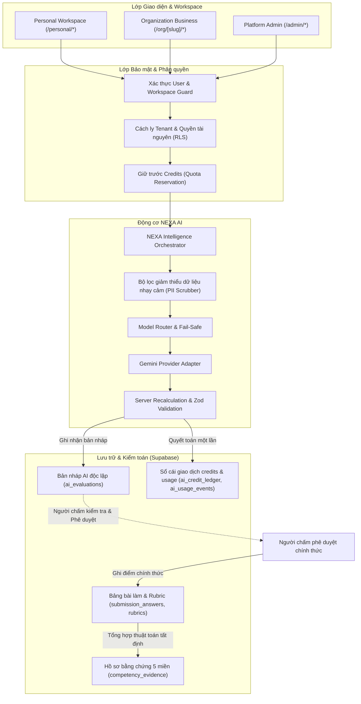

# NEXA AI — TÀI LIỆU ĐẶC TẢ HỆ THỐNG AI TOÀN DIỆN (SYSTEM SPECIFICATION)
## Kiến trúc, Quy trình Nghiệp vụ (Personal - Organization - Admin), Bàn chấm Rubric và Lộ trình 5 Miền

> **Mã tài liệu:** `SPEC-NEXA-AI-CORE-2026`  
> **Phiên bản:** `1.0.0` (Dựa trên tài liệu review hệ thống AI ngày 31/10/2026)  
> **Trạng thái:** `DRAFT FOR SPEC-DRIVEN DEVELOPMENT`  
> **Phạm vi:** Toàn bộ hệ thống AI Gateway, Bàn chấm bài (Personal/Org), Phân tích năng lực 5 miền, Quản trị Platform Admin và Hệ thống Quota/Ledger.

---

## 1. Mục tiêu và Bản chất Sản phẩm (Objective & Product Nature)

### 1.1. Mục tiêu cốt lõi
Xây dựng lớp trí tuệ nhân tạo ứng dụng (**Applied AI Layer**) cho NEXA AI mang tên thương hiệu **NEXA Intelligence**, giải quyết 2 bài toán lớn:
1. **NEXA Assess:** Hỗ trợ người chấm (Assessor/Evaluator) phân tích câu trả lời mở, tự luận, tình huống thực tế và minh chứng dựa trên tiêu chí **Rubric đa tầng**, tự động trích dẫn bằng chứng (*evidence quote*) và đề xuất mức điểm dự thảo (*AI Draft*).
2. **NEXA Guide:** Cố vấn học tập cho người học dựa trên hồ sơ điểm 5 miền năng lực số đã được xác minh bằng chứng thực tế, đề xuất thứ tự ưu tiên và học liệu tuyển chọn từ danh mục được kiểm duyệt (*Curated Catalog*).

### 1.2. Bản chất sản phẩm: Đánh giá có bằng chứng, không phải Chatbot
- **NEXA không phải công ty tự phát triển LLM nền tảng (Foundation Model).** NEXA là nền tảng SaaS khảo thí & phát triển năng lực số. Giá trị cốt lõi của NEXA là: **Khung chuẩn 5 miền, Ngân hàng đề, Rubric chuẩn hóa, Thuật toán tổng hợp năng lực tất định (Deterministic Algorithm), Cơ chế người phê duyệt (Human-in-the-loop) và Phân quyền tổ chức (Multi-tenant RLS).**
- **AI là công cụ hỗ trợ đọc hiểu và gợi ý; NEXA là hệ thống phán quyết điểm chính thức.**
- **AI chỉ kích hoạt On-demand (theo yêu cầu tường minh);** tuyệt đối không tự động kích hoạt model AI khi thí sinh bấm "Nộp bài" hoặc khi người dùng mở Dashboard.
- **Bản nháp AI (`AI_DRAFT`) không bao giờ tự động trở thành điểm chính thức.** Mọi điểm số chính thức tác động đến năng lực, chứng chỉ và báo cáo tổ chức phải do người có thẩm quyền phê duyệt.

---

## 2. Capability Map & Thứ tự Xây dựng (Build Order)

Hệ thống AI được phân rã thành 5 Module độc lập theo chuẩn `spec-driven-development`:

| Module ID | Tên Module | Trách nhiệm chính | Phụ thuộc vào |
|---|---|---|---|
| `ai-orchestrator-gateway` | Lõi AI Gateway & Điều phối | Quản trị provider adapter, router model, PII scrubbing, quota reservation, logging và audit | Hệ thống Auth & DB RLS |
| `rubric-engine-builder` | Động cơ & Bộ soạn Rubric | Quản lý rubric 3 tầng (`rubrics -> criteria -> levels`), validation điểm, snapshot đóng băng khi phát hành đề | Framework 5 miền |
| `nexa-assess-grading` | Bàn chấm bài có AI hỗ trợ | Giao diện 2 cột (Bài làm vs Rubric), nút gọi AI on-demand, xác minh trích dẫn, tính lại điểm trên server, phê duyệt điểm chính thức | `ai-orchestrator-gateway`, `rubric-engine-builder` |
| `nexa-guide-learning` | Cố vấn Lộ trình & 5 Miền | Đọc snapshot 5 miền đã xác thực, truy vấn catalog học liệu đã duyệt, giải thích lý do học, lưu kế hoạch học | `ai-orchestrator-gateway` |
| `ai-control-admin` | Trung tâm Điều khiển Admin | Quản trị cấu hình provider/model, kiểm tra kết nối, bộ test mẫu chuẩn (evals), giám sát chi phí/độ trễ, circuit breaker | `ai-orchestrator-gateway` |

```
THỨ TỰ XÂY DỰNG (BUILD ORDER):
rubric-engine-builder ──┐
                         ├──→ ai-orchestrator-gateway ──→ nexa-assess-grading ──→ nexa-guide-learning ──→ ai-control-admin
Auth & Quota Ledger  ────┘
```

---

## 3. Surface Assumptions (Các giả định kỹ thuật)

1. **Stack công nghệ:** Next.js 15 App Router, React 19, TypeScript strict mode, Tailwind CSS v4, Supabase PostgreSQL with Row Level Security (RLS), Zod v3.
2. **Provider hiện tại:** Google Gemini thông qua `@google/genai` (SDK chính thức hiện đại); các adapter khác (OpenAI, Anthropic) là giao diện mở rộng, chỉ kích hoạt khi có triển khai thực tế.
3. **Mô hình tính điểm 5 miền:** Điểm 5 miền (`D1` - Thông tin & Dữ liệu, `D2` - Giao tiếp & Hợp tác, `D3` - Sáng tạo nội dung số, `D4` - An toàn số, `D5` - Giải quyết vấn đề) được tính toán hoàn toàn bằng thuật toán tất định từ các câu hỏi/minh chứng đã được chấm chính thức. `score = null` nghĩa là chưa có dữ liệu; `score = 0` nghĩa là đã làm và đạt 0 điểm. Không bao giờ gán điểm tổng bài cho cả 5 miền.
4. **Hạch toán Credits:** Personal sử dụng ví cá nhân (nạp qua payOS); Organization sử dụng hạn mức hợp đồng Business do Platform Admin phê duyệt. Không dùng credits Personal cho bài thi của Organization.

---

## 4. Kiến trúc Tổng thể & Ranh giới Hệ thống



---

## 5. Đặc tả Chi tiết từng Module (Module Specifications)

### 5.1. Module 1: `ai-orchestrator-gateway` (Lõi AI Gateway)

#### 5.1.1. Nhiệm vụ
- Tiếp nhận yêu cầu AI từ các service nội bộ (`RUBRIC_GRADING`, `COMPETENCY_ANALYSIS`).
- Thực hiện kiểm tra Idempotency thông qua `requestId`.
- Tối thiểu hóa thông tin định danh cá nhân (PII Scrubber) trước khi gửi ra provider.
- Điều phối model thông qua adapter chuẩn hóa `AIProviderAdapter`.
- Ghi nhận nhật ký sử dụng, token, chi phí thực tế và quản lý trạng thái tác vụ.

#### 5.1.2. State Machine của Tác vụ AI
Khác biệt hoàn toàn với State Machine của bài thi:
```
AI Task: CREATED ──→ QUEUED ──→ RUNNING ──→ VALIDATING ──→ SUCCEEDED
                                                  │
                                                  └──→ FAILED / CANCELLED
```

#### 5.1.3. Hợp đồng API Gateway (Zod Contract)
```typescript
export const AITaskRequestSchema = z.object({
  taskId: z.string().uuid(),
  requestId: z.string().uuid(),
  taskType: z.enum(['RUBRIC_GRADING', 'COMPETENCY_ANALYSIS']),
  workspaceType: z.enum(['PERSONAL', 'ORGANIZATION']),
  organizationId: z.string().uuid().optional(),
  actorUserId: z.string().uuid(),
  payload: z.record(z.unknown()),
});
```

#### 5.1.4. Quy tắc Credits & Quota
- **Giữ trước (Reservation):** Khi tiếp nhận request hợp lệ, hệ thống giữ trước số credits tương ứng bằng giao dịch nguyên tử (`status = 'RESERVED'`).
- **Quyết toán (Settle):** Khi AI trả kết quả hợp lệ và vượt qua khâu kiểm tra server, chuyển trạng thái thành `SETTLED`.
- **Hoàn trả (Release):** Nếu model báo lỗi (429, 503, timeout) hoặc JSON không hợp lệ, hệ thống tự động giải phóng khoản giữ trước (`status = 'RELEASED'`), không thu credits của người dùng.
- **Chống gọi lặp (Idempotency):** Nếu nhận cùng một `requestId`, backend trả về kết quả hoặc trạng thái của tác vụ đang xử lý, không trừ credits lần 2.

---

### 5.2. Module 2: `rubric-engine-builder` (Động cơ & Quản trị Rubric)

#### 5.2.1. Nhiệm vụ
- Cho phép người tạo đề (Personal Pro/Creator, Org Assessor/Admin, Platform Admin) thiết lập câu hỏi tự luận/thực hành kèm **Rubric có cấu trúc 3 tầng**.
- Ràng buộc cấu trúc rubric chặt chẽ: `rubrics (đề/câu) -> rubric_criteria (tiêu chí) -> rubric_levels (các mức độ đạt)`.

#### 5.2.2. Quy tắc Nghiệp vụ Rubric
1. **Khớp thang điểm:** Tổng điểm tối đa của các tiêu chí (`maxPoints`) phải bằng đúng điểm tối đa của câu hỏi (`item.max_score`).
2. **Trọng số phần trăm:** Nếu dùng `weight_percent`, tổng trọng số của các tiêu chí trong rubric phải bằng đúng 100%.
3. **Mức độ rõ ràng:** Mỗi mức độ (`rubric_levels`) phải có mô tả hành vi cụ thể và tỷ lệ phần trăm điểm (`score_percent` từ 0 đến 100%).
4. **Đóng băng phiên bản (Immutability):** Khi đề thi được phát hành (`status = 'PUBLISHED'`) hoặc đã giao vào đợt thi (`campaign`), toàn bộ rubric được đóng băng phiên bản (`version`). Không được chỉnh sửa tiêu chí của đề đã có bài làm.

#### 5.2.3. Schema Định nghĩa Rubric (Zod)
```typescript
export const RubricLevelDefSchema = z.object({
  id: z.string().uuid().optional(),
  levelName: z.string().min(1, 'Tên mức độ không được để trống'),
  scorePercent: z.number().min(0).max(100),
  description: z.string().min(5, 'Mô tả tiêu chí mức độ phải rõ ràng'),
});

export const RubricCriterionDefSchema = z.object({
  id: z.string().uuid().optional(),
  name: z.string().min(1, 'Tên tiêu chí không được để trống'),
  domainCode: z.enum(['D1', 'D2', 'D3', 'D4', 'D5']),
  weightPercent: z.number().min(1).max(100),
  maxPoints: z.number().positive('Điểm tối đa phải lớn hơn 0'),
  levels: z.array(RubricLevelDefSchema).min(2, 'Mỗi tiêu chí phải có ít nhất 2 mức độ đánh giá'),
});
```

---

### 5.3. Module 3: `nexa-assess-grading` (Bàn Chấm Bài có AI Hỗ trợ)

#### 5.3.1. Nhiệm vụ
- Cung cấp không gian làm việc cho người chấm (Personal cho đề tự tạo, Org cho lớp/đợt thi được phân công).
- Bố cục chuẩn mực: Cột trái (Bài làm, tệp minh chứng), Cột phải (Rubric tiêu chí chấm), Khu vực đề xuất AI tách biệt.
- **Nút "Nhờ NEXA Assess gợi ý điểm":** Kích hoạt AI theo yêu cầu, hiển thị mức đề xuất, điểm dự kiến, nhận xét và câu trích từ bài làm (*evidence quote*).

#### 5.3.2. Quy tắc Server Recalculation (Tái tính điểm phía Server)
> [!IMPORTANT]
> **Tuyệt đối không sử dụng `totalScore` trực tiếp từ phản hồi JSON của Model!**
- Model AI chỉ có quyền đề xuất: `criterionId` và `levelId`.
- Server đối chiếu `levelId` với cơ sở dữ liệu để lấy `scorePercent`, sau đó tự tính toán:  
  $$\text{score} = \text{round}\left(\text{maxPoints} \times \frac{\text{scorePercent}}{100}, 2\right)$$
- Server kiểm tra chuỗi `evidenceQuote` có thực sự tồn tại trong nội dung bài làm của thí sinh hay không. Nếu phát hiện trích dẫn bịa đặt (hallucination), hệ thống gắn cờ cảnh báo `INVALID_EVIDENCE` và yêu cầu người chấm kiểm tra thủ công.

#### 5.3.3. State Machine của Bài làm được Chấm
```
Submission: IN_PROGRESS ──→ SUBMITTED ──→ PENDING_REVIEW ──→ EVALUATED (Đã duyệt)
                                                │
                                    (Khi có AI gợi ý)
                                                ↓
                                             AI_DRAFT
                                  (Lưu tại ai_evaluations,
                                   chưa ghi điểm chính thức)
```

#### 5.3.4. Phân quyền truy cập bàn chấm (Authorization Gate)
- **Personal:** Chỉ chủ sở hữu đề thi hoặc người tạo phòng thi mới được chấm bài nộp.
- **Organization:** Người dùng phải có vai trò `ORG_OWNER`, `ORG_ADMIN`, hoặc `ASSESSOR` được phân công cụ thể vào lớp (`class_id`) hoặc đợt thi (`campaign_id`) chứa bài nộp đó. `MEMBER` tuyệt đối bị chặn truy cập (HTTP 403).

---

### 5.4. Module 4: `nexa-guide-learning` (Cố vấn Lộ trình & 5 Miền Năng lực)

#### 5.4.1. Nhiệm vụ
- Hiển thị hồ sơ năng lực số chuẩn xác **5 miền** (không hiển thị điểm số 21 kỹ năng con).
- Tổng hợp điểm miền dựa trên **Competency Evidence** có nguồn gốc từ các bài làm đã được phê duyệt chính thức.
- Cung cấp tính năng **NEXA Guide**: Diễn giải điểm mạnh, điểm yếu và gợi ý lộ trình phát triển.

#### 5.4.2. Quy tắc Hiển thị 5 Miền & Xử lý Null
- `score = null`: Miền **chưa có bằng chứng hợp lệ** hoặc chưa làm bài đánh giá bao phủ miền đó. Giao diện hiển thị nhãn "Chưa đủ dữ liệu", nút "Làm bài đánh giá".
- `score = 0`: Miền **đã được đánh giá hợp lệ nhưng kết quả đạt 0**.
- Tuyệt đối không thay thế `null` bằng `0`, không vẽ biểu đồ Radar 0% giả tạo.

#### 5.4.3. Curated Course Catalog (Catalog Học liệu Tuyển chọn)
- NEXA không phải sàn thương mại điện tử khóa học. Học liệu được lưu trữ trong bảng `course_catalog` được Admin kiểm duyệt (`review_status = 'APPROVED'`).
- AI chỉ được phép sắp xếp thứ tự và đề xuất các khóa học có mã `courseId` nằm trong danh mục do backend cung cấp.
- Nếu danh mục rỗng hoặc lỗi, giao diện hiển thị trạng thái rỗng trung thực; không cho phép AI tự sáng tác URL hoặc tên khóa học giả.

---

### 5.5. Module 5: `ai-control-admin` (Trung tâm Quản trị AI Platform Admin)

#### 5.5.1. Nhiệm vụ
- Quản lý cấu hình AI tập trung cho toàn bộ nền tảng (duy nhất Platform Admin có quyền truy cập `/admin/ai-gateway`).
- Cấu hình provider, model ID, prompt version, max tokens, rate limit.
- **Tuyệt đối cách ly Secret:** Không hiển thị API Key dạng plaintext trên giao diện; secrets được lưu trong biến môi trường hoặc Secret Vault được mã hóa.
- Quản lý chỉ số quan sát (*Observability*): Tỷ lệ thành công, độ trễ P95, chi phí token thực tế, lịch sử tác vụ.

#### 5.5.2. Nguyên tắc Thay đổi Model (Model Switch Policy)
1. Chỉ cho phép chọn các Provider đã có Adapter hoạt động trong mã nguồn (`GeminiAdapter`).
2. Trước khi kích hoạt model mới cho môi trường production, Admin phải chạy bộ kiểm thử chuẩn (*Golden Dataset Harness*) để đánh giá độ lệch điểm (MAE) so với chuyên gia và tỷ lệ tuân thủ rubric.
3. Không cho phép nhập tên model tự do ngoài danh mục hỗ trợ.

---

## 6. Quy chuẩn Giao diện & UX Chi tiết (Design & UX Standards)

Tuân thủ nghiêm ngặt **Mục 3 trong `AGENTS.md`**:
- **Light Mode (mặc định):** Nền trang `#FFFFFF` (`bg-white`), Tiêu đề `#171717`, Nội dung `#262626`, Nền phụ `#F8FAFC`, Viền `#E2E8F0`, Xanh Cobalt `#2563EB` (chỉ cho link, CTA, trạng thái chọn; không dùng làm màu văn bản chính).
- **Dark Mode:** Nền trang `#000000` (`dark:bg-black`), Nền Panel/Sidebar `#0A0A0B`, Nền Card `#111114`, Viền `#27272A`, Tiêu đề `#F5F5F5`, Nội dung `#E4E4E7`, Chữ phụ `#A3A3A3`, Xanh nhấn sáng `#60A5FA`, Nền badge thông báo `#102044`.
- **Chống thiết kế rập khuôn (Anti-AI Slop):**
  - Không sử dụng viền neon, hiệu ứng phát sáng mờ ảo (glow), card kính mờ (glassmorphism), emoji làm icon JSX (sử dụng icon `lucide-react` nét 1.75).
  - Không hiển thị con số tự phong như "Độ tin cậy 94%" khi chưa qua kiểm định chuẩn.
  - Phân biệt rõ rệt 3 trạng thái: Đang tải (Skeleton/Spinner), Không có dữ liệu (Empty state trung thực), và Lỗi hệ thống (Error state có giải pháp).

---

## 7. Bảng Kiểm Thử & Nghiệm Thu (Acceptance Criteria)

| Mã AC | Tình huống kiểm thử | Kết quả mong đợi |
|---|---|---|
| `AC-SEC-01` | Thí sinh nộp bài trắc nghiệm (MCQ) | Không có request nào gọi tới AI Gateway. Điểm được chấm ngay bằng khóa đáp án phía server. |
| `AC-SEC-02` | Thí sinh nộp bài tự luận/thực hành | Trạng thái chuyển thành `PENDING_REVIEW`. Không tự động gọi AI chấm, không ghi điểm giả. |
| `AC-GRD-01` | Người chấm bấm "Nhờ NEXA Assess gợi ý" | AI trả về `AI_DRAFT` gồm các mức đề xuất và trích dẫn. Trạng thái bài vẫn là `PENDING_REVIEW`. Điểm chính thức trong `submission_answers` chưa thay đổi. |
| `AC-GRD-02` | Model AI trả về điểm vượt quá maxPoints | Backend tự động từ chối hoặc tái tính toán dựa trên mức độ rubric; không ghi nhận điểm sai lệch. |
| `AC-GRD-03` | Người chấm sửa điểm và bấm "Phê duyệt" | Điểm chính thức được ghi đè bằng điểm người chấm đã duyệt, ghi nhận `grading_reviews` audit, cập nhật `EVALUATED`. |
| `AC-CMP-01` | Thí sinh chưa làm câu hỏi thuộc miền D3 | Hồ sơ trả về `D3: null`. Giao diện hiển thị "Chưa đủ dữ liệu", không vẽ 0 điểm trên radar. |
| `AC-CMP-02` | Gọi phân tích NEXA Guide khi chưa đủ dữ liệu | Giao diện cảnh báo "Chưa đủ căn cứ đánh giá để phân tích", không trừ credits, hướng dẫn làm thêm bài. |
| `AC-ORG-01` | Thành viên (`MEMBER`) truy cập trang chấm bài tổ chức | Server chặn ngay lập tức với mã lỗi HTTP 403 Forbidden. |
| `AC-ORG-02` | Hết quota AI tổ chức | Nút gọi AI bị khóa với thông báo rõ ràng "Tổ chức đã hết hạn mức AI. Vui lòng chấm thủ công hoặc liên hệ quản trị viên". |
| `AC-ADM-01` | Admin đổi sang provider chưa có adapter | Giao diện hiển thị cảnh báo "Chưa có adapter hỗ trợ", nút Kích hoạt bị vô hiệu hóa. |
| `AC-API-01` | Mất mạng hoặc API Gemini trả về lỗi 503 | Hệ thống giữ nguyên bài làm, hoàn trả quota reservation, hiển thị thông báo lỗi thật, không tự tạo điểm fallback. |

---

> **Phê duyệt đặc tả:** Tài liệu này đóng vai trò bản quy chiếu duy nhất (Single Source of Truth) cho các công việc phát triển, kiểm thử và rà soát hệ thống AI trên toàn bộ nền tảng NEXA.
