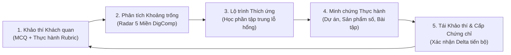
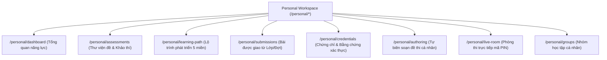
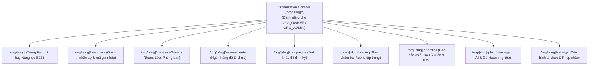
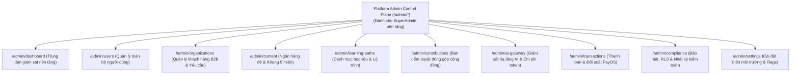
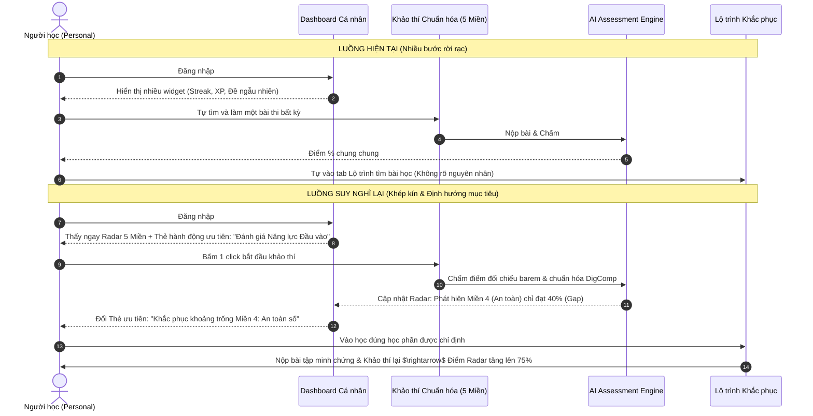
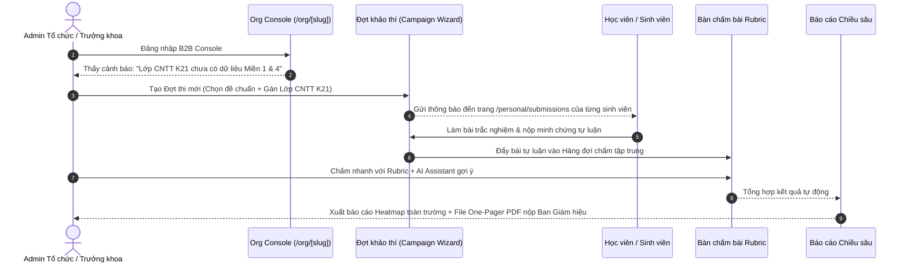

# ĐẶC TẢ ĐÁNH GIÁ & TƯ DUY LẠI TOÀN DIỆN UI/UX 3 KHÔNG GIAN DASHBOARD — NEXA AI
> **Thời điểm thẩm định & thiết kế:** 04/11/2026  
> **Tác giả:** Senior Product Engineer & Staff UX Architect  
> **Căn cứ quy chuẩn:** [`AGENTS.md`](file:///c:/nexa/AGENTS.md) • [`SRS.md`](file:///c:/nexa/docs/SRS.md) • [`USECASE.md`](file:///c:/nexa/docs/USECASE.md) • [`docs/NEXA_SYSTEM_AUDIT_COMPREHENSIVE_REVIEW_2026-11-04.md`](file:///c:/nexa/docs/NEXA_SYSTEM_AUDIT_COMPREHENSIVE_REVIEW_2026-11-04.md)  
> **Mục tiêu:** Phân tích thực trạng, bóc tách các điểm nghẽn trải nghiệm người dùng, và tái cấu trúc giao diện/luồng tương tác (UI/UX) cho từng trang trong cả 3 không gian: **Personal Workspace**, **Organization Business Console**, và **Platform Admin Control Plane**.

---

## 1. TRIẾT LÝ THIẾT KẾ & TƯ DUY NGUYÊN BẢN (FIRST-PRINCIPLES PRODUCT DESIGN)

### 1.1. Bản chất cốt lõi của NEXA AI
Khác với các hệ thống quản lý học tập (LMS) thụ động (nơi người dùng chỉ xem video hoặc tải slide) hay các sàn thương mại khóa học (ưu tiên quảng cáo và bán hàng), **NEXA AI là Nền tảng Đánh giá và Phát triển Năng lực Số Chuẩn hóa theo Bằng chứng thực tế**.

Mọi điểm chạm (touchpoint) trên giao diện phải phục vụ **Chu trình Phát triển Năng lực Khép kín (Closed-Loop Competency Growth)**:

### 1.2. Ba Trụ Cột Trải Nghiệm Cần "Suy Nghĩ Lại" (The Paradigm Shift)

| Trụ cột | Lối mòn cũ (AI Slop & Dashboard thông thường) | Tư duy chuẩn mực NEXA AI (Senior Dev / UX Architect) |
| :--- | :--- | :--- |
| **Mục đích hiển thị** | Trưng bày thật nhiều thẻ biểu đồ, số liệu thống kê tĩnh để "trông có vẻ nguy hiểm" nhưng người dùng không biết phải click vào đâu. | **Actionable Command Center:** Mỗi màn hình chỉ có 1 hành động ưu tiên cao nhất (Primary Next Step) kèm theo ngữ cảnh rõ ràng: *"Tại sao tôi phải làm việc này ngay bây giờ?"* |
| **Đo lường năng lực** | Biến kỹ năng thành điểm số XP, chuỗi ngày đăng nhập ảo (gamification quá đà), ép `score = 0` khi chưa thi. | **Thực chứng trung thực (Evidence-based):** `null` là chưa có bằng chứng; `0` là đã đánh giá và đạt 0 điểm. Radar 5 miền là trung tâm sự nghiệp của người học. |
| **Ngôn ngữ thị giác** | Đổ bóng màu mè, viền neon, kính mờ (glassmorphism), chữ xanh trên nền tối, icon emoji rải rác. | **High-Density Academic SaaS:** Light Mode nền trắng tinh khiết (`#FFFFFF`), Dark Mode nền đen thật (`#000000`), chữ xám than trung tính (`#171717` / `#F5F5F5`), nhấn xanh Cobalt (`#2563EB` / `#60A5FA`). Kiểu số kỹ thuật `font-mono tabular-nums`. |

---

## 2. KHÔNG GIAN 1: PERSONAL WORKSPACE (`/personal/*`)

### 2.1. Bản Đồ Điều Hướng & Các Màn Hình Chức Năng Hiện Tại

---

### 2.2. Đánh Giá Hiện Trạng & Ý Tưởng Tái Cấu Trúc Từng Trang

#### A. Trang Tổng quan cá nhân — [`/personal/dashboard`](file:///c:/nexa/src/app/(dashboard)/personal/dashboard/page.tsx)
* **Thực trạng mã nguồn & UX:**
  * Tệp `page.tsx` hiện dài hơn **1,270 dòng**, đóng vai trò là một client component nguyên khối nhồi nhét: Hero Banner, Thông báo chuỗi đăng nhập Streak, Cột điểm thưởng XP, Biểu đồ Radar, Thẻ bài thi đề xuất, Tiến độ lộ trình, Bảng xếp hạng tuần/tháng, Danh sách bài tập từ tổ chức.
  * *Vấn đề lớn:* **Cạnh tranh nhận thức (Cognitive Overload)**. Khi người học đăng nhập, có tới 4-5 nút CTA kêu gọi họ hành động cùng lúc: Làm bài kiểm tra đầu vào, Làm bài tập lớp sắp hết hạn, Vào học lộ trình, Xem thứ hạng. Người học bị bối rối không biết đâu là việc quan trọng nhất.
* **Tư duy thiết kế lại (Rethink):**
  * Tách trang thành **3 phân khu có tôn ti trật tự rõ ràng (Z-Pattern Layout)**:
    1. **Khu vực 1: Status Hero — "Chiếc gương Năng lực Số" (Top Section):**
       * Nửa trái: Biểu đồ Radar 5 Miền năng lực số. Nếu chưa thi: Hiển thị radar khung nét đứt kèm nút gọi làm bài **"Đánh giá Năng lực Đầu vào (25 phút)"**. Nếu đã thi: Nổi bật **Miền mạnh nhất (Strengths)** và **Khoảng trống cần bù đắp (Gaps)**.
       * Nửa phải: **Single Priority Action Card (Thẻ hành động duy nhất hôm nay)**. Hệ thống tự động tính toán: Nếu có bài tập lớp đến hạn trong 24h $\rightarrow$ Ưu tiên bài tập; Nếu không có bài tập $\rightarrow$ Gợi ý bài học khắc phục miền yếu nhất; Nếu chưa có điểm đầu vào $\rightarrow$ Khảo thí ngay.
    2. **Khu vực 2: Lộ trình & Bài tập Lớp (Split Middle Section - 65% / 35%):**
       * Cột chính (65%): **Adaptive Learning Tracks** — Liệt kê các bài học gắn trực tiếp với lỗ hổng năng lực (ví dụ: *"Miền 4 An toàn thông tin đạt 45% → Học phần: Nhận diện Email lừa đảo Phishing"*).
       * Cột phụ (35%): **Work & Class Queue** — Danh sách 3 bài tập được giao từ Lớp/Tổ chức gần nhất có deadline, thanh đếm ngược thời gian.
    3. **Khu vực 3: Bảng thành tích & Bằng chứng (Bottom Secondary Section):**
       * Thu nhỏ Bảng xếp hạng và Điểm chuyên cần thành một thanh ngang tối giản (Subtle Metrics Bar), chuyển trọng tâm từ "Đua điểm ảo" sang "Chứng chỉ thực chứng đã mở khóa".

---

#### B. Trang Thư viện đề khảo thí — [`/personal/assessments`](file:///c:/nexa/src/app/(dashboard)/personal/assessments/page.tsx)
* **Thực trạng & Vấn đề:**
  * Người dùng thường không phân biệt được: Đề thi nào là chuẩn DigComp chính thức để cập nhật Radar, đề nào là bài tự luyện kỹ năng, đề nào là đề kiểm tra nội bộ lớp.
* **Tư duy thiết kế lại (Rethink):**
  * Tái cấu trúc thành **3 Tab định hướng rõ ràng**:
    1. **Tab 1: Khảo thí Chuẩn hóa (Standardized Benchmark):** Các bài đánh giá toàn diện 5 miền hoặc chuyên sâu từng miền do NEXA AI phát hành chính thức. Làm xong được cấp Chứng chỉ số và cập nhật điểm Radar hồ sơ cá nhân.
    2. **Tab 2: Luyện tập Tự do (Skill Practice):** Các bài trắc nghiệm nhanh 10-15 phút, giải thích đáp án tức thì, không tính điểm vào hồ sơ chính thức nhưng cộng điểm tích lũy học tập.
    3. **Tab 3: Đề thi Cộng đồng (Community Contributed):** Các đề do chuyên gia, giảng viên chia sẻ đã qua kiểm duyệt chất lượng.

---

#### C. Trang Lộ trình học tập thích ứng — [`/personal/learning-path`](file:///c:/nexa/src/app/(dashboard)/personal/learning-path/page.tsx)
* **Thực trạng & Vấn đề:**
  * Hiện tại danh mục khóa học còn mang hơi hướng catalog tĩnh, chưa tạo được cảm giác *"Cá nhân hóa theo kết quả thi của riêng tôi"*.
* **Tư duy thiết kế lại (Rethink):**
  * Áp dụng mô hình **Adaptive Remediation Canvas (Bản đồ Khắc phục Lỗ hổng)**:
    * Đầu trang: Thước đo tiến độ 5 miền: Miền nào đã đạt chuẩn ($\ge 70\%$) hiện màu xanh thành công; Miền nào dưới $70\%$ hiện trạng thái *"Cần bồi dưỡng"*.
    * Thẻ học phần: Mỗi học phần phải có nhãn nguồn gốc: *"Được gợi ý vì bạn đạt 40% câu hỏi Bảo mật ở bài thi ngày 02/11"*.
    * Nút hành động cuối mỗi chặng: **"Thực hành minh chứng"** (nộp bài tập thực tế) và **"Khảo thí lại miền này"** để kiểm chứng sự tiến bộ.

---

#### D. Trang Quản lý bài nộp — [`/personal/submissions`](file:///c:/nexa/src/app/(dashboard)/personal/submissions/page.tsx)
* **Thực trạng & Ưu điểm hiện tại:**
  * Đã có 4 tab: *Tất cả*, *Cần làm*, *Đang chấm*, *Đã hoàn thành*.
* **Tư duy nâng cấp (Rethink):**
  * Thêm màn hình **Chi tiết Kết quả & Phản hồi Rubric (Submission Feedback Drawer)**: Khi người học click vào bài đã hoàn thành, mở panel trượt từ bên phải hiển thị chi tiết: Điểm từng tiêu chí Rubric do Giảng viên chấm, lời nhận xét cụ thể, tệp minh chứng đã nộp, và nút *"Tải báo cáo kết quả (PDF)"*.

---

#### E. Trang Tự biên soạn đề thi — [`/personal/authoring`](file:///c:/nexa/src/app/(dashboard)/personal/authoring/page.tsx)
* **Tư duy thiết kế lại theo chuẩn Notion/Linear:**
  * Bám sát đặc tả `NEXA_ASSESSMENT_AUTHORING_UX_PRODUCT_SPEC.md`:
  * Thanh trạng thái trên cùng: Hiển thị Tổng điểm câu hỏi hiện tại trên thang 100 điểm (`Total: 85/100`). Nếu chưa đủ 100, hiện cảnh báo nhẹ màu hổ phách kèm nút **"Tự động cân bằng về 100"**.
  * Chế độ thêm câu hỏi trắc nghiệm (`CHOICE`) và tự luận/thực hành (`OPEN_RESPONSE`) có Rubric chấm điểm rõ ràng. Tình huống bối cảnh (`Context`) là tùy chọn bật tắt linh hoạt cho từng câu.
  * Tự động lưu bản nháp (Auto-save draft) mỗi khi người dùng dừng gõ 2 giây, không bao giờ để mất công sức của người soạn đề.

---

## 3. KHÔNG GIAN 2: ORGANIZATION BUSINESS CONSOLE (`/org/[slug]/*`)

### 3.1. Bản Đồ Phân Quyền & Các Màn Hình Chức Năng

---

### 3.2. Đánh Giá Hiện Trạng & Ý Tưởng Tái Cấu Trúc Từng Trang

#### A. Trang Tổng quan điều hành — [`/org/[slug]`](file:///c:/nexa/src/app/(dashboard)/org/[slug]/page.tsx)
* **Thực trạng & Vấn đề:**
  * Hiện tại trang tổng quan chỉ hiển thị các con số đếm cơ bản (tổng thành viên, số lớp, số đợt thi). Ban giám hiệu trường học hoặc Giám đốc nhân sự (CHRO/L&D) khi mở trang này chưa nhận được giá trị kinh doanh cốt lõi: *"Bức tranh kỹ năng số của đơn vị tôi đang ở mức nào?"*.
* **Tư duy thiết kế lại (Executive Command Center):**
  * Tái cấu trúc thành **4 Khối điều hành cấp C-Level**:
    1. **Khối 1: Digital Competency Health (Chỉ số Sức khỏe Năng lực Số Tổ chức):**
       * Điểm trung bình toàn đơn vị theo 5 miền DigComp.
       * Thẻ cảnh báo rủi ro kỹ năng: Ví dụ *"Cảnh báo: 68% nhân viên phòng Kế toán có điểm Miền 4 (An toàn dữ liệu) dưới mức tiêu chuẩn (< 50%)"*.
    2. **Khối 2: Đợt khảo thí đang vận hành (Active Campaigns Pulse):**
       * Thẻ tiến độ thời gian thực của các đợt thi đang diễn ra: Tỷ lệ tham gia (Turnout rate: 142/200 người), thời gian còn lại, nút *"Gửi email nhắc nhở thí sinh chưa thi"*.
    3. **Khối 3: Hàng đợi công việc khẩn cấp (Urgent Action Queue):**
       * Số lượng bài tự luận đang chờ chấm (Pending grading) $\rightarrow$ Nút vào thẳng Bàn chấm.
       * Số lượng thành viên mới chờ phê duyệt vào tổ chức.
       * Cảnh báo hạn ngạch AI Credits hoặc số ghế thành viên sắp hết.
    4. **Khối 4: Phân bố năng lực giữa các phòng ban / khối lớp (Cross-Unit Matrix):**
       * Biểu đồ cột ngang xếp hạng các lớp/phòng ban có điểm năng lực số cao nhất và tiến bộ nhanh nhất.

---

#### B. Bàn chấm bài Rubric tập trung — [`/org/[slug]/grading`](file:///c:/nexa/src/app/(dashboard)/org/[slug]/grading/page.tsx)
* **Thực trạng:**
  * Đã có cấu trúc 3 cột (Danh sách $\rightarrow$ Bài làm $\rightarrow$ Rubric).
* **Tư duy tối ưu công thái học (Ergonomic Grading Desk):**
  * **Cột 1 (Queue - 20%):** Danh sách bài nộp lọc theo Đợt thi / Lớp. Hiển thị thumbnail đại diện, tên người nộp, thời điểm nộp, trạng thái (Chưa chấm / Đang chấm).
  * **Cột 2 (Evidence Viewer - 50%):** Khu vực thẩm định minh chứng tối ưu hóa:
    * Trình đọc PDF nhúng trực tiếp, hỗ trợ phóng to/thu nhỏ, cuộn trang mượt mà.
    * Xem trước hình ảnh sắc nét, mở liên kết sản phẩm (GitHub repo, Figma prototype, Google Docs) an toàn trong sandbox.
  * **Cột 3 (Rubric & AI Assist - 30%):**
    * Bảng tiêu chí Rubric chuẩn: Click chọn mức điểm (Kém - Đạt - Khá - Xuất sắc) tự động cộng tổng điểm.
    * **Tính năng "AI Drafted Grading (HITL)":** Nút bấm *"Nhờ AI phân tích bài làm theo Rubric"*. AI đối chiếu nội dung bài nộp với rubric và đưa ra gợi ý điểm kèm giải thích. Người chấm có toàn quyền xác nhận, chỉnh sửa hoặc hủy bỏ (đảm bảo tính minh bạch, con người kiểm soát cuối cùng).
    * Phím tắt tiện lợi: `Ctrl + Enter` (Lưu & Chuyển bài kế tiếp), `Alt + 1..4` (Chọn mức rubric).

---

#### C. Trang Đợt khảo thí định kỳ — [`/org/[slug]/campaigns`](file:///c:/nexa/src/app/(dashboard)/org/[slug]/campaigns/page.tsx)
* **Tư duy thiết kế lại (Campaign Lifecycle Manager):**
  * Quy trình tạo đợt thi theo **Stepped Wizard 3 bước chuẩn mực**:
    * *Bước 1: Mục tiêu & Chọn đề:* Chọn đề từ Ngân hàng đề tổ chức hoặc đề chuẩn DigComp. Cấu hình thời gian làm bài, điểm liệt.
    * *Bước 2: Phạm vi đối tượng:* Chọn theo Lớp học, Phòng ban, hoặc toàn bộ tổ chức.
    * *Bước 3: Lịch trình & Chế độ giám sát:* Đặt lịch bắt đầu/kết thúc tự động, cấu hình giám sát chuyển tab, xáo trộn câu hỏi, có cho xem đáp án ngay sau khi nộp hay không.
  * Màn hình danh sách đợt thi: Phân chia theo trạng thái: *Đang diễn ra (Live)*, *Sắp diễn ra (Scheduled)*, *Đã kết thúc (Archived)*. Có nút xuất toàn bộ bảng điểm Excel/CSV chuẩn mẫu Bộ GD&ĐT hoặc Doanh nghiệp chỉ với 1 click.

---

#### D. Trang Báo cáo năng lực chuyên sâu — [`/org/[slug]/analytics`](file:///c:/nexa/src/app/(dashboard)/org/[slug]/analytics/page.tsx)
* **Tư duy thiết kế lại (Executive Analytics & ROI):**
  * **Báo cáo Phân tích Khoảng trống (Gap Analysis Heatmap):** Ma trận màu sắc thể hiện điểm trung bình của từng đơn vị trên cả 5 miền. Giúp lãnh đạo nhìn thấy ngay *"Đâu là điểm trũng công nghệ của tổ chức"*.
  * **Đo lường Hiệu quả Đào tạo (Pre vs Post Training Delta):** So sánh điểm số của cùng một nhóm nhân sự trước và sau khi hoàn thành khóa bồi dưỡng năng lực.
  * **Nút xuất Báo cáo Ban Lãnh Đạo (Executive One-Pager PDF):** Tự động render bản tóm tắt phân tích năng lực 1 trang A4 trang nhã, sẵn sàng in ấn gửi Hội đồng Quản trị hoặc Ban Giám hiệu.

---

## 4. KHÔNG GIAN 3: PLATFORM ADMIN CONTROL PLANE (`/admin/*`)

### 4.1. Bản Đồ Điều Hành Toàn Hệ Thống

---

### 4.2. Đánh Giá Hiện Trạng & Ý Tưởng Tái Cấu Trúc Từng Trang

#### A. Trung tâm điều hành — [`/admin/dashboard`](file:///c:/nexa/src/app/(dashboard)/admin/dashboard/page.tsx)
* **Thực trạng & Cải tiến:**
  * Hiện tại trang đã tích hợp số liệu thực: Người dùng, Khách hàng B2B, Doanh thu PayOS thực tế, Bài thi đã nộp.
* **Tư duy thiết kế lại (High-Density Telemetry):**
  * Tái cấu trúc theo phong cách **Bảng điều khiển Giám sát Kỹ thuật (Mission Control)**:
    * Dòng trên cùng: 4 chỉ số sinh tồn (Vital Signs): Doanh thu tháng (VND), Active Users 24h, Chi phí AI 24h (USD/VND), Tỷ lệ lỗi hệ thống (Error Rate < 0.05%).
    * Khu vực trung tâm: **Hàng đợi Phê duyệt Hợp nhất (Universal Approval Queue)**:
      * Yêu cầu tư vấn doanh nghiệp B2B mới (`business_inquiries`).
      * Đề thi đóng góp từ cộng đồng chờ duyệt (`community_contributions`).
      * Giao dịch thanh toán cần đối soát thủ công.
    * Góc phải: **System Health Pulse**: Trạng thái kết nối Database Supabase, AI Provider (Gemini/OpenAI), Cổng thanh toán PayOS.

---

#### B. Giám sát AI Gateway & Chi phí — [`/admin/ai-gateway`](file:///c:/nexa/src/app/(dashboard)/admin/ai-gateway/page.tsx)
* **Tư duy thiết kế lại:**
  * Quản trị chi phí và độ ổn định của các mô hình LLM hỗ trợ khảo thí:
    * Thống kê Token tiêu thụ theo ngày, phân bổ theo mô hình: Gemini 2.5 Flash, Gemini 3.8 Pro, GPT-4o.
    * Biểu đồ độ trễ trung bình (Latency p50, p95, p99) khi chấm bài tự động.
    * **Emergency Circuit Breaker:** Nút gạt chuyển đổi khẩn cấp giữa các nhà cung cấp AI khi có sự cố nghẽn mạng từ phía nhà mạng hoặc upstream provider.

---

#### C. Bàn kiểm duyệt đóng góp cộng đồng — [`/admin/contributions`](file:///c:/nexa/src/app/(dashboard)/admin/contributions/page.tsx)
* **Tư duy thiết kế lại:**
  * Giao diện Review 2 cột:
    * Cột trái: Thông tin tác giả đóng góp, chủ đề, miền năng lực DigComp được ánh xạ, độ khó.
    * Cột phải: Xem trước câu hỏi và đáp án đúng, barem rubric chấm điểm.
    * Thanh hành động: Nút *Phê duyệt & Đưa vào Ngân hàng Chung* (Tự động thưởng điểm uy tín cho tác giả), hoặc nút *Yêu cầu chỉnh sửa* kèm lý do gửi qua email.

---

## 5. SO SÁNH LUỒNG TƯƠNG TÁC (USER FLOWS): HIỆN TẠI VS. SUY NGHĨ LẠI

### 5.1. Luồng Người Học (Learner Journey): Từ Đánh Giá Đến Bồi Dưỡng

---

### 5.2. Luồng Lãnh Đạo Tổ Chức (Organization Admin Flow): Từ Phát Động Đến Báo Cáo

---

## 6. QUY TẮC BẢO TOÀN KIẾN TRÚC & HỆ THỐNG THIẾT KẾ (DESIGN SYSTEM RULES)

### 6.1. Quy chuẩn Màu sắc & Typography (Theo [`AGENTS.md`](file:///c:/nexa/AGENTS.md) 3.1 & 3.2)
1. **Light Mode (Mặc định cho môi trường giáo dục/văn phòng):**
   * Nền trang chính: `#FFFFFF` (`bg-white`).
   * Nền phụ (Sidebars, thanh công cụ, bảng danh sách): `#F8FAFC` (`bg-slate-50`).
   * Văn bản chính (Tiêu đề, heading): `#171717` (Đen than trung tính, không dùng đen tuyệt đối `#000000` chống mỏi mắt).
   * Nội dung thân bài, nhãn menu: `#262626` (`text-neutral-800`).
   * Đường viền, phân cách: `#E2E8F0` (`border-slate-200`).
   * Màu nhấn nhận diện thương hiệu (Cobalt Blue): `#2563EB` (`bg-blue-600`, `text-blue-600`). Chỉ sử dụng cho: Nút bấm hành động (CTA), liên kết điều hướng, trạng thái đang chọn (Active tab). **Không dùng màu xanh cho toàn bộ tiêu đề hoặc số liệu thống kê**.
2. **Dark Mode (Nền đen chân thực - True Black):**
   * Nền trang chính: `#000000` (`dark:bg-black`).
   * Nền thanh điều hướng / Sidebar: `#0A0A0B`.
   * Nền thẻ nội dung (Card / Dropdown): `#111114` (Nổi bật nhờ đường viền mảnh, không dùng glow/shadow lớn).
   * Văn bản chính: `#F5F5F5` (`dark:text-neutral-100`).
   * Văn bản phụ: `#A3A3A3` (`dark:text-neutral-400`).
   * Đường viền: `#27272A` (`dark:border-zinc-800`).
   * Xanh nhấn sáng trên nền tối: `#60A5FA` (`dark:text-blue-400`).
3. **Phông chữ & Số liệu:**
   * Phông chữ không chân hiện đại (Inter / Segoe UI / SF Pro) cho văn bản đọc.
   * `font-mono tabular-nums` cho toàn bộ: Điểm số, mã PIN phòng thi, mã định danh bài nộp, giá trị tiền VND PayOS, thời gian countdown.

### 6.2. Loại bỏ hoàn toàn dấu vết "AI Slop"
* **Nghiêm cấm:**
  * Hiệu ứng hào quang neon (glow effect), đổ bóng màu mè tím/hồng, lớp kính mờ đục (glassmorphism) làm giảm độ tương phản.
  * Các biểu tượng emoji trang trí trong mã nguồn JSX (thay thế 100% bằng bộ biểu tượng `lucide-react` chuẩn với `strokeWidth={1.75}`).
  * Biểu đồ rỗng vẽ sẵn số liệu giả (0% hay 100% khi chưa có dữ liệu). Phân biệt rành mạch: `null` (chưa có bằng chứng) vs `0` (đã đánh giá và đạt 0 điểm).

---

## 7. LỜI KẾT & KHUYẾN NGHỊ CHO QUY TRÌNH PHÁT TRIỂN TIẾP THEO

Bản thiết kế lại này đặt người dùng vào trung tâm của chu trình năng lực số:
- **Người học (Personal):** Không còn bị xao nhãng bởi điểm số ảo hay các widget cạnh tranh; luôn biết mình mạnh ở đâu, yếu ở miền nào và bước tiếp theo cần làm gì.
- **Tổ chức (Organization):** Biến dữ liệu khảo thí thành bức tranh sức khỏe nhân sự chiến lược, bàn chấm bài thông minh giảm 60% thời gian của giảng viên/assessor.
- **Nền tảng (Platform Admin):** Vận hành như một hệ thống viễn thông số (Telemetry-driven) an toàn, minh bạch, kiểm soát chặt chẽ chi phí AI và doanh thu thực.

> [!NOTE]
> Báo cáo này là tài liệu đánh giá kiến trúc và đặc tả ý tưởng thiết kế giao diện (Design Specification & Architecture Review). Việc triển khai mã nguồn cụ thể cho từng màn hình sẽ được thực hiện tuần tự khi có yêu cầu và phê duyệt từ Người dùng.
