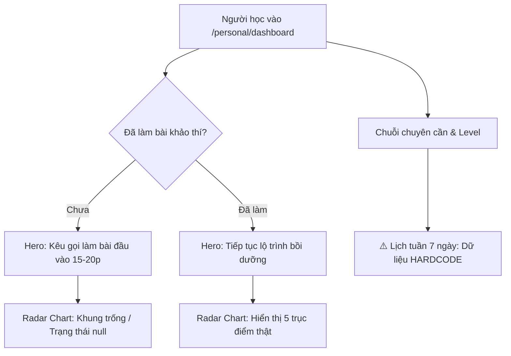
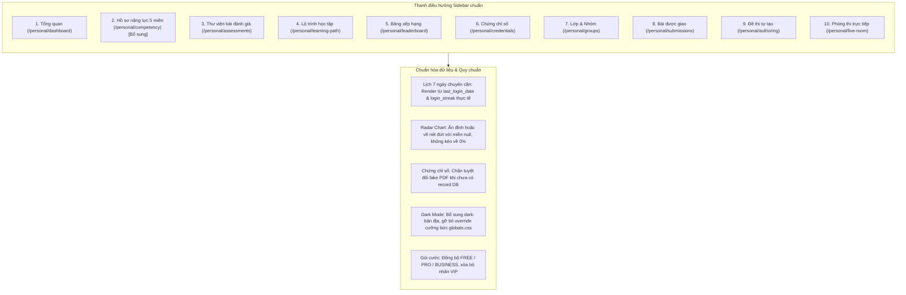

# BÁO CÁO RÀ SOÁT TOÀN DIỆN PERSONAL DASHBOARD WORKSPACE (`/personal/*`)
> **Thời điểm thực hiện:** 04/11/2026  
> **Phạm vi kiểm tra:** Toàn bộ giao diện, luồng trải nghiệm (UX), tính năng (Functionality), phân quyền và tính hợp lý của không gian cá nhân (`/personal/*`).  
> **Căn cứ đối chiếu:** [`AGENTS.md`](file:///c:/nexa/AGENTS.md) (Quy chuẩn màu sắc, Dark mode, 5 miền năng lực, Anti-AI slop, Bảo toàn dữ liệu).

---

## 1. TỔNG QUAN ĐÁNH GIÁ (EXECUTIVE SUMMARY)

| Trục đánh giá | Trạng thái | Điểm cốt lõi |
| :--- | :---: | :--- |
| **Logic nghiệp vụ & 5 miền** | ⚠️ Cần tinh chỉnh | Đã loại bỏ thuật ngữ kỹ thuật DigComp ở UI, nhưng còn tồn tại điểm số giả lập, ngưỡng Gap không thống nhất (60% vs 70%), và lộ kỹ năng thành phần ở trang Năng lực. |
| **Giao diện (UI) & Màu sắc** | ⚠️ Chưa đồng bộ | Chưa chuẩn hóa Cobalt Blue (`#2563EB`) trên toàn bộ trang (vẫn còn Sky Blue `#0284C7` rải rác). Nhiều card và modal thiếu class `dark:` bản địa. |
| **Chế độ tối (Dark Mode)** | 🔴 Bất cập lớn | Nhiều trang (`competency`, `grading`, `checkout`, `billing`, `leaderboard`) có **0 đến 3 class `dark:`**, phụ thuộc vào bản vá cưỡng chế `globals.css` gây lỗi tương phản. |
| **Trải nghiệm người dùng (UX)** | ⚠️ Còn phân mảnh | Một số route bị mồ côi (`/personal/exams`, `/personal/item-bank`, `/personal/live-pin`); trang Năng lực (`/personal/competency`) không có link trên Sidebar. |
| **Tính sẵn sàng của chức năng** | 🟢 85% Hoạt động | Luồng khảo thí, tác vụ biên soạn (Authoring), lớp nhóm (Groups), phòng thi trực tiếp (Live Room), tính điểm XP & Streak đều đã có API và 116 unit test xanh. |

---

## 2. KIỂM TOÁN CHI TIẾT THEO TỪNG TRANG & MODULE

### 2.1. Trang Tổng quan (`/personal/dashboard/page.tsx`)

* **Điểm đã làm tốt:**
  * Thẻ Hero đổi trạng thái nhạy bén giữa "Chưa khảo thí" và "Đã có kết quả".
  * Stepper 5 bước (`dynamicStepperItems`) tự động gắn nhãn "Đạt chuẩn", "Cần ưu tiên", "Chưa đạt" dựa trên kết quả khảo thí thật.
  * Widget bài tập từ tổ chức (`OrgAssignmentsWidget`) xuất hiện tự nhiên khi học viên thuộc tổ chức.
* **Vấn đề & Bất hợp lý phát hiện:**
  1. 🔴 **Lịch tuần chuyên cần bị HARDCODE ngày tháng (Dữ liệu giả):**  
     * **Vị trí:** [`src/app/(dashboard)/personal/dashboard/page.tsx#L373-L397`](file:///c:/nexa/src/app/(dashboard)/personal/dashboard/page.tsx#L373-L397)
     * **Bằng chứng:** Mảng 7 ngày được gán tĩnh `{ label: 'T2', num: 26, done: false }, ... { label: 'T7', num: 31, done: true }, { label: 'CN', num: 1, today: true }`. Bất kể hôm nay là ngày nào trong tuần hay tháng nào, giao diện luôn vẽ các số 26, 27, 28, 29, 30, 31, 1 với ngày T5, T6, T7 luôn tick xanh! Điều này vi phạm quy tắc **"Không giả lập thành công / Không tạo số liệu mẫu"** của AGENTS.md §1.4 & §3.4.
  2. ⚠️ **Radar Chart vẫn vẽ điểm `null` về gốc `0`:**  
     * **Vị trí:** [`src/components/dashboard/personal/CompetencyRadarChart.tsx#L73`](file:///c:/nexa/src/components/dashboard/personal/CompetencyRadarChart.tsx#L73)
     * **Bằng chứng:** `const val = d.score !== null ? d.score / 100 : 0;`. Khi một miền chưa được khảo thí (`score: null`), hệ thống kéo đỉnh radar về 0, làm méo hình đa giác thành một góc 0% giả, trái với yêu cầu hiển thị nét đứt hoặc không vẽ đỉnh giả.
  3. ⚠️ **Màu sắc radar dùng Sky Blue cũ:**  
     * Radar SVG hardcode `#0284C7` thay vì Cobalt Blue `#2563EB`.

---

### 2.2. Thư viện đề khảo thí (`/personal/assessments/page.tsx`)

* **Điểm đã làm tốt:**
  * Đầy đủ bộ lọc đa chiều: lọc theo Miền năng lực (tích chọn 1-5 miền), dạng bài (Trắc nghiệm, Tình huống, Thực hành), và phân hạng gói.
* **Vấn đề & Bất hợp lý phát hiện:**
  1. 🔴 **Dùng thuật ngữ "VIP" thay vì "PRO":**  
     * **Vị trí:** [`src/app/(dashboard)/personal/assessments/page.tsx#L55-L90`](file:///c:/nexa/src/app/(dashboard)/personal/assessments/page.tsx#L55-L90)
     * **Bằng chứng:** Gói cước đã chuẩn hóa gồm `FREE`, `PRO`, `BUSINESS`. Nhưng ở đây bộ lọc và thẻ đề thi vẫn ghi nhãn `VIP`, `accessTier === 'VIP'`.
  2. ⚠️ **Menu Dropdown thiếu Dark Mode hoàn toàn:**  
     * **Vị trí:** [`src/app/(dashboard)/personal/assessments/page.tsx#L224`](file:///c:/nexa/src/app/(dashboard)/personal/assessments/page.tsx#L224), [`L324`](file:///c:/nexa/src/app/(dashboard)/personal/assessments/page.tsx#L324), [`L415`](file:///c:/nexa/src/app/(dashboard)/personal/assessments/page.tsx#L415)
     * **Bằng chứng:** Các khung popup bộ lọc dùng `bg-white border-slate-200 text-slate-700` không có bất kỳ class `dark:` nào. Khi người dùng bật Dark Mode, popup mở ra sẽ bị chói trắng hoặc lệch màu nền.
  3. ⚠️ **Tỷ lệ khung `aspect-square` gây tràn chữ trên màn hình nhỏ:**  
     * **Vị trí:** [`src/app/(dashboard)/personal/assessments/page.tsx#L521`](file:///c:/nexa/src/app/(dashboard)/personal/assessments/page.tsx#L521)
     * **Bằng chứng:** Thẻ đề thi bị cố định tỉ lệ 1:1 (`aspect-square`). Khi tiêu đề dài 3 dòng kết hợp phần mô tả 2 dòng và thanh thông số ở chân, nội dung bị ép chặt hoặc tràn viền trên màn hình di động/tablet.

---

### 2.3. Hồ sơ năng lực (`/personal/competency/page.tsx` & `analysis/page.tsx`)

* **Điểm đã làm tốt:**
  * Tính toán trung thực: `score: null` thì hiển thị `--` thay vì 0%.
  * Có biểu đồ so sánh tiến độ so với lần khảo thí ban đầu (`baselineSnapshot`).
* **Vấn đề & Bất hợp lý phát hiện:**
  1. 🔴 **Không có liên kết trên Sidebar:**  
     * Người dùng không thể tìm thấy trang Hồ sơ năng lực từ Sidebar bên trái, mà phải quay lại Dashboard để bấm vào một đường link phụ.
  2. 🔴 **0% Hỗ trợ Dark Mode:**  
     * Cả 2 trang `competency/page.tsx` (240 dòng) và `competency/analysis/page.tsx` (602 dòng) đều có **0 class `dark:`**!
  3. ⚠️ **Vi phạm quy chuẩn: Lộ 21 kỹ năng thành phần ra ngoài giao diện:**  
     * **Vị trí:** [`src/app/(dashboard)/personal/competency/page.tsx#L229-L231`](file:///c:/nexa/src/app/(dashboard)/personal/competency/page.tsx#L229-L231)
     * **Bằng chứng:** Dòng chữ `Đã khảo thí {dom.completedCount}/{dom.competenciesCount} kỹ năng thành phần`. AGENTS.md §2.1 nêu rõ: *"Chỉ có 5 điểm miền được chấm, tổng hợp, hiển thị Radar, so sánh và dùng xác định lộ trình. Không thiết kế UX đánh giá 21 kỹ năng thành phần."*
  4. ⚠️ **Xung đột ngưỡng đánh giá:**  
     * Tiêu đề ghi chuẩn mục tiêu `70%`, nhưng thanh tiến độ dòng 217-219 lại chia ngưỡng `>= 80%` (xanh lá), `>= 60%` (xanh dương), và `< 60%` (vàng hổ phách).

---

### 2.4. Hồ sơ chứng chỉ (`/personal/credentials/page.tsx`) & API Tạo chứng chỉ

* **Điểm đã làm tốt:**
  * Áp dụng cơ chế điều kiện kép: Điểm tích lũy $\ge 500$ VÀ Hoàn thành lộ trình học tập.
  * Sinh mã QR vector động dẫn đến URL tra cứu `/verify/[credentialId]`.
* **Vấn đề & Bất hợp lý phát hiện:**
  1. 🔴 **Tự động chế tạo Chứng chỉ giả lập (Faking Credentials on the fly):**  
     * **Vị trí:** [`src/app/api/credentials/[id]/pdf/route.ts#L24-L38`](file:///c:/nexa/src/app/api/credentials/[id]/pdf/route.ts#L24-L38)
     * **Bằng chứng:** Nếu người dùng gõ bất kỳ mã nào bắt đầu bằng `NX-` (kể cả mã không hề có trong cơ sở dữ liệu), API tự động dựng một chứng chỉ ảo: `candidate_name: 'Học Viên Nexa', score_percentage: 100, competency_level: 'Level 4: Highly Advanced'` và xuất file PDF đóng dấu hợp lệ!
     * **Mức độ:** **Nghiêm trọng (Critical)** — Vi phạm nguyên tắc bảo mật và quy tắc *"Không giả lập thành công"* của AGENTS.md §1.4.
  2. ⚠️ **Mã chứng chỉ mẫu hardcode ở Frontend:**  
     * **Vị trí:** [`src/app/(dashboard)/personal/credentials/page.tsx#L60`](file:///c:/nexa/src/app/(dashboard)/personal/credentials/page.tsx#L60) và [`MasterCertificateCard.tsx#L27`](file:///c:/nexa/src/components/dashboard/personal/MasterCertificateCard.tsx#L27) có mã giả `NX-2026-MASTER-8F3A2B` và `NX-2026-MASTER-DEMO`.

---

### 2.5. Gói dịch vụ & Thanh toán (`/personal/billing/page.tsx` & `checkout/[orderId]`)

* **Điểm đã làm tốt:**
  * Tích hợp cổng VietQR payOS chuẩn, có bộ đếm ngược 15 phút, sao chép nhanh số tài khoản và nội dung chuyển khoản.
* **Vấn đề & Bất hợp lý phát hiện:**
  1. 🔴 **API vẫn phân biệt theo role cũ (`role=LEARNER`):**  
     * **Vị trí:** [`src/app/(dashboard)/personal/billing/page.tsx#L44`](file:///c:/nexa/src/app/(dashboard)/personal/billing/page.tsx#L44)
     * **Bằng chứng:** `fetch('/api/plans?role=LEARNER')`. Điều này đi ngược với định hướng *"Một tài khoản đăng nhập có cùng mức giá/gói dịch vụ, không chia gói theo vai trò cũ"*.
  2. 🔴 **Trang Checkout hoàn toàn không có Dark Mode:**  
     * [`checkout/[orderId]/page.tsx`](file:///c:/nexa/src/app/(dashboard)/personal/checkout/[orderId]/page.tsx) dài gần 400 dòng nhưng có **0 class `dark:`**. Khung quét mã QR và thông tin chuyển khoản sẽ bị lỗi giao diện khi ở chế độ tối.
  3. ⚠️ **Chức năng Giả lập thanh toán (`mock-pay`) lộ ra ngoài:**  
     * Cần đảm bảo nút "Giả lập thanh toán thành công" chỉ xuất hiện trong môi trường Development/Staging (`process.env.NODE_ENV !== 'production'`).

---

### 2.6. Bảng chấm bài cá nhân (`/personal/grading/page.tsx`)

* **Điểm đã làm tốt:**
  * Phân quyền chuẩn qua API `/api/personal/evaluator-check`: Chỉ hiển thị mục "Bài cần chấm" trên Sidebar khi người dùng thực sự sở hữu hoặc được phân công làm giáo viên chấm bài cho một nhóm cá nhân (`organization_id IS NULL`).
  * Có Bàn chấm Rubric chi tiết từng tiêu chí kèm tính năng AI gợi ý điểm và nhận xét.
* **Vấn đề phát hiện:**
  1. 🔴 **Không hỗ trợ Dark Mode:**  
     * Toàn bộ 1,060 dòng của trang Bàn chấm bài có **0 class `dark:`**.

---

### 2.7. Bảng xếp hạng (`/personal/leaderboard/page.tsx`)

* **Điểm đã làm tốt:**
  * Thiết kế bục vinh danh Top 3 (Vàng - Bạc - Đồng) trang trọng, có phân biệt Á Quân và Quán Quân.
* **Vấn đề phát hiện:**
  1. 🔴 **Gần như thiếu Dark Mode hoàn toàn:**  
     * Toàn bộ 505 dòng code chỉ có đúng 2 dòng ở Header có class `dark:`. Các thẻ bục vinh danh hardcode màu nền sáng `#FEF3C7`, `#FDE68A`, `bg-white`, `border-slate-200`.

---

### 2.8. Danh mục Route Mồ côi & Trùng lặp (Dead / Orphan Routes)

Qua rà soát hệ thống routing, phát hiện 3 trang không còn được điều hướng hoặc trùng lặp chức năng:
1. `/personal/exams/page.tsx`: Bản sao cũ của chức năng tạo đề, không có link trỏ đến. Chức năng chuẩn hiện tại là `/personal/authoring`.
2. `/personal/item-bank/page.tsx`: Ngân hàng câu hỏi riêng lẻ, hiện đã được tích hợp trực tiếp vào Drawer chọn câu hỏi trong trình soạn thảo Authoring (`QuestionPickerDrawer.tsx`).
3. `/personal/live-pin/page.tsx`: Giao diện nhập mã PIN cũ, hiện đã được thay thế bằng Modal nhập PIN nhanh trên Topbar (`QuickPinModal.tsx`).

---

## 3. SƠ ĐỒ LUỒNG ĐỀ XUẤT SAU KHI TINH CHỈNH (TARGET WORKFLOW)

---

## 4. BẢNG TỔNG HỢP VẤN ĐỀ THEO MỨC ĐỘ ƯU TIÊN

| STT | Vấn đề phát hiện | Mức độ | Vị trí file | Hướng giải quyết đề xuất |
| :---: | :--- | :---: | :--- | :--- |
| **1** | API `/api/credentials/[id]/pdf` tự sinh chứng chỉ 100% giả khi mã bắt đầu bằng `NX-` | 🔴 **Nghiêm trọng** | `src/app/api/credentials/[id]/pdf/route.ts:24-38` | Xóa bỏ đoạn mock; chỉ tạo PDF khi bản ghi tồn tại trong bảng `credentials` của DB. |
| **2** | Lịch tuần chuyên cần ở Dashboard dùng mảng ngày tháng hardcode (26-31, 1) | 🔴 **Cao** | `src/app/(dashboard)/personal/dashboard/page.tsx:373-397` | Viết hàm tính 7 ngày gần nhất theo ngày thực tế (Monday $\rightarrow$ Sunday) và khớp với `login_streak`. |
| **3** | Dark Mode bị thiếu diện rộng (`competency`, `grading`, `checkout`, `billing`, `leaderboard`) | 🔴 **Cao** | ~6 files chính của personal dashboard | Thêm đầy đủ class `dark:bg-[#111114] dark:border-zinc-800 dark:text-neutral-100` trực tiếp tại component; loại bỏ CSS hack `!important` trong `globals.css`. |
| **4** | Nhãn "VIP" xuất hiện ở Thư viện đề và Màn hình làm bài thay vì "PRO" | 🟡 **Trung bình** | `assessments/page.tsx:55`, `take/[id]/page.tsx:127` | Đổi toàn bộ nhãn hiển thị và mã lọc từ `VIP` thành `PRO`. |
| **5** | Radar Chart kéo điểm `null` về góc 0% gây hiểu lầm học viên bị 0 điểm | 🟡 **Trung bình** | `src/components/dashboard/personal/CompetencyRadarChart.tsx:73` | Tách biệt trạng thái `score === null`: chỉ vẽ đa giác qua các miền đã thi; miền chưa thi vẽ nét đứt hoặc vòng tròn rỗng. |
| **6** | Lộ số lượng "kỹ năng thành phần" ở trang Hồ sơ năng lực | 🟡 **Trung bình** | `src/app/(dashboard)/personal/competency/page.tsx:230` | Thay thế bằng câu tự nhiên: "Đã đánh giá qua X bài khảo thí minh chứng". |
| **7** | Sidebar thiếu liên kết trực tiếp đến Hồ sơ năng lực (`/personal/competency`) | 🟢 **Thấp** | `src/components/dashboard/personal/PersonalSidebar.tsx` | Thêm mục "Hồ sơ năng lực" vào nhóm menu "Học tập & Phát triển". |
| **8** | Tồn tại các route mồ côi (`exams`, `item-bank`, `live-pin`) | 🟢 **Thấp** | `personal/exams`, `personal/item-bank`, `personal/live-pin` | Chuyển hướng (redirect) an toàn về `authoring` và `groups` để dọn dẹp routing. |

---

> [!NOTE]
> Báo cáo này hoàn toàn là tài liệu **đánh giá và phân tích hiện trạng** theo đúng nguyên tắc AGENTS.md §1.2. Chưa có bất kỳ thay đổi mã nguồn nào được tự ý triển khai.
