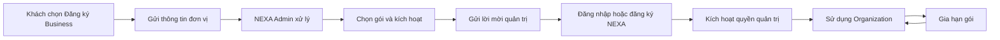

# NEXA — Mô hình sản phẩm & SaaS Business v3.0

**Ngày:** 02/11/2026  
**Phạm vi:** Personal, Organization, Platform Admin; đăng ký/kích hoạt/gia hạn Business; kiến trúc định danh và trải nghiệm.  
**Nguồn đối chiếu:** repository `minhhuyzzz/nexa_AI`, nhánh `main`, commit `35978bf1b2f1d21face6339a88f56ca5cec407f1`.  
**Trạng thái:** Đặc tả **đề xuất**, không phải mô tả tính năng đã triển khai hoàn chỉnh. Không có thay đổi source/database trong bộ bàn giao.

---

## 0. Quyết định sản phẩm (phải thống nhất trước khi code)

1. **NEXA không yêu cầu ký hợp đồng để dùng Business.** Bỏ funnel báo giá/ký kết trên giao diện. Đăng ký Business là một yêu cầu dịch vụ; NEXA Admin xác nhận và kích hoạt gói.
2. **Business thuộc về tổ chức**, không phải gói cá nhân của người đại diện. Cá nhân FREE vẫn có thể quản trị tổ chức Business, không cần mua PRO.
3. **Một tài khoản đăng nhập**, nhiều ngữ cảnh dữ liệu. Người tham gia tổ chức vẫn có trải nghiệm Personal; chỉ quản trị viên được giao quyền mới mở Organization Console.
4. **Giao diện phân quyền chỉ có Quản trị viên và Thành viên.** Quyền giảng dạy, ra đề, chấm bài, xem báo cáo được *phân công theo lớp/đợt*, không tạo nhiều vai trò cấp tổ chức cho người dùng phải tự hiểu.
5. **Gói Business có hạn dùng và nút “Gia hạn gói”.** Nếu chưa tích hợp thanh toán tự động: nút tạo yêu cầu gia hạn tới Platform Admin và hiển thị trạng thái xử lý. Không tạo nút bấm giả.
6. **Một nguồn dữ liệu quyền lợi duy nhất (entitlement/subscription)** cho ghế, số đề, AI credits và ngày hết hạn; không lấy `organizations.max_members` ở một trang nhưng lấy `organization_entitlements.max_seats` ở trang khác.
7. **Không hiển thị 2/0, 0/0 hay CTA “nâng cấp PRO” trong Business.** Chưa được cấp gói phải có trạng thái “Đang kích hoạt” với hướng xử lý phù hợp; gói đang dùng hiển thị thông tin cấp phát thực tế.
8. **Thiết kế theo công việc, không theo mô-típ 4 KPI → tabs → bảng.** Mỗi trang có một mục tiêu, một thao tác nổi bật và trạng thái trống hữu ích.

## 1. Mô hình sản phẩm

| Khái niệm | Ý nghĩa | Quy tắc |
|---|---|---|
| `User` / `Profile` | Danh tính người dùng đăng nhập bằng email | Duy nhất, dùng chung NEXA |
| `Personal Workspace` | Học tập, làm bài, kết quả và chứng chỉ cá nhân | Mọi user đều có; FREE/PRO là quyền lợi **cá nhân** |
| `Organization` | Không gian quản trị của một trường/doanh nghiệp | Do NEXA Admin tạo/kích hoạt hoặc provision theo yêu cầu |
| `Organization Membership` | Liên kết giữa user và tổ chức | Không đồng nghĩa với gói PRO; không tự có quyền quản trị |
| `Organization Subscription` | Gói Business đang sử dụng của tổ chức | Có kỳ hạn, quota, trạng thái và lịch sử gia hạn |
| `Organization Entitlements` | Quyền lợi thực tế của gói | Nguồn sự thật cho ghế, đề, AI, tính năng |
| `Scoped assignment` | Phân công ra đề/chấm bài/quản lý lớp | Chỉ có quyền với lớp/đợt/bài được giao |

### Nguyên tắc dữ liệu

- Hồ sơ học tập và năng lực thuộc **người học**; bài nộp gắn với nguồn (Personal hoặc Organization) và phạm vi tổ chức cụ thể.
- Người dùng có thể thuộc nhiều tổ chức. Dữ liệu mỗi tổ chức phải được ràng buộc theo `organization_id`, không được nhìn chéo.
- Điểm năng lực phải đến từ kết quả đã duyệt; thiếu chứng cứ thì hiển thị **“Chưa đủ dữ liệu”**, không phải 0%.
- Điểm thưởng, gói PRO cá nhân, AI credits cá nhân tách khỏi AI credits/ghế/số đề của tổ chức.
- Khi rời tổ chức, tài khoản Personal không bị xóa. Quyền vào dữ liệu tổ chức bị thu hồi. Quyền truy cập và việc hiển thị bản sao kết quả/chứng chỉ cần theo chính sách dữ liệu rõ ràng.

## 2. Luồng Business tối giản (không ký hợp đồng)



### 2.1. Khách hàng gửi yêu cầu (không cần tài khoản)

Form ngắn: **Tên đơn vị, người liên hệ, email, số điện thoại, quy mô dự kiến, ghi chú (tùy chọn)**. Không yêu cầu mã số thuế, chữ ký, số hợp đồng hay tải tài liệu pháp lý để gửi yêu cầu thông thường.

Sau khi gửi: “NEXA đã nhận yêu cầu của bạn. Chúng tôi sẽ liên hệ qua email/số điện thoại đã cung cấp.” Không cam kết thời gian phản hồi cứng nếu chưa có SLA.

### 2.2. Platform Admin xử lý bằng 3 trạng thái chính

| Trạng thái | Nhãn giao diện | Ý nghĩa | Hành động chính |
|---|---|---|---|
| `NEW` | Mới | Vừa nhận đăng ký | Tiếp nhận |
| `IN_PROGRESS` | Đang xử lý | Đang xác nhận thông tin/gói | Kích hoạt Business |
| `ACTIVATED` | Đã kích hoạt | Đã provision tổ chức và gửi lời mời | Xem tổ chức |

**Trạng thái phụ**, không phải bước trong funnel: `CLOSED` (không tiếp tục), `NEEDS_INFO` (thiếu thông tin). Không dùng `Đã gửi báo giá`, `Chờ ký kết`, `Đã ký` làm điều kiện hệ thống.

Admin có thể kích hoạt ngay từ yêu cầu `NEW`, không cần phải bấm đi qua từng trạng thái. Màn hình chỉ cần: thông tin người liên hệ, gói, chu kỳ, hạn mức, ngày hết hạn, email quản trị viên. Số tiền có thể được ghi nhận nội bộ **nếu cần**, không bắt buộc để kích hoạt.

### 2.3. Kích hoạt gói

1. Admin chọn gói Business (hoặc hạn mức tùy chỉnh), kỳ hạn 1/3/12 tháng, ghế, số đề, AI credits, email quản trị viên.
2. Server thực hiện một thao tác **idempotent/transaction**: tạo tổ chức ở trạng thái `PROVISIONING`, tạo subscription và entitlement, tạo token lời mời một lần, ghi log.
3. Nếu thất bại một khâu, không đánh dấu `ACTIVE` nửa vời, không báo thành công giả.
4. Admin kiểm tra và chọn **Gửi lời mời**; email chứa link thiết lập/nhận quyền, không chứa mật khẩu.
5. Người đại diện có tài khoản NEXA thì đăng nhập; chưa có thì tạo tài khoản qua email được mời. Chấp nhận lời mời xong mới mở Organization Console.

**Không tạo tài khoản/mật khẩu thay người dùng.** Quản trị viên NEXA không được biết mật khẩu của khách hàng.

### 2.4. Sau khi đã kích hoạt

Trên Organization Console, hiển thị **“Business · Đang hoạt động”** và một liên kết nhỏ **“Gói & thanh toán”**. Không hiển thị `CHƯA_KÍCH_HOẠT` hoặc các mã enum kỹ thuật.

## 3. Gia hạn Business — phải là một luồng thực

**Mục tiêu UX:** Khách hàng thấy gói hiện tại, hạn dùng, lượng sử dụng và có thể **yêu cầu gia hạn mà không phải đăng ký tổ chức lại**.

### 3.1. Nút Gia hạn

Tại `/org/[slug]/plan` (hoặc tên UI “Gói Business”):

- Tên gói, trạng thái, “Có hiệu lực đến DD/MM/YYYY”.
- Lượng sử dụng: thành viên, đề đánh giá, AI credits (không phải 4 ô KPI chung cho mọi trang).
- **CTA chính: “Gia hạn gói”**, luôn hiện khi đang có subscription; riêng trường hợp đã gửi yêu cầu thì hiển thị “Đang chờ xử lý” và mã yêu cầu.
- Nếu còn ≤30 ngày: thêm cảnh báo tinh tế “Gói sẽ hết hạn sau N ngày”. Không chặn thao tác khi gói còn hiệu lực.
- Nếu đã hết hạn: CTA “Gia hạn để tiếp tục”, nhưng vẫn cho xem dữ liệu cũ theo chính sách bảo vệ dữ liệu.

### 3.2. Quy trình gia hạn (giai đoạn hiện tại)

1. Admin tổ chức nhấn **Gia hạn gói**.
2. Chọn kỳ hạn (1/3/12 tháng), tùy chọn đề xuất điều chỉnh ghế/AI credits; xem tóm tắt thay đổi và gửi yêu cầu.
3. Backend tạo `renewal_request` trạng thái `PENDING`, chống gửi trùng.
4. Platform Admin nhận hàng đợi **Yêu cầu gia hạn**, xác nhận và bấm **Gia hạn** (nếu cần ghi nhận thanh toán, ghi ở đây hoặc qua payment provider).
5. Backend tạo bản ghi kỳ gia hạn / điều chỉnh `ends_at`, audit, thông báo khách hàng.

**Nếu về sau tích hợp checkout Business**, CTA có thể thành “Thanh toán & gia hạn”, nhưng vẫn phải có xác minh giao dịch, webhook idempotent và trạng thái pending. Trong giai đoạn chưa có payment flow này, không tự giả định “đã thanh toán”.

**Quy tắc ngày:** `new_end_at = max(now, current_end_at) + thời_hạn_gia_hạn`; tránh làm mất phần thời gian chưa sử dụng. Không tự cấp thêm AI credits theo chu kỳ nếu chưa định nghĩa chính sách reset/nạp thêm.

### 3.3. Các trạng thái gói

| Subscription | Hiển thị | Quyền thao tác |
|---|---|---|
| `PROVISIONING` | Đang kích hoạt | Hiện trang thiết lập, không hiển thị hạn mức 0/0 như lỗi |
| `ACTIVE` | Đang hoạt động | Dùng đầy đủ theo quota; có Gia hạn |
| `EXPIRING` *(derived)* | Sắp hết hạn | Vẫn dùng bình thường; CTA Gia hạn nổi bật hơn |
| `RENEWAL_PENDING` *(request)* | Đang xử lý gia hạn | Không tạo yêu cầu trùng; giữ quyền đang có đến ngày hết hạn |
| `EXPIRED` | Hết hạn | Xem dữ liệu đã có, tạm khóa tạo mới/tác vụ tốn credits, CTA Gia hạn |
| `SUSPENDED` | Tạm ngưng | Giải thích nguyên nhân/đầu mối hỗ trợ, không xóa dữ liệu |

`EXPIRING` có thể tính từ `ends_at`, không cần lưu thành trạng thái độc lập.

## 4. Vai trò: đơn giản đối với người dùng

**Giao diện:**

- `Quản trị viên`: quản lý thành viên, lớp, đề, đợt, chấm, báo cáo, cài đặt và gói.
- `Thành viên`: tham gia các lớp, làm bài, xem kết quả của mình trong Personal. Họ không nhìn thấy Organization Console.

**Quy tắc nội bộ bắt buộc:**

- Có một `owner_user_id`/quyền chủ sở hữu để bàn giao và ngăn mất quyền quản trị cuối cùng. Chủ sở hữu không cần là bộ lọc vai trò phổ biến trong UI.
- Người được phân công chấm bài/quản lý lớp có `scoped_grants` (`class_id`, `campaign_id`, `assessment_id`, `action`, `expires_at`), **không được tự có toàn quyền Org**.
- Admin có thể cấp quyền chấm bằng giao diện “Phân công người chấm”, cấp quyền quản lý lớp trong giao diện “Lớp & nhóm”.
- Platform Admin là một vùng quyền độc lập, không suy ra từ vai trò `ORG_ADMIN`.
- Kiểm tra quyền phải diễn ra ở API/RLS, không chỉ ẩn menu.

### Thành viên thường nhìn thấy gì?

Không mở một phiên bản thu nhỏ của dashboard quản trị tổ chức. Sau khi tham gia trường/doanh nghiệp:

- Trong Personal Dashboard xuất hiện khối **“Từ tổ chức của bạn”**: tên tổ chức, lớp học, nhiệm vụ sắp đến hạn, bài cần làm, kết quả có liên quan.
- Trang “Lớp & nhóm” Personal có tab “Tổ chức của tôi” (nếu cần), hiển thị lớp mà người dùng tham gia.
- Kết quả/năng lực cá nhân vẫn đi theo hồ sơ người học, có nhãn nguồn `Trường FPT Polytechnic`, không gộp lẫn báo cáo của các tổ chức.
- Nếu người dùng thuộc nhiều tổ chức, cho lọc theo đơn vị ở **nhiệm vụ cá nhân**, không phải chuyển sang Org Console.

### Admin tổ chức có thể về Personal không?

**Có.** Nhưng chỉ để ở avatar → “Không gian cá nhân”. Trong Organization Console không hiển thị gói PRO cá nhân, nút “Nâng cấp PRO” và danh sách role kỹ thuật. Bộ chọn tổ chức trên topbar chỉ hiện khi admin quản trị nhiều đơn vị. Chuyển ngữ cảnh phải điều hướng sang route và tải dữ liệu tenant tương ứng, không dựa vào cookie làm bảo mật.

## 5. Kiến trúc điều hướng mới

### 5.1. Organization Console (chỉ admin)

- **Tổng quan** `/org/[slug]`
- **Thành viên** `/org/[slug]/members`
- **Lớp & nhóm** `/org/[slug]/classes`
- **Đề đánh giá** `/org/[slug]/assessments`
- **Đợt đánh giá** `/org/[slug]/campaigns`
- **Chấm bài** `/org/[slug]/grading`
- **Báo cáo năng lực** `/org/[slug]/analytics`
- **Gói Business** `/org/[slug]/plan` *(đề xuất mới, thay tên “Hạn mức AI” thành một phần của gói)*
- **Cài đặt** `/org/[slug]/settings`

Không đưa vào sidebar các trang không có nhiệm vụ rõ ràng. Dùng một menu duy nhất ổn định cho Admin Org; quyền giảng viên thuộc màn hình phân công, thành viên dùng Personal.

### 5.2. Platform Admin

- **Yêu cầu Business**: danh sách NEW / IN_PROGRESS / ACTIVATED, tìm kiếm và lọc.
- **Tổ chức**: xem tenant đã kích hoạt, trạng thái, admin chính.
- **Gói & gia hạn**: cấp gói, điều chỉnh hạn mức, xử lý gia hạn.
- Không cần UI CRM phức tạp, kanban 5 giai đoạn hay “Quản trị hợp đồng” như một pháp lý giả định.

### 5.3. Personal

- Dashboard cá nhân + khối “Từ tổ chức của bạn” khi đã có membership.
- Bài được giao → làm bài → nộp → xem đánh giá đã duyệt → chứng chỉ/hồ sơ năng lực cá nhân.
- Điều hướng nhận lời mời đúng email và trở về Personal đối với thành viên, Org Console đối với quản trị viên.

## 6. Nguyên tắc thiết kế SaaS: bỏ giao diện “AI slop”

1. **Light mặc định:** `#FFFFFF` cho nền; các section dùng trắng hoặc xám rất nhạt. Chữ `#171A21`, mô tả `#667085`, đường phân chia `#E7EAF0`, xanh chủ đạo `#315DEB`. Không gradient cầu vồng, không shadow dày, không dark tự bật theo OS.
2. **Typography thật:** heading 28–32px (trang), 18–20px (section), body 13–14px; khoảng trắng thoáng; giảm chữ 10–11px hiện tràn ngập source.
3. **Không ép KPI trên mọi trang:** Tổng quan chỉ một số chỉ báo hữu ích; Thành viên lấy bảng làm trọng tâm; Chấm bài là workspace hai cột; Gói Business là sản phẩm/quyền lợi & CTA Gia hạn; Analytics ưu tiên biểu đồ và nguồn dữ liệu.
4. **Nội dung chính bắt đầu sớm:** không phải scroll qua 4 card + 3 panel “mẹo” trước khi thấy bảng.
5. **Empty state theo hành động:** không có đề thì “Tạo đề đầu tiên”, không có đợt thì “Tạo đợt đánh giá”, không lặp lại câu khẳng định trống hoặc tạo chỉ số giả.
6. **Không KPI vô nghĩa:** không hiện `0%` nếu chưa có dữ liệu; không vẽ donut `0 (100%)` khi trống; không hiện ngày “Khai giảng” do seed giả.
7. **Một CTA chính/trang:** tạo đề, mời thành viên, tạo đợt, phê duyệt điểm, Gia hạn gói. Secondary action vừa đủ.
8. **Sử dụng copy của người dùng:** “Gói Business đang hoạt động”, “Gia hạn”, “Mời thành viên”, “Chấm bài”; không lộ `CHUA_KICH_HOAT`, `ORG_OWNER`, `0/0`, `PLAN_TIER`.
9. **Trạng thái thật:** loading, empty, error, processing, success, no-access; nút phải có xử lý thành công/thất bại rõ ràng, không toast giả.
10. **Bảo mật / minh chứng:** nêu rõ AI chỉ hỗ trợ chấm, kết quả đã duyệt mới dùng cho báo cáo, không để client tự kiểm định thành chứng chỉ hợp lệ.

### Đặc thù từng trang

| Trang | Thành phần chính | Không nên làm |
|---|---|---|
| Tổng quan | Tiêu đề chào, hoạt động sắp diễn ra, danh sách việc cần xử lý, lối tắt tạo đợt | 4 số 0 cỡ lớn, cảnh báo đỏ khi mới tạo |
| Thành viên | Tìm kiếm, bảng, lời mời, yêu cầu vào, import CSV | Thẻ thành viên + tab thành viên lặp số |
| Lớp & nhóm | Danh sách lớp, chủ nhiệm, số học viên, bài được giao, bộ lọc | Donut “phân bổ nhóm” khi 0 lớp |
| Đề đánh giá | Ngân hàng đề, trạng thái bản nháp/phát hành, trình soạn chuyên dụng | Phát hành cùng nút mở Live; API admin-platform |
| Đợt đánh giá | Danh sách theo tiến độ, timeline, số cần xử lý | Card count và tabs lặp lại thông tin |
| Chấm bài | Hàng đợi → minh chứng → rubric → duyệt | Đánh giá AI được coi là điểm chính thức |
| Báo cáo | Bộ lọc theo đợt/lớp, 5 miền, mẫu dữ liệu & mức tin cậy | 0% khi chưa có bài được duyệt |
| Gói Business | Tên gói, ngày hết hạn, mức sử dụng, **Gia hạn gói** | “Nâng cấp PRO”, thuật ngữ hợp đồng, 0/0 |
| Cài đặt | Thông tin đơn vị, miền email, chính sách bảo mật | Dashboard KPI, thông số billing trùng màn Gói |

## 7. Đề xuất mô hình dữ liệu và API

### 7.1. Bảng lõi (đề xuất)

```text
users / profiles
organizations(id, name, slug, status, owner_user_id, ...)
organization_memberships(id, org_id, user_id, kind: ADMIN | MEMBER, status)
organization_subscriptions(id, org_id, plan_id, status, starts_at, ends_at, renewal_cycle, ...)
organization_entitlements(id, subscription_id, org_id, seats_limit, assessments_limit, ai_credits_granted, ai_credits_used, ...)
business_requests(id, contact_email, org_name, status, notes, assigned_admin_id, ...)
renewal_requests(id, org_id, subscription_id, period_months, requested_seats, requested_credits, status, ...)
scoped_assignments(id, org_id, user_id, resource_type, resource_id, capability, status)
subscription_events / admin_audit_logs
```

Không bắt buộc tạo bảng mới nếu có thể mở rộng bảng hiện tại an toàn. Duy trì dữ liệu lịch sử và migration tăng dần; **không sửa migration đã chạy**.

### 7.2. APIs (định hướng)

| Action | Route gợi ý | Quyền |
|---|---|---|
| Gửi yêu cầu Business | `POST /api/business/requests` | Công khai, rate limit |
| Liệt kê/tiếp nhận | `GET/PATCH /api/admin/business/requests` | Platform Admin |
| Kích hoạt | `POST /api/admin/business/activate` | Platform Admin, idempotent transaction |
| Xem gói của org | `GET /api/org/[slug]/subscription` | Org Admin |
| Yêu cầu gia hạn | `POST /api/org/[slug]/renewal-requests` | Org Admin |
| Duyệt gia hạn | `POST /api/admin/business/renewals/[id]/approve` | Platform Admin |
| Mời admin/thành viên | `POST /api/org/[slug]/invitations` | Org Admin |
| Nhận lời mời | `POST /api/invitations/accept` | User đã đăng nhập, đúng email |
| Bài/tác vụ của thành viên | `GET /api/personal/organization-work` | User; chỉ dữ liệu được giao |

API ở trên là **target architecture**, không khẳng định đã có trong repo.

### 7.3. Ràng buộc nhất quán cần giữ

- `organizations.status` diễn tả trạng thái tenant; `subscription.status` diễn tả gói; **không đánh đồng** chúng.
- Organization Console phải đọc cùng dịch vụ `getEffectiveOrgSubscription(orgId)` để trả về `status, seatsLimit, seatsUsed, assessmentsLimit, assessmentsUsed, creditsRemaining, endsAt`.
- `quota=0` là hết quyền **chỉ khi hệ thống xác nhận có subscription với limit 0**; nếu không có entitlement, trả trạng thái `PROVISIONING`/`NO_SUBSCRIPTION`, không hiển thị `2/0`.
- Không dùng `org.max_members || 50` và `entitlements.maxSeats` song song; phải thống nhất nguồn authoritative.
- Tăng ghế và xử lý quyền mời cần transaction chống race condition, đếm thành viên đang ACTIVE theo quy tắc thống nhất.
- Gia hạn cần idempotency key, audit và xác nhận có hiệu lực; không gia hạn hai lần từ một sự kiện.
- Tài khoản nhận email mời phải đăng nhập đúng email; lời mời một lần, có hạn và có thể thu hồi.

## 8. Những điểm **đã xác nhận ở source** cần sửa trước khi triển khai UX mới

| Độ ưu tiên | File hiện tại | Vấn đề/định hướng |
|---|---|---|
| P0 | `src/app/api/admin/organizations/approve/route.ts` | Chỉ lock inquiry với `status='PENDING'`, chuyển sang `PROCESSING`, trong khi migration `30_admin_audit_logs_and_inquiry_statuses.sql` chỉ cho `NEW`, `CONTACTED`, `PROPOSAL_SENT`, `APPROVED`, `REJECTED`. Cần đổi FSM và triển khai provision transaction thực. |
| P0 | `src/app/api/admin/organizations/route.ts` | Có đường tạo org `is_active=true` không kèm entitlement; gây dashboard active nhưng quota 0. |
| P0 | `src/features/billing/services/quota-enforcement.service.ts` | `getOrgEntitlements()` không tìm thấy gói thì trả 0, không phân biệt đang cấp/quá hạn và số liệu lỗi. |
| P0 | `src/app/(dashboard)/org/[slug]/members/page.tsx` | Dùng `org.max_members || 50`; trong khi trang gói dùng entitlement. Phải thống nhất quota. |
| P1 | `src/app/api/organizations/quota/route.ts` | Dùng `organizations.plan_tier` và `service_plans` — một mô hình quota khác với entitlement B2B. |
| P1 | `src/app/api/auth/onboarding/route.ts` | Có nhánh gán `profiles.plan_tier='ENTERPRISE'` khi nhập `orgCode`; làm lẫn subscription tổ chức và tier cá nhân. |
| P1 | `src/components/dashboard/AvatarWorkspaceSection.tsx` + `OrgAvatarMenu.tsx` | Gói Personal PRO và switch workspace chen trong menu org; cần chuyển sang menu tài khoản tối giản. |
| P1 | `src/components/dashboard/org/OrgSidebar.tsx` + `src/lib/auth/org-guard.ts` | Nhiều vai trò và đường dẫn không khớp phân quyền; đơn giản hóa giao diện đồng thời giữ authorization resource-scoped. |
| P1 | `src/app/(dashboard)/org/[slug]/assessments/new/page.tsx` + `AssessmentStudio.tsx` | Org Studio hiện gọi `/api/admin/assessments` (Platform Admin guard). Cần API authoring theo quyền Org và quy trình lưu nháp/kiểm định/phát hành an toàn. |
| P2 | Các trang Org Dashboard, Members, Analytics, AI Quota | Trùng KPI, copy kỹ thuật, thiếu empty states đúng và báo cáo 0% khi chưa có dữ liệu. |

**Lưu ý kỹ thuật:** Những điểm trên xác định từ source tại commit nêu đầu tài liệu; không có kiểm tra production database nên cần đối chiếu migration đang được áp dụng thực tế.

## 9. Kế hoạch triển khai theo thứ tự

**Pha A — Product model & dữ liệu (bắt buộc):** khóa quyết định ở mục 0; định nghĩa subscription lifecycle, một nguồn quota, migration mới, transaction cấp/gia hạn, quyền admin/member, kiểm thử multi-tenant.

**Pha B — Quy trình đăng ký Business:** form yêu cầu ngắn, Platform Admin nhận/duyệt/kích hoạt và email mời một lần; xử lý người đã/chưa có tài khoản; trạng thái provision không nửa vời.

**Pha C — Trang Gói Business & Gia hạn:** UI thật, API renewal request/approval, hạn dùng, lịch sử, chưa có payment thì không giả thanh toán.

**Pha D — App shell & workspaces:** org console cho admin, personal cho member, avatar tối giản, điều hướng theo context; bỏ PRO cá nhân khỏi org.

**Pha E — UX theo từng tác vụ:** Tổng quan → Thành viên/Lớp → Đề/Đợt → Chấm bài → Báo cáo → Cài đặt.

## 10. Tiêu chí nghiệm thu (Definition of Done)

- [ ] Khách chưa có tài khoản vẫn gửi yêu cầu Business được.
- [ ] Admin tiếp nhận và kích hoạt trực tiếp, không phụ thuộc trạng thái “Chờ ký kết/Đã ký”.
- [ ] Kích hoạt thành công tạo subscription/entitlements nhất quán và lời mời hợp lệ; lỗi thì không còn tenant ACTIVE nửa vời.
- [ ] Người đã có tài khoản nhận lời mời bằng đúng email và vào Org Console nếu là admin.
- [ ] Người chưa có tài khoản có thể tạo tài khoản, nhận quyền mà không phải mua gói PRO.
- [ ] Thành viên mới gia nhập thấy nhiệm vụ tổ chức trong Personal, không bị đưa vào dashboard quản trị.
- [ ] Org Admin có thể quay về Personal từ menu tài khoản; Business không quảng cáo PRO cá nhân.
- [ ] Mỗi tổ chức chỉ đọc dữ liệu của chính tổ chức đó; người chấm chỉ thao tác trên bài được giao.
- [ ] Trang Gói Business hiển thị hạn dùng thật, quota thật và **Gia hạn gói**.
- [ ] Gửi yêu cầu gia hạn có trạng thái, chống gửi trùng; Admin duyệt gia hạn cập nhật hạn đúng kỳ và ghi log.
- [ ] Chưa cấp gói hiển thị “Đang kích hoạt”, không hiển thị `2/0` hoặc thúc khách tự mua PRO.
- [ ] Hết hạn không xóa bài/chứng cứ; hạn chế tác vụ tạo mới và AI đúng chính sách.
- [ ] Không có báo cáo 0% khi dữ liệu chưa đủ; số liệu bám bài đã được phê duyệt.
- [ ] Mỗi trang có một chức năng chính, không tái sử dụng bố cục 4 KPI + tab làm mẫu chung.
- [ ] Desktop/mobile, loading/empty/error/success và keyboard accessibility được test.

## 11. Các điểm cần quyết định trước khi code production

- Gói Business có được **tự thanh toán qua payOS** ngay không, hay trước mắt chỉ **gửi yêu cầu và Admin xác nhận**? Đặc tả này chọn **gửi yêu cầu và Admin xác nhận** làm mặc định để không giả thanh toán.
- Có cho gói trial không? Nếu có, trial phải là một subscription có thời hạn và hạn mức cụ thể.
- Ghế đếm những ai? Đề xuất: user membership `ACTIVE`; người được mời chưa nhận không chiếm ghế, nhưng hệ thống nên dự phòng để tránh mời vượt số ghế.
- AI credits reset theo kỳ, rollover hay nạp cố định? Phải định nghĩa minh bạch trước khi mở Gia hạn tự động.
- Chính sách grace period khi hết hạn và quyền xem lại chứng chỉ/bài nộp.

---

### Tuyên bố định hướng

> **NEXA Personal giúp từng người phát triển và chứng minh năng lực số. NEXA Business giúp đơn vị tổ chức, triển khai và theo dõi quá trình đánh giá năng lực số của người tham gia. Business là gói dịch vụ của tổ chức, có thể kích hoạt và gia hạn đơn giản; không phải tài khoản cá nhân cấp cao hay một quy trình ký hợp đồng phức tạp.**
