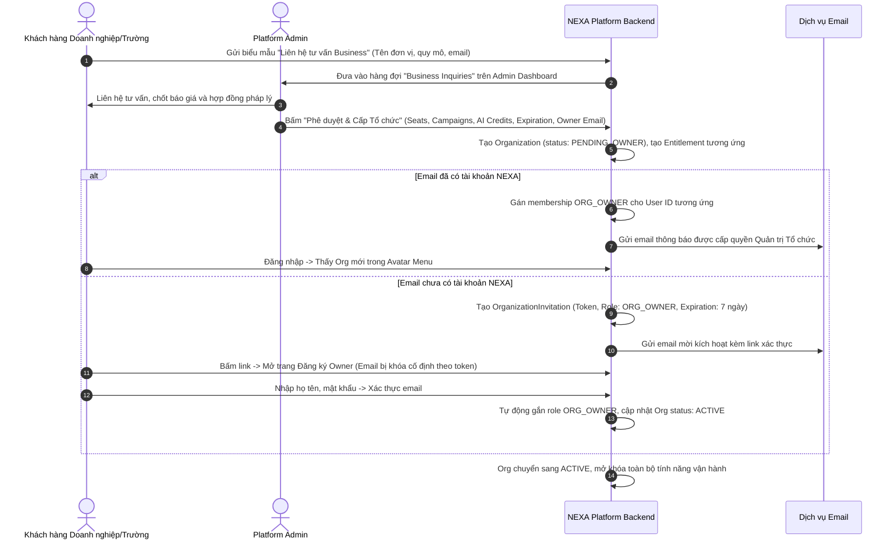
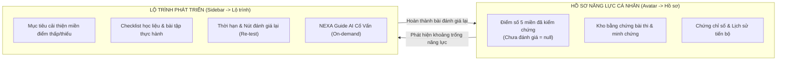

# ĐẶC TẢ KỸ THUẬT & KIẾN TRÚC HỆ THỐNG TOÀN DIỆN: NEXA vNext (3 DASHBOARD, WORKFLOW & UX SPECIFICATION)

> **Mã tài liệu:** `SPEC-NEXA-VNEXT-2026-10-31`  
> **Căn cứ:**  
> - Báo cáo phân tích chuyên sâu: `NEXA_AI_DEEP_REVIEW_3_DASHBOARD_GIAI_THICH_SO_DO_2026-10-31_VI.md`  
> - Yêu cầu tái thiết kế nghiệp vụ, workflow và UX của Nhà phát triển (31/10/2026)  
> - Quy chuẩn kiến trúc & giao diện: [`AGENTS.md`](file:///c:/nexa/AGENTS.md)  
> **Phương pháp tiếp cận:** Spec-Driven Development (SDD) — Đặc tả chuẩn hóa trước khi lập kế hoạch và triển khai mã nguồn.

---

## 1. MỤC TIÊU & TẦM NHÌN HỆ THỐNG (OBJECTIVE)

### 1.1. Bản chất cốt lõi của NEXA
NEXA AI là **Nền tảng Đánh giá và Phát triển Năng lực số (Digital Competency Assessment & Growth)** chuẩn hóa theo khung DigComp quốc tế. Khác biệt then chốt của NEXA:
$$\text{Đánh giá có bằng chứng} \longrightarrow \text{Xác định khoảng trống 5 miền} \longrightarrow \text{Lộ trình học tập cá nhân hóa} \longrightarrow \text{Thực hành} \longrightarrow \text{Đánh giá lại tiến bộ}$$
NEXA không phải là sàn thương mại điện tử bán khóa học và không phải là dashboard thống kê chỉ số chung chung lặp lại.

### 1.2. Mục tiêu tái thiết kế (vNext Objectives)
1. **Một danh tính — Đa không gian làm việc (One Identity, Multi-workspace):** Xóa bỏ hoàn toàn sự nhập nhằng giữa tài khoản cá nhân, vai trò thành viên tổ chức và đặc quyền điều hành nền tảng. Chuyển bộ chuyển đổi không gian (Workspace Switcher) vào Menu Avatar.
2. **Chốt 3 gói thương mại duy nhất:** `Free` (Cá nhân tự do), `Pro` (Cá nhân nâng cao), `Business` (Tổ chức theo hợp đồng phê duyệt).
3. **Quy trình cấp Organization Business fail-closed:** Khách hàng không cần đăng ký tài khoản trước; hỗ trợ tạo Org và kích hoạt qua email mời `ORG_OWNER` nguyên tử.
4. **Tách biệt 4 lớp dữ liệu khảo thí:**
   - **Ngân hàng câu hỏi (Question Bank):** Kho câu hỏi độc lập có thể tái sử dụng (Reusable Items), hỗ trợ rich-media và rubric đa tầng.
   - **Bộ đề (Assessment Content):** Bản đóng gói cấu trúc đề thi, rubric, mapping 5 miền, có trang Chi tiết bộ đề (Detail) 5 tab sau khi soạn xong.
   - **Đợt thi (Campaign / Assignment):** Thiết lập đối tượng thi, lớp thi, lịch mở/đóng, thời lượng làm bài, phân công chấm bài.
   - **Phòng thi trực tiếp (Live Room):** Phiên điều phối thi thời gian thực có sảnh chờ (Lobby), mã PIN/QR, và bàn điều khiển giám thị (Control Room).
5. **Phân định rõ Hồ sơ năng lực và Lộ trình phát triển:**
   - **Hồ sơ năng lực:** "Tôi đang ở đâu?" — Gộp vào Hồ sơ cá nhân (Profile), hiển thị bằng chứng điểm 5 miền đã được duyệt (`score: null` nếu chưa có bài thi, không vẽ 0% giả), chứng chỉ và lịch sử tiến bộ.
   - **Lộ trình phát triển:** "Tôi cần làm gì tiếp theo?" — Kế hoạch hành động, checklist bài học từ catalog kiểm duyệt, thời hạn và nút đánh giá lại; AI cố vấn on-demand.
6. **Nâng cấp Báo cáo Tổ chức & Platform Control Plane:**
   - Báo cáo Org chuyển hóa thành BI Dashboard với heatmap, phân phối điểm và xu hướng theo cohort.
   - Admin chuyển hóa thành Control Plane với hàng đợi xử lý công việc (Action Queues), BI toàn nền tảng, quản lý khóa tài khoản người dùng, đối soát tài chính đa trạng thái, kiểm duyệt nội dung workbench 2 cột và AI Gateway giám sát P95 latency/error rate thực tế.
7. **Xóa bỏ bệnh rập khuôn giao diện (Anti-AI-Slop):** Loại bỏ việc lạm dụng Modal tràn lan, thay thế bằng Full-page, Split-view hoặc Side Drawer; thẻ bài thi chuẩn hóa tỷ lệ vuông 1:1; đa dạng hóa trực quan hóa dữ liệu (Bar, Heatmap, Line, Histogram).

---

## 2. CAPABILITY MAP (BẢN ĐỒ PHÂN HỆ KHẢ NĂNG)

```markdown
┌─────────────────────────────────────────────────────────────────────────────┐
│                            CAPABILITY MAP: NEXA vNext                       │
└─────────────────────────────────────────────────────────────────────────────┘

| Mã Module      | Trách nhiệm nghiệp vụ (Responsibility)                      | Phụ thuộc (Depends on)       |
|----------------|-------------------------------------------------------------|------------------------------|
| `MOD-AUTH-WS`  | Identity, Avatar Workspace Switcher, Org Provisioning       | — (Nền tảng)                 |
| `MOD-ITEM-BANK`| Reusable Question Bank, Taxonomy 21 Kỹ Năng, Import Preview | `MOD-AUTH-WS`                |
| `MOD-ASSESS-ED`| Assessment Studio, Trang Detail 5 Tab, Versioning Đề        | `MOD-ITEM-BANK`              |
| `MOD-DELIVERY` | Campaign Wizard, Live Room Control, Giao Bài & Nộp Bài      | `MOD-ASSESS-ED`              |
| `MOD-PROFILE`  | Hồ sơ năng lực 5 miền trong Avatar, Lộ trình học hành động   | `MOD-DELIVERY`               |
| `MOD-ORG-MGMT` | 5 Vai trò RBAC, Quản lý Link/Mã mời, Lớp học, Usage Ledger  | `MOD-AUTH-WS`, `MOD-DELIVERY`|
| `MOD-ADMIN-CP` | Action Queues, Quản lý User/Khóa, Đối soát Tài chính        | `MOD-AUTH-WS`, `MOD-ORG-MGMT`|
| `MOD-ADMIN-BI` | Phân tích BI nâng cao, Communications Center, Content Studio| `MOD-ADMIN-CP`               |

Build Order:
MOD-AUTH-WS ──→ MOD-ITEM-BANK ──→ MOD-ASSESS-ED ──→ MOD-DELIVERY ──→ MOD-PROFILE
      │                                                     │
      └──→ MOD-ORG-MGMT ──→ MOD-ADMIN-CP ──→ MOD-ADMIN-BI ◄─┘
```

---

## 3. KIẾN TRÚC CHI TIẾT CÁC PHÂN HỆ

### 3.1. Phân hệ Không gian làm việc & Định danh (`MOD-AUTH-WS`)

#### 3.1.1. Nguyên tắc 1 Danh tính — Đa không gian
- Một tài khoản duy nhất (Email/Auth ID) dùng để đăng nhập toàn bộ hệ thống.
- **Menu Avatar (Avatar Workspace Switcher):** Đưa toàn bộ tính năng chuyển đổi workspace vào dropdown của Avatar:
  ```text
  ┌─────────────────────────────────────────────────────────┐
  │  Nguyễn Văn A (nguyenvana@gmail.com)                     │
  ├─────────────────────────────────────────────────────────┤
  │  KHÔNG GIAN LÀM VIỆC                                    │
  │  ● Cá nhân (Personal)                    Gói Pro         │
  │  ○ Trường ĐH Bách Khoa                   Quản trị viên   │
  │  ○ Tập đoàn Công nghệ VN                 Người chấm      │
  ├─────────────────────────────────────────────────────────┤
  │  [Đặc quyền] Quản Trị Nền Tảng (Platform Admin)         │ (Chỉ hiện nếu có quyền)
  ├─────────────────────────────────────────────────────────┤
  │  Hồ sơ của tôi & Năng lực 5 miền                        │
  │  Gói dịch vụ & Lịch sử thanh toán                       │
  │  Cài đặt giao diện & Bảo mật                            │
  │  Đóng góp ý kiến cho NEXA                               │
  │  Đăng xuất                                              │
  └─────────────────────────────────────────────────────────┘
  ```
- **Cách ly dữ liệu (Tenant Isolation):** Đổi không gian làm việc thay đổi toàn bộ API Context, query cache và bộ lọc dữ liệu. Dữ liệu của Org A tuyệt đối không xuất hiện ở Org B hay Personal.

#### 3.1.2. Ba gói dịch vụ thương mại duy nhất
1. **Free (Cá nhân):** Làm bài đánh giá cơ bản, tự luyện tập, xem hồ sơ năng lực 5 miền, quota thực hành giới hạn.
2. **Pro (Cá nhân nâng cao):** Mở rộng ngân hàng đề, phân tích chuyên sâu bằng NEXA Guide, tạo đề thi và phòng thi cá nhân, thanh toán tự động qua cổng payOS.
3. **Business (Tổ chức theo hợp đồng):** Dành cho trường học, doanh nghiệp. Hạn mức số ghế (Seats), số đợt thi (Campaigns), AI credits và thời hạn hiệu lực theo hợp đồng phê duyệt bởi Platform Admin.

#### 3.1.3. Quy trình cấp Organization Business (Fail-closed)


---

### 3.2. Ngân hàng câu hỏi độc lập (`MOD-ITEM-BANK`)

#### 3.2.1. Bản chất Reusable Item
- Câu hỏi trong ngân hàng là tài nguyên độc lập với bộ đề, có thể được dùng lại trong nhiều đề thi khác nhau.
- **Cấu trúc trường của Question Bank Item:**
  - `id`: UUID.
  - `item_code`: Mã câu hỏi chuẩn hóa (ví dụ: `Q-D1-001`, `Q-D4-015`).
  - `item_type`: `MCQ_SINGLE` | `MCQ_MULTI` | `SCENARIO` | `PRACTICAL_SUBMISSION` | `EVIDENCE_LINK`.
  - `domain_id`: Mã miền DigComp (`D1`: Thông tin & Dữ liệu, `D2`: Giao tiếp & Hợp tác, `D3`: Sáng tạo nội dung số, `D4`: An toàn số, `D5`: Giải quyết vấn đề).
  - `sub_competence_code`: Mã 21 kỹ năng thành phần (ví dụ: `1.1`, `4.2`) — **chỉ dùng làm taxonomy tag phân loại, không dùng làm chỉ số chấm điểm**.
  - `difficulty_level`: `BEGINNER` | `INTERMEDIATE` | `ADVANCED` | `EXPERT`.
  - `prompt`: Nội dung câu hỏi (hỗ trợ rich text markdown, KaTeX math).
  - `media_attachments`: Mảng file ảnh/video/tài liệu đính kèm (có alt text, kích thước tối đa 5MB).
  - `options`: Mảng phương án đối với trắc nghiệm.
  - `correct_answers`: Đáp án đúng có mã hóa hoặc rubric ID liên kết đối với câu hỏi tự luận/thực hành.
  - `rubric_definition`: Cấu trúc rubric 3 tầng (nếu là câu hỏi mở).
  - `scope`: `PERSONAL` (do cá nhân tạo) | `ORGANIZATION` (thuộc kho Org) | `PLATFORM` (kho chuẩn quốc gia).
  - `status`: `DRAFT` | `APPROVED` | `ARCHIVED`.

#### 3.2.2. Giao diện Ngân hàng câu hỏi
- **Bãi bỏ Modal thêm câu hỏi 700 dòng:** Bấm "Tạo câu hỏi" hoặc bấm vào một câu hỏi sẽ mở **Trang biên soạn câu hỏi chuyên sâu** (`/item-bank/[id]`) gồm 3 khu vực:
  1. Cột trái: Bộ lọc phân loại (Miền D1..D5, Sub-competence, Loại câu, Độ khó, Trạng thái).
  2. Bảng danh sách câu hỏi: Hiển thị nội dung tóm tắt, tag miền, độ khó, số bộ đề đang sử dụng câu hỏi này.
  3. Chức năng Import Excel/Word: Phải có **Import Verification Wizard** (Phân tích cú pháp -> Kiểm tra lỗi từng dòng -> Xem trước dạng bảng -> Xác nhận lưu nguyên tử).

---

### 3.3. Assessment Studio & Trang Chi Tiết Bộ Đề (`MOD-ASSESS-ED`)

#### 3.3.1. Tách biệt Nội dung bộ đề vs Lần triển khai
- **Bộ đề (Assessment Content):** Đóng gói nội dung học thuật.
  - Chứa: Danh sách câu hỏi, thứ tự, điểm tối đa của câu hỏi, rubric chấm, ma trận 5 miền.
  - Chỉ có trường: `estimated_duration_minutes` (Thời lượng làm bài ước tính của một lượt thi, e.g. 45 phút).
  - **TUYỆT ĐỐI KHÔNG chứa:** Ngày giờ mở đợt thi, ngày đóng đợt thi, danh sách học viên dự thi, mã PIN phòng thi.

#### 3.3.2. Trang Chi Tiết Bộ Đề (Assessment Detail Page — `/assessments/[id]`)
Sau khi hoàn tất soạn thảo trong Assessment Studio, người dùng được điều hướng đến trang Chi tiết bộ đề gồm 5 tab chức năng:
```text
← Quay lại Bộ đề của tôi / Đề Đánh Giá Năng Lực Số Đầu Vào

┌──────────────┐   ĐỀ ĐÁNH GIÁ NĂNG LỰC SỐ ĐẦU VÀO
│   Ảnh bìa    │   Phiên bản: v1.3 (Đã phát hành - Khóa bất biến)
│   Vuông 1:1  │   Quy mô: 35 câu hỏi · 100 điểm · Bao phủ 5/5 miền DigComp
│              │   [Làm thử bản xem trước]  [Triển khai thành Đợt thi / Phòng thi]  [···]
└──────────────┘

TABS:
[ 1. Tổng quan ] [ 2. Danh sách câu hỏi ] [ 3. Ma trận 5 miền & Rubric ] [ 4. Lịch sử phiên bản ] [ 5. Lần triển khai ]

Nội dung từng Tab:
- Tab 1 (Tổng quan): Mô tả mục tiêu, đối tượng hướng tới, tác giả, trạng thái, thẻ bài thi vuông 1:1.
- Tab 2 (Danh sách câu hỏi): Danh sách toàn bộ các câu hỏi trắc nghiệm, tình huống, thực hành.
- Tab 3 (Ma trận & Rubric): Bảng phân bổ điểm theo từng miền D1..D5, danh mục rubric chấm tự luận.
- Tab 4 (Lịch sử phiên bản): Ghi nhận v1.0 -> v1.1 -> v1.2, ghi chú thay đổi (changelog). Khi đề đã có bài thi nộp, phiên bản đó bị khóa bất biến (không sửa hồi tố). Mọi chỉnh sửa nội dung bắt buộc tạo phiên bản mới (v1.3).
- Tab 5 (Lần triển khai): Liệt kê các Campaign hoặc Live Room đang sử dụng bộ đề này. Có nút "Tạo đợt thi mới" và "Tạo phòng thi trực tiếp".
```

#### 3.3.3. Trạng thái và Nút hành động trên trang Detail
- `DRAFT`: Nút "Tiếp tục soạn thảo", "Kiểm tra chất lượng (Validation)". KHÔNG có nút "Bắt đầu làm bài".
- `PUBLISHED`: Nút "Làm thử" (dành cho tác giả kiểm tra đề), nút "Tạo đợt thi (Campaign)", nút "Tạo phòng thi trực tiếp (Live Room)".
- `ARCHIVED`: Chỉ đọc (Read-only), có nút "Nhân bản (Clone) thành bộ đề mới".

---

### 3.4. Triển Khai Thi: Campaign & Live Room (`MOD-DELIVERY`)

#### 3.4.1. Campaign (Đợt thi theo tổ chức / Giao bài theo nhóm)
- **Campaign Wizard 5 bước:** Đã có nền tảng tại `src/app/(dashboard)/org/[slug]/campaigns/new/page.tsx`, chuẩn hóa dữ liệu:
  1. *Thông tin đợt:* Tên chiến dịch, mô tả, ảnh đại diện vuông 1:1.
  2. *Chọn bộ đề:* Chọn phiên bản bộ đề đã phát hành (`status: 'PUBLISHED'`).
  3. *Đối tượng tham gia:* Chọn một hoặc nhiều Lớp học trong tổ chức.
  4. *Lịch trình & Giám sát:* Ngày giờ mở (`start_at`), ngày giờ kết thúc (`end_at`), thời lượng mỗi lượt làm (`time_limit_minutes`), số lượt làm bài cho phép (`max_attempts`), ngưỡng điểm đạt (`pass_score`).
  5. *Phân công chấm bài:* Chọn các giảng viên/Assessor chịu trách nhiệm chấm các bài tự luận của đợt thi.
- **Trang Chi Tiết Campaign (`/campaigns/[id]`):**
  - Thanh KPI thực tế: Được giao (150), Đang làm (25), Đã nộp (110), Đã duyệt điểm (95), Chờ chấm (15).
  - Tab danh sách bài nộp, tab phân công chấm bài, tab kết quả 5 miền của đợt thi.

#### 3.4.2. Live Room (Phòng thi trực tiếp)
Tách thành 5 phân hệ giao diện chuyên biệt:
1. **Danh sách phiên thi (`/personal/live-room` hoặc `/org/[slug]/live-room`):** Quản lý phiên Đang diễn ra, Sắp diễn ra, Đã kết thúc.
2. **Thiết lập phiên thi (Setup):** Chọn đề thi đã duyệt, đặt thời gian bắt đầu, cấu hình giám sát (bật cảnh báo rời tab màn hình), tạo mã PIN 6 số và mã QR.
3. **Sảnh chờ (Lobby — `/live/waiting-room`):** Màn hình dành cho thí sinh điểm danh vào phòng, kiểm tra kết nối mạng, hiển thị danh sách người đang chờ thi.
4. **Bàn điều khiển trực tiếp của Giám thị (Control Room — `/live/control`):** Giám sát real-time số thí sinh đang kết nối, cảnh báo thí sinh có hành vi tab-switch, nút "Bắt đầu tính giờ thi", nút "Cộng thêm giờ", nút "Thu bài toàn phòng".
5. **Tổng kết phòng thi:** Tự động khóa nộp bài, chấm tự động câu trắc nghiệm, đẩy bài tự luận sang hàng đợi chấm, xuất báo cáo kết quả tức thì.

---

### 3.5. Hồ Sơ Năng Lực & Lộ Trình Phát Triển (`MOD-PROFILE`)

#### 3.5.1. Tách biệt triệt để hai khái niệm


#### 3.5.2. Hồ Sơ Năng Lực 5 Miền (Personal Competency Profile)
- **Vị trí:** Tích hợp trực tiếp vào **Hồ sơ của tôi (My Profile & Digital Competency)** truy cập từ Menu Avatar.
- **Quy tắc hiển thị:**
  - Điểm của miền chỉ được tính từ các câu hỏi/bài thi đã được chấm và phê duyệt hợp lệ.
  - Miền nào chưa có dữ liệu đánh giá: Hiển thị trạng thái `Chưa có dữ liệu đánh giá` (giá trị `null`), **tuyệt đối không hiển thị 0%**.
  - Trực quan hóa: Sử dụng Bar Chart chuẩn hóa 5 thanh ngang kèm số lượng bằng chứng (Coverage: e.g. "3/5 bài thi bao phủ"), biểu đồ Radar chỉ đóng vai trò hình ảnh phụ.
  - Lịch sử tiến bộ: Biểu đồ đường (Line Chart) so sánh điểm qua các mốc thời gian (Tháng 8 -> Tháng 9 -> Tháng 10).
  - Kho chứng chỉ: Danh sách chứng chỉ số hợp lệ đã được cấp kèm mã băm SHA-256 xác thực.

#### 3.5.3. Lộ Trình Phát Triển Cá Nhân (Personal Learning Path)
- **Vị trí:** Mục riêng trên Sidebar Personal (`/personal/learning-path`).
- **Cấu trúc màn hình:**
  1. *Thẻ Mục tiêu hiện tại:* Chọn miền năng lực muốn nâng bậc (ví dụ: "Nâng miền D4: An toàn số từ Đạt (62%) lên Xuất sắc (80%) trước ngày 30/11").
  2. *Checklist Nhiệm vụ (Action Checklist):*
     - Hoàn thành bài đọc: "Nhận diện mã độc & lừa đảo trực tuyến (Phishing)" (Catalog nội bộ đã duyệt).
     - Thực hành: "Thiết lập xác thực 2 lớp (2FA) cho tài khoản cá nhân".
     - Làm bài tập tình huống: "Bảo vệ thông tin cá nhân trên mạng xã hội".
  3. *Cột mốc Đánh giá lại (Re-assessment Milestone):* Nút "Làm bài thi đánh giá lại Miền D4" khi hoàn thành checklist để cập nhật lại Hồ sơ năng lực.
  4. *NEXA Guide Cố Vấn (AI on-demand):* Nút bấm rõ ràng "Phân tích khoảng trống bằng NEXA Guide (1 Credit)". Modal xác nhận chi phí trước khi gọi AI. Kết quả phân tích chỉ gợi ý tài liệu học thực tế từ bảng `course_catalog`, không tự ý ghi điểm năng lực.

---

### 3.6. Lớp & Nhóm Cá Nhân (`MOD-PERSONAL-GROUPS`)
- Tên module trên Sidebar: **Lớp & Nhóm (Classes & Groups)**.
- Phân chia 3 tab rõ ràng:
  1. **Tôi tham gia (Joined):** Danh sách các lớp học/nhóm do người khác tạo mà mình là thành viên. Thấy danh sách bài thi được giao trong nhóm, bảng xếp hạng nội bộ.
  2. **Tôi quản lý (Managed):** Danh sách các nhóm do chính người dùng tạo (ví dụ: Nhóm học tập CLB Tin học). Người dùng có quyền: Thêm thành viên bằng mã/link, giao bài thi từ Bộ đề của tôi, theo dõi tiến độ và bảng điểm thành viên.
  3. **Lời mời tham gia (Pending Invites):** Các lời mời vào nhóm đang chờ xác nhận hoặc từ chối.
- **Phân tách hoàn toàn:** Lớp nhóm cá nhân có `organization_id = null`, hoàn toàn độc lập với Lớp học của Tổ chức Business.

---

### 3.7. Không Gian Tổ Chức Business (`MOD-ORG-MGMT`)

#### 3.7.1. Phân quyền RBAC 5 vai trò tại Tổ chức
| Quyền hạn | `ORG_OWNER` | `ORG_ADMIN` | `ASSESSOR` | `REPORT_VIEWER` | `MEMBER` |
|:---|:---:|:---:|:---:|:---:|:---:|
| Quản lý hợp đồng & chuyển quyền sở hữu Org | **Có** | Không | Không | Không | Không |
| Mời, duyệt, phân quyền, khóa thành viên Org | **Có** | **Có** | Không | Không | Không |
| Tạo và quản lý Lớp học của Org | **Có** | **Có** | Lớp phụ trách | Không | Không |
| Tạo, phát hành và quản lý Đợt thi (Campaign) | **Có** | **Có** | Nếu được phân công | Không | Không |
| Chấm bài thi tự luận/thực hành | **Có** | **Có** | **Có (Được giao)** | Không | Không |
| Xem Báo cáo Năng lực BI toàn Org | **Có** | **Có** | Chỉ lớp phụ trách | **Có** | Không |
| Làm bài thi được giao trong Org | Được giao | Được giao | Được giao | Được giao | **Có** |
| Xem thông tin điểm & bài nộp của thành viên khác | **Có** | **Có** | Lớp phụ trách | **Có** | **CẤM** |

#### 3.7.2. Quản lý Thành viên, Lọc vai trò & Quản trị Link mời
- **Bộ lọc chuyên dụng:** Dropdown lọc theo Vai trò (`OWNER`, `ADMIN`, `ASSESSOR`, `REPORT_VIEWER`, `MEMBER`), lọc theo Lớp học, lọc theo Trạng thái (`ACTIVE`, `PENDING`, `SUSPENDED`).
- **Mã & Link tham gia như một tài nguyên (Join Code Asset):**
  - Tên định danh mã (ví dụ: "Đăng ký Khóa 2026").
  - Vai trò gán mặc định (mặc định là `MEMBER`).
  - Lớp học tự động phân bổ khi tham gia.
  - Số lượt dùng tối đa (Max usage count) và Ngày hết hạn.
  - Quy tắc: "Tự động duyệt vào Org" hoặc "Đưa vào hàng đợi chờ Admin duyệt".
  - Nút "Thu hồi mã (Revoke)" ngay lập tức có hiệu lực, vô hiệu hóa link cũ.

#### 3.7.3. Module "Hợp Đồng & Hạn Mức (Contract & Usage)" (Thay thế AI-Quota)
- Xóa bỏ giao diện cũ hiển thị `0/0` mâu thuẫn.
- Trình bày trực quan:
  1. *Thông tin Hợp đồng:* Gói Business Doanh nghiệp/Trường học, Ngày bắt đầu, Ngày hết hạn hợp đồng, Trạng thái (`ACTIVE` / `EXPIRED`).
  2. *Thanh tiến độ Hạn mức (Quotas):*
     - Số ghế thành viên: `45 / 200 ghế đã kích hoạt`.
     - Số đợt thi (Campaigns): `12 / 50 đợt đã tạo`.
     - Số lượt AI đánh giá: `1.240 / 10.000 credits đã sử dụng`.
  3. *Nhật ký sử dụng (Usage Ledger):* Bảng truy vết minh bạch: Thời gian, Người thực hiện, Tác vụ (Chấm bài tự luận / Phân tích lộ trình), Số credits đã trừ, Trạng thái.
  4. *Nút liên hệ gia hạn:* Nút "Yêu cầu gia hạn hợp đồng / Mua thêm gói ghế" gửi thông báo trực tiếp đến Admin NEXA.

#### 3.7.4. Cài đặt Tổ chức (Org Settings)
- Tab 1: **Thông tin tổ chức:** Tên đơn vị, Logo hiển thị, Địa chỉ, Email liên hệ.
- Tab 2: **Miền Email Cho Phép (Domain Allowlist):** Cho phép giới hạn chỉ những người có đuôi email trường/công ty (ví dụ: `@fpt.edu.vn`, `@doanhnghiep.com`) mới được chấp nhận tham gia qua link.
- Tab 3: **Chính sách khảo thí mặc định:** Cài đặt giám sát gian lận mặc định cho các đợt thi của trường.
- Tab 4: **Đóng góp ý kiến nền tảng:** Biểu mẫu gửi phản hồi, yêu cầu tính năng trực tiếp đến ban điều hành NEXA.

---

### 3.8. Platform Admin Control Plane (`MOD-ADMIN-CP` & `MOD-ADMIN-BI`)

#### 3.8.1. Dashboard Tổng Quan Điều Hành (NEXA Control Center — `/admin/dashboard`)
Không nhồi nhét biểu đồ phân tích sâu vào màn hình chính. Ưu tiên hàng đầu là **Hàng đợi công việc cần xử lý ngay (Action Queues)**:
```text
┌─────────────────────────────────────────────────────────────────────────────┐
│                            NEXA CONTROL CENTER                              │
│                                                                             │
│  [Doanh thu thực tế]     [Người dùng Active]    [Org Business]   [Đề chờ duyệt]│
│     142.500.000 đ               12.450                86               18   │
├─────────────────────────────────────────┬───────────────────────────────────┤
│  CÔNG VIỆC CẦN XỬ LÝ NGAY (Action Queues)│ SỨC KHỎE NỀN TẢNG (System Health) │
│                                         │                                   │
│  ● 05 Hồ sơ Business mới cần tư vấn & duyệt│ ● Xác thực Auth: 99.98% bình thường│
│  ● 03 Giao dịch thanh toán cần đối soát │ ● Database PostgreSQL: Kết nối tốt │
│  ● 18 Bộ đề đóng góp chờ thẩm định      │ ● Cổng AI Gateway: Latency P95 820ms│
│  ● 02 Báo cáo vi phạm thi cử cần xem xét│ ● Dịch vụ Email/SMS: Hoạt động    │
├─────────────────────────────────────────┴───────────────────────────────────┤
│  Xu hướng đăng ký mới 30 ngày qua (Line Chart)                              │
└─────────────────────────────────────────────────────────────────────────────┘
```

#### 3.8.2. Module Phân Tích Chuyên Sâu BI (`/admin/analytics`)
Tách thành trung tâm báo cáo BI với các nhóm phân tích chuyên sâu:
1. **Tăng trưởng & Phễu người dùng (Growth & Funnel):** Đo lường tỷ lệ chuyển đổi: Người truy cập -> Đăng ký tài khoản -> Hoàn thành bài khảo sát đầu vào -> Nâng cấp Pro / Đăng ký Business.
2. **Năng lực số diện rộng (DigComp National Analytics):** Thống kê điểm trung bình 5 miền của toàn bộ thí sinh trên toàn hệ thống, xác định miền năng lực người Việt Nam còn yếu nhất (ví dụ: D4 An toàn số thấp nhất đạt 48%).
3. **Hiệu suất & Doanh thu hợp đồng:** Doanh thu cá nhân qua payOS và doanh thu hợp đồng Business theo quý/năm.
4. **Chất lượng đề thi (Item Analysis):** Tỷ lệ câu hỏi quá khó/quá dễ, phân tích câu hỏi thiếu rubric, phân tích tỷ lệ AI gợi ý bị người chấm điều chỉnh (AI Override Rate).
5. **Nút Xuất Dữ Liệu Toàn Diện:** Hỗ trợ xuất dữ liệu dạng CSV/Excel chuẩn hóa có bộ lọc thời gian và phân quyền bảo mật dữ liệu cá nhân.

#### 3.8.3. Quản Lý Người Dùng & Quyền Khóa Tài Khoản (`/admin/users`)
- **Chi tiết người dùng:** Xem thông tin cá nhân, gói dịch vụ, danh sách Org tham gia, lịch sử hoạt động và log đăng nhập.
- **Chức năng Khóa tài khoản (Suspend User):**
  - Cho phép Admin tạm khóa tài khoản vi phạm chính sách kèm lý do cụ thể và thời hạn khóa.
  - Khi bị khóa, tài khoản bị đăng xuất ngay lập tức và không thể truy cập hệ thống.
  - Có chức năng Mở khóa (Unsuspend) và ghi nhận vào nhật ký kiểm toán (Audit Log).
- **Chức năng Buộc đăng xuất (Force Logout / Revoke Sessions):** Hủy toàn bộ token/session đang hoạt động của tài khoản khi nghi ngờ có rủi ro bảo mật.
- **Tuyệt đối cấm tính năng Impersonation tự do:** Không cho phép Admin tự ý đăng nhập dưới danh nghĩa người dùng để tránh vi phạm dữ liệu cá nhân.

#### 3.8.4. Thanh Toán & Đối Soát Tài Chính (`/admin/finance`)
Xây dựng Workbench Đối soát gồm 4 phân hệ:
1. *Giao dịch thành công (Settled):* Danh sách đơn hàng cá nhân qua payOS hoặc hợp đồng Business đã thanh toán đủ, có mã đối chiếu ngân hàng (Bank Reference).
2. *Giao dịch ngoại lệ (Exceptions):* Giao dịch sai số tiền, thừa/thiếu tiền, chuyển khoản sai cú pháp nội dung. Kế toán có công cụ khớp lệnh thủ công hoặc hoàn tiền.
3. *Xử lý hoàn tiền (Refunds):* Quy trình hoàn tiền 2 bước có phê duyệt và lý do.
4. *Báo cáo đối soát:* Xuất bảng kê doanh thu chi tiết theo ngày/tháng để đối chiếu với sao kê ngân hàng và quyết toán thuế.

#### 3.8.5. Platform Content Studio & Thẩm Định Đề Chuẩn (`/admin/content`)
- **Biên soạn đề chuẩn quốc gia:** Admin có quyền biên soạn các bộ đề chuẩn của NEXA.
- **Phân phối đề thi (Distribution):**
  - *Shared Catalog:* Phát hành vào kho đề chung cho toàn bộ người dùng và tổ chức có quyền tiếp cận.
  - *Cấp phép cho Tổ chức (Licensed Assessments):* Chọn cấp quyền sử dụng độc quyền bộ đề cho một Org cụ thể. Org được cấp quyền chỉ có quyền tạo Campaign/Live Room để tổ chức thi, không được sửa nội dung đề gốc.
- **Khu kiểm duyệt nội dung đóng góp (Content Moderation Workbench):**
  - Giao diện 2 cột: Cột trái xem trước toàn bộ câu hỏi và rubric của đề đóng góp; cột phải gồm checklist kiểm định chất lượng, ô nhập lý do/góp ý và 3 nút: **"Phê duyệt phát hành"**, **"Yêu cầu sửa đổi"**, **"Từ chối"**.

#### 3.8.6. Cấu Hình AI Gateway & Giám Sát Chi Phí (`/admin/ai-gateway`)
- **Giám sát trực quan:** Hiển thị biểu đồ P95 Latency (ms), Tỷ lệ lỗi (Error rate %), Tổng số token tiêu thụ, Chi phí thực tế (USD & VNĐ) theo ngày.
- **Định tuyến Model theo Tác vụ (Task-based Routing):**
  - Tác vụ Chấm bài tự luận & Rubric: Gán model (e.g. `gemini-1.5-pro` hoặc `gemini-2.0-flash`).
  - Tác vụ Phân tích Lộ trình học (NEXA Guide): Gán model (e.g. `gemini-1.5-flash`).
  - Dropdown nhà cung cấp: Chỉ cho phép chọn các Provider đã có Adapter hoạt động (`GOOGLE_GEMINI`). Các provider chưa hỗ trợ bị vô hiệu hóa kèm nhãn "Chưa hỗ trợ".

#### 3.8.7. Trung Tâm Truyền Thông & Góp Ý (`/admin/communications`)
- **Hộp thư góp ý (Feedback Inbox):** Tiếp nhận toàn bộ phản hồi, báo lỗi từ người dùng Personal và Org. Phân loại theo mức độ: Lỗi giao diện, Góp ý tính năng, Vấn đề bảo mật.
- **Thông báo toàn hệ thống (System In-app Broadcast):** Cho phép Admin gửi thông báo đẩy khẩn cấp (ví dụ: "Bảo trì máy chủ lúc 23:00") tới toàn bộ người dùng đang đăng nhập.
- **Chiến dịch Email thông báo:** Cho phép gửi email thông báo tính năng mới, bắt buộc tuân thủ: Chỉ gửi cho người đồng ý nhận tin (Consent), có nút Hủy đăng ký (Unsubscribe), có giới hạn tốc độ gửi (Rate limiting).

#### 3.8.8. Phân Quyền Nội Bộ Platform Admin (Internal RBAC)
Xóa bỏ việc cấp quyền Superadmin cho tất cả nhân sự nội bộ. Chia 5 vai trò Admin:
1. `SUPER_ADMIN`: Toàn quyền hệ thống, quản lý tài chính và phân quyền cho các Admin khác.
2. `OPERATIONS_ADMIN`: Quản lý yêu cầu Business, hỗ trợ người dùng, khóa tài khoản vi phạm.
3. `CONTENT_ADMIN`: Biên soạn đề chuẩn, kiểm duyệt ngân hàng câu hỏi, cập nhật khung 5 miền DigComp.
4. `FINANCE_ADMIN`: Quản lý đối soát thanh toán, xuất báo cáo doanh thu, xử lý hoàn tiền.
5. `AI_OPERATOR`: Giám sát AI Gateway, điều phối model và tối ưu chi phí token.

---

## 4. QUY CHUẨN GIAO DIỆN & TRẢI NGHIỆM NGƯỜI DÙNG (UX / DESIGN RULES)

### 4.1. Bảng màu chính thức (Bảo toàn theo AGENTS.md)
- **Light Mode (Mặc định):**
  - Nền trang: `#FFFFFF` (`bg-white`)
  - Nền phụ / Phân nhóm: `#F8FAFC` (`bg-slate-50`)
  - Tiêu đề & Số liệu quan trọng: `#171717` (`text-neutral-900`)
  - Nội dung chính & Menu: `#262626` (`text-neutral-800`)
  - Chữ phụ & Metadata: `#64748B` (`text-slate-500`)
  - Viền & Phân cách: `#E2E8F0` (`border-slate-200`)
  - Xanh Cobalt hành động: `#2563EB` (`bg-blue-600`, `text-blue-600` — chỉ dùng cho CTA, liên kết, trạng thái active)
- **Dark Mode (Nền đen thuần khiết):**
  - Nền trang: `#000000` (`dark:bg-black`)
  - Nền Card / Dropdown: `#111114`
  - Tiêu đề & Chữ chính: `#F5F5F5` (`dark:text-neutral-100`)
  - Nội dung thường: `#E4E4E7` (`dark:text-zinc-200`)
  - Viền & Phân cách: `#27272A` (`dark:border-zinc-800`)
  - Xanh nhấn sáng: `#60A5FA` (`dark:text-blue-400`)

### 4.2. Nguyên tắc chống rập khuôn AI Slop & Lạm dụng Modal
1. **Quy định sử dụng Modal:**
   - **CHỈ ĐƯỢC DÙNG MODAL** cho các thao tác xác nhận ngắn, tập trung (Confirmation Dialog dưới 3 trường dữ liệu, e.g. "Xác nhận khóa tài khoản", "Xác nhận thu hồi mã mời").
   - **CẤM DÙNG MODAL** cho các tác vụ phức tạp: Soạn đề thi, soạn câu hỏi ngân hàng, cấu hình chiến dịch, chấm bài thi, đối soát tài chính. Các tác vụ này bắt buộc sử dụng **Full-page Editor**, **Side Drawer** hoặc **Split-view Workbench**.
2. **Quy chuẩn Hình ảnh bài đánh giá:**
   - Thẻ hiển thị bộ đề (Assessment Card) sử dụng **Ảnh bìa tỷ lệ vuông 1:1** (`aspect-square`), bo góc nhẹ `rounded-md`, kích thước tối ưu trên Grid 3 hoặc 4 cột.
   - Nếu không có ảnh: Hiển thị nền màu đơn sắc với icon tượng trưng và typography tối giản, không dùng ảnh stock trang trí rác.
3. **Đa dạng hóa mô hình trực quan hóa dữ liệu:**
   - Không lạm dụng duy nhất một biểu đồ Radar cho mọi màn hình.
   - Phân tích 5 miền: Dùng Bar Chart chuẩn hóa 5 thanh ngang kèm độ bao phủ bằng chứng.
   - Tiến độ thời gian: Dùng Line Chart.
   - Phân tích lớp và tổ chức: Dùng Heatmap và Box Plot phân phối điểm.
   - Chuyển đổi và phễu khách hàng: Dùng Funnel Chart.
4. **Không tạo dữ liệu giả:** Khi không có dữ liệu, hiển thị Empty State định hướng hành động (CTA), tuyệt đối không hiển thị 0 điểm hoặc 0% giả.

---

## 5. RANH GIỚI VẬN HÀNH & AN TOÀN HỆ THỐNG (BOUNDARIES)

### 5.1. Luôn luôn thực hiện (Always Do)
- Kiểm tra phân quyền phía máy chủ (Server-side RBAC) trên mọi route, Server Action và API handler.
- Kiểm tra `organization_id` trên mọi truy vấn cơ sở dữ liệu để đảm bảo cách ly tuyệt đối đa tổ chức (Multi-tenant Isolation).
- Lưu giữ nguyên trạng `score: null` cho các miền năng lực chưa có bài làm đánh giá hợp lệ.
- Chấm bài AI chỉ tạo bản ghi `status: 'DRAFT'` trong bảng `ai_evaluations`; điểm chính thức của thí sinh chỉ được công nhận khi người chấm có thẩm quyền bấm "Phê duyệt kết quả".
- Giữ trước credits (Quota Reservation) bằng giao dịch nguyên tử trước khi gọi mô hình AI và tự động giải phóng khi gặp sự cố.

### 5.2. Cần hỏi ý kiến trước (Ask First)
- Thay đổi cấu trúc các bảng dữ liệu lịch sử hoặc xóa dữ liệu người dùng/tổ chức.
- Bổ sung thư viện bên ngoài mới ngoài stack hiện có (Next.js 15, React 19, TypeScript, Tailwind 4, Supabase, Vitest, Lucide).

### 5.3. Tuyệt đối không làm (Never Do)
- Tuyệt đối không cho phép tài khoản cá nhân tự checkout online để kích hoạt gói Organization Business ACTIVE.
- Tuyệt đối không lưu secret, API key hoặc thông tin PII nhạy cảm (CCCD, SĐT, Email) vào prompt AI hoặc gửi sang client.
- Tuyệt đối không mock kết quả AI thành công khi API bị lỗi mạng hoặc quá tải.
- Tuyệt đối không sử dụng emoji làm icon trong JSX (chỉ sử dụng `lucide-react` chuẩn mực).

---

## 6. TIÊU CHUẨN NGHIỆM THU TỔNG THỂ (SUCCESS CRITERIA)

1. **Identity & Workspaces:** Chuyển đổi workspace trơn tru qua Avatar Menu; truy cập đúng quyền theo từng tổ chức; không rò rỉ dữ liệu chéo giữa các Org.
2. **Business Onboarding:** Luồng cấp Org Business qua email lời mời hoạt động hoàn chỉnh cho cả 2 trường hợp (đã có account và chưa có account); fail-closed nếu thiếu hợp đồng.
3. **Assessment Content & Delivery:** Tách bạch 100% giữa Bộ đề (trang Detail 5 tab) và Đợt thi Campaign/Live Room; không còn ngày giờ mở đóng nằm trong editor soạn đề.
4. **Question Bank:** Quản lý câu hỏi độc lập có taxonomy tag 21 kỹ năng và rubric 3 tầng; import câu hỏi có preview xác minh từng dòng.
5. **Profile & Learning Path:** Hồ sơ năng lực gộp vào Hồ sơ cá nhân với bằng chứng 5 miền thực tế; Lộ trình phát triển là kế hoạch hành động riêng biệt có mục tiêu và checklist bài học.
6. **Org BI & Usage Ledger:** Báo cáo tổ chức có heatmap/phân bổ điểm; module Hợp đồng hiển thị đúng số ghế, số campaign, AI credits và nhật ký trừ hạn mức minh bạch.
7. **Platform Control Plane:** Admin Dashboard ưu tiên Action Queues; có module BI riêng; có chức năng khóa tài khoản vi phạm; đối soát tài chính 4 trạng thái; Content Studio phân phối đề chuẩn; AI Gateway hiển thị P95 latency thực tế.
8. **Chất lượng mã nguồn:** Toàn bộ test suites pass 100% (`npm test`), 0 lỗi kiểu dữ liệu (`npm run typecheck`), biên dịch production thành công 100% (`npm run build`).

---

## 7. CÂU HỎI MỞ CẦN XÁC NHẬN (OPEN QUESTIONS)

1. **Khóa tài khoản người dùng:** Khi Admin khóa tài khoản (Suspend), bạn muốn chặn toàn bộ quyền đăng nhập ngay lập tức, hay cho phép họ đăng nhập nhưng chỉ hiển thị thông báo "Tài khoản của bạn tạm thời bị khóa, vui lòng liên hệ admin"? *(Khuyến nghị: Chặn truy cập và hiển thị màn hình thông báo bị khóa)*.
2. **Quy tắc Link mời của Tổ chức:** Bạn có muốn mặc định mọi link mời gia nhập Org đều phải qua bước Admin bấm "Chấp thuận (Approve)", hay cho phép người tạo link chọn bật/tắt tính năng tự động duyệt? *(Khuyến nghị: Cho phép chọn bật/tắt khi tạo link)*.
3. **Hình ảnh câu hỏi:** Giới hạn dung lượng tối đa cho mỗi ảnh tải lên câu hỏi là bao nhiêu MB? *(Khuyến nghị: Tối đa 5MB/ảnh, tự động nén WebP phía client)*.
4. **Khu vực Đóng góp ý kiến (Feedback):** Nút gửi góp ý nền tảng nên đặt ở cuối Sidebar của Personal & Org, hay đặt bên trong menu Avatar? *(Khuyến nghị: Đặt ở cả chân Sidebar lẫn menu Avatar để tiện thao tác nhất)*.
