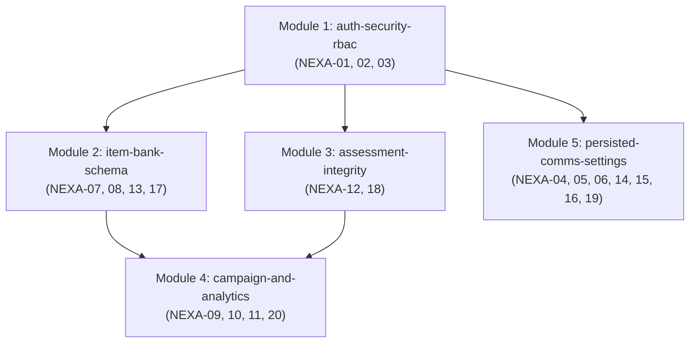

# ĐẶC TẢ KỸ THUẬT KHẮC PHỤC TOÀN DIỆN 3 DASHBOARD (BẢN REVIEW `ce74dea`)
## NEXA AI — SPECIFICATION FOR TRUE RUNTIME FIDELITY & SECURITY REMEDIATION

> **Phiên bản:** 1.0.0 · **Trạng thái:** DRAFT (Chờ phê duyệt)  
> **Tài liệu gốc đối chiếu:** `NEXA_REVIEW_2026-10-31_ce74dea.md` (Commit `ce74dea`)  
> **Quy chuẩn bắt buộc:** Tuân thủ tuyệt đối [AGENTS.md](file:///c:/nexa/AGENTS.md) và kỹ năng [/spec-driven-development](file:///c:/nexa/.agents/skills/spec-driven-development/SKILL.md).  
> **Nguyên tắc xuyên suốt:** **"Lưu thật, gửi thật, phân quyền thật, số liệu thật"** — Xóa bỏ triệt để mọi hành vi mock, timeout giả lập thành công, hardcode số liệu hoặc lệch schema.

---

## 1. Mục tiêu (Objective)

Đợt nâng cấp tại commit `ce74dea` đã hoàn thiện cấu trúc giao diện 3 Dashboard (Personal, Organization, Platform Admin). Tuy nhiên, bản kiểm toán độc lập đã chỉ ra 20 điểm nghẽn (`NEXA-01` $\rightarrow$ `NEXA-20`), trong đó 13 lỗi mức **P1 (Khẩn)** về mặt logic thực thi:
1. **Kiểm soát tài khoản & phiên:** Nút buộc đăng xuất chỉ ghi audit mà không vô hiệu hóa phiên; tài khoản bị khóa (`is_suspended`) không bị chặn ở tầng middleware / server auth guard; phân quyền Admin nội bộ (`admin_role`) mới chỉ là nhãn UI.
2. **Toàn vẹn Ngân hàng câu hỏi & Bộ đề:** Form biên soạn câu hỏi và module import ghi cột JSONB `options` và enum không khớp với schema migration 13 (`question_bank_options`); thí sinh mở trang detail bộ đề bị truy vấn đáp án đúng (`is_correct`) về trình duyệt; route detail chấp nhận ID rác và fallback lấy đề ngẫu nhiên thay vì 404.
3. **Phân tách ngữ cảnh & Số liệu:** Trang chi tiết Campaign kéo bài thi theo `assessment_id` thay vì `campaign_id`, tự bịa 50 người khi danh sách rỗng; lớp của Organization bị trộn lẫn vào danh sách Personal Groups; dashboard năng lực 5 miền thiếu dữ liệu `domain_scores`.
4. **Loại bỏ giả lập thành công (Anti-Slop / Anti-Mock):** Màn hình truyền thông, cài đặt tổ chức, chuông thông báo và hòm thư góp ý đang dùng `setTimeout` và `localStorage` thay vì lưu bền vững vào PostgreSQL.

**Mục tiêu của tài liệu này:** Xác lập bản thiết kế kiến trúc chuẩn mực, capability map, schema chuẩn và tiêu chí chấp nhận cho toàn bộ 20 phát hiện, đảm bảo hệ thống đạt độ tin cậy cấp production.

---

## 2. Các giả định kỹ thuật (Assumptions)

Trước khi tiến hành lập kế hoạch và triển khai code, các giả định sau được xác lập:

1. **Database Migrations:** Mọi thay đổi cấu trúc bảng, RLS và hàm RPC sẽ được triển khai thông qua các file migration mới (từ `34_*.sql` trở đi). **Tuyệt đối không sửa đổi các file migration lịch sử (từ 01 đến 33)** đã được áp dụng.
2. **Chính sách 3 gói thương mại:** Chỉ tồn tại duy nhất 3 gói sản phẩm: **`FREE`**, **`PRO`** (dành cho Cá nhân), và **`BUSINESS`** (dành cho Tổ chức theo hợp đồng). Toàn bộ các định danh cũ (`ENTERPRISE`, v.v.) chỉ là enum kỹ thuật tương thích nội bộ và phải được ánh xạ chuẩn xác ở tầng trình diễn.
3. **Khung 5 miền DigComp:** Hệ thống chỉ đánh giá, chấm điểm và báo cáo trên đúng **5 miền năng lực số**. Điểm số từng miền chỉ có giá trị khi có bằng chứng/câu hỏi được chấm hợp lệ; nếu chưa có, giá trị bắt buộc là `null` (không thay bằng `0`).
4. **Phân quyền Server-Side:** Không tin tưởng bất kỳ tham số hay trạng thái nào gửi từ client. Mọi hành động nhạy cảm (khóa tài khoản, xem đáp án, lưu đề, chấm điểm, duyệt bài, xuất báo cáo) đều phải được kiểm tra quyền sở hữu và vai trò qua Supabase Auth và Session Token trên server.

---

## 3. Capability Map & Thứ tự thực hiện (Build Order)

Hệ thống các vấn đề được phân rã thành 5 Module độc lập:



| Module ID | Trách nhiệm cốt lõi | Phụ thuộc | Findings giải quyết |
| :--- | :--- | :--- | :--- |
| **`auth-security-rbac`** | Thu hồi phiên thật, cưỡng chế cờ khóa tài khoản trên mọi request, phân quyền Admin nội bộ theo action. | *Không* | `NEXA-01`, `NEXA-02`, `NEXA-03` |
| **`item-bank-schema`** | Thống nhất Canonical Schema cho ngân hàng câu hỏi, hỗ trợ Personal creator, chuẩn hóa Importer & Editor. | `auth-security-rbac` | `NEXA-07`, `NEXA-08`, `NEXA-13`, `NEXA-17` |
| **`assessment-integrity`** | Chặn lộ đáp án trắc nghiệm ở client, chuẩn hóa 404 cho UUID không hợp lệ, quản lý phiên bản đề thi bất biến. | `auth-security-rbac` | `NEXA-12`, `NEXA-18` |
| **`campaign-and-analytics`** | Cách ly dữ liệu Lớp Personal vs Org, lọc bài nộp chuẩn theo `campaign_id`, tổng hợp 5 miền từ rubric evidence. | `item-bank-schema`, `assessment-integrity` | `NEXA-09`, `NEXA-10`, `NEXA-11`, `NEXA-20` |
| **`persisted-comms-settings`** | Chuông thông báo lưu server, Org settings lưu DB, bảng hòm thư góp ý thật, xuất CSV server-side an toàn. | `auth-security-rbac` | `NEXA-04`, `NEXA-05`, `NEXA-06`, `NEXA-14`, `NEXA-15`, `NEXA-16`, `NEXA-19` |

---

## 4. Đặc tả chi tiết từng Module

### 4.1. Module `auth-security-rbac` (Kiểm soát phiên, Khóa tài khoản & RBAC Admin)

#### A. Thu hồi phiên người dùng (`NEXA-01`)
* **Hiện trạng lỗi:** `POST /api/admin/users` nhánh `REVOKE_SESSION` chỉ ghi log `recordAdminAudit` rồi trả `success: true`.
* **Giải pháp đặc tả:**
  1. Sử dụng Supabase Admin Client (`supabase.auth.admin.signOut(userId, 'global')`) để thu hồi toàn bộ refresh token của người dùng.
  2. Bổ sung trường `session_version INT DEFAULT 1` hoặc `tokens_revoked_at TIMESTAMPTZ` trong bảng `profiles`.
  3. Khi Admin bấm thu hồi: Cập nhật `tokens_revoked_at = NOW()` và gọi Supabase Admin Auth signOut.
  4. Server Auth Guard (`getEffectiveUser` và `middleware.ts`): Nếu `auth_time` của JWT token trước `tokens_revoked_at`, từ chối ngay lập tức với mã `401 Unauthorized`.

#### B. Cưỡng chế tài khoản bị tạm khóa (`NEXA-02`)
* **Hiện trạng lỗi:** Cờ `profiles.is_suspended` đã có nhưng `middleware.ts` và `getEffectiveUser.ts` không đọc trường này.
* **Giải pháp đặc tả:**
  1. Trong `src/middleware.ts`: Bổ sung kiểm tra `profile.is_suspended === true`. Nếu tài khoản bị khóa, tự động chuyển hướng về trang thông báo tài khoản bị tạm khóa `/account-suspended` (kèm lý do và liên hệ hỗ trợ).
  2. Trong `src/lib/auth/getEffectiveUser.ts` và các API Server Guards: Kiểm tra `is_suspended`. Nếu `true`, ném lỗi `AccountSuspendedError` (HTTP 403), chặn mọi thao tác đọc/ghi vào Personal, Org, AI Gateway, Grading, Billing.
  3. Chặn hành vi tự khóa tài khoản của chính mình đối với Super Admin cuối cùng.

#### C. Phân quyền Admin nội bộ theo năng lực hành động (`NEXA-03`)
* **Hiện trạng lỗi:** Migration 33 có enum `admin_role = SUPER_ADMIN | OPERATIONS_ADMIN | CONTENT_ADMIN | FINANCE_ADMIN | AI_OPERATOR`, nhưng API chỉ kiểm tra email whitelist chung chung.
* **Giải pháp đặc tả:**
  1. Xây dựng ma trận quyền hạt nhân (Granular Permission Matrix):
     * `SUPER_ADMIN`: Toàn quyền mọi module, là vai trò duy nhất được gán/sửa `admin_role` của nhân sự khác.
     * `OPERATIONS_ADMIN`: Quản lý Business Inquiry, Tổ chức, Thành viên, Hỗ trợ người dùng; không xem được secret AI hay cấu hình thanh toán.
     * `CONTENT_ADMIN`: Kiểm duyệt nội dung, ngân hàng đề thi hệ thống, khung năng lực 5 miền; không có quyền đối soát tài chính.
     * `FINANCE_ADMIN`: Quản lý giao dịch, đối soát ngân hàng, xuất báo cáo tài chính; không can thiệp vào AI Gateway hoặc nội dung khảo thí.
     * `AI_OPERATOR`: Giám sát hiệu năng AI, hạn mức token, latency, chi phí; không được xem PII học viên hoặc chỉnh sửa điểm số.
  2. Tạo hàm guard chuẩn: `requirePlatformPermission(permission: AdminPermission)`.

---

### 4.2. Module `item-bank-schema` (Toàn vẹn Ngân hàng câu hỏi)

#### A. Thống nhất Canonical Schema & Loại bỏ xung đột (`NEXA-07`, `NEXA-13`)
* **Hiện trạng lỗi:** Editor và Importer ghi trực tiếp các cột `options`, `rubric_definition` và enum `BEGINNER/EXPERT` vào bảng `question_bank_items`, trong khi migration 13 yêu cầu lưu các lựa chọn vào bảng con `question_bank_options` và dùng enum `FOUNDATION`, `INTERMEDIATE`, `ADVANCED`, `HIGHLY_SPECIALIZED`.
* **Giải pháp đặc tả:**
  1. Viết migration mới (Migration 34) cập nhật bảng `question_bank_items`:
     * Bổ sung cột JSONB `rubric_definition` (có kiểm tra cấu hình schema tiêu chí/thang điểm qua Zod).
     * Bổ sung cột `owner_user_id UUID REFERENCES auth.users(id)` và `scope VARCHAR(20) DEFAULT 'PERSONAL'` (`PERSONAL | ORGANIZATION | PLATFORM`).
     * Chuẩn hóa enum độ khó: Hỗ trợ ánh xạ 4 bậc chuẩn DigComp (`FOUNDATION`, `INTERMEDIATE`, `ADVANCED`, `HIGHLY_SPECIALIZED`).
  2. Tạo service dùng chung `QuestionBankWriteService`:
     * Khi lưu câu trắc nghiệm (MCQ): Thực hiện trong một Transaction nguyên tử: lưu bản ghi vào `question_bank_items`, sau đó insert đồng thời danh sách đáp án vào bảng `question_bank_options`.
     * Cả `ItemBankEditor` và `ItemBankImporter` đều bắt buộc gọi qua service này, loại bỏ hoàn toàn các lệnh insert lỏng lẻo từ client.

#### B. Phân quyền RLS cho Creator Personal (`NEXA-08`)
* **Hiện trạng lỗi:** RLS migration 13 giới hạn quyền tạo/sửa câu hỏi chỉ cho `ADMIN` và `EVALUATOR`. Người dùng thường với vai trò `LEARNER` trong gói Personal Free/Pro bị cấm tạo câu hỏi.
* **Giải pháp đặc tả:**
  1. Cập nhật RLS Policy mới cho `question_bank_items` và `question_bank_options`:
     * `SELECT`: Người dùng được xem câu hỏi do chính mình tạo (`owner_user_id = auth.uid()`), hoặc câu hỏi thuộc tổ chức họ đang tham gia, hoặc câu hỏi công khai của hệ thống (`scope = 'PLATFORM' AND status = 'APPROVED'`).
     * `INSERT / UPDATE / DELETE`: Người dùng chỉ được sửa/xóa câu hỏi do chính mình sở hữu (`owner_user_id = auth.uid()`), trừ khi là `CONTENT_ADMIN` hoặc `SUPER_ADMIN`.

#### C. Truy vết nguồn gốc & Khung 5 miền (`NEXA-17`)
* **Giải pháp đặc tả:**
  * Mỗi câu hỏi khi tạo bắt buộc phải gắn với 1 trong 5 miền năng lực (`domain_id IN ('D1', 'D2', 'D3', 'D4', 'D5')`).
  * Trạng thái câu hỏi tuân thủ vòng đời: `DRAFT` $\rightarrow$ `REVIEWED` $\rightarrow$ `APPROVED`. Câu hỏi mới do cá nhân tạo mặc định là `DRAFT` (dùng nội bộ cho cá nhân) hoặc gửi yêu cầu đóng góp lên kho chung.

---

### 4.3. Module `assessment-integrity` (Bảo mật & Toàn vẹn Bộ đề)

#### A. Bảo vệ đáp án trắc nghiệm (`NEXA-12`)
* **Hiện trạng lỗi:** Client trang detail truy vấn trực tiếp bảng `item_options` lấy cả hai trường `is_correct` và `explanation`. Nếu ID trên URL không phải UUID, hệ thống tự động chạy `.limit(1)` trả về một đề thi ngẫu nhiên.
* **Giải pháp đặc tả:**
  1. **Xử lý ID:** Kiểm tra tính hợp lệ của UUID bằng Zod/Regex. Nếu không hợp lệ $\rightarrow$ trả về `notFound()` (HTTP 404). Tuyệt đối không fallback sang `limit(1)`.
  2. **Tách biệt DTO theo ngữ cảnh người xem (Sanitized DTO):**
     * **Đối với Thí sinh / Người xem thử (Learner / Preview):** API chỉ trả về `id`, `question_text`, `options: [{ id, text }]`. Triệt tiêu hoàn toàn trường `is_correct` và `explanation` trước khi gửi về client.
     * **Đối với Người tạo đề / Quản trị viên (Creator / Assessor):** Chỉ trả về đáp án đúng khi người dùng đã được xác minh quyền sở hữu (`created_by = auth.uid()`) hoặc quyền quản lý bài thi trong tổ chức.

#### B. Phiên bản bất biến (Immutable Version Snapshot) (`NEXA-18`)
* **Hiện trạng lỗi:** Tab Versions trên UI chỉ hiển thị chuỗi tĩnh `'v1.0'`.
* **Giải pháp đặc tả:**
  * Khi bộ đề được chuyển sang trạng thái `PUBLISHED`, hệ thống tạo một Snapshot JSON cố định chứa toàn bộ danh sách câu hỏi, thứ tự, đáp án và rubric tại thời điểm phát hành.
  * Các lượt làm bài (attempts) hoặc kỳ thi (Campaigns) chỉ tham chiếu đến Snapshot này. Mọi sửa đổi sau đó của tác giả trong Ngân hàng câu hỏi sẽ không làm thay đổi nội dung của bài thi đang diễn ra.

---

### 4.4. Module `campaign-and-analytics` (Cách ly Tenant & Báo cáo 5 miền)

#### A. Cách ly Lớp học Personal và Organization (`NEXA-09`)
* **Hiện trạng lỗi:** Query danh sách lớp tại `/personal/groups` lấy tất cả các lớp người dùng tham gia mà không lọc `organization_id IS NULL`.
* **Giải pháp đặc tả:**
  * Tại `/personal/groups`: Chỉ hiển thị các nhóm học tập cá nhân độc lập (`organization_id IS NULL`).
  * Các lớp thuộc tổ chức chỉ xuất hiện tại giao diện workspace của tổ chức đó (`/org/[slug]/classes`). Nếu muốn hiển thị lối tắt, phải gắn nhãn rõ ràng: *"Thuộc tổ chức [Tên Org]"* và dẫn link trực tiếp sang `/org/[slug]/classes/[id]`.

#### B. Báo cáo Campaign chính xác theo đợt (`NEXA-10`, `NEXA-20`)
* **Hiện trạng lỗi:** Trang `/org/[slug]/campaigns/[id]` truy vấn bài nộp chỉ bằng `.eq('assessment_id', asm.id)`, dẫn đến việc gom bài thi của các đợt khác vào; `totalAssigned` tự động gán `|| 50`.
* **Giải pháp đặc tả:**
  1. Truy vấn bài nộp bắt buộc phải có điều kiện lọc kép: `.eq('campaign_id', campaign.id).eq('organization_id', org.id)`.
  2. Số lượng học viên được giao (`totalAssigned`) phải được đếm từ danh sách thành viên thực tế của các lớp được phân công trong đợt. Nếu lớp rỗng $\rightarrow$ hiển thị `0` hoặc `"Chưa có học viên"`. Cấm triệt để fallback số liệu giả.

#### C. Tổng hợp Năng lực 5 miền từ Bằng chứng Thực tế (`NEXA-11`)
* **Hiện trạng lỗi:** Trang `/org/[slug]/analytics` không tải trường `domain_scores` từ bảng bài nộp.
* **Giải pháp đặc tả:**
  1. Cập nhật câu truy vấn Analytics để trích xuất đầy đủ `domain_scores` từ các bài thi đã hoàn thành (`status = 'COMPLETED' | 'GRADED'`).
  2. Báo cáo phân tích 5 miền (Radar / Bar Chart) chỉ tính toán trên các miền có điểm số hợp lệ; miền chưa có bằng chứng khảo thí sẽ hiển thị trạng thái `Chưa có dữ liệu đánh giá` (không vẽ 0% giả).

---

### 4.5. Module `persisted-comms-settings` (Lưu trữ Bền vững & Chống Mock)

#### A. Chuông thông báo Server-Side (`NEXA-06`)
* **Hiện trạng lỗi:** `NotificationBell` dùng `localStorage` để lưu thông báo.
* **Giải pháp đặc tả:**
  1. Sử dụng bảng `user_notifications` trên database: `id`, `user_id`, `title`, `message`, `category`, `link_url`, `is_read`, `created_at`.
  2. Xây dựng API `/api/notifications` hỗ trợ: Lấy danh sách thông báo theo người dùng, đánh dấu đã đọc (`PATCH /api/notifications/[id]/read`), và đánh dấu đã đọc tất cả.
  3. Thay thế toàn bộ `localStorage` trong `NotificationBell.tsx` bằng lời gọi API server.

#### B. Cài đặt Tổ chức & Hòm thư Góp ý (`NEXA-05`, `NEXA-19`)
* **Hiện trạng lỗi:** Org Settings hardcode domain `'fpt.edu.vn', 'fe.edu.vn'`, nút Lưu và Góp ý chỉ đổi state client bằng `setTimeout`.
* **Giải pháp đặc tả:**
  1. Tạo bảng `organization_policies`: lưu allowlist domain, cấu hình chống gian lận, thời lượng làm bài theo từng `organization_id`. Bổ sung API `GET` và `PATCH` tại `/api/org/[slug]/settings`.
  2. Tạo bảng dùng chung `feedback_tickets`: lưu phản hồi của người dùng từ cả Personal, Organization và gửi về Admin Inbox thật.
  3. Loại bỏ toàn bộ `setTimeout` và cờ giả lập trong `OrgSettingsView.tsx` và `FeedbackModal.tsx`.

#### C. Trung tâm Truyền thông Admin (`NEXA-04`, `NEXA-15`, `NEXA-16`)
* **Hiện trạng lỗi:** `/admin/communications` giả lập gửi thông báo/email; xuất CSV làm ở client; secrets chưa được mã hóa.
* **Giải pháp đặc tả:**
  1. Đối với Broadcast: Lưu thông báo phát thanh vào bảng `broadcast_announcements` để người dùng nhận được qua chuông thông báo thật.
  2. Đối với Email: Nếu chưa kết nối dịch vụ email hàng loạt (SendGrid/Resend marketing queue), gắn nhãn rõ ràng: **"Tính năng đang trong lộ trình phát triển"** và khóa (disable) nút Gửi, tuyệt đối không dùng `setTimeout` để báo gửi thành công.
  3. Xuất CSV tài chính: Tạo API Server-Side `/api/admin/transactions/export` với stream dữ liệu, xử lý mã độc CSV Injection (loại bỏ ký tự `=, +, -, @` ở đầu ô) và mã hóa UTF-8 BOM cho Excel tiếng Việt.

---

## 5. Ma trận Kiểm thử Chấp nhận (Acceptance Criteria Matrix)

Mọi thay đổi code trong quá trình triển khai đều phải vượt qua 19 tiêu chí kiểm thử sau:

| Mã Kiểm Thử | Bối cảnh & Hành động | Kết quả Bắt buộc |
| :--- | :--- | :--- |
| `AUTH-SUSP-01` | Người dùng đã đăng nhập, Admin bấm KHÓA tài khoản. | Mọi request tiếp theo bị từ chối với HTTP 403, chuyển về `/account-suspended`. |
| `AUTH-REV-01` | Admin bấm BUỘC ĐĂNG XUẤT tài khoản nghi vấn. | Session cũ bị vô hiệu hóa thật sự trên server; API bảo vệ từ chối với HTTP 401. |
| `RBAC-ADMIN-01` | Tài khoản `CONTENT_ADMIN` gọi API duyệt thanh toán tài chính. | Bị từ chối với HTTP 403 Forbidden. |
| `QB-01` | Người dùng Personal Free/Pro tạo câu hỏi trắc nghiệm mới. | Lưu thành công cả câu hỏi và danh sách đáp án con vào DB; F5 không mất dữ liệu. |
| `QB-02` | Người dùng A gửi request sửa câu hỏi do Người dùng B tạo. | Bị RLS chặn với HTTP 403/Policy Denied. |
| `QB-03` | Nhập file câu hỏi có 1 câu bị lỗi định dạng trên tổng số 10 câu. | Báo cáo chính xác lỗi tại dòng sai; không tạo dữ liệu rác mồ côi (orphan records). |
| `ASM-DETAIL-01` | Người dùng truy cập đường dẫn `/personal/assessments/invalid-uuid`. | Hệ thống trả về trang 404 Not Found; không mở đề ngẫu nhiên. |
| `ASM-ANSWER-01` | Thí sinh mở trang làm bài hoặc preview đề thi. | Dữ liệu trả về client tuyệt đối không chứa trường `is_correct` hay giải thích đáp án. |
| `CLASS-SCOPE-01` | Người dùng vừa có lớp cá nhân vừa tham gia lớp của Tổ chức. | Màn hình `/personal/groups` chỉ hiển thị lớp cá nhân; lớp tổ chức nằm trong `/org/[slug]`. |
| `CAMP-01` | Hai Campaign khác nhau cùng sử dụng một bộ đề thi mẫu. | Màn hình chi tiết của từng Campaign chỉ hiển thị bài nộp của đúng đợt đó. |
| `CAMP-02` | Tổ chức A và Tổ chức B cùng dùng chung một bộ đề chuẩn hệ thống. | Tổ chức A tuyệt đối không xem được danh sách hay điểm thi của thí sinh thuộc Tổ chức B. |
| `CAMP-03` | Mở xem chi tiết Campaign vừa tạo chưa có học viên nào tham gia. | Hiển thị số lượng giao bài là `0`, không xuất hiện con số 50 giả. |
| `ORG-SETTING-01` | Quản trị viên Tổ chức thay đổi chính sách allowlist domain và lưu lại. | Dữ liệu được ghi vào DB; tải lại trang hoặc mở trên thiết bị khác vẫn giữ nguyên. |
| `ORG-SETTING-02` | Thành viên thông thường (`MEMBER`) gửi request PATCH sửa cài đặt tổ chức. | Bị từ chối với HTTP 403 Forbidden. |
| `ORG-INVT-01` | Hai thao tác chấp nhận lời mời tham gia gửi đồng thời cùng 1 token. | Xử lý nguyên tử (Idempotent): chỉ 1 lời mời được chấp nhận, trừ đúng 1 ghế (seat). |
| `COMP-01` | Bài thi chỉ có câu hỏi thuộc Miền 1 (D1) và Miền 4 (D4). | Báo cáo chỉ hiển thị điểm D1 và D4; các miền D2, D3, D5 có giá trị `null` (không vẽ 0% giả). |
| `NOTIF-01` | Giảng viên giao bài tập mới cho học viên. | Chuông thông báo của học viên hiển thị thông báo mới từ database; đồng bộ trạng thái đọc. |
| `FEEDBACK-01` | Người dùng gửi thư góp ý từ Personal hoặc Org Dashboard. | Bản ghi được tạo trong bảng `feedback_tickets` và hiển thị trong Inbox của Platform Admin. |
| `PAY-CSV-01` | Admin Finance xuất danh sách 500+ giao dịch chứa ký tự đặc biệt (`=cmd...`). | File CSV tải về an toàn, vô hiệu hóa mã độc CSV Injection, hỗ trợ font tiếng Việt UTF-8. |

---

## 6. Lệnh Kiểm thử & Xác minh (Verification Commands)

Sau khi hoàn tất từng phần việc, hệ thống bắt buộc phải vượt qua các lệnh kiểm tra sau:

```bash
# 1. Kiểm tra toàn bộ kiểu dữ liệu TypeScript (0 lỗi)
npm run typecheck

# 2. Chạy toàn bộ bộ kiểm thử tự động (Unit & Integration Tests)
npm run test

# 3. Chạy kiểm tra quy chuẩn mã nguồn ESLint
npm run lint

# 4. Kiểm tra khả năng biên dịch sản phẩm hoàn chỉnh
npm run build
```

---

## 7. Phê duyệt & Bước tiếp theo

Tài liệu Đặc tả Kỹ thuật này đã phân loại toàn bộ 20 phát hiện từ bản review và thiết lập kế hoạch giải quyết triệt để.

* **Bước tiếp theo:** Sau khi bạn xem xét và phê duyệt Đặc tả này, chúng ta sẽ chuyển sang bước lập kế hoạch thực thi chi tiết (`/planning-and-task-breakdown`) để tiến hành hiện thực hóa code cho từng Module theo đúng thứ tự phụ thuộc.
