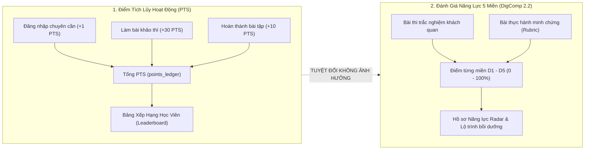
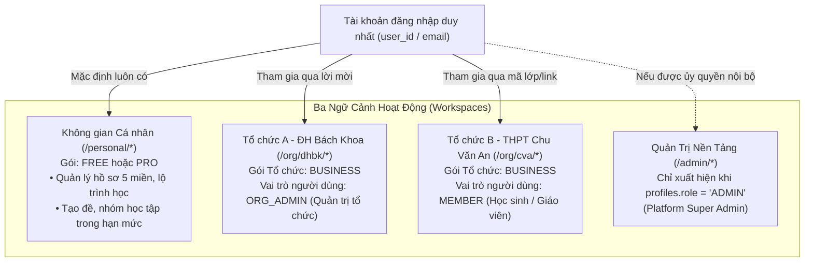

# Báo Cáo Đánh Giá (Review): Đề Xuất Chuẩn Hóa PTS, Xếp Hạng & Tài Khoản Đa Không Gian

> **Tài liệu được review:** [`NEXA_PTS_VA_KHONG_GIAN_PERSONAL_ORG_2026-10-31.md`](file:///c:/Users/CPS/Downloads/NEXA_PTS_VA_KHONG_GIAN_PERSONAL_ORG_2026-10-31.md)  
> **Người thực hiện review:** AI Coding Agent — NEXA AI  
> **Thời điểm review:** 31/10/2026  
> **Trạng thái kết luận:** **RẤT HỢP LÝ, KHẢ THI CAO VÀ ĐÚNG ĐẮN VỀ MẶT KIẾN TRÚC.**

---

## 1. Kết Luận Tổng Quan

Đề xuất trong tài liệu `NEXA_PTS_VA_KHONG_GIAN_PERSONAL_ORG_2026-10-31.md` **hoàn toàn hợp lý, chuẩn mực và đồng thuận 100% với tôn chỉ kiến trúc trong [`AGENTS.md`](file:///c:/nexa/AGENTS.md)**. 

Tài liệu đã giải quyết triệt để 4 câu hỏi lớn về thiết kế nghiệp vụ và UX mà hệ thống cần chốt chặn:
1. **Tách bạch hoàn toàn giữa Điểm hoạt động (PTS) và Điểm năng lực 5 miền DigComp:** Chấm dứt tình trạng người dùng hoặc thuật toán nhầm lẫn giữa điểm cày cuốc (gamification XP/PTS) với bằng chứng năng lực số thực tế (D1–D5).
2. **Khẳng định nguyên lý "Ba không gian, một danh tính":** Không có khái niệm "nâng cấp tài khoản cá nhân thành công ty". Mỗi người dùng có một `user_id`, luôn sở hữu không gian Personal (`FREE` hoặc `PRO`), và được mời tham gia vào các Tổ chức (`BUSINESS`) với các vai trò độc lập.
3. **Chuẩn hóa 3 gói thương mại:** Chỉ tồn tại `FREE`, `PRO` (thuộc Personal) và `BUSINESS` (thuộc Organization theo hợp đồng). `ORG_ADMIN`, `ASSESSOR`... chỉ là **vai trò** trong tổ chức, không phải gói.
4. **UX Menu Avatar tinh tế:** Phân cấp rõ ràng giữa gói cá nhân và các tổ chức trực thuộc, loại bỏ chữ dài dòng và hiển thị chính xác trạng thái từng workspace.

---

## 2. Đối Chiếu Bằng Chứng Mã Nguồn Hiện Trạng (Codebase Evidence)

| Đề xuất trong tài liệu | Hiện trạng trong Codebase | Mức độ phù hợp & Đánh giá |
| :--- | :--- | :--- |
| **1. Đổi `XP` thành `PTS` trên UI, giữ nguyên cột DB `points`** | CSDL đang dùng bảng `profiles.points` và `point_ledger` ([point-ledger.service.ts](file:///c:/nexa/src/features/gamification/services/point-ledger.service.ts)). Trên UI [dashboard/page.tsx](file:///c:/nexa/src/app/(dashboard)/personal/dashboard/page.tsx) dòng 361 và 685 vẫn còn sót nhãn `(XP)` và `+30 XP`. | **Rất hợp lý.** Giữ nguyên schema CSDL `points`, chỉ thay nhãn hiển thị UI thành `PTS` là phương án tối ưu, không gây breaking change. |
| **2. Bảng xếp hạng chỉ dựa trên PTS hợp lệ** | Trong [api/leaderboard/route.ts](file:///c:/nexa/src/app/api/leaderboard/route.ts) dòng 51 đang order thứ cấp bằng `avg_competency_score`. | **Hợp lý.** Cần loại bỏ `avg_competency_score` khỏi sắp xếp leaderboard để bảo đảm tính minh bạch: bảng xếp hạng hoạt động chỉ tính theo PTS. |
| **3. Không nâng tài khoản cá nhân thành tài khoản tổ chức** | Codebase đã có bảng riêng `organizations`, `organization_memberships`, `organization_entitlements`. API [accept-invite/route.ts](file:///c:/nexa/src/app/api/organizations/accept-invite/route.ts) đã ghi nhận theo cặp `(user_id, organization_id)`. | **Hoàn toàn khớp kiến trúc.** CSDL và RLS đã được thiết kế sẵn sàng cho mô hình này. |
| **4. Chỉ 3 gói thương mại: `FREE`, `PRO`, `BUSINESS`** | Trong [quota-enforcement.service.ts](file:///c:/nexa/src/features/billing/services/quota-enforcement.service.ts) dòng 5 còn enum `'ENTERPRISE'`, và gán `organizationId ? 'ENTERPRISE' : planTier`. | **Cần chuẩn hóa nhãn.** Cần đồng bộ tên gọi gói tổ chức thống nhất là `BUSINESS` thay vì dùng lẫn lộn Enterprise. |
| **5. Menu Avatar hiển thị `[Vai trò] · BUSINESS`** | Trong [AvatarWorkspaceSection.tsx](file:///c:/nexa/src/components/dashboard/AvatarWorkspaceSection.tsx), menu đang hiển thị `Cá nhân (Personal)` và nhãn vai trò đơn lẻ `ROLE_LABELS[ws.role]`. | **Cải tiến UX rất tốt.** Hiển thị `Cá nhân` (kèm FREE/PRO) và dòng Org là `[Tên Org] - Quản trị tổ chức · BUSINESS` sẽ giúp người dùng hiểu rõ ngữ cảnh. |

---

## 3. Phân Tích Sâu Các Trụ Cột Đề Xuất

### 3.1. Trụ Cột 1: Đổi `XP` thành `PTS` (Points)



- **Tính hợp lý:** `PTS` (Points) là điểm ghi nhận sự siêng năng, tương tác và luyện tập của người học. Điểm năng lực số (D1–D5) là thước đo chuẩn hóa theo DigComp. Hai đại lượng này có bản chất toán học và sư phạm hoàn toàn khác nhau.
- **Quy tắc kỹ thuật cần giữ:**
  - Không đổi tên cột CSDL `points` $\rightarrow$ Tránh migration rủi ro.
  - Mỗi sự kiện cộng PTS phải có `idempotency_key` (đã có trong `point_ledger`).
  - Điểm khảo thí nếu bị giám khảo/admin hủy bỏ do gian lận thì phải có giao dịch bù trừ (hồi tố) trừ lại PTS tương ứng.

---

### 3.2. Trụ Cột 2: Kiến Trúc "Một Danh Tính — Ba Không Gian"



- **Trả lời câu hỏi của người dùng: "Có cần tài khoản Personal trước khi làm quản trị viên tổ chức?"**
  - **Về mặt kỹ thuật:** Để đăng nhập, hệ thống cần một bản ghi `auth.users` và `profiles`. Nhưng **khách hàng doanh nghiệp/trường học không cần phải tự đăng ký trước khi ký hợp đồng**.
  - **Quy trình chuẩn hóa:**
    1. Khi hợp đồng Business được duyệt, Platform Admin tạo Organization và gửi lời mời đến email người đại diện.
    2. Nếu email đó **chưa có tài khoản**: Link mời dẫn đến trang đăng ký và xác minh email, sau đó tự động gán `ORG_OWNER` vào Org đó.
    3. Nếu email đó **đã có tài khoản**: Đăng nhập vào và xác nhận lời mời, lập tức nhận quyền `ORG_OWNER`.
    4. Không gian Personal của họ vẫn giữ nguyên (nếu đang FREE thì vẫn là FREE, nếu đang PRO thì vẫn là PRO). Họ vào Org với tư cách chủ sở hữu gói Business của trường/công ty.

---

### 3.3. Trụ Cột 3: Tinh Chỉnh UX Menu Avatar

Đề xuất giao diện Avatar Menu trong tài liệu:
```text
┌───────────────────────────────────────────────┐
│  [Ảnh]  Học Viên Nexa                         │
│          learner@nexa.edu.vn                  │
├───────────────────────────────────────────────┤
│  GÓI CÁ NHÂN: FREE            [Nâng cấp PRO]  │
├───────────────────────────────────────────────┤
│  KHÔNG GIAN LÀM VIỆC                          │
│  ✓  Cá nhân                     FREE          │
│     Trường Đại học Sư phạm                    │
│       Quản trị tổ chức · BUSINESS             │
│     Trường THPT Chuyên                        │
│       Thành viên · BUSINESS                   │
│     Quản trị nền tảng NEXA   [chỉ khi là Admin]│
├───────────────────────────────────────────────┤
│  Hồ sơ & Năng lực 5 miền                      │
│  Cài đặt tài khoản                            │
│  Góp ý kiến                                   │
│  Đăng xuất                                    │
└───────────────────────────────────────────────┘
```
- **Điểm ưu việt:**
  - Ngắn gọn, không lặp từ (thay vì "Cá nhân (Personal)" dài dòng, chỉ dùng "Cá nhân").
  - Phân định rõ ràng: `BUSINESS` là gói của tổ chức, gắn liền với tên tổ chức và vai trò của người dùng trong tổ chức đó.
  - Phía trên giữ thẻ Gói cá nhân và CTA Nâng cấp PRO.
  - Phía dưới là bộ chọn Không gian làm việc.

---

## 4. Kế Hoạch Triển Khai Theo Chuẩn `/planning-and-task-breakdown`

Nếu được phê duyệt triển khai, khối lượng công việc được chia thành **3 Lát Cắt Dọc (Vertical Slices)** độc lập, kiểm thử được ngay:

### Lát Cắt 1: Chuẩn Hóa Nhãn `PTS` Trên Toàn Bộ Giao Diện (Scope: S — 3 files)
- **Mục tiêu:** Đồng bộ toàn bộ chữ `XP` thành `PTS`, sửa nhãn điểm tích lũy.
- **Công việc:**
  - Sửa [personal/dashboard/page.tsx](file:///c:/nexa/src/app/(dashboard)/personal/dashboard/page.tsx): Đổi `(XP)` $\rightarrow$ `(PTS)`, `+30 XP` $\rightarrow$ `+30 PTS`, `{points} điểm` $\rightarrow$ `{points} PTS`.
  - Sửa [PersonalTopbar.tsx](file:///c:/nexa/src/components/dashboard/personal/PersonalTopbar.tsx): Hiển thị `{points} PTS`.
  - Sửa [leaderboard/page.tsx](file:///c:/nexa/src/app/(dashboard)/personal/leaderboard/page.tsx): Đổi toàn bộ nhãn hiển thị cột điểm sang `PTS`.
- **Tiêu chí nghiệm thu (Acceptance Criteria):**
  - [ ] Không còn bất kỳ chữ `XP` nào xuất hiện trên giao diện Personal.
  - [ ] Điểm số hiển thị đồng nhất dạng `X PTS`.
  - [ ] `npm test` và `npm run build` thành công 100%.

### Lát Cắt 2: Chuẩn Hóa Logic Xếp Hạng Chỉ Theo PTS (Scope: S — 2 files)
- **Mục tiêu:** Xếp hạng thuần túy theo tổng điểm PTS tích lũy, minh bạch tiêu chí đồng hạng.
- **Công việc:**
  - Sửa [src/app/api/leaderboard/route.ts](file:///c:/nexa/src/app/api/leaderboard/route.ts): Bỏ `order('avg_competency_score')`, sắp xếp theo `points DESC, created_at ASC`.
  - Bổ sung unit test xác minh: Học viên có PTS cao hơn luôn đứng trước, bất kể điểm trung bình năng lực 5 miền.
- **Tiêu chí nghiệm thu:**
  - [ ] API trả về danh sách xếp hạng chính xác theo PTS.
  - [ ] Điểm số 5 miền DigComp không can thiệp vào thứ hạng gamification.

### Lát Cắt 3: Cập Nhật UX Menu Avatar Theo Đúng Chuẩn Đề Xuất (Scope: S — 2 files)
- **Mục tiêu:** Tinh chỉnh nhãn hiển thị trong Avatar Menu khớp 100% với bản đặc tả.
- **Công việc:**
  - Cập nhật [AvatarWorkspaceSection.tsx](file:///c:/nexa/src/components/dashboard/AvatarWorkspaceSection.tsx):
    - Dòng cá nhân: Đổi thành `Cá nhân` (badge `FREE` hoặc `PRO`).
    - Dòng tổ chức: Hiển thị định dạng `[Tên Org] — [Vai trò tiếng Việt] · BUSINESS`.
    - Dòng admin: Hiển thị `Quản trị nền tảng NEXA` (badge `ADMIN`).
- **Tiêu chí nghiệm thu:**
  - [ ] Menu hiển thị đúng nhãn súc tích, sang trọng.
  - [ ] Chuyển đổi workspace mượt mà, lưu cookie và chuyển hướng chuẩn xác.

---

## 5. Kết Luận & Khuyến Nghị

1. **Văn bản `NEXA_PTS_VA_KHONG_GIAN_PERSONAL_ORG_2026-10-31.md` hoàn toàn hợp lý, chuẩn mực và sẵn sàng làm căn cứ thực hiện.**
2. **Không có bất kỳ rủi ro phá vỡ cấu trúc cơ sở dữ liệu** vì đề xuất tôn trọng nguyên tắc bảo toàn schema (`points` giữ nguyên cột, `points_ledger` giữ nguyên, RLS giữ nguyên).
3. **Phạm vi tác động thực tế rất gọn (chủ yếu là UI Copywriting, Menu Avatar format và tinh chỉnh query Leaderboard)**.
4. **Hành động đề xuất:** Khi bạn sẵn sàng, bạn có thể ra lệnh cho tôi tiến hành áp dụng 3 lát cắt trên vào codebase.
