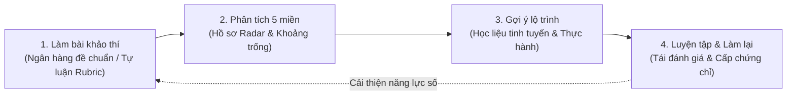
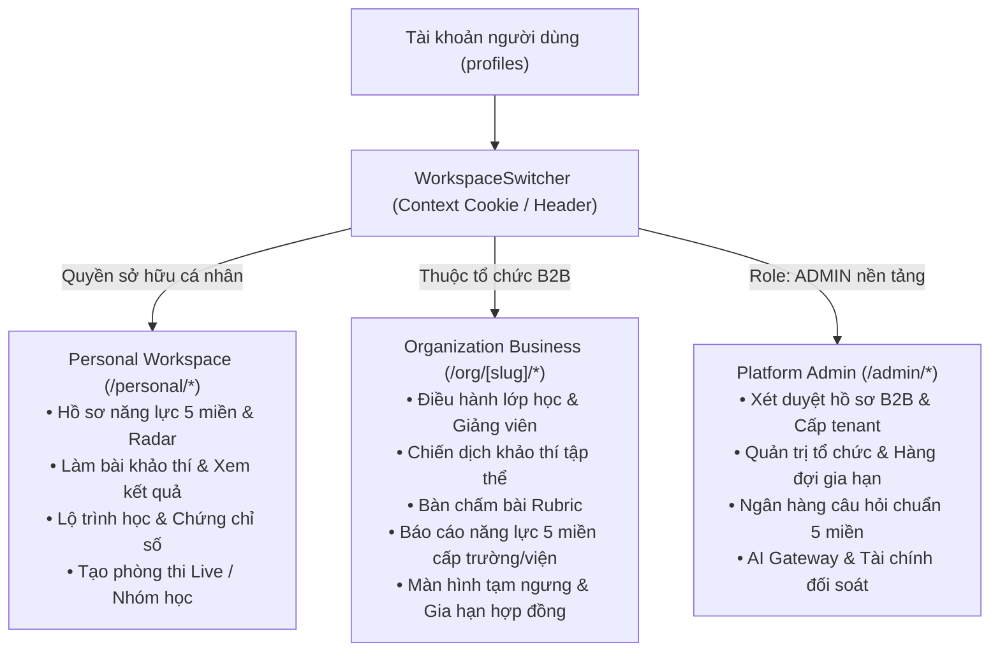
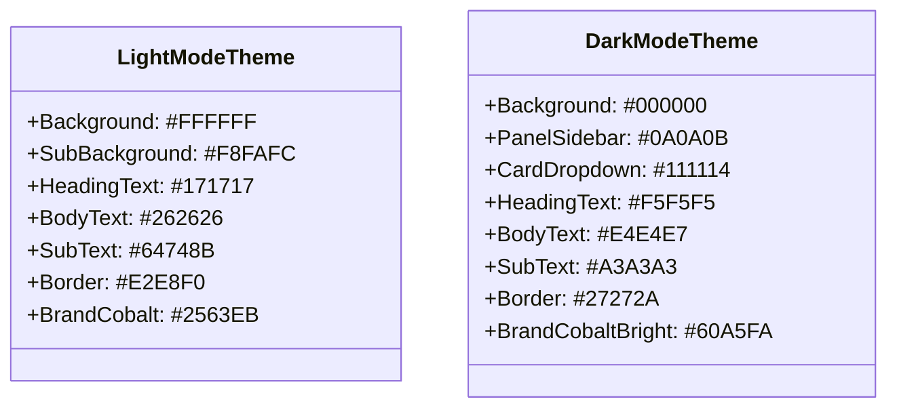

# BÁO CÁO REVIEW TOÀN DIỆN HỆ THỐNG NEXA AI
**Thời điểm đánh giá:** Tháng 11/2026  
**Phiên bản mã nguồn:** Next.js 15.2 · React 19 · TypeScript 5.7 · Supabase PostgreSQL  
**Trạng thái kiểm thử:** 63/63 test suites passed (430/430 tests) · TypeScript 0 errors  

---

## 1. TỔNG QUAN HIỆN TRẠNG & BẢN CHẤT SẢN PHẨM

### 1.1. Bản chất cốt lõi của NEXA AI
NEXA AI là **nền tảng đánh giá và phát triển năng lực số**, vận hành theo chu trình khép kín:
> **Đánh giá có bằng chứng → Phát hiện khoảng trống năng lực → Gợi ý lộ trình đào tạo → Thực hành/Luyện tập → Đánh giá lại**.

Hệ thống **không phải là sàn thương mại bán khóa học**, không ưu tiên đề xuất trả phí và không hiển thị các số liệu thống kê ảo. Các số liệu đánh giá phản ánh chính xác bằng chứng khảo thí thực tế của người học.

### 1.2. Tech Stack & Chỉ số kỹ thuật thực tế
* **Frontend:** React 19 & Next.js 15.2.1 (App Router), kết hợp Server Components và Client Components.
* **Styling & Design System:** Tailwind CSS v4, globals.css định nghĩa CSS custom tokens chuẩn WCAG AA cho cả Light Mode (`#FFFFFF`) và Dark Mode (`#000000`). Vector icons chuẩn từ lucide-react.
* **Database & Auth:** Supabase SSR 0.5.2 với PostgreSQL, Row-Level Security (RLS) bảo vệ từng tenant, Database Triggers quản lý profile và phân quyền.
* **Email Service:** Transactional Email REST client qua Resend API (HTML template branded NEXA, cơ chế safe fallback khi thiếu key).
* **Tài chính & Thanh toán:** PayOS Node SDK xử lý webhook chữ ký bảo mật cho các gói nâng cấp Personal Pro.
* **AI Engine:** @google/genai 2.30.0 tích hợp đa mô hình Gemini với PII-scrubber, bộ kiểm duyệt nội dung và chấm điểm tự luận theo Rubric.
* **Chứng chỉ số:** pdf-lib 1.17.1 sinh trực tiếp file PDF chứng chỉ chuẩn in ấn, mã QR xác minh công khai và chữ ký số SHA-256 kép.

---

## 2. KIẾN TRÚC "BA KHÔNG GIAN, MỘT DANH TÍNH"

Hệ thống thiết kế theo nguyên lý **Một tài khoản đăng nhập duy nhất** có thể hoạt động trong ba không gian làm việc độc lập. Việc chuyển đổi giữa các không gian là **đổi ngữ cảnh (context switching)**, không thay đổi loại tài khoản.

### 2.1. Phân tích chi tiết từng không gian

| Đặc tính | Personal Workspace (`/personal/*`) | Organization Workspace (`/org/[slug]/*`) | Platform Admin (`/admin/*`) |
| :--- | :--- | :--- | :--- |
| **Đối tượng** | Học viên cá nhân, giáo viên tự do, người tự khảo thí | Trường Đại học, Cao đẳng, Doanh nghiệp đào tạo nội bộ | Ban điều hành & Đội ngũ kỹ thuật NEXA AI |
| **Cơ chế quyền** | Theo quyền sở hữu tài nguyên cá nhân và gói [FREE / PRO] | Theo membership trong user_organizations (`ORG_OWNER`, `ORG_ADMIN`, `ASSESSOR`) | Đặc quyền nền tảng bảo vệ bởi requirePlatformAdmin |
| **Ranh giới dữ liệu** | Điểm số, bài làm và đề tự tạo thuộc sở hữu cá nhân | Chỉ hiển thị dữ liệu của tổ chức hiện tại; cách ly hoàn toàn giữa các tenant | Toàn quyền kiểm tra hệ thống, phê duyệt B2B nhưng không can thiệp trái phép vào nội dung riêng |
| **Xử lý trạng thái ngưng** | Miễn phí hoặc hết hạn PRO về lại FREE | Hiển thị OrgSuspendedView, bảo toàn 100% dữ liệu, có nút gửi gia hạn | Khóa/Mở tenant, duyệt yêu cầu gia hạn từ hàng đợi |

---

## 3. KHUNG ĐÁNH GIÁ 5 MIỀN NĂNG LỰC SỐ

### 3.1. Quy tắc hiển thị giao diện chuẩn
* **Không phô bày thuật ngữ kỹ thuật**: Tuyệt đối không đưa các mã chuẩn quốc tế hay số hiệu phiên bản (`DigComp`, `DigComp 2.2`, v.v.) lên UI để tránh gây rối người dùng. Trên toàn bộ giao diện chỉ sử dụng tên gọi tự nhiên: **"5 miền năng lực số"**, **"Khung năng lực số 5 miền"** hoặc **"Hồ sơ năng lực 5 miền"**.
* **5 Miền năng lực số chính thức:**
  1. **Thông tin và dữ liệu** (Information & Data Literacy)
  2. **Giao tiếp và hợp tác** (Communication & Collaboration)
  3. **Sáng tạo nội dung số** (Digital Content Creation)
  4. **An toàn và bảo mật** (Safety & Security)
  5. **Giải quyết vấn đề** (Problem Solving)

### 3.2. Tính toán điểm số & Radar Chart
* **Phân định rõ giá trị:**
  * `score: null` ➔ **Chưa có bằng chứng khảo thí hợp lệ**. Radar chart không vẽ điểm giả 0%.
  * `score: 0` ➔ **Đã hoàn thành đánh giá hợp lệ nhưng kết quả là 0 điểm**.
* **Không gán điểm tổng bài cho cả 5 miền**: Mỗi câu hỏi hoặc tiêu chí Rubric chỉ đóng góp điểm vào đúng miền năng lực mà nó ánh xạ (được kiểm chứng tại `scoring-and-radar.test.ts`).

---

## 4. REVIEW BẢO MẬT, PHÂN QUYỀN & MULTI-TENANCY

### 4.1. Row-Level Security (RLS) & Kiểm soát truy cập
Hệ thống áp dụng chính sách bảo mật nhiều lớp:
1. **RLS Database:**
   * Các bảng nhạy cảm như `organizations`, `user_organizations`, `assessments`, `classes`, `renewal_requests` đều có RLS bật (`ALTER TABLE ... ENABLE ROW LEVEL SECURITY`).
   * Chính sách truy cập kiểm tra theo `auth.uid()` và quan hệ trong `user_organizations`.
2. **Server-side Route Guard:**
   * Platform Admin được bảo vệ bằng `requirePlatformAdmin()`, chặn ngay lập tức 401/403 trước khi thực thi business logic.
   * Organization Workspace được bảo vệ bằng `requireOrgPagePermission()` và layout check tại `src/app/(dashboard)/org/[slug]/layout.tsx`.

### 4.2. Luồng tạo tổ chức B2B & Kích hoạt Owner an toàn
Khi Platform Admin tạo tổ chức mới hoặc duyệt hồ sơ B2B:
* **Nếu Email đã có tài khoản trên hệ thống:** Tự động nâng cấp tài khoản đó thành `ORG_OWNER` với trạng thái `ACTIVE` trong `user_organizations`, gửi email chúc mừng và kích hoạt ngay tổ chức.
* **Nếu Email chưa có tài khoản:** Khởi tạo tổ chức ở trạng thái `PENDING_OWNER`, phát hành token mời có thời hạn tại `/accept-invite?token=...`, đồng thời cho phép Admin sao chép link dự phòng để gửi trực tiếp cho đối tác.
* **Multi-tenant Privacy Boundary:** Đã loại bỏ hoàn toàn nút "Xem Workspace" bên trong popup Admin để ngăn chặn Platform Admin vô tình xâm phạm không gian riêng tư của khách hàng.

### 4.3. Quản lý vòng đời Tenant & Chống mất mát dữ liệu
* **Tuyệt đối không xóa vĩnh viễn (Hard-delete):** Đã loại bỏ nút xóa vĩnh viễn khỏi menu thao tác của tổ chức.
* **Cơ chế Tạm ngưng & Gia hạn:**
  * Khi Admin bấm "Tạm ngưng", tổ chức chuyển sang danh sách riêng **"Tạm ngưng / Cần gia hạn"**.
  * Khi thành viên truy cập tổ chức tạm ngưng, hệ thống hiển thị màn hình `OrgSuspendedView`:
    * Khẳng định bảo toàn dữ liệu 100%.
    * Nút **"Gửi yêu cầu gia hạn dịch vụ"** mở popup `BusinessRenewalModal`.
    * Yêu cầu được gửi vào tab **"Hàng đợi gia hạn"** của Platform Admin để phê duyệt 1-click.

---

## 5. REVIEW CHUẨN MỰC GIAO DIỆN (UI/UX AUDIT)

Hệ thống tuân thủ nghiêm ngặt quy tắc giao diện SaaS học thuật, tin cậy, không rập khuôn:

### Các quy tắc đã được thực thi triệt để:
1. **Light Mode chuẩn:** Nền trang trắng tinh `#FFFFFF`, chữ chính là than chì trung tính (`#171717` / `#262626`), không dùng xanh cobalt làm màu chữ bài đọc hay tiêu đề.
2. **Dark Mode chuẩn:** Nền đen thật `#000000` (không phải xanh navy hay tím tối). Các thẻ card nổi bật nhờ viền `#27272A` và nền `#111114`.
3. **Màu xanh thương hiệu Cobalt (`#2563EB`):** Chỉ dùng làm điểm nhấn cho nút CTA chính, liên kết điều hướng và trạng thái được chọn (`active`).
4. **Chống thiết kế rập khuôn (Anti-AI Slop):** Không sử dụng gradient rực rỡ, không thẻ kính mờ (glassmorphism) quá đà, không icon emoji trong JSX sản phẩm, font chữ căn số `tabular-nums` cho số ghế, PIN, mã tham gia và thời gian.

---

## 6. PHÂN TÍCH CHI TIẾT TỪNG PHÂN HỆ CHỨC NĂNG

### 6.1. Phân hệ Xác thực & Onboarding (`(auth)`)
* **Đăng ký tài khoản (`RegisterPage`):** Đã tối ưu hóa loại bỏ ô "Biệt danh hiển thị", tự động lấy tên từ tiền tố email và kích hoạt hàm `make_unique_nickname` chống trùng lặp. Giảm số bước đăng ký xuống mức tối thiểu (Email + Mật khẩu + Điều khoản).
* **Đăng nhập (`LoginPage`):** Hỗ trợ `redirect` an toàn (chống Open Redirect) và tự động điền sẵn email khi kích hoạt qua link mời.
* **Onboarding:** Hỗ trợ thiết lập thông tin ban đầu sau khi đăng nhập qua Google OAuth.

### 6.2. Phân hệ Cá nhân (`personal`)
* **Bảng điều khiển 5 miền (`dashboard/page.tsx`):** Radar chart 5 miền năng lực số, danh sách nhiệm vụ cần làm, phân tích khoảng trống kỹ năng.
* **Lộ trình học tập (`learning-path/page.tsx`):** Khóa học tinh tuyển đề xuất dựa trên điểm yếu 5 miền, gắn nhãn học liệu và nút đánh giá lại sau khi học.
* **Khảo thí & Làm bài (`take/[id]/page.tsx`):** Giao diện làm bài thi trực quan, hỗ trợ đếm ngược thời gian, lưu trạng thái tự động và cảnh báo khi rời bài.
* **Phòng thi thời gian thực (`live/`):** Điều khiển phòng thi trực tiếp, màn hình máy chiếu (Projector) hiển thị bảng xếp hạng trực tiếp qua kết nối SSE.

### 6.3. Phân hệ Doanh nghiệp / Tổ chức (`org/[slug]`)
* **Quản trị lớp học (`classes/`):** Tạo lớp học, cấp mã tham gia (Join Code), phân công giảng viên và theo dõi tiến độ học viên theo lớp.
* **Chiến dịch khảo thí (`campaigns/`):** Tạo đợt thi theo khung thời gian, giới hạn số lần làm bài, gán đề chuẩn hoặc đề tùy chỉnh của trường.
* **Bàn chấm bài Rubric (`grading/`):** Khảo thí viên chấm bài tự luận dựa trên tiêu chí Rubric minh bạch, nhập phản hồi chi tiết cho từng miền.
* **Báo cáo phân tích tập thể (`analytics/`):** Heatmap các đơn vị/lớp, biểu đồ phân bố điểm 5 miền, phân tích xu hướng và xuất báo cáo CSV/PDF.
* **Gói dịch vụ & Gia hạn (`plan/`):** Hiển thị số ghế đã dùng/tổng số ghế, thời hạn hợp đồng và lịch sử các yêu cầu gia hạn.

### 6.4. Phân hệ Quản trị nền tảng (`admin`)
* **Tổ chức B2B (`organizations/`):** Xử lý hồ sơ đăng ký Business, tạo tổ chức & phát hành lời mời Owner, chuyển trạng thái Tạm ngưng/Kích hoạt lại, duyệt yêu cầu gia hạn từ hàng đợi.
* **Ngân hàng đề & Nội dung (`content/`):** Quản lý ngân hàng 120 câu hỏi chuẩn hóa 5 miền, duyệt đóng góp đề thi từ cộng đồng.
* **Lộ trình học tập (`learning-paths/`):** Biên tập catalog khóa học tinh tuyển, ánh xạ khóa học vào miền năng lực và cấp độ.
* **AI Gateway (`ai-gateway/`):** Giám sát chi phí token, hạn mức quota, cấu hình model fallback và kiểm soát an toàn dữ liệu cá nhân (PII).

---

## 7. ĐÁNH GIÁ CHẤT LƯỢNG MÃ NGUỒN & KIỂM THỬ

### 7.1. Báo cáo thực thi Test Suite
Chạy trực tiếp toàn bộ test suite dự án bằng lệnh `npm test`:
* **Tổng số test suites:** 63 files
* **Tổng số tests:** 430 tests
* **Kết quả:** **100% Passed (430 passed, 0 failed)**
* **Thời gian thực thi trung bình:** ~6.3 giây

### 7.2. Kiểm tra tĩnh (TypeScript & Linter)
* **TypeScript (`npm run typecheck`):** **0 lỗi**. Mọi interface và route handler đều được định kiểu chặt chẽ.
* **ESLint (`npm run lint`):** **0 lỗi (Error: 0)**.

---

## 8. CÁC PHÁT HIỆN TỒN ĐỌNG & KHUYẾN NGHỊ CẢI TIẾN

1. **Tối ưu hóa hình ảnh với `next/image`:** Một số component avatar đang dùng thẻ `` thay vì `<Image />` từ Next.js. Nên chuẩn hóa dần để tăng tốc độ tải trang (LCP).
2. **Kế hoạch di chuyển ESLint (Next.js 16):** Lệnh `next lint` đã được cảnh báo deprecated; khi nâng cấp dependencies có thể chuyển sang Flat Config `eslint.config.mjs`.
3. **Cấu hình Custom Domain cho Resend Email:** Khi triển khai domain chính thức trên Vercel, hoàn tất cấu hình DNS (SPF, DKIM) để gửi email thương hiệu trực tiếp từ tên miền riêng.

---

## 9. KẾT LUẬN

Dự án **NEXA AI** đạt mức độ hoàn thiện cao, kiến trúc tách bạch rõ ràng giữa 3 không gian làm việc, tuân thủ nghiêm ngặt nguyên tắc bảo mật và bảo toàn dữ liệu, 100% tests chạy xanh và sẵn sàng cho môi trường vận hành thực tế.
