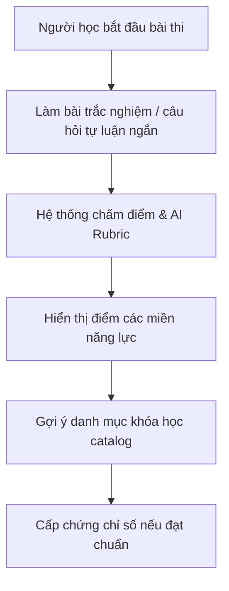
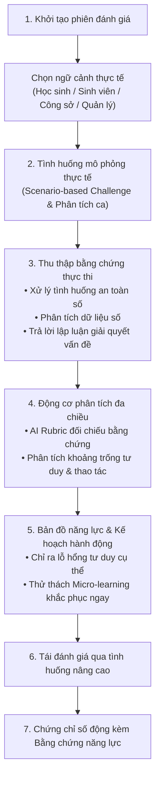

# ĐÁNH GIÁ HIỆN TRẠNG VÀ ĐỊNH HƯỚNG MÔ HÌNH ĐÁNH GIÁ NĂNG LỰC SỐ NEXA AI

Báo cáo phân tích hiện trạng kiến trúc và đề xuất định hướng mô hình đánh giá năng lực số thế hệ mới, giải quyết triệt để rủi ro "bị lặp lại như các phần mềm trắc nghiệm truyền thống".

## 1. ĐÁNH GIÁ HIỆN TRẠNG HỆ THỐNG

### 1.1. Những nền tảng vững chắc đã xây dựng thành công
Hiện tại, dự án NEXA AI đã sở hữu khung kiến trúc rất bài bản và hoàn thiện hơn đa số các hệ thống khảo thí hiện nay trên thị trường:
* **Kiến trúc Ba không gian - Một danh tính**: Phân tách rạch ròi giữa Personal Workspace (`/personal`), Organization Workspace (`/org/[slug]`) và Platform Admin (`/admin`), được bảo vệ chặt chẽ bởi Server Guards và Row-Level Security (RLS) của Supabase.
* **Cơ chế đánh giá năng lực tích lũy (Longitudinal Competency Aggregation)**: Minh chứng tại `src/features/competency/services/competency-aggregation.service.ts`. Điểm không bị tính cào bằng, chỉ tích lũy khi có bằng chứng khảo thí đạt chuẩn (>= 70%) và phân bổ chính xác theo từng miền năng lực số.
* **Chấm điểm tự luận đa tiêu chí bằng AI (AI Rubric Grading)**: Triển khai tại `src/features/assessments/services/rubric.service.ts`, kết hợp mô hình Gemini để phân tích ngữ nghĩa, chấm theo rubric phân cấp và phản hồi chi tiết cho thí sinh.
* **Hạ tầng thi trực tiếp và chống gian lận**: Đã có `src/features/assessments/hooks/useSmartProctoring.ts`, watermark động bảo mật đề thi và các chế độ phòng thi thời gian thực (`Live Room`).
* **Hệ thống cấp chứng chỉ số có mã xác minh công khai**: Triển khai tại `src/features/credentials/services/certificate-generator.service.ts` và route `src/app/verify/[credentialId]/page.tsx`.

### 1.2. Thách thức cần giải quyết
Nếu chỉ dừng lại ở trắc nghiệm khách quan 4 lựa chọn (A/B/C/D), người học rất dễ cảm thấy:
* Đơn điệu, mang tính kiểm tra trí nhớ lý thuyết thay vì đo lường năng lực số ứng dụng thực tế.
* Dễ học vẹt hoặc sử dụng công cụ AI bên ngoài để tra cứu đáp án trắc nghiệm nhanh chóng.
* Chưa thấy rõ tính "hành động" sau khi nhận báo cáo khoảng trống năng lực.

## 2. SO SÁNH LUỒNG ĐÁNH GIÁ: HIỆN TẠI VÀ ĐỀ XUẤT NÂNG CẤP

### 2.1. Luồng đánh giá hiện tại

### 2.2. Luồng đánh giá đề xuất thế hệ mới (Evidence-Driven Competency Engine)

## 3. ĐỊNH HƯỚNG MÔ HÌNH ĐÁNH GIÁ BIẾN NEXA THÀNH NỀN TẢNG ĐẶC BIỆT

Để không bị nhầm lẫn với các phần mềm trắc nghiệm cũ, mô hình đánh giá của NEXA AI nên được định vị theo 4 trụ cột chiến lược:

### Trụ cột 1: Đánh giá dựa trên tình huống thực tế (Scenario-Based Assessment)
* **Khác biệt**: Thay vì hỏi "Phishing là gì?", đưa ra một tình huống: "Một email giả mạo ngân hàng gửi đến kèm tệp đính kèm và link rút gọn. Hãy chỉ ra 3 dấu hiệu rủi ro và thực hiện các bước xử lý theo quy trình an toàn số".
* **Đo lường**: Đo lường khả năng tư duy phản biện, kỹ năng xử lý thông tin số và an toàn số trong môi trường sống và làm việc thực tế.

### Trụ cột 2: Khảo thí thích ứng thông minh (Adaptive Assessment)
* Tận dụng AI để tự động điều chỉnh độ khó của câu hỏi/tình huống tiếp theo dựa trên năng lực biểu hiện của thí sinh ngay trong phiên làm bài.
* Giúp bài thi ngắn hơn (từ 60 câu trắc nghiệm dài dòng xuống còn 15-20 tình huống sắc bén) nhưng đo lường chính xác hơn độ thành thạo của thí sinh.

### Trụ cột 3: Báo cáo khoảng trống năng lực mang tính chỉ dẫn hành động (Actionable Diagnostic Report)
* Thay vì chỉ nói "Bạn đạt 65% ở Miền An toàn và bảo mật", báo cáo sẽ chỉ rõ:
  * "Điểm mạnh: Bạn nhận diện tốt rủi ro phần mềm độc hại."
  * "Khoảng trống: Bạn chưa thành thạo phân quyền truy cập tài liệu cộng tác trên đám mây."
  * "Bài tập khắc phục 10 phút: Hoàn thành bài thực hành cấp quyền bảo mật cho thư mục dùng chung."

### Trụ cột 4: Chứng chỉ số đính kèm Portfolio bằng chứng (Living Credential)
* Chứng chỉ số của NEXA không chỉ có tên và ngày cấp, mà trang tra cứu công khai hiển thị tóm tắt năng lực thực chứng: các tình huống thí sinh đã xử lý thành công, điểm chuẩn ở từng miền năng lực số.
* Đây là giá trị mà nhà tuyển dụng và các cơ sở giáo dục đánh giá cực kỳ cao vì tính trung thực và minh bạch.

## 4. KẾT LUẬN & ĐỀ XUẤT BƯỚC ĐI TIẾP THEO

Nền tảng của bạn hiện nay đã sở hữu phần khung kiến trúc rất chuẩn mực, vững chắc và sạch sẽ. Điểm tạo nên cú hích đột phá tiếp theo sẽ là **nâng cấp nội dung câu hỏi từ trắc nghiệm lý thuyết sang ngân hàng tình huống giải quyết vấn đề số**, kết hợp sâu hơn với năng lực chấm tự luận đa tiêu chí của AI mà hệ thống đã tích hợp sẵn.
