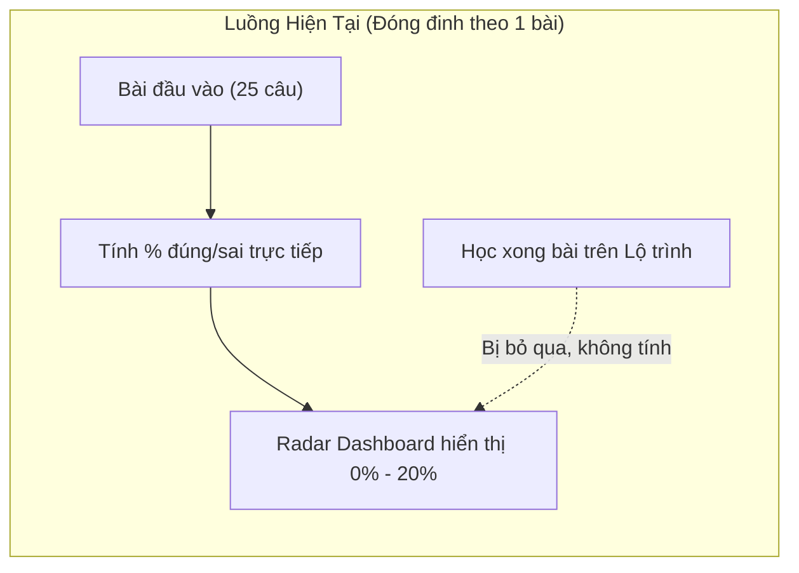
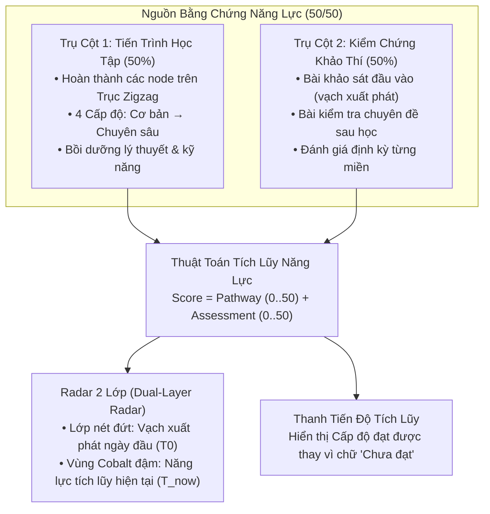

# Thiết Kế Thuật Toán Tích Lũy Năng Lực Số & Radar Tiến Bộ Lâu Dài (Longitudinal Competency Progression)

> **Trạng thái:** Đã hội tụ ý tưởng (Idea Refinement — Phase 3)  
> **Áp dụng cho:** Trang Tổng quan (`personal/dashboard`), Hồ sơ năng lực (`personal/competency`), Lộ trình bồi dưỡng (`personal/learning-path`)  
> **Mục tiêu:** Tách biệt rõ nét giữa **Ảnh chụp chẩn đoán ban đầu (Baseline Snapshot)** và **Năng lực tích lũy thực tế theo thời gian (Longitudinal Mastery)**, giúp người học nhìn thấy sự tiến bộ rõ rệt (Growth Tracking) sau từng bài học.

---

## 1. Problem Statement (Bài toán cốt lõi)

> **Làm thế nào để hệ sinh thái NEXA đo lường và phản ánh năng lực số của người học như một hành trình phát triển bền vững — nơi bài khảo sát đầu vào chỉ đóng vai trò vạch xuất phát tìm khoảng trống, còn hoạt động học tập thực tế và bài kiểm tra sau học sẽ liên tục làm nở rộng Radar 5 miền theo thời gian?**

---

## 2. Phân tích hiện trạng & Lỗ hổng (Current Architecture Audit)

### 2.1. Điểm nghẽn trong mã nguồn hiện tại
* Tại [`DomainAssessmentSummaryService.ts`](file:///c:/nexa/src/features/competency/services/domain-assessment-summary.service.ts#L187-L215):
  $$\text{Domain Score} = \frac{\sum \text{Điểm đạt được trong submission\_answers}}{\sum \text{Điểm tối đa các câu hỏi}} \times 100\%$$
* Khi người dùng mới chỉ làm **1 bài khảo thí đầu vào (Baseline 25 câu)**:
  * Miền nào làm đúng 1/5 câu $\to$ Gán luôn $20\%$ lên Dashboard.
  * Miền nào làm đúng 0/5 câu $\to$ Gán luôn $0\%$ lên Dashboard.
* **Hệ quả sư phạm & trải nghiệm:**
  1. **Tạo tâm lý tiêu cực (Deficit Mindset):** Vừa vào hệ thống đã bị dán nhãn màu đỏ rực `Chưa đạt (0%)`, `Cần cải thiện (20%)`.
  2. **Đứt gãy động lực học tập:** Người học vào Lộ trình (`learning-path`), hoàn thành các bài học, đọc tài liệu, đạt các cấp độ Cơ bản $\to$ Trung cấp... nhưng quay lại Dashboard thì điểm Radar **vẫn giậm chân tại chỗ** (vì Dashboard không đọc dữ liệu hoàn thành bài học).

---

## 3. Recommended Direction: Mô hình Tích lũy 2 Tầng (Hybrid 50/50 Model)

Năng lực của mỗi miền $D_i$ ($i \in \{1..5\}$) trên Dashboard được cấu thành từ hai trụ cột có trọng số cân bằng:

### 3.1. Công thức toán học chi tiết

$$\mathbf{S_{\text{domain}}} = \mathbf{S_{\text{pathway}}} + \mathbf{S_{\text{assessment}}}$$

#### A. Điểm Tiến trình Học tập ($S_{\text{pathway}} \in [0, 50]$):
Mỗi miền trong chương trình chuẩn hóa 5 miền gồm các kỹ năng thành phần, mỗi kỹ năng có 4 cấp độ:
* **Cấp 1: Cơ bản (Basic)**
* **Cấp 2: Trung cấp (Intermediate)**
* **Cấp 3: Nâng cao (Advanced)**
* **Cấp 4: Chuyên sâu (Highly Advanced)**

$$S_{\text{pathway}} = \left( \frac{\text{Số cấp độ đã hoàn thành trong miền}}{\text{Tổng số cấp độ của miền}} \right) \times 50$$

> *Ví dụ:* Miền 01 có 3 kỹ năng thành phần $\times 4$ cấp độ $= 12$ cấp độ. Người học hoàn thành 6 cấp độ $\to S_{\text{pathway}} = \frac{6}{12} \times 50 = 25$ điểm.

#### B. Điểm Kiểm chứng Khảo thí ($S_{\text{assessment}} \in [0, 50]$):
Được lấy từ kết quả các bài kiểm tra đánh giá có chấm điểm:
* **Khi mới bắt đầu (chỉ có bài khảo sát đầu vào):**
  Lấy tỷ lệ câu trả lời đúng của miền đó trong bài đầu vào quy đổi về thang 50 điểm:
  $$S_{\text{assessment}} = \left( \frac{\text{Số câu đúng của miền trong bài đầu vào}}{\text{Tổng số câu của miền trong bài đầu vào}} \right) \times 50$$
  *(Ví dụ: Đúng 2/5 câu miền D5 $\to S_{\text{assessment}} = \frac{2}{5} \times 50 = 20$ điểm).*
* **Khi người học làm thêm bài khảo thí chuyên đề sau học:**
  Điểm bài khảo thí chuyên sâu mới nhất của miền đó sẽ cập nhật thay thế hoặc tính trung bình trọng số thời gian, kéo điểm kiểm chứng lên tới tối đa $50$ điểm!

#### C. Tổng điểm năng lực miền ($S_{\text{domain}} \in [0, 100]$):
* Người mới làm bài đầu vào, chưa học: $S_{\text{domain}} = 0 + 20 = 20\%$ (Đúng với vạch xuất phát ban đầu).
* Người học tiếp 50% chặng học: $S_{\text{domain}} = 25 + 20 = 45\%$ (**Radar nở ra rõ rệt!**).
* Người học làm thêm bài kiểm tra đạt 80%: $S_{\text{domain}} = 25 + 40 = 65\%$ (**Tiến gần chuẩn 70%!**).
* Người học hoàn thành toàn bộ chặng và bài thi xuất sắc: $S_{\text{domain}} = 50 + 50 = 100\%$ (**Thành thạo chuyên sâu!**).

---

## 4. Thiết kế Trực Quan: Radar 2 Lớp (Dual-Layer Radar)

Trên giao diện Dashboard:
1. **Lớp 1 — Vạch xuất phát ($T_0$ - Baseline Snapshot):**
   * Đường polygon nét đứt màu xám Slate (`stroke="#94A3B8" stroke-dasharray="3 3"`).
   * Không tô nền (fill-opacity = 0).
   * Chú thích: *"Vạch xuất phát ban đầu"*.
2. **Lớp 2 — Năng lực tích lũy hiện tại ($T_{\text{now}}$ - Longitudinal Progression):**
   * Vùng polygon màu xanh Cobalt thương hiệu (`#2563EB`) có độ phủ bán trong suốt (`fill-opacity="0.25"`), viền đậm 2px và các node tròn nổi bật.
   * Chú thích: *"Năng lực tích lũy hiện tại"*.
3. **Lớp 3 — Chuẩn mục tiêu 70%:**
   * Vòng tròn chuẩn tham chiếu DigComp để người học so sánh khoảng cách đạt chuẩn.

---

## 5. Cải tiến Thanh Tiến độ 5 Miền (Progress Bar UX)

> [!IMPORTANT]
> **Tuyệt đối không dùng chữ "Cấp 1, Cấp 2, Level" cho thanh tiến độ 5 miền.**  
> Việc dùng chữ "Cấp/Level" sẽ bị **trùng lặp và gây xung đột nghiêm trọng** với **Level tài khoản (XP Level 1: Basic)** đang hiển thị trên thanh trạng thái góc trên Dashboard, cũng như vi phạm nguyên tắc phân định đại lượng độc lập trong `AGENTS.md`.

Thay vì dùng "Cấp" hay các nhãn phán xét tiêu cực (`Chưa đạt`, `Cần cải thiện`), thanh tiến độ 5 miền chỉ sử dụng **Trạng thái Năng lực Tích lũy (Competency Progression Status)** tự nhiên và khích lệ:

| Thang điểm | Nhãn cũ (Bị chê) | Nhãn mới Chuẩn hóa (Không dùng chữ Cấp/Level) | Ý nghĩa & Trải nghiệm | Màu sắc hiển thị |
| :--- | :--- | :--- | :--- | :--- |
| **$0\%$ / Chưa học** | `Chưa đạt` (Đỏ) | **`Khởi đầu`** | Điểm xuất phát ban đầu, sẵn sàng học | Slate trung tính (`#64748B`) |
| **$1\% - 69\%$** | `Cần cải thiện` (Đỏ) | **`Đang bồi dưỡng`** | Đang tích lũy bài học & tiến về chuẩn mục tiêu 70% | Cobalt Blue (`#2563EB`) |
| **$70\% - 84\%$** | `Đạt chuẩn` | **`Đạt chuẩn`** | Đã chính thức cán mốc chuẩn hóa $\ge 70\%$ | Xanh lục chuẩn (`#16A34A`) |
| **$85\% - 100\%$** | `Xuất sắc` | **`Thành thạo`** | Vượt chuẩn xuất sắc toàn diện miền | Emerald (`#059669`) |

---

## 6. Assumption Audit (Đánh giá giả định & Rủi ro)

### 6.1. Must Be True (Điều kiện tiên quyết)
* **Người học phải cảm nhận được sự tiến bộ ngay lập tức:** Khi người dùng click hoàn thành một bài học trên Lộ trình (`learning-path`), quay về Dashboard họ phải thấy thanh tiến độ miền đó tăng điểm ngay.

### 6.2. Rủi ro & Cách khắc phục
* **Rủi ro người dùng "spam click" hoàn thành để cày điểm:**
  * *Khắc phục:* Mỗi cấp độ học tập gắn liền với thời lượng đọc tối thiểu hoặc một micro-quiz kiểm tra nhanh (3 câu) để xác nhận tiếp thu trước khi đánh dấu hoàn thành.
* **Rủi ro người dùng không chịu làm bài kiểm tra sau học:**
  * Vì trần điểm của việc chỉ học mà không làm bài test là $50\%$ (chưa thể đạt chuẩn $70\%$), người học **buộc phải làm bài khảo thí chuyên đề** thì mới vượt qua được ngưỡng chuẩn $70\%$ để nhận chứng chỉ. Đây là đòn bẩy động lực rất tự nhiên!

---

## 7. Scope MVP vs Not Doing (Phạm vi tối thiểu)

### Trong phạm vi (MVP Scope):
- [x] Cập nhật service `DomainAssessmentSummaryService` để đọc thêm bảng tiến độ học tập (`completedLessonIds` / `competency_evidence`).
- [x] Áp dụng công thức 50/50: 50% tiến độ bài học + 50% điểm bài test.
- [x] Nâng cấp component `CompetencyRadarChart` hỗ trợ vẽ thêm lớp nét đứt mờ (Baseline snapshot).
- [x] Thay thế nhãn cảnh báo đỏ "Chưa đạt / Cần cải thiện" trên Dashboard bằng nhãn tiến độ cấp độ tích lũy ("Khởi đầu", "Đang bồi dưỡng Cấp 1, Cấp 2", "Đạt chuẩn").

### Không làm trong giai đoạn này (Not Doing):
- **Không cài đặt thuật toán Bayesian IRT (Item Response Theory) quá phức tạp:** Không cần thiết cho giai đoạn này, khó giải thích cho người dùng bình thường và tốn tài nguyên tính toán.
- **Không giảm điểm khi làm bài test bị điểm thấp (No Punitive Penalty):** Điểm kiểm chứng chỉ lấy bài làm có kết quả cao nhất hoặc cải thiện dần, không làm tụt điểm năng lực đã tích lũy của người học.
