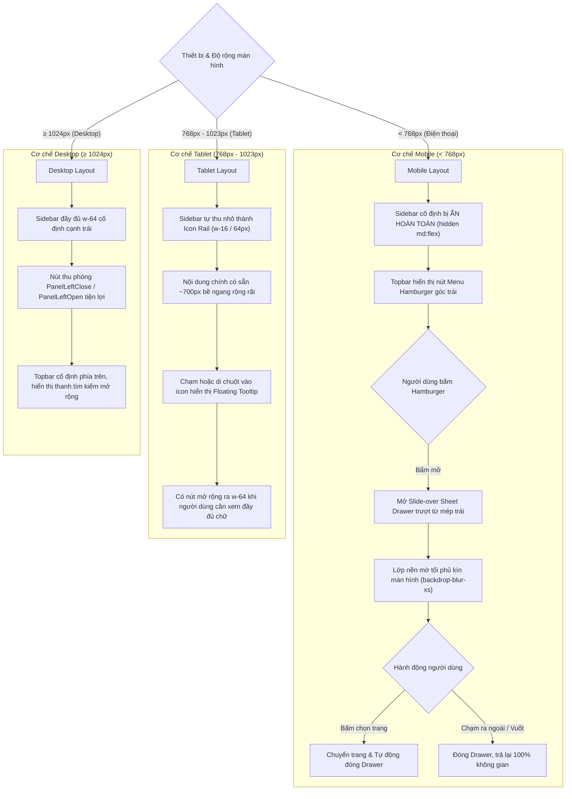
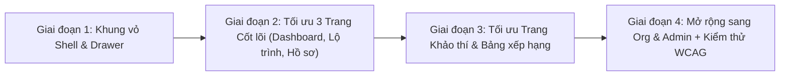

# ĐẶC TẢ KIẾN TRÚC RESPONSIVE & TỐI ƯU GIAO DIỆN ĐA THIẾT BỊ NỀN TẢNG NEXA
## Chuẩn hóa hiển thị Mobile (< 768px), Tablet (768px – 1024px) và Desktop (≥ 1024px)

---

## 1. Mục tiêu và Nguyên tắc Kiến trúc

Tài liệu này xác lập tiêu chuẩn kỹ thuật và thiết kế giao diện thích ứng (Responsive Design) toàn diện cho nền tảng NEXA AI trên cả 3 không gian làm việc:
- **Personal** (`/personal/*`) — Người học cá nhân.
- **Organization Business** (`/org/[slug]/*`) — Trường học / Doanh nghiệp.
- **Platform Admin** (`/admin/*`) — Quản trị cấp nền tảng.

### 1.1. Bảng Điểm ngắt Chuẩn (Breakpoint Matrix)

| Ký hiệu Tailwind | Dải kích thước màn hình | Thiết bị đại diện | Mô hình Sidebar | Mô hình Lưới nội dung |
| :--- | :--- | :--- | :--- | :--- |
| **Mobile (`< md`)** | `< 768px` (375px – 767px) | iPhone SE, iPhone 14/15/16, Samsung Galaxy S24 | **Slide-over Sheet Drawer** (Ẩn mặc định, mở qua nút Hamburger trên Topbar) | 1 cột (`grid-cols-1`), Padding `p-4`, Card cuộn dọc |
| **Tablet (`md` đến `lg`)** | `768px` – `1023px` | iPad Mini, iPad Air, Galaxy Tab (Portrait) | **Icon Rail (`w-16` / 64px)** (Thanh icon cố định + Tooltip chạm/hover) | 2 cột (`grid-cols-2`), Padding `p-6` |
| **Desktop (`≥ lg`)** | `≥ 1024px` (1024px – 1920px+) | iPad Pro Landscape, Laptop, Màn hình Desktop | **Sidebar đầy đủ (`w-64`)** (Có nút thu gọn về `w-16`) | 2–4 cột (`grid-cols-3` / `grid-cols-4`), Padding `p-8` |

### 1.2. Nguyên tắc Bắt buộc từ [AGENTS.md](file:///c:/nexa/AGENTS.md)
1. **Bảng màu chuẩn:** Light Mode nền trắng `#FFFFFF`, Dark Mode nền đen thật `#000000`, màu nhấn Cobalt `#2563EB`, text chính `#171717` (Light) / `#F5F5F5` (Dark).
2. **Không dùng đường viền ngang:** Tuyệt đối không dùng thẻ `<hr>` hay các đường line kẻ ngang đơn điệu; phân cách bằng khoảng cách (`space-y`), thẻ màu nền nhẹ (`bg-slate-50` / `bg-zinc-900`) hoặc viền hộp bo tròn.
3. **Khu vực bấm cảm ứng (Touch Target):** Mọi nút bấm, icon, menu item trên màn hình cảm ứng phải đạt tối thiểu $44 \times 44\text{px}$ theo chuẩn WCAG AA, tránh bấm nhầm.
4. **Không phô bày thuật ngữ DigComp trên UI:** Dùng các cụm từ tự nhiên: *"Hồ sơ năng lực số"*, *"Khung năng lực số"*, *"5 Miền năng lực số"*.

---

## 2. Kiến trúc Khung vỏ (Shell Architecture) & Điều hướng Đa thiết bị

### 2.1. Sơ đồ Hoạt động Điều hướng Sidebar Đa thiết bị



### 2.2. Hợp đồng Thiết kế Component & State Management

Để không bị phân mảnh code giữa 3 không gian (Personal, Organization, Admin), hệ thống sử dụng một hook điều hướng chia sẻ hoặc cơ chế Custom Event nhẹ:

```typescript
// src/hooks/useMobileNav.ts (hoặc Event Contract)
export const MOBILE_NAV_EVENT = 'nexa:toggle-mobile-sidebar';

export function toggleMobileSidebar(forceState?: boolean) {
  if (typeof window !== 'undefined') {
    window.dispatchEvent(
      new CustomEvent(MOBILE_NAV_EVENT, { detail: { open: forceState } })
    );
  }
}
```

#### Cấu trúc DOM chuẩn của Topbar trên Mobile:
- **Cột trái:** Nút Hamburger (`p-2.5 rounded-lg border text-neutral-800 dark:text-neutral-200 md:hidden`) + Logo Nexa nhỏ.
- **Thanh tìm kiếm:** Trên Desktop mở rộng tối đa `max-w-md`; trên Mobile co lại hoặc chuyển thành icon kính lúp mở thanh tìm kiếm overlay khi bấm.
- **Cột phải:** Điểm PTS (rút gọn trên màn hình hẹp), Chuông thông báo (Bell), Avatar người dùng.

#### Cấu trúc DOM chuẩn của Mobile Sheet Drawer:
```tsx
{/* 1. Backdrop */}
<div
  className="fixed inset-0 z-50 bg-black/60 backdrop-blur-xs transition-opacity duration-300 md:hidden"
  onClick={() => setMobileOpen(false)}
/>

{/* 2. Slide Drawer Panel */}
<aside
  className={`fixed inset-y-0 left-0 z-50 w-72 max-w-[85vw] bg-white dark:bg-[#0A0A0B] border-r border-slate-200 dark:border-zinc-800 shadow-2xl flex flex-col justify-between transition-transform duration-300 ease-in-out md:hidden ${
    mobileOpen ? 'translate-x-0' : '-translate-x-full'
  }`}
>
  {/* Header: Logo + Nút Đóng X */}
  {/* Body: Danh mục điều hướng cuộn mượt (tự đóng khi route thay đổi) */}
  {/* Footer: Hộp góp ý kiến / Đăng xuất */}
</aside>
```

---

## 3. Đặc tả Tối ưu Giao diện Từng Màn hình Trọng tâm

### 3.1. Trang Tổng quan (`/personal/dashboard`)
* **Vấn đề hiện tại:** Khối chào mừng và chỉ số XP bị chật; biểu đồ Radar 5 miền năng lực bị ép méo nếu giữ tỉ lệ 2 cột trên điện thoại.
* **Quy chuẩn Responsive:**
  * **Lưới chỉ số nhanh:** 
    * Desktop: 4 cột (`grid-cols-4`).
    * Tablet: 2 cột (`grid-cols-2 gap-4`).
    * Mobile: 1 hoặc 2 cột nhỏ (`grid-cols-1 sm:grid-cols-2 gap-3`), giảm padding trong card từ `p-5` xuống `p-4`.
  * **Khu vực Radar & Danh sách bài thi:**
    * Desktop: Chia 2 cột (Radar 40% - Bài thi đề xuất 60%).
    * Mobile & Tablet: Xếp chồng dọc 1 cột (`grid-cols-1`). Đặt Radar lên trước để người học quan sát tổng quan hồ sơ năng lực số, tiếp theo là danh sách bài thi đề xuất.
    * Biểu đồ Radar: Tự động điều chỉnh `size={Math.min(windowWidth - 48, 360)}` để không tràn màn hình điện thoại.

---

### 3.2. Trang Lộ trình Năng lực số (`/personal/learning-path`)
* **Vấn đề hiện tại:** Sơ đồ trạm kết nối SVG theo phương ngang quá dài, trên điện thoại bị tràn ngang hoặc chữ bị thu bé không đọc được.
* **Quy chuẩn Responsive:**
  * **Thanh chọn Miền năng lực:**
    * Thêm lớp `overflow-x-auto no-scrollbar flex-nowrap py-1` để người dùng có thể vuốt ngang chọn miền mượt mà trên điện thoại.
  * **Sơ đồ các trạm học tập:**
    * Desktop: Sơ đồ mạng lưới 2 hàng kết nối bằng đường cong SVG mượt mà.
    * Mobile: Chuyển sang dạng **Timeline dọc (Vertical Station Chain)**:
      * Mỗi trạm là một Card ngang đầy đủ thông tin: Mã trạm, Tên kỹ năng, Trạng thái chuẩn đạt.
      * Trục dọc nét đứt Cobalt kết nối từ trên xuống dưới, tạo cảm giác như một bản đồ hành trình từng bước.
  * **Drawer Chi tiết Trạm (Station Modal/Drawer):**
    * Desktop: Drawer trượt từ cạnh phải chiếm `w-96` hoặc `w-[480px]`.
    * Mobile: Mở dạng **Bottom Sheet** hoặc **Toàn màn hình (Fullscreen Dialog)** với nút đóng `X` lớn ở góc phải và nút *"Bắt đầu"* / *"Tài liệu"* ghim cố định ở thanh đáy (`sticky bottom-0 bg-white/95 backdrop-blur-md`).

---

### 3.3. Trang Tài liệu Chi tiết Trạm (`/personal/learning-path/docs/[skillCode]`)
* **Vấn đề hiện tại:** Cột mục lục bên phải chiếm không gian; sơ đồ luồng quy trình 4 chặng dạng card dễ bị gãy chữ.
* **Quy chuẩn Responsive:**
  * **Header:** Thanh điều hướng trên cùng giữ trong suốt, nút *"Quay lại lộ trình"* căn trái rõ ràng, tối ưu vùng bấm cảm ứng.
  * **Mục lục tài liệu:**
    * Desktop: Cột Sticky bên phải (`col-span-3`).
    * Mobile: Tự động ẩn cột phải, chuyển thành menu chọn nhanh dạng Dropdown hoặc Accordion ở đầu bài đọc để người học có thể nhảy nhanh tới chặng cần học.
  * **Sơ đồ luồng 4 chặng:**
    * Desktop: Lưới 2x2 hoặc 4 cột ngang nối nhau bằng SVG.
    * Mobile: Xếp dọc 1 cột tuần tự từ Chặng 1 đến Chặng 4, mỗi chặng có số thứ tự tròn to và mũi tên chỉ xuống chặng tiếp theo.
  * **Ma trận 4 cấp độ thành thạo:**
    * Bảng tiêu chí được hiển thị dạng Accordion (bấm vào Cấp 1, Cấp 2 để mở chi tiết tiêu chuẩn), tránh bảng ngang bị cuộn khó đọc.

---

### 3.4. Trang Không gian Làm bài & Khảo thí (`/personal/assessments/[id]`)
* **Vấn đề hiện tại:** Màn hình làm bài cần sự tập trung cao độ, trên điện thoại nếu thanh thời gian hoặc bảng số câu hỏi che mất đề bài sẽ gây khó chịu cho thí sinh.
* **Quy chuẩn Responsive:**
  * **Topbar phòng thi:** 
    * Cố định phía trên với: Nút thoát/nộp bài, Đồng hồ đếm ngược (`font-mono tabular-nums`), Tên bài thi (rút gọn `truncate`).
  * **Bảng danh sách câu hỏi (Question Palette):**
    * Desktop: Bảng nút số 1..20 nằm ở cột bên phải.
    * Mobile: Thu gọn thành một thanh cuộn ngang nhỏ gọn hoặc một nút mở Popup *"Danh sách câu hỏi"* để kiểm tra câu chưa làm.
  * **Khu vực câu hỏi & Đáp án:**
    * Nội dung câu hỏi và hình ảnh minh họa tự động co dãn theo bề ngang (`w-full object-contain`).
    * Thẻ đáp án: Chiều cao tối thiểu 52px, khoảng cách giữa các lựa chọn `space-y-3`, vùng bấm bao phủ toàn bộ ô giúp thao tác chọn bằng ngón cái cực kỳ chính xác.
  * **Thanh điều hướng dưới đáy (Exam Action Bar):**
    * Nút *"Câu trước"* và *"Câu tiếp theo"* ghim cố định ở đáy màn hình (`fixed bottom-0 left-0 right-0 p-3 bg-white/95 dark:bg-black/95 border-t border-slate-200 dark:border-zinc-800`), giúp người thi không phải cuộn tìm nút bấm.

---

### 3.5. Trang Hồ sơ & Cài đặt (`/personal/profile`)
* **Vấn đề hiện tại:** Cột Subnav neo danh mục cài đặt chiếm 3 cột bên trái; banner hồ sơ khi co lại màn hình nhỏ bị tràn số.
* **Quy chuẩn Responsive:**
  * **Hero Banner Hồ sơ:**
    * Desktop: Cột trái (Avatar, Tên, Cấp độ, Email) và Cột phải (Thanh tiến trình PTS + 2 chỉ số Tiến độ học tập số) nằm ngang.
    * Mobile: Tự động xếp chồng dọc 1 cột. Cụm avatar và tên nằm trên; cụm XP và 2 chỉ số học tập (`Bài đã hoàn thành` và `Tỷ lệ làm đúng`) nằm dưới thành 2 cột cân đối `grid-cols-2`.
  * **Thanh chuyển mục Cài đặt (Subnav):**
    * Desktop: Cột bên trái 3/12 dính cố định (`sticky top-20`).
    * Mobile: Chuyển thành thanh trượt ngang dạng Pill Tabs (`overflow-x-auto no-scrollbar flex-nowrap pb-2`), người dùng vuốt ngang ngón tay để chọn nhanh giữa *Quyền riêng tư, Thông báo, Giao diện, Gói dịch vụ, Dữ liệu & tài khoản*.
  * **Các form cài đặt:** Toàn bộ công tắc Switch và Dropdown giãn đều 100% bề ngang, mô tả ngắn gọn, dễ chạm.

---

### 3.6. Trang Bảng xếp hạng (`/personal/leaderboard`)
* **Vấn đề hiện tại:** Bục vinh danh Top 1–3 và bảng dữ liệu 100 học viên bị tràn bề ngang trên điện thoại.
* **Quy chuẩn Responsive:**
  * **Bục vinh danh Top 3 Podium:**
    * Co tỉ lệ kích thước bục: Top 1 ở giữa cao nhất, Top 2 bên trái, Top 3 bên phải. Giảm kích thước avatar từ `w-20` xuống `w-14` trên điện thoại.
  * **Bảng danh sách Top 100:**
    * Bọc toàn bộ bảng trong `div.overflow-x-auto` có bóng đổ mờ chỉ báo cuộn.
    * Ẩn các cột phụ không bắt buộc trên màn hình nhỏ (ví dụ: ẩn cột *Chuyên môn*, chỉ giữ *Hạng, Học viên, Cấp độ, Điểm PTS*).

---

## 4. Kế hoạch Triển khai Chi tiết theo Giai đoạn (Implementation Roadmap)



### Giai đoạn 1: Nâng cấp Khung vỏ Điều hướng (Shell & Drawer Foundation)
1. Tạo component **Mobile Sheet Drawer** tái sử dụng: Hỗ trợ trượt từ trái, backdrop mờ, tự đóng khi URL thay đổi.
2. Cập nhật [PersonalTopbar.tsx](file:///c:/nexa/src/components/dashboard/personal/PersonalTopbar.tsx): Thêm nút Hamburger cho mobile, co gọn search bar.
3. Cập nhật [PersonalSidebar.tsx](file:///c:/nexa/src/components/dashboard/personal/PersonalSidebar.tsx): Thêm logic ẩn trên `< md`, tự chuyển về `w-16` trên tablet (`md:w-16 lg:w-64`).
4. Cập nhật [PersonalLayout.tsx](file:///c:/nexa/src/app/(dashboard)/personal/layout.tsx): Giảm padding bao ngoài từ `p-6 md:p-8` thành `p-4 sm:p-6 md:p-8`.

### Giai đoạn 2: Tối ưu 3 Trang Người học Cốt lõi
1. **Hồ sơ & Cài đặt (`/personal/profile`):** Chuyển Subnav sang thanh cuộn ngang trên mobile, xếp chồng Banner 1 cột.
2. **Tổng quan (`/personal/dashboard`):** Chuyển lưới thống kê và khối Radar thành 1 cột trên mobile.
3. **Lộ trình học tập (`/personal/learning-path` & `/docs`):** Chuyển sơ đồ trạm SVG sang timeline dọc trên điện thoại; Drawer trạm hiển thị toàn màn hình.

### Giai đoạn 3: Tối ưu Không gian Làm bài & Bảng xếp hạng
1. **Phòng thi (`/personal/assessments/[id]`):** Tối ưu touch targets của 4 đáp án $\ge 48\text{px}$, ghim thanh điều khiển dưới chân trang.
2. **Bảng xếp hạng (`/personal/leaderboard`):** Tối ưu bục Top 3 và bảng danh sách có thanh cuộn ngang an toàn.

### Giai đoạn 4: Đồng bộ Khung vỏ Organization & Admin và Kiểm định
1. Áp dụng Drawer & Topbar Hamburger tương tự cho [OrgSidebar.tsx](file:///c:/nexa/src/components/dashboard/org/OrgSidebar.tsx) và [AdminSidebar.tsx](file:///c:/nexa/src/components/dashboard/admin/AdminSidebar.tsx).
2. Kiểm tra hiển thị thực tế trên các kích thước chuẩn: 375px (iPhone SE), 390px (iPhone 14/15), 768px (iPad Mini), 820px (iPad Air).
3. Chạy `npm run typecheck` xác nhận 0 lỗi.
