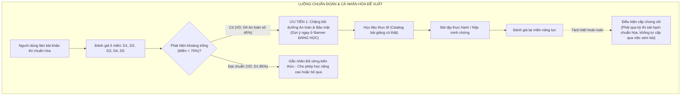

# Báo Cáo Đánh Giá & Phản Biện Feedback: Trang Lộ Trình và Tổng Quan Personal Dashboard

> **Ngày thực hiện:** 01/11/2026  
> **Phạm vi khảo sát:** Không gian cá nhân (*Personal Workspace*)  
> **Tài liệu tham chiếu:** Feedback người dùng (3 ảnh đính kèm), quy chuẩn [AGENTS.md](file:///c:/nexa/AGENTS.md), cấu trúc DigComp 5 miền chuẩn hóa và hiện trạng mã nguồn thực tế tại `c:\nexa`.

---

## 1. Tóm tắt điều hành & Nhận định chung

Người dùng đã cung cấp bản feedback chi tiết (qua 3 ảnh chụp) phân tích trực diện hai màn hình trung tâm của Personal Dashboard:
1. **Trang Tổng quan** (`/personal/dashboard`)
2. **Trang Lộ trình của tôi** (`/personal/learning-path`)

### Nhận định của Agent sau khi đối chiếu mã nguồn
Feedback của người dùng **hoàn toàn chính xác, sắc bén và đi trúng các tử huyệt về mặt trải nghiệm lẫn kiến trúc dữ liệu** mà codebase hiện tại đang mắc phải. 

Qua kiểm tra mã nguồn thực tế:
1. **Lỗi API 404 ngầm nghiêm trọng:** Tại [`src/app/(dashboard)/personal/dashboard/page.tsx#L201`](file:///c:/nexa/src/app/(dashboard)/personal/dashboard/page.tsx#L201) và [`src/app/(dashboard)/personal/learning-path/page.tsx#L66`](file:///c:/nexa/src/app/(dashboard)/personal/learning-path/page.tsx#L66), frontend đang gọi sai endpoint `/api/personal/competency/profile` (dấu `/`), trong khi route thực tế của hệ thống là `/api/personal/competency-profile/route.ts` (dấu `-`). Việc route trả về 404 khiến frontend luôn rơi vào trạng thái fallback, bộc lộ toàn bộ dữ liệu mock/hardcode sai lệch.
2. **Dữ liệu PTS bị phân mảnh và mock tùy tiện:** Giá trị PTS mặc định trong `LearnerDashboardPage` được hardcode là `9 PTS` ([page.tsx#L82](file:///c:/nexa/src/app/(dashboard)/personal/dashboard/page.tsx#L82)), trong khi Topbar khởi tạo `0 PTS` ([PersonalTopbar.tsx#L10](file:///c:/nexa/src/components/dashboard/personal/PersonalTopbar.tsx#L10)). Khối "Hoạt động gần đây" cũng được tạo dữ liệu ảo cộng dồn đúng bằng 8 PTS + 1 PTS chuyên cần = 9 PTS ([page.tsx#L809-L839](file:///c:/nexa/src/app/(dashboard)/personal/dashboard/page.tsx#L809-L839)).
3. **Vi phạm quy tắc cốt lõi của NEXA về 5 miền năng lực số:** Người dùng chưa làm bài khảo thí nào nhưng giao diện vẫn vẽ Radar Chart rỗng kèm 5 thanh tiến độ hiển thị số `0%` ([page.tsx#L551](file:///c:/nexa/src/app/(dashboard)/personal/dashboard/page.tsx#L551)). Điều này vi phạm trực tiếp quy tắc [AGENTS.md Mục 2.1](file:///c:/nexa/AGENTS.md): `score: null` là chưa có bằng chứng, không được thay bằng `0%` gây hoang mang cho người học.
4. **Bất nhất số liệu tiến độ học tập trên trang Lộ trình:** Cột phải báo `Đã hoàn thành 3 / 12 bài học (25%)` ([learning-path/page.tsx#L126-L130](file:///c:/nexa/src/app/(dashboard)/personal/learning-path/page.tsx#L126-L130)), trong khi 5 miền ở cột trái lại hiển thị D1 hoàn thành `2/8 bài`, D2–D5 là `0/8 bài` (tổng 2/40 bài) ([learning-path/page.tsx#L181-L240](file:///c:/nexa/src/app/(dashboard)/personal/learning-path/page.tsx#L181-L240)).
5. **Đánh đồng việc học với việc cấp chứng chỉ:** Thẻ chân trang Lộ trình ghi *"Hoàn thành lộ trình để nhận chứng chỉ NEXA"* ([learning-path/page.tsx#L535](file:///c:/nexa/src/app/(dashboard)/personal/learning-path/page.tsx#L535)), vi phạm quy tắc phân định độc lập giữa Học liệu - XP/PTS - Chứng chỉ khảo thí chuẩn hóa.

---

## 2. Đánh giá chi tiết Trang Tổng quan (`/personal/dashboard`)

```mermaid
flowchart TD
    subgraph Current ["HIỆN TRẠNG (Rối rắm, Quá tải & Lệch dữ liệu)"]
        A1["Header: Chào mừng + Streak 7 ngày + Gauge Level"] --> A2["Hero Banner: Tiếp tục học tập (Làm bài ngay / Tìm hiểu)"]
        A2 --> A3["4 Card chỉ số: Bài hoàn thành, 0/5 miền đạt, 9 PTS, Chứng chỉ"]
        A3 --> A4["Radar Chart rỗng + 5 thanh tiến độ 0% (Dù chưa thi)"]
        A4 --> A5["Stepper 5 chặng (Trùng lặp với 5 miền ở trên)"]
        A5 --> A6["Leaderboard Top 5"]
        A6 --> A7["3 Card cuối: Hoạt động giả (9 PTS) + Gợi ý + Checklist mục tiêu"]
    end

    subgraph Proposed ["ĐỀ XUẤT 3 TẦNG (Tinh gọn, Đúng nghiệp vụ & Tập trung hành động)"]
        B1["TẦNG 1: VIỆC CẦN LÀM NGAY\n- Chào mừng & PTS đồng bộ\n- Banner hành động số 1 (Chưa thi -> Làm khảo thí ban đầu | Đã thi -> Học bài tiếp theo)"]
        --> B2["TẦNG 2: NĂNG LỰC & HỌC TẬP\n- Nếu CHƯA THI: Card trạng thái khởi tạo (Không radar 0%, có nút Bắt đầu đánh giá)\n- Nếu ĐÃ THI: Radar 5 miền thật + Nhận diện khoảng trống (Gap) & Điểm mạnh"]
        --> B3["TẦNG 3: TIỆN ÍCH RÚT GỌN\n- Tiến độ lộ trình tóm tắt (1 chặng tiếp theo)\n- Top 3 Bảng xếp hạng mini hoặc Hoạt động thật gần đây\n(Chuyển bớt sang trang chuyên biệt)"]
    end
```



### 2.1. Phân tích 4 vấn đề được nêu trong feedback

#### Vấn đề 1: Radar Chart và thanh tiến độ hiển thị khi chưa có dữ liệu
- **Bằng chứng mã nguồn:**
  - File: [`src/app/(dashboard)/personal/dashboard/page.tsx#L532-L572`](file:///c:/nexa/src/app/(dashboard)/personal/dashboard/page.tsx#L532-L572)
  ```tsx
  <span className="font-mono font-semibold text-xs text-neutral-900 dark:text-neutral-100 tabular-nums">
    {hasAssessed ? `${scoreVal}%` : '0%'}
  </span>
  ```
  - Khi chưa đánh giá (`hasAssessed = false`), giao diện ép hiển thị số `0%`.
  - Thành phần [`CompetencyRadarChart.tsx#L71-L77`](file:///c:/nexa/src/components/dashboard/personal/CompetencyRadarChart.tsx#L71-L77) vẽ đa giác điểm số với giá trị 0 khi `score === null`, tạo ra một mạng nhện rỗng và vùng đa giác co cụm ở tâm hoặc hiển thị đường mục tiêu 70% trơ trọi.
- **Tác động người dùng:** Người học mới đăng nhập cảm giác mình bị "điểm 0" hoặc hệ thống bị lỗi, tạo tâm lý ức chế và hiểu sai về năng lực cá nhân.
- **Giải pháp chuẩn:** Khi `hasTakenAssessment === false` (hoặc `assessedDomainsCount === 0`):
  - Ẩn hoàn toàn đồ thị Radar và bảng 5 thanh phần trăm `0%`.
  - Thay thế bằng **Empty State / Onboarding State thanh lịch**: Minh họa nhẹ nhàng, tiêu đề *"Bạn chưa có hồ sơ năng lực số"*, giải thích ngắn gọn lợi ích của bài khảo thí đầu vào (15 phút, 5 miền) và nút CTA duy nhất: **"Bắt đầu khảo thí ban đầu"**.

#### Vấn đề 2: Chỉ số "0/5 miền đạt chuẩn" chưa chuẩn xác về ngữ nghĩa
- **Bằng chứng mã nguồn:**
  - File: [`src/app/(dashboard)/personal/dashboard/page.tsx#L441`](file:///c:/nexa/src/app/(dashboard)/personal/dashboard/page.tsx#L441)
  ```tsx
  <div className="text-3xl font-extrabold text-neutral-900 dark:text-neutral-100 font-mono tabular-nums my-1">
    {competencyProfile?.hasTakenAssessment ? `${passedDomainsCount} / 5` : '0 / 5'}
  </div>
  ```
- **Tác động:** "0/5 miền đạt chuẩn" có nghĩa là đã đo cả 5 miền nhưng rớt cả 5. Đây là kết luận sai lệch nghiêm trọng về mặt khảo thí.
- **Giải pháp chuẩn:** Khi chưa đánh giá, thẻ này phải ghi rõ: **"Chưa đánh giá"** hoặc **"— / 5"** với chú thích phụ: *"Cần hoàn thành bài đánh giá đầu vào"*. Chỉ khi đã làm bài mới hiển thị `X / 5 miền (≥ 70%)`.

#### Vấn đề 3: Lệch dữ liệu PTS giữa Dashboard và Sidebar/Topbar
- **Bằng chứng mã nguồn:**
  - `LearnerDashboardPage`: Khởi tạo state tĩnh `points: 9` ([page.tsx#L82](file:///c:/nexa/src/app/(dashboard)/personal/dashboard/page.tsx#L82)).
  - `PersonalTopbar`: Khởi tạo state `points: 0` ([PersonalTopbar.tsx#L10](file:///c:/nexa/src/components/dashboard/personal/PersonalTopbar.tsx#L10)).
  - Backend `profile-stats/route.ts`: Lấy từ `profiles.points ?? 0`. Với tài khoản mới tạo, DB trả về `0`.
  - Kết quả: Khi trang tải hoặc API phản hồi chậm, Topbar hiện `0 PTS`, thẻ thống kê và vòng tròn cấp độ hiện `9 PTS`, khối hoạt động liệt kê 3 hành động giả đúng bằng 8 PTS + 1 PTS điểm danh.
- **Giải pháp chuẩn:**
  - Triệt tiêu hoàn toàn các hằng số mock (`points: 9`, `loginStreak: 4`, mock activities).
  - Khởi tạo giá trị thống nhất dạng `loading` (Skeleton pulse) hoặc `0`, chỉ hiển thị số liệu khi có dữ liệu thật từ bảng `profiles` và ledger `user_points_history`.

#### Vấn đề 4: Quá nhiều khối nội dung, gây loãng và chiếm diện tích màn hình
- **Hiện trạng:** Dashboard có tới 6 tầng card dọc, trên màn hình chuẩn 1440 × 900 người dùng phải cuộn chuột 3 lần. Các khối bị trùng lặp:
  - Khối "Tiến độ theo 5 miền năng lực" nằm ngay trên khối "Lộ trình học tập dành cho bạn (Stepper 5 chặng)". Cả hai đều liệt kê lại D1 đến D5.
  - 3 khối nhỏ ở đáy (Hoạt động gần đây, Gợi ý, Mục tiêu nhanh) tạo cảm giác vụn vặt và thiếu chiều sâu.
- **Giải pháp chuẩn hóa theo Mô hình 3 Tầng đề xuất:**
  - **Tầng 1 — Chào mừng & Hành động chính:** Lời chào, PTS, chuỗi chuyên cần (giữ thiết kế gọn không viền) + 1 Hero Action Banner (nếu chưa thi: kêu gọi làm bài; nếu đã thi: tiếp tục bài học dang dở).
  - **Tầng 2 — Trọng tâm Năng lực:**
    - Trạng thái chưa thi: Khối Onboarding kích hoạt đánh giá.
    - Trạng thái đã thi: Radar Chart kết hợp phân tích Điểm mạnh / Khoảng trống (gaps).
  - **Tầng 3 — Lộ trình & Tiện ích:** 1 Card hiển thị bài học tiếp theo (với nút "Học ngay") + 1 Bảng xếp hạng mini Top 3 hoặc Bài nộp gần đây. Chuyển các checklist và gợi ý sang các tab chuyên sâu.

---

## 3. Đánh giá chi tiết Trang Lộ trình (`/personal/learning-path`)



### 3.1. Phân tích 5 vấn đề được nêu trong feedback

#### Vấn đề 1: Số liệu tiến độ chưa nhất quán (3/12 bài học vs 2/8 ở D1)
- **Bằng chứng mã nguồn:**
  - Cột phải: [`src/app/(dashboard)/personal/learning-path/page.tsx#L126-L130`](file:///c:/nexa/src/app/(dashboard)/personal/learning-path/page.tsx#L126-L130)
  ```tsx
  const completedCount = steps.filter((s) => s.status === 'completed').length || 3;
  const inProgressCount = steps.length > 0 ? (completedCount < steps.length ? 1 : 0) : 1;
  const unstartedCount = Math.max(0, (steps.length || 12) - completedCount - inProgressCount) || 8;
  const totalStepsCount = steps.length || 12;
  const overallProgressPercent = Math.min(100, Math.round((completedCount / totalStepsCount) * 100)) || 25;
  ```
  - Cột trái: [`src/app/(dashboard)/personal/learning-path/page.tsx#L174-L240`](file:///c:/nexa/src/app/(dashboard)/personal/learning-path/page.tsx#L174-L240)
  ```tsx
  { code: 'D1', totalLessons: 8, completedLessons: 2, status: 'learning' },
  { code: 'D2', totalLessons: 8, completedLessons: 0, status: 'unstarted' },
  // ... mỗi miền gán cứng 8 bài
  ```
- **Phân tích:** Cột phải lấy fallback `3/12 bài (25%)`, cột trái hardcode mỗi miền 8 bài (tổng 40 bài) và ghi D1 hoàn thành `2/8 bài`. Người học nhìn hai bên thấy hai số liệu đá nhau chan chát.
- **Giải pháp chuẩn:** 
  - Thống nhất một nguồn dữ liệu duy nhất (`single source of truth`) từ API `/api/personal/learning-path` (bảng `learning_modules` và `user_learning_progress`).
  - Nếu hiển thị tiến độ tổng thể, phải là $\sum \text{completed} / \sum \text{total}$ thực tế. Nếu chưa có bài nào, hiển thị `0 / Tổng số bài (0%)`. Tuyệt đối không dùng `|| 3` hoặc `|| 12`.

#### Vấn đề 2: Miền đang học nhưng học liệu báo "đang cập nhật"
- **Bằng chứng mã nguồn:**
  - Banner trên cùng thông báo: *"ĐANG HỌC - Bài 1/8: Tìm kiếm và đánh giá thông tin"* kèm nút *"▶ Tiếp tục học"* ([learning-path/page.tsx#L304-L341](file:///c:/nexa/src/app/(dashboard)/personal/learning-path/page.tsx#L304-L341)).
  - Nhưng khi người học mở rộng D1 ở ngay bên dưới, nếu danh sách module từ DB rỗng, giao diện hiển thị: *"Các bài học cho miền này đang được cập nhật thêm vào chương trình"* ([learning-path/page.tsx#L515-L517](file:///c:/nexa/src/app/(dashboard)/personal/learning-path/page.tsx#L515-L517)).
- **Tác động:** Trải nghiệm bị đứt gãy ("dead end"). Người học bấm nút "Tiếp tục học" nhưng không có bài học thật nào được mở ra.
- **Giải pháp chuẩn:**
  - Banner "ĐANG HỌC" chỉ được hiển thị khi thực sự có một bài học cụ thể mà người dùng đang học dở hoặc là bài học đầu tiên trong danh mục đã xuất bản.
  - Nếu danh mục học liệu chưa có bài nào, chuyển banner thành trạng thái: *"Chương trình học liệu đang được xây dựng theo chuẩn 5 miền"*, hướng người dùng đến bài khảo thí hoặc tài liệu hướng dẫn.

#### Vấn đề 3: Lộ trình chưa đủ tính cá nhân hóa (Personalization Gap)
- **Hiện trạng:** Codebase đang hiển thị lộ trình tĩnh tuần tự từ D1 $\to$ D2 $\to$ D3 $\to$ D4 $\to$ D5. Mọi học viên đều thấy giao diện giống hệt nhau.
- **Quy tắc sản phẩm:** Triết lý của NEXA là: **Đánh giá $\to$ Phát hiện khoảng trống $\to$ Lộ trình cá nhân hóa $\to$ Đánh giá lại**.
- **Giải pháp chuẩn:**
  - Phân biệt 2 chế độ lộ trình rõ ràng:
    1. **Chưa có kết quả khảo thí:** Giao diện hiển thị *"Lộ trình tiêu chuẩn DigComp"* (học tự do, không khóa tuần tự). Kèm lời nhắc: *"Làm bài khảo thí để hệ thống tự động ưu tiên các miền bạn còn yếu"*.
    2. **Đã có kết quả khảo thí:** Hệ thống phân loại các miền:
       - Miền có Gap ($< 70\%$): Đưa lên đầu lộ trình với nhãn **"Ưu tiên bồi dưỡng"** hoặc **"Khoảng trống năng lực"**.
       - Miền đã đạt chuẩn ($\ge 70\%$): Đưa xuống dưới với nhãn **"Đã đạt chuẩn (Vững kiến thức)"**, kèm tùy chọn học nâng cao.

#### Vấn đề 4: Lịch học gần đây sử dụng dữ liệu giả (Mock Schedule)
- **Bằng chứng mã nguồn:**
  - File: [`src/app/(dashboard)/personal/learning-path/page.tsx#L682-L736`](file:///c:/nexa/src/app/(dashboard)/personal/learning-path/page.tsx#L682-L736)
  ```tsx
  { day: 'T6', num: 31, active: true } // Hardcode thứ 6 ngày 31
  // Dữ liệu giả: "20:00 - 20:15 Tìm kiếm và đánh giá thông tin ✓"
  ```
- **Tác động:** Vi phạm quy tắc [AGENTS.md Mục 1.4](file:///c:/nexa/AGENTS.md): *"Không giả lập thành công... Không tạo số liệu, bài thi, quyền lợi hay giao dịch mẫu trên luồng production"*.
- **Giải pháp chuẩn:**
  - Lịch học chỉ được hiển thị nếu người dùng có lịch nhắc học thật (được đặt trong settings) hoặc có bài tập được giao từ lớp/tổ chức có deadline xác định.
  - Nếu chưa có lịch: Hiển thị Empty State với nút *"Thiết lập mục tiêu và thời gian học hàng ngày"*, hoặc thay thế bằng widget *"Bài học được đề xuất tiếp theo"*.

#### Vấn đề 5: Lẫn lộn giữa việc học lộ trình và cấp chứng chỉ
- **Bằng chứng mã nguồn:**
  - File: [`src/app/(dashboard)/personal/learning-path/page.tsx#L535`](file:///c:/nexa/src/app/(dashboard)/personal/learning-path/page.tsx#L535)
  ```tsx
  <h4 className="text-sm sm:text-base font-bold text-neutral-900 dark:text-neutral-100">
    Hoàn thành lộ trình để nhận chứng chỉ NEXA
  </h4>
  ```
- **Tác động:** Sai lệch triết lý khảo thí số chuẩn hóa. Việc đọc bài học không thể tự động cấp chứng chỉ năng lực. Chứng chỉ số đòi hỏi bài thi sát hạch có giám sát hoặc minh chứng thực hành được hội đồng/hệ thống chấm điểm đạt chuẩn.
- **Giải pháp chuẩn:** Sửa lại thông điệp:
  - *"Hoàn thành lộ trình để sẵn sàng cho bài thi cấp chứng chỉ"* hoặc *"Bồi dưỡng kiến thức để tự tin chinh phục Chứng chỉ Năng lực số Quốc gia"*.
  - Nút hành động dẫn sang trang thông tin điều kiện khảo thí: *"Xem điều kiện cấp chứng chỉ"*.

---

## 4. Đánh giá ma trận ưu tiên (P0, P1, P2) & Đề xuất hành động

Dưới đây là bảng đối chiếu ma trận ưu tiên từ feedback với phát hiện kỹ thuật thực tế từ codebase:

| Mức độ | Trang | Nội dung cần chỉnh từ Feedback | Thẩm định kỹ thuật & Hiện trạng mã nguồn | Hành động kỹ thuật bắt buộc |
| :--- | :--- | :--- | :--- | :--- |
| **P0** | **Tổng quan** | Không hiện điểm năng lực 0 khi chưa đánh giá | **Xác nhận 100%:** [page.tsx#L551](file:///c:/nexa/src/app/(dashboard)/personal/dashboard/page.tsx#L551) ép `0%` và Radar chart vẽ 0% khi `score === null`. | Đổi điều kiện render: Chưa đánh giá $\to$ Render Empty State hướng nghiệp. `score: null` hiển thị nhãn `"Chưa đánh giá"`, không hiển thị `0%`. |
| **P0** | **Tổng quan** | Đồng bộ PTS giữa header, sidebar và thống kê | **Xác nhận 100%:** [page.tsx#L82](file:///c:/nexa/src/app/(dashboard)/personal/dashboard/page.tsx#L82) hardcode `points: 9`, Topbar khởi tạo `0 PTS`. Route gọi sai 404. | Sửa endpoint `/api/personal/competency-profile`. Đưa initial PTS về `0` hoặc Skeleton, dùng chung hook hoặc sync event. |
| **P0** | **Lộ trình** | Đồng bộ số bài hoàn thành và phần trăm | **Xác nhận 100%:** [learning-path/page.tsx#L126-L130](file:///c:/nexa/src/app/(dashboard)/personal/learning-path/page.tsx#L126-L130) dùng fallback `3/12 (25%)`, trong khi D1 hardcode `2/8`. | Bỏ toàn bộ fallback `|| 3`, `|| 12`. Tính toán động $\sum$ từ mảng `steps` trả về từ API. |
| **P0** | **Lộ trình** | Tách học tập khỏi điều kiện cấp chứng chỉ | **Xác nhận 100%:** [learning-path/page.tsx#L535](file:///c:/nexa/src/app/(dashboard)/personal/learning-path/page.tsx#L535) ghi hoàn thành lộ trình để nhận chứng chỉ. | Viết lại nội dung banner chứng chỉ: Học để ôn luyện $\ne$ thi sát hạch cấp chứng chỉ. |
| **P1** | **Tổng quan** | Rút ngắn phần radar/trạng thái chưa có dữ liệu | **Xác nhận 100%:** Radar rỗng và 5 thanh 0% chiếm 50% diện tích màn hình. | Khi chưa thi, thay cả 2 cột Radar + 5 thanh bằng 1 Card Onboarding tinh gọn, có nút CTA làm bài. |
| **P1** | **Lộ trình** | Làm rõ bài học thật, học liệu và hành động tiếp theo | **Xác nhận 100%:** Banner ghi "Đang học" nhưng mở rộng bên dưới báo chưa có bài học. | Liên kết trực tiếp Banner Hero với bài học đầu tiên có thật trong DB; nếu rỗng thì báo đúng trạng thái. |
| **P1** | **Cả hai** | Giảm chữ mô tả nhỏ, tăng khoảng trắng có chủ đích | **Xác nhận 100%:** Quá nhiều text mô tả phụ `text-[10px]` và `text-slate-400` gây rối mắt. | Tinh giản copy, tăng spacing theo hệ thống lưới 8pt, giữ layout thoáng đãng. |
| **P2** | **Cả hai** | Bổ sung responsive, loading, lỗi và trạng thái rỗng | **Xác nhận 100%:** Các trang thiếu skeleton hoàn chỉnh, khi mất mạng dễ vỡ layout. | Bổ sung Skeleton component chuẩn cho từng card và xử lý khối Fallback khi API timeout/error. |

---

## 5. Bảng so sánh Kiến trúc UI/UX Hiện tại vs Đề xuất mới

### 5.1. Trang Tổng quan (`/personal/dashboard`)

| Yếu tố | Thiết kế Hiện tại | Thiết kế Đề xuất Mới |
| :--- | :--- | :--- |
| **Bố cục tổng thể** | 6 tầng card kéo dài, cuộn sâu 3–4 màn hình. | **3 tầng tập trung:** Tầng 1 (Hành động ngay) $\to$ Tầng 2 (Năng lực) $\to$ Tầng 3 (Tiện ích tóm tắt). |
| **Người dùng mới (Chưa thi)** | Hiện Radar chart rỗng, 5 thanh tiến độ 0%, chỉ số "0/5 miền đạt". | **Empty State thông minh:** Thông báo chưa có hồ sơ năng lực, giải thích lợi ích và CTA dẫn thẳng vào bài đánh giá 15 phút. Không có số 0% gây hiểu lầm. |
| **Người dùng đã đánh giá** | Chỉ hiện điểm số chung chung, lặp lại danh sách miền với Stepper phía dưới. | **Radar Chart hoàn chỉnh + Chẩn đoán:** Nêu bật rõ Điểm mạnh nhất và Khoảng trống (Gap $< 70\%$) cần ưu tiên bồi dưỡng. |
| **Dữ liệu PTS** | Lệch giữa Topbar (0 PTS) và Card (9 PTS), có hoạt động giả. | Đồng bộ 100% theo ledger tài khoản thực, không mock hoạt động ảo. |

### 5.2. Trang Lộ trình (`/personal/learning-path`)

| Yếu tố | Thiết kế Hiện tại | Thiết kế Đề xuất Mới |
| :--- | :--- | :--- |
| **Cơ chế khóa miền** | Gợi ý học tuần tự D1 $\to$ D5. | **Không khóa cứng:** Người học có quyền học bất kỳ miền nào; chỉ khóa từng bài nếu có bài tiên quyết trong cùng miền. |
| **Cá nhân hóa** | Tĩnh cho mọi học viên. | **Lộ trình chẩn đoán:** Đẩy miền có Gap lên đầu danh sách học, miền đã đạt chuẩn chuyển xuống nhóm nâng cao/tự chọn. |
| **Số liệu tiến độ** | Mâu thuẫn 3/12 bài (cột phải) vs 2/8 bài (cột trái). | Nguồn số liệu duy nhất từ DB: Hiển thị đúng số bài học thật đã hoàn thành trên tổng số bài trong chương trình. |
| **Lịch học** | Lịch tuần giả định cố định ngày 31 thứ sáu. | Lịch nhắc nhở thật của người dùng hoặc các deadline bài nộp từ lớp học thật; nếu không có thì ẩn hoặc hiện widget mục tiêu ngày. |
| **Chứng chỉ** | Ghi "học hết lộ trình được cấp chứng chỉ". | Tách rời: Học tập nâng cao năng lực $\to$ Sẵn sàng thi sát hạch để nhận chứng chỉ chính thức. |

---

## 6. Kết luận & Khuyến nghị tiếp theo

Bản feedback từ người dùng đã chỉ ra những điểm yếu cốt tử về mặt sản phẩm. Toàn bộ các đề xuất của người dùng trong 3 hình ảnh:
1. **Hoàn toàn khả thi về mặt kỹ thuật** (hạ tầng DB và service `DomainAssessmentSummaryService` của NEXA đã hỗ trợ sẵn các trường `score: null`, `hasTakenAssessment`, `assessedDomainsCount`).
2. **Tuyệt đối phù hợp với quy chuẩn sản phẩm [AGENTS.md](file:///c:/nexa/AGENTS.md)** (tôn trọng bản chất 3 không gian 1 danh tính, giữ màu Light trắng / Dark đen, bài trừ dữ liệu giả).

**Khuyến nghị:**
- Giữ nguyên cấu trúc khung và thẩm mỹ tổng thể (màu sắc, typography, card border) như người dùng đã ghi nhận (*"Nên giữ hướng thiết kế"*).
- Tập trung tinh chỉnh logic dữ liệu và tổ chức lại layout 3 tầng trên trang Tổng quan, đồng thời đồng bộ hóa dữ liệu và tách bạch chứng chỉ trên trang Lộ trình theo đúng ma trận P0 $\to$ P1 $\to$ P2.
