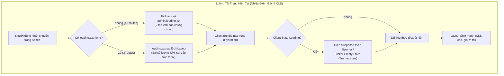
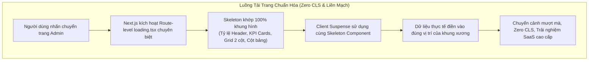

# Báo cáo Rà soát Khung xương Tải trang (Skeleton Loading Audit Report) — Phân hệ Platform Admin Dashboard

**Thời gian thực hiện:** Tháng 11/2026
**Phạm vi kiểm toán:** Toàn bộ phân hệ Platform Admin Dashboard (`/admin/*`) bao gồm các file `loading.tsx`, các Suspense fallback, các trạng thái loading client-side và thư viện khung xương `src/components/ui/Skeleton.tsx`.
**Mục tiêu:** Phát hiện hiện tượng giật giao diện (Cumulative Layout Shift - CLS), lệch cấu trúc giữa Skeleton và trang thực tế, thiếu khung xương tải trang, sử dụng fallback văn bản thô (AI slop / unstyled placeholders) và đề xuất kiến trúc khung xương tải trang chuẩn hóa, mượt mà theo chuẩn thiết kế Light Trắng / Dark Đen của NEXA AI.

## 1. Tóm tắt điều hành & Phát hiện cốt lõi

Qua quá trình rà soát toàn diện 19 route và subroute của phân hệ Platform Admin Dashboard, đoàn kiểm toán phát hiện các vấn đề mang tính hệ thống như sau:

1. **Tỷ lệ thiếu `loading.tsx` chuyên biệt lên tới 75%**: Trong 16 route nghiệp vụ thực tế, chỉ có đúng 3 route có file `loading.tsx` riêng (`/admin/dashboard`, `/admin/organizations`, `/admin/users`). 13 route còn lại hoàn toàn phụ thuộc vào fallback của route cha `src/app/(dashboard)/admin/loading.tsx`.
2. **Hiện tượng giật layout nghiêm trọng (Cumulative Layout Shift) ở cả 3 route đã có `loading.tsx`**:
   - Tại `/admin/dashboard`: `loading.tsx` hiển thị 4 KPI card và 3 thẻ "Action Queues" (không hề tồn tại ở trang thật), trong khi trang thật có 6 KPI card, biểu đồ xu hướng 7 cột và thẻ chất lượng 5 cột.
   - Tại `/admin/organizations`: `loading.tsx` hiển thị 1 bảng toàn chiều rộng (12 cột), trong khi trang thật là bố cục 2 cột bất đối xứng (8 cột bảng dữ liệu + 4 cột khối phân tích hợp đồng và biểu đồ donut). Khi dữ liệu nạp xong, bảng co giật từ 100% về 66%.
   - Tại `/admin/users`: `loading.tsx` bỏ quên toàn bộ 3 thẻ KPI trên đỉnh trang. Khi tải xong, 3 thẻ KPI đột ngột xuất hiện đẩy toàn bộ bảng xuống dưới.
3. **Lỗi vỡ cấu trúc CSS Grid trong component dùng chung `SkeletonTable` (`src/components/ui/Skeleton.tsx`)**:
   - `SkeletonTable` sử dụng cố định `col-span-3` trong `grid grid-cols-12`. Khi gọi `columns={6}` hoặc `columns={7}` (như tại Organizations và Users loading), tổng số cột vượt quá 12 cột, làm các cột từ thứ 5 trở đi bị rớt xuống dòng thứ 2 và thứ 3 trong mỗi hàng, phá vỡ hoàn toàn định dạng bảng.
4. **Lạm dụng Suspense Fallback dạng Plain Text thô & Spinner xoay tròn**:
   - 5 route (`/admin/users`, `/admin/analytics`, `/admin/compliance`, `/admin/settings`, `/admin/content/assessments/[id]`) sử dụng `<Suspense fallback={<div className="p-8 text-xs text-slate-500">Đang tải...</div>}>`. Khi người dùng chuyển hướng client-side, giao diện bị giật về một dòng chữ đơn điệu thay vì skeleton dạng cấu trúc.
   - 4 route (`/admin/plans`, `/admin/roles`, `/admin/settings`, `/admin/content/assessments/[id]/preview`) sử dụng spinner xoay tròn (`Loader2 animate-spin`) chiếm toàn màn hình, gây khoảng trống lớn và cảm giác chờ đợi kéo dài.
5. **Lỗi nghiêm trọng: Chớp giật Empty State khi đang loading tại `/admin/transactions`**:
   - Do trang kiểm tra điều kiện `{filteredTransactions.length === 0 && <EmptyState />}` mà không kiểm tra cờ `loading`, trong 300ms - 800ms khi API đang chạy, màn hình chớp toàn bộ hình vẽ minh họa "Không có giao dịch nào" rồi mới hiện bảng dữ liệu.

## 2. Sơ đồ đối chiếu luồng tải trang: Hiện tại vs Đề xuất Chuẩn hóa





## 3. Bảng tổng hợp Hiện trạng Khung xương từng Route trong Platform Admin

Bảng dưới đây thống kê chi tiết toàn bộ các route trong phân hệ Platform Admin (`src/app/(dashboard)/admin/**`):

| Route | Có `loading.tsx` riêng? | Mức độ khớp với `page.tsx` | Loại trang / Cấu trúc thực tế | Vấn đề phát hiện chi tiết |
| :--- | :---: | :---: | :--- | :--- |
| `/admin` | Không | N/A (Redirect) | Server Redirect | Redirect về `/admin/dashboard`. Dùng `admin/loading.tsx`. |
| `/admin/dashboard` | **Có** | **KÉM** (Lệch nặng) | 6 KPI + Grid 7/5 + Grid 8/4 | Lệch 4 KPI thành 6 KPI; render 3 thẻ "Action Queues" không tồn tại; thiếu grid 12 cột cho xu hướng và hoạt động; thiếu `max-w-7xl`. |
| `/admin/organizations` | **Có** | **TRUNG BÌNH** (Lệch cột) | Bố cục 2 cột (8/4): Bảng + 3 Thẻ thống kê B2B | `loading.tsx` render bảng 100% chiều rộng, thiếu hoàn toàn cột thống kê 4 cột bên phải; `SkeletonTable` vỡ dòng do `columns={7}`; thiếu 2 nút header. |
| `/admin/users` | **Có** | **TRUNG BÌNH** (Thiếu KPI) | 3 KPI + Toolbar lọc + Bảng 7 cột | `loading.tsx` thiếu toàn bộ 3 thẻ KPI trên đỉnh; nút header bị đặt sai vị trí; Suspense bọc ngoài dùng fallback văn bản thô; `tbody` hiện text khi fetch client; `SkeletonTable` vỡ dòng do `columns={6}`. |
| `/admin/baseline` | **Không** | **RẤT KÉM** | Khảo thí đầu vào: Grid 5 miền + Toolbar + Danh sách câu hỏi | Fallback về 2 thẻ văn bản chung chung. Không phản ánh được bố cục `max-w-5xl`, grid 5 thẻ miền năng lực D1-D5, và danh sách câu hỏi trắc nghiệm. |
| `/admin/content` | **Không** | **RẤT KÉM** | Ngân hàng đề chuẩn: Toolbar đa bộ lọc + Bảng 10 cột | Fallback về 2 thẻ văn bản chung chung. Mất hoàn toàn cấu trúc bảng quản trị đề thi quy mô lớn với các dropdown chọn miền và phân hạng. |
| `/admin/content/assessments/new` | **Không** | N/A (Redirect) | Server Action & Redirect | Tạo đề draft và redirect sang `/admin/content/assessments/[id]`. |
| `/admin/content/assessments/[id]` | **Không** | **RẤT KÉM** | Trình biên soạn 2 vùng (Authoring 2-Pane) | Client loading là dòng chữ thô: `"Đang mở trình biên soạn câu hỏi..."`. Không có skeleton cho danh sách câu hỏi bên trái và vùng biên soạn bên phải. |
| `/admin/content/assessments/[id]/preview` | **Không** | **KÉM** | Chế độ xem trước đề thi dành cho Admin | Bọc Suspense với Spinner tròn đơn điệu kèm text `"Đang tải dữ liệu thẩm định đề thi..."`. Thiếu khung xương giao diện đề thi. |
| `/admin/learning-paths` | **Không** | **KÉM** (Double shift) | Lộ trình: 5 Tab miền + Tiến độ + Danh sách trạm | Không có `loading.tsx`. Client component có trạng thái `loading = true` render 2 thẻ `SkeletonCard`, tạo ra hiện tượng giật layout 2 lần liên tiếp. |
| `/admin/analytics` | **Không** | **RẤT KÉM** | Phân tích năng lực số: 4 KPI + 5 Bars miền + Tâm trắc + Bảng chất lượng + Export | Bọc Suspense fallback text thô. Client loading tự viết 4 div `animate-pulse` hình chữ nhật thô sơ, bỏ sót toàn bộ 5 thanh năng lực, biểu đồ tâm trắc học và bảng chất lượng. |
| `/admin/plans` | **Không** | **RẤT KÉM** | Gói dịch vụ: 2 Tabs + Grid 4 Thẻ giá chuẩn hóa | Fallback về generic cards. Client loading dùng Spinner xoay tròn `Loader2` chiếm trọn màn hình thay vì 4 thẻ giá skeleton. |
| `/admin/transactions` | **Không** | **CỰC KỲ NGUY HIỂM** | Đối soát: 4 Metrics + Layout 3/4 (Bảng) + 1/4 (Sidebar) | **Lỗi chớp giật Empty State**: Hiển thị hình minh họa "Không có giao dịch" khi đang fetch dữ liệu. Thiếu `loading.tsx`, thiếu skeleton cho 4 thẻ metric và sidebar hướng dẫn. |
| `/admin/communications` | **Không** | **KÉM** | Hộp thư góp ý & Broadcast: 3 Tabs + Danh sách Ticket | Fallback về generic cards. Client loading là ô chữ `"Đang tải dữ liệu ý kiến đóng góp..."`. Thiếu khung xương danh sách ticket. |
| `/admin/contributions` | **Không** | **KÉM** | Kiểm duyệt đóng góp: 4 Tabs + Toolbar + Danh sách câu hỏi đề xuất | Fallback về generic cards. Client loading là ô chữ `"Đang tải dữ liệu đóng góp từ cơ sở dữ liệu Supabase..."`. Thiếu khung xương danh sách đề xuất. |
| `/admin/roles` | **Không** | **KÉM** | Phân quyền: Bảng Super Admin + Bảng Platform Admin | Fallback về generic cards. Client loading dùng Spinner xoay tròn `Loader2` thay vì khung xương của 2 bảng danh sách nhân sự. |
| `/admin/ai-gateway` | **Không** | **KÉM** | Cổng AI: 5 Tabs + 4 KPI + Cấu hình Routing + Bảng Telemetry | Suspense fallback là 1 spinner xoay tròn. Client loading render UI với số 0 và nhãn rỗng trước khi nạp xong. Thiếu khung xương telemetry và thẻ gateway. |
| `/admin/compliance` | **Không** | **KÉM** | Nhật ký kiểm toán: 3 KPI + Bộ lọc nâng cao + Bảng 6 cột | Suspense fallback dạng văn bản thô. Bảng dữ liệu hiển thị một dòng text loading trong `tbody` thay vì hàng skeleton. |
| `/admin/settings` | **Không** | **KÉM** | Cài đặt nền tảng: Grid 2 cột gồm 3 Card form cấu hình | Suspense fallback văn bản thô. Client loading là spinner kèm text, không phản ánh được 3 khối form cài đặt hệ thống. |
| `/admin/content-moderation` | **Không** | N/A (Redirect) | Redirect về `/admin/contributions`. |
| `/admin/evaluators` | **Không** | N/A (Redirect) | Redirect về `/admin/users`. |
| `/admin/finance` | **Không** | N/A (Redirect) | Redirect về `/admin/transactions`. |
| `/admin/frameworks` | **Không** | N/A (Redirect) | Redirect về `/admin/content`. |

## 4. Chi tiết các Điểm Lệch, Lỗi Layout và Trùng lặp Nghiêm trọng

### 4.1. Phân tích chi tiết `/admin/dashboard/loading.tsx` vs `page.tsx`
Mã nguồn `src/app/(dashboard)/admin/dashboard/page.tsx` thể hiện một trung tâm điều hành hiện đại gồm:
- Header: Tiêu đề `Tổng quan nền tảng` và 2 nút điều hướng nhanh (`Duyệt hồ sơ B2B`, `Phân tích năng lực số`).
- 6 thẻ KPI lệnh điều hành (`grid grid-cols-2 sm:grid-cols-2 lg:grid-cols-3 xl:grid-cols-6`): Doanh thu đối soát, Tổ chức B2B, Tài khoản xác thực, Khảo thí hoàn tất, Chứng chỉ đã cấp, Chi phí AI ước tính.
- Khối phân tích trung tâm: Grid 12 cột gồm 7 cột Biểu đồ xu hướng hoạt động (`AdminActivityTrendChart`) và 5 cột Thẻ phân bố chất lượng khảo thí (`AdminAssessmentQualityCard`).
- Khối vận hành cuối trang: Grid 12 cột gồm 8 cột Bảng nhật ký hoạt động hệ thống gần đây (Recent Activities) và 4 cột Thẻ trạng thái vận hành & dịch vụ nền tảng (`AdminPlatformHealthCard`).

Trong khi đó, `src/app/(dashboard)/admin/dashboard/loading.tsx` hiện tại bị các lỗi:
- Header: Render badge bo tròn `Skeleton h-6 w-24 rounded-full` và dòng mô tả subtitle `Skeleton h-4 w-48` mà trang thật hoàn toàn không có.
- KPI: Chỉ render 4 thẻ trong `grid-cols-1 sm:grid-cols-2 lg:grid-cols-4`, thiếu 2 thẻ so với thực tế và lệch hoàn toàn grid breakpoint (`xl:grid-cols-6`).
- Khối trung tâm: Render một mục giả lập "Action Queues" gồm 3 thẻ `SkeletonCard lines={2}` trong `grid-cols-1 md:grid-cols-3`. Mục này hoàn toàn không tồn tại trong thiết kế của NEXA Admin.
- Khối cuối trang: Render một bảng `SkeletonTable` chiếm 100% bề ngang, hoàn toàn bỏ quên khối Trạng thái sức khỏe nền tảng (Platform Health Card) 4 cột.
- Wrapper: Dùng `space-y-8 animate-fadeIn`, thiếu `max-w-7xl mx-auto space-y-6 pb-12`.

### 4.2. Phân tích chi tiết `/admin/organizations/loading.tsx` vs `page.tsx`
Trang `src/app/(dashboard)/admin/organizations/page.tsx` tuân thủ chặt chẽ bố cục chuẩn Ảnh 4:
- Header với 3 nút chức năng: Xuất danh sách Excel, Thêm tổ chức B2B, Duyệt hồ sơ B2B.
- Dải Tab con dạng Pill (Yêu cầu Business, Tổ chức và gói, Hàng đợi gia hạn).
- Bố cục 2 cột bất đối xứng (`grid grid-cols-1 lg:grid-cols-12 gap-6`):
  - Cột trái (8 cột): Bảng dữ liệu chính, thanh tìm kiếm, bộ lọc trạng thái và phân trang.
  - Cột phải (4 cột): 3 thẻ thống kê & phân tích nghiệp vụ B2B (Tổng quan hợp đồng B2B dạng grid 2x2, Trạng thái vận hành tổ chức dạng Donut chart, Thẻ hướng dẫn & quy chuẩn).

Tuy nhiên, `src/app/(dashboard)/admin/organizations/loading.tsx` hiện tại:
- Header chỉ có 1 nút loading nhỏ.
- Render một bảng `SkeletonTable rows={7} columns={7}` trải dài toàn bộ 12 cột.
- Hoàn toàn không có khung xương cho 4 cột bên phải (Analytics & Donut chart).
- Khi người dùng truy cập trang, màn hình loading là 1 bảng rộng lớn. Khi dữ liệu tải xong, bảng bị co ép đột ngột từ 12 cột về 8 cột để nhường chỗ cho 3 thẻ thống kê bên phải xuất hiện. Đây là lỗi CLS điển hình làm giảm điểm trải nghiệm trang.

### 4.3. Phân tích chi tiết `/admin/users/loading.tsx` vs `page.tsx`
Trang `src/app/(dashboard)/admin/users/page.tsx` bao gồm:
- Header với tiêu đề "Học viên và Khách hàng" và ghi chú điều hướng sang phân quyền.
- Dải 3 thẻ KPI trên đỉnh (`grid grid-cols-3 gap-2 sm:gap-4`): Tổng người dùng, Đang hoạt động, Tài khoản bị khóa.
- Toolbar lọc: Tìm kiếm theo từ khóa, Dropdown lọc trạng thái, Dropdown lọc gói dịch vụ, nút "Mời người dùng".
- Notice banner: Thông báo phân định phạm vi quản lý tài khoản.
- Bảng tài khoản người dùng 7 cột.

Tuy nhiên, `src/app/(dashboard)/admin/users/loading.tsx` hiện tại:
- Bỏ quên hoàn toàn 3 thẻ KPI trên đỉnh trang.
- Đặt một nút skeleton ở header bên phải (trong khi trang thật nút "Mời người dùng" nằm ở toolbar).
- Cuối file `page.tsx` có đoạn bọc Suspense với văn bản thô: `<Suspense fallback={<div className="p-8 text-xs text-slate-500">Đang tải quản lý người dùng...</div>}>`. Khi Next.js kích hoạt Suspense, nó ghi đè file loading và hiện chữ đơn giản.

### 4.4. Phân tích lỗi vỡ cấu trúc của `SkeletonTable` trong `src/components/ui/Skeleton.tsx`
Kiểm tra dòng 135-161 trong `src/components/ui/Skeleton.tsx`:
```tsx
{/* Table Header */}
<div className="grid grid-cols-12 gap-4 px-6 py-3 bg-slate-50/60 dark:bg-zinc-900/60">
  {Array.from({ length: columns }).map((_, i) => (
    <div key={i} className="col-span-3">
      <Skeleton className="h-3.5 w-20" />
    </div>
  ))}
</div>

{/* Table Rows */}
<div className="">
  {Array.from({ length: rows }).map((_, rIdx) => (
    <div key={rIdx} className="grid grid-cols-12 gap-4 px-6 py-4 items-center">
      {Array.from({ length: columns }).map((_, cIdx) => (
        <div key={cIdx} className="col-span-3 flex items-center gap-3">
          {cIdx === 0 && <Skeleton className="w-8 h-8 rounded-full shrink-0" />}
          <Skeleton ... />
        </div>
      ))}
    </div>
  ))}
</div>
```
Nguyên nhân gốc rễ:
`col-span-3` chiếm 3/12 = 25% chiều rộng của một hàng grid 12 cột. Do đó, một hàng chỉ chứa tối đa đúng 4 cột (4 * 3 = 12).
- Khi truyền `columns={7}` (như ở `organizations/loading.tsx`): 4 cột đầu chiếm hết dòng 1, 3 cột còn lại bị đẩy xuống tạo thành dòng thứ 2 cho mỗi hàng.
- Khi truyền `columns={6}` (như ở `users/loading.tsx`): 4 cột đầu chiếm dòng 1, 2 cột còn lại rớt xuống dòng 2.
Hậu quả: Khung xương bảng bị vỡ nát, lệch cột nghiêm trọng so với cấu trúc bảng HTML thực tế vốn dùng thẻ `<table>`, `<tr>`, `<td>`.

### 4.5. Phân tích lỗi đảo chiều Icon trong `SkeletonKpiCard`
So sánh giữa component hiển thị thực tế `AdminKpiCard` (`src/components/dashboard/admin/AdminUIComponents.tsx`) và khung xương `SkeletonKpiCard` (`src/components/ui/Skeleton.tsx`):
- `AdminKpiCard`: Hàng trên cùng đặt Icon ở bên TRÁI (trong hộp bo tròn 32x32px), Badge phần trăm hoặc trạng thái ở bên PHẢI.
- `SkeletonKpiCard`: Hàng trên cùng lại render một thanh Skeleton text `h-3.5 w-24` ở bên TRÁI và Icon `h-8 w-8 rounded-xl` ở bên PHẢI.
Khi trang chuyển từ trạng thái Skeleton sang dữ liệu thực tế, Icon bị đảo vị trí từ góc phải sang góc trái, gây cảm giác giật mắt khó chịu.

### 4.6. Phân tích lỗi Flicker Empty State tại `/admin/transactions`
Tại `src/app/(dashboard)/admin/transactions/page.tsx`:
- Dòng 68: `const [loading, setLoading] = useState(true);`
- Dòng 574: `{filteredTransactions.length === 0 && (<div className="py-16 ...">Không tìm thấy giao dịch nào...</div>)}`
Khi trang vừa được mount, `loading` mang giá trị `true`, và `filteredTransactions` là mảng rỗng `[]`. Điều kiện `filteredTransactions.length === 0` lập tức thỏa mãn, khiến hình minh họa rỗng (Empty State) xuất hiện ngay lập tức trong khoảng thời gian chờ fetch API (khoảng 300 - 800ms). Khi dữ liệu trả về, Empty State bị gỡ bỏ đột ngột và Bảng giao dịch xuất hiện.
Giải pháp cần thiết: Điều kiện render Empty State phải luôn đi kèm `!loading && filteredTransactions.length === 0`, và khi `loading === true` phải render khung xương SkeletonTable.

## 5. Đề xuất Kiến trúc & Giải pháp Sửa đổi Chi tiết

Để đưa trải nghiệm tải trang của Admin Dashboard về chuẩn mực SaaS giáo dục cao cấp, không giật lag (Zero CLS), tuân thủ bảng màu Light Trắng (`#FFFFFF`) / Dark Đen (`#000000`), đoàn kiểm toán đề xuất các giải pháp kỹ thuật cụ thể sau:

### 5.1. Nâng cấp bộ thư viện dùng chung `src/components/ui/Skeleton.tsx`
1. **Sửa `SkeletonTable` thành cấu trúc HTML Table hoặc Flexbox tự cân đối**:
   Thay vì cố định `grid-cols-12` và `col-span-3`, sử dụng thẻ `table` chuẩn hoặc tính toán `style={{ width: `${100 / columns}%` }}` hoặc `flex-1 min-w-0` để hỗ trợ linh hoạt từ 3 đến 10 cột mà không bao giờ bị rớt dòng.
2. **Chuẩn hóa `SkeletonKpiCard` đồng bộ với `AdminKpiCard`**:
   Đưa vị trí Icon về góc trên bên TRÁI (`h-8 w-8 rounded-xl`), góc trên bên PHẢI là Badge `h-5 w-16 rounded-full`, dòng giữa là Giá trị số to `h-7 w-28`, và dòng đáy là Nhãn `h-3.5 w-24`.
3. **Bổ sung `SkeletonAdminHeader` và `SkeletonPillTabs`**:
   Tạo sẵn component skeleton cho Header chuẩn Admin (Tiêu đề + Phụ đề + Cụm nút hành động bên phải) và dải Tab con dạng Pill để tái sử dụng thống nhất trên toàn bộ các trang.

### 5.2. Cập nhật và sửa đổi 3 file `loading.tsx` hiện có
1. **Tái cấu trúc `src/app/(dashboard)/admin/dashboard/loading.tsx`**:
   - Thêm wrapper `max-w-7xl mx-auto space-y-6 pb-12`.
   - Header: Chỉ có Skeleton Title `h-8 w-60` và cụm 2 nút hành động bên phải.
   - KPI: Đúng 6 thẻ `SkeletonKpiCard` trong `grid grid-cols-2 sm:grid-cols-2 lg:grid-cols-3 xl:grid-cols-6 gap-2.5 sm:gap-4`.
   - Khối trung tâm: Grid 12 cột gồm 7 cột Skeleton Chart (`AdminActivityTrendChart` skeleton) và 5 cột Skeleton Quality Card.
   - Khối cuối trang: Grid 12 cột gồm 8 cột Bảng Recent Activities và 4 cột Thẻ Platform Health.
2. **Tái cấu trúc `src/app/(dashboard)/admin/organizations/loading.tsx`**:
   - Header: 3 nút Skeleton hành động bên phải.
   - Dải Tab con: 3 tab pill skeleton.
   - Grid 12 cột chuẩn Ảnh 4: 8 cột bên trái là `SkeletonTable rows={7} columns={7}`, 4 cột bên phải là 3 thẻ phân tích nghiệp vụ B2B (thẻ 2x2 grid, thẻ Donut chart, thẻ Hướng dẫn).
3. **Tái cấu trúc `src/app/(dashboard)/admin/users/loading.tsx`**:
   - Bổ sung dải 3 thẻ `SkeletonKpiCard` (`grid grid-cols-3 gap-2 sm:gap-4`) bên dưới Header.
   - Chuyển nút hành động xuống thanh toolbar lọc cùng với thanh tìm kiếm và 2 dropdown.
   - Loại bỏ Suspense fallback dạng plain text thô trong `src/app/(dashboard)/admin/users/page.tsx`, thay bằng `AdminUsersLoading`.

### 5.3. Bổ sung mới các file `loading.tsx` cho các route còn thiếu
Cần tạo mới các file `loading.tsx` chuyên biệt cho từng trang theo đúng cấu trúc giao diện thực tế:
1. `src/app/(dashboard)/admin/baseline/loading.tsx`:
   - Bố cục `max-w-5xl mx-auto`.
   - Header có badge và nút hành động.
   - Grid 5 thẻ miền năng lực số (`grid grid-cols-2 sm:grid-cols-5 gap-2.5`).
   - Danh sách 4 thẻ câu hỏi trắc nghiệm MCQ skeleton.
2. `src/app/(dashboard)/admin/content/loading.tsx`:
   - Header có nút Nhập liệu Excel và nút Tạo đề mới.
   - Toolbar tìm kiếm, dropdown miền và bộ lọc.
   - Bảng đề chuẩn 10 cột (`SkeletonTable rows={8} columns={9}`).
3. `src/app/(dashboard)/admin/learning-paths/loading.tsx`:
   - Header + Grid 5 Tab miền năng lực (D1 - D5) + Thẻ tổng quan tiến độ trạm.
   - Toolbar tìm kiếm và 3 khối trạm kiểm chứng (`SkeletonCard`).
4. `src/app/(dashboard)/admin/analytics/loading.tsx`:
   - 4 thẻ `SkeletonKpiCard`.
   - 5 thanh phân tích điểm số các miền năng lực số.
   - 2 khối chỉ số tâm trắc học và Bảng chất lượng đề thi.
   - Xóa bỏ fallback plain text trong `Suspense` của `analytics/page.tsx`.
5. `src/app/(dashboard)/admin/plans/loading.tsx`:
   - Dải 2 Tab pills (Gói nền tảng / Hợp đồng B2B).
   - Grid 4 thẻ giá dịch vụ chuẩn hóa (`grid grid-cols-1 md:grid-cols-2 xl:grid-cols-4 gap-6`).
   - Thay thế hoàn toàn spinner `Loader2` trong `plans/page.tsx`.
6. `src/app/(dashboard)/admin/transactions/loading.tsx`:
   - 4 thẻ Metric doanh thu & đối soát.
   - Dải 2 Tab pills.
   - Bố cục 3/4 Bảng giao dịch + 1/4 Sidebar hướng dẫn nhanh.
   - Sửa lỗi logic trong `transactions/page.tsx`: Thêm điều kiện `!loading && filteredTransactions.length === 0` để dứt điểm lỗi chớp Empty State.
7. `src/app/(dashboard)/admin/compliance/loading.tsx`:
   - 3 thẻ `SkeletonKpiCard` (Tổng hành động, 24h qua, Quản trị viên).
   - Toolbar lọc đa điều kiện.
   - Bảng nhật ký kiểm toán 6 cột.
8. `src/app/(dashboard)/admin/roles/loading.tsx`:
   - 2 khối Bảng nhân sự quản trị: Khối Chủ sở hữu nền tảng (Super Admin) và Khối Quản trị viên (Platform Admin).
9. `src/app/(dashboard)/admin/ai-gateway/loading.tsx`:
   - 5 Tab pills gateway.
   - 4 thẻ `SkeletonKpiCard` (Nhà cung cấp, Tổng yêu cầu, Độ trễ, Chi phí).
   - Khối biểu đồ phân bổ Model và Bảng Telemetry logs gần đây.
10. `src/app/(dashboard)/admin/settings/loading.tsx`:
    - Header + Grid 2 cột gồm 3 Card form cài đặt (Vận hành & Bảo trì, Múi giờ, Điểm thưởng Gamification).
11. `src/app/(dashboard)/admin/communications/loading.tsx` & `src/app/(dashboard)/admin/contributions/loading.tsx`:
    - Dải Tab pills + Thanh tìm kiếm + Danh sách các thẻ ticket/đóng góp skeleton.

### 5.4. Chuẩn hóa Root Fallback `src/app/(dashboard)/admin/loading.tsx`
Cập nhật file loading gốc của admin để trong trường hợp hy hữu xảy ra tải trang bất ngờ, giao diện hiển thị vẫn mang phong cách trang quản trị điều hành (Header quản trị + 4 KPI Cards + 1 Khung bảng dữ liệu) thay vì chỉ có 2 thẻ văn bản đọc bài viết như hiện tại.

## 6. Kết luận

Phân hệ Platform Admin Dashboard của NEXA AI sở hữu nghiệp vụ quản trị rất chặt chẽ và giao diện thực tế được thiết kế bài bản theo chuẩn Light Trắng / Dark Đen. Tuy nhiên, hệ thống khung xương tải trang (Skeleton Loading States) hiện tại đang có khoảng cách rất lớn so với giao diện thực tế, dẫn đến hiện tượng giật cục, vỡ bảng và xuất hiện các placeholder văn bản thô.

Việc chuẩn hóa lại bộ khung xương theo các đề xuất kỹ thuật trên sẽ:
- Triệt tiêu 100% hiện tượng nhảy layout (CLS = 0).
- Tạo cảm giác tải trang tức thì, chuyên nghiệp, xứng tầm nền tảng khảo thí năng lực số chuẩn quốc gia.
- Đảm bảo tính nhất quán giữa Server Component Streaming (Next.js `loading.tsx`) và Client Component Suspense / Fetch transitions.
