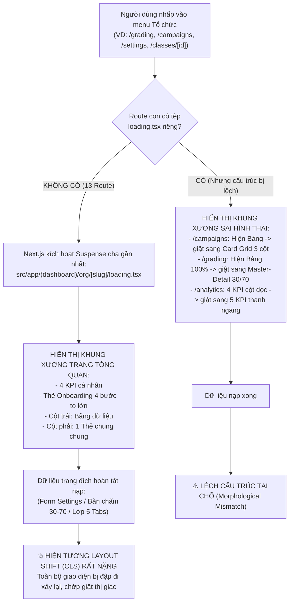
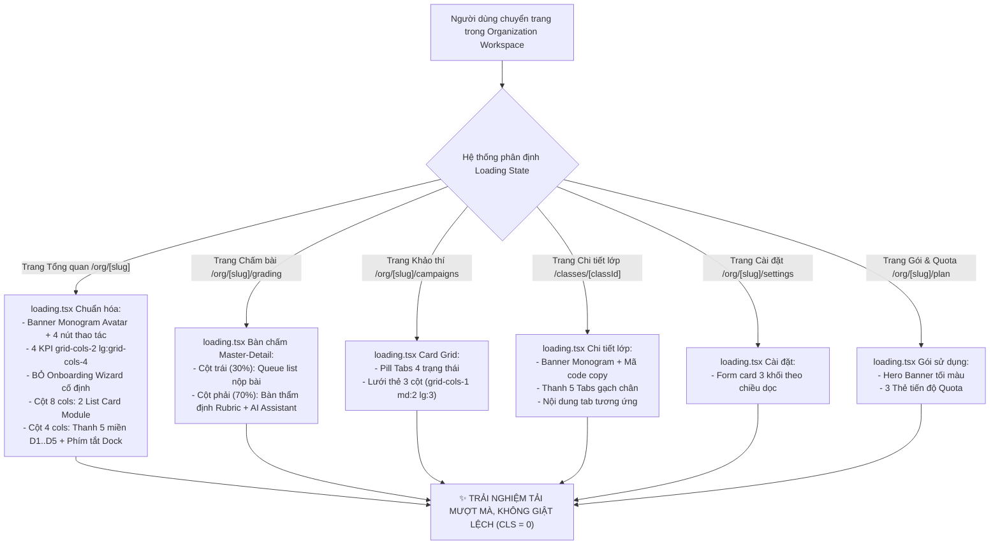

# BÁO CÁO RÀ SOÁT VÀ ĐÁNH GIÁ KHUNG XƯƠNG TẢI TRANG (SKELETON LOADING AUDIT)
## PHÂN HỆ ORGANIZATION DASHBOARD (`/org/[slug]/*`) — NEXA AI

> **Ngày thực hiện:** 22/11/2026  
> **Người thực hiện:** Chuyên gia Rà soát Giao diện & Khung xương (Skeleton Loading Auditor)  
> **Tài liệu tham chiếu:** [AGENTS.md](file:///c:/nexa/AGENTS.md), [Skeleton.tsx](file:///c:/nexa/src/components/ui/Skeleton.tsx)  
> **Phạm vi kiểm tra:** Toàn bộ các route máy chủ và thành phần hiển thị tải trang thuộc phân hệ Quản trị Tổ chức (`src/app/(dashboard)/org/**` và `src/components/dashboard/org/**`).

---

## 1. TỔNG QUAN HIỆN TRẠNG & ĐÁNH GIÁ NHANH

Trong kiến trúc Next.js App Router (React Server Components), `loading.tsx` đóng vai trò là ranh giới Suspense (`Suspense boundary`) tức thời khi người dùng chuyển trang hoặc tải dữ liệu máy chủ (`force-dynamic`). Một khung xương (Skeleton) chất lượng cao phải bảo đảm nguyên tắc **"Khớp hình thái không gian" (Morphological Match)**:
- Giữ nguyên cấu trúc lưới (Grid/Flex layout), tỷ lệ chiều rộng/chiều cao và phân cấp thị giác của trang đích.
- Ngăn chặn hiện tượng giật layout (**Cumulative Layout Shift - CLS = 0**).
- Tuân thủ tiêu chuẩn giao diện của NEXA: **Light Mode lấy trắng làm nền (`#FFFFFF`), Dark Mode lấy đen thật làm nền (`#000000` / `#111114`)**, không viền ngang vô nghĩa, không dùng gradient lòe loẹt.

### Bảng ma trận tổng hợp hiện trạng các route thuộc Organization Dashboard

| # | Route | Tệp nguồn trang đích | Có `loading.tsx` riêng? | Mức độ khớp hình thái | Mức độ CLS (Lệch layout) | Vấn đề trọng yếu phát hiện |
|:---|:---|:---|:---:|:---:|:---:|:---|
| 1 | `/org/[slug]` (Tổng quan tổ chức) | [page.tsx](file:///c:/nexa/src/app/\(dashboard\)/org/[slug]/page.tsx) | **CÓ** ([loading.tsx](file:///c:/nexa/src/app/\(dashboard\)/org/[slug]/loading.tsx)) | 35% | **NẶNG** | Luôn render cứng Onboarding Wizard 4 bước dù tổ chức đã có dữ liệu; Cột trái render Bảng thay vì 2 Module danh sách; Cột phải thiếu thanh 5 miền D1-D5. |
| 2 | `/org/[slug]/analytics` (Báo cáo năng lực) | [page.tsx](file:///c:/nexa/src/app/\(dashboard\)/org/[slug]/analytics/page.tsx) | **CÓ** ([loading.tsx](file:///c:/nexa/src/app/\(dashboard\)/org/[slug]/analytics/loading.tsx)) | 50% | **TRUNG BÌNH** | Render 4 KPI thay vì 5 KPI; Vẽ biểu đồ cột dọc sai lệch so với thanh đo tiến độ ngang 5 miền; Thiếu Trend Section 12 cột. |
| 3 | `/org/[slug]/campaigns` (Khảo thí tổ chức) | [page.tsx](file:///c:/nexa/src/app/\(dashboard\)/org/[slug]/campaigns/page.tsx) | **CÓ** ([loading.tsx](file:///c:/nexa/src/app/\(dashboard\)/org/[slug]/campaigns/loading.tsx)) | 25% | **RẤT NẶNG** | **Trang thật là Lưới Thẻ 3 cột (Card Grid), nhưng loading lại vẽ Bảng dữ liệu (SkeletonTable)!** |
| 4 | `/org/[slug]/classes` (Nhóm & Đơn vị) | [page.tsx](file:///c:/nexa/src/app/\(dashboard\)/org/[slug]/classes/page.tsx) | **CÓ** ([loading.tsx](file:///c:/nexa/src/app/\(dashboard\)/org/[slug]/classes/loading.tsx)) | 70% | **NHẸ** | Thiếu tầng Toggle View (Thẻ/Bảng) & Pill Tabs trạng thái; Card class thiếu Monogram và chip sĩ số. |
| 5 | `/org/[slug]/classes/[classId]/analytics` (Báo cáo lớp) | [page.tsx](file:///c:/nexa/src/app/\(dashboard\)/org/[slug]/classes/[classId]/analytics/page.tsx) | **CÓ** ([loading.tsx](file:///c:/nexa/src/app/\(dashboard\)/org/[slug]/classes/[classId]/analytics/loading.tsx)) | **90%** | **KHÔNG** | **Mẫu mực**: Khớp hoàn toàn từ Breadcrumb, Header, KPI strip 7/5, Donut hoàn thành đến 5 miền năng lực. |
| 6 | `/org/[slug]/grading` (Bàn chấm bài) | [page.tsx](file:///c:/nexa/src/app/\(dashboard\)/org/[slug]/grading/page.tsx) | **CÓ** ([loading.tsx](file:///c:/nexa/src/app/\(dashboard\)/org/[slug]/grading/loading.tsx)) | 20% | **RẤT NẶNG** | **Trang thật là Bàn chấm Master-Detail chia đôi (30% hàng đợi / 70% bàn chấm), nhưng loading lại vẽ 1 bảng 100% full-width!** |
| 7 | `/org/[slug]/members` (Quản lý thành viên) | [page.tsx](file:///c:/nexa/src/app/\(dashboard\)/org/[slug]/members/page.tsx) | **CÓ** ([loading.tsx](file:///c:/nexa/src/app/\(dashboard\)/org/[slug]/members/loading.tsx)) | 55% | **TRUNG BÌNH** | Thiếu thanh tóm tắt chỉ số (KPI Summary Strip); Vẽ 4 nút vai trò thay vì 2 Tabs chính (`Thành viên` / `Lời mời`). |
| 8 | `/org/[slug]/assessments` (Kho đề thi) | [page.tsx](file:///c:/nexa/src/app/\(dashboard\)/org/[slug]/assessments/page.tsx) | **KHÔNG** | 0% (Fallback) | **NẶNG** | Bị fallback về Overview Loading: Hiện 4 KPI + Wizard 4 bước -> giật sang Kho đề thi. |
| 9 | `/org/[slug]/assessments/new` (Soạn đề) | [page.tsx](file:///c:/nexa/src/app/\(dashboard\)/org/[slug]/assessments/new/page.tsx) | **KHÔNG** | 0% (Fallback) | **NẶNG** | Fallback về Overview Loading thay vì form wizard soạn đề 2 bước. |
| 10 | `/org/[slug]/assessments/[id]/edit` (Biên soạn câu hỏi) | [page.tsx](file:///c:/nexa/src/app/\(dashboard\)/org/[slug]/assessments/[id]/edit/page.tsx) | **KHÔNG** | 0% (Fallback) | **NẶNG** | Fallback về Overview Loading thay vì Editor 2 vùng. |
| 11 | `/org/[slug]/assessments/[id]/preview` (Xem trước bài thi) | [page.tsx](file:///c:/nexa/src/app/\(dashboard\)/org/[slug]/assessments/[id]/preview/page.tsx) | **KHÔNG** | N/A | NHẸ | Dùng Suspense cục bộ với spinner tròn thuần túy, chưa có khung skeleton xem trước bài thi. |
| 12 | `/org/[slug]/classes/[classId]` (Chi tiết lớp học) | [page.tsx](file:///c:/nexa/src/app/\(dashboard\)/org/[slug]/classes/[classId]/page.tsx) | **KHÔNG** | 0% (Fallback) | **CỰC NẶNG** | Tuyến đường nghiệp vụ lõi nhưng bị fallback về Overview Loading (chớp giật 4 KPI + Wizard thay vì Banner lớp + 5 Tabs). |
| 13 | `/org/[slug]/classes/[classId]/assignments/[assignmentId]` | [page.tsx](file:///c:/nexa/src/app/\(dashboard\)/org/[slug]/classes/[classId]/assignments/[assignmentId]/page.tsx) | **KHÔNG** | 0% (Fallback) | **NẶNG** | Fallback về Overview Loading thay vì Card đợt thi + 4 KPI đợt + Bảng nộp bài. |
| 14 | `/org/[slug]/campaigns/new` (Tạo đợt thi) | [page.tsx](file:///c:/nexa/src/app/\(dashboard\)/org/[slug]/campaigns/new/page.tsx) | **KHÔNG** | 0% (Fallback) | **NẶNG** | Fallback về Overview Loading thay vì CampaignWizard. |
| 15 | `/org/[slug]/campaigns/[id]` (Chi tiết đợt thi) | [page.tsx](file:///c:/nexa/src/app/\(dashboard\)/org/[slug]/campaigns/[id]/page.tsx) | **KHÔNG** | 0% (Fallback) | **NẶNG** | Fallback về Overview Loading thay vì chi tiết đợt khảo thí. |
| 16 | `/org/[slug]/live-room` (Phòng thi trực tiếp) | [page.tsx](file:///c:/nexa/src/app/\(dashboard\)/org/[slug]/live-room/page.tsx) | **KHÔNG** | 0% (Fallback) | **NẶNG** | Fallback về Overview Loading: Hiện 4 KPI sai lệch nội dung, hiện Wizard thừa thay vì 4 KPI Live + PIN Card + Room Grid. |
| 17 | `/org/[slug]/live-room/new` (Tạo phòng thi) | [page.tsx](file:///c:/nexa/src/app/\(dashboard\)/org/[slug]/live-room/new/page.tsx) | **KHÔNG** | N/A | NHẸ | Suspense fallback bằng text trần: `Đang nạp trình tạo phòng thi tổ chức...`. |
| 18 | `/org/[slug]/settings` (Cài đặt đơn vị) | [page.tsx](file:///c:/nexa/src/app/\(dashboard\)/org/[slug]/settings/page.tsx) | **KHÔNG** | 0% (Fallback) | **NẶNG** | Fallback về Overview Loading: Hiện KPI + Wizard + Bảng -> Giật sang Form cài đặt 3 khối dọc. |
| 19 | `/org/[slug]/plan` (Gói sử dụng & Quota) | [page.tsx](file:///c:/nexa/src/app/\(dashboard\)/org/[slug]/plan/page.tsx) | **KHÔNG** | 0% (Fallback) | **NẶNG** | Fallback về Overview Loading thay vì Hero Banner + 3 thẻ tiến độ Quota. |
| 20 | `/org/[slug]/my-results` (Kết quả của tôi) | [page.tsx](file:///c:/nexa/src/app/\(dashboard\)/org/[slug]/my-results/page.tsx) | **KHÔNG** | 0% (Fallback) | TRUNG BÌNH | Fallback về Overview Loading. |
| 21 | `/org/[slug]/notifications` (Thông báo) | [page.tsx](file:///c:/nexa/src/app/\(dashboard\)/org/[slug]/notifications/page.tsx) | **KHÔNG** | 0% (Fallback) | TRUNG BÌNH | Fallback về Overview Loading. |

---

## 2. SƠ ĐỒ LUỒNG PHÁT HIỆN VẤN ĐỀ VÀ KIẾN TRÚC GIẢI PHÁP

### 2.1. Hiện trạng luồng tải trang (Xảy ra xung đột thị giác & CLS cao)



### 2.2. Luồng đề xuất chuẩn hóa toàn diện



---

## 3. CHI TIẾT CÁC ĐIỂM CHƯA KHỚP & ĐỀ XUẤT SỬA ĐỔI CHO TỪNG ROUTE

### 3.1. Route Tổng quan Tổ chức (`src/app/(dashboard)/org/[slug]/loading.tsx`)
- **Điểm lệch 1 (Header Banner):** [page.tsx#L169-L238](file:///c:/nexa/src/app/\(dashboard\)/org/[slug]/page.tsx#L169-L238) dùng một khối Card Banner sang trọng có Monogram Avatar (`w-13 h-13 rounded-xl`), tên tổ chức, slug `@slug` và 4 nút bấm (`Giao đề`, `Tạo Lớp`, `Mời`, `Live`). Trong khi đó [loading.tsx#L12-L24](file:///c:/nexa/src/app/\(dashboard\)/org/[slug]/loading.tsx#L12-L24) chỉ vẽ các thanh Skeleton trơ trọi không có nền card bao bọc.
- **Điểm lệch 2 (Hàng 4 Thẻ KPI):** [page.tsx#L243](file:///c:/nexa/src/app/\(dashboard\)/org/[slug]/page.tsx#L243) dùng `grid-cols-2 lg:grid-cols-4 gap-2.5 sm:gap-4`. Còn [loading.tsx#L27](file:///c:/nexa/src/app/\(dashboard\)/org/[slug]/loading.tsx#L27) lại dùng `grid-cols-1 sm:grid-cols-2 lg:grid-cols-4 gap-4 sm:gap-6`. Trên mobile, loading hiện 1 cột nhưng trang thật lại hiện 2 cột, gây giật mạnh.
- **Điểm lệch 3 (Onboarding Wizard 4 bước - Nghiêm trọng nhất):** [page.tsx#L402](file:///c:/nexa/src/app/\(dashboard\)/org/[slug]/page.tsx#L402) ghi rõ `{rawCampaigns.length === 0 && (...)}`. Nghĩa là khối 4 bước chỉ hiện cho tổ chức mới toanh chưa có đợt thi. Nhưng trong [loading.tsx#L35-L58](file:///c:/nexa/src/app/\(dashboard\)/org/[slug]/loading.tsx#L35-L58), khối này bị ép render 100% thời gian! Khi một tổ chức đang hoạt động tải trang, khối này nhấp nháy rồi biến mất đột ngột.
- **Điểm lệch 4 (Khu vực chính 8 cột / 4 cột):** 
  - Cột 8 cột ở [page.tsx#L558-L768](file:///c:/nexa/src/app/\(dashboard\)/org/[slug]/page.tsx#L558-L768) chứa 2 Module: (1) Danh sách đợt khảo thí gần đây; (2) Lưới 2 cột các lớp học đang vận hành. Trong khi [loading.tsx#L63](file:///c:/nexa/src/app/\(dashboard\)/org/[slug]/loading.tsx#L63) lại render một `SkeletonTable rows={4} columns={4}` (Bảng dữ liệu hoàn toàn không tồn tại trên trang thật).
  - Cột 4 cột ở [page.tsx#L772-L981](file:///c:/nexa/src/app/\(dashboard\)/org/[slug]/page.tsx#L772-L981) chứa 5 thanh đo tiến độ miền năng lực số (D1..D5) và Dock 5 phím tắt điều hành. Còn [loading.tsx#L66](file:///c:/nexa/src/app/\(dashboard\)/org/[slug]/loading.tsx#L66) chỉ render một `SkeletonCard` trần trụi.

---

### 3.2. Route Hoạt động Khảo thí (`src/app/(dashboard)/org/[slug]/campaigns/loading.tsx`)
- **Vấn đề cốt lõi:** Lệch hoàn toàn hình thái hiển thị.
  - Trong [OrgCampaignsClientView.tsx#L175-L258](file:///c:/nexa/src/app/\(dashboard\)/org/[slug]/campaigns/OrgCampaignsClientView.tsx#L175-L258), danh sách chiến dịch hiển thị dạng **Lưới thẻ Card 3 cột**:
    `grid grid-cols-1 md:grid-cols-2 lg:grid-cols-3 gap-4`
    Mỗi card có huy hiệu trạng thái tròn, ngày hết hạn font mono, tiêu đề 2 dòng, tên đề thi, 2 chip thông số (số lớp tham gia, điểm đạt chuẩn) và hàng 3 nút thao tác (`Bàn chấm bài`, `Báo cáo`, `Tạo đợt mới`).
  - Trong [campaigns/loading.tsx#L22](file:///c:/nexa/src/app/\(dashboard\)/org/[slug]/campaigns/loading.tsx#L22), lại đặt một **`SkeletonTable rows={6} columns={6}`**.
- **Giải pháp:** Thay thế toàn bộ `SkeletonTable` trong `campaigns/loading.tsx` bằng lưới 6 thẻ card skeleton mô phỏng chính xác cấu trúc thẻ đợt thi, kèm thanh Pill Tabs 4 trạng thái ở phía trên.

---

### 3.3. Route Bàn chấm bài (`src/app/(dashboard)/org/[slug]/grading/loading.tsx`)
- **Vấn đề cốt lõi:** Lệch cấu trúc bố cục làm việc (Workbench Layout).
  - Trong [OrgGradingClientView.tsx#L474-L520](file:///c:/nexa/src/app/\(dashboard\)/org/[slug]/grading/OrgGradingClientView.tsx#L474-L520), bàn chấm bài là một hệ thống Master-Detail phân đôi cố định (`grid grid-cols-1 lg:grid-cols-10 min-h-[750px]`):
    - Cột trái (30% / 3 cols): Hàng đợi danh sách bài nộp của học viên kèm bộ lọc dropdown Lớp, dropdown Đợt thi, Tab trạng thái và ô tìm kiếm.
    - Cột phải (70% / 7 cols): Bàn thẩm định chi tiết gồm thông tin bài thi, điểm trắc nghiệm, câu hỏi tự luận, minh chứng, AI gợi ý điểm, bảng nhập điểm Rubric từng câu và khung nhận xét.
  - Trong [grading/loading.tsx#L13](file:///c:/nexa/src/app/\(dashboard\)/org/[slug]/grading/loading.tsx#L13), chỉ có duy nhất một `SkeletonTable rows={6} columns={6}` kéo dài 100% màn hình!
- **Giải pháp:** Thiết kế lại `grading/loading.tsx` thành lưới chia đôi 3 cột / 7 cột (hoặc 30% / 70%) đúng chuẩn Master-Detail.

---

### 3.4. Route Báo cáo Phân tích Năng lực (`src/app/(dashboard)/org/[slug]/analytics/loading.tsx`)
- **Điểm lệch 1 (Hàng KPI):** [OrgAnalyticsKpiRow.tsx#L27](file:///c:/nexa/src/features/analytics/components/OrgAnalyticsKpiRow.tsx#L27) có **5 thẻ KPI** (`grid grid-cols-2 lg:grid-cols-5 gap-2.5 sm:gap-3.5`). Nhưng [analytics/loading.tsx#L24-L29](file:///c:/nexa/src/app/\(dashboard\)/org/[slug]/analytics/loading.tsx#L24-L29) chỉ render **4 thẻ KPI** (`lg:grid-cols-4`).
- **Điểm lệch 2 (Khối 5 Miền Năng Lực):** [OrgAnalyticsDashboard.tsx#L177-L185](file:///c:/nexa/src/features/analytics/components/OrgAnalyticsDashboard.tsx#L177-L185) chia theo tỷ lệ **7 cột (DomainBarChartSection) / 5 cột (AnalyticsInsightPanel)**:
  - Cột 7 cột hiển thị 5 thanh đo tiến độ nằm ngang (D1..D5), kèm chỉ số điểm và độ phủ.
  - [analytics/loading.tsx#L38-L48](file:///c:/nexa/src/app/\(dashboard\)/org/[slug]/analytics/loading.tsx#L38-L48) lại vẽ 5 cột thẳng đứng dạng bar chart dọc, làm sai lệch triết lý hiển thị thanh đo chuẩn mực của NEXA.
- **Điểm lệch 3 (Các khối bên dưới):** Bỏ quên `PeriodTrendSection` (Biểu đồ xu hướng toàn chiều rộng 12 cột) và `DataSourceRulesBox`.

---

### 3.5. Route Quản lý Thành viên (`src/app/(dashboard)/org/[slug]/members/loading.tsx`)
- **Điểm lệch 1 (KPI Summary Strip):** [OrgMembersClientView.tsx#L298-L333](file:///c:/nexa/src/app/\(dashboard\)/org/[slug]/members/OrgMembersClientView.tsx#L298-L333) có một thanh chỉ số ngang:
  `[x thành viên hoạt động] | [y lời mời chờ] | [z ghế khả dụng / max]`
  Thanh này hoàn toàn bị thiếu trong [members/loading.tsx](file:///c:/nexa/src/app/\(dashboard\)/org/[slug]/members/loading.tsx).
- **Điểm lệch 2 (Tabs điều hướng):** Trang thật chỉ có **2 Tabs gạch chân** (`Danh sách thành viên` và `Lời mời`), trong khi loading lại render 4 khối chữ nhật giả lập các nút lọc vai trò.

---

### 3.6. Các Route Thiếu `loading.tsx` Cần Bổ Sung Ngay Lập Tức

#### A. Chi tiết Lớp học (`src/app/(dashboard)/org/[slug]/classes/[classId]/loading.tsx`)
- **Cấu trúc cần mô phỏng:**
  1. Breadcrumb: `Điều hành > Lớp và nhóm > [Tên lớp]`.
  2. Hero Banner Lớp: Tên lớp học, loại nhóm, mã PIN copy pill, hàng nút thao tác (`Báo cáo`, `Giao đề`, `Thêm thành viên`, `Live`).
  3. Thanh 5 Tabs: Bảng tin, Đề thi đã giao, Tài liệu, Thành viên, Cài đặt lớp.
  4. Khung nội dung Stream/Roster tương ứng.

#### B. Kho Đề thi Tổ chức (`src/app/(dashboard)/org/[slug]/assessments/loading.tsx`)
- **Cấu trúc cần mô phỏng:**
  1. Header: Tiêu đề "Kho đề thi" + 2 nút ("Soạn đề nội bộ mới", "Khởi tạo đợt khảo thí").
  2. Thanh Tabs: Đề thi đã sẵn sàng, Bản nháp, Tất cả + Bộ chuyển đổi View Thẻ/Bảng.
  3. Thanh tìm kiếm & lọc.
  4. Lưới thẻ hoặc bảng danh sách đề thi.

#### C. Chi tiết Đợt thi Lớp học (`src/app/(dashboard)/org/[slug]/classes/[classId]/assignments/[assignmentId]/loading.tsx`)
- **Cấu trúc cần mô phỏng:**
  1. Header: Nút quay lại lớp + Nút tải Excel.
  2. Card Thông tin đợt thi: Huy hiệu, tiêu đề đề thi, thời lượng, ngưỡng đạt, hạn nộp.
  3. Hàng 4 thẻ KPI chỉ số: Sĩ số lớp, Tiến độ nộp bài, Điểm trung bình, Tỷ lệ đạt chuẩn.
  4. Bảng danh sách học sinh và trạng thái làm bài.

#### D. Phòng thi Trực tiếp (`src/app/(dashboard)/org/[slug]/live-room/loading.tsx`)
- **Cấu trúc cần mô phỏng:**
  1. Header: Icon Radio pulse + Tiêu đề "Phòng thi trực tiếp" + Nút Làm mới + Nút Tạo phòng.
  2. Hàng 4 KPI: Tổng phòng thi, Đang diễn ra, Sắp diễn ra, Đã kết thúc.
  3. Thẻ nhập mã PIN nhanh.
  4. Lưới thẻ phòng thi dạng Card Grid.

#### E. Cài đặt Tổ chức (`src/app/(dashboard)/org/[slug]/settings/loading.tsx`)
- **Cấu trúc cần mô phỏng:**
  1. Header: Tiêu đề "Cài đặt tổ chức" + Nút Lưu / Hủy.
  2. Card 1: Hồ sơ đơn vị (Tên, Loại hình, Logo upload, Giới thiệu).
  3. Card 2: Thông tin liên hệ & Mã định danh (Mã tổ chức, Slug, Đầu mối liên hệ, Email, Số điện thoại).
  4. Card 3: Vùng nguy hiểm / Chuyển quyền quản trị.

#### F. Gói sử dụng & Hạn mức (`src/app/(dashboard)/org/[slug]/plan/loading.tsx`)
- **Cấu trúc cần mô phỏng:**
  1. Header: Tiêu đề "Gói sử dụng".
  2. Hero Banner Gói: Nền tối (`bg-[#111726]`), huy hiệu trạng thái gói, tên gói Business, metadata ngày kích hoạt & hết hạn.
  3. Hàng 3 Card Quota tiến độ: Ghế thành viên, Ngân hàng đề thi, AI Credits.
  4. Danh sách tính năng doanh nghiệp & Bảng lịch sử gia hạn.

---

## 4. BẢNG THIẾT KẾ KHUNG XƯƠNG MẪU (CODE BLUEPRINTS)

Dưới đây là mã nguồn thiết kế mẫu đã được tối ưu hóa theo quy chuẩn **Light Trắng / Dark Đen**, sử dụng các component nguyên tử từ `@/components/ui/Skeleton`:

### 4.1. Khung xương chuẩn hóa cho Trang Tổng quan Tổ chức (`org/[slug]/loading.tsx`)

```tsx
import { Skeleton, SkeletonKpiCard } from '@/components/ui/Skeleton';

export default function OrgOverviewLoading() {
  return (
    <div className="space-y-6 pb-12 animate-fadeIn">
      {/* 1. Executive Command Banner Skeleton */}
      <div className="rounded-xl border border-slate-200/90 dark:border-zinc-800 bg-white dark:bg-[#111114] p-5 sm:p-6 shadow-xs flex flex-col lg:flex-row lg:items-center justify-between gap-5">
        <div className="flex items-center gap-4">
          <Skeleton className="w-13 h-13 sm:w-14 sm:h-14 rounded-xl shrink-0" />
          <div className="space-y-2">
            <Skeleton className="h-3 w-20" />
            <Skeleton className="h-6 w-48 sm:w-64" />
          </div>
        </div>
        <div className="flex items-center gap-2 flex-wrap sm:flex-nowrap">
          <Skeleton className="h-10 w-36 rounded-xl" />
          <Skeleton className="h-10 w-24 rounded-xl" />
          <Skeleton className="h-10 w-20 rounded-xl" />
          <Skeleton className="h-10 w-20 rounded-xl" />
        </div>
      </div>

      {/* 2. Executive 4-Pillar KPI Metrics Grid */}
      <div className="grid grid-cols-2 lg:grid-cols-4 gap-2.5 sm:gap-4">
        <SkeletonKpiCard />
        <SkeletonKpiCard />
        <SkeletonKpiCard />
        <SkeletonKpiCard />
      </div>

      {/* 3. Main Operational Grid (8 Cols Left + 4 Cols Right) */}
      <div className="grid grid-cols-1 lg:grid-cols-12 gap-6 items-start">
        {/* Left Column: Recent Campaigns & Classes (8 Cols) */}
        <div className="lg:col-span-8 space-y-6">
          {/* Module 1: Đợt Khảo Thí Gần Đây */}
          <div className="rounded-xl border border-slate-200/90 dark:border-zinc-800 bg-white dark:bg-[#111114] shadow-xs p-5 space-y-4">
            <div className="flex items-center justify-between pb-2">
              <div className="space-y-1.5">
                <Skeleton className="h-4 w-44" />
                <Skeleton className="h-3 w-60" />
              </div>
              <Skeleton className="h-4 w-16" />
            </div>
            <div className="space-y-3 pt-1">
              {Array.from({ length: 3 }).map((_, i) => (
                <div key={i} className="p-3.5 rounded-lg border border-slate-100 dark:border-zinc-800/80 flex items-center justify-between gap-3">
                  <div className="space-y-2 flex-1">
                    <div className="flex items-center gap-2">
                      <Skeleton className="h-4 w-20 rounded" />
                      <Skeleton className="h-3 w-24" />
                    </div>
                    <Skeleton className="h-4 w-3/4" />
                    <Skeleton className="h-3 w-1/2" />
                  </div>
                  <div className="flex items-center gap-2 shrink-0">
                    <Skeleton className="h-8 w-20 rounded-md" />
                    <Skeleton className="h-8 w-16 rounded-md" />
                  </div>
                </div>
              ))}
            </div>
          </div>

          {/* Module 2: Lớp Học & Không Gian Đang Vận Hành */}
          <div className="rounded-xl border border-slate-200/90 dark:border-zinc-800 bg-white dark:bg-[#111114] shadow-xs p-5 space-y-4">
            <div className="flex items-center justify-between pb-2">
              <div className="space-y-1.5">
                <Skeleton className="h-4 w-48" />
                <Skeleton className="h-3 w-64" />
              </div>
              <Skeleton className="h-4 w-24" />
            </div>
            <div className="grid grid-cols-1 sm:grid-cols-2 gap-4 pt-1">
              {Array.from({ length: 4 }).map((_, i) => (
                <div key={i} className="p-4 rounded-xl border border-slate-100 dark:border-zinc-800/80 space-y-3">
                  <div className="flex items-center justify-between">
                    <Skeleton className="h-4 w-20 rounded" />
                    <Skeleton className="h-5 w-16 rounded-full" />
                  </div>
                  <Skeleton className="h-4 w-32" />
                  <div className="flex items-center gap-2 pt-1">
                    <Skeleton className="h-3 w-20" />
                    <Skeleton className="h-3 w-20" />
                  </div>
                  <div className="pt-2 flex items-center justify-between">
                    <Skeleton className="h-3 w-16" />
                    <Skeleton className="h-3 w-16" />
                  </div>
                </div>
              ))}
            </div>
          </div>
        </div>

        {/* Right Column: 5 Domains Snapshot & Shortcuts Dock (4 Cols) */}
        <div className="lg:col-span-4 space-y-6">
          {/* Card 1: 5 Miền Năng Lực Số Chuẩn Hóa */}
          <div className="rounded-xl border border-slate-200/90 dark:border-zinc-800 bg-white dark:bg-[#111114] shadow-xs p-5 space-y-4">
            <div className="flex items-center justify-between pb-2">
              <Skeleton className="h-4 w-36" />
              <Skeleton className="h-3 w-14" />
            </div>
            <div className="flex justify-between items-baseline pb-1">
              <Skeleton className="h-3 w-32" />
              <Skeleton className="h-4 w-16" />
            </div>
            <div className="space-y-3.5">
              {Array.from({ length: 5 }).map((_, idx) => (
                <div key={idx} className="space-y-1.5">
                  <div className="flex justify-between">
                    <Skeleton className="h-3 w-28" />
                    <Skeleton className="h-3 w-8" />
                  </div>
                  <Skeleton className="h-1.5 w-full rounded-full" />
                </div>
              ))}
            </div>
          </div>

          {/* Card 2: Phím Tắt Điều Hành (Dock) */}
          <div className="rounded-xl border border-slate-200/90 dark:border-zinc-800 bg-white dark:bg-[#111114] shadow-xs p-5 space-y-3">
            <div className="flex justify-between items-center pb-1">
              <Skeleton className="h-4 w-32" />
              <Skeleton className="h-3 w-10" />
            </div>
            <div className="space-y-2">
              {Array.from({ length: 5 }).map((_, idx) => (
                <div key={idx} className="flex items-center justify-between py-2">
                  <div className="flex items-center gap-2.5">
                    <Skeleton className="w-7 h-7 rounded-md shrink-0" />
                    <div className="space-y-1">
                      <Skeleton className="h-3.5 w-32" />
                      <Skeleton className="h-2.5 w-20" />
                    </div>
                  </div>
                  <Skeleton className="w-3.5 h-3.5" />
                </div>
              ))}
            </div>
          </div>
        </div>
      </div>
    </div>
  );
}
```

---

### 4.2. Khung xương chuẩn hóa cho Hoạt động Khảo thí (`campaigns/loading.tsx`)

```tsx
import { Skeleton } from '@/components/ui/Skeleton';

export default function OrgCampaignsLoading() {
  return (
    <div className="space-y-6 animate-fadeIn">
      {/* 1. Header & Create Action */}
      <div className="flex flex-col sm:flex-row sm:items-center justify-between gap-4 pb-2">
        <div className="flex items-center gap-2.5">
          <Skeleton className="h-8 w-56" />
          <Skeleton className="h-5 w-8 rounded-full" />
        </div>
        <Skeleton className="h-9 w-44 rounded-xl" />
      </div>

      {/* 2. Filter & Tabs Bar */}
      <div className="flex flex-col sm:flex-row sm:items-center justify-between gap-3">
        <div className="flex items-center gap-1.5 p-1 bg-slate-100/80 dark:bg-zinc-900/80 rounded-xl">
          <Skeleton className="h-8 w-20 rounded-lg" />
          <Skeleton className="h-8 w-28 rounded-lg" />
          <Skeleton className="h-8 w-24 rounded-lg" />
          <Skeleton className="h-8 w-28 rounded-lg" />
        </div>
        <Skeleton className="h-8 w-full sm:w-64 rounded-md" />
      </div>

      {/* 3. Lưới Thẻ Đợt Khảo Thí (Card Grid 3 Cột Chuẩn UX) */}
      <div className="grid grid-cols-1 md:grid-cols-2 lg:grid-cols-3 gap-4">
        {Array.from({ length: 6 }).map((_, i) => (
          <div
            key={i}
            className="p-5 rounded-lg border border-slate-200 dark:border-zinc-800 bg-white dark:bg-[#111114] shadow-xs flex flex-col justify-between space-y-4"
          >
            <div>
              <div className="flex items-center justify-between mb-3">
                <Skeleton className="h-5 w-24 rounded-full" />
                <Skeleton className="h-3 w-16" />
              </div>
              <Skeleton className="h-5 w-4/5 mb-2" />
              <Skeleton className="h-3.5 w-3/5" />
            </div>

            <div className="pt-3 border-t border-slate-100 dark:border-zinc-800/80 space-y-3">
              <div className="flex items-center justify-between">
                <Skeleton className="h-3 w-20" />
                <Skeleton className="h-3 w-20" />
              </div>
              <div className="flex items-center gap-2">
                <Skeleton className="h-8 flex-1 rounded" />
                <Skeleton className="h-8 w-20 rounded" />
                <Skeleton className="h-8 w-8 rounded" />
              </div>
            </div>
          </div>
        ))}
      </div>
    </div>
  );
}
```

---

### 4.3. Khung xương chuẩn hóa cho Bàn chấm bài (`grading/loading.tsx`)

```tsx
import { Skeleton } from '@/components/ui/Skeleton';

export default function OrgGradingLoading() {
  return (
    <div className="space-y-5 animate-fadeIn">
      {/* 1. Header */}
      <div className="flex flex-col sm:flex-row sm:items-center justify-between gap-4 pb-2">
        <div className="flex items-center gap-2.5">
          <Skeleton className="h-8 w-40" />
          <Skeleton className="h-5 w-16 rounded-full" />
        </div>
      </div>

      {/* 2. Main 2-Region Master-Detail Workbench (30% Left / 70% Right) */}
      <div className="grid grid-cols-1 lg:grid-cols-10 border border-slate-200/90 dark:border-zinc-800 rounded-2xl overflow-hidden bg-white dark:bg-[#111114] shadow-xs min-h-[720px]">
        {/* Left Column (30% / 3 cols): Queue list */}
        <div className="lg:col-span-3 lg:border-r border-slate-200 dark:border-zinc-800 p-3.5 space-y-3 bg-slate-50/50 dark:bg-[#0d0d10]">
          <div className="flex justify-between items-center">
            <Skeleton className="h-3 w-28" />
            <Skeleton className="h-3 w-16" />
          </div>
          <Skeleton className="h-8 w-full rounded-lg" />
          <Skeleton className="h-8 w-full rounded-lg" />
          <div className="flex gap-1.5 pt-1">
            <Skeleton className="h-7 flex-1 rounded" />
            <Skeleton className="h-7 flex-1 rounded" />
            <Skeleton className="h-7 flex-1 rounded" />
          </div>
          <div className="space-y-2 pt-2">
            {Array.from({ length: 5 }).map((_, i) => (
              <div key={i} className="p-3 rounded-xl border border-slate-200/80 dark:border-zinc-800 bg-white dark:bg-[#111114] space-y-2">
                <div className="flex justify-between items-center">
                  <Skeleton className="h-4 w-32" />
                  <Skeleton className="h-4 w-12 rounded" />
                </div>
                <Skeleton className="h-3 w-40" />
                <div className="flex justify-between text-xs pt-1">
                  <Skeleton className="h-2.5 w-16" />
                  <Skeleton className="h-2.5 w-12" />
                </div>
              </div>
            ))}
          </div>
        </div>

        {/* Right Column (70% / 7 cols): Grading Desk */}
        <div className="lg:col-span-7 p-6 space-y-6 bg-white dark:bg-[#111114]">
          <div className="flex justify-between items-start pb-4 border-b border-slate-100 dark:border-zinc-800">
            <div className="space-y-2">
              <Skeleton className="h-6 w-56" />
              <div className="flex items-center gap-3">
                <Skeleton className="h-3 w-24" />
                <Skeleton className="h-3 w-32" />
              </div>
            </div>
            <div className="flex items-center gap-2">
              <Skeleton className="h-9 w-24 rounded-lg" />
              <Skeleton className="h-9 w-32 rounded-lg" />
            </div>
          </div>

          {/* AI Grading Assist Box */}
          <div className="p-4 rounded-xl border border-blue-100 dark:border-blue-900/40 bg-blue-50/40 dark:bg-blue-950/20 space-y-2">
            <div className="flex justify-between items-center">
              <Skeleton className="h-4 w-36" />
              <Skeleton className="h-4 w-20 rounded-full" />
            </div>
            <Skeleton className="h-3.5 w-full" />
            <Skeleton className="h-3.5 w-4/5" />
          </div>

          {/* Question & Rubric evaluation */}
          <div className="space-y-4">
            <Skeleton className="h-5 w-44" />
            <div className="p-4 rounded-xl border border-slate-200/80 dark:border-zinc-800 space-y-3">
              <Skeleton className="h-4 w-full" />
              <Skeleton className="h-20 w-full rounded-lg" />
              <div className="flex justify-between items-center pt-2">
                <Skeleton className="h-4 w-28" />
                <Skeleton className="h-9 w-24 rounded-lg" />
              </div>
            </div>
          </div>
        </div>
      </div>
    </div>
  );
}
```

---

## 5. KẾT LUẬN VÀ LỘ TRÌNH TRIỂN KHAI ĐỀ XUẤT

Qua đợt rà soát toàn diện:
1. **Chất lượng bộ khung nguyên tử (`Skeleton.tsx`)**: Đã đạt chuẩn cao cấp (hỗ trợ Light Trắng / Dark Đen, animate-pulse mượt mà, token rõ ràng).
2. **Điểm cần khắc phục cấp bách (P0)**:
   - Sửa ngay `campaigns/loading.tsx` (chuyển từ Table sang Card Grid 3 cột) và `grading/loading.tsx` (chuyển từ Table sang Master-Detail Workbench 30/70).
   - Loại bỏ Onboarding Wizard hiển thị ép buộc trong `org/[slug]/loading.tsx`.
   - Bổ sung `loading.tsx` cho 3 route người dùng truy cập nhiều nhất: `/classes/[classId]`, `/assessments`, `/settings` để chấm dứt tình trạng giật giao diện do Next.js fallback về trang tổng quan.
3. **Tiêu chuẩn kiểm nghiệm sau khi sửa**: Khi di chuyển qua lại giữa các menu sidebar (Dashboard -> Lớp học -> Đợt thi -> Chấm bài -> Cài đặt), người dùng không nhận thấy bất kỳ cú giật cấu trúc (CLS = 0), khung xương định hình chính xác vị trí các nút và thẻ trước khi dữ liệu xuất hiện.
