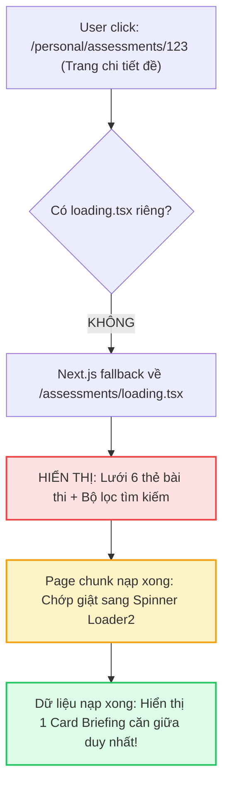
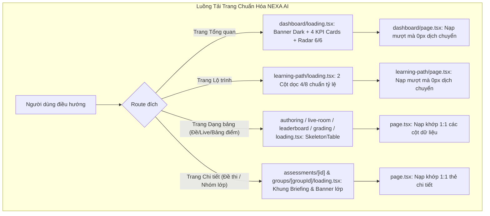

# BÁO CÁO RÀ SOÁT TOÀN DIỆN KHUNG XƯƠNG TẢI TRANG (SKELETON / LOADING STATES)
## Phân hệ Personal Dashboard (`/personal/*`) — Nền tảng NEXA AI

**Thời gian thực hiện:** Tháng 11/2026  
**Chuyên gia thực hiện:** Chuyên gia Rà soát Giao diện & Khung xương (Skeleton Loading Auditor)  
**Phạm vi:** Toàn bộ cây route `src/app/(dashboard)/personal/**`, các component loading nội bộ và thư viện khung xương chuẩn `src/components/ui/Skeleton.tsx`.

---

## I. TỔNG QUAN HIỆN TRẠNG CÁC ROUTE CỦA PERSONAL DASHBOARD

Trong kiến trúc Next.js App Router, file `loading.tsx` đóng vai trò là Suspense Boundary tự động tại cấp độ route. Khi một route con không có file `loading.tsx` riêng, Next.js sẽ tự động duyệt ngược lên cây thư mục để sử dụng `loading.tsx` của route cha gần nhất.

Khảo sát thực tế trong toàn bộ thư mục `src/app/(dashboard)/personal/**` cho thấy:
- **Tổng số route kiểm tra:** 18 route chính và nhánh con.
- **Số file `loading.tsx` hiện có:** 6 file (`personal/loading.tsx`, `dashboard/loading.tsx`, `assessments/loading.tsx`, `groups/loading.tsx`, `learning-path/loading.tsx`, `profile/loading.tsx`).
- **Số route thiếu hoàn toàn `loading.tsx`:** 12 route (bao gồm các màn hình cốt lõi như Bảng xếp hạng, Quản lý đề, Chấm bài, Bài được giao, Phòng thi trực tiếp, Chứng chỉ, và các trang chi tiết).
- **Hiện tượng xung đột:** 100% các trang con thiếu `loading.tsx` đều gặp hiện tượng **Kế thừa sai lệch cấu trúc** (Inherited Skeleton Mismatch) và **Xung đột tầng tải kép** (Next.js Skeleton $\rightarrow$ Client Spinner $\rightarrow$ Render UI), gây ra chỉ số dịch chuyển bố cục tích lũy (Cumulative Layout Shift - CLS) rất cao và chớp giật giao diện.

### Bảng tổng hợp hiện trạng chi tiết từng Route

| STT | Route URL | Có `loading.tsx` riêng? | Mức độ khớp với `page.tsx` | Vấn đề phát hiện |
| :--- | :--- | :---: | :---: | :--- |
| 1 | `/personal` (Root redirect) | Có (`personal/loading.tsx`) | Trung bình (Fallback gốc) | Chỉ gồm 2 thẻ `SkeletonCard` đơn điệu; đóng vai trò fallback chung cho mọi trang thiếu loading khiến layout bị bóp méo khi kế thừa. |
| 2 | `/personal/dashboard` | Có (`dashboard/loading.tsx`) | **Lệch nghiêm trọng** | • Banner hero loading màu trắng nhưng thực tế là dải lụa Dark Luxury (`#0B1224`) $\rightarrow$ Flash chói mắt.<br>• Thiếu hoàn toàn hàng 4 Thẻ chỉ số Bento (KPI Cards) phía trên.<br>• Nhét sai vị trí 2 thẻ KPI xuống dưới biểu đồ Radar.<br>• Chia cột 7/5 với danh sách bài đánh giá giả định, trong khi trang thật chia 6/6 với 5 thanh đối chuẩn miền năng lực.<br>• Bỏ sót hoàn toàn 2 hàng thẻ phía dưới (Chuyên đề + BXH top 5; Hoạt động gần đây + Gợi ý). |
| 3 | `/personal/assessments` | Có (`assessments/loading.tsx`) | Lệch vừa | • Thanh lọc hiển thị 5 chip miền cố định trong khi trang thật dùng 2 menu Dropdown đa chọn.<br>• Thừa khung subtitle mà tiêu đề thật không có.<br>• Lưới 6 thẻ bài thi khớp khá tốt. |
| 4 | `/personal/assessments/[id]` | **KHÔNG** | **Lệch nghiêm trọng (Kế thừa sai)** | Kế thừa khung xương của `/assessments` (lưới 6 thẻ bài thi + thanh tìm kiếm). Người dùng bấm vào 1 bài thi thì màn hình chớp ra 6 thẻ danh sách, sau đó nhảy sang trang Briefing đơn lẻ căn giữa. Bên trong `page.tsx` dùng spinner xoay tròn `<Loader2>`. |
| 5 | `/personal/assessments/[id]/result` | **KHÔNG** | **Lệch nghiêm trọng (Kế thừa sai)** | Server Component tải dữ liệu từ DB nhưng kế thừa khung xương lưới 6 thẻ của route cha. Khi tải xong giật sang giao diện kết quả điểm số, radar chart và danh sách câu hỏi. |
| 6 | `/personal/groups` | Có (`groups/loading.tsx`) | **Lệch cấu trúc** | • Lưới thẻ skeleton là 3 cột (`lg:grid-cols-3`), nhưng trang thật là lưới 2 cột (`md:grid-cols-2`) $\rightarrow$ Bố cục bị co giật khi nạp xong.<br>• Thiếu thanh 4 Tab phân loại (`Tất cả`, `Tôi quản lý`, `Tôi tham gia`, `Lời mời`).<br>• Khi trang client-side loading, lại tự vẽ 4 khối xám thô (`h-44 rounded-2xl animate-pulse`) thay vì dùng Skeleton chuẩn. |
| 7 | `/personal/groups/[groupId]` | **KHÔNG** | **Lệch nghiêm trọng (Kế thừa sai)** | Kế thừa khung xương lưới nhóm học tập của route cha (2 nút bấm + tìm kiếm + 6 thẻ nhóm). Trang thật là Google Classroom layout: Banner `ClassHeader` (mã lớp, quản trị, tabs) và luồng Bảng tin (`ClassStreamTab`). Bị chớp `<Loader2>`. |
| 8 | `/personal/groups/[groupId]/assignments/[assignmentId]` | **KHÔNG** | **Lệch nghiêm trọng (Kế thừa sai)** | Kế thừa khung xương lưới 6 thẻ nhóm của route ông bà (`groups/loading.tsx`). Trang thật là bảng danh sách bài nộp và thống kê nộp bài của thành viên. |
| 9 | `/personal/learning-path` | Có (`learning-path/loading.tsx`) | **Đảo ngược 100% layout** | • Khung xương xếp 5 thẻ nằm ngang toàn trang ở trên + 1 thẻ rộng ở dưới.<br>• Trang thực tế chia 2 cột dọc (`4 cols` bên trái gồm 5 trụ miền và card gói; `8 cols` bên phải gồm cây kỹ năng và trạm bồi dưỡng).<br>• Gây CLS cực lớn, bố cục bị xáo trộn hoàn toàn khi tải xong. |
| 10 | `/personal/profile` | Có (`profile/loading.tsx`) | **Lệch cấu trúc & Xung đột tầng** | • Hero card skeleton thiếu thanh tiến trình cấp độ, điểm PTS và 2 thẻ chỉ số học tập bên phải.<br>• Thân trang skeleton chia 8/4 với form nhập liệu giả định; trang thật chia 3/9 (cột trái 3 cols là danh mục neo dính Subnav, cột phải 9 cols là 5 card cài đặt).<br>• Xung đột tầng tải: `page.tsx` bọc `<Suspense fallback={<Loader2>}>` và `if (loading) return <Loader2>` $\rightarrow$ Khung xương hiện lên, tắt đi thành màn hình trắng xoay tròn, rồi mới hiện nội dung thật. |
| 11 | `/personal/submissions` | **KHÔNG** | **Thiếu hoàn toàn** | Rơi về root loading (2 thẻ chung chung). Trang thật gồm: Header, 4 Tabs nhiệm vụ, Thanh lọc lớp và thời gian, Danh sách thẻ nhiệm vụ. Khi tải nội bộ hiển thị icon xoay `<Loader2>` lớn giữa màn hình. |
| 12 | `/personal/grading` | **KHÔNG** | **Thiếu hoàn toàn** | Rơi về root loading. Trang thật là Bàn làm việc Thẩm định Master-Detail (30% cột trái danh sách bài nộp; 70% cột phải là Rubric chấm điểm, gợi ý AI và khung phản hồi). Khi nạp nội bộ, cột trái hiện `<RefreshCw>` xoay vòng, cột phải trống rỗng. |
| 13 | `/personal/credentials` | **KHÔNG** | **Thiếu hoàn toàn** | Rơi về root loading. Trang thật gồm: Header, Thanh tiến độ mở khóa điều kiện, và Khung phôi chứng chỉ khổ ngang cao cấp (`MasterCertificateCard`). Nội bộ dùng `<RefreshCw>` xoay tròn. |
| 14 | `/personal/authoring` | **KHÔNG** | **Thiếu hoàn toàn** | Rơi về root loading. Mặc định trang là dạng Bảng dữ liệu 7 cột (`table`) kèm phân trang, tìm kiếm, lọc miền. Cần dùng `SkeletonTable` nhưng lại bị hiển thị 2 thẻ card, sau đó giật sang icon xoay `<Loader2>` rồi mới bung ra bảng. |
| 15 | `/personal/live-room` | **KHÔNG** | **Thiếu hoàn toàn** | Rơi về root loading. Trang thật gồm: Header có nút nhập nhanh mã PIN, Hàng nút hành động ("Mở phòng mới"), Thanh tìm kiếm bộ lọc, và Bảng dữ liệu danh sách phòng thi trực tiếp. Trang bọc `<Suspense>` trả về chuỗi text trần `"Đang nạp danh sách phòng đánh giá..."`. |
| 16 | `/personal/leaderboard` | **KHÔNG** | **Thiếu hoàn toàn** | Rơi về root loading. Trang thật gồm: Hero banner với 4 tab thời gian, Bục vinh danh Top 3 Podium (Hạng 2 - Hạng 1 - Hạng 3 với vòng nguyệt quế), và Bảng xếp hạng thành tích toàn hệ thống. Nội bộ dùng icon xoay `<RefreshCw>`. |
| 17 | `/personal/take/[id]` | **KHÔNG** | **Xung đột 3 tầng tải** | Khi vào làm bài thi, người dùng trải qua 3 tầng loading liên tiếp: (1) Root loading 2 cards $\rightarrow$ (2) Suspense fallback spinner 60vh $\rightarrow$ (3) Fixed modal overlay với vòng xoay xanh `border-t-transparent`. Cần một khung làm bài thi tinh gọn (Header thanh tiến trình + Cột câu hỏi + Danh sách đáp án). |
| 18 | `/personal/billing` | **KHÔNG** | **Thiếu hoàn toàn** | Rơi về root loading. Trang thật là trang Biểu phí gồm: Header, Khối thông tin gói hiện tại, Nút chuyển chu kỳ Tháng/Năm, và Lưới 3-4 Thẻ gói dịch vụ. |

---

## II. CHI TIẾT CÁC ĐIỂM CHƯA KHỚP, LỆCH LAYOUT VÀ XUNG ĐỘT TẦNG TẢI

### 1. Phân tích 5 file `loading.tsx` hiện có

```
[Hiện trạng tải trang]
Người dùng click link ──> Next.js Loading.tsx (Bố cục A) ──> Page Component (Bố cục B) ──> Chớp giật (CLS)
                               ▲                                      │
                               └────────── Lệch vị trí / Thiếu cột ───┘
```

#### A. `personal/dashboard/loading.tsx` vs `dashboard/page.tsx`
* **Đường dẫn mã nguồn:**
  - Loading: `src/app/(dashboard)/personal/dashboard/loading.tsx`
  - Page: `src/app/(dashboard)/personal/dashboard/page.tsx`
* **Các điểm sai lệch cụ thể:**
  1. **Lệch màu sắc và hiệu ứng ánh sáng (Color Flash):** Banner Hero ở `loading.tsx` dùng card trắng/xám (`bg-white dark:bg-zinc-900/40`), trong khi banner thực tế tại `page.tsx` (dòng 598) là dải lụa Dark Luxury (`bg-gradient-to-br from-[#0B1224] via-[#0F1B3B] to-[#0A1026] text-white`). Khi người dùng ở Light Mode tải trang, màn hình chớp trắng rồi bất ngờ chuyển thành xanh đen đậm.
  2. **Bỏ sót hoàn toàn hàng 4 thẻ KPI:** Ở `page.tsx` (dòng 808-897), ngay dưới banner là hàng 4 thẻ chỉ số Bento (Bài đã hoàn thành, Miền đạt chuẩn, Điểm tích lũy PTS, Chứng chỉ). Trong `loading.tsx`, hàng này hoàn toàn biến mất!
  3. **Đặt sai vị trí `SkeletonKpiCard`:** Tại `loading.tsx` (dòng 63-65), 2 thẻ KPI lại bị nhét xuống dưới biểu đồ Radar (cột 7). Trong thực tế, dưới biểu đồ Radar không có thẻ KPI nào.
  4. **Lệch cấu trúc cột chính:**
     - `loading.tsx` chia 7/5: Cột trái 7 cols (Radar + 2 KPI), Cột phải 5 cols (Danh sách bài thi 2 mục).
     - `page.tsx` (dòng 900-1000) chia 6/6: Cột trái 6 cols (Radar Chart borderless), Cột phải 6 cols (5 thanh tiến độ đối chuẩn các miền năng lực, không có danh sách bài thi ở đây!).
  5. **Bỏ sót nửa dưới trang:** `page.tsx` còn có hàng Chuyên đề bồi dưỡng (5 thẻ) + Bảng xếp hạng top 5 (dòng 1326), cùng hàng 3 card cuối trang (Hoạt động gần đây, Gợi ý bài thi, Mục tiêu). `loading.tsx` hoàn toàn trống ở phần này.

#### B. `personal/learning-path/loading.tsx` vs `learning-path/page.tsx`
* **Đường dẫn mã nguồn:**
  - Loading: `src/app/(dashboard)/personal/learning-path/loading.tsx`
  - Page: `src/app/(dashboard)/personal/learning-path/page.tsx`
* **Các điểm sai lệch cụ thể:**
  1. **Đảo lộn chiều không gian 100%:**
     - `loading.tsx` (dòng 16-36): Xếp 5 thẻ trụ miền dàn hàng ngang (`grid-cols-1 sm:grid-cols-2 lg:grid-cols-5 gap-3.5`) kéo dài hết chiều rộng màn hình, sau đó là 1 card lớn toàn màn hình ở dưới.
     - `page.tsx` (dòng 393-600): Thiết kế chuẩn là **2 cột dọc song song** (`grid-cols-1 lg:grid-cols-12 gap-6`). Cột trái chiếm 4 cột (`lg:col-span-4`) chứa khối 5 trụ miền xếp chồng theo chiều dọc có dải lụa Silk Ribbon header + card nâng cấp tài khoản; Cột phải chiếm 8 cột (`lg:col-span-8`) chứa chặng bồi dưỡng và danh sách các trạm kỹ năng.
  2. **Hậu quả:** Người dùng nhìn thấy 5 ô ngang, khi nạp xong lập tức bị dồn sang cột trái thành thanh dọc, toàn bộ nội dung bên dưới bị đẩy văng sang bên phải, tạo cảm giác giật cục rất mạnh.

#### C. `personal/groups/loading.tsx` vs `groups/page.tsx`
* **Đường dẫn mã nguồn:**
  - Loading: `src/app/(dashboard)/personal/groups/loading.tsx`
  - Page: `src/app/(dashboard)/personal/groups/page.tsx`
* **Các điểm sai lệch cụ thể:**
  1. **Lệch số cột lưới thẻ:** `loading.tsx` (dòng 22) tạo lưới 3 cột (`lg:grid-cols-3`) với 6 thẻ. Nhưng `page.tsx` (dòng 559) lại thiết kế dạng thẻ ngang 2 cột (`grid-cols-1 md:grid-cols-2 gap-4.5`) để hiển thị thông tin nhóm lớp (monogram, vai trò, số thành viên, số bài tập).
  2. **Thiếu thanh Tabs điều hướng:** `page.tsx` (dòng 473-533) có thanh tab quan trọng gồm 4 mục (`Tất cả`, `Tôi quản lý`, `Tôi tham gia`, `Lời mời`). `loading.tsx` bỏ quên toàn bộ thanh tab này, chỉ để lại thanh tìm kiếm cô đơn.
  3. **Tự chế khung xám thô trong client component:** Tại dòng 550 của `groups/page.tsx`, khi state `loading` là `true`, trang lại tự render 4 thẻ div rỗng xám xịt (`h-44 rounded-2xl ... animate-pulse`) thay vì dùng component Skeleton có sẵn.

#### D. `personal/profile/loading.tsx` vs `profile/page.tsx`
* **Đường dẫn mã nguồn:**
  - Loading: `src/app/(dashboard)/personal/profile/loading.tsx`
  - Page: `src/app/(dashboard)/personal/profile/page.tsx`
* **Các điểm sai lệch cụ thể:**
  1. **Hero Card thiếu nửa thông tin:** `page.tsx` (dòng 464-627) thiết kế Hero Card 2 nửa đối xứng: nửa trái là Avatar + Tên + Email; nửa phải là Điểm số PTS + Thanh tiến trình lên cấp + 2 Thẻ tiến độ học tập số ("Bài đã hoàn thành", "Tỷ lệ làm đúng"). `loading.tsx` chỉ tạo nửa bên trái, bỏ trống hoàn toàn cụm dữ liệu bên phải.
  2. **Sai lệch tỷ lệ cột thân trang:** `loading.tsx` (dòng 25-49) chia 8/4 với form nhập dữ liệu giả định; trang thực tế chia 3/9 (cột trái 3 cols là thanh Subnav neo dính gồm 5 mục cài đặt, cột phải 9 cols là 5 card cài đặt cuộn dọc).
  3. **Xung đột 3 tầng tải:** `profile/page.tsx` bọc component bằng `<Suspense fallback={<Loader2 ...>}>` và bên trong hàm component lại kiểm tra `if (loading) return <Loader2 ...>`. Khi chuyển trang, người dùng thấy `loading.tsx`, sau đó màn hình giật sang spinner xoay tròn trắng trơn, rồi mới hiện trang thật.

#### E. `personal/assessments/loading.tsx` vs `assessments/page.tsx`
* **Đường dẫn mã nguồn:**
  - Loading: `src/app/(dashboard)/personal/assessments/loading.tsx`
  - Page: `src/app/(dashboard)/personal/assessments/page.tsx`
* **Các điểm sai lệch:**
  1. `loading.tsx` (dòng 16-20) giả lập 5 chip bấm chọn miền cố định (`Array.from({ length: 5 }).map(...)`), nhưng thực tế trang dùng **Menu Dropdown lọc miền đa chọn** (`isDomainMenuOpen`) và **Dropdown quyền truy cập** (`isTierMenuOpen`).

---

### 2. Nguy cơ Kế thừa Khung xương Sai lệch (Inherited Loading Hazards)

Hiện tượng này xảy ra khi các route con không được trang bị `loading.tsx`, khiến Next.js tự động lấy `loading.tsx` của route cha đắp vào:



1. **Thảm họa UX tại `/personal/assessments/[id]`:**
   - Mục đích trang: Màn hình Briefing giới thiệu bài thi (quy chế, số câu, thời gian, nút bấm bắt đầu làm bài).
   - Khung xương hiển thị lúc chờ: **Lưới 6 bài thi của trang danh mục!** Người dùng tưởng mình bị bấm trượt hoặc trang bị chuyển hướng ngược về danh sách, 1 giây sau giao diện biến mất và thay bằng card đơn.
2. **Thảm họa UX tại `/personal/assessments/[id]/result`:**
   - Mục đích trang: Báo cáo kết quả bài làm, biểu đồ radar điểm số các miền, phân tích khoảng trống và xem lại câu hỏi.
   - Khung xương hiển thị lúc chờ: Lưới 6 bài thi của trang danh mục.
3. **Thảm họa UX tại `/personal/groups/[groupId]`:**
   - Mục đích trang: Không gian lớp học gồm Banner lớp, mã tham gia, tab Bảng tin, Bài tập, Tài liệu.
   - Khung xương hiển thị lúc chờ: Danh mục 6 nhóm học tập và thanh tìm kiếm nhóm.
4. **Các trang dữ liệu dạng bảng rơi về Root Loading (2 thẻ rỗng):**
   - `/personal/authoring` (Bảng quản lý đề thi) $\rightarrow$ Hiện 2 thẻ card rỗng $\rightarrow$ Giật sang bảng 7 cột.
   - `/personal/live-room` (Bảng phòng thi trực tiếp) $\rightarrow$ Hiện 2 thẻ card rỗng $\rightarrow$ Giật sang bảng phòng thi.
   - `/personal/grading` (Bàn thẩm định Master-Detail) $\rightarrow$ Hiện 2 thẻ card rỗng $\rightarrow$ Giật sang chia đôi 30/70.
   - `/personal/leaderboard` (Bục vinh danh Top 3 + Bảng xếp hạng) $\rightarrow$ Hiện 2 thẻ card rỗng $\rightarrow$ Giật sang bục podium vàng.
   - `/personal/credentials` (Phôi chứng chỉ ngang) $\rightarrow$ Hiện 2 thẻ card rỗng $\rightarrow$ Giật sang phôi bằng khen.

---

### 3. Đánh giá sự đồng bộ với `src/components/ui/Skeleton.tsx`

File `src/components/ui/Skeleton.tsx` đã được xây dựng rất bài bản với đầy đủ các thành phần nguyên tử và khối ghép:
- `Skeleton`: Khối nhịp thở chuẩn với hỗ trợ cả Light Mode (`bg-slate-200/80`) và Dark Mode (`dark:bg-zinc-800/80`).
- `SkeletonText`: Dòng văn bản tự nhiên có độ dài so le.
- `SkeletonKpiCard`: Thẻ chỉ số chuẩn có ô icon, số liệu và nhãn phụ.
- `SkeletonCard`: Thẻ nội dung tổng quát.
- `SkeletonTable`: Khung giả lập bảng dữ liệu chuẩn (thanh công cụ tìm kiếm, tiêu đề cột, các hàng dữ liệu).
- `SkeletonRadarChart`: Khung giả lập biểu đồ mạng nhện 5 miền năng lực số.

**Những điểm bất cập khi đối chiếu với mã nguồn thực tế:**
1. **Lãng phí `SkeletonTable`:** Component này hoạt động rất đẹp tại `admin` và `org/[slug]`, nhưng **hoàn toàn vắng bóng** trong toàn bộ phân hệ `personal`, mặc dù Personal có tới 5 trang thuần bảng dữ liệu (`authoring`, `live-room`, `leaderboard`, `grading`, `billing history`).
2. **Sử dụng sai vị trí `SkeletonKpiCard` và `SkeletonRadarChart`:** Tại `dashboard/loading.tsx`, các component này bị đặt lệch so với grid thực tế của `dashboard/page.tsx`.
3. **Mã rải rác và không đồng nhất:** Thay vì gọi các component chuẩn từ `@/components/ui/Skeleton`, nhiều file `page.tsx` tự viết các thẻ `div animate-pulse` không đồng nhất về độ bo góc (`rounded-xl` vs `rounded-2xl`) hoặc lạm dụng spinner `<Loader2 className="animate-spin">`.

---

## III. ĐỀ XUẤT THIẾT KẾ VÀ GIẢI PHÁP CHUẨN HÓA

### 1. Kiến trúc luồng tải trang chuẩn hóa (Target State)



### 2. Danh mục các file cần bổ sung và chỉnh sửa

#### Nhóm 1: Sửa chữa 5 file `loading.tsx` hiện có cho khớp 1:1 với layout thực tế

1. **`src/app/(dashboard)/personal/dashboard/loading.tsx`:**
   - **Header:** Căn chỉnh tiêu đề bên cạnh có ô tròn giả lập Level Gauge (`w-11 h-11 rounded-full`); bên phải là chuỗi 7 ô vuông giả lập Streak 7 ngày (`w-6 h-6`).
   - **Hero Banner:** Đổi nền thành màu tối sang trọng `bg-gradient-to-br from-[#0B1224] via-[#0F1B3B] to-[#0A1026] text-white border-blue-500/20` để đồng nhất 100% với banner thật, chấm dứt hiện tượng chớp trắng (Color Flashing).
   - **4 KPI Bento Cards:** Bổ sung hàng 4 thẻ `SkeletonKpiCard` ngay dưới Hero banner (`grid-cols-2 lg:grid-cols-4 gap-4`).
   - **Khu vực Radar & Đối chuẩn 5 Miền:** Chia đều 6/6 (`lg:col-span-6` bên trái cho `SkeletonRadarChart`; `lg:col-span-6` bên phải cho 5 thanh tiến độ miền năng lực so le).
   - **Khu vực Chuyên đề & BXH Top 5:** Khối 8/4 (`lg:col-span-8` gồm 5 thẻ chuyên đề nằm ngang; `lg:col-span-4` gồm 5 dòng xếp hạng).
   - **3 Card chân trang:** Bổ sung lưới 3 cột (`grid-cols-1 md:grid-cols-2 lg:grid-cols-3 gap-6`) cho Hoạt động gần đây, Gợi ý bài thi và Mục tiêu.

2. **`src/app/(dashboard)/personal/learning-path/loading.tsx`:**
   - Xóa bỏ lưới 5 thẻ ngang toàn màn hình.
   - Chuyển sang bố cục 2 cột dọc chuẩn (`grid-cols-1 lg:grid-cols-12 gap-6`):
     - **Cột trái (`lg:col-span-4`):** Khung card viền bo tròn chứa Banner lụa xanh ở trên + Danh sách 5 nút trụ miền xếp dọc + Card trạng thái tài khoản ở dưới.
     - **Cột phải (`lg:col-span-8`):** Header chặng bồi dưỡng lớn + 4 khối trạm kỹ năng phân nhánh.

3. **`src/app/(dashboard)/personal/groups/loading.tsx`:**
   - Bổ sung thanh 4 Tab phân loại (`Skeleton h-10 w-24 rounded-xl` $\times$ 4) đặt cạnh thanh tìm kiếm.
   - Chuyển lưới thẻ từ 3 cột (`lg:grid-cols-3`) sang **2 cột chuẩn (`grid-cols-1 md:grid-cols-2 gap-4.5`)**.
   - Mỗi thẻ nhóm giả lập có dải banner đầu thẻ (monogram tròn + nhãn vai trò) và hàng thông số (thành viên, bài tập) để khớp hoàn toàn với thẻ `ClassGroupItem`.

4. **`src/app/(dashboard)/personal/profile/loading.tsx`:**
   - **Hero Card:** Bổ sung cột bên phải gồm vòng tròn Trophy PTS, thanh tiến trình thon dài và 2 thẻ chỉ số nhỏ.
   - **Thân trang:** Thay đổi từ lưới 8/4 thành **lưới 3/9**:
     - Cột trái (`lg:col-span-3`): Khung dọc Subnav dính gồm 5 thanh nút bo tròn (`h-10 w-full`).
     - Cột phải (`lg:col-span-9`): 5 khối card cài đặt xếp chồng dọc (`SkeletonCard lines={3}`).
   - **Xử lý xung đột tại `profile/page.tsx`:** Loại bỏ component spinner trắng `<Loader2>` trơ trọi bên trong trang khi loading để tận dụng triệt để khung xương này.

5. **`src/app/(dashboard)/personal/assessments/loading.tsx`:**
   - Sửa thanh công cụ lọc: Thay 5 chip cố định bằng 2 khung Dropdown (`h-10 w-36 rounded-xl` và `h-10 w-28 rounded-xl`).
   - Xóa dòng subtitle thừa để tránh giật chiều cao khi trang tải xong.

---

#### Nhóm 2: Bổ sung 9 file `loading.tsx` mới cho các route đang thiếu

1. **`src/app/(dashboard)/personal/submissions/loading.tsx`:**
   - Header tiêu đề nhiệm vụ.
   - Thanh 4 Tab trạng thái (`Tất cả`, `Cần làm`, `Đã nộp`, `Đã chấm`).
   - Thanh lọc (Search input + Dropdown chọn lớp + Dropdown chọn hạn nộp).
   - Danh sách 4 thẻ nhiệm vụ dạng ngang (`SkeletonCard lines={2}`).

2. **`src/app/(dashboard)/personal/grading/loading.tsx`:**
   - Khung Bàn thẩm định Master-Detail chia 2 vùng (`lg:grid-cols-10`):
     - Vùng trái 30% (`lg:col-span-3`): Thanh tìm kiếm + Bộ lọc 3 tab (`Tất cả`, `Chờ chấm`, `Đã chấm`) + 4 thẻ bài nộp của thí sinh.
     - Vùng phải 70% (`lg:col-span-7`): Header thí sinh + Khung đề bài + Khung tiêu chí Rubric đánh giá + Khung nhận xét phản hồi.

3. **`src/app/(dashboard)/personal/credentials/loading.tsx`:**
   - Header tiêu đề chứng chỉ + nút Làm mới.
   - Card thanh tiến độ tích lũy điểm mở khóa chứng chỉ (`h-2 rounded-full`).
   - Khung phôi chứng chỉ lớn khổ ngang (`aspect-[1.414/1] max-w-4xl mx-auto rounded-3xl border-2 border-dashed`) có khung hoa văn, con dấu tròn và các dòng chữ ký danh dự.

4. **`src/app/(dashboard)/personal/authoring/loading.tsx`:**
   - Header trang Soạn đề + Nút "Soạn đề mới".
   - Thanh Tab trạng thái đề thi (`Tất cả`, `Đã phát hành`, `Bản nháp`, `Lưu trữ`).
   - Thanh công cụ lọc tìm kiếm + nút chuyển đổi Bảng/Lưới.
   - Bảng dữ liệu chuẩn bằng component `SkeletonTable rows={8} columns={7}`.

5. **`src/app/(dashboard)/personal/live-room/loading.tsx`:**
   - Header có nút "Tham gia bằng PIN" và nút "Mở phòng mới".
   - Thanh tìm kiếm và bộ lọc trạng thái phòng thi.
   - Bảng dữ liệu chuẩn bằng component `SkeletonTable rows={6} columns={7}`.

6. **`src/app/(dashboard)/personal/leaderboard/loading.tsx`:**
   - Hero banner vinh danh với 4 nút chuyển mốc thời gian (`grid-cols-4`).
   - Bục vinh danh Podium Top 3 (3 bệ nâng với độ cao so le: Hạng 2 bên trái, Hạng 1 ở giữa nhô cao, Hạng 3 bên phải).
   - Bảng thành tích hệ thống bằng component `SkeletonTable rows={10} columns={3}`.

7. **`src/app/(dashboard)/personal/groups/[groupId]/loading.tsx`:**
   - Chặn đứng việc kế thừa khung xương danh mục nhóm.
   - Khung `ClassHeader` banner lớn: Ảnh đại diện lớp, tiêu đề lớp, mã lớp, danh sách thành viên và hàng Tabs ngang (`Bảng tin`, `Bài tập`, `Tài liệu`, `Thành viên`, `Cài đặt`).
   - Khung dòng tin Bảng tin (ô đăng tin nhanh + 2 bài viết mẫu).

8. **`src/app/(dashboard)/personal/assessments/[id]/loading.tsx`:**
   - Chặn đứng việc kế thừa lưới 6 bài thi của trang danh mục.
   - Khung Briefing bài thi đơn lẻ căn giữa màn hình (`max-w-2xl mx-auto rounded-3xl p-8`): Icon la bàn tròn, Tiêu đề bài thi, Đoạn mô tả quy chế, Lưới 2 ô thông số (Số câu hỏi, Phạm vi đánh giá), Danh sách 5 miền được khảo thí, và 2 nút hành động CTA.

9. **`src/app/(dashboard)/personal/assessments/[id]/result/loading.tsx`:**
   - Header kết quả khảo thí + ngày nộp bài.
   - Khung Radar kết quả 5 miền chia đôi: bên trái là vòng tròn `SkeletonRadarChart`, bên phải là 2 thẻ điểm số và tỷ lệ đạt chuẩn.
   - Danh sách 5 thanh đánh giá chi tiết từng miền năng lực.

---

### 3. Blueprint mã nguồn tham khảo cho các Khung xương trọng điểm

#### A. Khung xương Dashboard chính: `src/app/(dashboard)/personal/dashboard/loading.tsx`
```tsx
import {
  Skeleton,
  SkeletonKpiCard,
  SkeletonRadarChart,
  SkeletonCard,
} from '@/components/ui/Skeleton';

export default function PersonalDashboardLoading() {
  return (
    <div className="space-y-6 max-w-7xl mx-auto pb-12 animate-fadeIn">
      {/* 1. Header: Greeting + Level Gauge + Streak Tracker */}
      <div className="flex flex-col lg:flex-row lg:items-center justify-between gap-3 lg:gap-6 pb-1">
        <div className="flex items-center gap-3 sm:gap-4 flex-wrap sm:flex-nowrap">
          <Skeleton className="h-8 w-48 sm:w-64" />
          <div className="flex items-center gap-2">
            <Skeleton className="w-11 h-11 rounded-full shrink-0" />
            <div className="space-y-1">
              <Skeleton className="h-3 w-20" />
              <Skeleton className="h-2.5 w-16" />
            </div>
          </div>
        </div>
        <div className="flex items-center gap-1.5">
          {Array.from({ length: 7 }).map((_, i) => (
            <Skeleton key={i} className="w-6 h-6 rounded-md" />
          ))}
        </div>
      </div>

      {/* 2. Hero Luxury Silk Wave Banner (Đồng bộ nền tối chống Flash màu) */}
      <div className="rounded-2xl border border-blue-500/20 bg-gradient-to-br from-[#0B1224] via-[#0F1B3B] to-[#0A1026] p-6 sm:p-8 shadow-xs">
        <div className="grid grid-cols-1 md:grid-cols-12 gap-6 items-center">
          <div className="md:col-span-8 space-y-3.5">
            <Skeleton className="h-5 w-36 rounded-full bg-blue-500/30" />
            <Skeleton className="h-8 w-3/4 bg-white/20" />
            <Skeleton className="h-4 w-5/6 bg-white/10" />
            <div className="pt-2 flex items-center gap-3">
              <Skeleton className="h-10 w-44 rounded-xl bg-blue-600/50" />
              <Skeleton className="h-4 w-32 bg-white/10" />
            </div>
          </div>
          <div className="hidden md:flex md:col-span-4 justify-center">
            <Skeleton className="w-40 h-40 rounded-full bg-blue-500/10" />
          </div>
        </div>
      </div>

      {/* 3. 4 Bento KPI Metric Cards Row */}
      <div className="grid grid-cols-2 lg:grid-cols-4 gap-4">
        <SkeletonKpiCard />
        <SkeletonKpiCard />
        <SkeletonKpiCard />
        <SkeletonKpiCard />
      </div>

      {/* 4. Radar 5 Miền & Thanh đối chuẩn (Cân xứng 6 / 6) */}
      <div className="grid grid-cols-1 lg:grid-cols-12 gap-6 lg:gap-0">
        <div className="lg:col-span-6 p-2 sm:p-5 lg:pr-8 lg:border-r border-slate-200/80 dark:border-zinc-800 space-y-4">
          <Skeleton className="h-5 w-36" />
          <SkeletonRadarChart className="border-0 shadow-none bg-transparent min-h-[300px]" />
        </div>
        <div className="lg:col-span-6 p-2 sm:p-5 lg:pl-8 space-y-4">
          <div className="flex justify-between items-center pb-2">
            <Skeleton className="h-5 w-44" />
            <Skeleton className="h-4 w-24" />
          </div>
          <div className="space-y-4 pt-2">
            {Array.from({ length: 5 }).map((_, i) => (
              <div key={i} className="space-y-1.5">
                <div className="flex justify-between">
                  <Skeleton className="h-3 w-32" />
                  <Skeleton className="h-3 w-12" />
                </div>
                <Skeleton className="h-2 w-full rounded-full" />
              </div>
            ))}
          </div>
        </div>
      </div>

      {/* 5. Chuyên đề bồi dưỡng (8 cols) & BXH Top 5 (4 cols) */}
      <div className="grid grid-cols-1 lg:grid-cols-12 gap-6">
        <div className="lg:col-span-8 p-6 rounded-2xl border border-slate-200/70 dark:border-zinc-800 bg-white dark:bg-[#111114] space-y-4">
          <Skeleton className="h-5 w-48" />
          <div className="grid grid-cols-1 sm:grid-cols-5 gap-2.5 pt-2">
            {Array.from({ length: 5 }).map((_, i) => (
              <Skeleton key={i} className="h-28 rounded-xl" />
            ))}
          </div>
        </div>
        <div className="lg:col-span-4 p-6 rounded-2xl border border-slate-200/70 dark:border-zinc-800 bg-white dark:bg-[#111114] space-y-3">
          <Skeleton className="h-5 w-36" />
          <div className="space-y-2 pt-2">
            {Array.from({ length: 5 }).map((_, i) => (
              <Skeleton key={i} className="h-9 rounded-xl" />
            ))}
          </div>
        </div>
      </div>
    </div>
  );
}
```

#### B. Khung xương Lộ trình học tập: `src/app/(dashboard)/personal/learning-path/loading.tsx`
```tsx
import { Skeleton } from '@/components/ui/Skeleton';

export default function PersonalLearningPathLoading() {
  return (
    <div className="space-y-6 max-w-7xl mx-auto pb-16 animate-fadeIn">
      {/* 1. Page Header */}
      <div className="flex flex-col sm:flex-row sm:items-center justify-between gap-4 pb-2">
        <div className="space-y-2">
          <Skeleton className="h-8 w-64 sm:w-80" />
          <Skeleton className="h-4 w-96 max-w-full" />
        </div>
        <Skeleton className="h-9 w-36 rounded-xl" />
      </div>

      {/* 2. Bố cục 2 Cột dọc 4 / 8 Chuẩn Tỷ Lệ */}
      <div className="grid grid-cols-1 lg:grid-cols-12 gap-6 items-start">
        {/* Cột trái (4 cols): 5 Trụ miền năng lực số */}
        <div className="lg:col-span-4 space-y-4">
          <div className="rounded-3xl border border-slate-200/90 dark:border-zinc-800 bg-white dark:bg-[#111114] overflow-hidden shadow-2xs">
            <div className="p-5 bg-blue-600 space-y-2">
              <Skeleton className="h-4 w-32 bg-white/30" />
              <Skeleton className="h-3 w-48 bg-white/20" />
            </div>
            <div className="p-4 space-y-2.5">
              {Array.from({ length: 5 }).map((_, i) => (
                <div key={i} className="p-3.5 rounded-2xl border border-slate-100 dark:border-zinc-800 space-y-2">
                  <div className="flex justify-between items-center">
                    <Skeleton className="h-4 w-28" />
                    <Skeleton className="w-4 h-4 rounded-full" />
                  </div>
                  <Skeleton className="h-3 w-44" />
                  <Skeleton className="h-1.5 w-full rounded-full" />
                </div>
              ))}
            </div>
          </div>
          <Skeleton className="h-28 w-full rounded-3xl" />
        </div>

        {/* Cột phải (8 cols): Chặng bồi dưỡng & Các trạm kỹ năng */}
        <div className="lg:col-span-8 space-y-4">
          <div className="p-6 sm:p-7 rounded-3xl border border-slate-200/80 dark:border-zinc-800 bg-white dark:bg-[#111114] space-y-3">
            <div className="flex justify-between items-center">
              <Skeleton className="h-6 w-32 rounded-full" />
              <Skeleton className="h-9 w-32 rounded-full" />
            </div>
            <Skeleton className="h-7 w-64" />
            <Skeleton className="h-4 w-full max-w-md" />
          </div>

          <div className="space-y-3">
            {Array.from({ length: 4 }).map((_, idx) => (
              <div
                key={idx}
                className="p-5 rounded-2xl border border-slate-200/80 dark:border-zinc-800 bg-white dark:bg-[#111114] flex items-center justify-between gap-4"
              >
                <div className="flex items-center gap-3.5 min-w-0">
                  <Skeleton className="w-10 h-10 rounded-xl shrink-0" />
                  <div className="space-y-1.5 min-w-0">
                    <Skeleton className="h-4 w-48" />
                    <Skeleton className="h-3 w-64 max-w-full" />
                  </div>
                </div>
                <Skeleton className="h-8 w-24 rounded-lg shrink-0" />
              </div>
            ))}
          </div>
        </div>
      </div>
    </div>
  );
}
```

#### C. Khung xương Chi tiết Đề thi (Chặn Kế thừa): `src/app/(dashboard)/personal/assessments/[id]/loading.tsx`
```tsx
import { Skeleton } from '@/components/ui/Skeleton';

export default function AssessmentBriefingLoading() {
  return (
    <div className="max-w-2xl mx-auto my-8 p-6 sm:p-8 rounded-3xl bg-white dark:bg-[#111114] border border-slate-200/90 dark:border-zinc-800 shadow-sm space-y-6 animate-fadeIn">
      {/* Icon & Title */}
      <div className="text-center space-y-3">
        <Skeleton className="w-14 h-14 rounded-2xl mx-auto" />
        <div className="space-y-1.5 flex flex-col items-center">
          <Skeleton className="h-3.5 w-32 rounded-full" />
          <Skeleton className="h-7 sm:h-8 w-80 max-w-full" />
        </div>
        <Skeleton className="h-4 w-96 max-w-full mx-auto" />
      </div>

      {/* 2 Stats Box */}
      <div className="grid grid-cols-2 gap-3 p-3.5 rounded-2xl bg-slate-50 dark:bg-zinc-900/50 border border-slate-200/80 dark:border-zinc-800">
        <div className="flex flex-col items-center space-y-1">
          <Skeleton className="h-3 w-20" />
          <Skeleton className="h-6 w-28" />
        </div>
        <div className="flex flex-col items-center space-y-1">
          <Skeleton className="h-3 w-20" />
          <Skeleton className="h-6 w-28" />
        </div>
      </div>

      {/* 5 Domains Grid */}
      <div className="space-y-2">
        <Skeleton className="h-4 w-48" />
        <div className="grid grid-cols-1 sm:grid-cols-5 gap-2">
          {Array.from({ length: 5 }).map((_, i) => (
            <Skeleton key={i} className="h-16 rounded-xl" />
          ))}
        </div>
      </div>

      {/* Notice & CTA Button */}
      <Skeleton className="h-14 w-full rounded-2xl" />
      <div className="pt-2 flex justify-between items-center">
        <Skeleton className="h-4 w-28" />
        <Skeleton className="h-10 w-44 rounded-xl" />
      </div>
    </div>
  );
}
```

---

## IV. KẾT LUẬN VÀ ĐÁNH GIÁ CHUNG

1. **Vấn đề cốt lõi:** Phân hệ Personal Dashboard đã có giao diện sản phẩm (`page.tsx`) hoàn thiện chỉn chu, nhưng hệ thống khung xương (`loading.tsx`) bị lệch pha nghiêm trọng: 12 route thiếu hoàn toàn loading riêng dẫn đến hiện tượng kế thừa tai hại (Inherited Mismatch), và 5 file loading hiện có đều bị lệch bố cục từ vừa đến nghiêm trọng so với giao diện thực tế.
2. **Ưu tiên kỹ thuật:**
   - **Mức độ khẩn cấp cao (P0):** Bổ sung `loading.tsx` riêng cho `/personal/assessments/[id]` và `/personal/groups/[groupId]` để chặn đứng tình trạng người dùng click vào chi tiết mà bị chớp toàn bộ danh sách thẻ của trang cha.
   - **Mức độ khẩn cấp cao (P0):** Sửa lỗi Flash màu (trắng $\rightarrow$ xanh đen `#0B1224`) và bổ sung hàng 4 thẻ KPI tại `personal/dashboard/loading.tsx`.
   - **Mức độ quan trọng (P1):** Chỉnh sửa tỷ lệ cột tại `learning-path/loading.tsx` (từ ngang sang dọc 4/8) và `profile/loading.tsx` (từ 8/4 sang 3/9).
   - **Mức độ hoàn thiện (P2):** Áp dụng component chuẩn `SkeletonTable` cho các trang bảng dữ liệu (`authoring`, `live-room`, `leaderboard`, `grading`) và loại bỏ các icon xoay vòng `<Loader2>` cục bộ.

Việc thực hiện các giải pháp trên sẽ loại bỏ hoàn toàn hiện tượng giật cục CLS, mang lại trải nghiệm tải trang nhanh, êm ái, đạt chuẩn chất lượng cao nhất cho người học trên NEXA AI.
