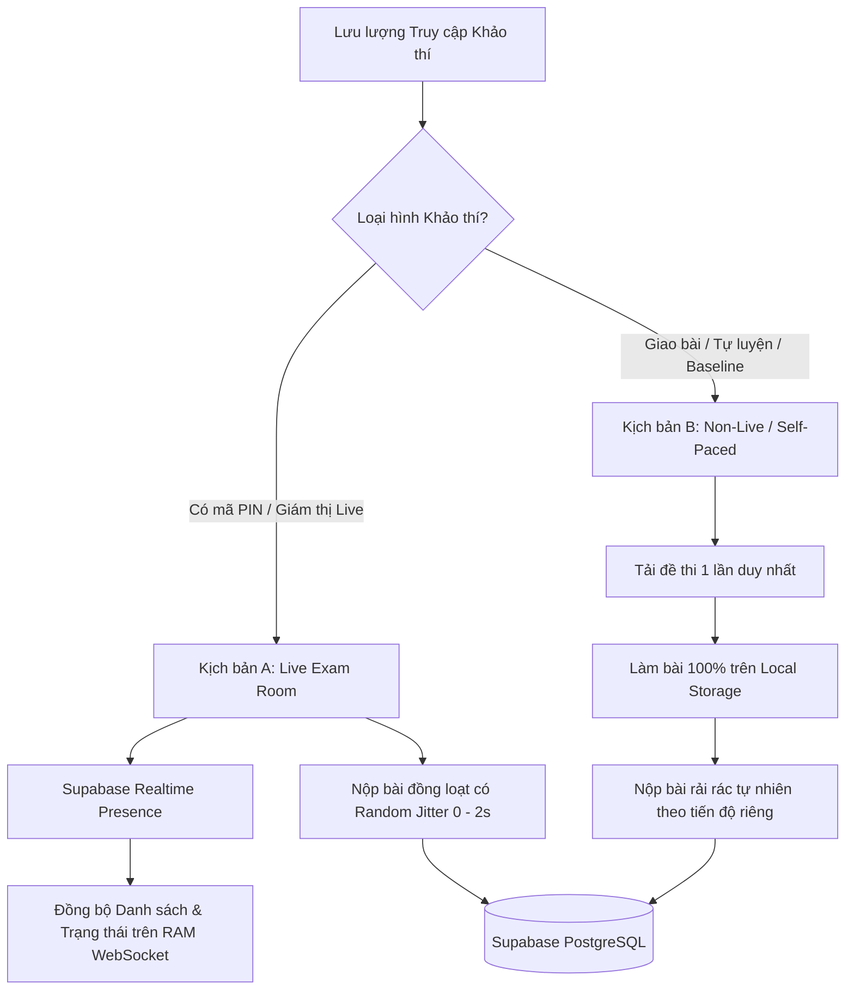
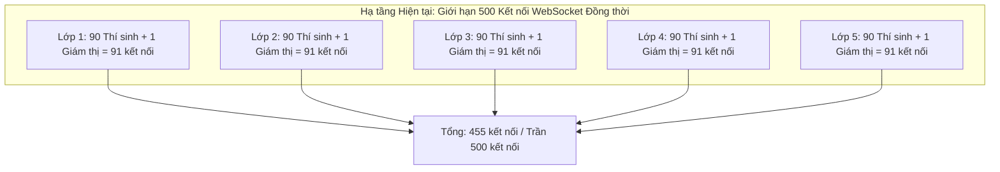

# ĐẶC TẢ KHẢ NĂNG CHỊU TẢI HỆ THỐNG HIỆN TẠI (NEXA AI)
## (Current System Load Capacity & Concurrency Specification)

> **Ngày phát hành:** 15/11/2026  
> **Phiên bản:** v1.1 — Đặc tả chuẩn xác theo cấu hình hạ tầng và mã nguồn hiện tại  
> **Phạm vi:** Đánh giá năng lực thực tế của nền tảng NEXA AI (Vercel Serverless Edge + Supabase Cloud hiện hành + Upstash Redis)  

---

## 1. TỔNG QUAN VÀ MỤC TIÊU ĐẶC TẢ

Hệ thống NEXA AI là nền tảng đánh giá và phát triển năng lực số phục vụ 3 không gian: **Personal (Cá nhân)**, **Organization Business (Trường học / Doanh nghiệp)** và **Platform Admin (Quản trị nền tảng)**.

Tài liệu này xác lập các chỉ số định lượng về năng lực chịu tải tối đa, ngưỡng an toàn vận hành thực tế của **hệ thống hiện tại** trên hai kịch bản khảo thí:
1. **Kịch bản A — Khảo thí Trực tiếp (Live Exam Rooms):** Phòng thi có mã PIN, kiểm soát sảnh chờ thời gian thực, giám sát tập trung, đếm ngược đồng bộ và nộp bài đồng loạt.
2. **Kịch bản B — Khảo thí Tự do & Bất đồng bộ (Non-Live / Self-paced Testing):** Khảo sát năng lực đầu vào (Baseline), bài tập được giao theo lớp (`class_assignments`), đợt khảo thí của tổ chức (`assessment_campaigns`), hoặc thí sinh tự luyện đề.

---

## 2. CƠ CHẾ CHỊU TẢI ĐANG HOẠT ĐỘNG TRONG MÃ NGUỒN

### 2.1. Tầng Trình duyệt Làm bài (Zero-DB Latency)
* **Lưu trữ cục bộ:** Trong toàn bộ thời gian làm bài (15 – 60 phút), mọi thao tác chọn trắc nghiệm, nhập văn bản tự luận, gắn link minh chứng, chuyển câu hỏi đều lưu trực tiếp vào `localStorage` và React State. Trình duyệt **hoàn toàn không gửi câu lệnh SQL lên Database** trên từng lượt click.
* **Debounce tiến độ:** Tác vụ gửi số câu đã làm (`answers_count`) về giám thị được debounce 800ms.

### 2.2. Tầng Realtime Sảnh chờ (Supabase Realtime Presence)
* **Giảm 100% truy vấn SQL ở sảnh chờ:** Danh sách thí sinh ra vào, avatar, trạng thái sẵn sàng (`isReady`) được xử lý hoàn toàn qua **Supabase Realtime Presence** trên RAM của cụm máy chủ WebSocket Phoenix/Elixir.
* **Khử hiện tượng $O(N^2)$:** Không còn hiện tượng 1 người vào phòng khiến cả sảnh cùng dội request HTTP về database.
* **Polling nền dự phòng:** Giãn từ 3.000ms thành 12.000ms (12 giây/lần), chỉ đóng vai trò cứu hộ thứ cấp nếu mạng của thí sinh gián đoạn WebSocket.

### 2.3. Tầng Nộp bài Đồng loạt (Random Jitter)
* **Khử nghẽn Connection Pool:** Khi đồng hồ đếm ngược hết giờ hoặc Giám thị bấm thu bài hàng loạt, hệ thống tự động giãn cách ngẫu nhiên `jitterMs = Math.floor(Math.random() * 2000)` (0 đến 2 giây), rải đều các lượt nộp bài để PostgreSQL xử lý êm ái.

---

## 3. ĐỊNH LƯỢNG NĂNG LỰC HIỆN TẠI: KỊCH BẢN A — PHÒNG THI TRỰC TIẾP (LIVE ROOM)

Phòng thi Live Room trải qua 3 giai đoạn:
* **Sảnh chờ:** Tiêu tốn kết nối WebSocket đồng thời (Realtime Connections).
* **Làm bài:** Tiêu tốn tài nguyên máy chủ gần như bằng 0 (chạy trên trình duyệt).
* **Nộp bài:** Tiêu tốn lượt ghi Database (Write I/O).

### 3.1. Năng lực cho 1 Phòng thi Đơn lẻ Hiện tại

| Quy mô 1 Phòng | Mức độ êm ái ở Sảnh chờ | Tải máy chủ lúc làm bài | Tải Database khi Hết giờ Nộp bài | Đánh giá Thực tế |
| :--- | :--- | :--- | :--- | :--- |
| **Dưới 60 thí sinh** | Siêu nhanh ($< 50\text{ms}$) | $0\text{ req/s}$ | $0.2 - 0.5\text{s}$ nộp xong toàn bộ | **Mượt mà, an toàn tuyệt đối** |
| **60 – 120 thí sinh** | Rất mượt ($< 100\text{ms}$) | $0\text{ req/s}$ | $0.8 - 1.5\text{s}$ nộp xong nhờ Jitter | **Tối ưu cho lớp học / hội trường vừa** |
| **150 – 250 thí sinh** | Mượt mà trên Presence | $0\text{ req/s}$ | Database tăng CPU nhẹ trong 2 giây | **Ngưỡng an toàn tối đa vận hành tốt** |
| **250 – 500 thí sinh** | Bắt đầu chạm trần kết nối | $0\text{ req/s}$ | Có độ trễ nhẹ khi nộp bài đồng loạt | **Ngưỡng giới hạn cứng của hạ tầng hiện tại** |

---

### 3.2. Năng lực Mở Nhiều Lớp Song Song (Định mức Tối đa 90 Thí sinh / Lớp)

Mỗi lớp 90 thí sinh + 1 Giám thị = **91 kết nối WebSocket Realtime**.

#### Kết quả định lượng đa lớp:
* **Số lớp có thể mở đồng thời:** **Tối đa 4 – 5 lớp song song**.
* **Tổng số thí sinh cùng thi trực tiếp:** $5 \times 90 = \mathbf{450\text{ thí sinh}}$ cùng lúc.
* **Căn cứ kỹ thuật:**
  * Hạ tầng hiện tại giới hạn trần cứng là **500 kết nối WebSocket đồng thời** ($500 / 91 \approx 5.5$).
  * Nhờ Realtime Presence, 5 lớp sảnh chờ này chỉ tạo khoảng 37 request đọc database mỗi giây rải đều ($450 / 12\text{s}$), PostgreSQL xử lý hoàn toàn nhẹ nhàng.

---

## 4. ĐỊNH LƯỢNG NĂNG LỰC HIỆN TẠI: KỊCH BẢN B — KHẢO THÍ TỰ DO / BẤT ĐỒNG BỘ (NON-LIVE)

Kịch bản này áp dụng cho:
* Khảo sát năng lực đầu vào (Baseline Assessment).
* Bài tập về nhà được giao theo lớp (`class_assignments`).
* Đợt khảo thí định kỳ mở trong nhiều ngày (`assessment_campaigns`).
* Người học tự chọn đề và tự luyện tập cá nhân.

### 4.1. Đặc tính Kỹ thuật
1. **Không chiếm dụng kết nối WebSocket:** Không bị giới hạn bởi trần kết nối Realtime.
2. **Không có Polling nền:** Không phát sinh request định kỳ về server.
3. **Phân tán thời gian tự nhiên (Natural Time Dispersion):** Người học vào làm bài và nộp bài ở các thời điểm khác nhau, các lượt nộp bài rải đều tự nhiên trong ngày, không bao giờ dồn tải cùng 1 giây.

### 4.2. Bảng Năng lực Chịu tải Thực tế (Non-Live)

| Chỉ số Hiệu năng | Năng lực của Hệ thống Hiện tại |
| :--- | :--- |
| **Số người có thể đang mở đề làm bài cùng lúc** | **1.000 – 3.000 người dùng đồng thời** |
| **Tốc độ nộp bài an toàn (Throughput)** | **60 – 120 bài nộp / phút** (~1-2 bài/giây) |
| **Dung lượng phục vụ trong ngày** | **5.000 – 10.000 lượt nộp bài / ngày** |
| **Độ trễ tải đề thi ban đầu** | $< 150\text{ms}$ |
| **Độ trễ trả kết quả & Radar năng lực sau nộp** | $< 350\text{ms}$ |

---

## 5. HIỆN TRẠNG BỘ ĐỆM UPSTASH REDIS TRONG HỆ THỐNG

1. **Hiện trạng sử dụng:**
   * Thư viện `@upstash/redis` (v1.34.4) đã được cài đặt và kết nối qua file `src/lib/redis/client.ts`.
   * **Phạm vi áp dụng hiện tại:** Chỉ mới sử dụng tại Bảng xếp hạng (`src/app/api/leaderboard/route.ts`) để lưu bộ đệm Top 100 trong 60 giây.
   * **Phòng thi Live Room:** Hiện tại **chưa sử dụng Redis**.
2. **Vì sao phòng Live hiện tại chưa dùng Redis?**
   * **Realtime Presence đã giải quyết trọn vẹn tải sảnh chờ:** Danh sách thí sinh ra vào đã chạy trên RAM của máy chủ WebSocket, Database không còn bị quá tải.
   * **Tránh rủi ro lệch pha trạng thái thi:** Phòng thi thời gian thực đòi hỏi tính nhất quán tuyệt đối (Host bấm phát đề, khóa phòng, cộng giờ phải có hiệu lực ngay). Nếu dùng Redis cache mà không xử lý xóa cache tức thời, thí sinh có thể nhận trạng thái cũ.
   * **Hạn mức gói miễn phí của Upstash:** Gói miễn phí Upstash giới hạn 10.000 lệnh/ngày, nếu bật cho phòng Live đông người sẽ hết quota rất nhanh.

---

## 6. KHUYẾN NGHỊ VẬN HÀNH THỰC TẾ TRÊN HỆ THỐNG HIỆN TẠI

1. **Tổ chức thi Live cho trường / khoa:**
   * Quy mô tối ưu nhất hiện tại: Tổ chức các đợt thi **từ 1 đến 5 lớp đồng thời** (mỗi lớp 60 – 90 thí sinh, tổng số thí sinh cùng làm bài từ 150 đến 450 người).
2. **Bố trí ca thi lệch giờ nhẹ khi tổ chức nhiều lớp:**
   * Nếu có từ 6 lớp trở lên cần thi trong cùng một buổi: Bố trí giờ phát đề so le nhau 5 – 10 phút (ví dụ: Lớp 1-3 thi từ 08h00 - 08h45; Lớp 4-6 thi từ 08h10 - 08h55). Việc này giúp hệ thống vận hành liên tục mà không bao giờ chạm trần kết nối WebSocket.
3. **Đóng phòng thi sau khi hoàn tất:**
   * Giám thị sau khi kết thúc ca thi nên bấm nút **"Kết thúc & Công bố kết quả"** để giải phóng bộ nhớ Presence và giải phóng hạn mức phòng thi đang mở.

---

## 7. BẢNG TỔNG KẾT NĂNG LỰC HỆ THỐNG HIỆN TẠI

| Kịch bản Khảo thí | Năng lực Chịu tải Hiện tại | Điểm nghẽn Kỹ thuật & Lưu ý |
| :--- | :--- | :--- |
| **Live Room: 1 Phòng đơn lẻ** | **150 – 250 thí sinh** | Tải ghi nộp bài (đã có Jitter 2s hỗ trợ) |
| **Live Room: Mở nhiều lớp (90 TS/lớp)** | **Tối đa 4 – 5 lớp song song (360 – 450 TS)** | Trần 500 kết nối WebSocket Realtime |
| **Khảo thí Tự do (Non-Live / Giao bài)** | **1.000 – 3.000 thí sinh làm bài cùng lúc** | Vercel Serverless Concurrency |
| **Tổng lượt nộp bài phục vụ trong ngày** | **5.000 – 10.000 lượt thi / ngày** | Dung lượng lưu trữ Database |
