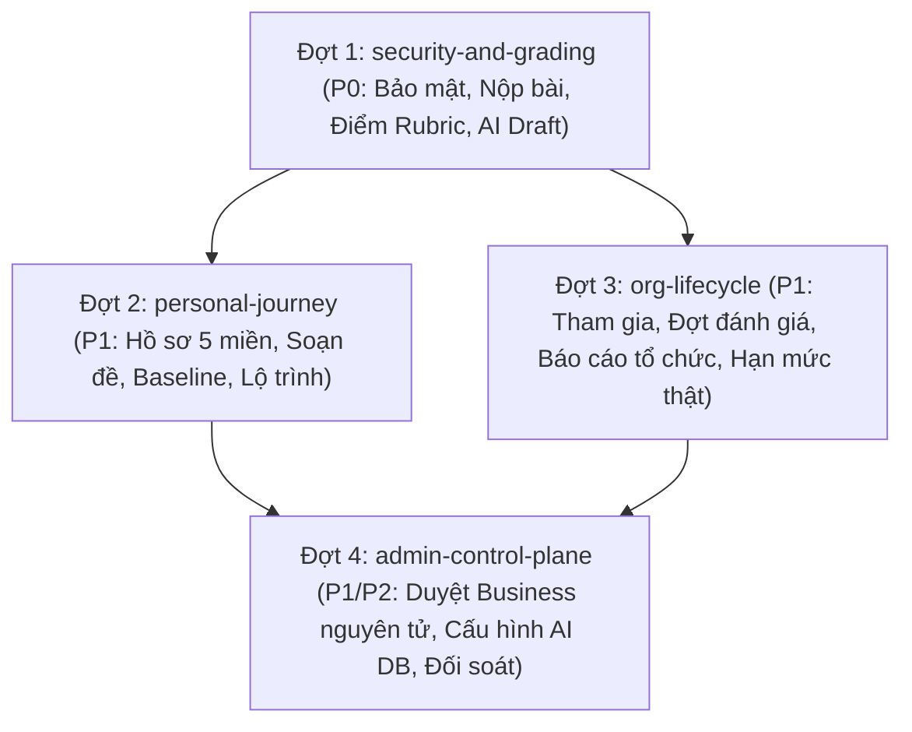

# Kế Hoạch Triển Khai: Chuẩn Hóa Toàn Diện 3 Dashboard & Toàn Vẹn Khảo Thí NEXA (P0 → P2)

> **Căn cứ tài liệu:**
> - [NEXA_AI_REVIEW_3_DASHBOARD_SO_DO_LUONG_2026-10-31_VI.md](file:///c:/Users/CPS/Downloads/NEXA_AI_REVIEW_3_DASHBOARD_SO_DO_LUONG_2026-10-31_VI.md)
> - [AGENTS.md](file:///c:/nexa/AGENTS.md)
>
> **Kỹ năng áp dụng:** `spec-driven-development`, `planning-and-task-breakdown`, `incremental-implementation`  
> **Trạng thái:** Kế hoạch thực thi chính thức (Active Master Plan)  
> **Repository:** https://github.com/minhhuyzzz/nexa_AI  
> **Commit căn cứ:** `a693566ebe26e627f018c9aac7cf234ef509153e`  
> **Nhánh mục tiêu:** `main`

---

## 1. Bản Đồ Năng Lực (Capability Map) & Thứ Tự Triển Khai

| Mã Module | Trách nhiệm chính | Phụ thuộc | Thứ tự xây dựng |
|---|---|---|---|
| **`security-and-grading`** (P0) | Phân quyền Server Org (`requireOrgPermission`), nộp bài nguyên tử, khóa giới hạn Rubric tại server, tách biệt AI Draft khỏi điểm chính thức (`GRADE-01`), duyệt điểm nguyên tử. | — | **Đợt 1 (Nền móng P0)** |
| **`personal-journey`** (P1) | Sửa API xóa đề Personal, chuẩn hóa tổng hợp 5 miền (`DomainAssessmentSummary`), luồng bài đầu vào baseline, khóa học đã kiểm duyệt, lưu vết lộ trình 4 bước bền vững. | `security-and-grading` | **Đợt 2 (Cá nhân)** |
| **`org-lifecycle`** (P1) | Sửa link mã tham gia, bộ đếm atomic token, Campaign wizard khép kín, chuẩn hóa enum Campaign, báo cáo 5 miền tổ chức trung thực, chặn quota hợp đồng ảo. | `security-and-grading` | **Đợt 3 (Tổ chức B2B)** |
| **`admin-control-plane`** (P1/P2) | Phê duyệt Business nguyên tử, xử lý lỗi Admin Users, chặn mua B2B qua checkout cá nhân, lưu cấu hình AI vào Database bền vững, adapter thực tế. | `security-and-grading`, `org-lifecycle` | **Đợt 4 (Quản trị nền tảng)** |

---

## 2. Các Quyết Định Kiến Trúc Then Chốt (ADR)

- **ADR-20: Cưỡng chế Phân Quyền Server-Side Cho Mọi Trang Organization (`requireOrgPermission`) (SEC-01)**
  - Mọi Server Component tại `src/app/(dashboard)/org/[slug]/**` và API route `src/app/api/organizations/[orgId]/**` bắt buộc gọi helper `requireOrgPermission({ userId, orgId, action, resourceId })`.
  - Không cho phép `createAdminClient()` truy vấn email, bài thi, thành viên trước khi xác thực vai trò (`ORG_ADMIN`, `ASSESSOR`, `REPORT_VIEWER`, `MEMBER`). Thành viên `MEMBER` tuyệt đối không xem được dữ liệu học viên khác.
- **ADR-21: Tách Biệt Tuyệt Đối AI Draft Với Điểm Chính Thức (GRADE-01, GRADE-02)**
  - API `POST /api/ai/grade-submission` chỉ được phép lưu kết quả chấm gợi ý vào bảng `ai_evaluations` với trạng thái `DRAFT` và `confidence_score`.
  - Nghiêm cấm ghi đè vào `submission_answers.score_awarded` hoặc `assessment_submissions.final_score` trước khi người chấm có thẩm quyền bấm "Duyệt" (Approve) hoặc "Chỉnh sửa" tại Bàn chấm bài.
- **ADR-22: Giới Hạn & Kiểm Định Thang Điểm Rubric Tại Máy Chủ (SEC-02)**
  - Server `src/app/api/evaluator/grade/route.ts` bắt buộc tải định nghĩa Rubric chính thức của câu hỏi từ database. Xác thực toàn bộ `criterionScores`: điểm từng tiêu chí phải nằm trong khoảng `[0, criterion.max_score]`, tổng điểm tính lại tại server, chặn hoàn toàn việc client gửi điểm tùy ý.
- **ADR-23: Nộp Bài Nguyên Tử & Chống Gửi Lặp (SEC-03)**
  - Quá trình nộp bài (`POST /api/assessments/[id]/submit`) chuyển trạng thái `IN_PROGRESS → SUBMITTED` và chấm trắc nghiệm khách quan phải diễn ra trong một giao dịch nguyên tử (RPC hoặc transaction có khóa idempotency). Chặn nộp lại bài đã ở trạng thái `SUBMITTED`/`EVALUATED`.
- **ADR-24: Thống Nhất Một Nguồn Sự Thật Báo Cáo 5 Miền (`DomainAssessmentSummary`) (PERS-02, ORG-06)**
  - Cả 3 workspace (Personal, Organization, Platform Admin) sử dụng chung một service tính toán điểm 5 miền (`D1`..`D5`).
  - Điểm của từng miền chỉ được tính khi có bằng chứng khảo thí hợp lệ đã được thẩm định. Miền chưa có bài thi/bằng chứng bắt buộc trả về `null` (hiển thị "Chưa đánh giá" trên UI), tuyệt đối không suy diễn từ điểm trung bình toàn bài và không gán điểm 0% giả tạo.
- **ADR-25: Lưu Cấu Hình AI Gateway Bền Vững Vào Database (AI-02, AI-03)**
  - Thay thế toàn bộ việc đọc/ghi file cục bộ `ai-config.json` bằng bảng `platform_settings` hoặc `ai_configurations` trong PostgreSQL.
  - Đồng bộ danh sách nhà cung cấp AI trên giao diện Admin với adapter thực tế đang hoạt động (Gemini), hiển thị rõ trạng thái khả dụng của các provider khác.

---

## 3. Lộ Trình 4 Đợt Triển Khai Chi Tiết

### Đợt 1: `security-and-grading` (P0: Bảo Mật, Nộp Bài, Điểm Rubric & AI Draft)
1. **Task 1.1:** Xây dựng `requireOrgPermission` helper và áp dụng cho toàn bộ các server page Organization (`SEC-01`).
2. **Task 1.2:** Tách biệt AI Draft: sửa `POST /api/ai/grade-submission` không ghi đè `score_awarded` trước khi duyệt (`GRADE-01`).
3. **Task 1.3:** Kiểm định Rubric và tính điểm tại máy chủ trong `api/evaluator/grade` (`SEC-02`).
4. **Task 1.4:** Nộp bài nguyên tử, chống nộp lại và chống giả mạo bài giao (`SEC-03`).
5. **Task 1.5:** Hợp nhất quy trình duyệt điểm và lưu minh chứng năng lực không bị trùng (`GRADE-02`).
*Checkpoint 1:* Kiểm tra toàn bộ luồng nộp bài, phân quyền org server-side và duyệt điểm qua test suite.

### Đợt 2: `personal-journey` (P1: Cá Nhân & Lộ Trình Tiến Bộ Thật)
1. **Task 2.1:** Sửa endpoint xóa đề Personal: tách riêng quyền sở hữu, không gọi API Admin (`PERS-01`).
2. **Task 2.2:** Chuẩn hóa Service `DomainAssessmentSummary`: báo cáo đúng 5 miền, `null` khi chưa đo (`PERS-02`).
3. **Task 2.3:** Thiết lập bài đánh giá đầu vào chuẩn (Baseline Assessment) và hoàn thiện CTA người mới (`PERS-03`, `UX-01`).
4. **Task 2.4:** Đồng bộ mã gói cá nhân, đăng ký và hạn mức quota (`PERS-04`).
5. **Task 2.5:** Lưu snapshot lộ trình 4 bước và theo dõi tiến độ bền vững (`PERS-05`).
6. **Task 2.6:** Lọc danh mục khóa học đã duyệt (`APPROVED`), loại bỏ dữ liệu giả / URL tự sinh (`PERS-06`).
7. **Task 2.7:** Chuẩn hóa trạng thái bài được giao trên Personal Dashboard (`PERS-07`).
*Checkpoint 2:* E2E Personal: Đăng ký → Baseline → Hồ sơ 5 miền (có null rõ ràng) → Lộ trình → Học → Đánh giá lại.

### Đợt 3: `org-lifecycle` (P1: Vòng Đời Tổ Chức & Đợt Đánh Giá B2B)
1. **Task 3.1:** Sửa URL sinh mã tham gia và mã hóa token tham gia an toàn (`ORG-01`, `ORG-03`).
2. **Task 3.2:** Bộ đếm lượt dùng mã tham gia nguyên tử (`ORG-02`).
3. **Task 3.3:** Xây dựng Campaign Wizard và tạo Đợt đánh giá nguyên tử (`ORG-04`, `UX-02`).
4. **Task 3.4:** Chuẩn hóa State Machine và enum trạng thái Campaign (`ORG-05`).
5. **Task 3.5:** Báo cáo 5 miền tổ chức trung thực, không suy diễn điểm tổng (`ORG-06`).
6. **Task 3.6:** Chặn quota hợp đồng giả khi tổ chức chưa có entitlement (`ORG-07`).
7. **Task 3.7:** Phân quyền điều hướng Member ("Kết quả của tôi") & giới hạn phạm vi chấm bài theo phân công (`ORG-08`).
*Checkpoint 3:* E2E Organization: Mời thành viên → Duyệt ghế → Tạo Campaign bằng Wizard → Làm bài → Chấm bài → Báo cáo 5 miền.

### Đợt 4: `admin-control-plane` (P1/P2: Quản Trị Khách Hàng, AI & Tài Chính)
1. **Task 4.1:** Phê duyệt Business Inquiry và cấp Entitlement theo giao dịch nguyên tử (`ADM-01`).
2. **Task 4.2:** Chuẩn hóa phản hồi lỗi và mô hình vai trò tại Admin Users (`ADM-02`).
3. **Task 4.3:** Chặn checkout Business tự phục vụ và kiểm soát đối soát giao dịch (`ADM-03`).
4. **Task 4.4:** Cơ chế versioning cho Khung năng lực số và đề thi đã phát hành (`ADM-04`).
5. **Task 4.5:** Lưu cấu hình AI Gateway vào cơ sở dữ liệu bền vững và đồng bộ Adapter (`AI-02`, `AI-03`).
6. **Task 4.6:** Trừ AI credits nguyên tử, chính xác theo chủ thể chi trả (`AI-01`).
7. **Task 4.7:** Thống kê AI Gateway theo kỳ thời gian và nâng cấp Dashboard ưu tiên hàng đợi (`ADM-05`, `ADM-06`, `ADM-07`, `UX-03`).
*Checkpoint 4:* Toàn bộ hệ thống 3 Dashboard đạt chuẩn xác minh E2E, 0 lỗi TypeScript, 0 anti-pattern giao diện.
