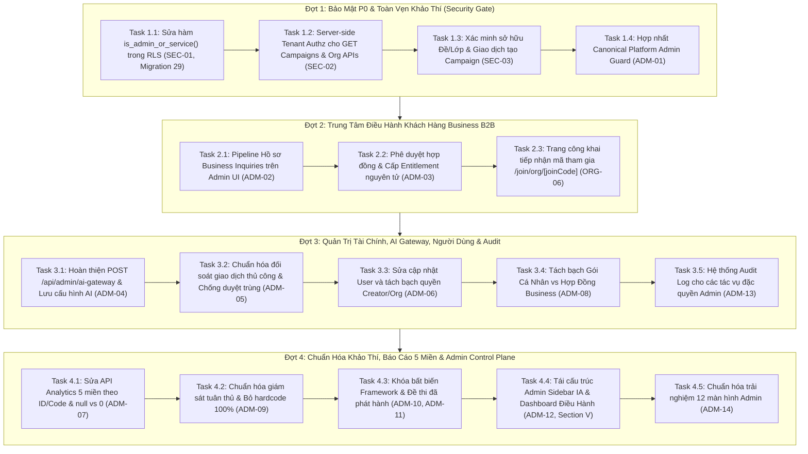

# Kế Hoạch Triển Khai: Nâng Cấp Toàn Diện Platform Admin & Khắc Phục Lỗ Hổng Bảo Mật (P0 → P2)

> **Căn cứ tài liệu:**
> - [NEXA_ADMIN_REVIEW_2026-10-30_abb463fa.md](file:///c:/nexa/NEXA_ADMIN_REVIEW_2026-10-30_abb463fa.md)
> - [AGENTS.md](file:///c:/nexa/AGENTS.md)
>
> **Kỹ năng áp dụng:** `planning-and-task-breakdown`, `incremental-implementation`  
> **Trạng thái:** Kế hoạch thực thi chính thức (Active Master Plan)  
> **Repository:** https://github.com/minhhuyzzz/nexa_AI  
> **Nhánh mục tiêu:** `main`

---

## 1. Tầm Nhìn Kiến Trúc & Mục Tiêu

Platform Admin không chỉ là nơi hiển thị các con số thống kê tổng hợp mà là **Trung tâm Điều hành Nền tảng (Platform Control Plane)** của chủ sở hữu NEXA. Kế hoạch này tập trung giải quyết triệt để các rủi ro bảo mật P0, khép kín các luồng nghiệp vụ B2B, chuẩn hóa quản trị tài chính - AI, và cấu trúc lại toàn bộ 12 màn hình Admin theo đúng quy chuẩn `AGENTS.md`.

### 5 Mục Tiêu Trọng Tâm:
1. **Khóa Chặt Lỗ Hổng Bảo Mật (P0 Security Gates):**
   - Sửa hàm `is_admin_or_service()` trong PostgreSQL RLS (loại bỏ lỗ hổng `current_user` trong `SECURITY DEFINER`).
   - Cưỡng chế phân quyền đa thuê bao (Tenant Authorization) ở cấp máy chủ cho toàn bộ các API `api/organizations/[orgId]/**`, triệt tiêu nguy cơ rò rỉ dữ liệu chéo tổ chức.
   - Kiểm tra tính toàn vẹn và sở hữu tài nguyên (Đề thi, Nhóm lớp, Giảng viên) khi tạo Đợt đánh giá (Campaigns).
2. **Khép Kín Vòng Đời Khách Hàng B2B (Business Control Center):**
   - Kết nối trực tiếp giao diện Admin với hàng đợi `business_inquiries` (`NEW → CONTACTED → PROPOSAL_SENT → APPROVED/REJECTED`).
   - Đảm bảo quy trình kích hoạt tổ chức và cấp hợp đồng (`organization_entitlements`) mang tính nguyên tử (Atomic Provisioning), không bao giờ tồn tại tổ chức `ACTIVE` mà thiếu hợp đồng hạn mức.
   - Hoàn thiện trang công khai nhập mã tham gia `/join/org/[joinCode]` cho học viên.
3. **Quản Trị Thực Chất: Tài Chính, AI Gateway & Người Dùng:**
   - Hoàn thiện API `POST /api/admin/ai-gateway` để lưu cấu hình provider/model routing/budget thật vào cơ sở dữ liệu.
   - Chuẩn hóa luồng đối soát thủ công (`/admin/transactions`) với yêu cầu minh chứng, đối chiếu số tiền và idempotency chống cộng trùng credits.
   - Sửa lỗi bắt kết quả HTTP (`res.ok`) khi cập nhật vai trò/gói người dùng tại `/admin/users`.
   - Xây dựng hệ thống nhật ký kiểm toán hành vi đặc quyền (`admin_audit_logs`).
4. **Báo Cáo Năng Lực 5 Miền & Tính Bất Biến Của Khảo Thí:**
   - Sửa API phân tích năng lực `/api/admin/analytics`: ánh xạ điểm theo mã miền chuẩn (`D1`..`D5`), phân biệt rõ `null` (chưa có bài thi) và `0` (đã thi đạt 0 điểm).
   - Loại bỏ thông điệp hardcode "100% người dùng đã cấp quyền" tại `/admin/compliance`.
   - Khóa phiên bản khung năng lực và đề thi đã phát hành có bài thi lịch sử.
5. **Chuẩn Hóa Kiến Trúc Thông Tin (Admin Sidebar IA) & Dashboard Điều Hành:**
   - Tái cấu trúc thanh điều hướng Admin thành 4 nhóm chuẩn theo Mục V của tài liệu review: `ĐIỀU HÀNH`, `KHÁCH HÀNG & KINH DOANH`, `NỘI DUNG & KHẢO THÍ`, `HẠ TẦNG & AN TOÀN`.
   - Nâng cấp `/admin/dashboard` thành trung tâm xử lý công việc ưu tiên (Hồ sơ B2B chờ duyệt, Giao dịch cần đối soát, Cảnh báo AI, Trạng thái hệ thống).

---

## 2. Các Quyết Định Kiến Trúc Then Chốt (ADR)

- **ADR-15: Sửa Lỗ Hổng Privilege Escalation Trong RLS Helper (SEC-01)**
  - `public.is_admin_or_service()` trong PostgreSQL khi được khai báo `SECURITY DEFINER` sẽ thực thi dưới quyền của owner (thường là `postgres`). Do đó, câu lệnh `current_user IN ('postgres', 'service_role')` luôn trả về `TRUE` cho mọi caller!
  - Giải pháp: Viết Migration 29 sửa hàm helper: kiểm tra role từ claim JWT `auth.jwt() ->> 'role' = 'service_role'`, kiểm tra email superadmin từ JWT, hoặc kiểm tra `public.profiles.role = 'ADMIN'` qua `auth.uid()`. Đặt `SET search_path = public, auth`.
- **ADR-16: Canonical Platform Admin Authorization (ADM-01)**
  - Hợp nhất cơ chế kiểm tra quyền Platform Admin thành hàm duy nhất `requirePlatformAdmin()` trong `src/lib/auth/admin-guard.ts`.
  - Sử dụng chung hàm này cho `admin/layout.tsx` và 100% các route `/api/admin/**`. Không để tình trạng route dùng email whitelist, route kiểm tra `profiles.role`, route dùng service-role không có guard.
- **ADR-17: Server-Side Tenant Authorization Guard (SEC-02, SEC-03)**
  - Tuyệt đối không cho phép route `/api/organizations/[orgId]/**` sử dụng `createAdminClient()` truy vấn theo `orgId` từ URL mà chưa kiểm tra `user_organizations` của caller đối với `orgId` đó.
  - Khi tạo Campaign, bắt buộc xác minh `assessments.organization_id = orgId` (hoặc đề dùng chung được cấp phép), và toàn bộ `class_ids` phải thuộc sở hữu của `orgId`.
- **ADR-18: Atomic Business Approval & Entitlement Provisioning (ADM-03)**
  - API `/api/admin/organizations/approve` bắt buộc thực hiện theo giao dịch: nếu việc khởi tạo `organization_entitlements` hoặc `owner invitation` thất bại, hệ thống phải rollback trạng thái tổ chức, không để tổ chức ở trạng thái `ACTIVE` dở dang.
- **ADR-19: Canonical 5-Domain Analytics Mapping (ADM-07)**
  - Ánh xạ điểm radar bắt buộc dựa trên mã định danh miền (`domain.code` hoặc `domain.id`), không bao giờ map theo thứ tự mảng `idx + 1`.
  - Trả về `null` cho miền chưa có đánh giá nào, giữ nguyên giá trị `0` khi người học có bài thi đạt 0 điểm.

---

## 3. Lộ Trình 4 Đợt Triển Khai (Roadmap)

---

## 4. Quản Trị Rủi Ro & Quy Tắc An Toàn

1. **Không tạo xung đột migrations:** Mọi thay đổi schema/hàm SQL được viết theo dạng forward-only (`src/database/migrations/29_*.sql`), không chỉnh sửa các file migration lịch sử.
2. **Quy tắc UI AGENTS.md:** Không sử dụng emoji trong JSX; 100% icons vector Lucide nét mảnh (`strokeWidth={1.75}`); màu chủ đạo Sky-600 (`#0284C7`), nền Slate-50/White, font JetBrains Mono cho số/mã/ngày.
3. **Fail-Closed:** Các endpoint nhạy cảm (phê duyệt, thanh toán, đổi quyền) trả về mã lỗi 401/403/500 rõ ràng và dừng lại ngay lập tức khi phát hiện dữ liệu bất thường; không bao giờ giả lập thành công trên client.
