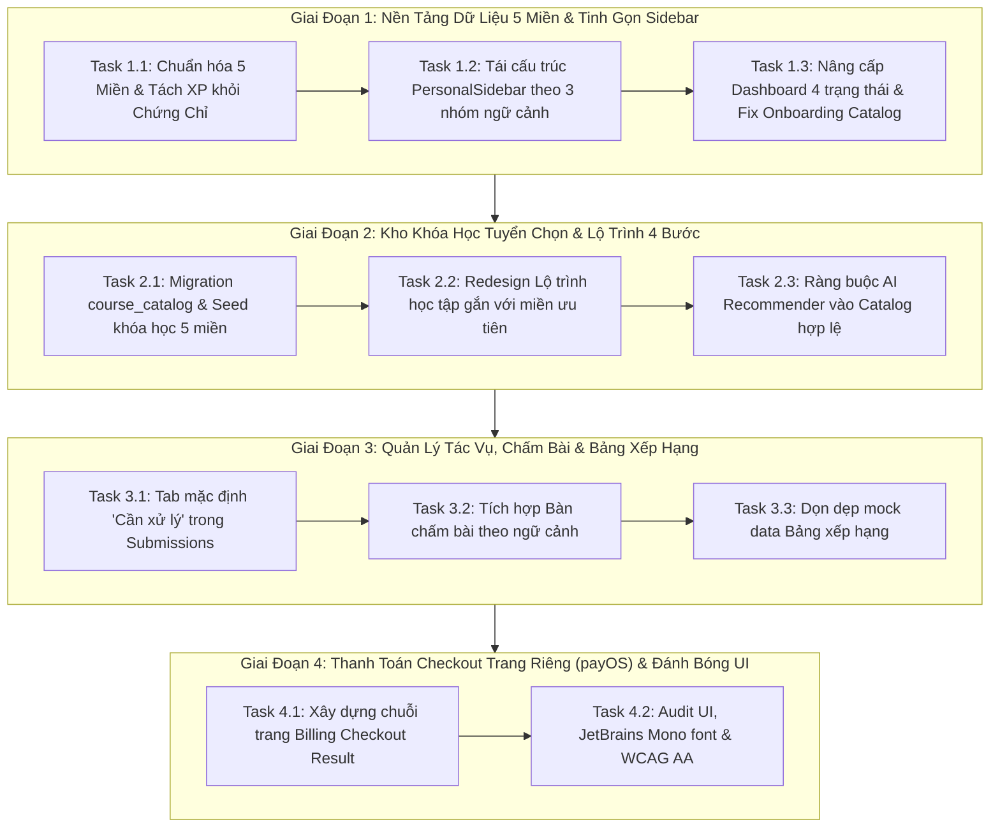

# Kế Hoạch Triển Khai: Tối Ưu Personal Dashboard UX & Chuẩn Hóa 5 Miền Năng Lực (DigComp)

> **Căn cứ tài liệu:**
> - [NEXA_PERSONAL_DASHBOARD_UX_PRODUCT_REVIEW_2026-10-30 (1).md](file:///c:/nexa/NEXA_PERSONAL_DASHBOARD_UX_PRODUCT_REVIEW_2026-10-30%20(1).md) (Tài liệu Review & Đề xuất Sản phẩm)
> - [AGENTS.md](file:///c:/nexa/AGENTS.md) (Quy tắc kiến trúc & UI bất biến của NEXA)
> - [NEXA_AI_PRODUCT_SPEC_PERSONAL_ORGANIZATION_WORKSPACES.md](file:///c:/nexa/NEXA_AI_PRODUCT_SPEC_PERSONAL_ORGANIZATION_WORKSPACES.md) (Đặc tả không gian làm việc)
>
> **Kỹ năng áp dụng:** `using-agent-skills`, `planning-and-task-breakdown`  
> **Trạng thái:** Kế hoạch thực thi chính thức (Active Master Plan)

---

## 1. Đánh Giá Chuyên Môn Về Bản Review UX & Sản Phẩm

Bản review ngày 30/10/2026 là một phân tích **xuất sắc, sắc bén và bám sát thực tế vận hành**. Tài liệu đã bóc tách chính xác các mâu thuẫn cốt lõi đang xuất hiện trên Dashboard cá nhân:

1. **Nguyên tắc "Đúng 5 Miền Năng Lực" (Abolish 21 micro-skills UI tracking):**
   - *Thực trạng:* Code và UI đang cố gắng đo đạc, hiển thị "0/21 kỹ năng", khiến giao diện vụn vặt và người học bị ngợp. Đánh giá trắc nghiệm/thực hành không thể bao phủ 21 kỹ năng vi mô với độ tin cậy thống kê cao.
   - *Đột phá:* Cố định việc đo lường, công bố điểm và lộ trình ở **đúng 5 miền DigComp**. 21 kỹ năng thành phần chỉ là metadata nội bộ trong CSDL.
2. **Xóa bỏ hiện tượng "Đa giác rỗng" (Empty Polygon) & Phân biệt `null` vs `0`:**
   - Người mới toanh vào thấy 5 đỉnh Radar đều 0%, nhưng bên dưới lại báo "0 miền cần cải thiện". `null` (chưa có bằng chứng) bị đánh đồng với `0` (đã thi và bị 0 điểm).
   - Giải pháp: Chỉ vẽ Radar khi có đủ bằng chứng 5 miền. Khi chưa đủ, hiển thị thanh tiến độ "Đã đánh giá x/5 miền" và CTA làm bài đầu vào.
3. **NEXA là Nền Tảng Đánh Giá & Phát Triển Năng Lực, KHÔNG PHẢI Sàn Bán Khóa Học:**
   - NEXA không có giỏ hàng, không kinh doanh khóa học đối tác, không ưu tiên thương mại vì tiền hoa hồng.
   - Khóa học là **tài nguyên tuyển chọn (Curated Catalog)** từ nguồn uy tín (Google, Coursera, Vinschool, MOOCs...) nhằm khắc phục khoảng trống năng lực (< 70%). Điểm khác biệt sống còn của NEXA là **vòng lặp kín**: *Đánh giá → Xác định khoảng trống → Gợi ý khóa tuyển chọn → Học/Thực hành → Đánh giá lại cùng miền → Đo lường tiến bộ*.
4. **Tách biệt 3 Thang Đo (Tri-Metric Separation):**
   - *Điểm hoạt động (XP)* $\ne$ *Điểm bài thi* $\ne$ *Hồ sơ năng lực 5 miền*.
   - Bug nghiêm trọng: `profiles.points >= 450` (điểm danh đăng nhập) đang tự động mở khóa chứng chỉ Master Certificate trong `profile-stats/route.ts`. Chứng chỉ năng lực phải dựa trên bằng chứng khảo thí hợp lệ.
5. **Tinh gọn IA Sidebar & Chuỗi Thanh Toán Trang Riêng (payOS):**
   - Loại bỏ `Bàn chấm bài` và `Gói & Nâng cấp` khỏi sidebar cấp 1 (đưa vào ngữ cảnh cụ thể khi có bài nộp hoặc menu tài khoản).
   - Thay thế Modal QR thanh toán bằng chuỗi trang riêng: `/personal/billing` $\rightarrow$ `/personal/checkout/[orderId]` $\rightarrow$ `/personal/billing/result`, kết nối trực tiếp với cổng payOS đã cấu hình.

---

## 2. Quyết Định Kiến Trúc Then Chốt (Architecture Decisions)

1. **ADR-05: Chuẩn Hóa Dữ Liệu Năng Lực 5 Miền (Domain-Level Competency Contract):**
   - Toàn bộ API (`/api/personal/competency-profile`, `/api/personal/competency-radar`, `/api/ai/analyze-competency`) và dịch vụ `CompetencyAggregationService` chỉ trả về mảng 5 phần tử tương ứng 5 miền DigComp.
   - Trạng thái miền: `INSUFFICIENT_DATA` (score = null), `NEEDS_IMPROVEMENT` (score < 70), `MEETS_TARGET` (score >= 70).
2. **ADR-06: Tách Rời Hoàn Toàn Gamification XP Khỏi Chứng Chỉ Năng Lực:**
   - Cột `points` trong `profiles` chỉ là "Điểm tích lũy hoạt động" (XP).
   - Cột `isCertificateUnlocked` trong `profile-stats` chỉ `true` khi người dùng có bản ghi hợp lệ trong bảng `credentials` (được cấp từ bài thi khảo thí hoặc hội đồng thẩm định).
3. **ADR-07: Kho Khóa Học Tuyển Chọn Độc Lập (Curated Course Catalog):**
   - Bảng mới `course_catalog` lưu trữ các khóa học được tuyển chọn thủ công, gắn với 1 hoặc nhiều trong 5 miền, có URL chính thức đã kiểm định.
   - AI chỉ được phép gợi ý `course_id` từ danh mục này; server sẽ validate ID trước khi trả về cho client.
4. **ADR-08: On-Demand Contextual Routing Cho Chấm Bài & Thanh Toán:**
   - `Bàn chấm bài` (`/personal/grading`) được kích hoạt thông qua CTA "Bài chờ chấm (n)" trên Dashboard hoặc từ danh sách bài tập của lớp học.
   - Nâng cấp gói chuyển hướng sang `/personal/checkout/[orderId]` sử dụng payOS SDK, loại bỏ hoàn toàn `showQrModal`.

---

## 3. Lộ Trình Triển Khai Chi Tiết (Vertical Slices)

---

## 4. Quản Trị Rủi Ro (Risks & Mitigations)

| Rủi ro | Mức độ | Biện pháp giảm thiểu |
| :--- | :---: | :--- |
| **Gãy tương thích giao diện cũ khi bỏ 21 kỹ năng** | Trung bình | Giữ nguyên schema bảng `competencies` trong CSDL; chỉ thay đổi tầng service aggregation và API response; không xóa cột/bảng. |
| **Học viên mới không có bài thi đầu vào nào khả dụng** | Cao | Thêm cơ chế fallback hoặc kiểm tra seed để bảo đảm luôn có ít nhất 1 bài đánh giá DigComp Baseline ở trạng thái `PUBLISHED`. |
| **AI tự ý sinh ra URL hoặc tên khóa học ảo** | Trung bình | Backend cưỡng chế chỉ chấp nhận `course_id` tồn tại trong bảng `course_catalog`. Mọi gợi ý không khớp ID sẽ bị loại bỏ. |
| **Trải nghiệm thanh toán bị đứt quãng khi chuyển từ Modal sang Trang riêng** | Thấp | Lưu `orderId` vào `payment_transactions` và cookie/query params để người dùng F5 hoặc quay lại vẫn giữ nguyên phiên thanh toán. |

---

## 5. Tiêu Chuẩn Nghiệm Thu (Definition of Done)

1. **5 Miền Năng Lực:** Chỉ hiển thị 5 miền; không còn xuất hiện chỉ số "0/21 kỹ năng"; phân biệt rõ ràng giữa `null` (chưa đo) và `0%` (đã thi 0 điểm); Radar chỉ vẽ khi đủ 5 miền.
2. **Hành Trình Khép Kín:** Học viên làm bài đầu vào → Nhận kết quả 5 miền → Xem lộ trình với khóa học tuyển chọn thực tế → Đánh giá lại cùng miền.
3. **Sidebar Chuẩn:** Bỏ `Bàn chấm bài` và `Gói & Nâng cấp` khỏi cấp 1; sidebar chia đúng 3 nhóm: `HỌC TẬP & PHÁT TRIỂN`, `NHÓM & CÔNG VIỆC`, `CÔNG CỤ TẠO & TỔ CHỨC`.
4. **Thanh Toán payOS:** Nâng cấp gói đi qua 3 trang riêng biệt; QR payOS hiển thị chính xác; webhook cập nhật gói idempotent.
5. **Chất Lượng Kỹ Thuật:** `npm run typecheck` đạt 0 lỗi, toàn bộ test suites `npm test` vượt qua 100%, tuân thủ nghiêm ngặt quy chuẩn UI trong `AGENTS.md`.
