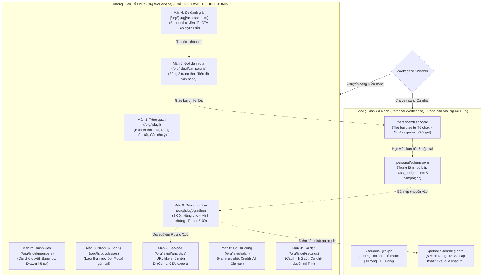

# Kế Hoạch Triển Khai: Redesign Toàn Diện Organization Dashboard v4 & Tích Hợp Luồng Thành Viên Trong Personal

> **Căn cứ tài liệu & Yêu cầu:**
> - Bản đặc tả thiết kế: [`NEXA_Organization_Dashboard_V4_UI_UX_SPEC.md`](file:///c:/Users/CPS/Downloads/NEXA_Org_Dashboard_V4_9_Man_Hinh/NEXA_Organization_Dashboard_V4_UI_UX_SPEC.md)
> - Prototype tham khảo: [`NEXA_Organization_Dashboard_9_Man_Hinh_V4.html`](file:///c:/Users/CPS/Downloads/NEXA_Org_Dashboard_V4_9_Man_Hinh/NEXA_Organization_Dashboard_9_Man_Hinh_V4.html) & thư mục `screens/`
> - Thư mục hình ảnh tài nguyên: `public/images/dashboard/` (`Banner Tổng quan.jpg`, `Banner Thư viện đề đánh giá.jpg`, `nexa-01-tong-quan.png` đến `nexa-08-cai-dat.png`)
> - Quy chuẩn thương hiệu & giao diện: [`AGENTS.md`](file:///c:/nexa/AGENTS.md) (Light `#FFFFFF`, Dark `#000000`, Cobalt `#2563EB`, chống AI slop, thang điểm `/100`, không số liệu giả).
> - Quy trình lập kế hoạch: [`planning-and-task-breakdown`](file:///c:/nexa/.agents/skills/planning-and-task-breakdown/SKILL.md)

---

## 1. Định Hướng Thiết Kế Cốt Lõi (Core UX Principles)

1. **Ba không gian độc lập, một danh tính duy nhất:**
   - **Personal (`/personal/*`):** Không gian của mọi người dùng (kể cả thành viên và học viên của tổ chức). Mọi bài tập, đợt khảo thí được giao, lớp học tham gia và kết quả 5 miền DigComp của thành viên đều diễn ra tại đây.
   - **Organization (`/org/[slug]/*`):** Bàn điều hành chuyên biệt chỉ dành cho Quản trị viên (`ORG_OWNER`, `ORG_ADMIN`). Tuyệt đối không tạo dashboard thừa cho vai trò `MEMBER`.
   - **Platform Admin (`/admin/*`):** Quản trị toàn hệ thống NEXA.
2. **Khắc phục triệt để chi tiết Workspace Switcher & Menu tài khoản:**
   - Khi ở **Personal**: Menu chuyển đổi hiển thị tùy chọn `+ Tham gia tổ chức khác` (mở Modal nhập mã mời/mã PIN hoặc xem lời mời).
   - Khi ở **Organization**: Menu chuyển đổi hiển thị tùy chọn `Mời thành viên` (mở Modal mời với 3 tab: Mã mời, Link tham gia, Gửi thư mời qua Email).
   - **Loại bỏ hoàn toàn** hộp thông tin thô kệch `Mã mời tham gia: [FPT-POLY]` và nút sao chép inline nằm chắn giữa danh sách chuyển đổi.
3. **Mỗi màn hình một mô hình tác vụ riêng biệt:**
   - Không rập khuôn cấu trúc "3 thẻ KPI + bảng" cho mọi trang.
   - Bàn chấm bài (`/org/[slug]/grading`) chuyển từ dạng mở popup sang **Bố cục 3 cột (3-Column Workbench)**: Cột 1 = Hàng đợi nộp bài; Cột 2 = Trình đọc bài nộp & minh chứng; Cột 3 = Bảng điểm Rubric chấm theo tiêu chí /100, AI gợi ý & phê duyệt.
4. **Sử dụng hình ảnh có chọn lọc & mục đích rõ ràng:**
   - Chỉ sử dụng Banner hình ảnh tối ưu từ `public/images/dashboard/` qua `next/image` tại 3 trang: **Tổng quan** (`Banner Tổng quan.jpg`), **Thư viện đề** (`Banner Thư viện đề đánh giá.jpg`), và **Gói sử dụng** (`nexa-07-goi-su-dung.png`).
   - Các màn hình đòi hỏi tập trung thao tác cao (Chấm bài, Thành viên, Báo cáo năng lực, Cài đặt) dùng giao diện sạch, nền trung tính, không chèn banner trang trí làm phân tâm.
5. **Thang điểm chuẩn hóa `/100`:**
   - Mọi điểm số năng lực và khảo thí hiển thị theo thang `/100` giúp ban lãnh đạo dễ dàng so sánh; vẫn lưu trữ điểm rubric gốc để đối chiếu minh chứng.
   - Điểm `null` / chưa thi hiển thị `—` hoặc trạng thái rỗng có chỉ dẫn; **tuyệt đối không hiển thị 0% giả**.

---

## 2. Sơ Đồ Kiến Trúc & Luồng Trải Nghiệm (Workflow Diagram)

---

## 3. Bản Kế Hoạch 5 Giai Đoạn (Detailed Phase Breakdown)

### Phase 1: Chuẩn Hóa Shell, Switcher Menu & Tích Hợp Luồng Member Trong Personal
- **Mục tiêu:** Hoàn thiện trải nghiệm chuyển đổi không gian mượt mà, loại bỏ triệt để các thành phần UI thừa trong Switcher, và nâng cấp các widget dành cho Thành viên tổ chức trong Personal Dashboard.
- **Nhiệm vụ:**
  - **Task 1.1: Chuẩn hóa AvatarWorkspaceSection & Switcher UX (S)**
    - Đảm bảo khi ở Personal: Nút hành động cuối là `+ Tham gia tổ chức khác` (mở `JoinOrgModal`).
    - Đảm bảo khi ở Org: Nút hành động cuối là `Mời thành viên` (mở `OrgInviteModal` với 3 tab: Mã mời, Link, Email).
    - Triệt tiêu hoàn toàn hộp inline `Mã mời tham gia: [FPT-POLY] [Sao chép mã mời]`.
  - **Task 1.2: Nâng cấp OrgAssignmentsWidget & Tích hợp Submissions trong Personal (M)**
    - Làm sắc nét giao diện `OrgAssignmentsWidget` trên `/personal/dashboard`: hiển thị huy hiệu tổ chức, thời hạn nộp bài rõ ràng, nút 1-click CTA "Bắt đầu làm bài".
    - Đồng bộ hóa tab `/personal/submissions` hiển thị cả bài tập thường (`class_assignments`) và bài khảo thí chiến dịch (`assessment_campaigns`).
  - **Task 1.3: Bộ thành phần dùng chung (Shared Primitives) cho Org Console (S)**
    - Chuẩn hóa các primitive Drawer và Modal cho bảng điều khiển Org (`OrgDrawer`, `OrgModalFilter`, `OrgEmptyState`) đảm bảo tuân thủ WCAG AA, phím Escape, focus trap, và thời gian animation 150-180ms.

*Checkpoint 1:* Kiểm tra switcher ở cả 2 không gian; kiểm tra tài khoản học viên trong Personal thấy bài tập từ tổ chức mà không cần vào Org.

---

### Phase 2: Màn Hình Vận Hành Trọng Tâm: Tổng Quan, Thành Viên, Lớp & Nhóm (Screens 1, 2, 3)
- **Mục tiêu:** Redesign 3 màn hình điều hành cơ bản của Admin theo đúng tiêu chuẩn V4 (không dùng thẻ KPI đóng khối cồng kềnh, phân cấp rõ ràng).
- **Nhiệm vụ:**
  - **Task 2.1: Redesign Màn 1 — Tổng quan (`/org/[slug]`) (M)**
    - Hero Banner: Tích hợp hình ảnh `Banner Tổng quan.jpg` (sử dụng `next/image` với fallback màu navy đậm `#17213a`).
    - Dòng tóm tắt nhanh (Summary Line): Thay thế 4 ô KPI thô bằng dòng text thông số thanh lịch: `"128 thành viên · 8 nhóm · 3 đợt đánh giá · 4 bài chờ chấm"`.
    - Danh sách việc cần chú ý (Attention Queue): Liệt kê các bài nộp đang chờ chấm, đợt thi sắp hết hạn.
    - Bảng hoạt động khảo thí gần nhất: Trạng thái vận hành thực tế kèm liên kết nhanh.
  - **Task 2.2: Redesign Màn 2 — Quản trị Thành viên (`/org/[slug]/members`) (M)**
    - Dải xử lý phê duyệt (Pending Approval Strip): Nổi bật danh sách yêu cầu gia nhập qua mã PIN/mã trường kèm nút duyệt/từ chối 1-click.
    - Thanh công cụ lọc & tìm kiếm: Tìm theo tên/email, lọc theo vai trò (`ORG_ADMIN`, `MEMBER`), lọc theo lớp.
    - Bảng danh sách thành viên gọn gàng: Hiển thị trạng thái tài khoản, số lớp tham gia, ngày tham gia.
    - `MemberProfileDrawer`: Drawer trượt mượt mà hiển thị thông tin chi tiết thành viên, danh sách lớp trực thuộc và hành động thay đổi quyền/xóa khỏi tổ chức.
  - **Task 2.3: Redesign Màn 3 — Nhóm & Đơn vị Trực Thuộc (`/org/[slug]/classes`) (M)**
    - Lưới thư mục trực quan (`classes-grid`): Trình bày các lớp học/phòng ban dưới dạng card chuyên nghiệp có thông tin giảng viên phụ trách, số lượng học viên và các đợt thi đang gán.
    - Modal tạo nhóm/lớp mới tinh giản.
    - Tích hợp tính năng gán nhanh đợt đánh giá cho lớp học.

*Checkpoint 2:* Xác nhận màn 1, 2, 3 hiển thị chuẩn Light/Dark mode, không có lỗi console, tương tác mượt mà.

---

### Phase 3: Ngân Hàng Đề, Chiến Dịch & Bàn Chấm Bài 3 Cột (Screens 4, 5, 6)
- **Mục tiêu:** Tái cấu trúc quy trình khảo thí từ phát hành đề, tạo đợt thi đến bàn chấm bài chuyên nghiệp không dùng popup.
- **Nhiệm vụ:**
  - **Task 3.1: Redesign Màn 4 — Thư viện Đề Đánh Giá (`/org/[slug]/assessments`) (S)**
    - Hero Banner: Tích hợp `Banner Thư viện đề đánh giá.jpg`.
    - Thư viện đề: Phân nhóm rõ ràng giữa Đề chuẩn DigComp quốc tế và Đề nội bộ của tổ chức.
    - Hành động trọng tâm: Nút `Tạo đợt từ đề` trực tiếp chuyển tiếp thông tin sang trang tạo chiến dịch.
  - **Task 3.2: Redesign Màn 5 — Đợt Đánh Giá & Khảo Thí (`/org/[slug]/campaigns`) (M)**
    - Bảng 3 trạng thái (Board / Tabs): "Đang diễn ra", "Sắp diễn ra", "Đã kết thúc".
    - Thẻ tiến độ khảo thí: Thanh phần trăm hoàn thành, số bài đã nộp/tổng số, hạn nộp.
    - Campaign Wizard: Đặt tên chiến dịch tùy chỉnh theo tổ chức (không tự gán Kỳ 1/Kỳ 2).
  - **Task 3.3: Redesign Màn 6 — Bàn Chấm Bài 3 Cột (`/org/[slug]/grading`) (M)**
    - Xóa bỏ việc mở modal chấm bài gây đứt gãy trải nghiệm.
    - Cột 1: Hàng đợi nộp bài (Queue) kèm bộ lọc theo Đợt thi, Lớp học, trạng thái Chờ chấm / Đã duyệt.
    - Cột 2: Trình xem minh chứng bài làm (Nội dung bài viết, tệp đính kèm, câu trả lời thực hành).
    - Cột 3: Bảng điểm Rubric (Chấm điểm tiêu chí theo thang /100, nút AI gợi ý điểm kèm trích dẫn minh chứng, ô nhận xét và nút Lưu & Phê duyệt kết quả).

*Checkpoint 3:* Kiểm thử luồng chấm bài: Chọn bài từ cột 1 -> xem minh chứng cột 2 -> chấm rubric cột 3 -> duyệt điểm và kiểm tra điểm cập nhật tức thì.

---

### Phase 4: Báo Cáo Năng Lực, Gói Dịch Vụ & Cài Đặt (Screens 7, 8, 9)
- **Mục tiêu:** Cung cấp thông tin phân tích chuẩn xác, quản lý hạn mức minh bạch và cài đặt tổ chức tinh gọn.
- **Nhiệm vụ:**
  - **Task 4.1: Redesign Màn 7 — Báo Cáo Năng Lực Tổ Chức (`/org/[slug]/analytics`) (M)**
    - Đồng bộ bộ lọc qua URL (`campaignId`, `classId`): Cho phép chia sẻ đường dẫn báo cáo đã lọc.
    - Các chỉ số cấp điều hành: Điểm trung bình /100, Tỷ lệ đạt chuẩn theo ngưỡng, Tổng số người tham gia duy nhất (loại trừ đếm trùng).
    - Biểu đồ phân bố điểm số theo khoảng (`<50`, `50-69`, `70-84`, `85-100`).
    - Bảng 5 miền năng lực số DigComp có thể bấm mở Drawer xem chi tiết từng miền.
    - Nút xuất báo cáo CSV chuẩn mã hóa UTF-8 BOM.
  - **Task 4.2: Redesign Màn 8 — Gói Sử Dụng & Hạn Mức (`/org/[slug]/plan`) (S)**
    - Banner hình ảnh `nexa-07-goi-su-dung.png`.
    - Dải đồng hồ đo hạn mức (Meters): Ghế thành viên (`active / maxSeats`), Credits AI chấm bài (`used / quota`), Đề đánh giá nội bộ.
    - Modal yêu cầu gia hạn gói với công thức cộng dồn ngày an toàn $\max(\text{now}, \text{current}) + \text{period}$.
  - **Task 4.3: Redesign Màn 9 — Cài Đặt Tổ Chức (`/org/[slug]/settings`) (S)**
    - Bố cục 2 cột dọc hiện đại: Menu phân mục bên trái, Form chi tiết bên phải.
    - Thiết lập cơ chế tham gia: Bật/tắt tham gia bằng mã PIN, yêu cầu phê duyệt thành viên trước khi kích hoạt.
    - Cảnh báo dirty state khi người dùng rời trang mà chưa lưu thay đổi.

*Checkpoint 4:* Kiểm tra báo cáo tải dữ liệu thật; kiểm tra gia hạn và cài đặt lưu dữ liệu chính xác.

---

### Phase 5: Kiểm Thử Toàn Diện, Tương Phản WCAG & Nghiệm Thu
- **Mục tiêu:** Đảm bảo toàn bộ hệ thống không có lỗi hồi quy, đáp ứng đầy đủ tiêu chuẩn code quality và quy tắc `AGENTS.md`.
- **Nhiệm vụ:**
  - **Task 5.1: Kiểm tra tương thích giao diện Light Mode & Dark Mode (S)**
    - Kiểm tra màu nền Light `#FFFFFF`, Dark `#000000`, thẻ `#111114`, viền `#27272A`, màu nhấn Cobalt `#2563EB`.
    - Đảm bảo độ tương phản chữ WCAG AA (tối thiểu 4.5:1).
  - **Task 5.2: Verification Suite: Typecheck & Automated Tests (S)**
    - Chạy `npm run typecheck` (0 errors).
    - Chạy toàn bộ test suites `npm test` (100% passing).

---

## 4. Bảng Ma Trận Màn Hình & Trạng Thái Xử Lý

| # | Tên Màn Hình | Route | Trạng thái hiện tại | Thiết kế mới V4 | Hình ảnh tài nguyên |
|:---:|---|---|---|---|---|
| 1 | **Tổng quan** | `/org/[slug]` | Pseudo-element banner, 3 thẻ KPI to | Banner editorial, summary line, việc cần xử lý | `Banner Tổng quan.jpg` |
| 2 | **Thành viên** | `/org/[slug]/members` | Bảng cơ bản, chưa có dải duyệt nổi bật | Dải duyệt chờ PIN, bộ lọc đa năng, Member Drawer | — |
| 3 | **Nhóm & Đơn vị** | `/org/[slug]/classes` | Danh sách đơn giản | Lưới thư mục lớp `classes-grid`, gán đợt thi | — |
| 4 | **Thư viện đề** | `/org/[slug]/assessments` | Chưa có banner, nút tạo đợt rời rạc | Hero banner gọn, thư viện DigComp, CTA tạo đợt | `Banner Thư viện đề đánh giá.jpg` |
| 5 | **Đợt đánh giá** | `/org/[slug]/campaigns` | Danh sách thông thường | Bảng 3 trạng thái, tiến độ phần trăm, wizard tên riêng | — |
| 6 | **Bàn chấm bài** | `/org/[slug]/grading` | Chấm bài qua popup modal | Bố cục 3 cột (Queue - Minh chứng - Rubric /100) | — |
| 7 | **Báo cáo năng lực** | `/org/[slug]/analytics` | Tabs phân tán, chưa có phân bố điểm | URL state, phân bố điểm, 5 miền DigComp, CSV UTF-8 | — |
| 8 | **Gói sử dụng** | `/org/[slug]/plan` | Thiếu banner, meters chưa đồng bộ | Banner gói, 3 thanh meters hạn mức, modal gia hạn | `nexa-07-goi-su-dung.png` |
| 9 | **Cài đặt** | `/org/[slug]/settings` | Form đơn điệu | Cấu hình 2 cột dọc, bật tắt mã PIN, dirty state | — |
