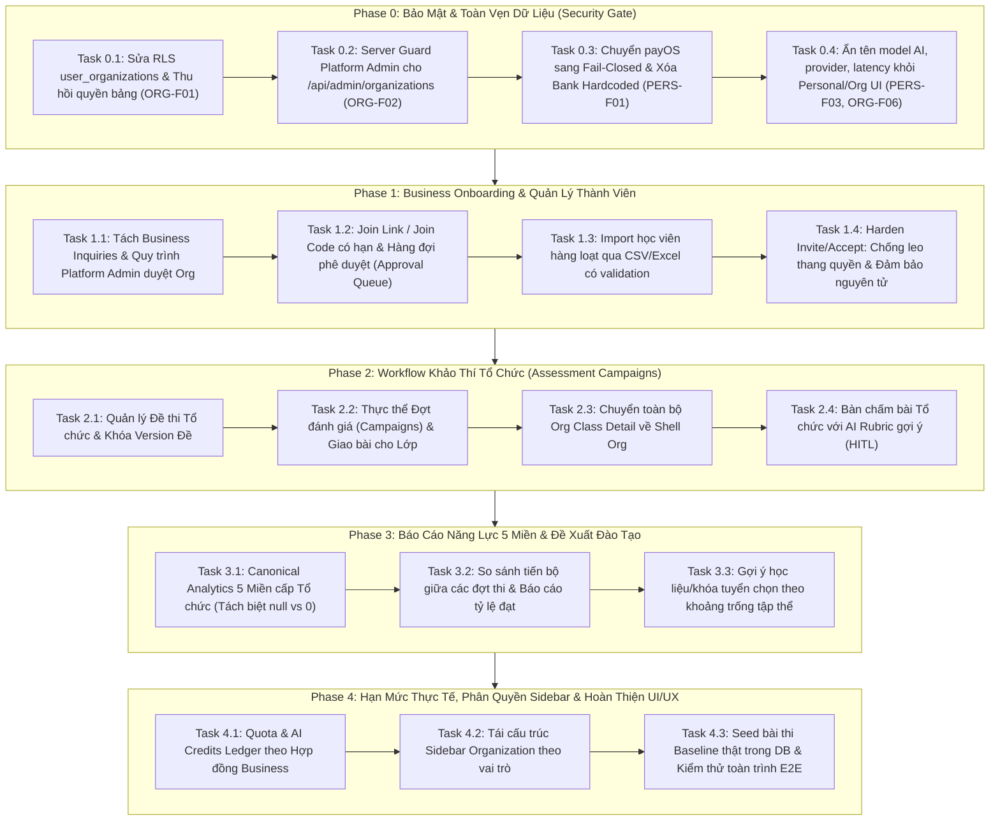

# Kế Hoạch Triển Khai Toàn Diện: NEXA AI Business Architecture & Security Overhaul (Phase 0 -> Phase 4)

> **Căn cứ tài liệu:**
> - [NEXA_REVIEW_PERSONAL_ORG_BUSINESS_2026-10-30_d7934984.md](file:///c:/Users/CPS/Downloads/NEXA_REVIEW_PERSONAL_ORG_BUSINESS_2026-10-30_d7934984.md)
> - [AGENTS.md](file:///c:/nexa/AGENTS.md)
>
> **Kỹ năng áp dụng:** `planning-and-task-breakdown`, `incremental-implementation`  
> **Trạng thái:** Kế hoạch thực thi chính thức (Active Master Plan)

---

## 1. Tầm Nhìn Kiến Trúc & Mục Tiêu

Chuyển đổi NEXA từ một hệ thống các dashboard phân tán thành một **nền tảng SaaS đánh giá và phát triển năng lực số B2B thực sự vận hành được**, phục vụ trường học và doanh nghiệp với chu trình khép kín:
1. **Bảo mật & Phân quyền Đa Tenant (Multi-Tenant Isolation):** Độc lập tuyệt đối giữa Personal Workspace và Organization Workspace. Không có bất kỳ kẽ hở RLS hay API nào cho phép rò rỉ dữ liệu chéo giữa các tổ chức.
2. **Vòng đời Khách hàng Business Hợp chuẩn:** Khách hàng B2B trải qua luồng thẩm duyệt hợp đồng (`Inquiry → Review → Contract → Entitlements → Activation`), không tự mua gói qua checkout cá nhân.
3. **Onboarding Quy mô lớn:** Link/mã tham gia có kiểm soát, hàng đợi phê duyệt (Approval Queue), import hàng loạt bằng file CSV/Excel với validation chặt chẽ.
4. **Vận hành Khảo thí Tập thể (Assessment Campaigns):** Lấy "Đợt đánh giá" làm trung tâm điều phối: Giao đề → Nộp bài → Chấm Rubric HITL → Phê duyệt → Báo cáo 5 miền.
5. **Độc quyền Quản trị AI:** Toàn bộ việc lựa chọn model, provider, latency và API key thuộc Platform Admin; khách hàng chỉ quản lý Quota và Credits.
6. **Chuẩn hóa 5 Miền Năng Lực (DigComp):** Báo cáo và đề xuất học liệu dựa trên đúng 5 miền cốt lõi, không chia vụn vặt 21 kỹ năng con; phân biệt rõ `null` (chưa đo) và `0` (đạt 0 điểm).

---

## 2. Các Quyết Định Kiến Trúc Then Chốt (ADR)

- **ADR-09: Fail-Closed Security & Strict Tenant RLS (Phase 0)**
  - Hủy bỏ toàn bộ chính sách RLS quá rộng (`auth.uid() IS NOT NULL`, `SELECT USING (true)`).
  - Thu hồi các quyền cấp thừa cho `anon` trên các bảng thành viên và tổ chức.
  - Tách bạch rõ quyền: Người dùng chỉ xem được membership của chính mình; Quản trị viên chỉ quản lý thành viên trong tổ chức của mình.
  - Cổng thanh toán payOS chuyển sang **fail-closed**: nếu payOS không cấu hình hoặc khởi tạo lỗi, API lập tức từ chối và báo lỗi, tuyệt đối không xuất mã QR tài khoản cá nhân hardcoded.
- **ADR-10: Ẩn Giấu Hoàn Toàn Metadata Model AI Khỏi Client (Phase 0)**
  - Client Personal và Organization Dashboard không bao giờ nhận tên model (`gemini-1.5-flash`), tên provider hay thời gian phản hồi (latency).
  - Client chỉ nhận: Trạng thái (Khả dụng / Đang xử lý / Tạm gián đoạn), số dư credits và kết quả đánh giá.
- **ADR-11: Vòng Đời Organization Business Thẩm Duyệt (Phase 1)**
  - Form liên hệ doanh nghiệp tạo bản ghi trong bảng `business_inquiries` với trạng thái `PENDING_CONTACT`.
  - Chỉ Platform Admin (được kiểm tra quyền server-side) mới có quyền tạo hoặc chuyển trạng thái Organization sang `ACTIVE`, đồng thời cấp `organization_entitlements` (số ghế, hạn mức AI, số bài thi, ngày hết hạn).
- **ADR-12: Onboarding Thành Viên Đa Kênh An Toàn (Phase 1)**
  - Link/mã tham gia (`join_codes`): có thời hạn (mặc định 7 ngày), giới hạn số lượt dùng (max_uses), có thể thu hồi (revoke), vai trò mặc định là `MEMBER`.
  - Hàng đợi yêu cầu (`membership_requests`): ứng viên gửi yêu cầu sẽ rơi vào trạng thái `PENDING`, yêu cầu Org Admin duyệt mới trở thành `ACTIVE` (có kiểm tra trần số ghế còn lại).
  - Import CSV: kiểm tra định dạng email, loại bỏ trùng lặp, kiểm tra số ghế trước khi tạo hàng loạt.
- **ADR-13: Thực Thể Đợt Đánh Giá - Assessment Campaigns (Phase 2)**
  - Tạo bảng `assessment_campaigns`: liên kết Đề đánh giá (đã khóa version) với Danh sách Lớp/Nhóm, Hạn nộp, Người chấm và Quy chế.
  - Toàn bộ giao diện quản lý lớp và bài tập của tổ chức chạy hoàn toàn trong Shell Org (`/org/[slug]/*`), không bao giờ chuyển hướng sang `/personal/groups/[id]`.
- **ADR-14: Đo Lường 5 Miền & Can Thiệp Đào Tạo Cấp Cohort (Phase 3)**
  - Báo cáo tổ chức đo lường tỷ lệ tham gia, tỷ lệ đạt chuẩn (>= 70%) trên 5 miền.
  - Phân biệt rõ `null` (chưa có bằng chứng) và `0` (đạt 0 điểm).
  - Đề xuất khóa học từ `course_catalog` theo nhóm khoảng trống năng lực của tập thể, giữ vững nguyên tắc NEXA không phải sàn thương mại điện tử bán khóa học.

---

## 3. Lộ Trình Triển Khai 5 Giai Đoạn

---

## 4. Quản Trị Rủi Ro & Biện Pháp Phòng Ngừa

| Rủi ro | Mức độ | Biện pháp giảm thiểu |
| :--- | :---: | :--- |
| **RLS đệ quy vô hạn (Infinite recursion)** | Cao | Khi kiểm tra quyền quản trị của caller trong RLS, sử dụng hàm `SECURITY DEFINER` được tối ưu hóa hoặc bảng helper không tự tham chiếu trực tiếp. |
| **Ảnh hưởng đến người dùng Personal khi vá RLS** | Cao | Đảm bảo policy cho phép user đọc bản ghi của chính họ (`auth.uid() = user_id`) luôn được bảo tồn độc lập. |
| **PayOS sandbox gián đoạn thanh toán thử nghiệm** | Trung bình | Cơ chế fail-closed chặn tạo QR ảo, nhưng cung cấp nút kiểm thử giả lập rõ ràng trong môi trường dev/staging có gắn cờ môi trường. |
| **Lỗi lệch Tenant khi điều phối bài thi** | Cao | Mọi bảng bài thi, lớp học, đợt đánh giá đều bắt buộc có ràng buộc khóa ngoại `organization_id` và RLS kiểm tra membership chặt chẽ. |

---

## 5. Định Nghĩa Hoàn Thành (Definition of Done)

- [ ] Toàn bộ các Phase thực hiện tuần tự và vượt qua kiểm tra chất lượng.
- [ ] `npm run typecheck` đạt 0 lỗi TypeScript (`tsc --noEmit`).
- [ ] `npx vitest run` đạt 100% test suites pass.
- [ ] Kiểm thử bảo mật đa vai trò (Anonymous, Member Org A, Admin Org A, Member Org B, Platform Admin) chứng minh cách ly tenant hoàn hảo.
- [ ] Tuân thủ tuyệt đối quy tắc giao diện trong `AGENTS.md`.
