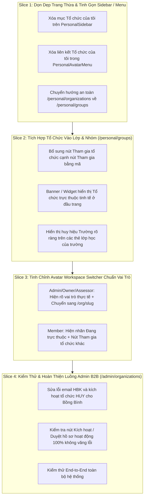

# Kế Hoạch Triển Khai: Tái Cấu Trúc Không Gian Tổ Chức Tinh Gọn (Phương Án A) & Chuẩn Hóa Quản Trị Admin B2B

## 1. Mục Tiêu & Triết Lý Thiết Kế
Loại bỏ triệt để bước trung gian thừa thãi của trang `/personal/organizations`. Thống nhất toàn bộ hoạt động học tập, lớp học và tổ chức của người học tại một nơi duy nhất: **"Lớp & Nhóm" (`/personal/groups`)**; đồng thời giải quyết triệt để lỗi phân quyền và kích hoạt tổ chức tại Dashboard Quản trị nền tảng (`/admin/organizations`).

### Nguyên tắc cốt lõi:
1. **Zero Redundancy:** Chủ sở hữu / Quản trị viên quản lý trường trực tiếp tại `/org/[slug]` qua Menu Avatar. Học viên sinh hoạt 100% tại `/personal/groups` và `/personal/submissions`. Không tạo trang rác trung gian.
2. **Không lỗi phân quyền:** Bảng `organizations`, `organization_invitations` và `user_organizations` trên Postgres hoạt động ổn định, Admin kích hoạt tổ chức trơn tru không bị popup lỗi.
3. **Tuân thủ quy chuẩn `AGENTS.md`:** Không sử dụng đường viền ngang (`border-b`, `border-t`, `divide-y`, `
`), nền trắng sáng `#FFFFFF` / đen sâu `#000000`, chữ than trung tính và màu nhấn Cobalt Blue `#2563EB`.

---

## 2. Các Lát Cắt Triển Khai (Vertical Slices)

---

## 3. Chi Tiết Từng Lát Cắt

### Slice 1: Dọn Dẹp Trang Thừa & Tinh Gọn Sidebar / Menu
* **Mục tiêu:** Xóa bỏ sự xuất hiện của trang `/personal/organizations` khỏi Sidebar và Menu Avatar; chuyển hướng an toàn mọi truy cập về `/personal/groups`.
* **Tệp can thiệp:**
  - `src/components/dashboard/personal/PersonalSidebar.tsx`: Loại bỏ mục `Tổ chức của tôi`.
  - `src/components/dashboard/personal/PersonalAvatarMenu.tsx`: Loại bỏ link `Tổ chức của tôi`.
  - `src/app/(dashboard)/personal/organizations/page.tsx`: Redirect về `/personal/groups`.

### Slice 2: Tích Hợp Quản Lý Tổ Chức Trực Thuộc Vào `personal/groups`
* **Mục tiêu:** Tại trang "Lớp & Nhóm", học viên thấy được mình đang trực thuộc trường nào (nếu có), có nút "Tham gia trường / tổ chức" nhanh bằng modal tinh gọn, và các lớp học của trường được phân biệt rõ ràng.
* **Tệp can thiệp:**
  - `src/app/(dashboard)/personal/groups/page.tsx`:
    - Thêm Banner thông tin trường trực thuộc (kèm nút Rời trường an toàn nếu muốn).
    - Thêm nút mở `JoinOrgModal` ngay trên thanh công cụ đầu trang.

### Slice 3: Tinh Chỉnh Menu Avatar Chuẩn Vai Trò
* **Mục tiêu:** Menu Avatar phản ánh đúng bản chất quyền hạn:
  - Chủ sở hữu / Quản trị viên / Khảo thí viên: chuyển sang `/org/[slug]` mượt mà.
  - Thành viên: chỉ ở không gian cá nhân.
* **Tệp can thiệp:**
  - `src/components/dashboard/AvatarWorkspaceSection.tsx`.

### Slice 4: Kích Hoạt & Kiểm Thử Toàn Diện Luồng Admin B2B
* **Mục tiêu:** Đảm bảo Admin tại `/admin/organizations` bấm duyệt / kích hoạt tổ chức thành công, người đại diện nhận đúng quyền `ORG_OWNER` và truy cập được Dashboard tổ chức.
* **Tệp can thiệp:**
  - `src/app/api/admin/organizations/route.ts`
  - Sửa email typo `minhhuy868762@gmai.com` -> `minhhuy868762@gmail.com` trong database.
