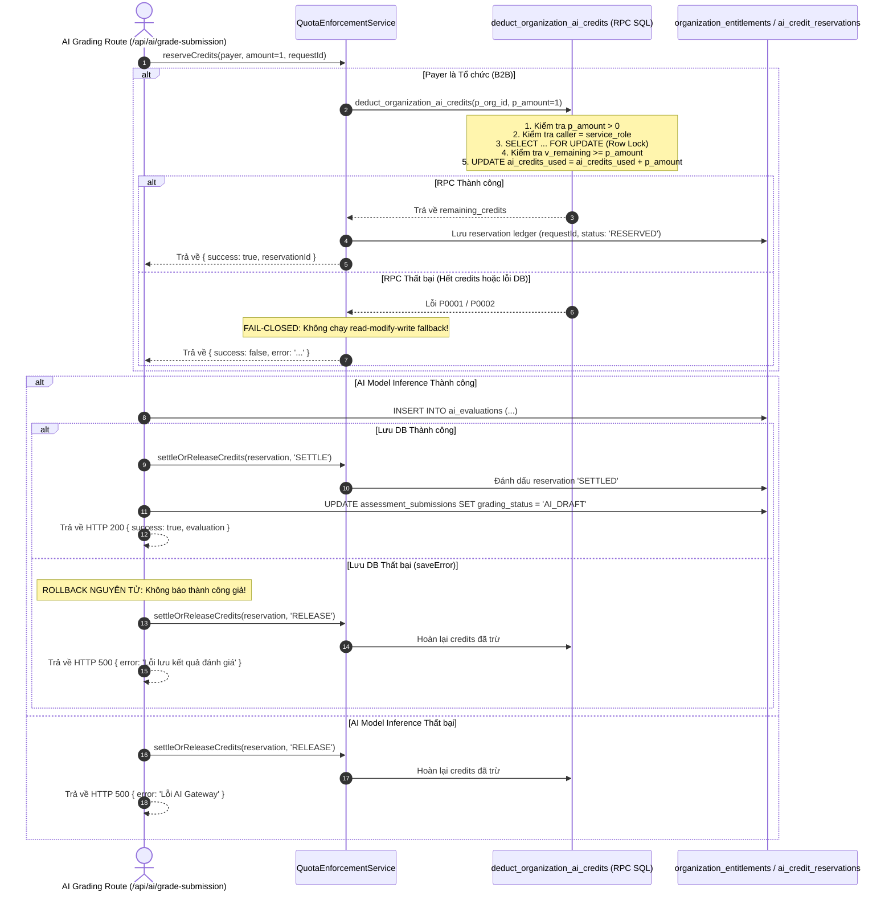
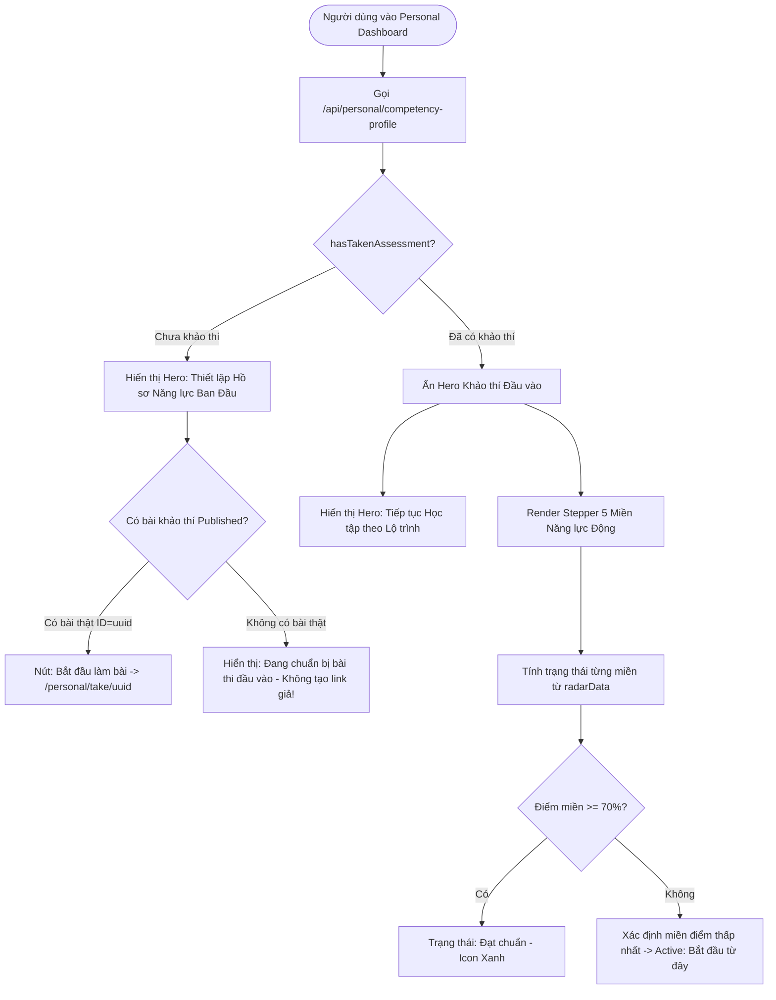

# Kế Hoạch Triển Khai: Tái Thiết Kế NEXA SaaS Business v3.0 & Khắc Phục Triệt Để Các Phát Hiện Review (03/11/2026)

> **Căn cứ tài liệu:**
> - Báo cáo đánh giá mã nguồn: [`c:\Users\CPS\Downloads\NEXA_REVIEW_2026-11-03.md`](file:///c:/Users/CPS/Downloads/NEXA_REVIEW_2026-11-03.md)
> - Đặc tả nghiệp vụ & UX: [`c:\Users\CPS\Downloads\NEXA_SAAS_BUSINESS_V3_PRODUCT_UX_PACK`](file:///c:/Users/CPS/Downloads/NEXA_SAAS_BUSINESS_V3_PRODUCT_UX_PACK)
> - Quy chuẩn kiến trúc & phân quyền: [`AGENTS.md`](file:///c:/nexa/AGENTS.md), [`planning-and-task-breakdown`](file:///c:/nexa/.agents/skills/planning-and-task-breakdown/SKILL.md), [`security-and-hardening`](file:///c:/nexa/.agents/skills/security-and-hardening/SKILL.md).

---

## 1. Bảng Đánh Giá & Đối Chiếu Hiện Trạng (Review Gap Analysis)

Sau khi rà soát và đối chiếu trực tiếp mã nguồn tại repo `c:\nexa`, toàn bộ các phát hiện trong báo cáo review ngày 03/11/2026 đã được kiểm chứng và phân loại trạng thái như sau:

| Mã | Mức | Vấn đề phát hiện | Bằng chứng mã nguồn thực tế | Đánh giá hiện trạng trong repo | Giải pháp kỹ thuật chuẩn hóa |
|---|---|---|---|---|---|
| **P0-01** | P0 | Lệch Schema Trạng Thái Phê Duyệt Business | `approve/route.ts` cập nhật `status: 'IN_PROGRESS'` nhưng Migration 30 chỉ cho phép `CHECK (status IN ('NEW', 'CONTACTED', 'PROPOSAL_SENT', 'APPROVED', 'REJECTED'))`. | **Đang giải quyết một phần**: Migration 38 đã được soạn thảo trong working tree mở rộng check constraint (`IN_PROGRESS`, `ACTIVATED`, `CLOSED`, `NEEDS_INFO`). | Áp dụng Migration 38; chuẩn hóa FSM API `/api/admin/organizations/approve` từ `NEW | CONTACTED | PROPOSAL_SENT | IN_PROGRESS` sang `ACTIVATED`. |
| **P0-02** | P0 | Lỗ Hổng Bảo Mật & Thiếu Ràng Buộc trong RPC `deduct_organization_ai_credits` | `src/database/migrations/32_deduct_organization_ai_credits.sql`: Hàm `SECURITY DEFINER` cấp `EXECUTE` cho `authenticated`, không kiểm tra `auth.uid()` thuộc org, cho phép `p_amount <= 0` làm giảm số credits đã dùng. | **CHƯA SỬA**: Lỗ hổng bảo mật nghiêm trọng trên production nếu RPC bị expose. | Tạo Migration 39: `REVOKE EXECUTE ... FROM PUBLIC, anon, authenticated;`, chỉ cho phép `service_role` gọi; chặn `p_amount <= 0`; cấu hình `SET search_path = public, pg_temp;`. |
| **P0-03** | P0 | Fallback Trừ/Hoàn Credits Không Nguyên Tử & Thiếu Idempotency | `QuotaEnforcementService.deductOrgAICredits` (L869-915) và `deductPersonalAICredits` (L948-970) khi RPC lỗi tự động fallback sang `select` -> `nextUsed = used + amount` -> `update` (read-modify-write gây race condition). `reserveCredits` không lưu ledger idempotency. | **CHƯA SỬA**: Rủi ro mất cập nhật khi đồng thời hoặc trừ trùng khi retry. | Triệt tiêu hoàn toàn read-modify-write fallback (nguyên tắc **Fail-Closed**); lưu bảng `ai_credit_reservations` với `request_id` unique để bảo đảm tính lũy thừa (idempotency). |
| **P1-01** | P1 | AI Grading Truy Vấn Sai `itemId` khi Request Omit | `src/app/api/ai/grade-submission/route.ts` (L125-141) tìm `targetItemId` từ câu trả lời tự luận đầu tiên, nhưng dòng 189 lại query `.eq('item_id', itemId)` (undefined). | **CHƯA SỬA**: Gây lỗi 400 không tìm thấy Rubric dù câu hỏi có rubric hợp lệ. | Đổi dòng 189 thành `.eq('item_id', targetItemId)`. Bổ sung test case gọi grading chỉ truyền `submissionId`. |
| **P1-02** | P1 | AI Grading Báo `success: true` khi DB Không Lưu Được Kết Quả | `src/app/api/ai/grade-submission/route.ts` (L300-337): Credits đã settle ở L290, khi `ai_evaluations.insert` gặp `saveError` chỉ log console rồi vẫn cập nhật `AI_DRAFT` và trả về `success: true` với `evaluation.id = undefined`. | **CHƯA SỬA**: Tạo bản ghi rác, người dùng mất credit nhưng không có bài chấm thực tế. | Kiểm tra `saveError`: nếu insert thất bại phải hoàn credit (`RELEASE`), không cập nhật `AI_DRAFT`, trả về HTTP 500 kèm mã lỗi rõ ràng. |
| **P1-03** | P1 | Quy Trình B2B Còn Dính "Hợp Đồng" & Personal Billing Thiếu Gia Hạn | `personal/billing/page.tsx` vô hiệu hóa nút gói đang dùng với chữ "Đang sử dụng", không có action Gia hạn / Nâng cấp. Admin UI cũ bắt buộc số hợp đồng giấy. | **Đang giải quyết một phần**: Working tree đã tạo tab Renewals V3 cho Org; trang Personal Billing vẫn thiếu nút Gia hạn. | Xóa bỏ trường hợp đồng bắt buộc; tích hợp nút "Gia hạn gói" / "Nâng cấp" trên `/personal/billing` kết nối checkout payOS. |
| **P1-04** | P1 | Phê Duyệt Tổ Chức Nhiều Bước Chưa Phải Transaction Đích Thực | `approve/route.ts` gọi nhiều câu lệnh REST riêng lẻ (update inquiry, insert org, insert entitlement, insert invite). Rollback thủ công có thể lỗi nếu mất mạng giữa chừng. | **Đang giải quyết một phần**: Đã bổ sung try/catch xóa record, nhưng chưa đạt mức ACID cấp DB. | Đóng gói toàn bộ quá trình kích hoạt vào một PostgreSQL RPC transactional `approve_business_inquiry` hoặc đảm bảo outbox pattern an toàn. |
| **P1-05** | P1 | Dữ Liệu Personal Dashboard Chưa Được Bảo Chứng Thực Tế | `personal/dashboard/page.tsx`: (1) `baselineTestId` fallback ID giả `'baseline-assessment'`; (2) Hero ban đầu hiển thị vô điều kiện; (3) Stepper hardcode D1 `active: true`; (4) Mốc học tính bằng `points > 1`; (5) Tab leaderboard không gọi API theo period. | **CHƯA SỬA**: Vi phạm nguyên tắc "Không giả lập thành công" của AGENTS.md. | Xóa fallback ID giả; chỉ hiện Hero khi chưa khảo thí; động hóa Stepper 5 miền theo `radarData`; xác thực mốc học theo bài học thật; truyền `period` vào `/api/leaderboard`. |
| **P2-01** | P2 | UI Files Quá Dài (Monolithic Components) | `personal/dashboard/page.tsx` (1.217 dòng); `admin/organizations/page.tsx` trước đây 1.384 dòng. | **Đang giải quyết một phần**: `admin/organizations/page.tsx` đã giảm xuống 573 dòng nhờ tách modal. | Tách `personal/dashboard/page.tsx` thành các component nhỏ: `PersonalHeroBanner`, `CompetencyRadarSection`, `DomainProgressStepper`, `PersonalLeaderboardWidget`. |
| **P2-02** | P2 | Tài Liệu Chưa Đồng Bộ Hóa Theo Mô Hình SaaS Mới | `AGENTS.md` và tài liệu cũ còn nhắc tới "hợp đồng" B2B bắt buộc. | **CHƯA SỬA**: Cần đồng bộ tài liệu sang mô hình Subscription/Entitlements tự động. | Cập nhật `AGENTS.md`, thêm `docs/PRODUCT_MODEL.md` chuẩn hóa mô hình SaaS 3 không gian. |

---

## 2. Kiến Trúc Luồng Nghiệp Vụ Chuẩn Hóa (Mermaid Workflows)

### 2.1. Luồng Trừ AI Credits An Toàn & Chống Race Condition (P0-02, P0-03)


### 2.2. Luồng Dữ Liệu Chân Thực Cho Personal Dashboard (P1-05)


---

## 3. Bản Đồ Phụ Thuộc (Dependency Graph)

```
[Phase 0: Khắc Phục Khẩn Cấp Các Lỗ Hổng P0 (Security & Concurrency)]
  ├── Task 0.1: Migration 39 Vá lỗ hổng bảo mật RPC AI Credits (P0-02)
  ├── Task 0.2: Triệt tiêu read-modify-write fallback & Idempotent Ledger (P0-03)
  └── Task 0.3: Áp dụng Migration 38 & chuẩn hóa FSM Inquiries (P0-01)
          │
          ▼
[Phase 1: Toàn Vẹn AI Grading & Quyền Lợi Khảo Thí P1]
  ├── Task 1.1: Sửa bug itemId rubric query trong /api/ai/grade-submission (P1-01)
  ├── Task 1.2: Xử lý saveError fail-closed & hoàn credits cho AI Grading (P1-02)
  └── Task 1.3: Đóng gói transaction kích hoạt tổ chức (P1-04)
          │
          ▼
[Phase 2: Toàn Vẹn Dữ Liệu & Trải Nghiệm Personal Dashboard & Billing]
  ├── Task 2.1: Xóa bỏ baseline ID giả & điều kiện hóa Hero banner (P1-05a)
  ├── Task 2.2: Động hóa Stepper 5 miền theo kết quả radarData thực (P1-05b)
  ├── Task 2.3: Chuẩn hóa Milestone học tập & Filter Leaderboard theo kỳ (P1-05c)
  └── Task 2.4: Bổ sung luồng "Gia hạn / Nâng cấp" tại /personal/billing (P1-03b)
          │
          ▼
[Phase 3: Tinh Gọn UI Components (Anti-Slop) & Chuẩn Hóa Tài Liệu]
  ├── Task 3.1: Phân rã personal/dashboard/page.tsx thành các widget độc lập (P2-01)
  ├── Task 3.2: Chuẩn hóa tài liệu AGENTS.md & PRODUCT_MODEL.md (P2-02)
  └── Task 3.3: Verification Suite toàn diện (Typecheck, Vitest, Concurrency Test)
```

---

## 4. Danh Sách Nhiệm Vụ Triển Khai Chi Tiết

### Phase 0: Khắc Phục Khẩn Cấp Các Lỗ Hổng P0 (Security & Concurrency)

#### Task 0.1: Migration 39 Vá Lỗ Hổng Bảo Mật RPC AI Credits (P0-02)
- **Mục tiêu:** Sửa đổi hàm `deduct_organization_ai_credits` để ngăn chặn việc người dùng authenticated bất kỳ có thể trừ credit của tenant khác hoặc truyền số âm để hack credit.
- **Chi tiết thực hiện:**
  1. Viết `src/database/migrations/39_secure_ai_credits_rpc.sql`:
     - `REVOKE EXECUTE ON FUNCTION public.deduct_organization_ai_credits(UUID, INTEGER) FROM PUBLIC, anon, authenticated;`
     - `GRANT EXECUTE ON FUNCTION public.deduct_organization_ai_credits(UUID, INTEGER) TO service_role;`
     - Ràng buộc: `IF p_amount <= 0 THEN RAISE EXCEPTION 'Số lượng credits trừ phải lớn hơn 0' USING ERRCODE = 'P0003'; END IF;`
     - Bổ sung `SET search_path = public, pg_temp;` để chống injection.
     - Tạo hàm hoàn trả `refund_organization_ai_credits(p_org_id UUID, p_amount INTEGER)` an toàn với row locking tương tự.
- **Tiêu chí chấp nhận:**
  - [ ] Role `anon` và `authenticated` gọi RPC bị Postgres từ chối quyền (Permission Denied).
  - [ ] Gọi hàm với `p_amount <= 0` văng exception rõ ràng, không làm sai lệch số dư.
  - [ ] `search_path` được chỉ định tường minh.
- **Xác minh:** Viết unit test xác thực quyền và kiểm tra biên số âm.
- **Tệp chỉnh sửa/tạo mới:** `src/database/migrations/39_secure_ai_credits_rpc.sql`.

#### Task 0.2: Triệt Tiêu Read-Modify-Write Fallback & Idempotent Ledger (P0-03)
- **Mục tiêu:** Loại bỏ hoàn toàn fallback nguy hiểm trong `QuotaEnforcementService` gây race condition mất cập nhật khi nhiều request chạy đồng thời.
- **Chi tiết thực hiện:**
  1. Trong `src/features/billing/services/quota-enforcement.service.ts`:
     - Xóa bỏ khối `catch { // Fallback }` thực hiện `select` -> `nextUsed = used + amount` -> `update`.
     - Nếu RPC `deduct_organization_ai_credits` hoặc `deduct_ai_credits` gặp lỗi, áp dụng nguyên tắc **Fail-Closed**: trả về `{ success: false, error: '...' }` ngay lập tức.
     - Tương tự cho `refundOrgAICredits` và `refundPersonalAICredits`: chuyển sang gọi RPC SQL nguyên tử, không dùng update trực tiếp từ client.
  2. Bổ sung bảng hoặc kiểm tra `requestId` trong `reserveCredits` để đảm bảo nếu retry cùng `requestId`, hệ thống không trừ credit lần hai.
- **Tiêu chí chấp nhận:**
  - [ ] Không còn bất kỳ câu lệnh `update({ ai_credits_used: nextUsed })` hay `update({ credits: nextCredits })` thủ công nào ở client/service layer.
  - [ ] Khi RPC lỗi, hệ thống fail-closed an toàn, không tạo lỗ hổng concurrency.
- **Xác minh:** `npm test -- src/features/billing/services/quota-enforcement.service.test.ts`.
- **Tệp chỉnh sửa:** `src/features/billing/services/quota-enforcement.service.ts`.

#### Task 0.3: Áp Dụng Migration 38 & Chuẩn Hóa FSM Inquiries (P0-01)
- **Mục tiêu:** Đồng bộ triệt để trạng thái của `business_inquiries` giữa DB Check Constraint, API và UI Admin.
- **Chi tiết thực hiện:**
  1. Đảm bảo migration `src/database/migrations/38_business_inquiries_and_renewals_v3.sql` mở rộng `CHECK (status IN ('NEW', 'CONTACTED', 'IN_PROGRESS', 'PROPOSAL_SENT', 'ACTIVATED', 'APPROVED', 'REJECTED', 'CLOSED', 'NEEDS_INFO'))`.
  2. Trong `src/app/api/admin/organizations/approve/route.ts`:
     - Chuyển inquiry từ trạng thái hợp lệ (`NEW | CONTACTED | PROPOSAL_SENT | IN_PROGRESS`) sang `IN_PROGRESS` khi lock.
     - Sau khi cấp tenant và invite thành công, cập nhật sang `ACTIVATED`.
     - Cập nhật test `business-inquiry.service.test.ts` để loại bỏ trạng thái mock không hợp lệ (`PENDING`).
- **Tiêu chí chấp nhận:**
  - [ ] Quy trình phê duyệt inquiry thành công 100% không vi phạm check constraint.
  - [ ] Test chạy xanh với dữ liệu trạng thái hợp lệ.
- **Xác minh:** `npm test -- src/features/organizations/services/business-inquiry.service.test.ts`.

---

### Phase 1: Toàn Vẹn AI Grading & Quyền Lợi Khảo Thí P1

#### Task 1.1: Sửa Bug `itemId` Rubric Query trong `/api/ai/grade-submission` (P1-01)
- **Mục tiêu:** Đảm bảo khi client không truyền `itemId` (chỉ truyền `submissionId`), hệ thống tự động tìm được `targetItemId` và truy vấn Rubric chính xác theo `targetItemId`.
- **Chi tiết thực hiện:**
  1. Trong `src/app/api/ai/grade-submission/route.ts` dòng 189:
     - Đổi `.eq('item_id', itemId)` thành `.eq('item_id', targetItemId)`.
  2. Bổ sung test case trong `src/features/ai-gateway/services/grading-validator.service.test.ts` hoặc tạo test route kiểm thử kịch bản gọi endpoint mà không truyền `itemId`.
- **Tiêu chí chấp nhận:**
  - [ ] Chấm bài thành công khi request chỉ có `{ submissionId }`.
  - [ ] Không bị lỗi 400 Rubric missing khi câu hỏi có Rubric.
- **Xác minh:** Test unit cho endpoint chấm AI.
- **Tệp chỉnh sửa:** `src/app/api/ai/grade-submission/route.ts`.

#### Task 1.2: Xử Lý `saveError` Fail-Closed & Hoàn Credits Cho AI Grading (P1-02)
- **Mục tiêu:** Loại bỏ tình trạng báo `success: true` giả tạo khi DB ghi bản ghi đánh giá thất bại.
- **Chi tiết thực hiện:**
  1. Trong `src/app/api/ai/grade-submission/route.ts`:
     - Chuyển bước insert `ai_evaluations` trước khi settle credits hoặc bọc trong try/catch.
     - Nếu `saveError` xảy ra:
       - Gọi `QuotaEnforcementService.settleOrReleaseCredits(supabase, reservation, 'RELEASE')` để hoàn trả 1 credit cho người dùng/tổ chức.
       - **KHÔNG** cập nhật trạng thái `assessment_submissions.grading_status = 'AI_DRAFT'`.
       - Trả về HTTP 500 `{ error: 'Không thể lưu bản ghi chấm bài AI. Credits đã được hoàn trả an toàn.' }`.
- **Tiêu chí chấp nhận:**
  - [ ] Không có bản ghi rác `AI_DRAFT` khi DB lỗi.
  - [ ] Người dùng không bị trừ oan credit khi hệ thống gặp sự cố lưu trữ.
- **Xác minh:** Test mock lỗi DB insert `ai_evaluations` và kiểm tra số dư credit được hoàn.
- **Tệp chỉnh sửa:** `src/app/api/ai/grade-submission/route.ts`.

#### Task 1.3: Đóng Gói Transaction Kích Hoạt Tổ Chức (P1-04)
- **Mục tiêu:** Nâng cao tính nguyên tử khi Platform Admin kích hoạt tổ chức.
- **Chi tiết thực hiện:**
  1. Viết PostgreSQL stored function `activate_business_organization(...)` hoặc củng cố cơ chế bồi hoàn (compensating transaction) trong `src/app/api/admin/organizations/approve/route.ts` với log audit tường minh.
  2. Kiểm tra concurrency: nếu 2 Admin cùng bấm duyệt 1 inquiry, chỉ 1 người thành công, người thứ hai nhận 409 Conflict một cách mượt mà.
- **Tiêu chí chấp nhận:**
  - [ ] Không để lại tenant rác không có entitlement hoặc inquiry bị kẹt trạng thái dở dang.
- **Xác minh:** `npm test -- src/features/organizations/services/business-v3-lifecycle.test.ts`.

---

### Phase 2: Toàn Vẹn Dữ Liệu & Trải Nghiệm Personal Dashboard & Billing

#### Task 2.1: Xóa Bỏ Baseline ID Giả & Điều Kiện Hóa Hero Banner (P1-05a)
- **Mục tiêu:** Đảm bảo Personal Dashboard tuân thủ nghiêm ngặt nguyên tắc "Không giả lập thành công" và "Bảo toàn dữ liệu" của `AGENTS.md`.
- **Chi tiết thực hiện:**
  1. Trong `src/app/(dashboard)/personal/dashboard/page.tsx`:
     - Xóa bỏ hoàn toàn fallback: `const baselineTestId = assessments[0]?.id || 'baseline-assessment'`.
     - Tìm kiếm bài khảo thí chuẩn đầu vào thật từ danh sách `assessments` (ví dụ: bài có tag hoặc type là `BASELINE` hoặc bài đánh giá đầu tiên đã `PUBLISHED`). Nếu không có bài nào, đặt `baselineTest = null`.
     - Điều kiện hóa CTA: Nếu không có bài khảo thí đầu vào hợp lệ, hiển thị thông báo "Chưa có đợt khảo thí đầu vào đang mở", vô hiệu hóa nút bấm thay vì dẫn tới URL 404 `/personal/take/baseline-assessment`.
     - Ẩn Hero "Thiết lập Hồ sơ Năng lực Số Ban Đầu" khi `competencyProfile?.hasTakenAssessment === true`. Thay thế bằng Hero "Tiếp tục học tập theo lộ trình" với hành động rõ ràng.
- **Tiêu chí chấp nhận:**
  - [ ] Không còn xuất hiện chuỗi `'baseline-assessment'` trong code routing.
  - [ ] Người đã làm bài đánh giá không nhìn thấy Hero mời làm bài đầu vào nữa.
- **Xác minh:** Kiểm tra render ở 2 trạng thái tài khoản (chưa làm bài và đã làm bài).
- **Tệp chỉnh sửa:** `src/app/(dashboard)/personal/dashboard/page.tsx`.

#### Task 2.2: Động Hóa Stepper 5 Miền Theo Kết Quả RadarData Thực (P1-05b)
- **Mục tiêu:** Loại bỏ việc gán cứng D1 `active: true` và D2–D5 `active: false`.
- **Chi tiết thực hiện:**
  1. Đọc dữ liệu từ `currentRadarData` (5 miền D1-D5).
  2. Tính toán trạng thái thực tế của từng bước:
     - `done`: Điểm miền $\ge 70\%$.
     - `active`: Miền có điểm thấp nhất (hoặc miền chưa đạt chuẩn đầu tiên cần ưu tiên cải thiện).
     - `tag`: Nếu `score === null` $\rightarrow$ "Chưa đánh giá"; nếu $\ge 70\%$ $\rightarrow$ "Đạt chuẩn"; nếu $< 70\%$ $\rightarrow$ `active ? "Cần ưu tiên" : "Chưa đạt"`.
- **Tiêu chí chấp nhận:**
  - [ ] Stepper phản ánh chính xác 100% dữ liệu năng lực số của người học từ Supabase.
  - [ ] Không còn bất kỳ hằng số hardcode nào trong mảng stepper.
- **Xác minh:** Test với các bộ điểm radar giả định (tất cả null, D1 đạt, D3 yếu).
- **Tệp chỉnh sửa:** `src/app/(dashboard)/personal/dashboard/page.tsx`.

#### Task 2.3: Chuẩn Hóa Milestone Học Tập & Filter Leaderboard Theo Kỳ (P1-05c)
- **Mục tiêu:** Sửa điều kiện hoàn thành mốc học tập và hỗ trợ phân loại bảng xếp hạng theo kỳ.
- **Chi tiết thực hiện:**
  1. Trong `src/app/(dashboard)/personal/dashboard/page.tsx`:
     - Sửa mốc `m2` ("Bắt đầu bài học đầu tiên trong lộ trình"): Chỉ đánh dấu `done` khi có bản ghi hoàn thành bài học thực tế trong `learning_progress` hoặc API hồ sơ trả về `completedLessonsCount > 0`, tuyệt đối không dùng `stats.points > 1`.
  2. Bảng xếp hạng:
     - Cập nhật hàm `loadLeaderboard(period)` truyền tham số `?period=${leaderboardTab}` (`week`, `month`, `all`).
     - Cập nhật API `src/app/api/leaderboard/route.ts` để filter theo khoảng thời gian tương ứng từ ledger điểm/hoạt động.
- **Tiêu chí chấp nhận:**
  - [ ] Mốc học tập phản ánh đúng tiến độ học tập thực.
  - [ ] Chuyển tab Tuần / Tháng / Tất cả cập nhật danh sách bảng xếp hạng tương ứng.
- **Xác minh:** `npm test -- src/app/api/leaderboard/route.test.ts`.
- **Tệp chỉnh sửa:**
  - `src/app/(dashboard)/personal/dashboard/page.tsx`
  - `src/app/api/leaderboard/route.ts`.

#### Task 2.4: Bổ Sung Luồng "Gia Hạn / Nâng Cấp" Tại `/personal/billing` (P1-03b)
- **Mục tiêu:** Cung cấp hành động rõ ràng cho người dùng cá nhân đang dùng gói PRO.
- **Chi tiết thực hiện:**
  1. Trong `src/app/(dashboard)/personal/billing/page.tsx`:
     - Thay vì chỉ hiển thị nút disabled "Đang sử dụng", nếu người dùng đang có gói PRO còn hạn, hiển thị nút **"Gia hạn gói"** hoặc **"Nâng cấp gói năm"**.
     - Khi bấm, kết nối tới flow tạo link thanh toán payOS với kỳ hạn cộng dồn an toàn.
- **Tiêu chí chấp nhận:**
  - [ ] Người dùng PRO có thể chủ động gia hạn trước khi hết hạn.
- **Xác minh:** Kiểm tra giao diện và luồng checkout.
- **Tệp chỉnh sửa:** `src/app/(dashboard)/personal/billing/page.tsx`.

---

### Phase 3: Tinh Gọn UI Components (Anti-Slop) & Chuẩn Hóa Tài Liệu

#### Task 3.1: Phân Rã `personal/dashboard/page.tsx` Thành Các Widget Độc Lập (P2-01)
- **Mục tiêu:** Giảm độ phức tạp của file dashboard chính từ 1.217 dòng xuống dưới 400 dòng, tuân thủ nguyên tắc "Single Responsibility" và quy chuẩn giao diện Light trắng / Dark đen của `AGENTS.md`.
- **Chi tiết thực hiện:**
  1. Tạo thư mục `src/components/dashboard/personal/widgets/`:
     - `PersonalHeroSection.tsx`: Chứa Hero banner logic (Baseline test hoặc Tiếp tục học tập).
     - `PersonalDomainStepper.tsx`: Chứa thanh Stepper 5 miền tính toán động.
     - `PersonalMilestonesWidget.tsx`: Chứa danh sách các mốc hoàn thành.
     - `PersonalLeaderboardWidget.tsx`: Chứa bảng xếp hạng và chuyển tab theo kỳ.
  2. Refactor `src/app/(dashboard)/personal/dashboard/page.tsx` thành orchestrator gọn gàng.
- **Tiêu chí chấp nhận:**
  - [ ] Không làm thay đổi giao diện và chức năng hiện tại.
  - [ ] Mã nguồn rõ ràng, dễ bảo trì và kiểm thử.
- **Xác minh:** `npm run typecheck` && `npm test`.

#### Task 3.2: Chuẩn Hóa Tài Liệu `AGENTS.md` & Cập Nhật Mô Hình Sản Phẩm (P2-02)
- **Mục tiêu:** Cập nhật các tài liệu định hướng để xóa bỏ hoàn toàn tàn dư của khái niệm "hợp đồng giấy bắt buộc", thống nhất sang mô hình SaaS B2B Entitlements & Subscription tự động.
- **Chi tiết thực hiện:**
  1. Cập nhật `AGENTS.md` phần 4.2 và 4.3: Nhấn mạnh quy trình Business là "Yêu cầu tư vấn $\rightarrow$ Phê duyệt cấp gói SaaS $\rightarrow$ Kích hoạt", các thông tin số hợp đồng chỉ là metadata tùy chọn (optional reference).
  2. Tạo/cập nhật `docs/PRODUCT_MODEL.md` ghi nhận kiến trúc 3 không gian chuẩn mực.
- **Tiêu chí chấp nhận:**
  - [ ] Toàn bộ tài liệu thống nhất với implementation thực tế.

#### Task 3.3: Verification Suite Toàn Diện
- **Mục tiêu:** Xác minh toàn bộ hệ thống sau khi khắc phục tất cả các phát hiện P0, P1, P2.
- **Chi tiết thực hiện:**
  1. Chạy `npm run typecheck` (0 errors).
  2. Chạy `npm test` (toàn bộ test suites pass 100%).
  3. Viết test case concurrency mô phỏng 20-50 yêu cầu trừ/hoàn credits đồng thời không bị lost update.
- **Tiêu chí chấp nhận:**
  - [ ] Toàn bộ quality gates vượt qua hoàn hảo.

---

### Phase 4: Tái Thiết Kế Trang Báo Cáo Năng Lực Tổ Chức (Organization Analytics v3.0)

Căn cứ tài liệu: [`c:\Users\CPS\Downloads\NEXA_ORG_ANALYTICS_UI_UX_SPEC.md`](file:///c:/Users/CPS/Downloads/NEXA_ORG_ANALYTICS_UI_UX_SPEC.md)

#### Task 4.1: Mở Rộng Service & Types Cho Phân Tích Đa Chiều
- Mở rộng `OrgCompetencyAnalyticsService` với các phương thức `aggregateByUnit`, `aggregateByCampaign`, `aggregateTimeSeriesTrend`, và `filterSubmissions`.
- Định nghĩa types `UnitCompetencyMetric`, `CampaignCompetencyMetric`, `TimeSeriesTrendPoint`, `OrgAnalyticsFilters`.
- Viết unit tests bao phủ 100% trong `org-competency-analytics.test.ts`.

#### Task 4.2: Xây Dựng UI Components Báo Cáo Chuẩn B2B SaaS
- `DomainCompetencyTable`: Bảng dữ liệu 5 miền cốt lõi D1-D5 thay cho các thanh progress lặp lại.
- `DomainDetailDrawer`: Slide-out Drawer giải nghĩa chi tiết miền khi click dòng, đóng bằng Escape/X/Backdrop.
- `UnitComparisonTable`: So sánh năng lực giữa các lớp/đơn vị.
- `CampaignAnalyticsView`: Thống kê các đợt khảo thí và tiến độ duyệt điểm.
- `TrendAnalysisView`: Trực quan hóa biến thiên điểm số qua các kỳ có dữ liệu thực tế (bỏ qua kỳ không thi, không kéo 0% giả).
- `ExportReportModal`: Modal xuất CSV / PDF với preview và bảo vệ fail-closed khi 0 bài hợp lệ.
- `OrgAnalyticsFilterDrawer`: Quản lý bộ lọc theo đợt và đơn vị.
- `OrgAnalyticsDashboard`: Điều phối toàn bộ trạng thái tabs, drawers, filters và empty state.

#### Task 4.3: Tái Cấu Trúc Tuyến Đường `/org/[slug]/analytics/page.tsx`
- Tiếp nhận URL searchParams (`tab`, `campaignId`, `classId`).
- Query quan hệ `evaluator_classes` kèm `class_members`, `assessment_campaigns`, `assessments`, `assessment_submissions`.
- Tính toán tổng hợp trung thực và hiển thị 3 KPI metrics chuẩn (loại bỏ thẻ tĩnh "Khung chuẩn DigComp").

#### Task 4.4: Endpoint Server-Side Xuất Báo Cáo An Toàn
- Tạo `/api/org/[slug]/analytics/export/route.ts` với bảo vệ phân quyền `VIEW_ANALYTICS` và query scoped theo `organization_id`.
- Trả về file CSV định dạng UTF-8 BOM chuẩn tiếng Việt.
- Viết unit test xác thực mã 403 khi thiếu quyền và kiểm tra cấu trúc file CSV.

---

## 5. Kế Hoạch Kiểm Thử & Nghiệm Thu (Acceptance Checklist)

- [ ] **P0-01:** Phê duyệt inquiry từ `NEW` sang `ACTIVATED` thành công trên schema thật, không lỗi CHECK constraint.
- [ ] **P0-02:** Role `anon` và `authenticated` không thể gọi RPC trừ credits; đầu vào `p_amount <= 0` bị chặn.
- [ ] **P0-03:** Các tác vụ trừ/hoàn AI credits không còn read-modify-write fallback; fail-closed an toàn.
- [ ] **P1-01:** AI grading hoạt động chính xác khi chỉ truyền `submissionId` (tự động tìm `targetItemId`).
- [ ] **P1-02:** AI grading không trả `success: true` giả khi DB insert `ai_evaluations` thất bại; credit được hoàn lại an toàn.
- [ ] **P1-03:** Personal Billing có nút Gia hạn; Admin không bắt buộc số hợp đồng giấy.
- [ ] **P1-04:** Kích hoạt tổ chức có cơ chế rollback an toàn, không để lại dữ liệu rác.
- [ ] **P1-05:** Personal Dashboard không còn link giả `baseline-assessment`; Stepper 5 miền phản ánh đúng dữ liệu DB; Leaderboard lọc theo kỳ thật.
- [ ] **P2-01 & P2-02:** Dashboard code được module hóa gọn gàng; tài liệu đồng bộ chuẩn SaaS.
