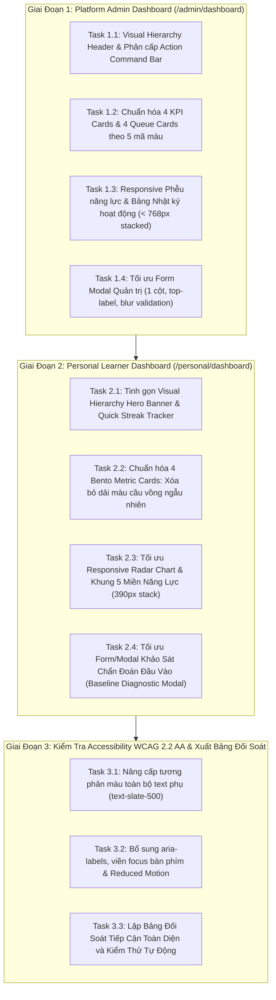

# Kế Hoạch Triển Khai: Kiểm Toán & Chuẩn Hóa Thiết Kế 2 Dashboard (/admin & /personal/dashboard)

## 1. Tổng Quan Kế Hoạch
Kế hoạch này mở rộng việc áp dụng 4 nhóm tiêu chuẩn kiểm toán thiết kế cao cấp (theo yêu cầu tại Ảnh 1) cho 2 màn hình còn lại của hệ sinh thái NEXA:
1. **Trung tâm điều hành nền tảng (Platform Admin Dashboard - `/admin/dashboard`)**
2. **Dashboard cá nhân người học (Personal Learner Dashboard - `/personal/dashboard`)**

Mục tiêu cốt lõi: Thiết lập trải nghiệm thị giác nhất quán trên toàn bộ 3 không gian (Personal, Organization, Platform Admin) với cùng một hệ thống Design Tokens, loại bỏ thiết kế rập khuôn "AI slop", chuẩn hóa form 1 cột validate on blur, tương thích responsive 390px/768px/1440px và đạt chuẩn tiếp cận WCAG 2.2 AA.

## 2. Hệ Thống Design Tokens Khóa Chung
* **5 Mã Màu Chủ Đạo:**
  - Nền trang (Background): `#FFFFFF` (Light) / `#000000` (Dark Mode đen thật)
  - Nền thẻ / Phân vùng (Card / Panel): `#F8FAFC` (Light) / `#111114` (Dark Mode)
  - Tiêu đề & Chữ chính (Foreground): `#171717` (Light) / `#F5F5F5` (Dark Mode)
  - Chữ phụ & Metadata (Muted): `#64748B` (Light) / `#A3A3A3` (Dark Mode, tương phản $\ge 4.6:1$)
  - Xanh thương hiệu tương tác (Primary Accent): `#2563EB` (Light) / `#60A5FA` (Dark Mode)
* **Quy chuẩn Form:** Bố cục 1 cột, nhãn phía trên ô nhập liệu, xác thực khi rời trường (`onBlur`), thông báo lỗi có giải pháp khắc phục, đủ 4 trạng thái (`focus-ring`, `disabled`, `loading`, `error`).
* **Quy chuẩn Responsive:** Tương thích 390px, 768px, 1440px; touch target $\ge 44px$; bảng chuyển thành card xếp chồng ở $< 768px$; không có thanh cuộn ngang `overflow-x`.
* **Quy chuẩn Accessibility:** WCAG 2.2 AA, tương phản $\ge 4.5:1$, viền focus bàn phím rõ nét, aria-labels đầy đủ, tôn trọng `motion-reduce:transition-none`.

## 3. Lộ Trình Triển Khai (Phân Theo Vertical Slices)

## 4. Chi Tiết Từng Nhiệm Vụ

### Giai Đoạn 1: Platform Admin Dashboard (`/admin/dashboard`)
* **Task 1.1: Visual Hierarchy Header & Phân cấp Action Command Bar**
  - **Mô tả:** Đặt 1 nút Primary CTA xanh `#2563EB` cho hành động "Duyệt hồ sơ B2B", nút "Phân tích BI 5 miền" chuyển thành secondary outline. Đảm bảo touch target $\ge 44px$ trên mobile.
  - **Tệp:** `src/app/(dashboard)/admin/dashboard/page.tsx`
  - **Tiêu chí nghiệm thu:** Phân cấp rõ rệt, người quản trị nắm bắt ngay hành động trọng tâm.
* **Task 1.2: Chuẩn hóa 4 KPI Cards & 4 Queue Cards theo 5 mã màu**
  - **Mô tả:** Dọn dẹp các màu rải rác trong `AdminUIComponents.tsx`, đưa icon containers về nền monochrome/xanh đồng nhất, số liệu `font-mono tabular-nums`.
  - **Tệp:** `src/components/dashboard/admin/AdminUIComponents.tsx`
  - **Tiêu chí nghiệm thu:** 4 thẻ KPI và 4 thẻ hàng đợi đồng nhất, không có gradient lòe loẹt.
* **Task 1.3: Responsive Phễu năng lực & Bảng Nhật ký hoạt động**
  - **Mô tả:** Chuyển bảng hoạt động hệ thống thành các card xếp chồng trên màn hình $< 768px$, đảm bảo không có thanh cuộn ngang trên 390px.
  - **Tệp:** `src/app/(dashboard)/admin/dashboard/page.tsx`, `src/components/dashboard/admin/AdminUIComponents.tsx`
  - **Tiêu chí nghiệm thu:** Hiển thị mượt mà trên 390px, 768px và 1440px.
* **Task 1.4: Tối ưu Form Modal Quản trị B2B (AddOrgModal)**
  - **Mô tả:** Rà soát modal thêm tổ chức B2B: bố cục 1 cột, nhãn phía trên, validate on blur, câu báo lỗi có hướng dẫn sửa, đủ 4 trạng thái tương tác.
  - **Tệp:** `src/components/dashboard/admin/AddOrgModal.tsx`
  - **Tiêu chí nghiệm thu:** Form tăng tỷ lệ hoàn thành, không giật lag khi đang nhập liệu.

### Giai Đoạn 2: Personal Learner Dashboard (`/personal/dashboard`)
* **Task 2.1: Tinh gọn Visual Hierarchy Hero Banner & Streak Tracker**
  - **Mô tả:** Giữ bố cục luxury silk ribbon nhưng tinh chỉnh độ tương phản, đặt 1 nút Primary CTA "Bắt đầu khảo sát đầu vào / Học tiếp lộ trình" nổi bật, chuỗi streak tối ưu vùng bấm di động.
  - **Tệp:** `src/app/(dashboard)/personal/dashboard/page.tsx`
  - **Tiêu chí nghiệm thu:** Header và Hero banner gọn gàng, vùng chạm $\ge 44px$.
* **Task 2.2: Chuẩn hóa 4 Bento Metric Cards**
  - **Mô tả:** Thay thế các dải gradient đa sắc ngẫu nhiên (`from-blue-50/40`, `from-emerald-50/40`, `from-amber-50/40`, `from-blue-50/80 via-sky-50`) bằng nền thẻ sạch `#F8FAFC` (Dark `#111114`), viền `#E2E8F0` (Dark `#27272A`), số liệu `font-mono tabular-nums`.
  - **Tệp:** `src/app/(dashboard)/personal/dashboard/page.tsx`
  - **Tiêu chí nghiệm thu:** 4 thẻ đo lường năng lực số cân xứng, tinh tế, sang trọng, tránh "AI slop".
* **Task 2.3: Tối ưu Responsive Radar Chart & Khung 5 Miền Năng Lực**
  - **Mô tả:** Đảm bảo trên 390px biểu đồ Radar và 5 thanh tiến độ xếp chồng cân đối, các bước tiến độ tự động co giãn không tràn màn hình.
  - **Tệp:** `src/app/(dashboard)/personal/dashboard/page.tsx`, `src/components/dashboard/personal/CompetencyRadarChart.tsx`
  - **Tiêu chí nghiệm thu:** Không có `overflow-x` trên mobile, giữ nguyên bố cục 2 cột trên 1440px.
* **Task 2.4: Tối ưu Form/Modal Khảo Sát Chẩn Đoán Đầu Vào (BaselineDiagnosticModal)**
  - **Mô tả:** Chuẩn hóa form khảo sát: bố cục 1 cột rõ ràng, nhãn trên, validate on blur, thông báo lỗi chỉ dẫn cụ thể, đủ 4 trạng thái focus/disabled/loading/error.
  - **Tệp:** `src/components/dashboard/personal/BaselineDiagnosticModal.tsx`
  - **Tiêu chí nghiệm thu:** Trải nghiệm khảo sát đầu vào mượt mà, dễ chịu, không gây ức chế.

### Giai Đoạn 3: Kiểm Tra Accessibility WCAG 2.2 AA & Xuất Bảng Đối Soát
* **Task 3.1: Nâng cấp tương phản màu toàn bộ text phụ**
  - **Mô tả:** Rà soát và thay thế toàn bộ `text-slate-400` (#94A3B8) thành `text-slate-500` (#64748B) trên cả 2 dashboard để đạt tỷ lệ tương phản $\ge 4.5:1$ theo WCAG AA.
  - **Tệp:** Tất cả các component liên quan của 2 dashboard.
  - **Tiêu chí nghiệm thu:** 100% văn bản đạt chuẩn độ tương phản WCAG 2.2 AA.
* **Task 3.2: Bổ sung aria-labels, viền focus bàn phím & Reduced Motion**
  - **Mô tả:** Thêm `aria-label` cho tất cả các nút icon (đóng modal, sao chép, mũi tên), bổ sung `focus-visible:ring-2 focus-visible:ring-blue-600 focus-visible:outline-none`, tích hợp `motion-reduce:transition-none`.
  - **Tệp:** Các tệp UI tương ứng.
  - **Tiêu chí nghiệm thu:** Thao tác bằng phím Tab trơn tru, screen reader đọc chuẩn ngữ nghĩa.
* **Task 3.3: Lập Bảng Đối Soát Tiếp Cận & Chạy Kiểm Thử Tự Động**
  - **Mô tả:** Tổng hợp bảng đối chiếu chi tiết Trước / Sau cho cả 2 màn hình; chạy kiểm thử `tsc --noEmit` và test suite.
  - **Tệp:** `tasks/todo.md`, báo cáo cuối cùng.
  - **Tiêu chí nghiệm thu:** Bảng đối soát minh bạch, build và test xanh.

## 5. Rủi Ro & Giải Pháp Giảm Thiểu
* **Rủi ro 1: Lệch bố cục Desktop khi tối ưu mobile:**
  - *Giải pháp:* Sử dụng Tailwind breakpoint tiền tố `sm:`, `lg:` để chỉ áp dụng stacked cards và full-width buttons ở màn hình nhỏ, giữ nguyên 100% bố cục lưới 1440px.
* **Rủi ro 2: Ảnh hưởng đến trạng thái state của bài khảo sát cá nhân:**
  - *Giải pháp:* Chỉ tối ưu các thuộc tính giao diện (HTML/CSS), tuyệt đối không can thiệp logic tính điểm hoặc thứ tự câu hỏi khảo sát.
* **Rủi ro 3: Vi phạm quy tắc không dùng đường kẻ ngang:**
  - *Giải pháp:* Sử dụng phân cấp nền (`bg-slate-50`), khoảng cách `gap-4`/`gap-6` và bo góc mềm mại thay vì các đường `border-b` / `border-t` phân cách.
