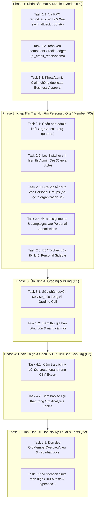

# Kế Hoạch Triển Khai: NEXA SaaS Business v3.0 & Khép Kín Trải Nghiệm Personal / Organization (Tái Cấu Trúc Sau Review 03/11/2026)

> **Căn cứ tài liệu:**
> - Bản Review Chuyên Gia: Đánh giá 7.5/10 & Các phát hiện khắc phục triệt để.
> - Đặc tả mô hình sản phẩm: [`c:\Users\CPS\Downloads\NEXA_WORKSPACE_PERSONAL_ORG_UX_SPEC_2026-11-03.md`](file:///c:/Users/CPS/Downloads/NEXA_WORKSPACE_PERSONAL_ORG_UX_SPEC_2026-11-03.md)
> - Quy chuẩn kiến trúc & an toàn dữ liệu: [`AGENTS.md`](file:///c:/nexa/AGENTS.md), [`security-and-hardening`](file:///c:/nexa/.agents/skills/security-and-hardening/SKILL.md), [`planning-and-task-breakdown`](file:///c:/nexa/.agents/skills/planning-and-task-breakdown/SKILL.md).

---

## 1. Tóm Tắt Khắc Phục Các Điểm Cốt Lõi Từ Đánh Giá (Review Feedback)

| Vấn đề từ Review | Mức độ | Nguyên nhân mã nguồn thực tế | Giải pháp chuẩn hóa |
|---|:---:|---|---|
| **Lỗ hổng hoàn AI Credits cá nhân** | **P0** | Migration 39 cho phép `authenticated` gọi `refund_ai_credits`, chỉ kiểm tra `auth.uid() = p_user_id` -> người dùng có thể tự cộng credits tùy ý. | Thu hồi `EXECUTE` khỏi `authenticated`, chỉ cấp cho `service_role`. Hoàn credit chỉ thực hiện từ backend tin cậy có đối chiếu reservation. |
| **Trừ Credits tổ chức bị chặn quyền** | **P0** | Migration 39 hạn chế RPC tổ chức cho `service_role`, nhưng `grade-submission/route.ts` lại truyền user-session client vào `reserveCredits`. | Xác minh quyền sở hữu bài nộp bằng user client; sau đó thực hiện trừ/hoàn credits qua `createAdminClient()` (`service_role`). |
| **Idempotency Credit Ledger chưa lưu** | **P0** | Bảng `ai_credit_reservations` đã có trong migration 39 nhưng `QuotaEnforcementService.reserveCredits` chưa thực hiện `insert` ledger và kiểm tra trạng thái cũ khi `SETTLE`/`RELEASE`. | Ghi nhận bản ghi `status: 'RESERVED'` với `request_id` unique; khi settle/release phải đối chiếu trạng thái cũ, loại bỏ hoàn toàn fallback read-modify-write. |
| **Xử lý trùng lặp Business Approval** | **P0** | `approve/route.ts` cho phép update `status: IN_PROGRESS` ngay cả khi status đang là `IN_PROGRESS` -> 2 admin bấm đồng thời vẫn claim trùng. | Chỉ claim từ `['NEW', 'CONTACTED', 'PROPOSAL_SENT']` (không cho phép từ `IN_PROGRESS`), bảo đảm 1 inquiry chỉ kích hoạt 1 tổ chức duy nhất. |
| **Chặn tất cả non-admin khỏi Org** | **P0** | `org-guard.ts` vẫn mở cửa cho `ASSESSOR`, `EVALUATOR`, `REPORT_VIEWER` vào một số màn hình tổ chức. | Chốt cứng `VIEW_WORKSPACE: ['ORG_OWNER', 'ORG_ADMIN']`. Mọi vai trò khác bị chặn tại server guard và điều hướng an toàn về Personal. |
| **Personal chưa nhận đủ lớp & bài tổ chức** | **P0** | (1) `personal/groups/page.tsx` (L149) chủ động lọc bỏ `!c.organization_id`; (2) `personal/submissions` mới chỉ đọc `class_assignments`, chưa đọc `assessment_campaigns`. | (1) Xóa điều kiện loại bỏ `!c.organization_id`, hiển thị tên tổ chức; (2) Tích hợp cả 2 nguồn bài tập (lớp & chiến dịch tổ chức) vào Personal. |

---

## 2. Thứ Tự Triển Khai 5 Giai Đoạn (Restructured Roadmap)

---

## 3. Chi Tiết Nhiệm Vụ Từng Giai Đoạn

### Phase 1: Khóa Bảo Mật & Dữ Liệu Credits (P0)

#### Task 1.1: Vá Lỗ Hổng Bảo Mật RPC `refund_ai_credits` & Triệt Tiêu Fallback Trực Tiếp
- **Mục tiêu:** Chặn triệt để nguy cơ người dùng tự hoàn AI credits trái phép; đảm bảo mọi tác vụ trừ/hoàn credits của tổ chức và cá nhân đều qua RPC SQL có row-lock an toàn.
- **Thực hiện:**
  1. Trong `src/database/migrations/39_secure_ai_credits_rpc.sql`:
     - `REVOKE ALL ON FUNCTION public.refund_ai_credits(UUID, INTEGER) FROM authenticated;`
     - Chỉ cấp `GRANT EXECUTE ... TO service_role;`.
  2. Trong `src/features/billing/services/quota-enforcement.service.ts`:
     - Xóa bỏ hoàn toàn các nhánh fallback `update` số dư trực tiếp trong `refundOrgAICredits` và `refundPersonalAICredits`.
     - Sử dụng `createAdminClient()` khi gọi các RPC tổ chức được giới hạn quyền `service_role`.
- **Files:** `src/database/migrations/39_secure_ai_credits_rpc.sql`, `src/features/billing/services/quota-enforcement.service.ts`.

#### Task 1.2: Toàn Vẹn Idempotency Ledger `ai_credit_reservations`
- **Mục tiêu:** Chống thất thoát hoặc trừ/hoàn trùng credit khi client retry hoặc hệ thống gặp lỗi mạng.
- **Thực hiện:**
  1. Trong `QuotaEnforcementService.reserveCredits`:
     - Insert bản ghi vào bảng `ai_credit_reservations` (`request_id`, `amount`, `payer_type`, `payer_id`, `status: 'RESERVED'`).
  2. Trong `settleOrReleaseCredits`:
     - Kiểm tra trạng thái bản ghi reservation trong DB: Chỉ chuyển sang `SETTLED` hoặc `RELEASED` nếu trạng thái hiện tại là `RESERVED`.
     - Nếu đã `RELEASED`, không gọi RPC hoàn tiền lần thứ hai (Idempotent Guarantee).
- **Files:** `src/features/billing/services/quota-enforcement.service.ts`, `src/features/billing/services/org-quota-enforcement.test.ts`.

#### Task 1.3: Khóa Chống Phê Duyệt Trùng Lặp Business Inquiry
- **Mục tiêu:** Đảm bảo 2 admin bấm nút duyệt đồng thời không tạo 2 tổ chức trùng lặp từ 1 yêu cầu tư vấn.
- **Thực hiện:**
  1. Trong `src/app/api/admin/organizations/approve/route.ts`:
     - Chỉ cho phép atomic claim cập nhật `status = 'IN_PROGRESS'` khi trạng thái hiện tại nằm trong `['NEW', 'CONTACTED', 'PROPOSAL_SENT']`.
     - Loại bỏ hoàn toàn `'IN_PROGRESS'` khỏi điều kiện đầu vào để chặn race condition.
- **Files:** `src/app/api/admin/organizations/approve/route.ts`.

---

### Phase 2: Khép Kín Trải Nghiệm Personal / Org / Member (P0)

#### Task 2.1: Chặn Tất Cả Non-Admin Khỏi Organization Console
- **Mục tiêu:** Chỉ cho phép `ORG_OWNER` và `ORG_ADMIN` truy cập `/org/[slug]/*`. Chặn mọi vai trò khác (`MEMBER`, `ASSESSOR`, `EVALUATOR`, `REPORT_VIEWER`).
- **Thực hiện:**
  1. Trong `src/lib/auth/org-guard.ts`:
     - Cập nhật `VIEW_WORKSPACE: ['ORG_OWNER', 'ORG_ADMIN']`.
     - Kiểm tra tại server guard: Nếu user không có quyền Admin, redirect ngay về `/personal/dashboard`.
  2. Trong `src/app/(dashboard)/org/[slug]/page.tsx`:
     - Xóa bỏ việc render `OrgMemberOverviewView` cho role `MEMBER`. Toàn bộ trang này là Dashboard điều hành của Admin.
  3. Trong `src/components/dashboard/org/OrgSidebar.tsx`:
     - Xóa bỏ nhánh menu `isMember`.
- **Files:** `src/lib/auth/org-guard.ts`, `src/app/(dashboard)/org/[slug]/page.tsx`, `src/components/dashboard/org/OrgSidebar.tsx`.

#### Task 2.2: Lọc Switcher Chỉ Hiển Thị Admin Org (Canva Style)
- **Mục tiêu:** Danh sách chuyển đổi không gian chỉ hiển thị những tổ chức mà người dùng thực sự có quyền quản trị.
- **Thực hiện:**
  1. Trong `src/components/dashboard/AvatarWorkspaceSection.tsx`:
     - Lọc danh sách `workspaces`: chỉ hiển thị các mục mà `ws.role === 'ORG_OWNER' || ws.role === 'ORG_ADMIN'`.
     - Member không thấy tổ chức trong switcher (chỉ thấy "Cá nhân" + nút "+ Tham gia tổ chức khác").
     - Admin thấy "Cá nhân" + các tổ chức mình quản trị + nút "+ Mời thành viên".
- **Files:** `src/components/dashboard/AvatarWorkspaceSection.tsx`.

#### Task 2.3: Đưa Đầy Đủ Lớp Tổ Chức Vào `/personal/groups`
- **Mục tiêu:** Thành viên thấy toàn bộ các lớp mình tham gia (bao gồm lớp do trường học/tổ chức quản lý) ngay trong Personal.
- **Thực hiện:**
  1. Trong `src/app/(dashboard)/personal/groups/page.tsx`:
     - Xóa bỏ điều kiện loại trừ `!c.organization_id` ở dòng 149!
     - Truy vấn quan hệ `organizations ( id, name, code, slug )`.
     - Hiển thị badge nhãn tên tổ chức (VD: `Trường FPT Polytechnic`) dưới tên lớp.
- **Files:** `src/app/(dashboard)/personal/groups/page.tsx`.

#### Task 2.4: Đưa Cả `class_assignments` & `assessment_campaigns` Vào `/personal/submissions`
- **Mục tiêu:** Thành viên thấy toàn bộ bài tập được giao (từ lớp học và từ các chiến dịch khảo thí của tổ chức) tại một nơi duy nhất.
- **Thực hiện:**
  1. Trong `src/app/(dashboard)/personal/submissions/page.tsx`:
     - Truy vấn bài tập từ `class_assignments` (lớp cá nhân & lớp tổ chức).
     - Truy vấn thêm các đợt đánh giá được giao từ `assessment_campaigns` mà lớp/thành viên được chỉ định.
     - Hiển thị nhãn nguồn tổ chức rõ ràng trên từng thẻ bài.
     - Cho phép học viên làm bài, nộp bài, xem kết quả trực tiếp.
- **Files:** `src/app/(dashboard)/personal/submissions/page.tsx`.

#### Task 2.5: Bỏ "Tổ Chức Của Tôi" Khỏi Personal Sidebar & Route Chuyển Tiếp
- **Mục tiêu:** Tinh giản Personal Sidebar, tránh dư thừa menu.
- **Thực hiện:**
  1. Xóa mục `{ name: 'Tổ chức của tôi', href: '/personal/organizations', icon: Building2 }` khỏi `src/components/dashboard/personal/PersonalSidebar.tsx`.
  2. Route `src/app/(dashboard)/personal/organizations/page.tsx` thực hiện redirect an toàn về `/personal/groups`.
- **Files:** `src/components/dashboard/personal/PersonalSidebar.tsx`, `src/app/(dashboard)/personal/organizations/page.tsx`.

---

### Phase 3: Ổn Định AI Grading & Billing (P1)

#### Task 3.1: Sửa Phân Quyền Service Role Cho AI Grading Call
- **Mục tiêu:** Đảm bảo luồng chấm bài AI cho tổ chức không bị lỗi permission denied khi gọi RPC trừ credit.
- **Thực hiện:**
  1. Trong `src/app/api/ai/grade-submission/route.ts`:
     - Sử dụng `createAdminClient()` khi gọi `QuotaEnforcementService.reserveCredits` để có quyền `service_role` hợp lệ.
     - Khi `ai_evaluations.insert` gặp `saveError`: gọi `settleOrReleaseCredits(..., 'RELEASE')` và trả về HTTP 500 rõ ràng.
- **Files:** `src/app/api/ai/grade-submission/route.ts`.

#### Task 3.2: Kiểm Thử Toàn Diện Luồng Gia Hạn & Nâng Cấp Gói
- **Mục tiêu:** Đảm bảo hạn mức và chu kỳ gia hạn gói tổ chức và cá nhân được cộng dồn chính xác.
- **Thực hiện:**
  1. Kiểm thử endpoint `/api/organizations/[orgId]/renewal-requests` và `/api/admin/business/renewals/[id]/approve`.
  2. Xác minh công thức cộng dồn $\max(\text{now}, \text{current}) + \text{period}$.
  3. Kiểm tra nút "Gia hạn gói" trên `/personal/billing`.
- **Files:** `src/app/api/organizations/[orgId]/renewal-requests/route.ts`, `src/app/(dashboard)/personal/billing/page.tsx`.

---

### Phase 4: Hoàn Thiện & Cách Ly Dữ Liệu Báo Cáo Organization (P2)

#### Task 4.1: Kiểm Tra Cách Ly Dữ Liệu Báo Cáo Cross-Tenant
- **Mục tiêu:** Ngăn chặn tuyệt đối việc rò rỉ dữ liệu bài nộp hoặc thành viên của tổ chức này sang tổ chức khác trong báo cáo.
- **Thực hiện:**
  1. Kiểm tra API `/api/org/[slug]/analytics/export/route.ts`: Xác nhận query scoped chặt chẽ theo `organization_id` của slug đã được xác thực quyền.
  2. Kiểm tra bộ lọc Unit/Campaign trong `OrgAnalyticsDashboard.tsx`.
- **Files:** `src/app/api/org/[slug]/analytics/export/route.ts`, `src/features/analytics/components/OrgAnalyticsDashboard.tsx`.

---

### Phase 5: Tinh Giản UI, Dọn Nợ Kỹ Thuật & Tests Tổng Thể (P2)

#### Task 5.1: Dọn Dẹp Route & Component Cũ Đã Deprecate
- **Mục tiêu:** Làm sạch mã nguồn, đồng bộ tài liệu kiến trúc.
- **Thực hiện:**
  1. Gỡ bỏ hoặc gắn nhãn deprecate `OrgMemberOverviewView.tsx`.
  2. Cập nhật `docs/PRODUCT_MODEL.md` và `AGENTS.md` đúng với hiện trạng hệ thống.
- **Files:** `src/components/dashboard/org/OrgMemberOverviewView.tsx`, `docs/PRODUCT_MODEL.md`.

#### Task 5.2: Verification Suite Toàn Diện
- **Mục tiêu:** Vượt qua 100% quality gates trước khi bàn giao.
- **Thực hiện:**
  1. Chạy `npm run typecheck` (0 errors).
  2. Chạy `npm test` (toàn bộ tests pass).
  3. Viết test case concurrency cho atomic claim inquiry và credit reservation.
- **Files:** Toàn bộ test suite.