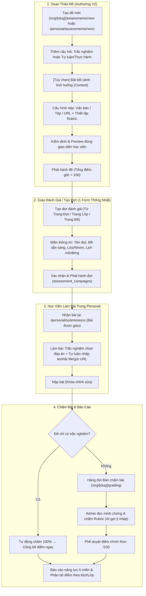

# Kế Hoạch Triển Khai: Đồng Bộ Assessment Authoring V2 & Tối Ưu Toàn Diện Organization Dashboard

> **Căn cứ tài liệu & Quyết định sản phẩm:**
> - Đặc tả tạo đề thống nhất: [`NEXA_ASSESSMENT_AUTHORING_UX_PRODUCT_SPEC.md`](file:///c:/Users/CPS/Downloads/NEXA_ASSESSMENT_AUTHORING_UX_PRODUCT_SPEC.md)
> - Đặc tả kiểm toán & thiết kế Org Dashboard: [`NEXA_ORG_DASHBOARD_UX_AUDIT_REDESIGN_SPEC_2026-11-03.md`](file:///c:/Users/CPS/Downloads/NEXA_ORG_DASHBOARD_UX_AUDIT_REDESIGN_SPEC_2026-11-03.md)
> - Quy chuẩn thương hiệu & giao diện: [`AGENTS.md`](file:///c:/nexa/AGENTS.md) (Light `#FFFFFF`, Dark `#000000`, Cobalt `#2563EB`, chống AI slop, thang điểm `/100`, không số liệu giả).
> - Quyết định phỏng vấn `/grill-me` (03/11/2026):
>   1. Thống nhất thang điểm 100; Trắc nghiệm tự chấm ngay, Tự luận/Thực hành chấm riêng theo Rubric, điểm chưa chấm là `null`/`PENDING`, chỉ kết luận /100 khi chấm xong toàn bộ.
>   2. Thống nhất một luồng Giao đánh giá & Tạo đợt duy nhất dựa trên `assessment_campaigns`, loại bỏ wizard 5 bước, form 1 trang + xác nhận cuối.

---

## 1. Mục Tiêu & Nguyên Tắc Bất Biến

1. **Ba không gian độc lập, một danh tính:**
   - **Personal (`/personal/*`):** Không gian của mọi người dùng (kể cả thành viên tổ chức). Nhận bài được giao, làm bài thi, nộp bài, xem kết quả và lộ trình 5 miền.
   - **Organization (`/org/[slug]/*`):** Bàn điều hành dành riêng cho Admin (`ORG_OWNER`, `ORG_ADMIN`). Thành viên tổ chức không dùng workspace này.
   - **Platform Admin (`/admin/*`):** Quản trị toàn hệ thống nền tảng.
2. **Một hệ thống đề đánh giá duy nhất với 2 loại câu hỏi:**
   - **Trắc nghiệm (`CHOICE` / `MCQ`):** Chọn 1 đáp án đúng, hệ thống tự động đối chiếu và cho điểm ngay khi nộp bài.
   - **Tự luận / Thực hành (`OPEN_RESPONSE` / `PRACTICAL`):** Người học nộp bài bằng văn bản, tệp đính kèm, liên kết URL hoặc kết hợp; người chấm đánh giá theo tiêu chí Rubric; AI chỉ đóng vai trò gợi ý nháp.
   - **Tình huống là bối cảnh tùy chọn (`context`),** không phải loại câu hỏi riêng. Có thể bật bối cảnh ở cả câu trắc nghiệm và câu tự luận.
3. **Thống nhất luồng Giao bài & Đợt đánh giá:**
   - Dùng `assessment_campaigns` làm mô hình dữ liệu chính duy nhất.
   - Giao đề từ Lớp hoặc Sử dụng đề từ Thư viện đề đều mở một form tạo đợt đánh giá tinh gọn (pre-select lớp hoặc đề), loại bỏ wizard 5 bước cồng kềnh.
4. **Bàn chấm bài chuyên nghiệp (Rubric & Evidence Reader):**
   - Hàng đợi chỉ gom các bài thi có câu tự luận/thực hành cần thẩm định (đề 100% trắc nghiệm tự hoàn tất, không đưa vào hàng chờ).
   - Xem toàn bộ minh chứng (file, url, text) và chấm điểm theo Rubric từng tiêu chí.
   - Điểm 0 là điểm hợp lệ, không tự động biến thành 70.
5. **Báo cáo năng lực trung thực:**
   - Lọc theo Đợt (tên Admin tự đặt) và Lớp/Nhóm.
   - Chuẩn hóa điểm /100, phân biệt người và lượt bài. Không tạo biểu đồ xu hướng giả khi dữ liệu các đợt không cùng điều kiện so sánh.

---

## 2. Kiến Trúc Luồng Dữ Liệu (End-to-End Workflow)

---

## 3. Lộ Trình Triển Khai Theo Giai Đoạn (Phased Execution)

### Giai đoạn P0: Vá Các Lỗ Hổng & Điểm Nghẽn Nghiệp Vụ Nghiêm Trọng (Stop-the-line)
1. **Sửa fallback ID giả `a1`, `a2` trong `AssignAssessmentModal.tsx`:**
   - Xóa bỏ hằng số `DEFAULT_ASSESSMENTS` (`a1`, `a2`). Nếu tổ chức chưa có đề sẵn sàng, hiển thị empty state chỉ rõ *"Chưa có đề đánh giá sẵn sàng"* kèm nút *"Tạo đề mới"*.
2. **Sửa lỗi điểm 0 bị biến thành 70 trong Bàn chấm bài:**
   - Tại `OrgGradingClientView.tsx`: Thay `sub.total_score || 70` bằng toán tử nullish coalescing `sub.total_score ?? null`. Điểm 0 phải giữ nguyên là 0.
3. **Sửa query bài nộp đề công khai trong `grading/page.tsx`:**
   - Cho phép hiển thị bài nộp của cả đề nội bộ tổ chức lẫn đề chuẩn công khai được giao trong các đợt/lớp của tổ chức.
4. **Sửa trạng thái đợt đánh giá theo thời gian thực:**
   - Đợt có thời gian bắt đầu trong tương lai phải mang trạng thái `UPCOMING` (Sắp diễn ra), không tự nhận là `ACTIVE`.

### Giai đoạn P1: Nâng Cấp Trình Soạn Thảo Đề (Assessment Authoring V2) & Grading Engine
1. **Chuẩn hóa mô hình kiểu dữ liệu Authoring V2:**
   - Định nghĩa kiểu: `kind: 'CHOICE' | 'OPEN_RESPONSE'`, trường `context?: string` cho bối cảnh tình huống, `submission_modes: ('TEXT' | 'FILE' | 'URL')[]`, và `rubric?: AuthoringRubricCriterion[]`.
   - Bảo toàn tương thích ngược cho các row cũ trong DB (`MCQ`, `SCENARIO`, `PRACTICAL`).
2. **Cải tiến giao diện Editor 2 cột (`AuthoringEditorTwoPane.tsx`):**
   - Bộ chọn thêm câu: Chỉ gồm **Trắc nghiệm** và **Tự luận / Thực hành**.
   - Công tắc *"Thêm bối cảnh tình huống"* trong từng câu hỏi.
   - Cấu hình phương thức nộp (Văn bản / Tệp đính kèm / Liên kết) và Rubric tiêu chí chấm trực quan.
   - Cơ chế kiểm soát điểm: Hiển thị tổng điểm hiện tại `/100`, cảnh báo khi thiếu/thừa điểm, nút *"Tự động cân bằng về 100"*, không tự ý chia lại điểm âm thầm.
3. **Màn hình Preview & Kiểm định (Validation):**
   - Xem trước liên tục toàn bộ đề hỗn hợp đúng như giao diện người học.
   - Kiểm định chặt chẽ: trắc nghiệm tối thiểu 2 đáp án và 1 đáp án đúng; câu mở có ít nhất 1 hình thức nộp và rubric; tổng điểm gốc phải đủ 100 điểm mới được phát hành.
4. **Grading Engine phân tách:**
   - Trắc nghiệm: Tự động chấm ngay khi nộp bài.
   - Tự luận / Thực hành: Gán trạng thái `PENDING`, điểm ban đầu là `null` (không mặc định là 0).
   - Chỉ tính điểm tổng kết bài thi khi tất cả câu hỏi bắt buộc đã được chấm xong.

### Giai đoạn P2: Thống Nhất Luồng Giao Đánh Giá / Tạo Đợt Khảo Thí (1 Form Duy Nhất)
1. **Loại bỏ Wizard 5 bước cồng kềnh:**
   - Thay thế `CampaignWizardClient.tsx` bằng Form tạo đợt 1 trang tinh gọn:
     - Khối 1: Tên đợt do Admin tự đặt & Mô tả.
     - Khối 2: Chọn đề đánh giá đã phát hành.
     - Khối 3: Chọn lớp/nhóm tham gia (kèm số lượng thành viên dự kiến).
     - Khối 4: Lịch mở/đóng bài và ngưỡng đạt (mặc định 70/100, có thể tùy chỉnh).
     - Khối 5: Xem trước tóm tắt & Nút phát hành đợt.
2. **Tích hợp nút "Giao đánh giá" từ trang Lớp & Thư viện đề:**
   - Bấm "Giao đánh giá" từ trang Lớp (`/org/[slug]/classes/[id]`): Mở form tạo đợt với lớp đã được chọn sẵn.
   - Bấm "Tạo đợt từ đề này" từ trang Đề (`/org/[slug]/assessments`): Mở form tạo đợt với đề đã được chọn sẵn.
   - Đồng bộ lưu trữ vào `assessment_campaigns`, không tạo `class_assignments` rời rạc ngoài đợt.

### Giai đoạn P3: Hoàn Thiện Bàn Chấm Bài & Báo Cáo Năng Lực 5 Miền
1. **Bàn chấm bài tổ chức (`/org/[slug]/grading`):**
   - Hàng đợi bài nộp: Chỉ gom các bài có câu tự luận/thực hành cần chấm. Đề 100% trắc nghiệm tự động chuyển trạng thái hoàn thành.
   - Khung đọc minh chứng: Xem được đồng thời văn bản, tệp tải lên (PDF, DOCX...) và URL sản phẩm nộp của học viên.
   - Bảng chấm Rubric: Chấm điểm từng tiêu chí, nhập nhận xét, nút "Phê duyệt điểm".
   - AI Grader: Đóng vai trò đề xuất nháp, Admin duyệt mới thành điểm chính thức.
2. **Báo cáo năng lực tổ chức (`/org/[slug]/analytics`):**
   - Bộ lọc: Lọc theo Đợt đánh giá (theo tên Admin đặt) và Lớp/Nhóm.
   - Dữ liệu 5 miền chuẩn DigComp: Điểm trung bình thật, tỷ lệ đạt, khoảng phân bố điểm.
   - Loại bỏ biểu đồ xu hướng theo kỳ giả mạo và các khối marketing framework nội bộ.
   - Trạng thái chưa có dữ liệu: Hiển thị 1 empty state duy nhất có hướng dẫn tạo đợt, không vẽ 3 card KPI 0% giả.

### Giai đoạn P4: Tối Ưu Hóa Các Trang Còn Lại (Tổng quan, Thành viên, Gói, Cài đặt) & Kiểm Thử
1. **Màn 01 Tổng quan (`/org/[slug]`):**
   - Bố cục định hướng hành động kế tiếp: Trạng thái onboarding thực tế (Đã có thành viên → Đã có đề → Tạo đợt đầu tiên).
   - Danh sách đợt đang diễn ra và các việc chờ xử lý (bài chờ chấm).
2. **Màn 02 Thành viên (`/org/[slug]/members`):**
   - Mặc định là Bảng thành viên toàn chiều rộng.
   - Drawer Thêm thành viên tích hợp: Mời qua Email, Mã gia nhập/Link tham gia, Nhập file CSV.
   - Không hiển thị vai trò `ASSESSOR`/`REPORT_VIEWER` trên giao diện mới.
3. **Màn 08 Gói sử dụng (`/org/[slug]/plan`):**
   - Hiển thị đúng 5 trạng thái lifecycle: Đang cấp quyền, Đang sử dụng, Sắp hết hạn, Chờ gia hạn, Hết hạn.
   - Giải thích rõ ý nghĩa hạn mức và AI Credits, không để trạng thái `0/0` mập mờ.
4. **Màn 09 Cài đặt (`/org/[slug]/settings`):**
   - Nhóm form khoa học: Thông tin tổ chức, Mã gia nhập, Chính sách khảo thí.
   - Trường chỉ đọc (`slug`, `code`) có nút sao chép; feedback lưu rõ ràng.
5. **Kiểm thử toàn diện:**
   - Kiểm tra `typecheck` (0 lỗi).
   - Kiểm tra toàn bộ 47+ test files đạt 100%.
   - Kiểm thử luồng end-to-end: Soạn đề hỗn hợp → Tạo đợt → Personal làm bài → Bàn chấm bài thẩm định → Báo cáo 5 miền.

---

## 4. Tiêu Chí Nghiệm Thu (Acceptance Criteria)

- [x] Không còn bất kỳ mock ID (`a1`, `a2`) hay dữ liệu mẫu nào trên luồng Organization.
- [x] Điểm 0 trong chấm bài không bị ghi đè thành 70.
- [x] Trình tạo đề Authoring V2 hỗ trợ mượt mà 2 loại câu: Trắc nghiệm và Tự luận/Thực hành; tình huống là bối cảnh tùy chọn.
- [x] Điểm trắc nghiệm tự chấm ngay; tự luận/thực hành chờ chấm theo Rubric; điểm chưa chấm hiển thị `null`/`PENDING`.
- [x] Luồng tạo đợt đánh giá gói gọn trong 1 form + xác nhận, liên kết đồng bộ giữa trang Lớp và trang Đợt.
- [x] Học viên làm bài và nhận kết quả 100% trong Personal, không cần Organization Dashboard.
- [x] Toàn bộ kiểm thử unit/integration và build TypeScript đạt 100%.
